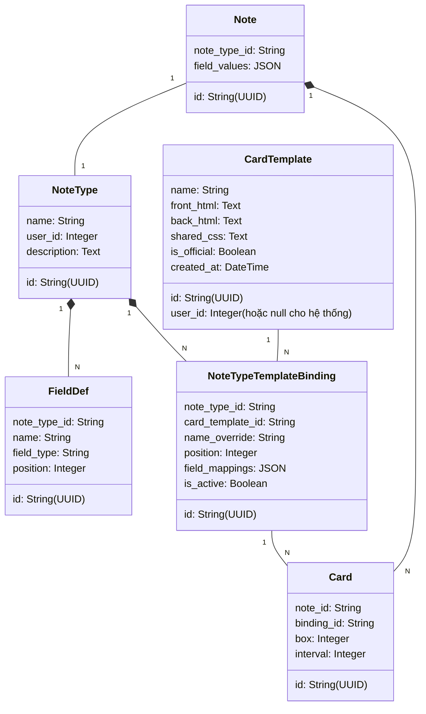

# Đề xuất Kiến trúc: Tách Card Template khỏi Note Type

Tài liệu này trình bày ý tưởng, thiết kế cơ sở dữ liệu và kế hoạch di chuyển dữ liệu cho việc tách biệt hoàn toàn **Card Template (Mẫu thẻ)** ra khỏi **Note Type (Loại ghi chú)** trong hệ thống thẻ nhớ Flama.

---

## 1. Vấn đề của Kiến trúc Hiện tại

Trong kiến trúc hiện tại:
* Một `NoteType` sở hữu trực tiếp một hoặc nhiều `Template` (mối quan hệ 1-N nghiêm ngặt).
* Mỗi `Template` thuộc về duy nhất một `NoteType` qua trường `note_type_id`.
* Mã nguồn HTML/CSS trong template tham chiếu trực tiếp đến tên các trường của `NoteType` đó (ví dụ: `{{Word}}`, `{{Meaning}}`).

### Điểm hạn chế:
1. **Không thể tái sử dụng giao diện**: Nếu người dùng có nhiều Note Type khác nhau (ví dụ: "Từ vựng Tiếng Nhật", "Từ vựng Tiếng Anh", "Thuật ngữ Công nghệ") nhưng muốn dùng chung một phong cách thiết kế giao diện thẻ (Layout, CSS, Hiệu ứng hiển thị), họ phải copy-paste mã HTML/CSS sang từng template của mỗi Note Type.
2. **Khó bảo trì**: Khi cần cập nhật giao diện (sửa lỗi hiển thị, đổi font chữ, tối ưu Dark Mode), lập trình viên hoặc người dùng phải chỉnh sửa thủ công tất cả các template của từng Note Type một.
3. **Ràng buộc cứng trường dữ liệu**: Template không thể hoạt động độc lập vì nó bị gắn chặt với tên trường cụ thể của Note Type chứa nó.

---

## 2. Giải pháp Kiến trúc Đề xuất (Decoupled Templates)

Ý tưởng cốt lõi là biến **Card Template** thành một đối tượng độc lập (Standalone Entity). Một Card Template sẽ chỉ định nghĩa **khung hiển thị (HTML/CSS)** với các biến giữ chỗ (placeholders) trừu tượng. Sau đó, các Note Type có thể liên kết với một hoặc nhiều Card Template thông qua một lớp trung gian (Junction Table) thực hiện việc **ánh xạ trường (Field Mapping)**.

### Sơ đồ Lớp (Class Diagram)



---

## 3. Thiết kế Chi tiết & Cơ chế Ánh xạ (Field Mapping)

### 3.1. Thiết kế Card Template Trừu tượng
Thay vì viết trực tiếp `{{Word}}` hoặc `{{Meaning}}`, một template trừu tượng sẽ dùng các placeholder chung, ví dụ:
* Mặt trước (Front): `{{Placeholder_1}}`
* Mặt sau (Back): `{{Placeholder_1}}<hr>{{Placeholder_2}}`

### 3.2. NoteType-Template Binding (Bảng trung gian)
Bảng `note_type_template_bindings` thiết lập mối quan hệ N-N giữa `NoteType` và `CardTemplate`. Mỗi dòng binding sẽ chứa cấu hình ánh xạ trường dưới dạng JSON (`field_mappings`):

```json
{
  "Placeholder_1": "Kanji",
  "Placeholder_2": "Meaning",
  "Audio_Field": "Audio"
}
```

Khi hệ thống render thẻ, bộ render sẽ thay thế `{{Placeholder_1}}` bằng giá trị của trường `Kanji` trong Note tương ứng.

### 3.3. Lợi ích vượt trội
* **Chia sẻ template**: Một template "Từ vựng tiêu chuẩn" có thể được dùng cho cả Note Type Tiếng Anh (Ánh xạ: `Placeholder_1` -> `Word`, `Placeholder_2` -> `Definition`) và Tiếng Nhật (Ánh xạ: `Placeholder_1` -> `Kanji`, `Placeholder_2` -> `Meaning`).
* **Cập nhật một nơi, áp dụng mọi nơi**: Chỉnh sửa HTML/CSS của `CardTemplate` gốc sẽ ngay lập tức thay đổi giao diện của tất cả các thẻ liên kết trên toàn bộ các Note Type mà không cần sửa từng cái.
* **Hệ thống Template Mẫu (Preset Library)**: Flama có thể cung cấp sẵn một thư viện Card Template đẹp mắt (Layout 2 cột, Layout thẻ âm thanh, Cloze test, vv.) do hệ thống thiết kế. Người dùng chỉ cần tạo Note Type với các trường riêng của họ rồi gắn template mẫu vào và ánh xạ.

---

## 4. Kịch bản Di chuyển Dữ liệu (Migration Plan)

Để nâng cấp hệ thống hiện tại lên mô hình mới mà không làm mất dữ liệu của người dùng, chúng ta thực hiện các bước sau:

### Bước 1: Tạo mới các bảng cơ sở dữ liệu
* Tạo bảng `card_templates` (sao chép cấu trúc từ bảng `templates` cũ nhưng bỏ `note_type_id`).
* Tạo bảng `note_type_template_bindings`.

### Bước 2: Di chuyển dữ liệu mẫu (Data Migration Script)
Viết một script di chuyển dữ liệu tự động thực hiện các thao tác:
1. Duyệt qua từng bản ghi trong bảng `templates` cũ.
2. Với mỗi template, tạo một bản ghi `card_templates` tương ứng (giữ nguyên HTML, CSS và các cấu hình hiển thị).
3. Phân tích HTML của template cũ để tạo cấu hình ánh xạ trường mặc định (do template cũ viết trực tiếp tên trường như `{{Word}}`, cấu hình ánh xạ mới sẽ là `"Word": "Word"`).
4. Tạo bản ghi `note_type_template_bindings` để liên kết `NoteType` cũ với `card_templates` mới bằng cấu hình ánh xạ trên.
5. Cập nhật khóa ngoại `template_id` trong bảng `cards` cũ trỏ sang binding mới (`binding_id`).

### Bước 3: Dọn dẹp
* Xóa bảng `templates` cũ sau khi kiểm tra tính toàn vẹn dữ liệu thành công.

---

## 5. Đánh giá Ưu điểm & Nhược điểm

| Tiêu chí | Kiến trúc mới (Tách biệt) | Kiến trúc cũ (Gắn liền) |
| :--- | :--- | :--- |
| **Khả năng tái sử dụng** | **Rất cao**: Một template dùng cho nhiều Note Type. | **Không có**: Mỗi template gắn chết với 1 Note Type. |
| **Khả năng bảo trì UI/UX**| **Dễ dàng**: Sửa giao diện ở một nơi duy nhất. | **Khó khăn**: Phải sửa từng Note Type riêng biệt. |
| **Độ phức tạp Database** | **Trung bình**: Thêm bảng liên kết binding trung gian. | **Thấp**: Chỉ có liên kết 1-N đơn giản. |
| **Trải nghiệm người dùng** | **Tốt hơn**: Dễ dàng áp dụng giao diện mẫu có sẵn. | **Bình thường**: Phải tự viết lại code giao diện. |

---

## 6. Kết luận & Khuyến nghị

Việc tách biệt **Card Template** khỏi **Note Type** là một cải tiến kiến trúc cần thiết để đưa Flama tiệm cận với khả năng tùy biến mạnh mẽ giống như Anki Connect, đồng thời mở ra hướng phát triển **Thư viện Giao diện Thẻ mẫu (Template Marketplace)** giúp người dùng bình thường dễ dàng tiếp cận và tạo ra các bộ thẻ đẹp mắt mà không cần biết viết mã HTML/CSS.

Khuyến nghị triển khai mô hình này trong giai đoạn tiếp theo của quá trình tái cấu trúc flashcard domain.
