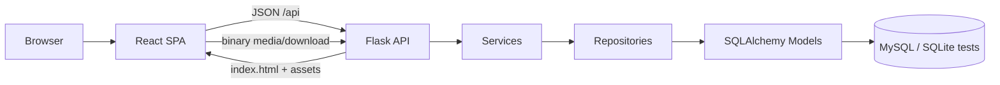

# Flama System Architecture

## Tổng quan

Flama gồm hai runtime tách biệt theo trách nhiệm:

- React SPA trong `frontend/` sở hữu toàn bộ HTML và UI.
- Flask trong `app/` cung cấp REST API, session/CSRF, binary media/download, CLI và startup maintenance.

`wsgi.py` vẫn là entry point duy nhất cho local, Docker và Gunicorn. Flask không còn cấu hình thư mục Jinja và không render server-side template.

## Luồng runtime



### Navigation và HTML

- Mọi GET giao diện được `app/spa.py` trả về `frontend/dist/index.html`.
- React Router xử lý deep-link, trang 404, auth guard và permission guard phía giao diện.
- Permission thật luôn được kiểm tra lại tại REST endpoint.
- `frontend/dist` được tạo trong frontend build stage của Dockerfile.
- Không còn thư mục `templates/`, Jinja filter, Jinja context processor hoặc HTML error page phía Flask.

### REST API

- Public namespace canonical là `/api`.
- Blueprint chính được đăng ký từ `app/api/`; package `app/api/v1/` là boundary nội bộ, không đưa version vào URL.
- JSON dùng `snake_case`; lỗi dùng envelope `error`, `message` và các trường tùy chọn như `field`, `details`.
- SPA dùng Flask-Login session, `credentials: same-origin` và CSRF token lấy từ `GET /api/session`.
- Các adapter cũ chỉ được bật trong `TESTING`; production trả `410 LEGACY_ENDPOINT_REMOVED` và yêu cầu dùng namespace `/api`.

### Ngoại lệ không phải JSON resource

- `/api/mcp`: JSON-RPC protocol.
- PayOS webhook: callback có signature và idempotency riêng.
- `/media/*`, `/static/js/card_renderer_host.js`, download và QR endpoints: binary delivery.
- SPA shell và frontend assets.

## Các lớp backend

- `app/api/`: parse HTTP, auth/permission guard và response mapping.
- `app/services/`: orchestration, transaction ownership và business rules.
- `app/repositories/`: query/persistence, không sở hữu response HTTP.
- `app/validators/`: validate và normalize request/business input.
- `models/`: SQLAlchemy models canonical.
- `app/routes/`: adapter chuyển tiếp, protocol/binary delivery và compatibility endpoints còn lại.

Đích kiến trúc cho mutation là:

```text
REST route -> application service (transaction owner) -> repository -> model
```

## Flashcard renderer

`render_template_pair()` trong `app/services/flashcard_renderer.py` không phải Jinja. Đây là compiler/sanitizer cho cú pháp card `{{Field}}`, conditional và media proxy. Output được React render trong iframe sandbox thông qua `static/js/card_renderer_host.js`; asset này được giữ lại có chủ đích.

## Startup và dữ liệu

`create_app()` vẫn khởi tạo extension, đăng ký model/blueprint/CLI và chạy startup maintenance. Startup có side effect schema compatibility, seed role/TTS và logical-overlay clone cutover; thay đổi frontend không được bỏ qua các bước này.

Shared deck install tiếp tục dùng logical overlay:

- Không copy source Note/Card cho learner.
- Clone edit ghi vào các bảng `DeckClone*`.
- Media tiếp tục đi qua sanitizer, CSP và `/media/proxy/<asset_id>`.
- Scheduler/timezone/day-boundary vẫn thuộc service/repository hiện có.

## Chạy và kiểm tra

- Local: `flask --app wsgi.py run --host=0.0.0.0 --port=4789`
- Production: `gunicorn --bind 0.0.0.0:4789 wsgi:app`
- Frontend: `cd frontend && npm run check`
- Backend focused: `python -m unittest tests.test_rest_only_runtime tests.test_api_v1_route_map tests.test_rest_api_v1`
