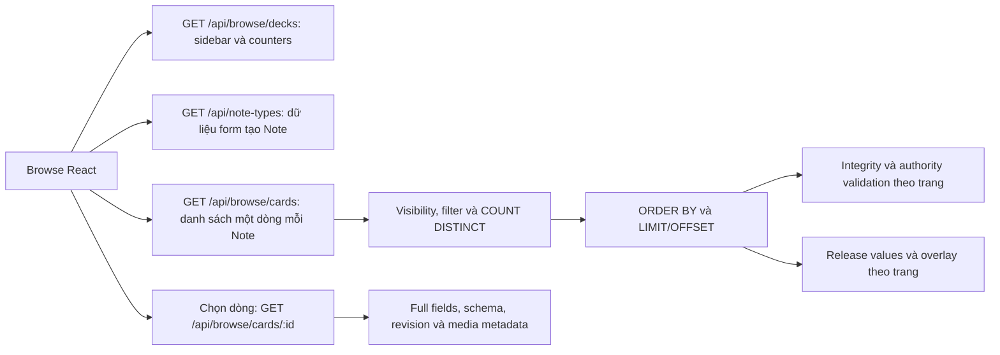

# Browse: dữ liệu, JOIN và hiệu năng

Ngày: 2026-10-24, Asia/Tokyo. Chế độ: INVESTIGATE. Baseline: HEAD `67084f60` và working tree tại thời điểm khảo sát. Không sửa application code, schema hay dữ liệu. Các thay đổi có sẵn của phiên làm việc khác được giữ nguyên.

## 1. Kết luận

Browse đã giảm tải dư so với trước, nhưng **vẫn còn tải dư và truy vấn tốn kém**. Không thể kết luận “bây giờ không còn thừa dữ liệu”.

Ba điểm cần ưu tiên:

1. Danh sách toàn collection phải chạy `COUNT DISTINCT` trên presentation và xếp hạng theo Note trước khi lấy trang. Trên MySQL local, count vượt giới hạn 5 giây của probe ở cả hai tài khoản khảo sát. Giảm 500 xuống 100 dòng không giải quyết bước này.
2. Search clone dựng SQL lặp các biểu thức checkpoint, release change và override cho từng field/install. Một mẫu toàn collection tạo câu count dài **1.862.434 ký tự**, rồi bị ngắt sau hơn 5 giây thực thi.
3. Frontend gọi `/api/note-types` đầy đủ ngay khi mở Browse. Nó lấy HTML/CSS template, metadata marketplace và taxonomy dù form tạo Note chỉ dùng ID, tên và field definitions. API `compact=1` đã có sẵn và đủ các trường mà form đang đọc.

Các JOIN phục vụ quyền truy cập, nội dung release và progress riêng của learner có lý do nghiệp vụ. Cần tối ưu hình dạng truy vấn và dữ liệu được tải; không đánh giá chất lượng chỉ bằng số bảng JOIN.

## 2. Phạm vi và phương pháp đo

- Đọc React → REST API → service → repository → ORM, đối chiếu lịch sử Git.
- MySQL local **8.0.40**, migration head `20261020_000071`; không chạy SQLite, migration, seed hoặc restore.
- Inventory: 41.624 Notes, 36 study applications, 111.743 presentation aliases, 45.607 progress subjects, 5.579 decks, 28 installs, 30.834 release checkpoints, 164.259 release changes. Có 0 note-field overrides trong DB này; nhánh nhiều override chưa được benchmark.
- Tài khoản A (`user_id=1`): 39.338 Notes sở hữu. Tài khoản B (`user_id=20`): 7 release installs. Cả hai được gọi với `admin_mode=False` để khảo sát luồng learner; không đại diện Browse của admin đăng nhập thực tế.
- Dùng `create_audit_app()` tắt maintenance; mỗi case có app/request context và session riêng. Chặn SQL ngoài SELECT/SHOW/EXPLAIN trong bước khảo sát; chỉ SET hai giới hạn ở session probe. Rollback sau mỗi case. Locking SELECT của implementation vẫn được giữ.
- `MAX_EXECUTION_TIME=5000`, `innodb_lock_wait_timeout=2`, timezone `Asia/Tokyo`. Ngưỡng 5 giây do probe đặt, **không phải timeout cấu hình sẵn của ứng dụng**.
- Thời gian dưới đây là gọi service cộng xử lý/serialize payload trong process local; không gồm HTTP, đăng nhập, tải JS hay render React. Mỗi case đo một lần, cache không được kiểm soát, không phải p50/p95. Không dùng chênh lệch giữa hai mẫu để khẳng định speedup ổn định.
- `cursor_execute_ms` trong evidence đo DBAPI execute, không tách đầy đủ fetch/ORM/compile. Phần còn lại của elapsed không được gọi là “CPU Python”. EXPLAIN là estimate, không phải actual rows; thời gian EXPLAIN được loại khỏi elapsed.

Evidence đã lọc bỏ nội dung Note, tên người dùng, credentials và SQL parameters: [JSON kết quả](BROWSE_PERFORMANCE_DATA_REVIEW_2026-10-24.evidence.json). Probe local: `.tmp/browse_review_20261024.py` (scratch, không phải script runtime).

| Mẫu | Kết quả | SQL statements | Thời gian service |
|---|---|---:|---:|
| A, toàn collection, 100 dòng | Count chạm ngưỡng 5 giây; chưa lấy trang | 9, gồm câu lỗi | 5,65 giây |
| A, toàn collection, 500 dòng | Count chạm ngưỡng 5 giây; chưa lấy trang | 9 | 5,33 giây |
| B, toàn collection, 100 dòng | Count chạm ngưỡng 5 giây; chưa lấy trang | 53 | 5,28 giây |
| B, toàn collection, 500 dòng | Count chạm ngưỡng 5 giây; chưa lấy trang | 53 | 5,17 giây |
| A, một deck 118 Notes, trang 20/100 dòng | Đúng 118 tổng, trả 20/100 | 24 / 24 | 775 / 301 ms |
| B, một deck 118 Notes, trang 20/100 dòng | Đúng 118 tổng, trả 20/100 | 36 / 36 | 265 / 303 ms |
| B, deck đó, sort word, 100 dòng | Trả 100 | 38 | 674 ms |
| B, deck đó, search từ không tồn tại | Trả 0 | 26 | 1.512 ms |
| A, sidebar `/browse/decks` | 1.534 deck, JSON khoảng 639 KB | 13 | 3.432 ms |
| B, sidebar `/browse/decks` | 290 deck, JSON khoảng 122 KB | 16 | 4.715 ms |
| A, `/note-types` full → compact | Cùng 6 note types; 247.402 → 17.523 bytes | 66 → 3 | 568 → 16 ms |
| B, `/note-types` full → compact | Cùng 3 note types; 47.410 → 10.850 bytes | 25 → 3 | 64 → 10 ms |

Bytes là UTF-8 từ cùng một cách `json.dumps`, chưa nén; không phải HTTP transferred size. Bản compact có ít dữ liệu hơn, không phải cùng toàn bộ response contract. Kết quả số statement bằng nhau khi tăng page size chỉ được xác nhận cho hai deck trên, không chứng minh mọi scope có số query cố định.

## 3. Màn hình gọi gì, vào lúc nào?

Ba query decks/note-types/cards được khai báo độc lập khi mount, tùy cache React Query. Bootstrap dùng query riêng và có thể đã cache. Search debounce 400 ms, mặc định 100 dòng/trang, tối đa 500. Khi đổi trang/filter/sort, query key thay đổi; `keepPreviousData` giữ kết quả cũ trong lúc chờ. Detail chỉ enabled khi có `activeCardId`; sample detail phục vụ TTS/local audio chỉ enabled khi mở modal và chưa chọn card.

Evidence: `frontend/src/features/browse/hooks/useBrowseState.ts:302-425`; `frontend/src/main.tsx:11-18` có staleTime 30 giây và tắt refetch khi focus. Đây không phải mô tả màn hình tải lại mọi dữ liệu ở mỗi render.

## 4. Các bảng JOIN và vì sao

Không có một câu SQL duy nhất JOIN tất cả bảng dưới đây. Phân biệt JOIN trong SQL chính, EXISTS/correlated subquery, và các SELECT batch/lazy kế tiếp.

### 4.1 Danh sách thông thường

| Bảng/nguồn | Cách truy cập | Lấy gì và mục đích |
|---|---|---|
| `notes` | Trong derived presentation và JOIN lại bằng `Card.note_id == Note.id` | Identity, owner, deck, note type, values, tags, revision/timestamps; lọc quyền và dựng preview |
| `study_applications` | JOIN với Note theo note type; JOIN thêm trong ranked subquery | Note được trình bày qua template nào; ACTIVE; chọn một preview theo default/position/ID |
| `card_presentation_aliases` | LEFT JOIN theo `(note_id, application_id)` | Giữ danh tính/thời điểm lịch sử và các cặp presentation tồn tại trước cutover |
| `card_presentation_cutover_notes` | EXISTS/NOT EXISTS trong presentation | Phân biệt Note gốc và Note mới để bảo toàn membership lịch sử |
| `card_presentation_cutover_applications` | EXISTS/NOT EXISTS | Phân biệt application gốc và application mới; không tạo lại cặp đã bị xóa trước cutover |
| `study_progress_subjects` | LEFT JOIN theo learner + logical Note key | Queue, due anchors, suspended/buried; lọc trạng thái và sort; không có current progress được đọc như NEW |
| `decks` | Query scope trước danh sách; thêm LEFT JOIN khi `sort_by=deck` | Tên, cây, quyền truy cập và lựa chọn deck/subdeck |
| `note_types`, `field_defs` | SELECT batch qua `selectinload`; thêm schema identity lookup khi đọc owned values | Tên type, thứ tự/kiểu field, ánh xạ ID sang nhãn và chọn word/reading/meaning |
| `templates` | SELECT batch, chỉ ID và tên cho list | Dựng `template`/`card_type` trong serializer; frontend bảng hiện tại không hiển thị các trường này |

`Card` **không còn là bảng `cards` vật lý**. `card_presentations` là tên subquery SQLAlchemy dựng từ `notes × study_applications`, không phải persisted MySQL VIEW. Một lần “query Card” đã kéo theo các quan hệ lịch sử trên. Không có bảng riêng cho `Word`, `Reading`, `Meaning`: đây là preview suy ra từ các text fields theo thứ tự schema.

Query chọn preview dùng `ROW_NUMBER() OVER (PARTITION BY note_id ORDER BY is_default DESC, position, application_id)`, rồi lọc cặp `(note_id, application_id)` của hạng 1. Ranking được đặt trên scope đã lọc để giữ những Note mà presentation default toàn note type không còn visible.

Evidence: `models/card.py:158-220`; `app/services/browse_card_service.py:368-477,763-826`; `app/repositories/browse_card_repository.py:319-365`; `app/repositories/vocabulary_repository.py:400-429,473-520`.

### 4.2 Các đọc bổ sung phục vụ tính nhất quán

| Bảng | Vì sao đọc |
|---|---|
| `users` | Shared learner fence trước khi đọc authority |
| `study_authority_enrollments` | Xác nhận NOTE authority/epoch hợp lệ; không tự tạo enrollment |
| `study_authority_storage_profile` | Xác nhận profile runtime hỗ trợ |
| `user_scheduler_settings` | Timezone/day boundary và runtime scheduler settings |
| `scheduler_presets` | Options của các deck xuất hiện trong trang, nếu deck có preset |
| `study_progress_subjects`, đọc lại | Integrity của page; phân loại pristine/stateful; tải/khóa full state, decode/hash/project kiểm tra parity |

Trong hai deck đo được, list thực hiện **8 locking SELECT**: hai lần bộ fence ba câu và hai lần đọc subject có `FOR UPDATE`. Không phải 8 query cho mỗi dòng. Tổng số câu có đề cập `study_progress_subjects` là 5, gồm count/page JOIN, integrity, classification và full-state load.

Evidence: `app/services/browse_card_service.py:826-865`; `app/repositories/study_authority_repository.py:347-399`; `app/services/study_note_pristine_service.py:34-84`; `app/services/study_authority_read_service.py:245-349`; `app/services/study_session_authority_pin_service.py:141-253`.

### 4.3 Riêng deck cài từ marketplace

| Bảng | Vì sao cần |
|---|---|
| `deck_installs` | Learner cài bộ nào, local root, source owner, applied release, overlay revision |
| `deck_clone_deck_maps` | Ánh xạ source deck sang local deck; đọc source nhưng hiển thị local name/options |
| `deck_releases` | Phiên bản nội dung đã cài; không dùng bản tác giả đang sửa |
| `deck_release_entity_memberships` | Note/field có thuộc release đó không, đã bị remove ở sequence nào |
| `deck_release_note_checkpoints` | Nội dung Note ở checkpoint để khôi phục release values |
| `deck_release_changes` | Schema/field history và các thay đổi nội dung sau checkpoint tới applied release |
| `deck_clone_note_field_overrides` | Phần learner tự sửa; ưu tiên hơn nội dung release |
| `deck_clone_field_def_overrides` | Learner đổi tên/kiểu/vị trí hoặc tắt source field |
| `deck_clone_added_field_defs` | Field thêm riêng của install |
| `deck_clone_field_order_overrides` | Thứ tự field riêng |
| `deck_clone_added_notes` | Xác định local Note và field thuộc install khi search canonical values |

Giá trị hiển thị là **release đã cài + delta của learner**; snapshot legacy dùng nội dung source theo compatibility path. Lấy thẳng source live có thể nhanh hơn nhưng trả sai phiên bản và bỏ các chỉnh sửa cá nhân. Không được giải quyết bằng copy toàn bộ source Notes sang learner.

Search/sort word còn đưa các bảng release/override vào correlated expressions trong SQL trước pagination. Sau khi lấy trang, service batch-load overrides và release values chỉ cho Note IDs của trang để dựng preview. Schema được cache theo request/install.

Sidebar counters của clone còn sử dụng `deck_release_template_pins` để xác định presentation membership. Bảng này không xuất hiện trong SQL list của các mẫu đã đo. Điều đó không có nghĩa hai đường đọc tương đương ở mọi trạng thái pin/retirement.

Evidence: `app/services/browse_card_service.py:481-735,865-952`; `app/repositories/browse_card_repository.py:123-275`; `app/services/share/overlay.py:323-395,508-664`; `app/services/deck_release_service.py:561-737`; `app/services/deck_aggregation_service.py:58-123`.

### 4.4 Dữ liệu khác khi mở màn/editor

- `/browse/decks`: đọc deck scope; distinct Note deck/type; tên note type; installs/maps; aggregate Note availability. Trả flat decks, counts và mixed-note-type metadata.
- `/note-types` full: `note_type_installs`, `note_types`, `field_defs`, `study_applications`, `templates`, `users`, và taxonomy. Mẫu A có `taxonomy_domains`, `taxonomy_subjects`, `taxonomy_frameworks`, `taxonomy_framework_levels`, `taxonomy_options`, `taxonomy_subject_option_maps`. Compact chỉ đọc ba bảng đầu.
- Detail đọc `media_assets` và trả metadata/proxy URLs cho editor/upload. List hiện không tải `media_assets` theo từng dòng. Không nên gán chi phí media detail vào query danh sách.

Evidence: `app/repositories/vocabulary_repository.py:523-608,771-908`; `app/services/flashcard_content_service.py:84-143`; `app/services/marketplace_query_service.py:51-151`; `app/repositories/browse_card_repository.py:306-333`.

## 5. Dữ liệu nào thực sự cần cho UI?

| Nhóm | Dữ liệu cần | Dùng ở đâu / giới hạn |
|---|---|---|
| Danh sách | `card_id`, `note_id` | Chọn dòng, mở detail, batch actions; card ID là presentation key, note ID là content identity |
| Preview | `word`, `reading`, `meaning` | Ba cột nội dung; cần schema/values để suy ra, không phải ba cột DB cố định |
| Học | `status`, `due_label` | Hai cột trạng thái/đến hạn; queue và due anchors cần cho tính toán/filter/sort backend |
| Ngữ cảnh deck | `deck_id` | Chọn deck đích cho worksheet/create/action fallback; không chỉ dùng để in tên |
| Pagination | `page`, `total`, `pages` | Footer và kéo page về trang cuối khi xóa; không được bỏ total mà không điều chỉnh UI contract |
| Sidebar | ID/name/path/parent, total/new/learn/due | Cây deck, tìm deck, badges và các bộ lọc |
| Nghiệp vụ theo deck | note type IDs/names, `has_mixed_note_types` | Chọn schema và chặn công cụ batch không hỗ trợ mixed types |
| Tạo Note | NoteType ID/name và `field_defs` | Dựng form và validate; không đọc template HTML/CSS/marketplace pricing |
| Editor | Full typed values, field definitions, tags/deck, revisions, media metadata | Chỉ cần khi chọn Note; revision bảo vệ concurrent editing; array phải giữ JSON list |
| Response list hiện dư với Browse đã kiểm tra | `card_type`, `note_type`, `note_type_id`, `template`, `queue`, `due_at`, `updated_at`, `tags`, `deck_name`, `has_next` | Không thấy read property trong feature Browse hiện tại; nhiều trường vẫn có vai trò nội bộ backend hoặc có thể có caller API khác. Phải audit các client trước khi thu gọn contract |

Các trường backend cần để kiểm tra quyền/integrity không tự động phải gửi ra browser. Ngược lại, không thể kết luận toàn bộ JSON field values là dư chỉ vì bảng hiện ba preview: thuật toán đang duyệt các text fields không rỗng theo thứ tự và có fallback cho các type tùy biến.

Evidence: `frontend/src/features/browse/types.ts:22-60,76-107`; `components/BrowseCardTable.tsx:53-106`; `components/BrowseDeckSidebar.tsx:140-194`; `components/BrowseCardCreateForm.tsx:48-98`; `pages/BrowsePage.tsx:68-113`; `hooks/useBrowseState.ts:332-361,435-458,560-579` (các đường frontend tương đối với `frontend/src/features/browse/`).

## 6. Vì sao ngày xưa thừa mà bây giờ ít hơn?

Phải phân biệt trùng dòng, tải dư, và dữ liệu được giữ cho mục đích khác nhau:

| Mốc có bằng chứng Git | Trước | Hiện tại và lý do |
|---|---|---|
| `cc657c25`, 12/10 | Card vật lý và các lớp progress/projection cũ | Card là presentation suy ra; progress runtime thuộc một learner/Note subject. Giảm fan-out khi thêm template, đổi lại truy vấn presentation có thêm quan hệ/cutover predicates |
| `886ad3bf`, 13/10 | Integrity preflight có thể phủ collection | Integrity/hash/state validation giới hạn page hiện trả; count tổng vẫn phủ filtered scope |
| `033dd94a`, 14/10 | Một Note có nhiều templates có thể hiện nhiều dòng | Mặc định một preview/Note; `all_templates=1` cho diagnostic. Bộ chọn hiện tại dùng ranking trên tập visible, không còn nên mô tả bằng default application chung của note type |
| `1eca44cb`, 16/10 | Tài liệu cũ mô tả values keyed bằng field name | Store live hiện là `notes.field_values_by_id` + `field_values_extras`; `Note.field_values` là property ánh xạ ra tên. ID mapping cần thêm schema lookup để giữ identity khi rename |
| `4f5b2726`, 20/10 | Tải mọi live deck toàn hệ thống rồi lọc Python | Chỉ đọc owned/note-holding/install descendants/live ancestors của learner; request cache tránh tải lại trong cùng request |
| Cùng commit 20/10 | Clone không có override vẫn có thể query từng Note, chạm media và dựng schema nhiều lần | Batch overrides, truyền `[]` khi không có; không đọc media cho list; reuse schema và settings |
| Cùng commit 20/10 | JOIN Note rồi `selectinload(Card.note)` đọc lại Note; trả cả flat decks và nested tree | `contains_eager` reuse JOIN; load ít cột type/template hơn; `/decks` chỉ trả flat list |

Ví dụ: một Note có ba presentation trước có thể hiện ba dòng cùng nội dung. Nay hiện một dòng, còn các presentation vẫn có danh tính và mục đích học khác nhau. Đây là thay đổi đơn vị hiển thị, không phải bằng chứng mất hai Notes.

Nếu “bây giờ không” nghĩa là thiếu dữ liệu trên màn: kiểm tra `page/per_page`, scope owner/install, release membership, application ACTIVE, một dòng/Note và suspension. `status=all` vẫn áp dụng `active_progress_expr` để lọc suspended; Browse hiện không truyền `today_day_index` nên nhánh predicate này chưa áp dụng bộ lọc buried. Sidebar có quy tắc active/burial riêng; `total` và các bucket new/learn/due không nhất thiết cùng tập. Flag `STUDY_NOTE_COUNT_ENABLED` còn quyết định đếm Note hay presentation ở counters. Cần đối chiếu Note ID cụ thể mới kết luận thiếu dữ liệu. Điểm khác biệt burial này được ghi nhận từ code, chưa thay đổi hành vi trong pha nợ kỹ thuật.

## 7. Findings và hướng xử lý

### F1 — P1: đếm tổng và chọn preview phủ toàn scope trước pagination

- **Observed:** Count giữ nguyên derived Card, visibility/progress predicates và ranked subquery. Sau đó query page lại thực hiện các điều kiện đó. `per_page` không giới hạn count.
- **Evidence:** `browse_card_service.py:763-826`; `browse_card_repository.py:336-365`. Mẫu A/B toàn collection đều chạm 5 giây ở count. Count A dài 63.992 ký tự; plan có temporary table, filesort, materialized `browse_note_previews`; subject lookup đã dùng `uq_sp_subject_user_note`.
- **Nguyên nhân:** API chuyển sang Note-grain nhưng vẫn lấy presentation-grain làm query nền; để giữ đúng visible preview, phải ranking rồi deduplicate. Danh sách ID deck lớn được lặp trong nhiều nhánh SQL.
- **Impact:** Người dùng chưa thấy trang đầu dù chỉ yêu cầu 100 dòng. Số query ít không chứng minh nhanh.
- **Hướng xử lý để kiểm chứng:** Thử count theo Note identity bằng cùng visibility predicates; tách chọn ID/preview nhẹ khỏi hydrate full Note; đo lại count và page riêng. Giữ exact total và visible-pair semantics. Chỉ cân nhắc cache/delay count sau khi định rõ invalidation và UI contract.
- **Unknowns:** Chưa có p95 production hay actual rows/loops. Không quy toàn bộ lỗi cho window: diagnostic bỏ dedup của A vẫn mất 6,29 giây tổng (count 1,79 giây + page 4,08 giây); B vẫn timeout count.

MySQL xác nhận window subquery không được merge và phải materialize; điều đó giải thích một phần plan, không tự chứng minh window là nguyên nhân duy nhất. [MySQL window optimization](https://dev.mysql.com/doc/refman/8.0/en/window-function-optimization.html).

### F2 — P1: search/sort clone làm biểu thức SQL phình theo field × install

- **Observed:** Mỗi effective field dựng các correlated SELECT riêng cho checkpoint, operation, value và overlay. Search OR qua tất cả field; visibility và biểu thức được lặp trong ranked/outer query. Bản no-match vẫn chạy count rồi query page.
- **Evidence:** `browse_card_repository.py:123-301`; `browse_card_service.py:576-735`. B toàn collection search có 102 statements trước failure, SQL count 1.862.434 ký tự. Một deck chỉ 118 Notes có count khoảng 247 nghìn ký tự và page khoảng 248 nghìn; trả rỗng vẫn mất 1,51 giây. Sort word page khoảng 98 nghìn ký tự.
- **Nguyên nhân:** Đẩy search/sort vào SQL để pagination đúng sau overlay là hợp lý; nhưng operation/value và checkpoint resolution chưa được chia sẻ, nên AST và câu SQL lặp lớn. Search substring không có đường seek rõ ràng cho effective values.
- **Impact:** Tăng compile/parse/execution cost; search ít hoặc không có kết quả vẫn nặng. Không được lấy source live hoặc lọc sau LIMIT để giảm chi phí: sẽ sai kết quả/trang.
- **Hướng xử lý để kiểm chứng:** So sánh phương án resolve một tập effective fields có thể reuse trong query với correlated expressions hiện tại; tách owned/installed scope khi có lợi. Chưa chốt index/search schema mới trong review này.
- **Unknowns:** DB local không có note-field override; chưa đo nhiều release histories, nhiều added fields hay page sâu. Chưa tách thời gian SQLAlchemy compile khỏi các chi phí client khác.

Expression sort và multi-table order có thể cần filesort; không thể bảo đảm chỉ thêm due/word index là đủ. [MySQL ORDER BY optimization](https://dev.mysql.com/doc/refman/8.0/en/order-by-optimization.html).

### F3 — P2: tải full NoteType phục vụ form chưa mở

- **Observed:** Query note types không có `enabled` theo chế độ create và không dùng compact. Full serializer query template applications lại theo từng type và dựng taxonomy.
- **Evidence:** `useBrowseState.ts:320-323`; `flashcard_content_service.py:84-143`; `marketplace_query_service.py:73-151`. A: 66 statements/247 KB; compact: 3/17,5 KB. B: 25/47,4 KB; compact: 3/10,9 KB.
- **Nguyên nhân:** Browse reuse API đầy đủ cho màn quản lý/marketplace thay vì contract form. Eager loading ban đầu không chặn serializer chạy repository query riêng.
- **Impact:** Tăng thời gian mount, DB work và payload. Đây là tải dư có bằng chứng ở implementation hiện tại.
- **Hướng xử lý nhỏ:** Dùng `compact=1`, với query key riêng theo response shape; cân nhắc enabled khi create. Giữ `field_defs`; `summary=1` không tự động thay thế được. Không đổi payload dưới key chung `['note-types']` nếu caller khác cần full data.
- **Unknowns:** Mức giảm cold HTTP/JS chưa đo; một số phiên đã có cache query dùng chung nên không phải lần vào Browse nào cũng gọi network.

### F4 — P2: list reuse authority reader đầy đủ của Study

- **Observed:** Sau JOIN queue/due và integrity page, list lấy authority full-state, khóa subject, decode state, kiểm hash, project parity và dựng state-version. Cuối cùng `_authority_progress_view()` chỉ giữ queue/due_at/due_day.
- **Evidence:** `browse_card_service.py:316-323,828-865`; `study_authority_read_service.py:245-349`; `study_session_authority_pin_service.py:141-253`. 8 locking statements trong các page có state đo được.
- **Nguyên nhân:** Reuse contract mạnh của Study để fail closed khi progress evidence hỏng hoặc đổi authority giữa request. Tính đúng được giữ nhưng list trả ít dữ liệu hơn reader dựng.
- **Impact:** Thêm I/O/CPU và khả năng chờ nhau với review cùng learner/Note. Không phải nguyên nhân đã đo của count timeout: full reader chưa chạy ở các case timeout đó.
- **Hướng xử lý để kiểm chứng:** Đo riêng authority phase; đánh giá reader chuyên cho Browse, giữ page integrity, state/hash parity và snapshot consistency. Không xóa lock/validation chỉ để giảm số query.
- **Unknowns:** Chưa chạy tải đồng thời, chưa chứng minh lock wait production. Locking reads giữ row locks tới cuối transaction theo [MySQL locking reads](https://dev.mysql.com/doc/refman/8.0/en/innodb-locking-reads.html).

### F5 — P2: sidebar aggregate và scope vẫn có chi phí toàn collection

- **Observed:** `/browse/decks` aggregate lại counters của toàn cây. `/browse/cards` vẫn collect toàn bộ deck accessible của learner để xây scope/map trước khi lọc deck đã chọn. Request cache không chia sẻ giữa hai HTTP request. Khi không chọn deck, clone scope resolver lặp theo install; mỗi install lại đọc ancestors/subtree/map/release.
- **Evidence:** `browse_card_service.py:208-313,452-550`; `vocabulary_repository.py:617-743`; `share/overlay.py:350-395,1046-1050`; `deck_tree_query.py:195-240`. B có 7 installs: 53 statements tới count; cùng một selected clone deck có 36 statements cho cả trang đã hydrate.
- **Nguyên nhân:** Scope resolution ban đầu được viết cho từng deck/install; cache chỉ trong request; counters phải đúng cả subtree/mixed types. Frontend cần flat list cho sidebar và dropdown nên mặc định đọc toàn cây.
- **Impact:** Sidebar mẫu A/B mất 3,43/4,72 giây và có payload lớn. Chọn deck nhỏ vẫn trả chi phí scope toàn learner; A vẫn có distinct deck query quét tập Notes của learner trước khi query 118 Notes.
- **Hướng xử lý để kiểm chứng:** Batch install/deck-map metadata, reuse cây đã scope trong request; đánh giá cache counters/scope có revision và day-boundary invalidation. Không dùng cache dashboard mặc nhiên: scope Browse còn bao gồm deck đang giữ Notes của learner và có contract khác.
- **Unknowns:** Chưa đo nhu cầu lazy tree/search server-side, độ sâu cây khác hoặc cache freshness chấp nhận được. Counters là phần chậm nhất quan sát trong sidebar, không phải rebuild cây Python.

### F6 — P3: serializer list và client contract chưa khớp tối thiểu

- **Observed:** List preload Template name và serialize nhiều thuộc tính bảng không đọc. Selected detail có query riêng, nên full media/editor payload không cần ở list. Ngược lại Note query vẫn tải full live value JSON, kể cả source values của release clone mà formatter cố ý không decode.
- **Evidence:** `browse_card_repository.py:319-333`; `vocabulary_repository.py:473-520`; `browse_card_service.py:930-952`; `BrowseCardTable.tsx:53-106`; `types.ts:22-60`.
- **Nguyên nhân:** DTO dùng chung mang dấu vết màn card browser cũ, còn UI hiện dùng Note preview. ORM entity hydration rộng hơn projection mà màn cần.
- **Impact:** Có I/O/payload dư; nhưng bỏ vài string response khó giải quyết count nhiều giây. Với Notes lớn, full JSON source có thể đáng kể dù chỉ tải theo page.
- **Hướng xử lý để kiểm chứng:** Audit mọi caller `/browse/cards`, rồi thu hẹp DTO/query columns; ưu tiên không tải source working values cho pinned clone nếu reader vẫn cần Note metadata. Không hard-code ba field names vì schema tùy biến, nested array và fallback display còn hợp lệ.
- **Unknowns:** Chưa có phân bố kích thước Note JSON và các client ngoài React Browse. Chưa kết luận số bytes có thể tiết kiệm an toàn ở API công khai.

### F7 — P2 hành vi: sort deck dùng tên source thay vì tên local hiển thị

- **Observed:** `sort_by=deck` ORDER BY `Deck.name` JOIN từ `Note.deck_id`; với clone đó là source deck. Row được remap sang local deck/name sau pagination.
- **Evidence:** `browse_card_service.py:769-775,939-950,1641-1650`.
- **Nguyên nhân:** Bổ sung overlay ở bước dựng response nhưng sort SQL vẫn theo identity source.
- **Impact:** Nếu local deck được đổi tên, thứ tự theo tên có thể không khớp tên trả về. Là parity issue cần giữ khi tối ưu, không phải bottleneck đã benchmark. Bảng hiện tại không render cột deck, nhưng API hỗ trợ sort này.
- **Hướng xử lý để kiểm chứng:** Tạo fixture local/source khác tên, kiểm tra thứ tự và page boundaries; thống nhất effective deck expression trước khi thay query.
- **Unknowns:** Chưa tái hiện trên dữ liệu local đổi tên; nhận định dựa trên luồng code, không khẳng định người dùng đã gặp.

## 8. Thứ tự thực hiện và tiêu chí nghiệm thu đề xuất

1. Lấy full-collection count/page làm baseline; thử query Note-grain/count và hydrate theo ID, giữ một preview trên visible set. Không coi bật `all_templates=1` là bản sửa.
2. Làm compact/lazy note types như thay đổi nhỏ riêng; khóa query key/contract và kiểm form create.
3. Giảm SQL lặp trong clone effective-field search/sort; so sánh đúng pinned release + local overrides trước/sau.
4. Batch scope metadata/counters và đo lại sidebar; sau đó mới cân nhắc cache với invalidation rõ ràng.
5. Profile authority phase và render 500 dòng trước khi quyết định đổi reader hoặc virtualize. Row đã có `memo`; chưa có browser profile để coi React là nút thắt.

Cần đo tối thiểu: count ms, page SQL ms, hydrate/authority/overlay ms, bytes nén/chưa nén, statement count theo page size và theo install/deck count; p50/p95 HTTP dưới workload thực. So sánh trang đầu/trang sâu, owned/release/snapshot, search có/không kết quả, due/word/deck sort, admin/learner và concurrent review.

Correctness gates: không lộ foreign Notes; không bỏ pinned content/local deltas; không sửa source; giữ nested JSON arrays và field identity; default/retired/cutover presentation membership; parity nullable due anchors/timezone/day boundary; count/list units; 409 khi authority diverged; sửa Note không mất unsaved draft. Frontend changes phải theo FSD và bảo toàn giao diện gốc.

## 9. Giới hạn và tài liệu cũ

- Không chạy regression suite vì chỉ tạo báo cáo/evidence; các test được đọc là bằng chứng mục tiêu coverage, không phải test pass trong phiên này. `tests/test_browse_query_bounds.py` kiểm số statement phẳng và scope equivalence trên SQLite memory; không chứng minh thời gian/plan MySQL. Probe local bổ sung bằng chứng thực tế và không thay thế correctness suite.
- Chưa kiểm HTTP/browser, không tuyên bố đã làm Chrome DevTools profiling hoặc Core Web Vitals. Chưa kiểm production, p95/load, pinned-retired parity, snapshot fallback có dữ liệu thật, overrides dày hoặc index changes.
- `docs/architecture/STUDY_BROWSE_PERFORMANCE_REVIEW.md` là snapshot 13/10; lỗi nullable due anchors ghi trong đó đã có phần sửa cuối tài liệu, không báo lại như lỗi mới.
- `docs/architecture/BROWSE_FIELDS_REVIEW.md` ngày 13/10 mô tả live values keyed bằng tên field; không còn đúng store live sau cutover 16/10. API editor vẫn nhận/hiện tên qua boundary projection.
- Nhiều dữ liệu hơn không luôn có nghĩa sai thiết kế: alias/cutover giữ identity lịch sử, release giữ nội dung immutable, overlay giữ sửa riêng, progress giữ state learner. Dữ liệu dư để tối ưu là phần tải/dựng mà đường đọc hiện tại không sử dụng, hoặc công việc được tính lặp quá rộng.
