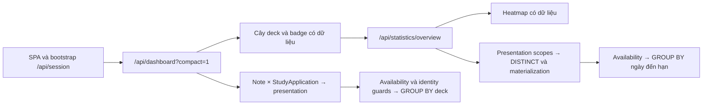

# Điều tra dashboard production chậm — 2026-10-13

> Mode: INVESTIGATE | Engine: MySQL 8.0.46 | Timezone báo cáo: Asia/Tokyo
> Production: `fb685882099d20d90479d234402ae3b098076f89`, migration `20261012_000062`
> Evidence: [JSON đã loại bỏ dữ liệu nội dung và credentials](artifacts/dashboard_production_investigation_20261013.json)

## 1. Kết luận và phạm vi

Điểm nghẽn được xác nhận nằm ở các truy vấn tổng hợp presentation/progress. Trên dữ liệu của learner 1, dashboard xử lý **113.680 presentation từ 39.336 Note**, dù badge đang đếm theo Note. Heatmap dựng lại tập presentation và nhiều lớp bảng tạm trước khi gom lịch đến hạn. Cache tổng hợp dashboard chưa hoạt động; MySQL buffer pool chỉ **128 MiB**, kèm lượng đọc đĩa lớn trong các cửa sổ đo.

Frontend tải heatmap sau dashboard. Vì vậy, thời gian hai API cộng dồn trước khi cả cây deck và heatmap có dữ liệu. Spinner toàn trang chỉ đợi bootstrap/dashboard; heatmap có trạng thái loading riêng.

| Phép đo | Dashboard | Overview/heatmap |
|---|---:|---:|
| HTTPS loopback qua Nginx → Gunicorn thật, 2 mẫu | 3.288–4.293 s | 3.882–4.180 s |
| Flask audit trên code/data đang deploy, 3 mẫu | 3.743–5.264 s | 4.073–4.486 s |
| Tỷ lệ SQL trong audit | 95.5–97.5% | 98.8–99.0% |
| SQL nặng nhất trong audit | 3.433–4.805 s | 3.693–4.068 s |
| Số SQL/request trong audit | 10–11 | 9 |

Session trên process phục vụ thật chỉ mất **8.3–14.5 ms**. Cặp dashboard → overview trong hai vòng HTTPS loopback mất khoảng **7.17 s** và **8.47 s**, chưa bao gồm mạng người dùng, tải frontend và paint.

Không sửa application code, cấu hình production, schema hoặc dữ liệu; không restart service. Audit dùng `create_audit_app()`, vô hiệu startup maintenance, đặt `@@transaction_read_only=1`, chặn SQL ngoài nhóm đọc/điều khiển transaction, giới hạn SELECT 45 s. HTTP probe dùng GET session/dashboard/overview, giữ cookie chẩn đoán trong bộ nhớ, không gửi timezone để tránh cập nhật profile.

## 2. Dữ liệu và nguồn sự thật

| Dữ liệu | Vai trò | Nguồn và đường đọc |
|---|---|---|
| `notes` | Nội dung và ownership; learner 1 có 39.336 Note | `models/note.py`; dashboard/presentation scope |
| `study_applications` | 34 application ACTIVE trên database tại lúc đo | `models/study_application.py`; NoteType → presentation |
| `card_presentation_aliases`, cutover membership | Bảo toàn identity lịch sử và các cặp presentation hợp lệ | `models/card.py:161`; không được bỏ membership guards tùy tiện |
| `Card` | SQLAlchemy read model dẫn xuất, không còn bảng `cards` vật lý | `models/card.py:165`, `models/card.py:194` |
| `study_progress_subjects` | Availability/progress canonical; learner 1 có 39.336 subject | `models/study_progress_subject.py`; `note_analytics_read_repository.py` |
| `review_events` | Lịch sử bất biến; learner 1 có 119.341 event | `models/review_event.py`; historical heatmap/streak |
| `deck_study_count_snapshots` | Cache dẫn xuất có revision/policy/day validation; hiện 0 row | `models/deck_count_snapshot.py:49`; snapshot service/prewarm |
| React Query | Cache dữ liệu trong vòng đời ứng dụng; stale time 30 s | `frontend/src/main.tsx:11`; dashboard query không được persist qua reload |

Runtime phục vụ: `wsgi.py → create_app() → canonical /api`, Gunicorn **2 worker × 4 thread**, `gthread`, timeout 120 s. `STARTUP_RUN_MAINTENANCE=0`; process đang chạy từ 2026-10-12, không quan sát thấy cold boot hoặc worker timeout trong mẫu log.

## 3. Luồng tải thực tế

Dashboard: `app/api/v1/analytics/routes.py:42` → `analytics_read_transaction()` → `rest_api_service.build_dashboard_payload()` → `dashboard_service.build_dashboard_data()` → snapshot resolver/raw `aggregate_deck_study_counts()`.

Overview: `app/api/v1/analytics/routes.py:77` → `build_stats_overview()` → historical aggregates và `_canonical_future_due_day_counts()` → `query_canonical_future_due_day_counts_mysql()` → presentation scope và canonical Note availability.

Frontend gate đã xác nhận cả trong source repo và **source map của bundle public hiện tại** (`DashboardPage-qvSNLytu.js`): `enabled: Boolean(dashboardQuery.data) && !dashboardQuery.isFetching`. Nguồn: `frontend/src/features/dashboard/hooks/useDashboardPage.tsx:29`. Bundle frontend trên VPS có hash khác frontend public; không dùng URL chunk cũ trên frontend public làm bằng chứng tải asset.

## 4. Findings

### F1. Dashboard luôn tổng hợp raw vì cache chưa được đưa vào vận hành

- **Observed:** Effective audit config `DECK_COUNT_WRITE_ENABLED=false`, `DECK_COUNT_READ_MODE=raw`; `REVIEW_ANALYTICS_WRITE_ENABLED=false`, `REVIEW_ANALYTICS_READ_MODE=raw`. Timer/service `flama-analytics-counts` inactive, snapshot table rỗng.
- **Evidence:** Đọc environment/service trên VPS, effective config từ audit factory; `app/services/deck_count_snapshot_service.py:135`; `deploy/flama-analytics-counts.service:15`.
- **Potential concern:** Code có cache nhưng mỗi GET hiện vẫn chạy raw aggregate; reload không hưởng React Query cache từ lần mở trước.
- **Impact:** Query đếm vài giây được chạy lại trên đường tải trang. Historical review rollup chỉ giúp phần historical, không trực tiếp loại bỏ truy vấn future-due đang chiếm phần lớn overview.
- **Unknowns:** Chưa kiểm tra coverage của mọi writer/invalidation, backfill và parity để đủ điều kiện bật summary. Không bật flags trong cuộc điều tra.

### F2. Đếm theo Note nhưng SQL mở rộng toàn bộ presentation trước

- **Observed:** `STUDY_NOTE_COUNT_ENABLED=true`. Aggregate dùng `COUNT(DISTINCT note_id)` trên scope Note × application. `EXPLAIN ANALYZE` ghi nhận **113.680 row**, **115.863 lần lookup Note theo PRIMARY**, **113.680 lần lookup alias**, **113.680 lần canonical subject lookup** và **113.680 lần identity probe**.
- **Evidence:** `models/card.py:161–188`; `app/services/deck_aggregation_service.py:157–235`; `app/repositories/note_analytics_read_repository.py:69`; JSON `explain_analyze`.
- **Potential concern:** Availability/identity ở mức Note được đọc lặp lại theo presentation. Query còn join lại `Note` bên ngoài read model vốn đã có Note.
- **Impact:** SQL nặng nhất mất 3.43–4.80 s trong audit. Tree load chỉ khoảng 40–121 ms; metadata fallback khoảng 182–191 ms. Một bulk SQL thống trị latency, dù tổng số SQL/request thấp.
- **Unknowns:** Chưa benchmark một query thay thế giữ đúng cutover membership, release pins, multi-template counts, clone scope và integrity guards. Không kết luận toàn bộ chậm đi do retirement: snapshot 2026-10-04 dùng code/data khác và chỉ có 39.284 Card.

### F3. Overview tốn phần lớn thời gian ở future-due và bảng tạm

- **Observed:** Future-due mất khoảng **3.70–4.09 s** trong ba audit mẫu; historical yearly aggregate khoảng **247–284 ms**, active-day/streak khoảng **57–100 ms**. Actual plan dựng tập 113.680 presentation, deduplicate/materialize nhiều lần, rồi mới lọc thành 42.968 availability row và 34 bucket ngày.
- **Evidence:** `app/repositories/stats_query_repository.py:35`, `:63`, `:170`; `app/repositories/note_analytics_read_repository.py:126`; overview actual plan trong JSON.
- **Potential concern:** `UNION ALL`, hai lớp `DISTINCT` và integrity expression tạo nhiều lớp trung gian. Plan overview mất khoảng **2.919 s** để materialize `learner_cards`; aggregate cuối kết thúc khoảng **3.716 s**. Đây là thời gian lồng nhau, không cộng các node với nhau.
- **Impact:** Heatmap thêm khoảng 4 s sau dashboard ngay trên origin. Tối ưu historical review riêng sẽ chỉ chạm phần nhỏ latency được đo.
- **Unknowns:** Chưa có A/B parity cho query giản lược. Hai lookup `live_note_id`/`logical_note_key` có mục đích integrity riêng; không bỏ một lookup hoặc release/clone guards chỉ dựa trên plan.

### F4. Bộ nhớ MySQL nhỏ đi kèm lượng đọc đĩa lớn

- **Observed:** Buffer pool `134217728` byte = **128 MiB**; máy có 7.9 GiB RAM, khoảng 5.36 GiB available lúc bắt đầu, load average `0.39/0.15/0.05`, không có row-lock wait tại các snapshot quan sát. Các bảng notes/progress/alias và indexes đã lớn hơn buffer pool; riêng notes data khoảng 108.7 MiB, subject data 58.6 MiB, alias data/index khoảng 78.2 MiB.
- **Evidence:** MySQL variables, information_schema inventory và global counters. Trong cửa sổ dashboard: **33.558 buffer misses, 555.270.144 byte đọc** (~529.5 MiB). Trong cửa sổ overview: **30.848 buffer misses, 507.510.784 byte đọc** (~484.0 MiB).
- **Potential concern:** Working set cạnh tranh trong pool nhỏ, các query presentation/progress/history có thể liên tục làm mất cache của nhau. Các phép đo lặp nhanh vẫn đọc đĩa nhiều, nên không phải một trạng thái warm cache hoàn toàn.
- **Impact:** Chi phí I/O góp phần vào latency nền và biến thiên sau thời gian không truy cập. Đây là cơ chế phù hợp với việc lần mở đầu chậm hơn, nhưng chưa định lượng riêng cold-cache penalty.
- **Unknowns:** Counters là global, có thể gồm traffic khác. Chưa có benchmark tăng pool, disk latency/concurrency profile, hoặc phân bổ bộ nhớ toàn workload. Không flush cache hoặc sửa MySQL configuration.

Theo [MySQL Buffer Pool](https://dev.mysql.com/doc/refman/8.0/en/innodb-buffer-pool.html), dữ liệu được giữ trong pool có thể phục vụ các lần đọc sau từ bộ nhớ. [Derived Table Optimization](https://dev.mysql.com/doc/refman/8.0/en/derived-table-optimization.html) mô tả `DISTINCT`/`UNION` có thể ngăn merge và dẫn tới materialization; actual plans ở đây xác nhận các lớp bảng tạm đó.

### F5. Lần mở đầu phải đi qua các API nối tiếp; log xác nhận khoảng chờ dài

- **Observed:** Chuỗi completion mới nhất trước khi điều tra, tất cả HTTP 200: session **19:58:20.004 JST**, dashboard **19:58:34.477**, overview **19:58:42.075**. Gap tương ứng **14.473 s** và **7.598 s**. Trong 24 giờ trước probe có 34 dashboard 200 và 33 overview 200; không tìm thấy QueuePool timeout, worker timeout hoặc traceback theo bộ lọc điều tra.
- **Evidence:** Journal Gunicorn và frontend gate; `frontend/src/features/dashboard/pages/DashboardPage.tsx:40`; `frontend/src/main.tsx:14`.
- **Potential concern:** Cache React Query rỗng khi mở/reload ứng dụng; heatmap còn đợi dashboard hoàn tất. Log Nginx/Gunicorn hiện không có duration/upstream timing.
- **Impact:** Backend nền khoảng 7–8.5 s cho hai API nối tiếp; query/I/O biến thiên và mạng/tải trang có thể kéo cảm nhận lên 15 s hoặc hơn. Cây deck có thể hiện trước khi heatmap hoàn tất.
- **Unknowns:** Gap completion không phải duration một request: bao gồm thời điểm frontend phát request, mạng và scheduling. Không dùng 14.473 s để tuyên bố SQL riêng đã chạy 14.473 s, hoặc để phân bổ chính xác toàn bộ 15 s.

### F6. Asset/auth không phải điểm nghẽn chính trong mẫu đã đo

- **Observed:** Session origin 8–15 ms. Public main JS 99.148 byte gzip, dashboard JS 10.418 byte gzip, `CF-Cache-Status=HIT`, thời gian fetch tương ứng khoảng 108/97 ms. Các shared asset được kiểm tra có cache immutable; một mẫu có latency khoảng 683 ms.
- **Evidence:** HTTP origin samples và asset public HTTP probes trong ngày; public bundle/source map xác nhận gate. Các số byte origin JSON là 335.015/dashboard và 53.023/overview, chưa nén ở Nginx.
- **Potential concern:** Cold browser vẫn cần tải/evaluate JS, namespace i18n và dựng DOM; chưa đo main-thread/paint của trình duyệt người dùng.
- **Impact:** Bằng chứng hiện ưu tiên xử lý SQL/I/O. Cloudflare có gzip cho public responses, nên không xem byte JSON origin là byte download thực tế của browser.
- **Unknowns:** Chưa có authenticated browser waterfall, DOM/paint profile, kết nối lạnh hoặc phép đo mạng trên đúng lượt người dùng báo 15 s.

## 5. Thứ tự xác minh tiếp theo

1. Đo A/B read-only cho scope/count và future-due để giảm expansion, repeated Note joins, repeated integrity checks và bảng tạm. Giữ nguyên Note/Card units, cutover membership, clone/release và timezone semantics; so sánh cùng transaction snapshot trước khi chọn cách sửa.
2. Kiểm tra working set và benchmark thay đổi buffer pool trong điều kiện có rollback/giới hạn bộ nhớ rõ ràng. Đối chiếu buffer misses và latency thay vì chỉ nhìn tổng RAM máy.
3. Audit writer/invalidation coverage rồi backfill, parity-check và canary summary/prewarm cho dashboard. Kiểm tra rõ historical rollup không giải quyết trực tiếp future-due hiện tại.
4. Bổ sung duration cho request/upstream và chụp authenticated cold-browser waterfall để định lượng chính xác lượt 15 s. Nếu dùng Chrome, bắt buộc profile riêng theo AGENTS.md.

Đây là các hướng cần kiểm chứng, không phải rollout hoặc thay đổi schema đã được chọn.

## 6. Giới hạn và validation

- Ba audit samples, hai origin HTTPS samples và SELECT `EXPLAIN ANALYZE`; không phải p95/load test. Queries đều thành công HTTP 200; audit kiểm tra `transaction_read_only=1`.
- Không kiểm soát database caches, traffic cạnh tranh hay máy/network người dùng; không tạo cold cache bằng restart/flush.
- Source repo và release production có HEAD khác nhau; chẩn đoán SQL chạy trực tiếp trên release production, frontend gate được xác minh riêng trên bundle public.
- Snapshot performance ngày 2026-10-04 chỉ là bối cảnh lịch sử, không phải phép đo trước/sau đồng nhất.
- Không chạy suite ứng dụng vì không có sửa application behavior. Kiểm tra JSON parse, paths/line references, chỉ các file báo cáo mới, và `git diff --check` cho các artifact thêm vào.
- Các sửa đổi Study/Browse và frontend đang có trong workspace thuộc công việc khác, được giữ nguyên.
