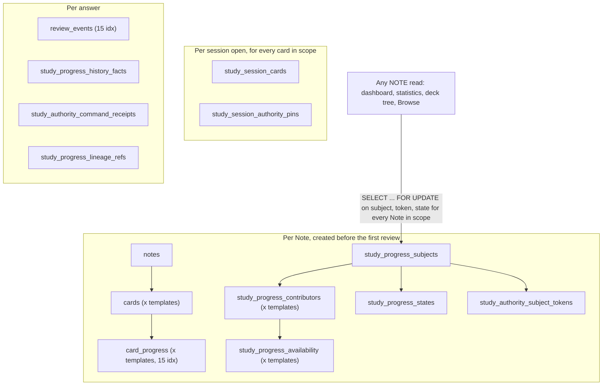

# Database Architecture Scalability Review (post-decoupling, NOTE authority)

> Date: 2026-09-29 | Mode: INVESTIGATE | Engine: MySQL 8.0.46 (disposable, default configuration)
> App under test: `develop` at `7ccd1de` with the post-R1 production flags from [P5 runbook](../runbooks/P5_NOTE_AUTHORITY_RUNBOOK.md) §1, served by Gunicorn with the flags in [`deploy/flama.service`](../../deploy/flama.service)
> Companion: [learner-path query review](./DATABASE_QUERY_PERFORMANCE_INVESTIGATION_2026-09-29.md) (LEGACY, SQLite). Harness and raw results: [`artifacts/db_load_test_2026-09-29/`](./artifacts/db_load_test_2026-09-29/)

## 1. Verdict

The post-decoupling NOTE authority stack does not survive real learners on the current code and deployment. The limits come from how the authority model is used at runtime, not from missing indexes, and they show up with a single learner on an idle database:

1. **A learner with a 2,000-card deck waits 22 s to open a study session, 7 s for the dashboard, and 12 s for statistics.** Every NOTE read path takes exclusive row locks on 3 rows per Note in scope (6,000 locks for 2,000 Notes) through the write-side authority fence.
2. **Eight concurrent learners freeze the whole application.** Session opens take 72 s (above nginx's default 60 s proxy timeout, so users get 504), and an unrelated `GET /api/health` waits up to 71 s. At 16 learners, 5 of 16 could not even log in within 60 s.
3. **Half of the answer commits were lost to deadlocks between different learners** at 4 and 8 concurrent users. The deadlocks come from a check-then-insert gap lock on `study_progress_lineage_refs`.
4. **A new learner who imports a deck pays about 36 ms per Note on the first session open** (2,000 Notes = 73 s in one request). Once R1 is applied, every new account starts in NOTE (`STUDY_NEW_LEARNER_NOTE_ENABLED=1`).
5. **27 % of concurrent sign-ups failed with HTTP 500** (8 of 30 in bursts of 10) because of a gap-lock deadlock on `study_authority_enrollments`.
6. **Per-session scaffolding outgrows the real data.** After 31 session opens, `study_session_cards` (72 MB) and `study_session_authority_pins` (26 MB) are the two largest tables. Nothing deletes them.

The Phase 5 design says the load, lock and latency limits "are not yet known" and must be set by synthetic concurrency before enablement ([cutover design §3, §6](./phase-5-authority-cutover-design-2026-09-20.md)). The R1 runbook moves that rehearsal out of scope ([runbook §6](../runbooks/P5_NOTE_AUTHORITY_RUNBOOK.md)) and enrolls every learner at once because production has 18 accounts. Whether R1 has already been applied on the VPS is not recorded in the repo. This review is that missing rehearsal, run on synthetic data.

## 2. Test setup

| Item | Value |
|---|---|
| MySQL | 8.0.46, stock settings: `innodb_buffer_pool_size` 128 MB, `max_connections` 151, `REPEATABLE-READ`, `innodb_lock_wait_timeout` 50 s. Production `my.cnf` is not in the repo (needs verification). |
| Schema | 101 tables from the current models (`db.create_all()`), matching the model-declared indexes. |
| Data | 20 learners. Each has a root deck, 10 child decks, one 3-field note type, one template, and 2,000 Notes/Cards, and is enrolled in NOTE (the R1 end state). |
| Flags | `STUDY_WIRE_V4_ENABLED=1`, `STUDY_NEW_LEARNER_NOTE_ENABLED=1`, `STUDY_PROGRESS_SHADOW_WRITE_ENABLED=1`, `STUDY_ASYNC_BATCH_ENABLED=0` (commits run synchronously in the web request). |
| App server | `gunicorn --workers 2 --threads 4 --worker-class gthread --timeout 120`; pool `DB_POOL_SIZE=4`, `DB_MAX_OVERFLOW=1`, `DB_POOL_TIMEOUT_SECONDS=5` (defaults in `app/settings.py:114-123`). |
| Load | Each virtual learner repeats the SPA loop: `POST /api/study/sessions` (v4, root deck), answer 50 new cards client-side, `POST .../commit` (`study-commit.v3`), then `GET /api/dashboard` and `GET /api/statistics/overview`. A bystander calls `GET /api/health` every 0.5 s. |
| Host | 4 vCPU, 15 GB RAM, app, MySQL and driver on the same host (no network latency, which favors the app). Production VPS size needs verification. |

## 3. Measurements

### 3.1 One learner, idle database (2,000-card deck)

| Request | Time | SQL statements | Notes |
|---|---|---|---|
| Open study session (v4) | **22.3 s** | 18,049 | 4.1 MB JSON snapshot, 2,000 `study_session_cards` + 2,000 pins inserted |
| Commit 50 answers (sync NOTE) | 2.1–4.2 s | 1,364 | ~27 statements per answer |
| Reopen after the 50-answer rollover | 22.5 s | 18,049 | the SPA reopens after every rollover (`useStudySession.ts:654-667`) |
| Dashboard | **7.3 s** | 6,046 | |
| Statistics overview | **11.7 s** | 10,024 | |
| Browse deck tree | 7.6 s | 6,050 | |
| Browse card list | 5.5 s | 4,088 | |

A single study cycle (open + commit + dashboard + statistics) costs 44 s of server time and 35,766 statements.

### 3.2 New learner's first session on an imported deck

| Deck size | First open | Second open |
|---|---|---|
| 500 Notes | 19.0 s, 15,524 statements | 4.7 s, 4,024 statements |
| 2,000 Notes | **72.9 s**, 62,030 statements | 17.7 s, 16,030 statements |

Cost is linear, about 31 statements and 36 ms per never-studied Note, all in one transaction.

### 3.3 Concurrent learners (distinct accounts, one cycle each)

| Learners | Open p50 / p95 | Commit p50 / p95 | Commits failed | Dashboard p50 | Statistics p50 | Bystander `/api/health` p95 / max | InnoDB deadlocks |
|---|---|---|---|---|---|---|---|
| 1 | 22 s / 22 s | 2.1 s | 0 / 1 | 7.5 s | 11.7 s | 0.01 s / 0.01 s | 0 |
| 4 | 38 s / 39 s | 2.7 / 3.8 s | **2 / 4** (409, deadlock) | 13 s | 19 s | 0.06 s / 0.12 s | 2 |
| 8 | **72 s / 73 s** | 5.3 / 7.4 s | **4 / 8** | 26 s | 40 s | **35 s / 71 s** | 4 |
| 16 | 73 s / **151 s** | 8.8 / 37 s | 2 / 11 | 30 s | 46 s | 1.4 s / 72 s | 2 |

At 16 learners, 5 of 16 logins timed out at 60 s, so only 11 learners completed a cycle. Throughput saturates at about 3.3 study cycles per minute (≈165 answers/min system-wide) regardless of added users; the extra load only turns into latency. With nginx's default `proxy_read_timeout` of 60 s ([`deploy/flama.nginx.conf`](../../deploy/flama.nginx.conf) sets none), every request above 60 s reaches the user as a 504 while the server keeps working on it. Gunicorn's `--timeout 120` does not bound request time with `gthread` workers (no `WORKER TIMEOUT` was logged even at 151 s).

### 3.4 Concurrent sign-ups

Three bursts of 10 simultaneous `POST /api/auth/register`: 9/10, 6/10, and 7/10 succeeded. The other 8 returned `500 {"error":"DB_ERROR","message":"Could not create the user."}` with 8 InnoDB deadlocks, all on `study_authority_enrollments` `PRIMARY` (`lock_mode X` gap vs `insert intention`).

### 3.5 Storage

| Table | Rows | Size | Per unit |
|---|---|---|---|
| `study_session_cards` | 55,817 | 72.3 MB | ~2.3 MB per session open (2,000 cards) |
| `study_session_authority_pins` | 59,097 | 25.6 MB | ~0.8 MB per session open |
| `study_progress_contributors` | 20,552 | 30.0 MB | 1.5 KB per Card |
| `study_progress_states` / `_subjects` / `_availability` / tokens / `card_progress` | ~21,000 each | 47 MB together | |

Progress metadata for a Note that was never studied is about 3.8 KB across 6 tables, 2.4 times the Note and Card content (1.6 KB). The whole database was 222 MB after this test, already larger than the default 128 MB buffer pool (535 free pages left).

## 4. How the post-decoupling data model is exercised



The Phase 5 design chose the "promote existing subject + separate state + token, with a lossless per-Card legacy projection" alternative and flagged its cost: "extra writes per sibling Card" and "one extra small token row/lock per NOTE transition" ([cutover design §3](./phase-5-authority-cutover-design-2026-09-20.md)). The measurements show the cost is dominated by where the fence is applied (all Notes in scope, on reads too) rather than by the per-transition writes.

## 5. Findings

### A1. NOTE reads take the write fence on every Note in scope

- **Observed**: dashboard, statistics, Browse deck tree, and Browse card list call `load_study_authority_card_reads` (`app/services/study_authority_read_service.py:203-252`). It classifies the Notes and then calls `lock_study_session_authority_subjects`, which selects the subjects `FOR UPDATE` (`study_session_authority_pin_service.py:185-196`) and, per Note, `lock_study_authority_subject`: `SELECT token ... FOR UPDATE` and `SELECT state ... FOR UPDATE` (`study_authority_repository.py:234-262`). It creates a missing token with an INSERT (`create_token_if_missing` defaults to true).
- **Evidence**: call-site attribution on MySQL: dashboard 2,000 × token lock + 2,000 × state lock + 2,000 lazy `SELECT notes` (`dashboard_service.py:265-277`); statistics adds 2,000 × `user_scheduler_settings` and 2,000 × `decks` from a per-card `resolve_deck_options` (`stats_overview.py:170-182`); deck tree (`browse_card_service.py:210-223`) and Browse list (`browse_card_service.py:783`) show the same pattern.
- **Potential concern**: a GET holds about 6,000 exclusive locks for 7–12 s, which blocks the same learner's commits and session opens (and any second tab) and turns every page view into O(Notes) round trips.
- **Impact**: the 7–12 s single-user page loads in §3.1 and the 26–46 s loads under concurrency in §3.3.
- **Unknowns**: whether any reader actually needs a locked, CAS-grade view. The design (§4) asks reads to use "a dedicated repository/evaluator"; it does not require exclusive locks.

### A2. The session model snapshots and pins the whole scope, and the SPA repeats it every 50 answers

- **Observed**: `open_study_session` loads every card in scope up to `MAX_SESSION_CARDS = 5000` (`study_session_service.py:131, 573-577`), locks every Note's authority rows (line 629), and inserts one `study_session_cards` row and one `study_session_authority_pins` row per card (lines 899-929). The per-card loop still lazy-loads `notes` and `media_assets` and re-reads `decks` and `user_scheduler_settings` (companion report F1). The SPA commits every `DEFAULT_STUDY_BATCH_EVENT_LIMIT = 50` events (`studySessionEngine.ts:50, 390`) and then opens a new snapshot (`useStudySession.ts:654-667`).
- **Evidence**: §3.1 (18,049 statements, 4.1 MB response, 22 s) and §3.5 (3.1 MB of new rows per open).
- **Potential concern**: cost scales with deck size rather than with what the learner studies today, and it is paid again every 50 answers.
- **Impact**: session opens dominate server time. At 8 concurrent learners they exceed the 60 s proxy limit.
- **Unknowns**: production scope sizes and daily answer counts per learner.

### A3. Eager materialization of never-studied Notes inside the request

- **Observed**: `materialize_pristine_notes` (`study_note_pristine_service.py:120-156`) runs on the first session open for every pristine Note in scope: a `SELECT cards ... FOR SHARE` plus about 30 writes per Note (card_progress, subject, contributor, state, availability, token), all in the open request's transaction. CLI enrollment does the same for an existing learner's whole collection.
- **Evidence**: §3.2 (36 ms and 31 statements per Note; 2,000 Notes = 73 s). Seeding 20 learners through `stage_note_authority_enrollment` took about 70 s per learner.
- **Potential concern**: a new learner who imports a typical Anki deck (several thousand Notes) cannot open it within the 60 s proxy limit. Retries start the work over, and parallel retries contend on the same learner's locks (`innodb_lock_wait_timeout` 50 s). The rows also precede any study (§3.5: 3.8 KB per never-studied Note).
- **Impact**: first-run failure for exactly the new users the platform wants to onboard.
- **Unknowns**: whether the client retries automatically after a 504, and actual import sizes.

### A4. Check-then-insert gap locks deadlock different learners

- **Observed**:
  - `finalize_study_authority_evidence` reads `study_progress_lineage_refs WHERE contributor_id IN (...) FOR UPDATE` (`study_authority_evidence_service.py:383-395`) and then inserts new lineage refs. On a Note's first review there are no rows, so REPEATABLE READ locks the gap on `uq_sp_lineage_ref`. Contributor ids are allocated in increasing order, so different learners' first reviews share gaps near the end of the index.
  - New-account enrollment (`enroll_new_learner_note_authority`, `study_authority_enrollment_service.py:496-533`, called from `auth_service.py:27`) selects the missing enrollment row `FOR UPDATE` (lines 228-232) and then inserts it. Concurrent sign-ups all take the supremum gap lock and then deadlock on insert.
  - The same pattern held a 70 s gap lock during a CLI enrollment and made an unrelated learner's enrollment fail with `1205 Lock wait timeout exceeded`.
- **Evidence**: `SHOW ENGINE INNODB STATUS` deadlock sections in §3.3 and §3.4 (`lock_mode X locks gap before rec` vs `insert intention waiting` on `uq_sp_lineage_ref` and on `study_authority_enrollments.PRIMARY`).
- **Potential concern**: the fence design assumes per-learner isolation, but gap locks cross learner boundaries.
- **Impact**: 50 % of 50-answer commits lost at 4–8 concurrent learners (the learner sees a 409 and must redo the answers); 27 % of concurrent sign-ups fail. The error body also returns the raw SQLAlchemy/pymysql exception text to the client (`"error":"e3q8"` payloads), which leaks SQL details.
- **Unknowns**: deadlock frequency once the lineage table is densely populated; the enrollment deadlock remains for every burst of new sign-ups.

### A5. Deployment capacity has no headroom for multi-second requests

- **Observed**: 8 request threads in total (2 processes × 4 `gthread` threads, and the Python work in each process is serialized by the GIL), 5 DB connections per process, nginx default 60 s proxy timeout, stock MySQL settings in the repo. Requests of 7–73 s occupy threads long enough that health checks and logins queue behind them.
- **Evidence**: §3.3 bystander latency and login timeouts.
- **Potential concern**: raising workers alone moves the bottleneck to MySQL locking (A1, A4) and to the 128 MB buffer pool, which is already smaller than the test database.
- **Impact**: one heavy learner degrades everyone; about 8 active learners stop the site.
- **Unknowns**: production VPS vCPU/RAM, MySQL `innodb_buffer_pool_size`, and whether Cloudflare proxies the API (its 100 s limit would also apply).

### A6. Per-session tables grow without bound

- **Observed**: `study_session_cards` and `study_session_authority_pins` receive one row per card in scope per open (A2), with 6 and 1 secondary indexes. No retention exists (the only deletes are content and deck deletion).
- **Evidence**: §3.5.
- **Impact**: at about 3 MB per open for a 2,000-card deck, a learner doing 200 answers a day adds about 13 MB a day, 1.3 GB a day per 100 such learners, which also degrades the buffer pool hit rate for everything else.

### A7. Legacy core key and index design amplifies every write (from the companion report)

- **Observed**: `notes.id`, `cards.id`, and `audit_logs.id` are random UUIDv4 strings in `VARCHAR(36)` utf8mb4 primary keys (`models/model_uuid.py`), so inserts land randomly in the clustered index and every secondary index carries up to 144 bytes of key (`cards` index size 11.6 MB vs 5.5 MB data). `card_progress` (15 secondary indexes) is still dual-written on NOTE, twice per answer for 2-template Notes; `review_events` has 15. The new NOTE tables themselves are compactly typed (ASCII/binary columns, 32-byte hashes) and lightly indexed.
- **Impact**: constant-factor write cost per answer and per materialized Note. Secondary to A1–A4.

## 6. What breaks first as real users arrive

1. **The first new user who imports a large Anki deck**: the first session open takes 36 ms per Note in one request; above ~1,600 Notes it exceeds the 60 s proxy limit (A3).
2. **Any sign-up burst**: roughly a quarter of simultaneous registrations fail with 500 (A4).
3. **A handful of simultaneous learners**: at about 4, a study session takes 40 s to open and commits start failing on deadlocks; at about 8, session opens return 504 and the site stops answering other users (A1, A2, A4, A5).
4. **Storage**: session scaffolding outgrows real data within days of steady use (A6), and the buffer pool is already too small (A5).

## 7. Direction (non-binding; each item needs DESIGN mode and the invariants in cutover design §2)

- **Reads**: serve NOTE reads from a non-locking consistent snapshot of state/availability (plain `SELECT`, no `FOR UPDATE`, no token creation), batched per scope, and keep the fence for writes only. This alone removes about 6,000 exclusive locks per page view.
- **Sessions**: snapshot the day's queue (due, learning, and the new-card allowance) instead of the whole scope, pin authority for the Notes actually in the lease, bulk-insert session rows, and add retention for expired sessions. Consider a continuation or refill endpoint instead of a full reopen after each 50-answer rollover.
- **Materialization**: materialize a pristine Note lazily on its first answer (or in bounded background chunks) instead of for the whole scope in the open request.
- **Gap locks**: replace check-then-insert on missing rows with insert-first (`INSERT ... ON DUPLICATE KEY` or catching the duplicate key), or lock a parent row that always exists (the learner's `users` row or the subject row) before inserting lineage refs and enrollments; never return raw DB exception text to clients.
- **Capacity**: after the above, size Gunicorn workers per vCPU, set `innodb_buffer_pool_size` to about 50–70 % of the database host's RAM, set explicit nginx proxy timeouts, and re-run this harness as a release gate (P5-09).

## 8. Reproduce

```bash
# Disposable MySQL 8.0 only. Never point this at production.
source docs/architecture/artifacts/db_load_test_2026-09-29/env.sh
# 1) create schema: python -c "from app import create_app; from models import db; a=create_app(); a.app_context().push(); db.create_all()"
# 2) seed:          python docs/architecture/artifacts/db_load_test_2026-09-29/seed_mysql.py 20 2000 10
# 3) serve:         gunicorn --workers 2 --threads 4 --worker-class gthread --timeout 120 --bind 127.0.0.1:4789 wsgi:app
# 4) load:          MYSQL_SOCKET=/path/to/mysqld.sock python .../driver.py 8 1 concurrent-8vu
# 5) single user:   python .../single_user_mysql.py B 0   |   python .../single_user_mysql.py A 500 2000
# 6) sign-ups:      MYSQL_SOCKET=... python .../signup_burst.py 10
```

`results.jsonl` holds the raw per-endpoint latency, status and MySQL counter deltas behind §3.3.

## 9. Open questions / needs verification

- Production VPS size, MySQL configuration (`innodb_buffer_pool_size`, `max_connections`, isolation level), and whether Cloudflare proxies `api.flama.vn`.
- Real collection sizes and daily answers per learner; whether the SPA retries a failed session open automatically.
- Current production row counts for `study_session_cards`, `study_session_authority_pins`, and the NOTE tables (the queries in the companion report §5 apply).
- Whether any NOTE reader truly requires exclusive, CAS-grade locking, which decides how far A1 can be relaxed without weakening the cutover invariants.
