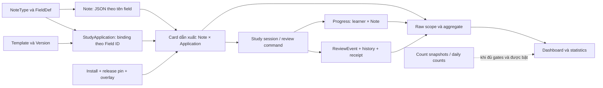
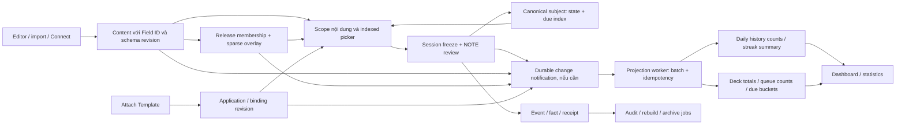

# Báo cáo hạn chế kiến trúc DB và mô hình cải thiện khi dữ liệu học tăng

> Ngày: 2026-10-13 · Phạm vi: Flama / Nihongo · MySQL 8.0 / SQLAlchemy
> Phần A: điều tra hiện trạng. Phần B: thiết kế đề xuất, chưa triển khai.
> Đối chiếu working tree trên HEAD `886ad3bf9491dcce6fcea59889a7ab1a040e2762`.
> Báo cáo này chỉ thêm tài liệu, không đổi application, migrations, DB hay cấu hình triển khai.

## Kết luận để ra quyết định

**Hướng hiện tại đúng, nhưng mới tách được nơi lưu progress; chưa tách hoàn toàn chi phí đọc thống kê và chi phí thay đổi schema khỏi dữ liệu lớn.** Không cần thiết kế lại toàn bộ DB hoặc chuyển sang một DB engine khác trước khi giải quyết các điểm này.

Repo hiện đã có progress theo **người học × Note**, Card dẫn xuất từ Note × StudyApplication, install deck bằng overlay và attachment template không tạo dòng cho từng Note. Đây là những nền tảng nên giữ. Hạn chế chính còn lại:

1. Dashboard, heatmap và forecast vẫn có đường tổng hợp raw theo toàn bộ scope. Giảm từ presentation xuống Note giúp đáng kể nhưng vẫn tăng theo số Note/progress hiện hành.
2. Bảng count đã có nhưng chưa được đưa vào vận hành trong snapshot production được lưu ngày 13/10. Cache hiện còn giới hạn owned deck; installed deck vẫn raw.
3. Giá trị field dùng **tên field làm key JSON**. Đổi tên field vẫn load và rewrite nhiều Note trong request, dù binding template đã theo Field ID.
4. Cache kiểu invalidate → rebuild vẫn có thể trả lại chi phí quét lớn sau mỗi lần học. Writer count đồng bộ lại có nguy cơ tăng độ trễ commit.
5. Lịch sử, receipts, session payload và dữ liệu release tăng theo thời gian; chúng cần đường đọc và vòng đời riêng để tránh cạnh tranh tài nguyên với thao tác học.

**Mô hình khuyến nghị:** giữ DB giao dịch hiện tại, ổn định identity nội dung, đọc progress trực tiếp bằng index cho thao tác học, và phục vụ thống kê phổ biến bằng projection nhỏ được cập nhật theo thay đổi. Triển khai theo thứ tự: hoàn thiện truy vấn Note scope → qualification count hiện có → Field ID storage → tổng hợp incremental và coverage installed deck.

### “Học càng nhiều vẫn nhanh” cần được hiểu thế nào?

Phân biệt bốn loại tăng trưởng:

| Ký hiệu | Dữ liệu tăng | Ý nghĩa |
|---|---|---|
| `N` | Note nhìn thấy trong scope | Thêm nội dung/được cài; nhiều Note mới chưa học vẫn làm scope lớn |
| `P` | Progress subject của người học | Xấp xỉ số Note đã materialize state/envelope, không phải số lần review |
| `H` | Review events / history facts | Học lại cùng Note nhiều lần làm `H` tăng nhưng không thêm subject cho mỗi lần |
| `D`, `A`, `F` | Deck, application template, field | Tăng cây deck, số cách trình bày và schema |

Mục tiêu kiến trúc là **install, attach và rename không đọc `P/H`; dashboard không quét `P/H` mỗi GET; một review không đọc lại `H`**. Độ trễ vẫn chịu ảnh hưởng B-tree, I/O, concurrency và kích thước tài nguyên. Không có thiết kế nào bảo đảm tuyệt đối “dữ liệu tăng vô hạn mà latency không đổi”; cần chứng minh độ trễ nằm trong ngân sách đã chọn ở quy mô mục tiêu.

## Phạm vi bằng chứng

- **Đã kiểm tra trong lượt này:** models, migrations 49–62 liên quan, services/repositories các luồng install, attachment, field rename, analytics, browse, review và retention; các regression assertions liên quan.
- **Số đo sử dụng lại:** các báo cáo và JSON audit/A/B đã có trong repo ngày 13/10. Đây không phải benchmark hay kiểm tra VPS mới của báo cáo này.
- **Working tree khác release production đã đo:** Note analytics scope mới đã có trong các thay đổi chưa commit. Không gọi lỗi expansion cũ là trạng thái chắc chắn của mọi deployment hiện tại.
- **Chưa biết:** phân bố `P/H` toàn hệ thống, p95/p99 dưới tải, query plans cho learner có nhiều installed deck, coverage worker/timer tại thời điểm đọc báo cáo.

Các tài liệu nền có đoạn đã cũ: [Flashcard V2 runbook](../runbooks/FLASHCARD_V2_RUNBOOK.md) và [clone cutover report](../plans/completed/CLONE_CUTOVER_REPORT.md) vẫn nhắc CardProgress/startup cutover theo phiên bản trước. Code hiện có migration retirement và maintenance flags; báo cáo này theo code mới, giữ nguyên invariant overlay từ các tài liệu đó.

---

# Phần A — Kiến trúc hiện tại và hạn chế

## A1. Nguồn dữ liệu, ownership và vòng đời

| Bảng / read model | Vai trò, identity | Writer / reader chính | Ràng buộc và vòng đời đáng chú ý |
|---|---|---|---|
| `notes` | Nội dung gốc; UUID; `field_values` JSON theo tên | Content API, import, Connect; renderer/browse | FK NoteType/User CASCADE; Deck SET NULL |
| `note_types`, `field_defs` | Schema; Field UUID ổn định, tên unique trong NoteType | Content service, merge; editor/binding | Field ID đã có nhưng chưa làm key giá trị Note |
| `templates`, `template_versions` | Template độc lập và phiên bản | Template library/version service | Owner User; application tham chiếu Template; nguồn template có lịch sử riêng |
| `study_applications` | Attachment NoteType ↔ Template, binding và occurrence | `attach_template`, retire/reactivate | Unique `(note_type_id, template_id, occurrence_key)`; ACTIVE/RETIRED |
| `Card` | **SQL read model**, không phải bảng `cards` vật lý hiện hành | Browse/study/compatibility đọc | Note × application; alias và cutover sets giữ cặp hợp lệ và ID cũ |
| `study_progress_subjects` | Progress canonical theo learner × logical Note | NOTE authority command/lifecycle; study/analytics | BIGINT PK; unique learner/logical key; CAS revision; FK live Note SET NULL |
| `review_events` | Fact review và attribution khi trả lời | Native/session/Connect writers; analytics | User CASCADE; Note/Card/Deck là snapshot identity, không có FK tới các entity đó |
| `study_progress_history_facts` | Bằng chứng scheduler/provenance, khác mục đích ReviewEvent | History service; replay/audit | Subject và ReviewEvent SET NULL; giữ logical key/generation |
| `study_authority_command_receipts` | Idempotency và kết quả command | Authority command/session | Unique learner/operation hash; references fact/event; phải giữ retry contract |
| `deck_installs`, `deck_clone_deck_maps`, `DeckClone*` | Pointer cài đặt, deck shell và delta local | Install/overlay/rebase | Release pin và overlay revision; không copy source Notes |
| `deck_releases`, membership/checkpoints/changes/template pins | Nội dung xuất bản và phiên bản áp dụng | Publish/rebase; clone readers | Immutable historical contract; không dùng working source thay release đã pin |
| `daily_review_counts`, analytics heads/generations | Projection lịch sử có thể dựng lại | Analytics projection/backfill; summary reader | Có policy, verification, revision; raw events vẫn là nguồn gốc |
| `deck_study_count_snapshots`, revision tables | Cache tổng hợp direct deck | Invalidation/prewarm; dashboard | Có ngày học, policy/dependency hash; chưa bao phủ install |

Evidence: [Note](../../models/note.py), [FieldDef](../../models/field_def.py), [StudyApplication](../../models/study_application.py), [Card](../../models/card.py), [progress](../../models/study_progress_subject.py), [events](../../models/review_event.py), [history](../../models/study_progress_history_fact.py), [receipt](../../models/study_authority_command_receipt.py), [install](../../models/deck_install.py), [review counts](../../models/review_analytics.py), [deck snapshot](../../models/deck_count_snapshot.py).

Migration [58](../../migrations/versions/20261012_000058_derive_cards_from_occurrences.py) bỏ bảng Card sau archive/identity gates; [60](../../migrations/versions/20261012_000060_retire_card_progress.py) retire CardProgress; [62](../../migrations/versions/20261012_000062_index_note_due_selection.py) thêm due-selection index. Không đề xuất làm lại các migration này.

## A2. Luồng hay dùng có phụ thuộc dữ liệu lớn ra sao?

| Hoạt động | Hành vi đã thấy trong code hiện tại | Đại lượng chi phối | Đánh giá |
|---|---|---|---|
| Install deck | Fence, check release, copy schema/template cần thiết, clone deck shell/maps, pin release, counter, commit | Deck subtree + fields/template pins + contention counter | Đã tách khỏi `P/H`; không cần tạo progress cho mọi source Note |
| Gắn template | Ghi/reactivate một application, validate binding, cập nhật sibling default khi cần | Fields + applications của NoteType | Đã tách khỏi progress; nếu bật count invalidation còn query Note→deck scope |
| Sửa nội dung template/binding | Template/version/application metadata | Kích thước template, schema, dependents/pins | Không cần rewrite scheduler state; render/session snapshot phải giữ version |
| Đổi tên NoteType | Sửa metadata; có guard khi có released shared dependents | Metadata và kiểm tra dependency | Không giống đổi tên Field; released shared NoteType đang có trường hợp bị 409 |
| Đổi tên Field | Count + `.all()` Note rồi rewrite key JSON, trong request | `N` của NoteType | Điểm yếu identity; không do progress nhưng vẫn chậm khi nội dung lớn |
| Một review | Cập nhật subject hiện hành + event/fact/receipt; counts tùy flags | Số Note trong batch + các rows cần lock | Nền tảng đúng; cần giữ không đọc toàn lịch sử và đo overhead projections |
| Dashboard | Cache eligible hoặc raw aggregate, tree metadata, cộng subtree | `N/P`, alias membership, `D`; install scope | Raw vẫn có chi phí theo collection |
| Heatmap/streak | Historical aggregate hoặc daily counts; future due là query progress khác | `H` lịch sử, `N/P` forecast | Daily review counts không giải quyết phần due tương lai |
| Today/future forecast | Working tree mới trả một row/Note rồi Python tính forecast/load | `N/P`, không còn một row/presentation ở owned branch | Vẫn `.all()` theo scope; memory/CPU tăng theo Note |
| Browse/search | Exact count + paginate; integrity theo trang; JSON search | Scope, search/sort, độ sâu OFFSET | Page nhỏ chưa đồng nghĩa toàn request chỉ đọc page nhỏ |
| Delete/rebase/bulk edit | Membership/release/overlay/lifecycle xử lý theo entity bị ảnh hưởng | Notes/deltas/dependents thực sự đổi | Công việc lớn hợp lý nhưng cần job/batch, không giữ transaction dài |

Nguồn: [install](../../app/services/share/install.py):263–424; [clone tree](../../app/services/share/overlay.py):111; [attach](../../app/services/template_library_service.py):295; [content mutation](../../app/services/flashcard_content_service.py):166, 552, 1607; [dashboard](../../app/services/dashboard_service.py):47; [forecast query](../../app/repositories/stats_query_repository.py):63; [forecast xử lý](../../app/services/stats_today_future.py):295; [browse](../../app/services/browse_card_service.py):698, 820.

Lưu ý: owned Note creation hiện có đường `materialize_new_note_authority()`; không khẳng định mọi subject hiện tại chỉ được tạo khi học lần đầu. Installed source Note có thể đọc như pristine trước khi người học tạo state.

## A3. Bằng chứng hiệu năng đã có

Từ [audit dashboard ngày 13/10](DASHBOARD_PRODUCTION_PERFORMANCE_INVESTIGATION_2026-10-13.md) và [JSON gốc](artifacts/dashboard_production_investigation_20261013.json):

- Learner mẫu: **39.336 Note, 39.336 subject, 119.341 ReviewEvent**, nhưng query cũ xử lý **113.680 presentation**.
- Hai mẫu HTTPS loopback: dashboard **3,288–4,293 giây**; overview **3,882–4,180 giây**. SQL chiếm khoảng **95,5–99%** thời gian trong audit factory.
- Future-due là phần lớn chi phí overview; yearly historical aggregate khoảng **247–284 ms** trong mẫu đó.
- Count tables chưa có row, writers off/readers raw. Buffer pool **128 MiB**; working set đã lớn hơn pool.

Working tree mới đã có Note scope. [A/B đã lưu](NOTE_CENTRIC_ANALYTICS_DESIGN_2026-10-13.md#6-mysql-plan-và-ab), [artifact](artifacts/note_centric_analytics_20261013.json):

| API | Baseline median | Candidate median |
|---|---:|---:|
| Dashboard | 3,538 s | 2,111 s |
| Overview/heatmap | 4,157 s | 2,084 s |
| Today/future | 5,834 s | 2,494 s |

Đây là hai mẫu mỗi variant, same snapshot, không phải p95. Learner mẫu không có installed deck. Bản sửa giảm amplification nhưng chưa chứng minh dashboard dưới một giây hoặc latency ổn định khi `P/H` tăng nhiều lần.

## A4. Findings

### F1 — Tách storage progress chưa loại bỏ quét scope trong analytics — ưu tiên P0

- **Observed:** Subject đã theo Note; current owned analytics scope đã giảm expansion. Installed branch vẫn đi qua presentation/release visibility trước group. Raw counts/forecast vẫn phải xét các Note trong scope.
- **Evidence:** [Note scope repository](../../app/repositories/note_analytics_scope_repository.py):18, 84, 127, 156; [aggregate](../../app/services/deck_aggregation_service.py):137; [availability reader](../../app/repositories/note_analytics_read_repository.py):126; [forecast](../../app/repositories/stats_query_repository.py):63.
- **Potential concern:** Đổi đơn vị tính từ Card sang Note giảm hệ số `A`, không làm request độc lập với `N/P`. Compatibility aliases và cutover guards vẫn có chi phí.
- **Impact:** Collection tăng tiếp vẫn tăng reads; nhiều người reload tạo áp lực lặp lại. Indexed due picker không tối ưu thay cho full aggregate.
- **Unknowns:** p95/concurrency và installed-heavy plans chưa có trong bằng chứng được đọc.

### F2 — Có count schema nhưng chưa có projection được vận hành đầy đủ — ưu tiên P0

- **Observed:** Defaults off/raw; cached owned resolver trả dirty decks sang raw. Install/mapped scopes bị loại khỏi cache. Reader lịch sử chỉ dùng generation có policy/revision/verification hợp lệ.
- **Evidence:** [settings](../../app/settings.py), [snapshot resolver](../../app/services/deck_count_snapshot_service.py):129–180; [history reader](../../app/repositories/review_analytics_read_repository.py):80–146; [inventory production đã lưu](ANALYTICS_COUNTS_PRODUCTION_ENABLEMENT_INVESTIGATION_2026-10-13.md).
- **Potential concern:** Bật một read flag hoặc thêm index không đủ. Thiếu writer coverage, backfill, timer hoặc generation thì fallback vẫn quét lớn.
- **Impact:** Người học nhiều installed deck chưa có đường dashboard ổn định dựa vào summary, kể cả khi owned cache đã bật.
- **Unknowns:** Không kiểm tra lại environment/timer trong lượt này; cần qualification trên release triển khai thực tế.

### F3 — Invalidate rồi rebuild dễ lặp lại toàn bộ chi phí; count writer có overhead — ưu tiên P0/P1

- **Observed:** Review đổi availability bump learner/deck revision; snapshots cũ mất validity. Occurrence changes query DISTINCT deck IDs từ Notes. History projection đồng bộ khóa heads/generations và ghi buckets trước commit.
- **Evidence:** [deck projection](../../app/services/deck_count_projection_service.py):111–182, 208–218; [snapshot validation](../../app/services/deck_count_snapshot_service.py):166; [history projection](../../app/services/review_analytics_projection_service.py):145–206.
- **Potential concern:** Học liên tục → dirty liên tục → prewarm không kịp → raw fallback. Attach không ghi progress nhưng bật writer có thể bổ sung scan `notes` để invalidate. Global epoch `0` còn khiến nhiều cache mất validity.
- **Impact:** Cache hit thấp đúng lúc hoạt động nhiều; hoặc dashboard nhanh hơn nhưng review/attach commit chậm hơn. Head lock có thể tạo contention giữa commits cùng learner.
- **Unknowns:** Chưa đo hit rate, prewarm backlog, contention và overhead từng writer trên NOTE hiện tại. Benchmark LEGACY cũ +21,84 ms median không được coi là chi phí NOTE đã xác nhận.

### F4 — Tên Field là identity giá trị nên rename gây write amplification — ưu tiên P1

- **Observed:** `FieldDef.id` ổn định, template bindings theo ID; `Note.field_values` vẫn theo tên. Rename job count rồi `.all()` Notes và rewrite JSON. Change-request merge có đường rewrite riêng.
- **Evidence:** [rename](../../app/services/flashcard_content_service.py):637–655, 1607–1647; [binding](../../app/services/template_binding_service.py):55–115; [merge](../../app/services/change_request/merge.py):51; [thiết kế Field identity đã có](FIELD_VALUE_IDENTITY_DESIGN_2026-10-12.md).
- **Potential concern:** Một thao tác label cần ghi `N` rows, gây memory/redo/lock pressure. Branch old/new keys cùng tồn tại bỏ old key; migration không được dùng branch này để giải quyết collision.
- **Impact:** Rename chậm, retry khó, rủi ro dữ liệu orphan/collision; ảnh hưởng gián tiếp query khác cùng MySQL dù không đọc progress.
- **Unknowns:** Phân bố Note/NoteType, orphan keys, collision, overrides thiếu ID và historical mappings chưa được inventory đầy đủ trong lượt này.

### F5 — History và due forecast là hai read model khác nhau — ưu tiên P1

- **Observed:** DailyReviewCount lưu số lần học theo ngày; due forecast đọc current subject availability. Today/future hiện `.all()` Note rows và tính load từ interval trong payload.
- **Evidence:** [review count model](../../models/review_analytics.py); [forecast service](../../app/services/stats_today_future.py):295–327; [overview](../../app/services/stats_overview.py):149; [forecast repository](../../app/repositories/stats_query_repository.py):63.
- **Potential concern:** Dùng history rollup để “tối ưu thống kê” rồi vẫn để forecast đọc toàn progress. Timezone/day-boundary và due_day/due_at làm việc cache due phức tạp hơn cache events.
- **Impact:** Heatmap vẫn chậm; forecast CPU/RAM tăng theo collection; thay đổi ngày học có thể làm count cũ sai dù không có review mới.
- **Unknowns:** Window/metric nào cần realtime tuyệt đối, distribution interval và frequency đổi timezone/preset chưa được đo.

### F6 — Lịch sử và dữ liệu vận hành tăng lâu dài, retention hiện chưa bao phủ mọi payload — ưu tiên P2

- **Observed:** Một review có event, fact và receipt với mục đích khác nhau. Session commits/batches giữ request/response payload. Retention service hiện purge membership/pins theo batch, không xóa toàn bộ lịch sử hay mọi receipt/payload.
- **Evidence:** [command](../../app/services/study_authority_command_service.py):303; [receipt model](../../models/study_authority_command_receipt.py); [commit](../../models/study_session_commit.py); [batch](../../models/study_session_batch.py); [retention](../../app/services/study_session_retention_service.py):142–203.
- **Potential concern:** Dữ liệu ít dùng cạnh tranh buffer/storage/indexes với progress hiện hành. Không thể xóa fact/receipt như cache vì replay, retry, undo và sync cần chúng.
- **Impact:** Backup/restore dài hơn, I/O nhiều hơn, rebuild thống kê lâu hơn. `review_events.id` còn là Integer; cần capacity forecast trước khi gần giới hạn, không suy đoán đang sắp hết.
- **Unknowns:** Bytes/ngày, retry horizon, replay/research requirements, retention job execution và nhu cầu giữ lịch sử chưa được xác định.

### F7 — Browse có page nhỏ nhưng count/search/sort còn rộng — ưu tiên P2

- **Observed:** Integrity/deep validation đã theo page; request vẫn exact count và OFFSET pagination. Search có cast JSON sang text; clone search reconstruct release/override values.
- **Evidence:** [browse count](../../app/repositories/browse_card_repository.py):346; [search/pagination](../../app/services/browse_card_service.py):698–709, 820; [effective clone fields](../../app/repositories/browse_card_repository.py):126.
- **Potential concern:** OFFSET sâu hoặc `%keyword%` không được giải quyết chỉ bằng index progress. Field ID storage nếu search cả JSON sẽ vô tình match UUID key.
- **Impact:** Browse lớn có thể tốn rows examined dù chỉ trả vài chục rows; generated dynamic values cần cache/search projection riêng.
- **Unknowns:** Search semantics mong muốn: substring, tiếng Nhật, field labels hay values; chưa có production workload để chọn full-text strategy.

### F8 — Working set và tải nền có thể ảnh hưởng mọi thao tác dù query đã tách — ưu tiên P0 đo lường

- **Observed:** Audit đã lưu cho thấy buffer pool 128 MiB và I/O lớn; các bảng history, aliases và subject cùng MySQL. Startup maintenance hiện được gate, không phải luôn quét/migrate mỗi boot.
- **Evidence:** [audit F4](DASHBOARD_PRODUCTION_PERFORMANCE_INVESTIGATION_2026-10-13.md#f4-bộ-nhớ-mysql-nhỏ-đi-kèm-lượng-đọc-đĩa-lớn); [startup](../../app/startup.py):41; [audit factory](../../app/__init__.py):292.
- **Potential concern:** Query/install không đọc history vẫn bị ảnh hưởng khi import/backfill/analytics chiếm I/O, buffer pool hoặc connections.
- **Impact:** Tách bảng về logic chưa đủ bảo đảm ổn định toàn hệ thống. Cần giới hạn job/concurrency và tài nguyên hợp lý.
- **Unknowns:** Host/resource state hôm nay, disk latency, peak concurrency và phần RAM dành cho các services chưa kiểm tra mới.

---

# Phần B — Mô hình cải thiện đề xuất

## B1. Invariant cần giữ

1. **Một progress canonical theo learner × logical Note.** Template/applications chỉ đổi cách trình bày; attach/retire/rebind không reset hay nhân bản progress.
2. **Overlay-only install.** Không tạo learner × source Note membership/progress rows cho toàn deck lúc install; source content không bị clone editor mutate.
3. **Field identity ổn định.** Rename label không đổi Field ID/value; delete rồi tạo field cùng tên là identity mới.
4. **Review ghi atomically:** state/availability/revision + event + fact + idempotency receipt; projection notification nếu dùng outbox cũng cùng transaction. Không trả thành công khi evidence chính chưa durable.
5. **Progress exact, analytics có contract freshness riêng.** Study eligibility/answer/CAS đọc canonical; không chọn thẻ bằng dashboard summary có độ trễ.
6. **Release/session/Connect identity lịch sử không đổi.** Giữ retired pins, original absent pairs, old card aliases, receipt fingerprints và frozen artifact bytes.
7. **Array giữ native JSON list**, kể cả list lồng, missing/null/empty và overlay remove. Dùng `stored_field_value()` ở storage, `field_value_text()` ở biên text; không thêm Anki export.
8. **Không đếm trùng ngoài contract hiện tại:** per-local-deck attribution khác collection union. Một source Note có nhiều install vẫn một progress; collection Card metrics phải union application identities, không cộng mù số template của từng install.
9. Projection/cache có thể rebuild nhưng không trở thành nguồn sửa ngược canonical state. Corruption đã xác định phải fail/contain rõ; không bỏ integrity checks chỉ để giảm SQL.

## B2. Thiết kế tổng thể

Đây là **tách mô hình ghi và mô hình đọc trong cùng MySQL trước**. Worker có thể dùng hạ tầng sẵn có; chưa cần Kafka, DB khác hay microservices mới. Trước khi thêm bảng outbox phải đánh giá receipt/fact/lifecycle log hiện có có đủ làm feed durable với deletion/tombstone coverage hay không.

### Các thay đổi dữ liệu cụ thể

Tên v2 bên dưới là **tên thiết kế**, chưa phải các bảng đã tồn tại.

| Dữ liệu | Thiết kế khuyến nghị | Key / version / access |
|---|---|---|
| Note values | Add `field_values_by_id` JSON + codec + content revision; giữ named payload khi chuyển đổi | UUID Field có scope; Note CAS độc lập với progress CAS |
| NoteType schema | Add `field_schema_revision`; tên/type/order nằm ở schema | Cache `(note_type_id, schema_revision, codec)` |
| Application | Giữ StudyApplication; có epoch/revision membership/binding khi cần | Attach sửa metadata; không rewrite `P` |
| Progress | Giữ StudyProgressSubject, scalar queue/due + state JSON hiện có | Unique learner/logical Note; due index hiện tại; không tạo authority store thứ hai |
| Content count | Projection direct deck × NoteType về số eligible Note/membership exceptions | Không keyed theo learner × từng source Note; application revision đổi validity |
| History analytics | Tái sử dụng DailyReviewCount + generation; thêm total/streak metadata nếu cần | Collection/day và direct attribution/day; policy/version tách biệt |
| Availability analytics v2 | Queue summary và due buckets theo learner/scope/generation; Card weights tách Note unit | Source revision, membership/release/overlay dependencies, policy + study-day |
| Change feed, nếu cần | Outbox với event ID, kind, entity key, entity revision/generation và payload delta có version | Monotonic BIGINT nội bộ; unique change identity; pending/index theo trạng thái và ID |
| Applied projection changes | Transactional dedup hoặc per-entity contiguous revision checkpoint | Consumer + change identity; gap/reset được xử lý, không chỉ `MAX(id)` |
| Search projection | Values-only document và primary sort key theo schema/release/overlay revision | Chỉ thêm sau khi chốt semantics/search workload |

Không tạo learner × toàn bộ source Note rows để “cache membership” lúc install. Tăng storage theo **user × deck/bucket đang dùng**, edits và progress thực sự materialize; không theo user × tất cả nội dung marketplace.

## B3. Hành vi mục tiêu cho từng thao tác

### Install deck

Giữ transaction hiện tại: validate release-ready → tạo install/deck shell/map/schema/subscription → commit. Summary count ban đầu lấy từ immutable release metadata khi đủ semantics; queue NEW được suy ra từ total eligible trừ state hiện có của learner trong scope. Nếu learner từng học source Note qua install khác, phải tính phần giao; **không mặc định mọi Note mới cài đều NEW**.

Metadata release chưa có thì prepare tại publish/background trước install, giống gate `DECK_RELEASE_NOT_READY` hiện có. Không chạy initial content backfill hay full history scan trong POST install. Rebuild summary và UI refresh chạy sau commit, có trạng thái readiness rõ.

Chi phí install phụ thuộc deck tree/schema/pins; độc lập với `H` và không proportional với `P` toàn learner. Tổng hợp trạng thái một scope mới có thể cần job theo phần giao progress, không nhét vào transaction install.

### Gắn template / sửa template / đổi tên NoteType

Giữ một attachment + validation theo `F/A`, không INSERT theo Note. Với Note-count dashboard, thay binding/render source không tự làm thay progress. Với Card-count contract, application ACTIVE/RETIRED có thể đổi multiplicity và membership; summary cần invalidate/rebuild đúng dependency, không ghi lại từng progress.

Thay việc count hook scan DISTINCT decks từ Notes mỗi attach bằng dependency revision của NoteType/application hoặc bảng deck↔NoteType usage nhỏ được duy trì từ content mutations. Count cache kiểm epoch này khi đọc. Tránh bump global content epoch cho mutation có scope biết rõ.

Đổi tên NoteType là metadata path riêng; released shared metadata cần version representation trước khi bỏ guard 409. Không coi tối ưu hiệu năng là lý do bypass release gate.

### Đổi tên Field

Lưu value theo Field ID. Ví dụ Note đang có `{"<field-id-1>": "猫"}`; đổi label `Word` thành `Expression` chỉ cập nhật Field schema và bump schema revision. Template vẫn dùng input `{{Question}}`, binding `Question → field-id-1`; resolver dựng context bằng codec/schema của request hoặc frozen session.

Rename cuối cùng chỉ sửa schema + metadata/bindings cần thiết theo `F/A`, không rewrite `N/P/H`. Điều này chỉ đạt sau khi tất cả name-storage writers/readers đã chuyển; dual-write sang cột tên vẫn khiến rename còn O(N).

Chọn **JSON key Field ID**, theo [thiết kế identity ngày 12/10](FIELD_VALUE_IDENTITY_DESIGN_2026-10-12.md). EAV `(note_id, field_id, value_json)` là phương án khả thi nếu query từng field/contended field edit trở thành workload chủ đạo; hiện nó tăng Note×Field rows/joins và chưa giải quyết overlay/historical mapping tự động.

### Review / dashboard / heatmap

- Review chỉ đọc state hiện hành và dữ liệu session/batch cần thiết; không replay toàn `H` cho mỗi answer. Algorithms có nhu cầu replay chạy như job/version transition riêng.
- History projection cộng event delta theo ngày và attribution đã capture. Không join lại live deck để sửa lịch sử của Note đã move/delete.
- Due projection là **trạng thái hiện hành**, dùng before/after availability: trừ bucket cũ, cộng bucket mới. Reset/suspend/bury/import/rekey/delete cũng phát change, không chỉ native answer.
- Dashboard đọc direct-deck summaries rồi roll subtree theo `D`; heatmap đọc các bucket trong window `W`. Nếu cần streak toàn đời, dùng summary/prefix theo ngày để tránh mỗi GET phải duyệt toàn active days lịch sử.
- Future series lấy due buckets, không `.all()` state JSON của `P` Notes. Metric load như `Σ(weight / max(1, interval))` cần scalar projection có version hoặc delta riêng, giữ phép tính hiện hành và parity.

### Browse / các mutation lớn

Browse giữ bounded deep validation theo page; thêm cursor `(sort_key, stable_id)` cho list lớn khi contract cho phép. Exact total tính riêng/cache theo filter dependency hoặc theo yêu cầu UI; không đổi API total âm thầm. Search values-only cần giữ pinned release + overlay, primary field và array text extraction đúng semantics.

Import/rebase/delete/bulk conversion vẫn có công việc theo số entity thực sự đổi. Đưa vào job có cursor, giới hạn rows/time mỗi chunk, transaction nhỏ và progress/status; không hứa biến công việc sửa N Note thành O(1).

## B4. Freshness, đồng thời và giới hạn của projection

Đây là điều kiện bắt buộc để tránh “cache nhanh nhưng sai”:

1. **Nguồn change durable:** state/evidence và outbox cùng commit; worker đọc committed rows. Không phát notification chỉ trong memory sau commit. Entity changes không có ReviewEvent vẫn cần feed.
2. **Apply idempotent:** delta + dedup/checkpoint cùng transaction. Worker chết sau commit rồi replay không double count; event đảo thứ tự/gap/reset generation có rule rõ. AUTO_INCREMENT ID không tự bảo đảm thứ tự commit; watermark không được bỏ event commit muộn.
3. **Backfill an toàn:** capture generation/high-water hoặc per-entity revision theo protocol đã verify; snapshot nhất quán; queue concurrent changes; publish sau reconcile. Không chỉ SELECT max ID rồi bỏ mọi thay đổi nhỏ hơn cursor.
4. **Scope đúng:** per-deck có local attribution; collection union phải dedup source Notes/applications qua nhiều installs. Global collection count không được lấy tổng direct-deck snapshots nếu overlap semantics khác nhau.
5. **Clock đúng:** giữ due_day và due_at như scheduler hiện hành; burial expiry, study-day rollover, timezone/day-boundary/policy changes đều có scheduled refresh/generation mới. Không dùng TTL đơn thuần để suy count luôn đúng.
6. **Read-your-writes:** response review trả progress chính xác. Dashboard có thể dùng summary + bounded recent tail đủ before/after/version để cho cùng learner thấy thay đổi ngay; tail vượt budget hoặc membership chưa ready thì trả trạng thái đang cập nhật/job, hoặc exact query có giới hạn rõ.
7. **Contract cũ không tự đổi:** summary reader hiện đòi revision đúng nguồn. Muốn async lag cần contract/generation mới và UI freshness nếu số hiển thị chưa exact. Không bỏ equality check rồi âm thầm phục vụ stale DTO.
8. **Budget fallback:** giữ raw path làm oracle/recovery. Không mặc định mọi cache miss đều chạy quét không giới hạn trên GET. Với exact summary chưa sẵn sàng, cần async/readiness contract rõ; không trả 0 hoặc stale như số exact.

Scope mới rất lớn, rebase nhiều thay đổi, thay timezone và các lượt invalidate toàn cục vẫn cần rebuild. Incremental projection làm đường ổn định nhanh hơn, không loại bỏ chi phí xây dựng lại; chi phí đó phải được giới hạn và chuyển sang background.

## B5. Các phương án và lựa chọn

| Phương án | Lợi ích | Chi phí / giới hạn | Quyết định |
|---|---|---|---|
| A — Giữ raw, chỉ chỉnh SQL/index/RAM | Ít thay đổi, nhanh triển khai, không thêm count writes | Vẫn quét `N/P/H` tùy metric; miss/peak chưa ổn định | Là bước P0 cần làm, không phải đích dài hạn |
| B — Snapshot + daily counts đồng bộ hiện có | Dùng code/schema sẵn; consistency mạnh; read nhỏ khi hit | Invalidation/rebuild; writer overhead; installed coverage thiếu | Qualification trước; dùng khi đạt ngân sách write/hit rate |
| C — Projection incremental, worker/feed durable + bounded tail | Tách analytics khỏi lịch sử/state lớn; giảm synchronous bucket locks | Feed correctness, lag, double-count/gaps, nhiều reconciliation | Đích khuyến nghị; bổ sung khi B không đạt latency/coverage |
| D — Copy toàn bộ deck/progress per install hoặc shard ngay | Có thể làm local reads đơn giản hơn ở vài flow | Write/storage amplification, sai overlay invariant, migration phức tạp | Không phù hợp mục tiêu hiện tại; sharding chỉ đánh giá sau capacity evidence |

B và C có thể cùng tồn tại theo metric. Nếu writer đồng bộ hiện có đạt ngân sách thì không cần thay nó chỉ vì async “hiện đại hơn”. Field ID storage là thay đổi identity độc lập, cần làm dù chọn B hay C.

## B6. MySQL và cấu trúc vật lý

- **Index có sẵn:** unique learner/logical key cho canonical lookup; `ix_sp_subject_note_due` phục vụ queue/suspension + due anchors. Giữ hai nhánh due_day/due_at, burial semantics và kiểm integrity. Không thêm index trùng hoặc suy rằng index picker sẽ giúp full count tự thành O(1).
- **Index đề xuất cần EXPLAIN:** live-identity probe dùng learner + live_note; model hiện chỉ có standalone live_note index ngoài logical UQ. Thử `(learner_user_id, live_note_id)` trên representative data trước khi quyết định thêm/drop. Summary indexes theo equality user/generation/scope rồi range ngày.
- **JSON:** giữ typed state/note arrays; scalar thường dùng cho filter/sort/aggregate nằm ở column/projection. JSON không có B-tree index trực tiếp như scalar; generated/extracted scalar indexes chỉ phù hợp query đã chốt. Xem [MySQL JSON](https://dev.mysql.com/doc/refman/8.0/en/json.html) và [generated-column index](https://dev.mysql.com/doc/refman/8.0/en/generated-column-index-optimizations.html).
- **PK:** giữ UUID external và identity cũ. Bảng internal append nhiều mới dùng BIGINT narrow PK khi thích hợp; không rewrite mọi Note UUID để tối ưu khi chưa đo. Forecast capacity của Integer event IDs và toàn bộ FK consumers trước migration BIGINT.
- **Locks:** progress authority dùng subject lock/CAS và shared learner fence. Không coi shared fence là mutex khóa độc quyền mọi thao tác; không bỏ fence. Giữ lock order nhất quán; count head/bucket serialization cần benchmark cùng learner và import.
- **I/O:** đo working set, RAM các services, buffer misses và disk latency; thử buffer pool phù hợp trong môi trường kiểm soát. Đây là hỗ trợ capacity, không thay thế việc loại scan lặp.
- **Archive/retention:** phân biệt current state, immutable learning history và operational payload. Archive có manifest/checksum/restore và query routing; giữ retry/replay windows, external refs và undo contract. Membership retention đã có không đồng nghĩa tất cả payload được cleanup.
- **Partitioning:** không partition ngay các bảng history hiện có. InnoDB partitioning không hỗ trợ FKs và partition columns phải thuộc mọi unique key; các bảng Flama đang có FK/idempotency UQ. Muốn partition phải thiết kế lại integrity/key hoặc archive store riêng, không coi là index tuning đơn giản. Xem [MySQL partitioning restrictions](https://dev.mysql.com/doc/refman/8.0/en/partitioning-limitations.html), [partitioning overview](https://dev.mysql.com/doc/refman/8.0/en/partitioning-overview.html).
- **DDL:** dùng Alembic additive, rehearsal đúng MySQL version/engine và explicit algorithm/lock khi hỗ trợ; vẫn quan sát metadata locks. Không backfill content/state trong app startup hay một DDL transaction kéo dài.

## B7. Lộ trình và rollback

| Đợt | Công việc | Gate hoàn tất | Rollback |
|---|---|---|---|
| P0 — Baseline và query | Review/verify Note-scope working tree; same-snapshot parity; EXPLAIN owned + clone-heavy; bổ sung duration/rows examined | Không sai units/aliases/pins/identity; giảm measured work; có p95 dưới concurrency | Revert query modules; không đổi state |
| P0 — Count qualification | Đo history-only, deck-only, cả hai trên NOTE; audit writer/bulk invalidation; backfill/prewarm; canary owned readers; quản lý flags/timer trong deploy | Parity, hit rate, commit overhead đạt budget; fail/restart recovery | Readers raw với budget kiểm soát; giữ derived data để đối chiếu |
| P1 — Field Expand | Nullable ID-value JSON/codec + schema/content CAS; scoped resolver và media adapter; old clients qua label projection | REST/MCP/Connect/import/CLI/clone/renderer đều có adapters, new writes parity | Reader cũ chỉ khi named shadow vẫn đồng bộ |
| P1 — Field Backfill | Keyset/batches, captured schema theo đúng release; CAS; collision/orphan disposition; raw typed checksum | Mọi row map duy nhất hoặc có disposition; arrays/presence/history không đổi | Giữ raw archive/name column; không đoán mapping |
| P1 — Field Cutover | Chuyển writers/readers; new requests ID-storage; rename metadata only; old frozen codecs vẫn đọc | Name-storage accesses = 0 trước bật rename nhanh; sessions/receipts/media/search parity | Sau rename nhanh không flip về old stale column; cần backward adapter/reverse projection verified |
| P1/P2 — Analytics Expand | Reuse counts; bổ sung membership revisions, due summaries, feed nếu cần; readers raw/shadow trước | Fault tests, state lifecycle coverage, out-of-order/retry/generation protocol đúng | Tắt v2 readers/workers; state/event gốc không đổi |
| P2 — Analytics Backfill/Cutover | Snapshot generations + concurrent delta; reconcile; owned rồi installed, bucket forecast và tail | Count/due/history parity; lag/write overhead/SLO đạt; current exact APIs không nhận stale âm thầm | Rollback theo consumer/version, raw/job recovery |
| P2 — Contract | Archive/remove named rewrite paths, unused projection generations, operational payload theo retention đã chốt | Restore rehearsal; retry/replay horizon; không còn consumers cũ | Backup/archive + compatible code; không generic downgrade mất dữ liệu |

Không coi mọi contraction là zero-downtime tự động. Expand/backfill/read cutover thiết kế online; bước drop/retire có thể cần stopped-writer window nếu consumer hoặc DDL thực tế yêu cầu. Chỉ contract sau dữ liệu/archive và rollout gates.

### Thứ tự ưu tiên thực tế

1. **Ngay trước:** đưa Note-scope optimization đã có qua release verification và đo under load; capacity/I/O tuning có kiểm chứng.
2. **Tiếp theo:** qualify count hiện có để giảm repeated raw dashboard/history; không bật rộng nếu review commit vượt ngân sách.
3. **Thay đổi schema quan trọng nhất:** Field ID storage để rename không rewrite Note.
4. **Đích scale:** installed-aware summary + due buckets + incremental changes; đảm bảo background backlog không quay lại thành full scan trên mọi GET.
5. **Sau đo capacity:** archive/retention, search projection, index/PK changes cần thiết. Chưa có lý do từ bằng chứng này để shard hoặc thay MySQL.

## B8. Cách chứng minh đạt mục tiêu

Đây là **ngân sách đề xuất để benchmark**, không phải tốc độ đã đạt hay cam kết trên máy hiện tại. Đo server p95 trên cùng cấu hình và target concurrency; browser/network đo riêng.

| Hoạt động / chỉ số | Ngân sách đề xuất |
|---|---|
| Attach template / metadata rename | p95 ≤ 200 ms với schema thông thường; không đọc progress/history; count hook không scan toàn Notes |
| Rename Field sau ID cutover | p95 ≤ 200 ms; số content rows rewritten = 0; không quét `N/P/H` |
| Install deck | p95 ≤ 1 s cho cây ≤100 deck nodes và schema/template nhỏ; không tạo source Note/progress copy |
| Dashboard summary | p95 ≤ 300 ms cho scope ≤100 visible decks; không raw scan `P/H` trên đường ready |
| Heatmap 365 ngày / due forecast có window | p95 ≤ 500 ms; đọc bucket/scoped summaries; không trả `.all()` `P` rows |
| Added review commit do analytics | p95 tăng ≤5 ms **và** ≤10% so với cùng NOTE workload không bật projection |
| Async projection, nếu chọn | p95 lag ≤2 s ở tải mục tiêu; bounded-tail/readiness contract cho read-your-writes |
| Khi tăng riêng `H` 10× | Metadata/install/ready dashboard p95 tăng không quá 10% trong benchmark kiểm soát; ghi rõ variance/resources |

### Ma trận tải tối thiểu

- Giữ `N/P/D/A` cố định, tăng `H` từ 10.000 → 100.000 → 1.000.000 events/learner: xác định read paths nào còn phụ thuộc lịch sử.
- Giữ `H` hợp lý, tăng Note/subject từ 1.000 → 40.000 → 100.000; fixed window dashboard/heatmap để đánh giá cost theo `P`.
- NoteType có 1/3/10 applications; đối chiếu Note units và Card multiplicities.
- Owned-only; installed-heavy; nhiều installs cùng source với overlapping/disjoint release pins; local-added Note và field.
- Multi-user và nhiều tab/session cùng learner; review đồng thời với attach, field edit, import, prewarm và rebase.
- Warm/cold-like cache conditions riêng; backlog, worker crash/retry, timer missing, generation dirty và ngày học rollover.

Chạy fixture/load generator trên DB dùng cho benchmark riêng; live production chỉ read-only sampling phù hợp. Ghi p50/p95/p99, rows examined/returned, logical/physical reads, temp tables, lock wait/deadlocks, pool wait, bytes written/review, hit rate, lag/backlog và resource footprint. Không dùng chỉ số SQL/request thấp làm proxy cho query nhẹ.

### Correctness gates

- Payload parity raw/new trong cùng snapshot/clock/policy; cả Note và Card units.
- Retired pinned application vẫn visible đúng scope; absent legacy pair không tự sinh; alias sai NoteType không được tính.
- Native/worker/Connect/MCP/import writers; duplicate command, reordered changes, rollback SAVEPOINT, reset/suspend/bury/rekey/delete.
- Rename có orphan/collision, literal dotted/UUID-looking names, delete/recreate, old checkpoints, overlay remove và media rollback.
- Array nested/duplicates/order/missing/null/empty giữ nguyên typed values; session retry giữ old artifact fingerprint.
- Timezone/day-boundary/due_day NULL/due_at, burial expiry và negative/overdue bucket semantics theo scheduler hiện hành.
- Restore archive, rebuild projections, no silent stale/exact confusion và không sửa source Note từ clone.

Khi implementation thay đổi, dùng modular runner của repo: `python scripts/run_tests.py --changed` hoặc modules phù hợp, kèm MySQL probe. Báo cáo này không chạy lại các suite vì chỉ thêm tài liệu; kết quả test trong báo cáo A/B là evidence đã lưu, không phải test mới.

## B9. Những điều cần xác minh trước triển khai

1. Target users/concurrency, số Note/learner và tổng events sau 1–3 năm; máy MySQL/I/O/RAM thực tế.
2. Dashboard badges cần exact tức thì ở mọi thiết bị hay chấp nhận analytics lag ngắn có read-your-writes; window mặc định của statistics.
3. Count writer coverage/overhead và snapshot hit rate trên NOTE; installed-heavy real query plans.
4. Manifest field mappings/media/clone/history collisions để mở Field ID migration.
5. Retention/replay/undo/retry/sync contract cho history/receipts/payload và nguồn phục hồi lâu dài.
6. Tính đầy đủ của fact/receipt/lifecycle feed; chỉ thêm outbox nếu dữ liệu hiện có không đủ durable delta/gap/deletion semantics.
