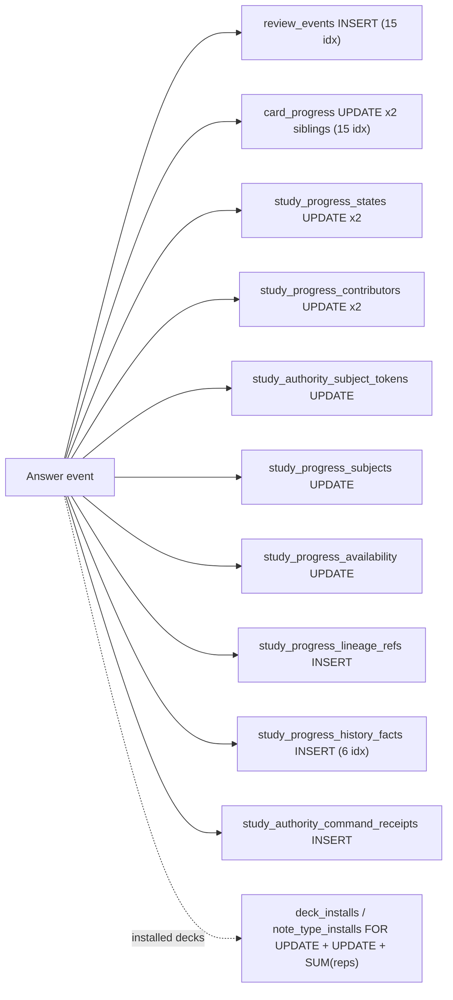

# Database Query Performance Investigation (Learner Paths)

> Date: 2026-09-29 | Mode: INVESTIGATE | Engine: MySQL 8.0 (OLTP), measured on SQLite in-memory
> Scope: study session open/commit (LEGACY and NOTE authority), NOTE worker batch, dashboard, statistics, deck tree, Browse
> Primary code: `app/services/study_session_service.py`, `app/services/flashcards_share_service.py`, `app/services/scheduler_config_service.py`, `app/services/dashboard_service.py`, `app/repositories/*`, `models/*`, `app/startup_schema.py`

## 1. Executive summary

Only learners are active today, and the learner hot path is where the query cost is concentrated. Read endpoints (dashboard, statistics, deck tree, Browse card list) run a constant number of statements; the study session endpoints do not.

1. **Opening a study session is O(cards in scope) round trips.** It snapshots every card in scope (up to `MAX_SESSION_CARDS = 5000`), then issues about 5 statements per card on LEGACY and about 8 per card on NOTE authority (row locks included), plus one INSERT per card into `study_session_cards` (and one into `study_session_authority_pins` on NOTE). 500 cards on NOTE authority = 4,028 statements and 2.26 s on in-memory SQLite, before any network latency.
2. **Each review answer costs about 30 statements on the NOTE worker path** and about 9 on LEGACY, writing to 10 tables on NOTE. For learners on installed (marketplace) decks, every answer also recomputes `SUM(card_progress.reps)` aggregates over the whole deck and note type and takes two `FOR UPDATE` row locks, only to maintain a "market active" flag.
3. **The most write-hot tables carry the most indexes.** `card_progress` (updated on every answer, twice on NOTE) has 15 secondary indexes, `review_events` (inserted on every answer) has 15, `deck_installs` (updated on every answer for installed decks) has 18. Several are single-column indexes on booleans or 2 to 5 value status strings, which the user-scoped queries cannot use.
4. **Several read paths aggregate in Python instead of SQL** (dashboard card counts, future-due forecast), and GET endpoints take shared row locks and even write (`UPDATE users SET timezone` on a statistics GET).

## 2. Method and measurements

Harness: `create_app()` with in-memory SQLite (same setup as `tests/test_study_session_api.py` and `tests/test_study_note_batch.py`), a SQLAlchemy `before_cursor_execute` listener counting statements per request, and a stack capture attributing each statement to the innermost `app/` frame. Data: one learner, a root deck with child decks, one note type, N notes. Statement counts are dialect-independent; MySQL adds a network round trip per statement, so wall time on production is higher than measured here.

| Request | N = 20 cards | N = 50 | N = 100 | N = 500 | Growth |
|---|---|---|---|---|---|
| `POST /api/study/sessions` (LEGACY) | 121 | 271 | 521 | – | ~5 per card |
| `POST /api/study/sessions` (NOTE, v4) | 188 | 428 | 828 | 4,028 (2.26 s) | ~8 per card |
| `POST .../commit`, 10 answers (LEGACY) | 93 | 93 | 93 | – | ~9 per answer |
| NOTE worker batch, 10 answers (`commit_note_study_session_batch`) | 297 | 297 | 297 | 297 | ~30 per answer |
| `GET /api/dashboard` | 10 | – | 10 | – | constant statements, O(cards) rows |
| `GET /api/statistics/overview` | 9 | – | 9 | – | constant, includes a write |
| `GET /api/browse/decks/tree` | 12 | – | 12 | – | constant (SQL `GROUP BY`) |
| `GET /api/browse/cards` (5 child decks / 40 child decks) | 31 / 136 | – | – | – | O(decks × depth) |

Per-answer writes on the NOTE worker path (10 answers, 2 sibling cards per note): 20 `UPDATE card_progress`, 20 `UPDATE study_progress_states`, 20 `UPDATE study_progress_contributors`, 10 each of `INSERT review_events`, `UPDATE study_authority_subject_tokens`, `UPDATE study_progress_subjects`, `UPDATE study_progress_availability`, `INSERT study_progress_lineage_refs`, `INSERT study_progress_history_facts`, `INSERT study_authority_command_receipts` = 132 writes for 10 answers.

## 3. Findings

Ranked by expected production impact on learners.

### F1. Session open loads the whole scope and runs per-card queries (N+1)

- **Observed**: `open_study_session` fetches every card in scope ordered by creation time (`study_session_service.py:573-577`, cap `MAX_SESSION_CARDS = 5000` at line 131), not only the due/new cards the day allows. It then loops over every card (lines 660-809) and for each card:
  - lazy-loads `card.note` (line 661, one `SELECT notes` per card);
  - calls `db.session.get(Deck, local_deck_id)` (line 667). This re-queries every iteration because the previous `Deck` has no strong reference and drops out of SQLAlchemy's weak identity map;
  - calls `resolve_deck_options` (line 671), which calls `get_user_scheduler_settings` without a `settings_row` (`scheduler_config_service.py:96,105,163`), so `user_scheduler_settings` is read once per card for a value that is identical for the whole session;
  - builds the content artifact, whose `_media_payload` lazy-loads `note.media_assets` (`study_artifact_service.py:163`, one `SELECT media_assets` per card).
  - On NOTE authority, `resolve_effective_study_deck_id` reads `notes` again per card (`study_service.py:220`, from line 605), `lock_study_session_authority_subjects` takes per-card `FOR UPDATE` locks on `study_authority_subject_tokens` and `study_progress_states` (`study_authority_repository.py:234,257`), and `stage_study_session_authority_pin` runs a SELECT and an INSERT per card (`study_session_authority_pin_service.py:311`).
- **Evidence**: measurements in section 2; call-site attribution shows exactly 1 statement per card for each item above.
- **Potential concern**: open time and lock duration grow linearly with deck size. On NOTE authority, all per-card subject locks are held in one transaction until commit at line 929, which blocks the worker from applying batches for the same learner while a large session opens.
- **Impact**: a 2,000-card Anki-imported deck on NOTE authority is on the order of 16,000 statements and 4,000 inserted rows per session open.
- **Unknowns**: production deck sizes per learner and how often the SPA reopens sessions (needs verification, see section 6).
- **Fix direction (non-binding)**: eager-load `Card.note` and `Note.media_assets` with `selectinload`, resolve decks and deck options once per distinct deck id, read `UserSchedulerSettings` once per request and pass `settings_row`, and bulk-insert session rows (a single `insert(...)` executemany instead of `add_all` of ORM objects with autoincrement PKs). Whether the snapshot must contain the whole scope, rather than the day's queue plus a refill mechanism, is a DESIGN question.

### F2. Per-answer "install usage" side effects run full aggregates and row locks

- **Observed**: every answer, on both LEGACY commit and the NOTE worker (`study_session_service.py:2000` → `study_service.stage_native_review_side_effects`, line 432), calls `_apply_review_side_effects` (`study_service.py:260-290`), which calls:
  - `touch_note_type_install_usage` (`flashcards_share_service.py:1865-1887`): `SELECT note_type_installs ... WHERE user_id = ? AND (installed_note_type_id = ? OR source_note_type_id = ?) ... FOR UPDATE`, then `is_note_type_install_active` runs `COUNT(notes)` and `SUM(card_progress.reps)` joined through `cards` and `notes` for the note type (lines 1892-1918, `flashcards_share_repository.py:248-268`);
  - `touch_deck_install_usage` (lines 1966-1985): walks deck ancestors one query per level (`deck_tree_query.py:233`), reads covering installs, re-selects each install `FOR UPDATE`, then `is_deck_install_active` resolves the clone scope and runs `SUM(card_progress.reps)` over the whole deck scope (lines 1987-2011, `flashcards_share_repository.py:286-328`).
- **Evidence**: LEGACY commit attribution: 20 ancestor `SELECT decks`, 10 `SELECT deck_installs`, 10 `SELECT note_type_installs` for 10 answers on a deck with no installs. With installs, the aggregates and `FOR UPDATE` statements run as well.
- **Potential concern**: the aggregates only decide `reps >= 3` (`DECK_ACTIVE_REVIEW_THRESHOLD`), a threshold that in practice only moves one way (reps only grow unless progress is reset), yet they are recomputed on every answer over all of the learner's progress in that deck. Each answer also writes `deck_installs` (18 indexes) and `note_type_installs`.
- **Impact**: grows with deck size for exactly the population that uses the product most (learners studying marketplace decks), and serializes answers on the install rows.
- **Unknowns**: share of learners on installed decks (needs verification).
- **Fix direction (non-binding)**: short-circuit when `market_active` is already true, or maintain the flag from a counter or an asynchronous job, and cache ancestor/scope resolution per request.

### F3. Commit path writes the same `card_progress` row several times

- **Observed**: on LEGACY commit, a card's first review inserts a placeholder `CardProgress` row and flushes it (`study_session_service.py:2532-2544`), then updates it with the scheduled state, then updates `last_review_event_id` again. On NOTE, both sibling cards' `card_progress` rows are updated for every answer (via `finalize_study_authority_evidence`, `study_authority_evidence_service.py:360`), alongside the NOTE authority tables. `card.note` is also lazy-loaded per touched card (line 2506), and on clone installs `DeckCloneAddedNote` is queried per card (lines 2465-2474).
- **Evidence**: LEGACY commit of 10 answers: 10 `INSERT card_progress`, 10 `UPDATE card_progress`, 1 `UPDATE card_progress SET last_review_event_id`; NOTE batch of 10 answers: 20 `UPDATE card_progress`, 132 writes total.
- **Potential concern**: each write to `card_progress` maintains up to 15 secondary indexes (F4), so the write cost is multiplied.
- **Impact**: per-answer latency and redo/binlog volume. On NOTE this is the dual-write cost of keeping LEGACY `card_progress` in step with the NOTE authority tables.
- **Unknowns**: whether the `card_progress` projection is still read by anything on NOTE learners after cutover (needs verification against the Phase 5 plan).

### F4. Over-indexing on write-hot tables

- **Observed** (declared in `models/`, and `app/startup_schema.py:444-485` creates the `card_progress` ones on every boot if missing):
  - `card_progress`, updated on every answer: 15 secondary indexes. Single-column indexes on `queue`, `is_suspended`, `is_buried`, `review_kind`, `scheduler_mode` (2 to 5 distinct values each), `due_at`, `due_day`, `buried_until_day`, `last_review_event_id`, `card_id`, `user_id`; composites `(user_id, queue, due_day)`, `(user_id, queue, due_at)`, `(user_id, is_suspended, is_buried)`; unique `(user_id, card_id)`. A review UPDATE changes `queue`, `due_at`, `due_day`, `review_kind`, and `last_review_event_id`, so it rewrites about 7 index entries per row.
  - `review_events`, inserted on every answer: 15 secondary indexes, including single-column `review_kind` and `scheduler_mode`, plus `user_id` and `study_session_id`, which are leftmost prefixes of other indexes.
  - `deck_installs`, updated on every answer for installed decks (F2): 18 secondary indexes, most of them single-column (`clone_mode`, `sync_mode`, `version_mode`, `auto_update_enabled`, `last_sync_status`, ...).
  - `study_session_cards`, one insert per card per session open: 6 indexes, including `scheduler_config_hash` (String(80)) and `session_id`, which is a leftmost prefix of `(session_id, ordinal)` and of the unique `(session_id, card_id)`.
- **Evidence**: `models/card_progress.py`, `models/review_event.py`, `models/deck_install.py`, `models/study_session_card.py`; `app/startup_schema.py:444-485`. Every `card_progress` filter found in `app/` is scoped by `user_id` first. The due-count queries wrap `queue` in `LOWER(COALESCE(...))` (`study_repository.py:439-444`), which prevents index use on `queue` anyway.
- **Potential concern**: low-cardinality single-column indexes and redundant prefixes add write amplification and buffer-pool pressure with little or no read benefit. MySQL still needs an index for each foreign key, so single-column indexes on FK columns are only redundant when another index starts with the same column.
- **Impact**: slower answers and session opens, more lock time per write, larger backups.
- **Unknowns**: actual index usage counters in production. Section 5 has the queries to confirm before any index is dropped (and dropping still needs explicit approval).

### F5. Dashboard and forecast aggregate in Python

- **Observed**: `build_dashboard_data` (`dashboard_service.py:108-165`) selects one row per card (`cards JOIN notes LEFT JOIN card_progress`) for all visible decks and classifies each row in Python. The Browse deck tree computes the same counts with SQL `GROUP BY` plus `CASE` (`vocabulary_repository.py:785-812`). `query_future_due_day_counts` loads every `card_progress` row of the user into Python (`stats_query_repository.py:470-495`, `query_due_progress_rows` at 626-640). `_query_active_review_days_mysql` scans the learner's entire `review_events` history with no lower bound on each statistics load (streak computation).
- **Evidence**: code references above; statement counts stay constant while row counts grow with the collection.
- **Potential concern**: transfer and CPU cost grow with collection size on every dashboard or statistics load. Two implementations of the same counts can also drift.
- **Impact**: moderate. It becomes noticeable for learners with large imported decks.

### F6. Browse and scope resolution walk the deck tree one query per level per deck

- **Observed**: `resolve_clone_scope_for_local_deck` → `deck_installs_covering_deck` → `collect_ancestor_ids` issues one `SELECT decks.parent_id` per ancestor level (`deck_tree_query.py:227-233`, `flashcards_share_service.py:2793, 3445`), and Browse calls it for each deck in scope. `_build_study_scope_query` does the same with a `DeckMarketplaceItem` lookup per ancestor (`routes/flashcards/study.py:151-157`).
- **Evidence**: Browse card list: 31 statements with 5 child decks, 136 with 40 child decks (81 ancestor lookups and 41 install lookups).
- **Impact**: Anki-imported collections often have hundreds of subdecks, so this becomes hundreds of statements per Browse page.
- **Fix direction (non-binding)**: load the user's deck `(id, parent_id)` map once per request and resolve ancestors in memory.

### F7. GET endpoints take row locks and write

- **Observed**: `lock_study_authority_route` issues `SELECT ... FOR SHARE` on the `users` row and on `study_authority_enrollments` (`study_authority_repository.py:131-165`). The dashboard (`dashboard_service.py:85`), Browse deck tree (`browse_card_service.py:172`), and statistics (`stats_overview.py:335`) call it, so read-only requests hold shared locks until their transaction ends. On REPEATABLE READ, a `FOR SHARE` on a missing enrollment row (the normal LEGACY state) also takes a gap lock. `_resolve_request_timezone` (`api/v1/analytics/routes.py:28-36`) runs `UPDATE users SET timezone` and commits inside `GET /api/statistics/overview` whenever the client timezone differs from the stored one.
- **Potential concern**: reads contend with writers on the `users` row (for example, the timezone update and enrollment changes), and a GET with side effects produces write load and binlog traffic.
- **Unknowns**: whether the read fence is required for correctness on these read-only endpoints or was applied uniformly (needs owner confirmation; the docstring describes it as a fence against authority mode switches).

### F8. Unbounded growth of per-session tables

- **Observed**: every session open inserts one `study_session_cards` row per card in scope (6 indexes) and, on NOTE, one `study_session_authority_pins` row per card. The only deletions found are in content deletion (`study_content_delete_service.py`) and deck deletion (`deck_management_service.py:333`). There is no retention job for expired sessions.
- **Impact**: these tables grow by (cards in scope × session opens) and never shrink, which inflates index maintenance and backup size.
- **Unknowns**: current row counts (section 5).

### Lower priority (outside the learner hot path)

- 212 loops containing direct query calls across `app/` (AST scan), concentrated in `flashcards_share_service.py` (18), `mcp/note_type_tools.py` (17), `study_content_delete_service.py` (11), the NOTE lifecycle and shadow mirror services, `share/overlay.py`, and `change_request/merge.py`. Many are chunked by design; the admin, import, and marketplace ones should be reviewed when those paths get traffic.
- The Browse keyword search applies `LOWER(COALESCE(JSON_EXTRACT(field_values, ...))) LIKE '%kw%'` per field, OR'ed across fields (`browse_card_repository.py:316-330`). That is a full scan of the learner's notes per search, which is acceptable at current sizes; FULLTEXT or a search column are the options if it grows.
- `OFFSET` pagination exists in MCP tools and the image library, support ticket, and deck access key repositories, none of which are learner-facing.
- All 217 `relationship()` declarations use the default lazy `select` loading, so any attribute access inside a loop is an N+1 unless the query adds `selectinload`/`joinedload`. The Browse card list already eager-loads (`browse_card_service.py:490-491`), which is why its statement count does not grow with cards.

## 4. Tables written per answer (NOTE authority)



## 5. Production verification queries

Run these on the production MySQL (read-only) before acting on F4 or F8. Replace `flama` with the schema name.

```sql
-- Statements by frequency and total time (N+1 shows as high COUNT_STAR, tiny avg)
SELECT LEFT(DIGEST_TEXT, 120) AS stmt, COUNT_STAR, ROUND(SUM_TIMER_WAIT/1e12, 2) AS total_s,
       ROUND(AVG_TIMER_WAIT/1e9, 2) AS avg_ms, SUM_ROWS_EXAMINED
FROM performance_schema.events_statements_summary_by_digest
WHERE SCHEMA_NAME = 'flama' ORDER BY COUNT_STAR DESC LIMIT 30;

-- Indexes never read since the last restart (need a full business cycle of uptime)
SELECT * FROM sys.schema_unused_indexes
WHERE object_schema = 'flama'
  AND object_name IN ('card_progress','review_events','deck_installs','study_session_cards');

-- Redundant (prefix-covered) indexes
SELECT table_name, redundant_index_name, redundant_index_columns, dominant_index_name
FROM sys.schema_redundant_indexes WHERE table_schema = 'flama';

-- Write cost per index on the hot tables
SELECT object_name, index_name, COUNT_READ, COUNT_WRITE
FROM performance_schema.table_io_waits_summary_by_index_usage
WHERE object_schema = 'flama'
  AND object_name IN ('card_progress','review_events','deck_installs','study_session_cards')
ORDER BY object_name, COUNT_READ;

-- Growth of per-session tables and index size vs data size
SELECT table_name, table_rows, ROUND(data_length/1048576, 1) AS data_mb,
       ROUND(index_length/1048576, 1) AS index_mb
FROM information_schema.tables
WHERE table_schema = 'flama'
  AND table_name IN ('study_session_cards','study_session_authority_pins','card_progress',
                     'review_events','study_progress_history_facts','deck_installs');

-- Largest scopes learners open sessions on
SELECT user_id, COUNT(*) AS sessions, MAX(cnt) AS max_cards FROM (
  SELECT s.user_id, s.id, COUNT(c.id) AS cnt
  FROM study_sessions s JOIN study_session_cards c ON c.session_id = s.id
  WHERE s.opened_at > NOW() - INTERVAL 7 DAY GROUP BY s.user_id, s.id) t
GROUP BY user_id ORDER BY max_cards DESC LIMIT 20;
```

## 6. Open questions / needs verification

- Production collection sizes (cards per learner and per session scope) and session open frequency: these decide how much F1 costs in practice.
- Share of active learners studying installed marketplace decks (F2 cost only applies to them).
- Actual index usage counters (F4) after at least one full week of uptime.
- Whether LEGACY `card_progress` must remain dual-written for NOTE learners after the Phase 5 cutover (F3).
- Whether the read-side authority fence is required on dashboard, deck tree, and statistics (F7).
- MySQL round-trip latency from the app host (section 2 measures statement counts and in-process time only).
