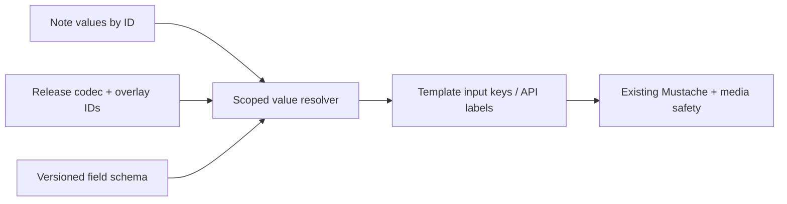

# Field value identity — thiết kế chuyển tên sang ID

> Ngày: 2026-10-12. Chế độ: **DESIGN**, phần R5 của [kế hoạch retirement](../plans/LEGACY_PROGRESS_RETIREMENT_PLAN_2026-10-12.md). Engine: MySQL 8.0; rehearsal phải có cả MySQL và SQLite.
> Phạm vi chứng cứ: code hiện tại trong worktree `nihongo-legacy-retirement`, bao gồm attachment cutover R4. **Chưa đổi storage Field/Note, chưa migrate giá trị và chưa retire FieldRenameJob.** Các column/version/codec bên dưới là đề xuất, chưa tồn tại chỉ vì được ghi trong tài liệu này.

## 1. Quyết định và ranh giới

Chọn **JSON có key là stable FieldDef ID** cho giá trị Note; giữ tên như nhãn và contract ở biên API/render. Không đổi sang EAV trong cùng đợt retirement Card/CardProgress. Sửa tên Field cuối cùng chỉ sửa schema/nhãn và invalidation cần thiết, không duyệt hay viết JSON của mọi Note.

R4 đã tách Template và bind input vào FieldDef ID, nhưng chưa tách identity của **giá trị**: `prepare_bound_fields()` vẫn đọc `source_values.get(target.name)`. Đổi tên hiện vẫn cần rewrite Note và `FieldRenameJob` vẫn phục vụ runtime.

Một Field definition, một giá trị, tên hiển thị và input key của Template là bốn thứ khác nhau. UUID của Field tồn tại qua rename; Field mới thay Field đã xóa phải có ID mới dù dùng lại cùng tên. Input key như `Question` tiếp tục là tên biến trong Mustache, được application bind vào Field ID; không thay template thành ``.

## 2. Điều tra hiện trạng và nguồn dữ liệu

| Dữ liệu / biên | Nguồn hiện hành và identity | Reader / writer đã xác minh |
| --- | --- | --- |
| Schema owned | `FieldDef.id`, scope `note_type_id`; tên unique trong NoteType | [field_def.py](../../models/field_def.py), [flashcard_content_service.py](../../app/services/flashcard_content_service.py) |
| Nội dung owned | `Note.field_values` JSON, key theo tên; không có FK cho từng key JSON | [note.py](../../models/note.py), `clean_note_field_values()` trong [flashcard_input.py](../../app/validators/flashcard_input.py) |
| Clone schema | Source Field ID + properties override; Field thêm local có ID riêng | [deck_clone_field_def_override.py](../../models/deck_clone_field_def_override.py), [deck_clone_added_field_def.py](../../models/deck_clone_added_field_def.py), [share/overlay.py](../../app/services/share/overlay.py) |
| Clone value delta | `source_field_def_id` nullable, `field_name`, `set/remove`, JSON `value`; unique cả theo tên lẫn source Field ID | [deck_clone_note_field_override.py](../../models/deck_clone_note_field_override.py), `apply_clone_note_field_overrides()` |
| Release lịch sử | Change atom có `field_def_id` và JSON before/after; checkpoint lưu JSON theo tên, decode bằng schema tại sequence checkpoint | [deck_release_change.py](../../models/deck_release_change.py), [deck_release_note_checkpoint.py](../../models/deck_release_note_checkpoint.py), [deck_release_service.py](../../app/services/deck_release_service.py) |
| Media | `MediaAsset.field_name`, unique `(note_id, sha256, field_name)`; migration audit cũng giữ field name | [media_asset.py](../../models/media_asset.py), [media_field_migration.py](../../models/media_field_migration.py), [media_staging_service.py](../../app/services/media_staging_service.py), [flashcard_media_normalizer.py](../../app/services/flashcard_media_normalizer.py) |
| Browse / search | Owned search có cast toàn JSON thành text; clone search phối hợp checkpoint name, release atom ID và override ID/name fallback | [browse_card_service.py](../../app/services/browse_card_service.py), `clone_effective_field_text_expression()` trong [browse_card_repository.py](../../app/repositories/browse_card_repository.py) |
| TTS / audio / worksheet | Field được chọn bằng tên; text extraction và destination media phụ thuộc field name | [browse_voicevox_service.py](../../app/services/browse_voicevox_service.py), [useDeckAudioScanner.ts](../../frontend/src/features/audio/hooks/useDeckAudioScanner.ts), [worksheet_service.py](../../app/services/worksheets/worksheet_service.py) |
| Import / Connect / MCP | Mapping CSV, identity-field lookup, sync comparison và note API dùng tên; nguồn external giữ identity riêng | [flashcard_import.py](../../app/services/flashcard_import.py), [note_sync_service.py](../../app/services/note_sync_service.py), [connect/actions.py](../../app/services/connect/actions.py), [connect/import_cards.py](../../app/services/connect/import_cards.py), [mcp/note_tools.py](../../app/services/mcp/note_tools.py) |
| Rendering / session | Binding input→Field ID; render context đọc tên, giữ unknown keys; artifact hashes gồm field defs/values và frozen session binding có cả ID/tên | [template_binding_service.py](../../app/services/template_binding_service.py), [flashcard_renderer.py](../../app/services/flashcard_renderer.py), [study_artifact_service.py](../../app/services/study_artifact_service.py), [study_session_service.py](../../app/services/study_session_service.py) |

### Finding A — Giá trị còn dùng tên làm identity

- **Observed:** Field có UUID nhưng Note JSON dùng tên. Owned rename tạo job rồi `.all()` toàn bộ Note thuộc user/NoteType; merge change request có một đường rewrite theo tên khác, chia batch 500 nhưng vẫn O(N).
- **Evidence:** `_rename_field_values()` trong [flashcard_content_service.py](../../app/services/flashcard_content_service.py); `_rename_note_type_field_values()` và `_remove_note_type_field_values()` trong [change_request/merge.py](../../app/services/change_request/merge.py); [field_rename_job.py](../../models/field_rename_job.py).
- **Potential concern:** Rename là schema mutation nhưng gây content write amplification và giữ nhiều row lock. Nếu JSON có cả old/new key, branch hiện tại bỏ old key; unique tên Field không chứng minh rằng JSON không có orphan target key.
- **Impact:** Đổi label trên NoteType lớn cần ghi N Note; migration không được dùng chính branch rename này để xử lý collision vì có thể mất một giá trị.
- **Unknowns:** Chưa đo phân bố orphan keys, collision, job pending/failed và số Note mỗi NoteType trong DB triển khai R5. Không suy ra các giá trị đó từ code hoặc audit progress.

### Finding B — Clone và release đã có ID nhưng còn adapter theo tên

- **Observed:** Override có stable source ID lẫn name fallback; schema view áp dụng local rename lên dict theo tên. Release reconstruction tạo `field_values_by_id`, nhưng checkpoint phải dịch name bằng schema đúng sequence.
- **Evidence:** `apply_clone_note_field_overrides()` trong [share/overlay.py](../../app/services/share/overlay.py); `_get_note_field_values_by_id_for_ids_at_release()` trong [deck_release_service.py](../../app/services/deck_release_service.py); [deck_clone_note_field_override.py](../../models/deck_clone_note_field_override.py).
- **Potential concern:** Source ID có FK `SET NULL`; một tên được dùng lại sau delete không chứng minh identity lịch sử. UUID local-added Field cũng không tự thuộc namespace source FieldDef.
- **Impact:** Map bằng schema mới nhất có thể gán dữ liệu của release cũ vào Field mới cùng tên hoặc làm mất local override. Không được rewrite checkpoint/release hash để làm chúng trông như format mới.
- **Unknowns:** Số override thiếu source ID và coverage của historical field definitions cần manifest theo install/release; hiện chưa có bằng chứng rằng mọi row đều map duy nhất.

### Finding C — Binding ổn định chưa đồng nghĩa storage ổn định

- **Observed:** Application bindings được kiểm scope Field ID; projection lại đọc value bằng `target.name`. Renderer giữ raw source, unknown keys, dotted-name compatibility và media URL helpers.
- **Evidence:** `validate_bindings()` trong [template_library.py](../../app/validators/template_library.py); `initialize_legacy_bindings()` trong [template_library_service.py](../../app/services/template_library_service.py); `prepare_bound_fields()` và `build_render_context()`.
- **Potential concern:** Đổi key DB trực tiếp khiến renderer, editor, TTS và import đọc rỗng dù bindings vẫn có ID hợp lệ.
- **Impact:** Cần một resolver có scope và format rõ ràng, rồi projection ra input keys/tên biên; không sửa Mustache sources hoặc biến array thành text để tránh lỗi.
- **Unknowns:** Cần inventory script/template nào dựa vào undeclared keys hoặc field-name helpers trước khi thay compatibility projection.

### Finding D — Tên còn tham gia media, search, fingerprint và retry

- **Observed:** Media association/rollback audit dùng field name; search có cả SQL JSON cast lẫn value-only paths; sync fingerprints và study artifact versions còn chứa dict key/name snapshots.
- **Evidence:** [media_asset.py](../../models/media_asset.py), `rollback_media_field_migration()` trong [flashcard_media_normalizer.py](../../app/services/flashcard_media_normalizer.py), `compute_note_content_hash()` trong [note_sync_service.py](../../app/services/note_sync_service.py), `content_version()` trong [study_artifact_service.py](../../app/services/study_artifact_service.py).
- **Potential concern:** UUID key xuất hiện trong JSON text search; rehash dữ liệu lịch sử theo keys mới có thể đổi idempotency hoặc khiến retry session đã cấp không khớp.
- **Impact:** Storage codec mới cần version riêng; artifact/receipt/release đã phát hành giữ bytes/fingerprint cũ. Media asset ID và `/media/proxy/<asset_id>` không đổi.
- **Unknowns:** Search parity phải phân biệt match value với match field label/key, không mặc định xem hai contract đang giống nhau. Các retention/late-retry cohort cần được kiểm trước contraction.

## 3. Invariant phải giữ trước schema change

1. Migration identity không thay giá trị: giữ raw JSON type, thứ tự, duplicate và nesting của list; không sanitize lại, flatten, trim hoặc chạy import normalizer để chuyển keys.
2. `array` là JSON list text, có thể list lồng; dữ liệu cũ còn có thể là chuỗi từng dòng. `stored_field_value()` giữ list; chỉ `field_value_text()` ở biên text/TTS/search và `fieldValueEditorText()` ở editor mới chuyển sang text. Mustache nhận list nguyên; template quyết định cách hiển thị. Xem [field_types.py](../../models/field_types.py), [arrayField.ts](../../frontend/src/lib/arrayField.ts), `_plain_context_value()`.
3. Missing, `""`, `null`, `[]` và overlay `remove` không được nhập làm một. Giữ cả bit presence và raw value trong đối chiếu; default render hiện tại không được materialize vào persisted data chỉ vì migrate.
4. Source Notes không bị copy hoặc mutate trong clone edit. Source Field ID và local-added Field ID có scope/kind rõ; label trùng không hợp nhất identity.
5. Source rename không retarget pin của release cũ. Recreate Field cùng tên là entity khác; template input binding chỉ đổi khi user thực sự rebind.
6. Note identity, presentation alias/key, NOTE scheduler state/hash/CAS, review facts, session/command receipts và external Connect IDs không đổi do đổi storage keys.
7. New requests dùng schema/version hiện hành; old frozen artifacts/retries dùng đúng codec/snapshot đã phát hành. Không tính lại historical fingerprints bằng label hiện tại.
8. Flama import **một chiều** từ Anki/text. External ordinal/name chỉ là adapter import; không thiết kế Anki export và không ép native arrays thành chuỗi theo hạn chế của Anki.

## 4. Hai phương án lưu trữ

| Tiêu chí | A — JSON key UUID | B — Relational EAV, value vẫn JSON |
| --- | --- | --- |
| Identity | `FieldDef.id` làm key trong JSON của Note | Row có `(note_id, field_id)`, một value JSON |
| Rename | Sửa schema/label, không rewrite Note | Sửa schema/label, không rewrite value row |
| Whole-note read/render | Một JSON load như hiện tại, rồi schema projection | N Field rows mỗi Note, cần batch/pivot để tránh N+1 |
| Integrity MySQL | JSON key không có FK; writer phải validate ID/scope/version | FK/unique thể hiện tốt hơn; phải phân biệt current Field row với definition lịch sử/clone-added |
| Ghi và concurrency | Một Note JSON row; sửa hai Field trên cùng Note vẫn tranh chấp row/CAS | Có thể fence từng value row, nhưng multi-field note mutation cần transaction và thứ tự lock nhất quán |
| Row/index growth | Không tạo Note×Field rows; UUID keys tăng kích thước JSON | Tăng rows và PK/FK/index theo tổng số giá trị; không tạo row default/missing |
| Search | Cần query/projection values theo ID, không cast cả key UUID như text | Predicate theo Field ID thuận hơn; value JSON/full-text vẫn cần contract/index riêng |
| SQLAlchemy/Alembic | Additive JSON column + codec, giữ pattern copy/replace dict | Model/repository mới, batch hydrate, nhiều lifecycle/FK/overlay migrations |
| Releases/overlays | Tận dụng ID atoms hiện có; version legacy checkpoint reader | Vẫn cần codec release/overlay; FK current Field không đại diện definition bị xóa ở release cũ |

**Khuyến nghị A.** Flama thường đọc/render nguyên Note, có typed JSON/array sẵn và overlay/release đã biết Field IDs. Chọn EAV chỉ sau workload chứng minh cần value-level contention hoặc querying theo Field đủ để bù row/index amplification; không suy luận từ một request rename chậm. Cả hai phương án đều giải quyết identity, batching rename theo tên không giải quyết nó.

## 5. Target contract đề xuất

### 5.1. Envelope và resolver

- Expand bằng column JSON nullable riêng, ví dụ `Note.field_values_by_id`, và marker/version riêng. Không suy format từ việc một key trông giống UUID: tên Field hợp lệ cũng có thể giống UUID.
- Add content-value revision dùng CAS và `field_schema_revision` của NoteType. Đây là revision nội dung/schema, **không dùng scheduler authority_revision thay thế**. Schema mutation phải bump revision trong cùng transaction.
- Owned JSON: `{ "<FieldDef.id>": <raw JSON value> }`. Tên chỉ nằm trong captured schema. Validation phải kiểm Field thuộc đúng NoteType/scope; một UUID hợp lệ không đủ.
- Clone resolver dùng typed identity `(source-field, source_id)` hoặc `(clone-added-field, added_id, install_id)`. Không trộn UUID của hai bảng bằng name fallback. Nếu cần JSON chung, dùng key namespace rõ ràng và codec version; chưa thêm FK giả cho các key này.
- Unknown/orphan name keys không bị bỏ. Lưu nguyên raw payload và disposition; có thể cần retained extras sidecar cho undeclared render compatibility. Chỉ backfill row khi mọi mapping cần thiết có đúng một identity và không collision.
- Media expand một stable field reference có scope; asset ID, SHA, storage path và proxy URL giữ nguyên. `field_name` lịch sử giữ để đọc/rollback audit; chưa drop column chỉ vì Note đã map ID.

### 5.2. Collision, defaults và rename

- Mapping có scope/version: exact captured name→ID của owned schema, hoặc field schema tại checkpoint/release sequence. Không case-fold, normalize Unicode hay fuzzy-match để đoán identity.
- Nếu old/new name keys cùng tồn tại, giữ cả hai vào disposition; chỉ gộp khi typed value/presence bằng nhau và có evidence identity. Khác nhau phải chặn row/group, không chọn newest/longest/non-empty.
- Field đã xóa/tạo lại, historical ID không còn live row, source ID `SET NULL`, local-added label đụng source label: cần historical definition hoặc explicit disposition; không cấp UUID mới để che thiếu provenance.
- Default/missing xử lý ở resolved view theo cùng schema snapshot. Required-field/type validation vẫn áp dụng cho write mới; không sửa dữ liệu cũ chỉ để đạt validation hiện tại.
- Trong giai đoạn dual format, rename vẫn duy trì shadow theo tên và job cũ. Chỉ bật rename O(1) sau khi Name-storage readers/writers bằng 0; old API nhận tên vẫn có thể tồn tại nếu nó resolve ID trước khi ghi.

### 5.3. Cached schema và invalidation

NoteType hiện không có một field-schema epoch riêng được khai báo trong [note_type.py](../../models/note_type.py). Đề xuất cache map ID/name/type/order theo `(note_type_id, field_schema_revision, value_codec_version)`; clone thêm `(install_id, applied_release_id, overlay_revision)`. Schema release immutable cache theo release ID/sequence; không alias nó sang schema working hiện tại.

Rename/order/type/required/add/remove bump schema revision; clone schema/value mutation bump overlay/content revision đúng scope. Invalidate TTS destination selection, editor descriptors, renderer/schema artifacts và search projection cần schema đó, không invalidate hay rewrite toàn bộ scheduler states.

Session issuance hiện đã hash effective field defs, source và binding material. Resolver mới chỉ đổi nơi đọc persisted values, vẫn freeze input keys/typed values/schema của session. Native array không đi qua cache text rồi quay lại thành string. Không cache name→ID chỉ bằng NoteType ID hoặc chỉ bằng `updated_at` của Note.

## 6. Expand → backfill → verify → cutover → contract

| Đợt | Công việc | Gate ra khỏi đợt |
| --- | --- | --- |
| F0 — Inventory | Manifest owned/clone-added/source overrides/checkpoints/media; thống kê ambiguous/orphan/collision; inventory REST/MCP/Connect/CLI/worker/frontend callers, retained releases và retry cohorts | Đủ writer/reader manifest; raw typed snapshot/restore rehearsal; unresolved có disposition, không mất khỏi accounting |
| F1 — Expand + adapters | Add nullable ID-value storage, codec/revisions; resolver biên và scoped validation; dual-write cùng transaction qua mọi writer | New/old writes parity; không startup auto-backfill; old rollout code còn dùng được; migrations fresh/upgrade MySQL+SQLite PASS |
| F2 — Backfill offline | Keyset theo Note ID, bounded batch; captured schema map; CAS value revision + schema/overlay revision; giữ raw name payload/archive | Row/schema đổi giữa read/write thì retry; mapping ambiguous fail closed; typed hashes/presence + row counts 100% đã map hoặc disposition |
| F3 — Dual-read verify | New resolver primary trong rehearsal; shadow compare named effective view, render/search/TTS/import/overlay/release | Owner + installed clone + local-added + retired pinned application + renamed/recreated field parity; arrays nested/literal dotted names/helpers không đổi |
| F4 — Cutover | Đồng bộ web/Connect/worker/CLI; version API/codec khi cần; ngừng Name-storage writes; rename dùng schema/label only | Reader/writer trace Name-storage = 0; old session/receipt retry vẫn đúng snapshot; diễn tập local rồi VPS, không copy values local đè VPS |
| F5 — Contract | Archive/restore/checksum old columns + rename job evidence; remove legacy rewrite paths; drop model/table/columns qua revision riêng | Pending/failed jobs đã disposition; metadata/startup/fresh chain không tái tạo; old wire/release codecs cần giữ đã tách khỏi runtime storage |

Backfill không dùng `str()` với list và không gọi `clean_note_field_values()` để revalidate bằng schema mới. Đối chiếu dựa trên `(scope, note ID, field identity, presence, raw typed value)`; hash của raw named payload và ID payload được lưu riêng. Hash semantic đối chiếu qua captured mapping, không mong hai JSON có keys khác nhau có raw SHA giống nhau.

MySQL transaction giữ batch nhỏ; bắt schema/value mutation bằng revision/CAS, retry collision hợp lệ, không scan N Note trong Alembic DDL hoặc mỗi request. DDL additive được rehearsal đúng MySQL version; chọn algorithm/lock sau khi kiểm engine support, không đoán rằng thêm JSON column luôn instant. Không triển khai index theo mọi dynamic Field trước khi có workload chứng minh.

## 7. Các cutover bắt buộc theo consumer

1. **Owned/edit/MCP/Connect/CSV/Anki:** resolve inbound labels/ordinals bằng declared external/schema version; write ID keys; compound uniqueness/primary identity dùng stable Field ID và normalization hiện tại. External source hash/receipt cũ giữ contract source, không rehash thành DB UUID keys. One-way import giữ nguyên.
2. **Clone/rebase/change request:** base + target + local compare theo same source ID. Added Field có namespace và install scope; promotion vào source tạo explicit mapping added-ID→new-source-ID. Không copy Note source; không xóa override vì source label đổi. Bỏ cả rewrite trong Content API lẫn `change_request.merge`, không chỉ job factory.
3. **Releases:** new checkpoints/atoms có format marker và ID values; old checkpoint decoder tiếp tục dùng schema đúng sequence. Giữ original bytes/hash/sequence/membership/template pins. Source working rename không đổi nội dung release đã publish.
4. **Media:** stage/commit/backfill/rollback audit/TTS destination đều resolve stable field; audit cũ vẫn đọc field name historical. Giữ URL proxy, CSP, richtext/Markdown sanitation và bytes asset.
5. **Search/TTS/worksheet:** value extraction qua typed resolver. Search không vô tình match UUID key mới; xác minh semantics field-label search riêng. Array text extraction chỉ ở biên; typed storage/render giữ list nguyên.
6. **Frontend/render/session:** editor state chọn Field ID và schema revision; name-based API projection vẫn có thể phục vụ old client. Frozen binding/artifact v1 đọc nguyên; retry không dùng latest labels để tái tạo fingerprint. Nếu schema đã đổi, stale edit phải refresh/fail rõ, không âm thầm ghi orphan key theo tên cũ.

## 8. Rollback và tiêu chí hoàn tất

- Trước cutover, rollback reader chỉ được dùng shadow named values nếu dual-write + schema rename parity đã chứng minh. Sau rename O(1), old named column có thể stale: không flip về old binary chỉ vì column còn tồn tại.
- Sau cutover, rollback ưu tiên release vẫn hiểu ID codec. Muốn về writer cũ cần reverse projection có schema/provenance/CAS và đối chiếu full parity trong rehearsal; sau contract phải restore archive vào DB cách ly rồi reconcile. Không dựng bảng rỗng để giả phục hồi dữ liệu.
- Storage migration không reset Note progress hoặc sửa receipts/history. `due_day` và `due_at` còn là anchors scheduling có nghĩa; không retire chúng theo tên “legacy” và không đưa schema/hash audit toàn collection vào Browse/study request.
- Validation tương lai phải có concurrent rename/edit/backfill, crash/resume, duplicate/recreated names, source deletion, NULL/missing/empty list, nested array, default/required changes, media rollback, clone rebase, retained release render, old session late retry và MySQL restore/checksum.
- **FieldRenameJob chỉ được retire** khi mọi path còn rewrite Note keys đã bằng 0, pending/failed evidence đã archive/disposition, tất cả values/scopes đã qua mapping gates và model/import/migration chain/startup đã có contraction riêng. Hiện các điều kiện đó **chưa đạt**.

## 9. Deliverable R5 hiện tại

Đã hoàn thành điều tra reader/writer và quyết định thiết kế staged. Không tạo migration, không đổi `notes.field_values`, không thêm EAV rows, không xóa `field_rename_jobs` và không tuyên bố DB đã dùng Field ID storage. Việc thực thi F0–F5 là một đợt riêng sau retirement hiện tại, dựa trên manifest dữ liệu thực tế; tên/schema cụ thể phải được chốt cùng migration IDs tại thời điểm implementation.
