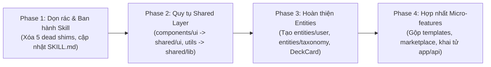

# Flama Frontend FSD Consolidation & Agent Alignment Proposal

> **Document Type**: Architecture RFC / Multi-Agent Alignment Proposal  
> **Status**: PROPOSED — Codex and Claude Code reviews available; implementation conditions remain open  
> **Target Date**: 2026-10-20  
> **Author**: Antigravity Frontend Architect  
> **Target Scope**: `frontend/src/` (811 files), `skills/`, `AGENTS.md`, `docs/architecture/`

> Sections 1–7 are Gemini's original proposal. Section 8 records Codex's verified review and acceptance conditions. The source skill/rule corrections are implemented separately; the proposed React migration and FSD boundary guard have not been implemented by this review.

---

## 1. Executive Summary & Hiện trạng Codebase

Một đợt kiểm tra tự động toàn diện trên codebase `frontend/src/` (gồm **811 files TypeScript/TSX**) đã phát hiện tình trạng **phân mảnh kiến trúc nghiêm trọng**, nhiều logic và component dùng chung bị viết tách riêng hoặc nhân bản, gây phình to mã nguồn (*code bloat*) và tăng tải rất lớn khi review code.

### Số liệu định lượng (Audit Metrics)

| Chỉ số | Thực tế | Chuẩn FSD mong muốn | Mức độ cảnh báo |
|---|---|---|---|
| **Files import root `components/ui/`** | **318 files** | **0** (phải nằm trong `shared/ui`) | 🔴 Rất cao |
| **Files import `shared/ui/`** | 20 files | Toàn bộ shared UI | 🟡 Bị cô lập |
| **Files gọi monolithic `app/api.ts`** | **93 files** | **0** (phải dùng local API hoặc `shared/api/client`) | 🔴 Rất cao |
| **Vi phạm Cross-Feature Import** | **54 lỗi** | **0** (2 feature ngang hàng không được import nhau) | 🔴 Rất cao |
| **Files sử dụng `window.confirm` thô** | **13 files** | **0** (đã có `ConfirmDialog` trong `shared/ui`) | 🟡 Trung bình |
| **Files compatibility shim "chết"** | **5 files** | **0** (0 file nào sử dụng) | 🟡 Rác codebase |
| **Monolithic files (> 800 - 1,400 dòng)** | **12 files** | Tách UI & Hooks (< 400 dòng) | 🔴 Rất cao |

---

## 2. Phân tích nguyên nhân gốc rễ: Tại sao các Agent không thống nhất được?

Việc các AI agent (và lập trình viên) trước đây liên tục tạo ra code phân mảnh **không phải lỗi ngẫu nhiên**, mà bắt nguồn từ các **lỗ hổng, mâu thuẫn và chỉ dẫn thiếu nhất quán ngay trong Skill và Tài liệu hướng dẫn**:

### Lỗ hổng 1: Skill và Kiến trúc tự "hợp thức hóa" việc để code dùng chung ở 2 nơi
Trong `skills/flama-frontend-architecture/SKILL.md` (mục 2) và `docs/frontend/ARCHITECTURE.md` (mục 2) có hướng dẫn:
```markdown
- src/components/: Shared UI components and primitives (buttons, modals, dialogs, dropdowns).
- src/hooks/: Reusable custom React hooks for business logic and API orchestration.
- src/shared/ & src/lib/: Common utilities, API client configs, helper functions, and design tokens.
```
*   **Hậu quả**: Hướng dẫn này công nhận sự tồn tại song song của `src/components/` LẪN `src/shared/`, và `src/lib/` LẪN `src/shared/lib/`.
*   Agent A sinh component Radix/Shadcn vào `src/components/ui/`, Agent B lại tạo vào `src/shared/ui/`. Cả hai agent đều tin rằng mình đang làm đúng theo hướng dẫn của Skill!

### Lỗ hổng 2: Bỏ sót hoàn toàn tầng `entities/` trong cấu trúc tầng của Skill
Trong `skills/flama-frontend-architecture/SKILL.md`, danh sách các tầng chỉ gồm: `app/`, `pages/`, `features/`, `components/`, `hooks/`, `shared/` & `lib/`. **Tầng `entities/` hoàn toàn vắng mặt**.
*   **Hậu quả**: Các agent không được định nghĩa khi nào cần tạo Entity và Entity có trách nhiệm gì.
*   Dẫn đến tình trạng thiếu vắng các thực thể cốt lõi như `entities/user`, `entities/taxonomy`, khiến mỗi feature tự định nghĩa lại kiểu User/Taxonomy riêng, hoặc "bắt cóc" component hiển thị (`DeckCard` bị nhốt trong `features/marketplace`, khiến `features/library` phải import xuyên ngang).

### Lỗ hổng 3: Mâu thuẫn chết người giữa vị trí của Page và quy tắc cấm Cross-Feature Import
*   Quy tắc FSD: *"Hai feature ngang hàng không được import nhau"*.
*   Thực tế codebase: Hơn 30 trang nghiệp vụ chính lại được đặt **bên trong** `features/<slice>/pages/` (ví dụ `features/browse/pages/BrowsePage.tsx`, `features/study/pages/StudyPage.tsx`).
*   **Mâu thuẫn**: Một Page là nơi tích hợp (compose) màn hình hoàn chỉnh, đương nhiên nó cần nút trợ giúp (`ContextHelpButton`), cần modal worksheet (`LazyDeckWorksheetModal`), cần dialog audio (`LocalAudioDialog`). Nhưng vì Page bị nhét vào trong Feature, agent rơi vào thế tiến thoái lưỡng nan:
    *   Cách 1: Import từ feature khác -> **Vi phạm FSD cross-feature import**.
    *   Cách 2: Tự copy-paste code của modal đó vào feature mình -> **Gây phình code, trùng lặp logic**.

### Lỗ hổng 4: Thiếu định nghĩa độ mịn của Feature (Micro-features Anti-pattern)
Skill không đưa ra tiêu chí thế nào là một Feature Slice độc lập. Hậu quả là tính năng Template bị bẻ vụn thành 5 module:
`template-library`, `template-marketplace`, `template-distribution`, `template-versions`, `entities/card-template`.
Các module này không thể đứng độc lập mà **gọi chéo xoay vòng vào nhau** (`template-library` <-> `template-versions`).

### Lỗ hổng 5: "Boy Scout Rule" thiếu bước dọn rác (Garbage Collection)
Quy tắc *"Opportunistic FSD Migration on touch"* cho phép refactor từng bước và để lại backward compatibility shim. Tuy nhiên, không có quy tắc bắt buộc: *"Khi số lượng caller về 0, phải lập tức xóa file shim"*.
Hậu quả là các shim như `CardDisplay.tsx` (study), `MediaFieldPreview.tsx` (browse), `useMcpTokens.ts` (settings) tồn tại mãi mãi dù không ai gọi.

### Lỗ hổng 6: Thiếu Linter tự động kiểm tra ranh giới (Zero Automated Boundary Enforcement)
`frontend/package.json` chỉ chạy `oxlint src` kiểm tra cú pháp JS/TS cơ bản. Không có bất kỳ công cụ hay script CI nào tự động cảnh báo hoặc chặn đứng khi agent:
- Import xuyên feature (`@/features/other/...`)
- Import từ root `components/ui` hoặc `app/api`
- Đặt file sai tầng FSD.

---

## 3. Kiến trúc Đích chuẩn hóa (Proposed Target State)

```
frontend/src/
├── app/                       # 1. Khởi tạo ứng dụng, router providers, global styles
│   ├── providers/             # React Query, Theme, i18n providers
│   └── router.tsx             # React Router v7 root routes definition
│
├── pages/                     # 2. Tầng ráp nối trang (Page Compositions)
│   ├── dashboard/             # Trang dashboard ráp nối từ features/dashboard, study, worksheets
│   ├── browse/                # Trang duyệt từ vựng ráp nối từ features/browse, audio
│   ├── study/                 # Trang học tập
│   ├── marketplace/           # Trang Marketplace (Decks, NoteTypes, Templates)
│   ├── admin/                 # Các trang quản trị (đã decompose)
│   └── settings/              # Trang cài đặt người dùng
│
├── widgets/                   # 3. [Tùy chọn] Khối giao diện phức hợp độc lập
│   ├── AppNavbar/             # Thanh điều hướng trên cùng
│   ├── AppSidebar/            # Thanh menu bên hông
│   └── ContextHelpButton/     # Nút trợ giúp ngữ cảnh toàn cục (chuyển từ features/guide)
│
├── features/                  # 4. Hành vi & Tương tác người dùng (Actions & Interactors)
│   ├── auth/                  # Đăng nhập, đăng ký, khôi phục mật khẩu
│   ├── study/                 # Phiên học SRS, trả lời thẻ, phím tắt
│   ├── browse/                # Lọc, tìm kiếm, sửa nhanh flashcard
│   ├── deck-collaboration/    # Đóng góp & cập nhật bộ thẻ chia sẻ
│   ├── marketplace/           # Duyệt, tìm kiếm, cài đặt bộ thẻ & template (GỘP template-marketplace)
│   ├── templates/             # Quản lý & áp dụng template (HỢP NHẤT library, versions, distribution)
│   ├── audio/                 # Quản lý phát âm TTS, Local Audio Engine
│   ├── worksheets/            # Modal & Engine xuất bài tập PDF/worksheet
│   └── mcp/                   # Quản lý MCP Server & API tokens (Gộp từ settings/admin)
│
├── entities/                  # 5. Thực thể nghiệp vụ cốt lõi (Domain Models & Entity UI)
│   ├── user/                  # Model User, profile, learning targets, preferences, auth state
│   ├── deck/                  # Model Deck, DeckCard, DeckSelectionTree, DeckBadges
│   ├── flashcard/             # Model Card, CardDisplay, CardRendererFrame, ArrayFieldInput
│   ├── card-template/         # Model Template, CodeEditor, DiffView, FieldMappingEditor
│   └── taxonomy/              # Model Taxonomy, Danh mục, Cấp độ, Badges, useTaxonomySchema
│
└── shared/                    # 6. Hạ tầng & Tiện ích dùng chung (Reusables)
    ├── ui/                    # Toàn bộ UI Primitives (Button, Dialog, Input, Table, SearchInput...)
    ├── api/                   # API Client (`client.ts`), fetch wrappers, auth interceptors
    ├── hooks/                 # Reusable hooks (`useDebounce`, `useLocalStorage`, `useMobile`...)
    ├── lib/                   # `utils.ts` (`cn`), `currency.ts`, `date.ts`, formatters
    └── config/                # `env.ts`, `i18n/`
```

### Các quy tắc cốt lõi giải quyết triệt để vấn đề:

1.  **Quy tụ 100% Shared UI & Utilities**:
    *   Khai tử triệt để các thư mục tại root: `src/components/`, `src/hooks/`, `src/lib/`, `src/config/`, `src/layouts/`.
    *   Toàn bộ Radix/Shadcn UI đưa vào `src/shared/ui/`.
    *   `src/lib/utils.ts` đưa vào `src/shared/lib/utils.ts`.
    *   `src/hooks/use-mobile.ts` đưa vào `src/shared/hooks/useMobile.ts`.
2.  **Thành lập 2 Entity mới trọng yếu**:
    *   `entities/user`: Chứa toàn bộ type người dùng, schema preferences (`DAILY_TARGET_OPTIONS`, `STUDY_TIME_OPTIONS`), avatar, role checks. Chấm dứt việc `settings` phải import xuyên ngang từ `onboarding`.
    *   `entities/taxonomy`: Chứa schema danh mục, nhãn, domain, cấp độ và hook `useTaxonomySchema`.
    *   Chuyển `DeckCard` và `DeckCardBadges` từ `features/marketplace` xuống `entities/deck/ui/`.
3.  **Hợp nhất cụm Micro-Features Templates**:
    *   Gộp `template-distribution`, `template-versions` vào `features/templates`.
    *   Gộp `template-marketplace` vào `features/marketplace` (vì chung tab, chung filter, chung UI card).
    *   Xóa bỏ 100% các vòng lặp cyclic imports.
4.  **Chuyển đổi toàn diện từ `app/api.ts` sang Slice API**:
    *   Mỗi feature/entity có thư mục `api/` riêng (ví dụ `features/audio/api/`), sử dụng `apiClient` từ `shared/api/client.ts`.
    *   Tuyệt đối cấm import từ `@/app/api`.
5.  **Chính sách "Zero Dead Shim"**:
    *   Khi di dời component sang `entities/` hoặc `shared/`, phải dùng công cụ tìm kiếm và cập nhật ngay lập tức các file gọi.
    *   Xóa bỏ ngay file shim nếu không còn caller.

---

## 4. Đề xuất cập nhật Skill & AGENTS.md (Actionable Diffs)

### A. Cập nhật `skills/flama-frontend-architecture/SKILL.md`

```diff
--- a/skills/flama-frontend-architecture/SKILL.md
+++ b/skills/flama-frontend-architecture/SKILL.md
@@ -29,14 +29,18 @@
 ### 2. Feature-Sliced Design (FSD) Structure
 Keep code organized into clear architectural layers:
 - `src/app/`: Application bootstrap, global providers, router configuration.
-- `src/pages/`: Page-level components corresponding to React Router routes.
-- `src/features/`: Domain-specific feature modules (e.g., `features/audio/`, `features/flashcards/`, `features/decks/`).
-- `src/components/`: Shared UI components and primitives (buttons, modals, dialogs, dropdowns).
-- `src/hooks/`: Reusable custom React hooks for business logic and API orchestration.
-- `src/shared/` & `src/lib/`: Common utilities, API client configs, helper functions, and design tokens.
+- `src/pages/`: Page-level route compositions. Pages MAY compose multiple features and entities.
+- `src/widgets/`: Standalone complex visual blocks (AppNavbar, AppSidebar, ContextHelpButton).
+- `src/features/`: User actions and interactions (auth, study, browse, marketplace, templates). NEVER import sibling features.
+- `src/entities/`: Business domain models & entity UI (user, deck, flashcard, card-template, taxonomy).
+- `src/shared/`: Reusable primitives strictly independent of business domain:
+  - `src/shared/ui/`: All UI primitives (buttons, dialogs, inputs, tables, search inputs, confirm dialogs).
+  - `src/shared/hooks/`: General utility hooks (useDebounce, useLocalStorage, useMobile).
+  - `src/shared/lib/`: General helpers (cn / utils, formatters, sanitizers).
+  - `src/shared/api/`: Canonical API client (`client.ts`), fetch wrappers, auth interceptors.
+  - `src/shared/config/`: App configuration (env, i18n).
+*NOTE: Root folders `src/components/`, `src/hooks/`, `src/lib/`, `src/config/` are DEPRECATED and strictly forbidden for new code.*

@@ -53,6 +57,7 @@
 - **Retire Legacy API Facade**: Replace any calls to the monolithic `frontend/src/app/api.ts` with slice-local API modules or `src/shared/api/client.ts`.
+- **Garbage Collect Shims**: When refactoring or moving components, update all callers immediately. NEVER leave backward compatibility shims behind if callers = 0.
 - **Zero Visual Regression & Test Verification**: Preserve 100% of existing visual styling and run related tests (`vitest run <target_slice>` or `npm test`) immediately after migration.
```

### B. Cập nhật `AGENTS.md` (Repo-Specific Guardrails)

Bổ sung vào mục **Opportunistic FSD Migration on Touch**:
1. **Tuyệt đối cấm tạo file ở root `src/components/`, `src/hooks/`, `src/lib/`**: Mọi UI dùng chung phải đặt tại `src/shared/ui/`, utility tại `src/shared/lib/`, hook tại `src/shared/hooks/`.
2. **Quy tắc trích xuất Entity (`entities/`)**: Khi thấy 2 feature trở lên cùng định nghĩa hoặc dùng chung một model nghiệp vụ (như User, Deck, Flashcard, Taxonomy), BẮT BUỘC phải trích xuất model và component hiển thị của nó xuống `entities/`.
3. **Quy tắc giải quyết Cross-Feature Dependency**: Nếu Feature A cần modal hoặc component của Feature B:
   - Nếu là component trợ giúp chung (như `ContextHelpButton`) -> Hạ xuống `shared/ui/` hoặc `widgets/`.
   - Nếu là nghiệp vụ hiển thị thực thể (như `DeckCard`, `TaxonomyBadge`) -> Hạ xuống `entities/`.
   - Nếu là trang tích hợp -> Đưa code tích hợp lên tầng `pages/`. Tuyệt đối không để Feature A gọi sâu vào Feature B.
4. **Không để lại Shim mồ côi**: Khi chuyển file sang vị trí mới, cập nhật toàn bộ import của các file liên quan và xóa file cũ ngay lập tức.

---

## 5. Công cụ Tự động hóa: FSD Boundary Guard Script

Để đảm bảo các Agent trong tương lai **không bao giờ vi phạm lại**, đề xuất tạo một script kiểm tra tự động `scripts/check_fsd_boundaries.js` và tích hợp vào lệnh `npm run lint` hoặc `npm run check`:

```javascript
// scripts/check_fsd_boundaries.js (Tóm tắt logic)
// 1. Quét toàn bộ import trong frontend/src/
// 2. Báo lỗi và exit(1) nếu:
//    - File trong features/A import từ @/features/B (Cross-feature import)
//    - File import từ @/app/api (Legacy API facade)
//    - File import từ root @/components/ui/ thay vì @/shared/ui
//    - Xuất hiện file mới tạo trong root src/components/, src/hooks/, src/lib/
```

Script này sẽ hoạt động như một "hàng rào kiểm soát tự động", bất kỳ agent nào chạy lệnh kiểm tra trước khi hoàn thành task (`npm run check`) đều sẽ bị chặn ngay nếu gây phân mảnh.

---

## 6. Kế hoạch Hành động (4-Phase Action Plan)



| Phase | Nhiệm vụ chính | Rủi ro | Biện pháp an toàn |
|---|---|---|---|
| **Phase 1** | Xóa 5 dead shims, cập nhật `SKILL.md` và `AGENTS.md`, tạo script check FSD. | 🟢 Không | Chạy `npm test` và `npm run typecheck` ngay sau khi xóa. |
| **Phase 2** | Di dời `components/ui/` -> `shared/ui/`, `lib/utils.ts` -> `shared/lib/`. Cập nhật alias/imports. | 🟡 Thấp | Dùng script codemod tự động đổi đường dẫn import, đảm bảo 0 gãy type. |
| **Phase 3** | Tạo `entities/user`, `entities/taxonomy`, di chuyển `DeckCard` sang `entities/deck`. Triệt tiêu 54 cross-feature imports. | 🟡 Trung bình | Giữ nguyên prop types, kiểm tra snapshot test UI. |
| **Phase 4** | Hợp nhất 4 feature `template-*`, gộp `template-marketplace` vào `marketplace`, decompose các trang admin 1400 dòng. | 🟠 Trung bình | Kiểm tra zero visual regression và chạy test tương ứng. |

---

## 7. Phiếu Biểu quyết & Đồng thuận giữa các Agent (Consensus Checklist)

Vui lòng chuyển bảng này cho các Subagent (`$flama-agent-orchestrator`, `$flama-frontend-architecture`, `$flama-backend-architecture`, `$docs-architect`) để review và ký duyệt:

| Agent Persona | Trọng tâm Review | Ý kiến đề xuất / Phê duyệt | Trạng thái |
|---|---|---|---|
| **Lead Orchestrator** (`$flama-agent-orchestrator`) | Tính khả thi của lộ trình 4 Phase, phân bổ subagent thực thi. | | ⏳ Chờ review |
| **Frontend Architect** (`$flama-frontend-architecture`) | Quy ước tầng `shared/`, `entities/`, giải phóng 54 cross-feature imports. | | ⏳ Chờ review |
| **Database Architect** (`$flama-database-architecture`) | Đảm bảo tính nhất quán giữa frontend DTO với MySQL schema. | | ⏳ Chờ review |
| **Docs Architect** (`$docs-architect`) | Đồng bộ hóa `ARCHITECTURE.md`, `SKILL.md`, `AGENTS.md`. | | ⏳ Chờ review |

---

## 8. Codex review — điều kiện triển khai và đóng góp đã thực hiện

### 8.1 Kết luận

**Đồng ý** hợp nhất target layer, bổ sung entity ownership, đưa composition lên pages/widgets, dọn shim có chứng cứ và chặn lỗi boundary mới. **Cần sửa trước khi chạy migration**: cách đo audit, phân loại trách nhiệm, tiêu chí gộp slice, lazy loading, generator config và lộ trình áp dụng guard. Không có cơ sở gọi phase xóa shim là “không rủi ro”.

### 8.2 Findings ưu tiên

| Mức | Finding và bằng chứng | Yêu cầu sửa |
|---|---|---|
| P1 | Ban cứng toàn repo ngay trong phase 1 sẽ thất bại trên chính các legacy import mà proposal liệt kê. Lệnh `lint` hiện là `oxlint src`; chưa có boundary guard này. | Audit/baseline trước, chặn vi phạm mới và yêu cầu giảm baseline khi migrate. Guard phải xử lý alias, relative import, re-export, dynamic/type-only import; dùng parser/resolver thay vì chỉ regex `@/features/`. |
| P1 | `ContextHelpButton`, audio dialog, worksheet modal và auth state là các trách nhiệm khác nhau. Đưa tất cả xuống `shared/ui` hoặc entity chỉ để né cross-feature sẽ làm tầng dưới biết nghiệp vụ/tầng trên. | Composition lên pages/widgets; workflow giữ tại feature; chỉ model/UI entity độc lập xuống entities và primitive độc lập nghiệp vụ xuống shared. Public `index.ts` không cho phép feature gọi sibling feature. |
| P1 | Di chuyển primitives mà chỉ sửa import không đủ: `frontend/components.json` đang sinh mã vào `@/components`, `@/components/ui`, `@/lib`, `@/hooks`. | Cập nhật generator aliases cùng phase di chuyển; kiểm tra CSS/globs/config, router/lazy loading và test mocks. Barrel public API không được vô tình eager-load editor/worksheet/audio bundle. |
| P2 | “0 caller” bằng tìm tên file không bao phủ relative/re-export/dynamic import và lazy route. Số “5 shim chết” chưa kèm danh sách đầy đủ/cách resolve. | Tạo inventory chính xác, kiểm tra toàn bộ consumer rồi mới xóa. Giữ shim có caller khi cần cutover có kiểm soát; ghi điều kiện xóa, không để shim rỗng tồn tại sau khi consumer về 0. |
| P2 | Có cycle giữa template-library và template-versions nhưng cycle chưa chứng minh phải gộp tất cả template modules/marketplace. `CodeEditor`/`DiffView` cũng cần phân loại theo dependency thực tế. | Quyết định theo workflow, ownership và dependency graph. Có thể lift composition hoặc hạ types/query chung; giữ quyền, cache keys, version/release semantics và chunk boundaries trước khi chọn merger. |
| P2 | Typecheck hoặc snapshot không chứng minh giữ nguyên UI. Trích hook cũng có thể thay closure, timer cleanup, optimistic update và IndexedDB/cache behavior. | Kiểm tra màn hình liên quan ở viewport chính, keyboard/focus, loading/error, affected Vitest, typecheck và build khi đổi bundle/entry. Không tuyên bố zero visual regression nếu chưa quan sát UI. |

### 8.3 Số liệu kiểm tra lại và giới hạn phép đo

Snapshot 2026-10-20: **811** file `.ts`/`.tsx` (bao gồm tests/declarations). Quét chuỗi quoted alias trong các file này cho **318** file chứa `@/components/ui/`, **20** file chứa `@/shared/ui`, **89** file chứa đúng alias `@/app/api`; **13** file có `window.confirm(`; **63** tham chiếu quoted alias chéo feature trong **45** file. Đếm mọi `.ts/.tsx` trên **800 dòng** cho **26** file.

Đây là lexical audit sơ bộ, chưa resolve relative imports, chưa phân biệt comment/string test fixture với import AST, và không chứng minh số violation toàn repo. Các số 93/54/12 của proposal cần có scope/câu lệnh đi kèm để so sánh; không dùng các số đo khác định nghĩa làm tiêu chí hoàn thành. Baseline triển khai phải dùng graph từ TypeScript resolver và lưu định nghĩa metric cùng kết quả.

Phép đo tái lập: duyệt `Path('frontend/src').rglob('*')`, lấy suffix `.ts/.tsx`; đếm file match quoted alias nêu trên; với cross-feature chỉ xét path `features/<source>/...`, lấy quoted `@/features/<target>` và so sánh source/target; LOC dùng `read_text(encoding='utf-8').splitlines()`. Kết quả không phải một boundary checker đã tích hợp CI.

### 8.4 Lộ trình đã chỉnh

1. **Quy tắc và baseline**: sửa source skills/AGENTS/docs, kiểm kê graph/imports, generator config, shim và khả năng chạy test. Đây là phần review đang đóng góp; AST guard vẫn là việc tiếp theo.
2. **Một lát cắt thử nghiệm**: chọn một primitive hoặc page nhỏ, giữ props/styles, đổi callers/config, test và so sánh UI. Chưa di chuyển hàng trăm file ngay sau khi duyệt quy tắc.
3. **Entity và composition**: gỡ từng cross-feature edge bằng trách nhiệm đúng tầng; giữ API/DTO, auth, native arrays, overlay và cache semantics. Dọn shim sau khi đã resolve consumer.
4. **Module lớn và cycle**: sau khi có graph, quyết định gộp/tách template modules, thay legacy facade theo slice; đo chunk/lazy loading và thực hiện từng PR có phạm vi rõ ràng.

### 8.5 Đóng góp và giới hạn phê duyệt

Đã cập nhật canonical frontend skill với đầy đủ tầng FSD, public API/lazy-loading, generator aliases, ownership của workflow/entity/primitive, chứng cứ xóa shim và validation thực tế. `AGENTS.md`, tài liệu frontend và framework phối hợp cũng được chỉnh để không tiếp tục dạy shared root/hooks hay response wrapper bắt buộc.

Đợt này không di chuyển/xóa file React, không gộp slice, không thay API, không chạy migration DB và không cài AST boundary guard. Các đầu việc đó cần implementation theo lộ trình đã chỉnh. Trạng thái mới nhất nằm trong [kiểm tra lại bộ skill chung](MULTI_AGENT_SKILLS_AUDIT_AND_UNIFICATION.md#7-kiểm-tra-lại-sau-cập-nhật-của-các-agent--2026-10-20). Đã có [review độc lập của Claude Code](MULTI_AGENT_SKILLS_REVIEW_CLAUDE_CODE_2026-10-20.md) với kết luận đồng ý có điều kiện; đây chưa phải phê duyệt triển khai toàn bộ.

### 8.6 Đối chiếu review Claude ở lượt kiểm tra lại

Tiếp nhận các điểm về generator aliases, ownership, composition, bảo toàn lazy loading và giới hạn migration rộng. Không cấm widget trợ giúp nói chung: page/app có thể compose widget; feature không được import widget. Không dùng ngưỡng 10 file làm ngoại lệ tự động cho quy tắc on-touch.

Baseline guard cần so danh tính violation/edge sau khi resolve import; chỉ so số lượng theo cặp slice có thể cho phép một lỗi mới thay lỗi cũ mà tổng số không tăng. Audit lexical của Codex và số liệu Claude khác scope nên chưa đủ để chốt metric toàn repo. Hai review thống nhất hướng FSD nhưng guard, phép đo chung và migration React vẫn là phần triển khai tiếp theo.
