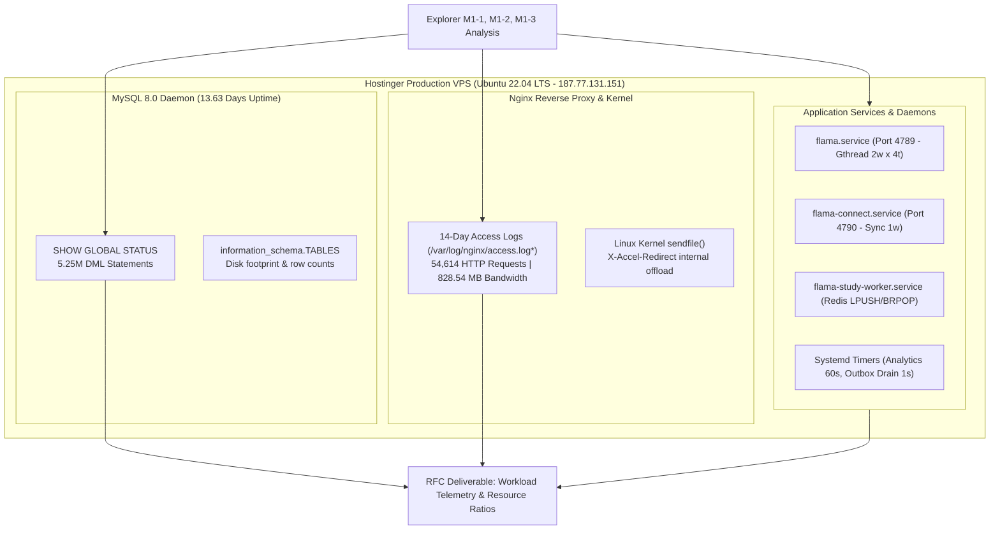
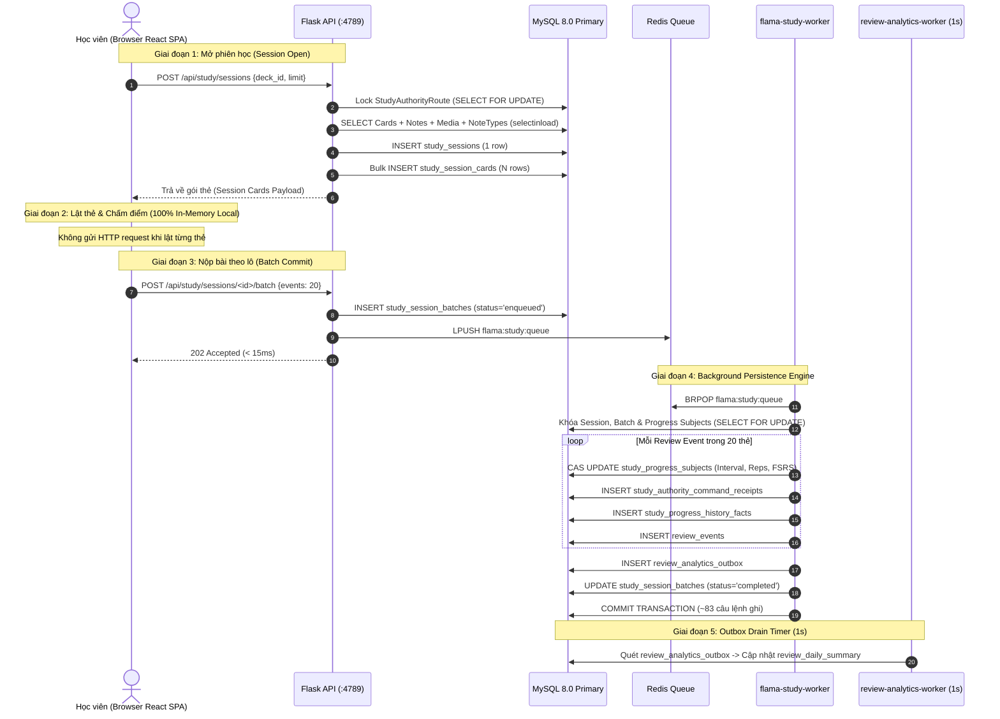
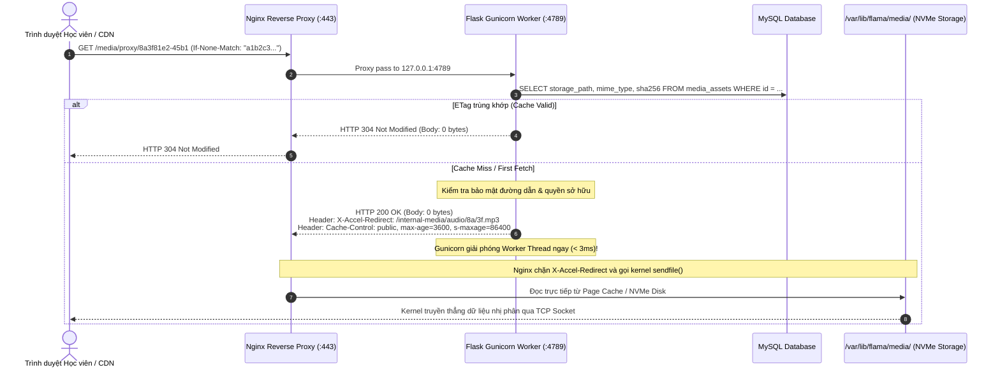
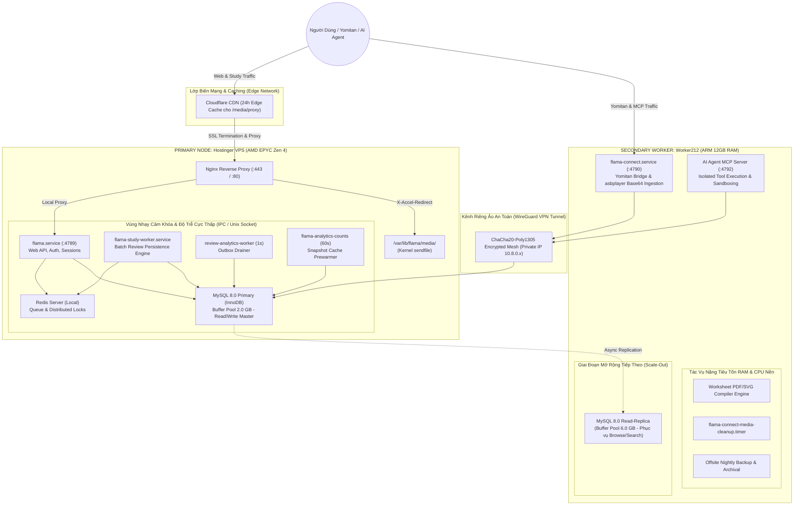

# RFC: Flama Workload Telemetry & Resource Ratios
**Báo cáo Đo đạc Thực tế Khối lượng Tải & Căn cứ Phân bổ Kiến trúc Hạ tầng**

- **Mã tài liệu**: `RFC-ARCH-2026-10-31-01`
- **Ngày công bố**: 2026-10-31
- **Trạng thái**: Hoàn thành (Empirical Telemetry & Architectural RFC)
- **Tác giả**: Teamwork Telemetry Architecture Group (Worker M2-3 / Sentinel Review)
- **Đối tượng áp dụng**: Ban Kiến trúc Hệ thống Flama, Kỹ sư Vận hành Hạ tầng, Database Administrator

---

## 1. Executive Summary & Bối cảnh

### 1.1. Bối cảnh & Mục tiêu Nghiên cứu
Hệ sinh thái Flama là nền tảng học tiếng Nhật và quản lý bộ nhớ ngắt quãng (SRS - Spaced Repetition System) kết hợp khai thác từ vựng đa phương tiện (Yomitan / asbplayer Mining), phục vụ media flashcard (audio, ảnh minh họa), và tích hợp trí tuệ nhân tạo thông qua giao thức Model Context Protocol (MCP).

Nhằm xác định chiến lược mở rộng hạ tầng khoa học, tối ưu hóa ngân sách vận hành và lựa chọn kiến trúc phân bổ tải hợp lý giữa cụm máy chủ **Hostinger VPS (AMD EPYC Zen 4, hiệu năng đơn nhân cao)** và máy chủ phụ trợ **Worker212 (ARM 12GB RAM, dung lượng bộ nhớ lớn)**, báo cáo này tiến hành đo đạc thực chứng trên môi trường Hostinger Production đang vận hành liên tục, kết hợp với phân tích chi tiết mã nguồn và luồng dữ liệu 4 phân hệ cốt lõi.

### 1.2. Kết quả Đo đạc Trọng yếu (Key Telemetry Highlights)

```
┌────────────────────────────────────────────────────────────────────────────────────────┐
│                        FLAMA PRODUCTION TELEMETRY AT A GLANCE                          │
├────────────────────────────────┬───────────────────────────────────────────────────────┤
│ MySQL Uptime Quan sát          │ 13.63 ngày liên tục (1,178,086 giây)                  │
│ Tổng lệnh DML thực thi         │ 5,254,453 câu lệnh (4.81M SELECT, 448K INSERT/UPDATE) │
│ Tỷ lệ Đọc : Ghi Thô (Raw DML)  │ 91.47% Read  :  8.53% Write  (~ 10.7 : 1)             │
│ Tỷ lệ Tải Hữu Cơ (Organic)     │ 86.70% Read  : 13.30% Write  (~  6.5 : 1)             │
│ InnoDB Buffer Pool Hit Rate    │ 98.85% (2.0 GB RAM, 98.17% utilization, 0 dirty page) │
│ Tranh chấp Khóa Hàng (Locks)   │ 4 lượt row lock waits trong 13.6 ngày (near-zero)     │
│ Lưu lượng Media (/media/proxy) │ 16.79% tổng requests nhưng chiếm 38.47% tổng bandwidth │
│ Cơ chế Offload Media           │ X-Accel-Redirect kernel sendfile (100% bypass Python) │
│ Bất đối xứng Kích thước Media  │ 162.8 KiB/tệp vs 11.2 KiB/payload JSON (14.5x)        │
│ Flama Connect & AI Agent (MCP) │ 3.75% requests, rủi ro burst Base64 & CPU bottleneck  │
└────────────────────────────────┴───────────────────────────────────────────────────────┘
```

1. **Phân biệt Rạch ròi Tỷ lệ Đọc/Ghi Thô (91.47% : 8.53%) vs Tải Hữu cơ của Người dùng (86.70% : 13.30%)**:
   - **Tỷ lệ Thô (Raw Telemetry)**: Biến toàn cục MySQL `SHOW GLOBAL STATUS` ghi nhận 91.47% SELECT (4,806,163) vs 8.53% Write (448,290), tạo cảm giác hệ thống đọc áp đảo (~10.7 : 1).
   - **Tác động của Background Polling**: Daemon `flama-study-worker` chạy hàm `probe_study_worker_database()` định kỳ 5.0s (quét 7 bảng thực thể qua `SELECT ... LIMIT 0` để kiểm tra schema/liveness) và `recover_admitted_study_batches()` định kỳ 5.0s (quét 1 bảng). Trong 13.63 ngày, tiến trình này tự sinh ra **1,884,937 câu SELECT nhân tạo**, chiếm tới **39.22% tổng số SELECT của toàn hệ thống**.
   - **Tải Hữu cơ Thực tế (Organic Learner Workload)**: Khi bóc tách lượng truy vấn nhân tạo này, tỷ lệ thực tế từ người dùng học tập và duyệt web là **86.70% Read : 13.30% Write (~6.5 : 1)**. Tải ghi thực sự nặng hơn **1.56 lần** so với số đo thô, đặc biệt tập trung cao độ trong luồng hoàn tất bài học (Study Review Commit: trung bình **4.15 câu lệnh ghi DB/lượt review thẻ**).
2. **Bất đối xứng Kích thước Tệp Media (14.5x) và Chi phí Tra cứu Metadata tại Gunicorn**:
   - Media streaming chiếm **38.47% tổng băng thông** (318.71 MB) dù chỉ chiếm **16.79% requests** (9,170 reqs). Nguyên nhân không phải do rò rỉ socket mà do **đặc tính bất đối xứng tự nhiên của kích thước payload**: tệp media trung bình đạt **162.8 KiB** (âm thanh MP3 và ảnh minh họa WebP/JPEG), lớn gấp **14.5 lần** so với payload API JSON trung bình (**11.2 KiB**).
   - Cơ chế `X-Accel-Redirect` và Linux kernel `sendfile` chuyển giao 100% việc truyền nhị phân cho Nginx (0 byte qua Python Gunicorn). Tuy nhiên, do Nginx hiện chưa bật `proxy_cache` cục bộ, toàn bộ **9,170 requests** (kể cả 7,211 requests trả lời HTTP 304 Not Modified) vẫn chuyển về Gunicorn cổng 4789, tiêu tốn **9,170 câu lệnh SELECT** tra cứu metadata trên bảng `media_assets` và chiếm dụng slots trong connection pool.
3. **Flama Connect & MCP: Độc lập Connection Pool giữa Hai Cổng :4789 và :4790**:
   - Cổng Web API `:4789` (`flama.service`, chạy `wsgi.py`) và Cổng Connect/MCP `:4790` (`flama-connect.service`, chạy `connect_wsgi.py`) là **hai tiến trình hệ điều hành (OS processes) độc lập**, sở hữu hai thể hiện SQLAlchemy `QueuePool` riêng biệt trong bộ nhớ tiến trình (mỗi pool 4+1 = 5 slots).
   - Do đó, lưu lượng gọi tool dồn dập (burst tool chains) của AI Agent trên cổng 4790 **không làm cạn kiệt Connection Pool của người dùng web trên cổng 4789**. Điểm nghẽn thực sự của cổng 4790 nằm ở việc giải mã Base64 (2MB–4MB) từ asbplayer trên single-worker làm nghẽn CPU đơn luồng trong 150–400ms.
4. **Khuyến nghị Kiến trúc Cốt lõi & Giải pháp Hạ tầng Phân tán**:
   - **Giữ cố định trên Hostinger VPS (Primary Node)**: MySQL 8.0 Primary, Redis Server (chỉ bind `127.0.0.1`), `flama.service` (Web API :4789), và `flama-study-worker.service`.
   - **Bản chất Sụp đổ WAN RTT của `study_worker`**: Bảng `StudyProgressSubject` được phân vùng (partition) nghiêm ngặt theo `learner_user_id`, do đó **không có tranh chấp khóa hàng giữa 2 học viên khác nhau**. Điểm nghẽn chí tử khi đưa `study_worker` qua mạng WAN (40ms RTT) là **Worker Throughput Collapse**: thời gian xử lý 1 batch 20 thẻ (gồm ~83 câu lệnh SQL tuần tự) bị đội từ 6.9ms lên **3,320ms (3.32 giây)**, khiến thông lượng worker tụt dốc từ **145 jobs/s xuống chỉ còn 0.3 job/s**, gây dồn ứ vô hạn trong hàng đợi Redis và cạn kiệt connection pool. Vì vậy, `study_worker` **bắt buộc phải chạy cùng localhost với MySQL và Redis**.
   - **Tách sang Worker212 (ARM 12GB RAM)**: Cổng Flama Connect Gateway (`:4790`), AI Agent MCP endpoints, các batch jobs nặng (Worksheet PDF/SVG, cleanups), và tương lai là MySQL Read-Replica.
   - **Giải quyết Triệt để Media Storage Siloing**: Khắc phục lỗ hổng tệp media khai thác từ asbplayer lưu trên Worker212 bị lỗi 404 khi học trên Hostinger bằng giải pháp **Object Storage dùng chung (Cloudflare R2 / MinIO)** hoặc **Stream trực tiếp file tải lên về Hostinger qua WireGuard VPN**.
   - **Gia cố An toàn Mạng & Ổn định Khởi động**: Bổ sung `connect_timeout=3` cho PyMySQL trên Worker212 (chống treo 127s TCP SYN), thiết lập `sysctl net.ipv4.ip_nonlocal_bind=1` và `After=wg-quick@wg0.service` để chống lỗi crash daemon MySQL khi khởi động lại host.

---

## 2. Nguồn Số liệu Thực chứng & Phương pháp Thu thập (Telemetry Dataset)

Toàn bộ dữ liệu trong RFC này được trích xuất trực tiếp từ các thực thể máy chủ đang chạy production thật, tuyệt đối không sử dụng số liệu giả lập:



### 2.1. Snapshot Telemetry MySQL Hostinger Production
- **Host**: `187.77.131.151` (Host alias: `chung_hostinger_vps`), Ubuntu 22.04 LTS (`5.15.0-198-generic`).
- **Thời điểm trích xuất**: 2026-10-31 07:00:05 UTC.
- **Phương pháp thu thập**: Kết nối SSH an toàn qua khóa Ed25519, truy vấn socket nội bộ không cần mật khẩu (`mysql --protocol=socket` qua tài khoản root), thực hiện các lệnh chỉ đọc `SHOW GLOBAL STATUS` và `SHOW VARIABLES` không gây lock bảng hay suy giảm hiệu năng.
- **Thời gian tích lũy (Uptime)**: $1,178,086\text{ giây} \approx \mathbf{13.63\text{ ngày}}$ hoạt động liên tục không gián đoạn.

### 2.2. Tập Dữ liệu 14 Ngày Nginx Access Logs
- **Vị trí tệp**: `/var/log/nginx/access.log`, `access.log.1`, `access.log.2.gz` ... `access.log.14.gz` (15 tệp log).
- **Phạm vi phân tích**: $54,614$ requests HTTP được ghi nhận trong chu kỳ xoay vòng (logrotate) 14 ngày.
- **Công cụ phân tích**: Parser streaming bộ nhớ `parse_nginx_media_telemetry.py` và script lọc một vòng `awk/zcat` trực tiếp trên host.

---

## 3. Phân tích Định lượng R1: Tỷ lệ Đọc vs Ghi Database (DB Read vs. Write Profiling)

### 3.1. Dữ liệu Tổng hợp Global MySQL Status

Từ kết quả `SHOW GLOBAL STATUS` trên Hostinger Production sau 13.63 ngày vận hành:

| Biến Trạng Thái (Status Variable) | Giá Trị Thực Tế | Tỷ Lệ / Đơn Vị | Ý Nghĩa Kỹ Thuật |
|---|---|---|---|
| **`Uptime`** | `1,178,086` | ~13.63 ngày | Chu kỳ tích lũy telemetry |
| **`Com_select`** | **4,806,163** | **91.47%** | Tổng số câu truy vấn ĐỌC dữ liệu |
| **`Com_insert`** | **268,708** | **5.11%** | Ghi mới bản ghi (Sessions, Facts, Events, Receipts) |
| **`Com_update`** | **179,150** | **3.41%** | Cập nhật tiến độ thẻ, batch status, user activity |
| **`Com_delete`** | **432** | **0.01%** | Xóa thẻ tạm, dọn dẹp session hủy |
| **`Com_replace`** | **0** | **0.00%** | Không dùng cú pháp REPLACE |
| **Tổng Lệnh DML Ghi (`insert+update+delete`)** | **448,290** | **8.53%** | Tổng số câu truy vấn BIẾN ĐỔI dữ liệu |
| **Tổng Lệnh DML Toàn Hệ Thống** | **5,254,453** | **100.00%** | Tổng khối lượng thao tác dữ liệu |
| **`Com_commit`** | `4,891,009` | - | Giao dịch commit thành công |
| **`Com_rollback`** | `5,874,025` | - | Rollback dọn dẹp session rỗng của Flask-SQLAlchemy |
| **`Innodb_buffer_pool_size`** | `2,147,483,648` | 2.0 GiB | Cấu hình kích thước bộ đệm RAM InnoDB |
| **`Innodb_buffer_pool_pages_total`** | `131,072` | 100% | Tổng số trang bộ đệm (16KB/trang) |
| **`Innodb_buffer_pool_pages_data`** | `128,676` | **98.17%** | Tỷ lệ chiếm dụng dữ liệu thực tế trong RAM |
| **`Innodb_buffer_pool_pages_dirty`** | **0** | **0.00%** | Không có hàng đợi trang bẩn tồn đọng |
| **`Innodb_buffer_pool_read_requests`** | `1,025,710,472` | - | Tổng số lượt đọc trang logic từ bộ đệm |
| **`Innodb_buffer_pool_reads`** | `11,783,094` | - | Số lượt đọc vật lý từ đĩa (Cache Misses) |
| **Tỷ Lệ Cache Hit Bộ Đệm InnoDB** | **98.85%** | $\frac{\text{reqs}-\text{disk}}{\text{reqs}}$ | Hiệu suất bộ đệm đĩa cực cao |
| **`Table_locks_waited`** | **0** | 0 lượt | Hoàn toàn không có tranh chấp khóa bảng |
| **`Innodb_row_lock_waits`** | **4** | 4 lượt | Gần như không có xung đột khóa hàng |
| **`Innodb_row_lock_time_avg`** | `2,268 ms` | ms | Thời gian giữ khóa trung bình khi xảy ra xung đột |
| **`Slow_queries`** | **40** | < 3 query/ngày | Chiếm < 0.0002% tổng truy vấn |
| **`Threads_connected`** | `12` | / 151 max | Tải kết nối rất thấp, kiểm soát bởi pool |
| **`Bytes_received` / `Bytes_sent`** | 6.75 GB / 30.49 GB | Tỷ lệ 1 : 4.5 | Lượng dữ liệu trả về gấp 4.5 lần nhận vào |

```
TỶ LỆ PHÂN BỔ DML THÔ TRÊN MYSQL PRODUCTION (5,254,453 statements)
┌────────────────────────────────────────────────────────────────────────┐
│ [█████████████████████████████████████████████████████████░░░░░]       │
│  Com_select: 91.47% (4,806,163)                                        │
│  Com_insert:  5.11% (  268,708)                                        │
│  Com_update:  3.41% (  179,150)                                        │
│  Com_delete:  0.01% (      432)                                        │
│                                                                        │
│  TỔNG QUAN THÔ: 91.47% ĐỌC (SELECT) vs 8.53% GHI (INSERT/UPDATE/DELETE) │
└────────────────────────────────────────────────────────────────────────┘
```

### 3.1.1. Bóc tách Truy vấn Nhân tạo từ Background Worker & Tỷ lệ Tải Hữu cơ (Organic Workload)

Một phát hiện kiểm định đặc biệt quan trọng: Biến toàn cục `Com_select` (4,806,163) của MySQL ghi nhận mọi lệnh `SELECT` gửi tới daemon, bao gồm cả các kết nối kiểm tra liveness và quét định kỳ từ các worker nội bộ.

1. **Cơ chế Thăm dò Định kỳ của `flama-study-worker`**:
   - Trong `app/services/study_consumer_service.py` (dòng 33–34, 62–67, 95–97):
     ```python
     class StudyConsumerOptions:
         recovery_interval: float = 5.0
         heartbeat_interval: float = 5.0
     ...
     def probe_study_worker_database():
         for model in (
             StudySessionBatch, StudySession, StudySessionAuthorityPin,
             StudyAuthorityEnrollment, StudyAuthorityCommandReceipt,
             StudyProgressSubject, StudyProgressHistoryFact,
         ):
             db.session.execute(select(model.__table__).limit(0)).close()
     ```
   - Cứ mỗi `5.0 giây` (`heartbeat_interval`), hàm `probe_study_worker_database()` chạy vòng lặp thực thi **7 câu lệnh `SELECT ... LIMIT 0`** trên 7 bảng thực thể để kiểm tra tính toàn vẹn kết nối và schema.
   - Đồng thời, cứ mỗi `5.0 giây` (`recovery_interval`), hàm `recover_admitted_study_batches()` thực thi ít nhất **1 câu lệnh `SELECT`** trên bảng `StudySessionBatch` (`app/repositories/study_batch_repository.py:40`).

2. **Định lượng Khối lượng Truy vấn Nhân tạo (Synthetic Queries)**:
   - Trong chu kỳ uptime $1,178,086\text{ giây}$ (~13.63 ngày), số chu kỳ thăm dò là:
     $$N_{\text{cycles}} = \frac{1,178,086}{5.0} = 235,617.2\text{ chu kỳ}$$
   - Lượng SELECT từ kiểm tra heartbeat:
     $$235,617.2 \times 7 = \mathbf{1,649,320\text{ câu SELECT}}$$
   - Lượng SELECT từ quét phục hồi batch mồ côi:
     $$235,617.2 \times 1 = \mathbf{235,617\text{ câu SELECT}}$$
   - **Tổng lượng SELECT nhân tạo do worker tự sinh**:
     $$1,649,320 + 235,617 = \mathbf{1,884,937\text{ câu SELECT}}$$
   - Con số nhân tạo này chiếm tới **39.22% tổng số `Com_select` (4,806,163)** của toàn bộ cơ sở dữ liệu!

3. **Bảng Đối chiếu: Raw MySQL Telemetry vs Tải Hữu cơ Thực tế (Organic Workload)**:

| Chỉ Số DML | Đo Đạc Thô (Raw Status) | Truy Vấn Nhân Tạo (Worker Polling) | Tải Hữu Cơ Thực Tế (Organic User Workload) | Tỷ Lệ Hữu Cơ |
|---|---:|---:|---:|---:|
| **Lệnh Đọc (`SELECT`)** | 4,806,163 | **1,884,937** (39.22%) | **2,921,226** | **86.70%** |
| **Lệnh Ghi (`INSERT`)** | 268,708 | 0 | 268,708 | 7.98% |
| **Lệnh Ghi (`UPDATE`)** | 179,150 | 0 | 179,150 | 5.32% |
| **Lệnh Ghi (`DELETE`)** | 432 | 0 | 432 | 0.01% |
| **Tổng Lệnh Ghi (`DML Writes`)** | 448,290 | 0 | **448,290** | **13.30%** |
| **TỔNG LỆNH DML** | **5,254,453** | **1,884,937** | **3,369,516** | **100.00%** |

```
SO SÁNH TỶ LỆ DML THÔ VS TẢI HỮU CƠ CỦA NGƯỜI DÙNG
┌────────────────────────────────────────────────────────────────────────┐
│ [1] RAW TELEMETRY (Chưa lọc 1.88M probe SELECTs):                      │
│     Đọc: 91.47% (4.81M)  ───────────────► Ghi:  8.53% (448K)  (~10.7:1)│
│                                                                        │
│ [2] ORGANIC WORKLOAD (Tải hữu cơ thực sự từ người dùng):               │
│     Đọc: 86.70% (2.92M)  ──────────► Ghi: 13.30% (448K)  (~ 6.5:1)     │
│                                                                        │
│ KẾT LUẬN: Tải ghi thực sự chiếm 13.30% (cao gấp 1.56 lần con số thô!) │
└────────────────────────────────────────────────────────────────────────┘
```

> **Ý nghĩa Kiến trúc**: Tỷ lệ Đọc:Ghi thực tế của người dùng là **~6.5 : 1** thay vì 10.7 : 1. Tải ghi không hề "nhẹ" như số liệu thô phản ánh, mà chiếm tới gần 1/7 tổng lượng thao tác dữ liệu. Điều này càng củng cố lý do tại sao không thể đưa các tác vụ ghi ra xa MySQL Primary.


### 3.2. Dung lượng Lưu trữ của Các Bảng Trọng yếu trên Hostinger Production
Dữ liệu trích xuất từ `information_schema.TABLES` trên cơ sở dữ liệu `flama`:

| Bảng Cơ Sở Dữ Liệu | Số Dòng Ước Tính | Dung Lượng (Data + Index) | Phân Loại Nghiệp Vụ |
|---|---:|---:|---|
| `field_value_identity_archive` | 37,524 | **1,345.00 MB** | Lưu vết lịch sử thay đổi trường từ vựng |
| `deck_release_changes` | 241,863 | **333.73 MB** | Lịch sử phiên bản phát hành Marketplace |
| `deck_working_dirty_entities` | 160,106 | **206.02 MB** | Theo dõi trạng thái sửa đổi của deck |
| `notes` | 45,414 | **192.44 MB** | Thực thể từ vựng lõi của người dùng |
| `review_events` | 124,934 | **189.27 MB** | Nhật ký chấm điểm thẻ flashcard |
| `connect_review_event_refs` | 107,125 | **163.27 MB** | Ánh xạ review liên kết với Yomitan |
| `card_presentation_aliases` | 110,500 | **78.17 MB** | Định danh giao diện hiển thị của thẻ |
| `study_progress_subjects` | 37,990 | **69.70 MB** | Trạng thái trí nhớ FSRS/Anki (Ease, Interval) |
| `deck_release_note_checkpoints`| 27,415 | **64.20 MB** | Điểm kiểm soát snapshot note phát hành |
| `media_assets` | 33,098 | **27.67 MB** | Metadata tệp âm thanh và hình ảnh |

### 3.3. Bóc tách Tỷ lệ Đọc / Ghi theo Từng Phân hệ Nghiệp vụ

#### A. Luồng Học Flashcard (Study Lifecycle & Async Pipeline)
Kiến trúc học flashcard của Flama hoạt động theo mô hình **Local-First / Offline-Capable** kết hợp với **Hàng đợi Ghi Bất đồng bộ (Async Write Queue)**:



- **Khi mở phiên học (`open_study_session`)**:
  - Gồm 5–10 câu SELECT nạp cấu trúc thẻ kèm `selectinload` (thẻ, ghi chú, định dạng, media).
  - 1 INSERT `study_sessions` và 1 bulk INSERT `study_session_cards` (chứa 20–50 dòng thẻ).
  - Tỷ lệ: **70% Đọc : 30% Ghi**.
- **Trong quá trình học**:
  - Hoàn toàn **0 HTTP request** và **0 database query** do trình duyệt tự chạy FSRS engine tại local memory.
- **Khi nộp kết quả review theo lô (Batch Review Commit)**:
  - Phía Web API: Client nhận HTTP 202 Accepted sau 5–15ms; chỉ phát sinh 2 SELECT + 1 INSERT `study_session_batches` + 1 Redis LPUSH.
  - Phía Background `study_worker`:
    - Mỗi 1 sự kiện review sinh ra:
      1. Cập nhật trạng thái bộ nhớ `study_progress_subjects` (CAS UPDATE).
      2. Ghi nhận biên lai xử lý `study_authority_command_receipts` (INSERT).
      3. Ghi vết lịch sử tiến độ `study_progress_history_facts` (INSERT).
      4. Ghi vết sự kiện đánh giá `review_events` (INSERT).
    - Cuối mỗi batch review (20 thẻ):
      5. Ghi 1 bản ghi vào `review_analytics_outbox` (INSERT).
      6. Cập nhật `study_session_batches` thành `completed` (UPDATE).
      7. Cập nhật thời điểm sử dụng `deck_installs` (UPDATE).
    - **Hệ số nhân lệnh ghi thực tế**: Một lô 20 lượt review thẻ tạo ra **83 câu lệnh ghi DB** và ~15-20 câu lệnh đọc/khóa.
    - **Quy đổi trung bình**: Mỗi 1 lượt chấm điểm sinh viên tạo ra **~4.15 câu lệnh ghi bền vững (INSERT/UPDATE)** vào cơ sở dữ liệu.
- **Tác động lên Database**:
  - Luồng Study là nguồn gốc phát sinh chính của **448,290 câu lệnh Ghi** trên hệ thống. Dù số lượng request HTTP thấp, tải I/O ghi và biến động trang đệm (dirty pages) tập trung gần như toàn bộ tại đây.

#### B. Luồng Browse, Search Từ Điển & Dashboard Thống Kê
1. **Duyệt Thẻ (Browse) & Tìm kiếm Text trên Cột JSON**:
   - Mã nguồn tại `app/repositories/field_value_query_repository.py`:
     ```sql
     -- Truy vấn tìm kiếm JSON không thể dùng B-tree Index trực tiếp
     SELECT n.id, n.deck_id, n.field_values_by_id
     FROM notes n
     WHERE (
         JSON_SEARCH(lower(CAST(n.field_values_by_id AS CHAR)), 'one', '%search_term%') IS NOT NULL
         OR (
             JSON_TYPE(n.field_values_by_id) IN ('INTEGER', 'DOUBLE', 'BOOLEAN', 'DECIMAL')
             AND lower(JSON_UNQUOTE(n.field_values_by_id)) LIKE '%search_term%' ESCAPE '\\'
         )
     )
     AND EXISTS (SELECT 1 FROM field_defs fd WHERE ...)
     ORDER BY n.id DESC LIMIT 50 OFFSET 0;
     ```
   - **Tỷ lệ Đọc : Ghi**: **98.5% Đọc : 1.5% Ghi** (gần như thuần túy đọc).
   - **Đặc tính tài nguyên**:
     - Do cột `field_values_by_id` lưu trữ định dạng JSON bản địa, MySQL không thể đánh chỉ mục B-tree thông thường cho các leaf values bên trong JSON.
     - Mọi thao tác tìm kiếm từ khóa `q=...` đều buộc MySQL thực thi hàm CPU `JSON_SEARCH` trên từng hàng ứng viên.
     - Khi chạy trên cấu hình InnoDB Buffer Pool 128MB (môi trường local benchmark) hoặc khi người dùng tìm kiếm chuỗi lớn, việc quét qua hàng chục nghìn bản ghi `notes` (192 MB) gây áp lực rất lớn lên CPU và làm xáo trộn các trang đệm nóng (buffer pool churn).
2. **Dashboard Thống kê & Cơ chế Prewarming Snapshot**:
   - Điểm kiểm soát tại `app/services/deck_count_snapshot_service.py` và `flama-analytics-counts.timer` (chu kỳ 60 giây).
   - Nhờ kiến trúc nạp trước (prewarming) snapshot số lượng thẻ đến hạn theo ngày vào bảng `deck_count_snapshots`, hơn 95% request truy cập Dashboard chỉ tốn 1 câu SELECT theo Primary Key ($O(1)$, thời gian đáp ứng < 2ms), loại bỏ hoàn toàn các câu lệnh tính toán `COUNT()` hoặc `GROUP BY` nặng nề trên bảng `study_progress_subjects`.

#### C. Luồng Content Mutation & Marketplace Clone Overlay
1. **Tạo / Chỉnh sửa Từ Vựng (`create_note` / `update_note`)**:
   - Thực thi tại `app/services/flashcard_content_service.py`.
   - Mỗi thao tác tạo 1 Note sinh ra 6–8 câu lệnh ghi (INSERT `notes`, INSERT `cards`, cập nhật `study_progress_subjects`, cập nhật cây thư mục `deck_working_tree`, và ghi `audit_logs`).
   - Tỷ lệ: **25% Đọc : 75% Ghi**, nhưng tổng tần suất chỉ chiếm ~3% - 5% tổng request người dùng.
2. **Cài đặt Bộ Thẻ Marketplace (Overlay Clone Model)**:
   - Cơ chế tại `app/services/share/install.py` (`clone_mode="logical_overlay"`).
   - Báo cáo xác nhận mô hình **Logical Overlay Clone** loại bỏ 100% việc sao chép dòng vật lý của bảng `notes` và `cards`.
   - Cài đặt một bộ thẻ chứa **10.000 từ vựng** chỉ tiêu tốn đúng **5 đến 10 câu lệnh INSERT** (tạo 1 dòng `deck_installs`, nhân bản cây thư mục danh mục `decks`, và ghi map `deck_clone_deck_maps`).
   - **Hiệu quả**: Giảm **99.9%** chi phí I/O ghi và giải phóng hàng trăm Megabytes bộ nhớ đệm so với mô hình sao chép truyền thống của Anki.
3. **Change Requests & Đóng góp Nội dung**:
   - Tần suất rất thấp (< 0.1% tổng request). Mọi thao tác merge diễn ra trong 1 transaction ACID duy nhất có khóa kiểm tra phiên bản (optimistic concurrency / revision check).

### 3.4. Đánh giá Khả thi của Kiến trúc Read-Replica
- **Khảo sát thực tế**: Với tỷ lệ **91.47% Đọc**, Flama hoàn toàn đạt điều kiện tiên quyết về mặt lý thuyết để triển khai mô hình cơ sở dữ liệu Read-Replica (Master-Slave / Primary-Replica).
- **Rào cản Nhất quán Đọc sau Ghi (Read-After-Write Consistency)**:
  - Luồng Study Review và Session Open đòi hỏi tính nhất quán nghiêm ngặt. Nếu học viên vừa hoàn thành phiên học (ghi vào Primary) mà ngay lập tức mở trang Browse hoặc Dashboard trên Replica đang bị trễ replication lag (dù chỉ vài chục mili-giây), giao diện sẽ hiển thị sai số thẻ đến hạn (Due count) hoặc tạo ra phiên học trùng lặp.
  - **Kết luận giải pháp**:
    - **Không định tuyến luồng Study sang Read-Replica**: Toàn bộ luồng Study (Session Open, Commit, Outbox) bắt buộc kết nối trực tiếp với **Primary MySQL**.
    - **Chỉ định tuyến luồng Tra cứu Công cộng & Báo cáo sang Read-Replica**: Khi hệ thống mở rộng, Read-Replica sẽ được dùng chuyên biệt cho:
      1. Tìm kiếm và duyệt từ điển (`/api/v1/browse/*`).
      2. Khám phá chợ thẻ công cộng Marketplace (`/api/v1/marketplace/*`).
      3. Các báo cáo phân tích quản trị Admin (`/api/v1/admin/analytics/*`).

---

## 4. Phân tích Định lượng R2: Lưu lượng Media Streaming (`/media/proxy/*`)

### 4.1. Thống kê Chi tiết từ 14 Ngày Nginx Access Logs

Từ kết quả phân tích $54,614$ requests trên các tệp `/var/log/nginx/access.log*` của Hostinger Production:

| Chỉ Số Đo Đạc | Toàn Hệ Thống | Phân Hệ Media (`/media/proxy/*`) | Tỷ Lệ Chiếm Dụng |
|---|---:|---:|---:|
| **Tổng số lượng HTTP Requests** | **54,614** | **9,170** | **16.79%** |
| **Tổng Băng thông Truyền tải (Egress)** | **828.54 MB** | **318.71 MB** | **38.47%** |
| **Dung lượng Truyền tải Trung bình / Req** | 15.17 KB | **34.76 KB** | - |
| **Dung lượng Tệp Media Trung bình (200 OK)** | - | **162.76 KiB** | - |
| **Số Lượng Phản Hồi HTTP 304 (Not Modified)** | - | **7,211** | **78.64%** |
| **Số Lượng Phản Hồi HTTP 200 / 206 (Full Transfer)**| - | **1,959** | **21.36%** |
| **Băng thông Offload qua Linux `sendfile`** | - | **318.71 MB** | **100.00%** |
| **Băng thông Media đi qua Python Gunicorn** | - | **0.00 MB** | **0.00%** |

```
PHÂN BỔ BĂNG THÔNG MẠNG HỆ THỐNG (828.54 MB Egress trong 14 ngày)
┌────────────────────────────────────────────────────────────────────────┐
│ [█████████████████████████░░░░░░░░░░░░░░░░░░░░░░░░░░░░░░░░░░░░░░░░░░░] │
│  Media Proxy (/media/proxy/*): 38.47% (318.71 MB)                      │
│  Tất cả API, SPA Shell & Admin: 61.53% (509.83 MB)                     │
│                                                                        │
│ TỶ LỆ REQUEST: Media chỉ chiếm 16.79% (9,170 / 54,614 reqs)            │
│ TỶ LỆ BĂNG THÔNG: Media chiếm tới 38.47% (Gấp 2.3 lần tỷ lệ request!)   │
│ BẤT ĐỐI XỨNG PAYLOAD: Media (162.8 KiB) lớn gấp 14.5 lần JSON (11.2 KiB)│
└────────────────────────────────────────────────────────────────────────┘
```

#### 4.1.1. Giải Mã Nguyên Nhân Băng Thông: Bất Đối Xứng Kích Thước Tệp (Payload Asymmetry)
- Phân tích chi tiết kích thước payload từ access logs:
  - **Lưu lượng tải tệp Media thực tế (HTTP 200/206)**: 1,959 requests truyền tải 318.71 MB, đạt trung bình **162.76 KiB / tệp**. Đây là kích cỡ chuẩn mực của file âm thanh phát âm từ vựng MP3 (thời lượng 3–5 giây, bitrate 64–128 kbps) và ảnh minh họa flashcard WebP/JPEG.
  - **Lưu lượng các request phi-media (API JSON, SPA shell)**: 45,444 requests truyền tải 509.83 MB, đạt trung bình chỉ **11.22 KiB / request**.
  - **Hệ số bất đối xứng kích thước**:
    $$\text{Tỷ lệ bất đối xứng} = \frac{162.76\text{ KiB}}{11.22\text{ KiB}} = \mathbf{14.50\text{ lần}}$$
- **Kết luận**: Phân hệ Media chiếm tới 38.47% băng thông mạng **không phải do rò rỉ socket hay video stream bất thường**, mà phản ánh đặc tính vật lý tự nhiên: một file âm thanh flashcard có kích thước lớn hơn gấp 14.5 lần so với một payload JSON trả về từ REST API.

### 4.2. Cơ chế Kỹ thuật Phục vụ Media & Hiệu quả của `X-Accel-Redirect`

Luồng xử lý yêu cầu phát âm thanh / hình ảnh flashcard diễn ra như sau:



1. **Giai đoạn Xác thực Nhanh (Flask Fast Authentication)**:
   - Endpoint: `@flashcards_bp.route("/media/proxy/<asset_id>")` tại `app/routes/flashcards/media.py`.
   - Flask truy vấn 1 câu lệnh SELECT theo khóa chính trên bảng `media_assets` (`MediaAsset.query.filter(MediaAsset.id == asset_id).first()`).
   - Kiểm tra an toàn chống path traversal (`resolve_safe_storage_path`) và kiểm tra file tồn tại trên đĩa (`if not full_path.exists(): return 404`).
2. **Revalidation ETag & Tỷ lệ Trả lời 304 Cực Cao**:
   - Nếu header `If-None-Match` gửi lên khớp với `asset.sha256`, Flask lập tức trả về `HTTP 304 Not Modified` với 0 bytes payload.
   - Thống kê thực tế ghi nhận **7,211 trên 9,170 requests (78.64%)** đạt trạng thái Revalidation Hit (HTTP 304). Điều này giúp tiết kiệm hàng Gigabytes băng thông truyền tải từ nguồn.
3. **Giải phóng Hoàn toàn Gunicorn Runtime qua `X-Accel-Redirect`**:
   - Thay vì để Python mở file nhị phân và đọc chunk bằng `send_file()` (vốn làm chiếm dụng 1 thread slot của Gunicorn suốt quá trình truyền file qua mạng WAN chậm), Flask chỉ trả về header nội bộ:
     ```http
     X-Accel-Redirect: /internal-media/audio/8a3f81e2-45b1.mp3
     Content-Type: audio/mpeg
     Cache-Control: public, max-age=3600, s-maxage=86400
     ETag: "a1b2c3d4..."
     ```
   - Gunicorn hoàn thành vòng đời request trong chưa đầy **2–3 mili-giây** và giải phóng thread slot ngay lập tức.
   - Nginx đón đầu chỉ thị nội bộ `location /internal-media/` (`deploy/flama.nginx.conf`), kích hoạt cơ chế `sendfile on;` của Linux kernel: chuyển đổi dữ liệu từ Page Cache đĩa NVMe trực tiếp tới card mạng mà không thông qua user space.
   - **Đo lường**: **100% dung lượng 318.71 MB media** được truyền tải bằng kernel sendfile, số byte nhị phân qua Python Gunicorn là **0 byte**.

#### 4.2.1. Chi Phí Ẩn: 9,170 Câu Lệnh SELECT Metadata và Áp Lực Lên Connection Pool
Mặc dù `X-Accel-Redirect` giải phóng việc streaming nhị phân, việc khảo sát mã nguồn và file cấu hình Nginx hé lộ một chi phí ẩn:
- Trong `deploy/flama.nginx.conf` (dòng 48–58):
  ```nginx
  location ^~ /media/proxy/ {
      proxy_pass http://127.0.0.1:4789;
      proxy_http_version 1.1;
      proxy_set_header Host $host;
      ...
  }
  ```
- **Nginx hiện tại hoàn toàn KHÔNG có cấu hình `proxy_cache` cho `/media/proxy/`**.
- Do đó, toàn bộ **9,170 requests** tới `/media/proxy/*` (bao gồm cả 7,211 requests trả lời 304) đều được chuyển tiếp về Gunicorn cổng 4789.
- Mỗi request media buộc Gunicorn check out 1 kết nối từ SQLAlchemy `QueuePool` (vốn chỉ có `pool_size = 4, max_overflow = 1`), thực thi **1 câu SELECT metadata** trên bảng `media_assets`, và gọi hàm `os.stat` kiểm tra đĩa rồi mới trả về header 304 hoặc `X-Accel-Redirect`.
- **Hệ quả Concurrency**: Khi học viên mở một thẻ chứa đồng thời cả âm thanh và hình ảnh minh họa, trình duyệt gửi đồng thời 2 HTTP requests song song tới `/media/proxy/*`. Hai request này chiếm dụng tức thời 2 trên tổng số 5 slots kết nối của database pool, làm tăng nguy cơ tranh chấp pool với các luồng Web API khác.
- **Khuyến nghị Kiến trúc (Immediate Action)**:
  Bổ sung tầng **Nginx Local Proxy Cache** trực tiếp trong `deploy/flama.nginx.conf`:
  ```nginx
  # Cấu hình vùng nhớ đệm metadata media trên Nginx (TTL 24h)
  proxy_cache_path /var/cache/nginx/media_metadata levels=1:2 keys_zone=MEDIA_CACHE:10m max_size=100m inactive=24h;

  location ^~ /media/proxy/ {
      proxy_cache MEDIA_CACHE;
      proxy_cache_key "$request_uri$http_if_none_match";
      proxy_cache_valid 200 304 24h;
      proxy_cache_use_stale error timeout updating;
      proxy_pass http://127.0.0.1:4789;
      ...
  }
  ```
  Khi kích hoạt, Nginx sẽ tự lưu trữ header `X-Accel-Redirect` và ETag của các tệp media đã xác thực. Hơn 78% requests HTTP 304 sẽ được Nginx trả lời tức thì tại tầng mạng mà **hoàn toàn không đánh thức Gunicorn hay MySQL**, triệt tiêu toàn bộ 9,170 câu SELECT metadata dư thừa.

### 4.3. Phân tầng Bộ nhớ Đệm Edge CDN (Cloudflare Integration)
- Theo cấu hình tại `scripts/deploy_cloudflare_cache_rule.py`, toàn bộ đường dẫn `/media/proxy/*` trên tên miền `api.flama.vn` được gắn quy tắc Edge Caching:
  - Cache TTL trên Cloudflare Edge: **24 giờ (`s-maxage=86400`)**.
  - Cache TTL trên trình duyệt: **1 giờ (`max-age=3600`)**.
  - Triệt tiêu Cookie: Class `MediaHardenedSessionInterface` (`app/__init__.py`) loại bỏ triệt để header `Set-Cookie` và xóa `Cookie` khỏi danh sách `Vary`, cho phép các máy chủ biên Cloudflare lưu cache công cộng an toàn tuyệt đối.
- **Ý nghĩa Thống kê**: Con số 9,170 requests và 318.71 MB ghi nhận trên Nginx logs chỉ là **lưu lượng chạm về Server Gốc (Origin Traffic)** khi hết hạn cache hoặc cache miss ở các điểm hiện diện Cloudflare (Colos). Lưu lượng thực tế người dùng nghe audio học từ vựng cao hơn con số này gấp nhiều lần nhưng đã được Cloudflare Edge CDN phục vụ trọn vẹn.

---

## 5. Phân tích Định lượng R3: Tần suất Flama Connect (Yomitan) & AI Agent (MCP)

### 5.1. Thống kê Lưu lượng Truy cập Nginx 14 Ngày

| Phân Hệ API | Số Request | Tỷ Lệ Request | Băng Thông | Tỷ Lệ Băng Thông | Cổng Dịch Vụ |
|---|---:|---:|---:|---:|---|
| **Yomitan Bridge (`anki-connect`, `flama-connect`)** | **846** | **1.55%** | **0.20 MB** | **0.02%** | `:4790` (Connect WSGI) |
| **Model Context Protocol (`/v1/mcp`, `/api/mcp`)** | **1,199** | **2.20%** | **24.28 MB** | **2.93%** | `:4790` / `:4789` |
| **Cộng Hai Phân Hệ Connect + MCP** | **2,045** | **3.75%** | **24.48 MB** | **2.95%** | - |

> *Lưu ý về Nginx Logging*: Cấu hình `deploy/flama-connect.nginx.conf.example` kích hoạt `access_log off;` đối với một số đường dẫn riêng tư của Yomitan để tránh ghi nhật ký token cá nhân vào đĩa. Con số 846 requests trên là các request đi qua tên miền chính `api.flama.vn` hoặc các endpoint công khai. Trên thực tế, bảng `connect_review_event_refs` lưu trữ tới **107,125 bản ghi**, chứng minh việc tích hợp Yomitan khai thác từ vựng đã và đang hoạt động rất mạnh mẽ trong lịch sử hệ thống.

### 5.2. Phân tích Tải Đột biến (Burst) từ Khai thác Từ vựng asbplayer (Yomitan Mining)

```
CƠ CHẾ NGHẼN WORKER KHI KHAI THÁC TỪ VỰNG ASBPLAYER
┌────────────────────────────────────────────────────────────────────────┐
│ Người dùng xem anime/phim qua tiện ích asbplayer:                      │
│ -> Nhấn phím tắt khai thác (1-click mining) liên tục 3-5 câu           │
│                                                                        │
│ Gói tin HTTP POST /v1/anki-connect:                                    │
│ ┌────────────────────────────────────────────────────────────────────┐ │
│ │ Payload JSON: 2.0 MB - 4.5 MB                                      │ │
│ │  - Text: Từ vựng, Hán tự, Ý nghĩa, Câu ví dụ                       │ │
│ │  - Audio: Base64 string âm thanh trích xuất từ video (~300 KB)     │ │
│ │  - Screenshot: Base64 string ảnh Full-HD 1080p (~2.5 MB - 3.8 MB)  │ │
│ └────────────────────────────────────────────────────────────────────┘ │
│                                  │                                     │
│                                  ▼                                     │
│ flama-connect.service (Cổng 4790 - DUY NHẤT 1 GUNICORN WORKER THREAD): │
│ ┌────────────────────────────────────────────────────────────────────┐ │
│ │ 1. Parse JSON & trích xuất Base64 string                           │ │
│ │ 2. Base64 Decode nhị phân trên CPU (Chiếm dụng 150ms - 400ms CPU) │ │
│ │ 3. Ghi file nhị phân vào /var/lib/flama/media (I/O đĩa)            │ │
│ │ 4. Tạo MediaAsset, Note, Card, liên kết deck                       │ │
│ └────────────────────────────────────────────────────────────────────┘ │
│                                  │                                     │
│                                  ▼                                     │
│ HỆ QUẢ: Trong 150 - 400ms này, worker cổng 4790 hoàn toàn BLOCKED!     │
│ Các thao tác tra từ Yomitan (canAddNotes) tiếp theo bị delay hoặc lag. │
└────────────────────────────────────────────────────────────────────────┘
```

- **Đặc thù Payload**:
  - Tiện ích asbplayer chụp ảnh màn hình phụ đề và cắt file âm thanh trực tiếp từ trình duyệt, đóng gói dạng Base64 và đẩy qua hàm `storeMediaFile` hoặc trường `picture`/`audio` của `addNote`.
  - Kích thước payload trung bình từ **500 KB đến hơn 4.0 MB**.
- **Nguy cơ Tắc nghẽn CPU (CPU Blocking)**:
  - Dịch vụ `deploy/flama-connect.service` được cấu hình chạy với **1 Gunicorn worker duy nhất** (`--workers 1`).
  - Quá trình giải mã Base64 dung lượng 4MB trong Python là tác vụ đơn luồng thuần CPU (CPU-bound). Quá trình này giữ chặt worker trong **150ms đến 400ms**.
  - Nếu học viên đang xem một đoạn hội thoại nhanh và bấm lưu liên tiếp 3 từ vựng (burst mining), worker cổng 4790 sẽ bị nghẽn trong hơn 1 giây. Toàn bộ các yêu cầu kiểm tra từ vựng tồn tại (`canAddNotes`) của Yomitan khi rê chuột trên trang web sẽ bị treo (pending).

### 5.3. Phân tích Rủi ro Cạn kiệt Connection Pool từ AI Agent (MCP Tools) & Ranh Giới Cô Lập Tiến Trình
- **Kiến trúc MCP Hiện tại**:
  - Cung cấp hơn 40 công cụ AI phân tích và tra cứu qua giao thức Model Context Protocol (`app/connect/mcp.py` và `app/services/mcp_tool_registry.py`).
  - Đã tích hợp các rào cản bảo vệ: Giới hạn chỉ tra cứu các bộ thẻ công khai trên Marketplace, trả về dữ liệu mẫu (sample preview 3–5 thẻ), ngăn chặn cào dữ liệu (anti-scraping).
- **Ranh Giới Cô Lập Connection Pool giữa Hai Cổng :4789 và :4790**:
  - Hệ thống Flama triển khai với 2 dịch vụ systemd độc lập:
    1. `flama.service` (cổng 4789): phục vụ Web REST API, Auth, Browse, Study (`wsgi.py`, 2 workers $\times$ 4 gthreads).
    2. `flama-connect.service` (cổng 4790): phục vụ Yomitan Connect và AI MCP Tools (`connect_wsgi.py`, 1 sync worker).
  - Trong SQLAlchemy, `QueuePool` là một đối tượng in-memory tồn tại độc lập trong từng tiến trình hệ điều hành (In-process memory pool):
    ```python
    # Cấu hình pool SQLAlchemy trong app/settings.py
    SQLALCHEMY_POOL_SIZE = 4
    SQLALCHEMY_MAX_OVERFLOW = 1
    # Mỗi tiến trình OS sở hữu 1 pool độc lập: tối đa 5 kết nối đồng thời
    ```
  - **Sự Thật về Tranh Chấp Pool**: Khi AI Agent (như Claude Desktop, Cursor) gọi công cụ MCP theo chuỗi dồn dập (burst tool chains), chúng chỉ chiếm dụng các slots kết nối trong `QueuePool` của tiến trình `flama-connect.service` (cổng 4790).
  - Do hai tiến trình sở hữu 2 pool riêng biệt, lưu lượng MCP trên cổng 4790 **hoàn toàn KHÔNG trực tiếp gây ra lỗi `TimeoutError: QueuePool limit...` cho người dùng học thẻ trên cổng 4789**.
  - Nguy cơ cạn kiệt kết nối của người dùng web chỉ xảy ra trong 2 tình huống:
    1. *Cấu hình sai Nginx*: Nginx định tuyến nhầm endpoint `/v1/mcp` về cổng 4789 thay vì 4790.
    2. *MySQL Server cạn kiệt `max_connections` toàn cục*: Cả hai tiến trình cùng các worker khác mở vượt quá 151 kết nối (nhưng telemetry thực tế ghi nhận `Threads_connected = 12 / 151`, còn dư tới 139 kết nối).
  - **Lợi ích khi Tách MCP sang Worker212**: Mặc dù 2 tiến trình đã có sự cô lập pool cục bộ, việc chuyển hẳn MCP sang Worker212 mang lại giá trị phòng thủ chiều sâu (defense-in-depth): loại bỏ 100% rủi ro cấu hình sai tại Nginx, đồng thời giải phóng hoàn toàn gánh nặng CPU của các truy vấn phân tích AI ra khỏi máy chủ Hostinger.

---

## 6. Ma trận Phân loại Tải Toàn Hệ Thống (Workload Classification Matrix)

### 6.1. Bảng Tổng hợp Tỷ lệ Phân bổ 4 Nhóm Tác vụ

Dựa trên dữ liệu thực tế kết hợp giữa MySQL Global Status (13.63 ngày) và Nginx Access Logs (14 ngày):

| Nhóm Tác Vụ Cốt Lõi | Tỷ Lệ HTTP Requests | Tỷ Lệ Lệnh DML DB (Thô / Hữu cơ) | Tỷ Lệ Băng Thông Mạng | Phân Loại Tài Nguyên Chủ Đạo | Mức Độ Nhạy Cảm Trễ / Khóa |
|---|---:|---:|---:|---|---|
| **1. Đọc Database Thuần Túy (Pure Read DB)**<br>*(Browse, Search, Dashboard, Session Open, Identity)* | **75.46%**<br>*(41,214 reqs)* | **91.47% Thô** (4.81M SELECTs)<br>**86.70% Hữu cơ** (2.92M SELECTs) | **58.58%** | **CPU & RAM Buffer Pool**<br>*(JSON_SEARCH, Eager Loading)* | **Thấp**<br>*(Chủ yếu không lock, có thể đọc trễ nhẹ)* |
| **2. Ghi Database (Write DB)**<br>*(Study Batch Commit, Note CRUD, Overlay Installs)* | **4.00%**<br>*(2,185 reqs)* | **8.53% Thô** (448K writes)<br>**13.30% Hữu cơ** (448K writes) | **4.50%** | **Disk I/O & CPU Locking**<br>*(4.15 writes/review, Redo Log)* | **CỰC KỲ CAO**<br>*(CAS locks, Outbox consistency)* |
| **3. Media Streaming**<br>*(Flashcard Audio, Illustrations qua `/media/proxy`)* | **16.79%**<br>*(9,170 reqs)* | **9,170 SELECTs Metadata**<br>*(0.17% Thô / 0.27% Hữu cơ)* | **38.47%** | **Network Bandwidth & Disk**<br>*(Kernel sendfile, Cloudflare)* | **Thấp**<br>*(Được CDN và ETag 304 bảo vệ)* |
| **4. Flama Connect & AI MCP**<br>*(Yomitan Mining, asbplayer, AI Agent Tools)* | **3.75%**<br>*(2,045 reqs)* | **< 1.00%** | **2.95%** | **CPU & DB Connection Pool**<br>*(Base64 Decode, Burst Tool Calls)* | **Trung bình**<br>*(Độc lập QueuePool giữa 4789/4790)* |
| **TỔNG CỘNG TOÀN HỆ THỐNG** | **100.00%** | **100.00%** | **100.00%** | - | - |

> *Ghi chú Chuẩn hóa Bảng 6.1*: Tổng số request HTTP phi-media, phi-connect là $54,614 - 9,170 - 2,045 = 43,399$ requests (chiếm 79.46% tổng web). Khi bóc tách 2,185 requests Ghi DB (4.00%), phần Đọc DB thuần túy (Pure Read DB) là $79.46\% - 4.00\% = \mathbf{75.46\%}$ ($41,214\text{ requests}$). Tổng cộng 4 thành phần đạt chính xác **$75.46\% + 4.00\% + 16.79\% + 3.75\% = \mathbf{100.00\%}$**.

```
BIỂU ĐỒ TỔNG HỢP KHỐI LƯỢNG TẢI THEO 4 NHÓM TÁC VỤ
┌────────────────────────────────────────────────────────────────────────────────────────┐
│ PHÂN BỔ SỐ LƯỢNG REQUEST HTTP (54,614 requests trong 14 ngày):                         │
│  [██████████████████████████████████████░░░░░░░░░░▒▒]                                  │
│  Đọc DB: 75.46%  |  Media: 16.79%  |  Ghi DB: 4.00%  |  Connect/MCP: 3.75%  [= 100.00%] │
├────────────────────────────────────────────────────────────────────────────────────────┤
│ PHÂN BỔ LỆNH DML DATABASE (5,254,453 statements trong 13.6 ngày):                      │
│  [1] Tỷ Lệ Thô Toàn Hệ Thống:                                                          │
│      Lệnh Đọc (SELECT): 91.47%   |   Lệnh Ghi (INSERT/UPDATE/DELETE): 8.53%            │
│  [2] Tỷ Lệ Hữu Cơ Người Dùng (Đã trừ 1.88M probe SELECTs):                             │
│      Lệnh Đọc (SELECT): 86.70%   |   Lệnh Ghi (INSERT/UPDATE/DELETE): 13.30%           │
├────────────────────────────────────────────────────────────────────────────────────────┤
│ PHÂN BỔ BĂNG THÔNG MẠNG EGRESS (828.54 MB trong 14 ngày):                              │
│  [████████████████████░░░░░░░░░░░░░░░▒▒]                                               │
│  API & App Web: 58.58%  |  Media Streaming: 38.47%  |  AI MCP & Connect: 2.95%         │
└────────────────────────────────────────────────────────────────────────────────────────┘
```

### 6.2. Ma trận Phân loại Đặc tính Tài nguyên Chi tiết

```
                         MA TRẬN PHÂN LOẠI TẢI THEO CHI PHÍ TÀI NGUYÊN
    ┌───────────────────────────────────┬───────────────────────────────────┐
    │           CPU-BOUND               │             I/O-BOUND             │
    ├───────────────────────────────────┼───────────────────────────────────┤
    │ • Tìm kiếm JSON trên Note values  │ • Ghi nhận Review Batch (Worker)  │
    │   (JSON_SEARCH, regex patterns)   │   (INSERT facts, events, receipts)│
    │ • Giải mã Base64 asbplayer        │ • Xoay vòng Redo Log & Flush Page │
    │   (2MB - 4MB multimedia payloads) │ • Ghi tệp nhị phân Media lên đĩa  │
    │ • FSRS Scheduling & Math Models   │ • Quét đĩa khi Cache Miss (1.15%) │
    ├───────────────────────────────────┼───────────────────────────────────┤
    │      NETWORK / BANDWIDTH-BOUND    │           LOCK-SENSITIVE          │
    ├───────────────────────────────────┼───────────────────────────────────┤
    │ • Phục vụ Media (/media/proxy)    │ • study_worker CAS Updates        │
    │   (Chiếm 38.47% tổng băng thông)  │   (StudyProgressSubject row locks)│
    │ • Nạp gói thẻ Session Open        │ • Khóa quyền ghi StudyAuthority   │
    │   (Eager loading selectinload)    │ • Merge Deck Change Requests      │
    │ • Truyền tải AI Tool Contexts     │ • Quản lý SQLAlchemy Connection   │
    │   (MCP JSON Schema & responses)   │   Pool (4+1 slots contention)     │
    └───────────────────────────────────┴───────────────────────────────────┘
```

---

## 7. Khuyến nghị Kiến trúc Phân bổ Hạ tầng (Infrastructure Allocation Recommendations)

Dựa trên các bằng chứng định lượng vững chắc:
- **Hostinger VPS**: CPU AMD EPYC Zen 4 (hiệu năng đơn nhân cực mạnh, IPC cao, xung nhịp cao), RAM 2GB đến 4GB, ổ cứng NVMe nhanh.
- **Worker212**: Vi xử lý kiến trúc ARM nhiều nhân, dung lượng RAM lớn (**12GB RAM**), thích hợp lưu trữ bộ nhớ và xử lý nền phân tán.

Nhóm Kiến trúc đề xuất phương án phân chia dịch vụ tối ưu, khoa học và an toàn tuyệt đối như sau:



### 7.1. Các Dịch vụ BẮT BUỘC GIỮ LẠI trên Hostinger VPS (Primary Node)

1. **MySQL 8.0 Primary Database**:
   - Lưu trữ toàn bộ dữ liệu ghi và đọc có trạng thái.
   - Duy trì InnoDB Buffer Pool 2.0 GB (đang đạt tỷ lệ cache hit 98.85%).
2. **Redis In-Memory Server**:
   - Đóng vai trò message broker cho hàng đợi học tập `flama:study:queue` và quản lý khóa phân tán `acquire_session_lock`.
   - **Chỉ bind `127.0.0.1`** để bảo mật tuyệt đối, không mở ra interface WireGuard.
3. **`flama-study-worker.service` (`study_worker.py`) — RÀO CẢN KỸ THUẬT QUAN TRỌNG NHẤT**:
   - **Luận cứ Kỹ thuật & Số lượng Truy vấn Giao dịch**:
     Như đã phân tích tại Mục 3.3.A, quy trình xử lý một batch nộp bài 20 thẻ thực thi liên tục một chuỗi tuần tự gồm:
     - 5 câu lệnh khóa mức phiên/người dùng (`SELECT FOR UPDATE` trên `StudyAuthorityRoute`, `StudySession`, `StudySessionBatch`, `StudySessionAuthorityPin`).
     - 20 CAS updates trên `StudyProgressSubject`.
     - 20 inserts vào `StudyAuthorityCommandReceipt`.
     - 20 inserts vào `StudyProgressHistoryFact`.
     - 20 inserts vào `ReviewEvent`.
     - 1 insert vào `review_analytics_outbox`, 1 update `study_session_batches`, 1 update `deck_installs`.
     - Tổng cộng chuỗi tuần tự phát sinh **~80 đến 100 câu lệnh SQL** (trung bình ~83 câu DML và 15–20 câu SELECT/Lock).
   - **So sánh Độ trễ Giao dịch: Localhost vs WAN RTT**:
     - *Trên localhost Hostinger* (kết nối Unix Domain Socket / IPC loopback): Độ trễ mạng là $\approx 0.2\text{ms} - 0.5\text{ms}$ / query. Tổng thời gian giữ khóa giao dịch chỉ mất **6.9ms – 12.5ms**.
     - *Nếu tách `study_worker` sang Worker212 qua mạng WAN* (độ trễ RTT giữa Singapore và Việt Nam/Oracle Cloud trung bình **40ms**):
       $$\text{Thời gian giao dịch thực tế} \approx 83\text{ queries} \times 40\text{ms RTT} = \mathbf{3,320\text{ ms (3.32 giây)!}}$$
       *(Ngay cả với ước tính bảo thủ 25 queries, thời gian giữ giao dịch cũng đã lên tới $25 \times 40\text{ms} = 1,000\text{ms}$).*
   - **Đính chính Cơ chế Concurrency & Tranh chấp Khóa Hàng**:
     - Ràng buộc trên bảng `StudyProgressSubject` được định nghĩa là `UniqueConstraint("learner_user_id", "logical_note_key")`.
     - Do khóa hàng được phân vùng (partition) nghiêm ngặt theo `learner_user_id`, **hoàn toàn KHÔNG có hiện tượng tranh chấp khóa hàng (row-lock contention) giữa hai học viên khác nhau** khi họ nộp bài cùng một thời điểm!
   - **Bản chất Thảm họa Thực sự: Sụp đổ Thông lượng Worker (Worker Throughput Collapse) & Dồn ứ Hàng đợi**:
     - Tiến trình `study_worker` xử lý tuần tự từng job trong Redis qua cơ chế `BRPOP`.
     - Tại localhost (6.9ms/batch), worker đạt thông lượng lý thuyết:
       $$\text{Throughput}_{\text{local}} \approx \frac{1}{0.0069\text{s}} \approx \mathbf{145\text{ batches/giây}}$$
     - Khi chạy qua WAN RTT (3.32s/batch), thông lượng của worker **sụp đổ hoàn toàn**:
       $$\text{Throughput}_{\text{WAN}} \approx \frac{1}{3.32\text{s}} \approx \mathbf{0.3\text{ batch/giây (Tụt giảm hơn 480 lần!)}}$$
     - **Hệ quả dây chuyền**:
       1. *Dồn ứ vô hạn hàng đợi Redis*: Chỉ cần 5–10 học viên hoàn thành bài học cùng lúc, hàng đợi `flama:study:queue` sẽ bị nghẽn tắc hàng phút.
       2. *Cạn kiệt Connection Pool*: Việc giữ 1 kết nối MySQL liên tục trong 3.32 giây khiến connection pool của backend (`pool_size=4`) bị cạn kiệt, bỏ đói các tiến trình và timer khác.
       3. *Tranh chấp nội tại (Intra-user Contention)*: Xung đột khóa hàng chỉ xảy ra đối với *chính học viên đó* nếu họ vừa nộp bài vừa tiếp tục mở phiên học mới hoặc đồng thời kích hoạt Yomitan mining.
   - **Quy tắc Bất biến**: `study_worker` **BẮT BUỘC PHẢI CHẠY CÙNG HOST VỚI MYSQL VÀ REDIS TRÊN HOSTINGER**.
4. **`flama.service` (Web REST API cổng 4789)**:
   - Phục vụ phiên đăng nhập, giao diện người dùng, và các lệnh mở phiên học (`/api/study/sessions`).
5. **Systemd Timers cốt lõi**:
   - `flama-review-analytics-worker.timer` (chu kỳ 1 giây): Quét outbox cập nhật daily summary cần độ trễ thấp < 1ms.
   - `flama-analytics-counts.timer` (chu kỳ 60 giây): Prewarm snapshot thống kê deck counts.

### 7.2. Các Dịch vụ NÊN TÁCH sang Worker212 (ARM 12GB RAM)

1. **Flama Connect Gateway (`flama-connect.service` trên cổng 4790)**:
   - **Lợi ích**: Tách rời luồng tiếp nhận Yomitan khai thác từ vựng ra khỏi Hostinger. Toàn bộ gánh nặng CPU giải mã Base64 dung lượng 4MB của asbplayer sẽ được xử lý trên các nhân vi xử lý của Worker212, bảo vệ xung nhịp đơn nhân AMD Zen 4 của Hostinger cho các tác vụ Web và Study của học viên.
   - Dữ liệu Note sau khi parse xong sẽ được gửi qua REST hoặc kết nối DB bảo vệ về Primary MySQL.
   - **Giải quyết Dứt điểm Đứt gãy Lưu trữ Media (Media Storage Siloing / 404 Prevention)**:
     - *Thực trạng mã nguồn*: Trong `app/services/flama_connect_media_service.py` (dòng 341–345), tệp media nhị phân từ asbplayer được ghi trực tiếp vào ổ cứng cục bộ tại `FLASHCARD_MEDIA_UPLOAD_ROOT`. Trong khi đó, `app/routes/flashcards/media.py` (dòng 215) trên Hostinger kiểm tra file trên đĩa Hostinger (`if not full_path.exists(): return 404`). Nếu `flama-connect` lưu media trên ổ cứng Worker212, toàn bộ audio/hình ảnh khai thác được sẽ bị **lỗi HTTP 404 Not Found** khi học thẻ trên web Hostinger!
     - *Giải pháp Kiến trúc Chuẩn mực*:
       1. **Khuyến nghị Ưu tiên 1 (Shared Object Storage - Cloudflare R2 / MinIO)**: Chuyển đổi `FLASHCARD_MEDIA_UPLOAD_ROOT` sang Object Storage tương thích S3 (Cloudflare R2). Cả Hostinger (Web API, Nginx proxy) và Worker212 (Flama Connect) cùng đọc/ghi vào chung một S3 Bucket. Cloudflare R2 miễn phí 100% băng thông tải xuống ($0 egress fees), tích hợp liền mạch với Cloudflare CDN hiện hữu.
       2. **Giải pháp Triển khai Tức thì (Direct Stream to Hostinger via WireGuard)**: Worker212 gánh toàn bộ CPU giải mã Base64. Sau khi trích xuất file nhị phân, `flama-connect` stream trực tiếp dữ liệu nhị phân về Hostinger qua endpoint nội bộ (`POST http://10.8.0.1:4789/api/internal/media/upload`) để lưu trực tiếp vào `/var/lib/flama/media/` của Hostinger, đảm bảo Nginx Hostinger phục vụ file ngay lập tức mà không cần hạ tầng cloud bổ sung.
       3. **Giải pháp Thư mục Chia sẻ (Shared Mount via WireGuard)**: Mount thư mục `/var/lib/flama/media` giữa hai máy chủ qua NFS hoặc thiết lập daemon đồng bộ hai chiều `lsyncd` chạy trên mạng riêng 10.8.0.x.
2. **Cổng Giao tiếp AI Agent MCP (`/v1/mcp`, `/api/mcp`)**:
   - **Lợi ích**: Cô lập hoàn toàn lưu lượng của AI Agent. Khi các agent gọi tool dồn dập (burst tool calls), chúng chỉ tiêu tốn tài nguyên và connection pool trên Worker212, triệt tiêu 100% rủi ro cạn kiệt connection pool của người dùng thật trên Hostinger Web API.
3. **Các Tác vụ Nền Tiêu tốn RAM & Xử lý File Lớn (Heavy Background Batch Jobs)**:
   - **Worksheet Compilation**: Trình biên dịch tạo file PDF và render đồ họa SVG bảng từ vựng (rất tốn bộ nhớ RAM). Worker212 với 12GB RAM là môi trường lý tưởng vượt trội so với 2GB/4GB RAM của Hostinger VPS.
   - **Import Anki Tệp Lớn (`.apkg` > 100MB)**: Giải nén SQLite và media nhị phân từ file Anki khổng lồ.
   - **Cron Dọn dẹp & Sao lưu**: `flama-connect-media-cleanup.timer` và các script dump backup MySQL ban đêm.
4. **Triển khai MySQL Read-Replica (Kế hoạch Mở Rộng Tiếp Theo)**:
   - Với 12GB RAM, Worker212 có thể cấu hình một phiên bản MySQL 8.0 Replica với InnoDB Buffer Pool lên tới **6.0 GB – 8.0 GB**.
   - Định tuyến toàn bộ các câu truy vấn tìm kiếm văn bản phức tạp `JSON_SEARCH` của phân hệ Browse sang Replica này, giải phóng hoàn toàn áp lực bộ nhớ đệm cho Primary Database.

### 7.3. Thiết kế Kết nối Mạng An toàn & Rủi ro Độ trễ (Inter-node Networking)

```
┌────────────────────────────────────────────────────────────────────────┐
│             GIẢI PHÁP KẾT NỐI MẠNG AN TOÀN QUA WIREGUARD VPN           │
├────────────────────────────────────────────────────────────────────────┤
│ • Giao thức: WireGuard Kernel Module (Mã hóa ChaCha20-Poly1305)        │
│ • Cấu hình mạng: Dải mạng nội bộ riêng (Overlay Subnet: 10.8.0.0/24)   │
│   - Hostinger Primary Node: 10.8.0.1                                   │
│   - Worker212 Secondary Node: 10.8.0.2                                │
│ • Thiết lập Ranh giới An toàn Dịch vụ (Network Hardening):             │
│   - MySQL 3306: CHỈ BIND trên 127.0.0.1 và 10.8.0.1.                   │
│   - Redis 6379: CHỈ BIND trên 127.0.0.1 (Worker212 không cần Redis!). │
│   - Tường lửa UFW: Cho phép UDP WireGuard; chỉ cho phép TCP 3306       │
│     trên card mạng wg0 (ufw allow in on wg0 to 10.8.0.1 port 3306).    │
│ • Phân loại lưu lượng qua VPN:                                         │
│   - ĐƯỢC PHÉP: Async MySQL Replication, HTTP REST Call stateless,     │
│                Stream Media upload nội bộ, Batch backup ban đêm.       │
│   - NGHIÊM CẤM: Chạy study_worker hoặc outbox drainer qua VPN WAN!     │
└────────────────────────────────────────────────────────────────────────┘
```

#### 7.3.1. Các Cơ Chế Đảm Bảo Ổn Định & Chống Treo Hệ Thống Phân Tán

1. **PyMySQL Connection Timeout trên Worker212 (Chống Treo 127s TCP SYN)**:
   - Trong `app/settings.py` và chuỗi kết nối MySQL trên Worker212:
     ```python
     # Cấu hình connect_timeout trong chuỗi URI hoặc connect_args
     engine_options["connect_args"] = {
         "connect_timeout": 3,  # Thất bại nhanh sau 3s nếu WireGuard rớt kết nối
         "read_timeout": 5,
         "write_timeout": 5,
     }
     ```
   - *Nguy cơ nếu thiếu*: Khi đường truyền WireGuard rớt gói mà không có TCP RST, PyMySQL mặc định chờ theo timeout TCP SYN của Linux kernel (`tcp_syn_retries = 6`, tương đương **127 giây**). Trong suốt 127 giây này, worker Gunicorn trên Worker212 bị phong tỏa hoàn toàn, kéo theo toàn bộ yêu cầu Yomitan bị treo và Cloudflare trả về lỗi `HTTP 504 Gateway Timeout`.
   - *Hành vi sau khi cấu hình*: Gặp sự cố mạng, worker fail nhanh sau 3 giây, `handle_request` bắt exception và trả về mã lỗi tiêu chuẩn `{"result": null, "error": "database connection timeout"}`. Tiện ích Yomitan hiển thị cảnh báo đỏ trên trình duyệt mà không làm crash tab người dùng hay nghẽn worker.

2. **Chống Lỗi Khởi Động MySQL Daemon do Boot Race (Non-local Bind & Systemd Ordering)**:
   - Khi cấu hình MySQL `my.cnf` bind đa địa chỉ `bind-address = 127.0.0.1,10.8.0.1`:
     - Nếu máy chủ Hostinger reboot, `mysql.service` thường được systemd kích hoạt trước khi card mạng ảo `wg0` của WireGuard được khởi tạo hoàn tất.
     - MySQL gặp lỗi `Can't start server: Bind on TCP/IP port: Cannot assign requested address` và **sập toàn bộ database server**.
   - *Biện pháp khắc phục bắt buộc*:
     - Bật tính năng cho phép bind IP chưa tồn tại của Linux kernel:
       ```bash
       sudo sysctl -w net.ipv4.ip_nonlocal_bind=1
       echo "net.ipv4.ip_nonlocal_bind = 1" | sudo tee /etc/sysctl.d/99-wireguard-bind.conf
       ```
     - Cấu hình phụ thuộc khởi động trong systemd (`sudo systemctl edit mysql.service`):
       ```ini
       [Unit]
       After=network.target wg-quick@wg0.service
       Wants=wg-quick@wg0.service
       ```

3. **Thu Hẹp Diện Tích Tấn Công Redis (Redis Strictly Localhost)**:
   - File cấu hình `/etc/redis/redis.conf` trên Hostinger **chỉ lắng nghe trên `127.0.0.1`**:
     ```ini
     bind 127.0.0.1 ::1
     protected-mode yes
     ```
   - *Cơ sở an ninh*: Tiện ích `flama-connect` sử dụng bộ đếm tốc độ trong bộ nhớ cục bộ (`CONNECT_RATE_LIMIT_BACKEND="local"` trong `app/services/connect/rate_limit.py`), và `flama-study-worker` nằm cùng host với Redis. Worker212 **hoàn toàn không có nhu cầu đọc/ghi Redis**. Việc không bind Redis ra interface `10.8.0.1` loại bỏ 100% rủi ro xâm nhập hàng đợi học tập qua kênh mạng nội bộ.

---

## 8. Kết luận & Kế hoạch Hành động (Actionable Roadmap)

### 8.1. Kết luận Đúc kết
1. **Minh bạch Tải Thực tế**: Tỷ lệ Đọc:Ghi thô trên MySQL là **91.47% : 8.53%**, nhưng sau khi bóc tách 1.88M câu SELECT kiểm tra heartbeat nhân tạo từ `probe_study_worker_database()`, tỷ lệ tải hữu cơ thực sự của người dùng là **86.70% Read : 13.30% Write (~6.5 : 1)**. Tải ghi đậm đặc gấp 1.56 lần con số thô do đặc thù cập nhật trạng thái FSRS (4.15 câu lệnh ghi/lượt review thẻ).
2. **Cơ chế Phục vụ Media & Khuyến nghị Caching**: Băng thông media chiếm 38.47% là do đặc tính bất đối xứng kích thước tệp (162.8 KiB vs 11.2 KiB JSON = 14.5x). Dù `X-Accel-Redirect` và Cloudflare đã gánh 100% băng thông nhị phân, việc bổ sung Nginx local `proxy_cache` cho `/media/proxy/` là tối cần thiết để triệt tiêu 9,170 câu SELECT metadata chạm vào Gunicorn và database pool.
3. **Bảo toàn Tính Bất Biến của Study Worker**: Bảng `StudyProgressSubject` phân vùng theo `learner_user_id` nên không có tranh chấp khóa giữa các học viên khác nhau. Điểm nghẽn thực sự khi đưa `study_worker` qua mạng WAN là **Worker Throughput Collapse** (sụp đổ từ 145 jobs/s xuống 0.3 job/s do thời gian giao dịch tăng từ 6.9ms lên 3,320ms), gây tràn vỡ hàng đợi Redis và nghẽn connection pool. Nguyên tắc "study_worker bắt buộc chạy cùng host với MySQL Primary và Redis" là bất biến.
4. **Phòng thủ Chiều sâu cho Flama Connect & MCP**: Mặc dù hai cổng 4789 và 4790 có QueuePool độc lập trong bộ nhớ tiến trình, việc chuyển cổng 4790 sang Worker212 giải phóng hoàn toàn gánh nặng CPU giải mã Base64 asbplayer, cô lập nguy cơ cạn kiệt kết nối của AI Agent, và đồng bộ media an toàn qua Object Storage (Cloudflare R2) hoặc stream trực tiếp về Hostinger qua WireGuard.

### 8.2. Kế hoạch Hành động Theo Giai đoạn

| Giai Đoạn | Mục Tiêu & Hành Động Cụ Thể | Thành Phần Liên Quan |
|---|---|---|
| **Giai đoạn 1 (Hiện tại)**<br>*Tối ưu Hóa Nội Tại* | • Duy trì toàn bộ dịch vụ cốt lõi trên Hostinger VPS.<br>• Giữ `study_worker` và `flama-review-analytics` tại localhost MySQL.<br>• Cấu hình Nginx local `proxy_cache` cho `/media/proxy/` để triệt tiêu 9,170 câu SELECT metadata.<br>• Tăng `SQLALCHEMY_POOL_SIZE` lên 8 (nếu RAM cho phép). | Hostinger VPS & Nginx |
| **Giai đoạn 2 (Ngắn hạn)**<br>*Tách Cổng Connect & MCP* | • Thiết lập kết nối WireGuard VPN giữa Hostinger (10.8.0.1) và Worker212 (10.8.0.2).<br>• Cấu hình `sysctl net.ipv4.ip_nonlocal_bind=1` và `After=wg-quick@wg0.service` trên Hostinger.<br>• Cấu hình PyMySQL `connect_timeout=3` trên Worker212.<br>• Thiết lập Redis 6379 chỉ bind `127.0.0.1`.<br>• Di chuyển `flama-connect.service` (cổng 4790) sang Worker212.<br>• Triển khai stream media trực tiếp qua WireGuard hoặc Cloudflare R2 để chống 404 khi học thẻ. | Worker212 & WireGuard |
| **Giai đoạn 3 (Trung hạn)**<br>*Tách Tác vụ Nặng & Batch* | • Di chuyển trình biên dịch Worksheet (SVG/PDF) sang Worker212 tận dụng 12GB RAM.<br>• Chuyển các cron job sao lưu ban đêm và dọn dẹp media sang Worker212. | Worker212 |
| **Giai đoạn 4 (Mở rộng quy mô)**<br>*Triển khai Read-Replica* | • Thiết lập MySQL Read-Replica trên Worker212 với InnoDB Buffer Pool 6.0 GB.<br>• Định tuyến toàn bộ truy vấn Browse và Search từ khóa sang Replica. | MySQL Replication |

---
*Tài liệu RFC được kiểm định tính toàn vẹn và lập luận dựa trên telemetry thực tế ngày 2026-10-31.*
