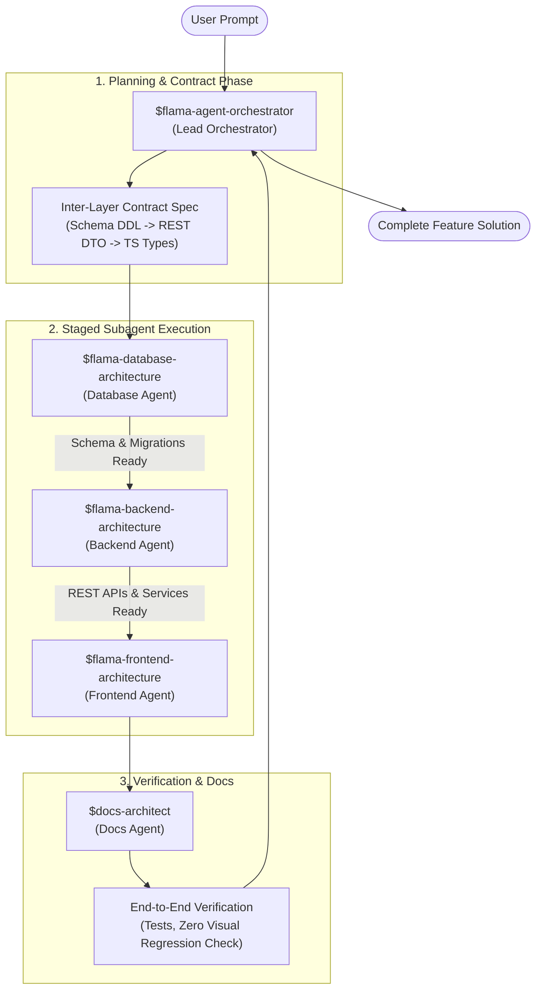

# Flama Multi-Agent Collaboration Framework & Architecture

> Version: 1.0.0 | System Architecture Document | Project: Flama / Nihongo

This document defines collaboration guidelines for Flama. The DB -> BE -> FE diagram is an example for schema-dependent work; skip unaffected layers and parallelize independent work only when delegation is authorized. A skill is a workflow, not an automatically available subagent. Use the current host's supported agent API and record file ownership before dispatch.

Canonical skills live in `skills/`. `python scripts/sync_claude_skills.py` generates repository mirrors in `.claude/skills/` and `.agents/skills/`; `--check` checks both. Do not bulk-sync user-global skill folders. Track source presence, Git inclusion, mirror equality, runtime discovery and tool availability separately. See [the dated audit, review and export queue](MULTI_AGENT_SKILLS_AUDIT_AND_UNIFICATION.md). Each reviewer records only its own result; an unavailable login is not a sign-off.

---

## 1. Multi-Agent Ecosystem Overview



---

## 2. Specialized Agent Roles & Boundaries

| Agent Persona | Skill Identifier | Target Workspace | Core Responsibility |
|---|---|---|---|
| **Lead Orchestrator** | `$flama-agent-orchestrator` | Entire Repository | Requirement analysis, task decomposition, API contract definition, agent dispatch, final verification. |
| **Database Architect** | `$flama-database-architecture` | `models/`, `migrations/` | Schema design, SQLAlchemy ORM mappings, zero-data-loss Alembic migrations, overlay clone modeling. |
| **Backend Architect** | `$flama-backend-architecture` | `app/api/`, `app/services/`, `app/repositories/`, `app/validators/`, `tests/` | Flask REST endpoints, service layer transaction management, Anki scheduling, payments, Yomitan bridge. |
| **Frontend Architect** | `$flama-frontend-architecture` | `frontend/src/` | React SPA components (FSD structure), custom hooks, state management, Tailwind styling, Zero Visual Regression. |
| **Docs Architect** | `$docs-architect` | `docs/`, `README.md`, `AGENTS.md` | Architecture docs, runbooks, setup guides, API specifications. |

---

## 3. Inter-Layer Contract Specification

To ensure seamless coordination between subagents working on separate layers, every full-stack feature must establish explicit contracts:

### A. Database -> Backend Contract
- **Schema Mapping**: Define SQLAlchemy model attributes, field types, nullability, foreign keys, and unique constraints.
- **Migration Guarantee**: Every schema update must include an Alembic migration script in `migrations/versions/`.

### B. Backend -> Frontend Contract (REST DTO)
- **JSON Payload Format**: Record the actual endpoint's request and response shape. Preserve existing envelopes; the example below is illustrative, not a mandatory response wrapper.
```json
{
  "success": true,
  "data": { ... },
  "error": null
}
```
- **HTTP Status Codes**: `200 OK`, `201 Created`, `400 Bad Request`, `401 Unauthorized`, `404 Not Found`, `409 Conflict`, `422 Unprocessable Entity`.

### C. Frontend Interface Spec
- **TypeScript Types**: Match backend JSON payloads in the owning feature/entity. Business-independent infrastructure types may live in `shared`; do not collect domain DTOs in `shared/types` by default.
- **State Hooks**: Encapsulate API calls inside custom hooks (e.g., `useStudySession`, `useDeckMarketplace`).

---

## 4. Staged Execution Pipeline

1. **Step 1: Database Execution**:
   - DB Agent creates/modifies SQLAlchemy ORM models in `models/`.
   - DB Agent generates migration in `migrations/versions/`.
   - Verification: Run model tests or DB migration verification.

2. **Step 2: Backend Execution**:
   - BE Agent creates validators in `app/validators/`.
   - BE Agent creates repositories & services in `app/repositories/` and `app/services/`.
   - BE Agent exposes REST endpoints in `app/api/`.
   - Verification: Run backend tests under `tests/`.

3. **Step 3: Frontend Execution**:
   - FE Agent defines TypeScript types and API fetchers.
   - FE Agent extracts complex state management into custom hooks in the owning slice's `hooks/`; only business-independent hooks belong in `shared/hooks/`.
   - FE Agent builds/updates React components in `frontend/src/` adhering to FSD layout and Zero Visual Regression.
   - Verification: Verify UI visual rendering and DevTools console clean state.

---

## 5. Non-Negotiable Quality Guardrails

1. **Zero Visual Regression**: Frontend modifications must preserve existing color palettes, brand gradients, typography, font sizes, padding, shadows, and responsive layout.
2. **Data Integrity First**: Database schema changes must be backward-compatible and zero-downtime (Expand -> Backfill -> Cutover -> Contract).
3. **Overlay-Only Shared Deck Integrity**: Shared decks use pointer overlay clones. Never mutate source notes when editing clone decks.
4. **Isolated Chrome DevTools**: All browser testing and DevTools profiling must use an isolated user profile directory.
