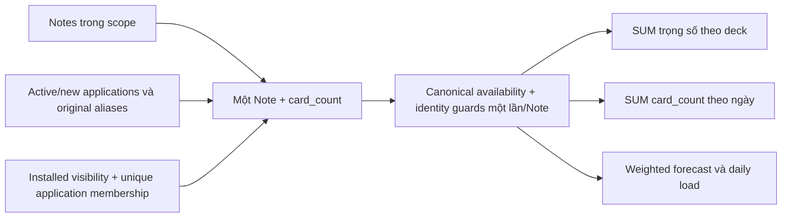

# Analytics lấy Note làm trung tâm

> Date: 2026-10-13 | Mode: DESIGN + IMPLEMENT | Engine: MySQL 8.0
> Tiền đề: [điều tra dashboard production](DASHBOARD_PRODUCTION_PERFORMANCE_INVESTIGATION_2026-10-13.md)
> Phạm vi: dashboard/deck counts, future heatmap, today/future forecast; giữ REST DTO và UI hiện tại.

## 1. Kết luận

Khả thi với schema hiện tại: availability/progress canonical đã thuộc `(learner_user_id, logical_note_key)` của Note. Triển khai query scopes có **một dòng cho mỗi Note**, kèm `card_count` là số presentation hợp lệ. Các metric Note dùng trọng số 1; các metric Card dùng `card_count`. Không tạo bảng progress, migration hoặc writer mới.

Bản implementation nằm ở `app/repositories/note_analytics_scope_repository.py`, được dashboard, overview và forecast dùng qua `note_analytics_read_repository.note_rows()`.

## 2. Invariants

1. Progress và availability đọc từ `study_progress_subjects` của **learner**, không dùng progress tác giả source Note.
2. Mỗi Note chỉ join canonical availability và kiểm tra identity một lần trong mỗi effective scope. Giữ kiểm tra logical key, live key và presence; không thay logical-key join bằng live-key join.
3. Badge Note đếm một Note có ít nhất một presentation; badge Card, future heatmap và forecast vẫn đếm presentation. Multiple occurrences của cùng Template vẫn đóng góp nhiều Card.
4. Owner chỉ thấy application ACTIVE. Cặp original Note/original application vắng ở cutover vẫn vắng; alias lịch sử là immutable evidence.
5. Installed release vẫn giữ Note membership, template/application pins, retired pinned applications và timestamp fallback. Không copy hay sửa source Note.
6. Counts theo local deck có thể đếm cùng source Note ở các local deck khác nhau. Collection forecast/heatmap deduplicate presentation qua nhiều bản cài; pin subsets tạo **union** chính xác.
7. `due_day`/`due_at`, timezone/DST, day boundary, suspended/buried và null anchors giữ contract hiện có. History vẫn lấy từ `review_events`.
8. Analytics GET chỉ đọc trong transaction boundary hiện có; không thêm lease, lock, repair hoặc commit state.

## 3. Nguồn sự thật và scopes

| Store | Vai trò | Implementation |
|---|---|---|
| `notes` | Identity, ownership, physical deck và NoteType | Note-scoped projection chỉ lấy ID/deck/type, không hydrate field JSON |
| `study_applications` | Occurrences và ACTIVE/RETIRED | Tổng hợp application counts theo NoteType |
| `card_presentation_aliases`, cutover sets | Original pair membership | Tổng hợp alias hợp lệ cho original Notes trong phạm vi yêu cầu |
| `deck_installs`, maps, release memberships/pins | Installed visibility và effective deck | Tái dùng `clone_source_card_visibility()` trước khi group Note |
| `study_progress_subjects` | Canonical Note progress/availability | `note_rows()` nối logical key, giữ live-key integrity probe |
| `review_events` | Review history | Không thay đổi đường historical aggregation |

`Card` vẫn là read model dùng ở Study/Browse/MCP và các consumer cần identity presentation. Đường analytics tổng hợp không còn dùng Card làm hạt dữ liệu để join progress trên nhánh owned.

## 4. Membership và phép đếm

Với một NoteType, tính:

- `active_count`: số application ACTIVE.
- `new_count`: số application ACTIVE không thuộc original application cutover set.
- `original_alias_count(note)`: số alias của Note tới application ACTIVE **thuộc original set và cùng NoteType**.

Khi Note không thuộc original Note cutover set: `card_count = active_count`.

Khi Note thuộc original set: `card_count = new_count + original_alias_count(note)`.

Đây là phép biến đổi của membership gốc trong `models/card.py`: một cặp tồn tại nếu có alias, hoặc Note mới, hoặc application mới. Unique constraint `(note_id, application_id)` của alias bảo đảm count không nhân đôi. Loại các Note có `card_count=0` trước khi join progress.

Installed scope dùng visibility predicate gốc và `COUNT(DISTINCT application_id)` theo Note. Loại đúng những active presentation đã có trong owned scope, rồi cộng phần còn lại. Với scope deck, owned overlap cần cùng physical/effective deck; với collection, cần owned physical deck nằm trong selected deck IDs nếu có bộ lọc. Vì vậy, hai release pin disjoint đều đóng góp, còn overlapping pins chỉ đếm một lần.

Forecast Python nhận `(due_at, due_day, queue, card_count)`; không dựng lại một tuple cho mỗi sibling. `daily_load` cộng `card_count / max(1, interval)`. Floating-point accumulation có thể khác ở bit cuối so với cộng từng Card; A/B dùng tolerance `rel=1e-12`, `abs=1e-9` cho float, còn integer/count và mọi giá trị khác phải bằng chính xác.

## 5. Các phương án đã đánh giá

| Phương án | Ưu điểm | Chi phí/rủi ro | Kết quả |
|---|---|---|---|
| Group presentation hiện có thành Note trước progress | Ít thay đổi membership; guard đọc một lần/Note | Vẫn mở rộng mọi owned presentation và materialize Card keys | Dùng nguyên lý group cho installed branch để giữ release semantics |
| Owned Note scope với multiplicity từ application/cutover/aliases | Loại presentation keys và repeated wide Note/progress reads; không thêm write amplification | Cần chứng minh tương đương cho original absent pairs, mismatched aliases và overlap scopes | Chọn cho owned branch, có oracle parity tests và MySQL A/B |
| Durable summary/count cache mới hoặc bật toàn bộ rollup | Có thể bỏ raw count khỏi nhiều GET | Cần writer/invalidation coverage, freshness/backfill và đánh giá write latency | Không nằm trong thay đổi này; cache hiện có tiếp tục giữ flags hiện tại |

## 6. MySQL plan và A/B

A/B chạy code baseline đang deploy và candidate modules **trong bộ nhớ** của process audit riêng trên VPS, cùng read-only REPEATABLE READ snapshot, cùng clock. Không ghi module lên release, không deploy/restart, không sửa MySQL configuration. Mỗi variant có hai mẫu, thứ tự baseline/candidate đảo ở vòng thứ hai; không phải p95 hoặc cold-browser benchmark.

| Metric | Baseline median | Candidate median | Speedup |
|---|---:|---:|---:|
| Dashboard | 3.538 s | 2.111 s | 1.68× |
| Overview/heatmap | 4.157 s | 2.084 s | 1.99× |
| Today/future forecast | 5.834 s | 2.494 s | 2.34× |

Tất cả payloads parity trên cùng snapshot. Forecast SELECT trả **39.336 Note row** thay cho **113.680 presentation row**. Actual plan dashboard có 39.336 canonical subject/identity lookups thay cho 113.680. Alias membership vẫn cần đọc các original alias; không tuyên bố toàn bộ công việc ở dưới Note scope đã thành một thao tác cho mỗi Note.

Bản đầu chưa đạt mục tiêu heatmap: MySQL rewrite EXISTS thành semijoin, tạo khoảng **31 × 39.336 = 1,22 triệu** row trung gian trước Note lookup. Hai điều chỉnh đã được đo riêng:

- Bounded scalar presence probe thay EXISTS cho live current-state scope; giữ cả semantics tồn tại và canonical logical-key read.
- `SELECT STRAIGHT_JOIN` chỉ trong alias aggregation trên MySQL, để bắt đầu từ scoped Notes rồi dùng alias index prefix; SQLite dùng planner riêng. Theo [MySQL SELECT](https://dev.mysql.com/doc/refman/8.0/en/select.html), modifier này giữ thứ tự join trong FROM. Actual plan sau sửa đọc scoped Note bằng `ix_notes_user_id`, probe alias theo Note, rồi join application set nhỏ.

Đường raw hiện vẫn cần khoảng 2 s/API ở môi trường buffer pool 128 MiB. Không suy diễn rằng browser đã load dưới một giây, hoặc mọi user/clone workload có cùng speedup. Chưa đo p95 dưới concurrency và authenticated cold-browser paint.

## 7. Kiểm thử

- Bộ focused tests: deck aggregation, NOTE analytics reads, retirement, overview, today/future, deck snapshot/projection và Note-count flag contracts.
- Sáu regression cases mới trong `tests/test_note_stats_retirement.py` so scope Note-weight với **Card membership query cũ**: original absent pairs/new apps, alias sai NoteType, nhiều occurrence, disjoint/overlapping pins, owned/install overlap, scope rỗng và Note không có application.
- MySQL probe: `scripts/probe_note_analytics_mysql.py`, chạy fixtures trong schema loopback được sinh ngẫu nhiên, guard không trùng configured DB, cleanup/verify schema trong `finally`. Có các ca retired pins, local added Notes, multiple installs, future heatmap và identity drift.
- Modular test runner đã map repository/probe mới vào module analytics và đưa retirement tests vào cùng module.

Kết quả cuối: **105 focused backend tests pass**, **25 modular-runner tests pass**, **10 MySQL 8.0.40 cases pass**; generated schema đã được drop và xác minh không còn tồn tại. Production A/B dùng MySQL 8.0.46 và `transaction_read_only=1`. Các warning `datetime.utcnow()` đã có trong fixtures/runtime hiện tại.

Kết quả cuối được lưu trong [artifact A/B và validation](artifacts/note_centric_analytics_20261013.json).

## 8. Cutover và rollback

1. **Expand:** thêm Note scope/availability reader; không đổi schema hoặc authority store.
2. **Verify:** oracle fixtures, focused suites, disposable MySQL và same-snapshot production A/B.
3. **Cutover code:** dashboard, future heatmap và forecast đọc Note scopes; REST DTO và UI giữ nguyên. Không bật cache writers/read modes hoặc thay buffer pool trong patch này.
4. **Deploy:** theo pipeline hiện có khi release này được phát hành; implementation hiện vẫn ở working tree. Canary theo duration dashboard/overview/forecast, row counts và 409 integrity rates.
5. **Rollback:** phục hồi các module query/service của release trước. Không có data migration hoặc backfill cần đảo; NOTE state và installed releases chưa bị ghi lại.

Tập benchmark chưa bao phủ p95, concurrent traffic hoặc toàn bộ pin distributions trên production. Clone membership và scoped overlap đã được kiểm tra bằng fixture/MySQL; user 1 trong A/B không có installed deck, nên chưa có số liệu performance production cho installed-heavy learners.
