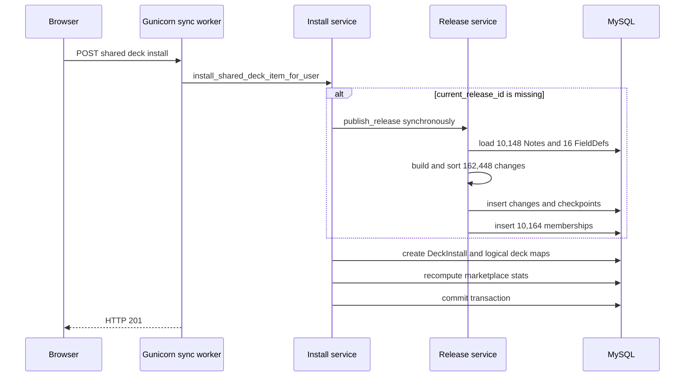

# Shared Deck Install Performance Investigation — 2026-08-25

> Date: 2026-08-25 | Mode: INVESTIGATE | Engine: MySQL 8.0.46 (production)
> Scope: marketplace install, immutable release bootstrap, logical-overlay clone, Gunicorn deployment
> Production access: read-only through the configured SSH alias; no application import, DDL, DML, restart, or secret inspection

## 1. Executive conclusion

The overload incident was caused primarily by a learner install request synchronously
building the missing initial immutable release for the 10,148-note public deck
`語彙徹底N1`. It was not caused by copying 10,000 Notes/Cards into the learner account.

Because three older installs were still unpinned legacy snapshots, the initial release
had to preserve an atomic baseline. The request materialized and persisted:

| Release artifact | Persisted rows |
|---|---:|
| `deck_release_changes` | 162,448 |
| `deck_release_note_checkpoints` | 10,148 |
| `deck_release_entity_memberships` | 10,164 |
| Minimum release rows built in one request | 182,760 |

The counts reconcile exactly:

- `162,448 = 10,148 Notes × 16 fields + 16 FieldDefs × 5 properties`;
- `10,164 memberships = 10,148 Notes + 16 FieldDefs`.

The first request exceeded Gunicorn's 120-second timeout and its worker was killed.
A user retry rebuilt the same release and completed in about 105 seconds. Production
currently has one synchronous Gunicorn worker, so the heavy request occupied the only
web worker and made the whole application unavailable during the build.

The market-stat N+1 behavior identified in the preliminary investigation is real, but
it is a secondary scaling issue. With only four installs on this item, it cannot explain
the 162,448 release-change inserts or why this specific 10k deck triggered the incident.

## 2. Observed runtime and incident timeline

Production is host-native, not Docker-managed:

- active release at inspection: `873de2d47e2c7ad1cba5cb769ae9385a7c097e69`;
- `flama.service` runs `/opt/flama/current`;
- Gunicorn command: `--workers 1 --timeout 120 --bind 0.0.0.0:4789`;
- MySQL and nginx run as host services;
- normal startup maintenance and clone cutover are disabled.

The sanitized journal and database timestamps establish this sequence:

| UTC time | Event |
|---|---|
| 14:18:44 | Browser preflight for the install request |
| 14:19:20 | First `deck_release_changes` insert burst begins |
| 14:20:39 | First checkpoint insert burst begins |
| 14:20:45 | Gunicorn reports `WORKER TIMEOUT` for the only worker |
| 14:20:47 | Worker is killed and a replacement worker boots |
| 14:22:49 | Browser retries install |
| 14:22:54 | Second release build starts |
| 14:24:20 | Second release-change burst finishes |
| 14:24:25 | Second checkpoint burst finishes |
| 14:24:28–14:24:32 | Membership rows are inserted |
| 14:24:34 | Install returns HTTP `201` |

The first POST is absent from the access log because access logging occurs after a
response and the worker was killed before responding. The exact twofold insert counts
in Performance Schema show that the timed-out transaction did almost all release work
before rollback, then the retry repeated it.

Production Performance Schema, cumulative for the incident statements:

| Normalized statement | Executions | Total DB time | Interpretation |
|---|---:|---:|---|
| insert release change | 324,896 | 94.668 s | exactly `2 × 162,448` |
| insert checkpoint | 20,296 | 6.114 s | exactly `2 × 10,148` |
| insert membership | 10,164 | 2.088 s | reached only by the successful retry |

Prometheus for the affected two-vCPU host recorded:

- one-minute CPU busy peak: 74.9%;
- 30-second CPU busy peak: 81.1%;
- normalized one-minute load peak: 108.5%;
- 30-second I/O-wait peak: 14.5%.

The user-observed “over 90%” is consistent with the normalized load panel. Kernel logs
showed no OOM event; the Gunicorn “Perhaps out of memory?” text is a generic message
after SIGKILL, not evidence of an OOM kill here.

## 3. End-to-end data flow



The logical-overlay invariant remains intact. The install creates learner-owned Deck
shells and `DeckCloneDeckMap` pointers, not learner copies of the source Notes/Cards.

## 4. Systems of record and ownership

| Entity | Role | Written by this flow | Lifecycle concern |
|---|---|---|---|
| `DeckMarketplaceItem` | Public listing and current release pointer | release/install service | visible legacy rows may lack a release |
| `DeckRelease` | Immutable published version | release service | building must finish atomically |
| `DeckReleaseChange` | Atomic release delta | release service | legacy initial baseline can be `O(notes × fields)` |
| `DeckReleaseNoteCheckpoint` | Initial Note snapshot | release service | one JSON row per source Note |
| `DeckReleaseEntityMembership` | Release visibility intervals | release service | one row per Note and FieldDef initially |
| `DeckInstall` | Learner's logical install | install service | release-pinned for new installs |
| `DeckCloneDeckMap` | Source-to-local Deck mapping | install service | grows with Deck nodes, not Notes |
| source `Note`/`Card` | Authoritative shared content | owner content flows | never copied or mutated by install |

## 5. Findings

### 5.1 Learner install owns an unbounded release-build fallback

- **Observed**: `install_shared_deck_item_for_user()` calls
  `_stage_initial_release_if_visible()` before creating the install. When the listing
  has no current release, that helper calls `publish_release()` synchronously.
- **Evidence**: `app/services/flashcards_share_service.py:69-100` and
  `app/services/flashcards_share_service.py:3195-3327`.
- **Potential concern**: a read-like learner action unexpectedly owns a catalog
  migration/release transaction whose cost depends on the entire source deck.
- **Impact**: CPU/DB burst, long locks and transaction lifetime, worker timeout, retry
  amplification, and total web outage with one sync worker.
- **Unknowns**: no distributed trace exists, so Python time is derived from journal,
  release timestamps, and statement summaries rather than per-function spans.

### 5.2 Legacy installs expand the initial baseline to every Note field

- **Observed**: if any install has `applied_release_id IS NULL`, the initial plan uses
  `initial_baseline_mode="atomic"`, retains all Notes in the diff, and creates one
  change per populated Note field in addition to checkpoints.
- **Evidence**: `app/repositories/deck_release_repository.py:141-150`,
  `app/services/deck_release_service.py:1222-1281`, and
  `app/services/deck_release_service.py:820-906`.
- **Potential concern**: complexity becomes `O(notes × fields)` in Python objects,
  hashes, sorting, SQL statements, and transaction log volume.
- **Impact**: this deck generated 162,448 change rows before install work began.
- **Unknowns**: production has not been profiled with 50k Notes or larger field JSON.

### 5.3 Persistence is statement-heavy and retry repeats completed work

- **Observed**: release changes/checkpoints/memberships are assembled as ORM objects
  and added to the session; production executed one normalized insert per row. A killed
  request rolled back and the retry rebuilt the release from zero.
- **Evidence**: `app/services/deck_release_service.py:1537-1637` and
  `app/services/deck_release_service.py:1792-1871`; production statement counts above.
- **Potential concern**: Python allocation, JSON serialization, network round trips,
  and InnoDB work dominate what should be a one-time controlled maintenance job.
- **Impact**: the failed and successful attempts executed 324,896 release-change
  inserts and 20,296 checkpoint inserts in total.
- **Unknowns**: exact proportions of Python CPU, client serialization, and MySQL CPU
  require application spans or a staging profiler.

### 5.4 Single-worker deployment turns one slow request into an outage

- **Observed**: production uses one default synchronous Gunicorn worker with a
  120-second timeout.
- **Evidence**: `deploy/flama.service:14`; sanitized production `systemctl` and journal
  inspection; `docs/architecture/production-architecture-verification-2026-08-24.md`.
- **Potential concern**: any slow request blocks all unrelated API traffic.
- **Impact**: the app was unavailable while release generation occupied the worker;
  timeout then discarded almost two minutes of work.
- **Unknowns**: request p95/p99 is not currently emitted by the default access-log
  format, and concurrency has not been load-tested against production-like data.

### 5.5 Marketplace-stat recomputation is real but secondary here

- **Observed**: install recomputes NoteType and Deck marketplace stats by loading every
  historical install and running activity queries per installer.
- **Evidence**: `app/services/flashcards_share_service.py:1703-1774`,
  `app/services/flashcards_share_service.py:1797-1856`,
  `app/services/flashcards_share_service.py:2193-2230`, and
  `app/services/flashcards_share_service.py:3312`.
- **Potential concern**: install cost grows with installer count and shared rows are
  updated inside the install transaction.
- **Impact**: this becomes a future N+1/lock-contention problem, but four installs do
  not explain the observed 162k release writes.
- **Unknowns**: the preliminary same-deck deadlock benchmark has not been reproduced
  on the current production topology. Production showed zero cumulative InnoDB row-lock
  waits at inspection, so deadlock is not established as this incident's cause.

### 5.6 Release-pinned install still scales with Deck tree nodes

- **Observed**: `clone_deck_subtree()` recursively queries children, selects the next
  sibling position, flushes, and creates one local Deck/map per source Deck node.
- **Evidence**: `app/services/flashcards_share_service.py:2233-2286` and
  `app/repositories/flashcards_share_repository.py:348-355`.
- **Potential concern**: the current 171-node production tree still causes hundreds of
  SQL operations even after release bootstrap is removed from the request.
- **Impact**: a release-pinned install is much smaller than the incident but is not a
  constant 5–7 query operation.
- **Unknowns**: production install-only latency was not isolated because the successful
  request combined release flush, tree clone, stats, audit, and commit.

### 5.7 Source NoteType inference rescans source Notes on every install

- **Observed**: install always synchronizes the listing's source NoteType, and binding
  always infers the distinct NoteType across the source subtree even when the persisted
  pointer is already populated.
- **Evidence**: `app/services/flashcards_share_service.py:828-837`,
  `app/services/flashcards_share_service.py:973-1015`, and
  `app/repositories/flashcards_share_repository.py:403-414`.
- **Potential concern**: a publication invariant is re-proved with an `O(notes)` query
  for every installer; current `notes` indexes are single-column only.
- **Impact**: local MySQL plans for the 10k source scan measured about 102 ms. It is not
  the 105-second root cause, but it is avoidable recurring work.
- **Unknowns**: the correct invalidation policy must cover owner source mutations and
  legacy listings without silently accepting mixed NoteTypes.

### 5.8 Deck detail sample generation repeatedly loads the full source deck

- **Observed**: opening the deck detail loads every scoped Note, converts each Note's
  JSON into a sample candidate, shuffles the complete list, and returns only five.
  After a successful install, React invalidates the detail query and triggers this work
  again.
- **Evidence**: `app/services/marketplace_query_service.py:341-372`,
  `app/routes/flashcards/share.py:438-478`, and
  `frontend/src/features/marketplace/pages/SharedDeckDetailPage.tsx:186-208`.
- **Potential concern**: the visible “clone” interaction includes another `O(notes ×
  fields)` CPU/memory scan outside the POST transaction. Source NoteType inference is
  also repeated on the detail and install paths.
- **Impact**: production detail requests for this item took roughly one to two seconds
  around the incident and add avoidable load before/retry/after install.
- **Unknowns**: access logs lack precise request duration, so these timings are bounded
  by preflight and completion timestamps rather than application spans.

### 5.9 The seed path publishes listings without creating a release

- **Observed**: vocabulary seeding creates or updates official listings directly as
  `published`, then commits at the end without staging an immutable release.
- **Evidence**: `app/cli.py:1238-1315` and `app/cli.py:644-678`.
- **Potential concern**: the seed path bypasses the invariant enforced by normal
  marketplace create/update services and leaves learner install to perform bootstrap.
- **Impact**: the affected item and the five remaining visible/unversioned items are
  predictable products of this gap, not random data corruption.
- **Unknowns**: other import/admin paths that can set a listing visible need the same
  invariant audit before the hotfix is considered complete.

### 5.10 Startup maintenance was not involved

- **Observed**: normal production startup performs a connectivity check and returns;
  schema maintenance, seeds, and clone cutover are disabled.
- **Evidence**: `app/settings.py:215-250`, `app/startup.py:19-96`, and the 2026-08-24
  production verification report.
- **Potential concern**: explicitly enabling these flags with multiple workers would
  reintroduce per-worker mutation races, but that configuration was not active.
- **Impact**: startup/cutover can be excluded from the incident root cause.
- **Unknowns**: other deployments may override the flags and must be checked separately.

## 6. Evaluation of the preliminary investigation

The preliminary report correctly identified two residual risks:

1. full market-stat recomputation grows with historical installer count;
2. one synchronous web worker makes slow requests globally visible.

It does not establish the primary cause of this production incident:

- the 10k deck's missing initial release and legacy atomic baseline were omitted;
- its `Q(N) = 41 + 7N` model does not include release generation or Deck-tree size;
- the 5–10 concurrent worker/deadlock scenario does not match the one-worker VPS;
- Dockerfile configuration was treated as production truth even though the VPS uses
  `deploy/flama.service`;
- predicted 5–7 queries and 15–35 ms after the proposed stats fix are not valid for a
  171-node logical clone and have not been measured on production-like MySQL data.

The synthetic stats/deadlock results remain useful as a P1 scaling warning, but their
percentage attribution and “no missing evidence” conclusion should not be used for the
hotfix decision.

## 7. Current production state

The successful retry left the affected item in a consistent, useful state:

- one published release is now present and is the listing's current release;
- persisted row counts match the release metadata;
- three older installs remain `legacy_snapshot` and unpinned;
- the new install is release-pinned;
- no building release remains for the item.

Do not delete or roll back this immutable release merely to reduce table size. It is
what prevents the next install of the same item from repeating initial bootstrap.

Five other visible listings still lack a current release. Their source Note counts are
1,585, 1,001, 460, 145, and 90; none currently has a legacy unpinned install. They are
smaller and should use checkpoint mode, but they still represent learner-request
fallback work until explicitly bootstrapped or guarded.

## 8. Recommended remediation and rollout

### Phase 0 — containment before code deployment

1. Keep the newly published `語彙徹底N1` release and verify its release/change/checkpoint/
   membership counts after the next backup.
2. Schedule the five remaining visible, unversioned listings for one-at-a-time bootstrap
   in a low-traffic maintenance window using the existing CLI with `--apply`.
3. Do not use the CLI's default dry run during peak traffic: it builds the full release
   and then rolls it back, so it consumes nearly the same CPU/DB work.
4. Monitor CPU, load, I/O wait, free memory, Gunicorn journal, and release row counts for
   each item; stop before starting the next item if thresholds are breached.

Production mutation in this phase requires a separate operator go-ahead. This
investigation did not execute it.

### Phase 1 — production hotfix (no schema migration)

1. Remove `_stage_initial_release_if_visible()` from the learner install path.
2. Enforce the guard inside `install_shared_deck_item_for_user()` so free installs,
   paid entitlement fulfillment, and internal callers all share the same boundary.
3. If `current_release_id` is missing, fail fast with a stable error such as
   `DECK_RELEASE_NOT_READY`/HTTP 503 and create no install or release rows.
4. Keep initial release creation in the owner publish flow and controlled bootstrap CLI
   until a background job/outbox exists.
5. Add structured phase timings and counters for release load, diff construction,
   persistence, tree clone, stats, and commit. Add request duration to access logs.

Create this hotfix from production `origin/master`/`873de2d`, not from the current local
`develop` head. The branches have diverged and deploying `develop` would bundle unrelated
scheduler/algorithm work, even though the relevant sharing files currently match.

Required focused tests:

- unversioned visible install returns quickly and creates zero release/install rows;
- versioned install never calls the initial-release publisher;
- free, paid, entitlement, and retry paths enforce the same guard;
- release-pinned install preserves pointer-only clone behavior;
- existing bootstrap CLI and initial atomic-baseline tests remain valid;
- seeded visible listings cannot be committed without a release or explicit preparing
  state;
- direct owner and installed-clone behavior both remain covered.

### Phase 2 — remove residual synchronous amplification

1. Replace full market-stat recomputation on install with an idempotent atomic install
   count update; do not recompute ratings on install.
2. Recompute active usage with a batched aggregate maintenance job or on explicit
   threshold transitions, with a reconciliation CLI for correctness.
3. Batch Deck-tree reads/inserts/maps and scope root position by user rather than doing
   recursive per-node position queries and flushes.
4. Skip full source NoteType inference during install when the persisted pointer still
   exists and passes cheap owner/template provenance checks; enforce subtree consistency
   on publish and source mutation.
5. Limit deck-detail sample reads at the database boundary and use deterministic or
   publish-time sample IDs; do not materialize/shuffle the full Note collection.
6. Make the seed path publish only after a controlled initial release succeeds. A seed
   should not commit a visible listing with `current_release_id IS NULL`.
7. For future large initial publishes, move release construction to a durable worker/job
   and use bounded bulk persistence. Preserve immutable-release atomicity; do not commit
   partial releases merely to reduce transaction size.
8. Evaluate composite indexes only after the request-boundary fixes. Local MySQL plans
   show source NoteType inference/release Note loading consume hundreds of milliseconds,
   not the observed 105 seconds, so indexes are not the first incident fix.

### Phase 3 — worker availability

Do not increase concurrency while unbounded release generation remains callable from
HTTP; additional workers would allow multiple CPU/DB-heavy jobs to run simultaneously.

After Phase 1 and a production-like load test:

1. externalize process-local login/MCP rate-limit state or explicitly accept and test
   its multi-process semantics;
2. canary two synchronous workers on the two-vCPU VPS;
3. verify MySQL connection limits/pool sizing, memory, p95 latency, and error rate;
4. retain the lower worker count if the canary increases CPU contention or tail latency.

Increasing Gunicorn timeout is not a fix: it only lets an unbounded request occupy web
capacity for longer.

## 9. Deployment, verification, and rollback gates

### Pre-deploy

- take and verify a recoverable database backup;
- reproduce a 10k Note/16-field/legacy-install initial release on staging MySQL 8;
- benchmark separately: release build, release-pinned install, stats, and Deck-tree clone;
- run focused backend tests and the shared-deck/release regression set;
- confirm all production-visible listings intended for install are release-pinned or
  deliberately return the readiness error.

### Post-deploy acceptance

- an unversioned install returns the readiness response without inserting any
  `deck_release_*` or `deck_installs` rows;
- a release-pinned `語彙徹底N1` install emits no initial-release inserts;
- no Gunicorn worker timeout, SIGKILL, or unexpected worker replacement occurs;
- pointer-only invariants hold: learner Note/Card count does not grow with install;
- all five controlled bootstraps commit one published release each and leave no
  `building` release;
- request latency/error/CPU acceptance thresholds are set from staging measurements,
  not the preliminary 15–35 ms estimate.

### Rollback

- roll back only the application release through the existing symlink/systemd workflow;
- do not run Alembic downgrade; this hotfix needs no schema change;
- do not delete the successfully published immutable release or its checkpoints;
- if rolling back before every legacy listing is bootstrapped, temporarily block the
  install endpoint for unversioned items so the old synchronous fallback is not exposed;
- verify `/api/health`, current release fingerprint, service worker PID/start time, and
  install guard behavior after rollback.

## 10. Verification performed

Read-only production work:

- service/runtime metadata and sanitized journal inspection;
- Prometheus query-range inspection for CPU/load/I/O wait;
- MySQL `SELECT`, `SHOW`, `information_schema`, and Performance Schema summaries;
- aggregate release/install/source-scope counts only; no Note content or user identity.

Local tests:

```text
test_initial_release_preserves_atomic_baseline_for_legacy_install
test_shared_deck_install_creates_pointer_clone_without_note_copy
test_shared_deck_install_retries_when_deadlock_occurs

Ran 3 tests in 3.402s — OK
```

## 11. Open questions / needs verification

1. What latency/CPU target should product accept for a 171-node release-pinned install?
2. Should an unready listing be hidden from marketplace results, return 503, or display
   a “preparing” state? The backend must fail fast in every case.
3. Which durable job system should own large release publication? Redis is installed on
   the VPS, but no checked-in production outbox/worker contract currently owns this work.
4. How should active-usage counters be refreshed and reconciled without putting an
   installer loop back into the request transaction?
5. What production-like concurrency level should gate the later two-worker canary?
