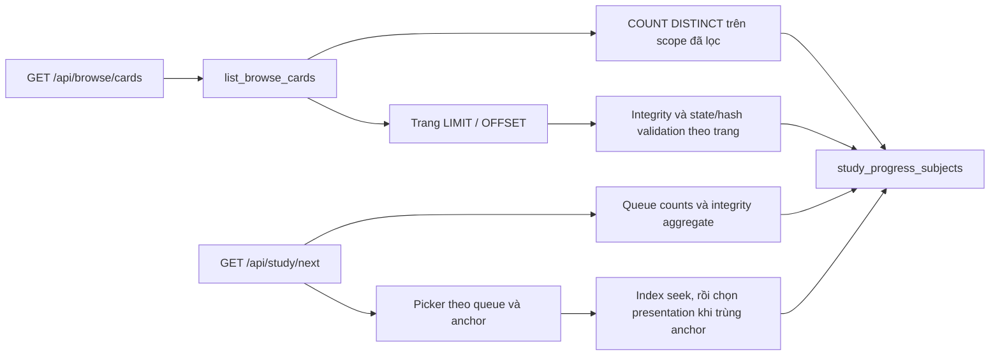

# Kiểm tra hiệu năng Browse và Study Queue

> Ngày: 2026-10-13 | Mode: INVESTIGATE | MySQL đã kiểm tra: 8.0.40
> Phạm vi: tài liệu `docs/tasks/STUDY_BROWSE_LEGACY_BRANCHING_PERFORMANCE_ISSUES.md`, HEAD `95eb1c5f` và các thay đổi chưa commit trong workspace.

> Cập nhật sau sửa, 2026-10-13: lỗi Browse ở finding 3 đã được sửa trên HEAD `886ad3bf`; 28 test liên quan pass. Các findings bên dưới ghi lại trạng thái khảo sát trước sửa; kết quả bản sửa nằm cuối tài liệu.

## Kết quả khảo sát trước sửa

Hai đoạn code trong tài liệu gốc không còn mô tả chính xác implementation hiện tại. Browse trong workspace đã giới hạn kiểm tra integrity theo trang. Study picker đã tách queue/anchor, có index và dùng index range scan trên MySQL được cấu hình ở máy này. Tuy nhiên, thay đổi chưa commit của `review_due_expr()` gây lỗi bỏ sót review có `due_day = NULL` trong bộ lọc Browse. Chưa thể đánh dấu toàn bộ công việc hoàn thành.

Trong lần khảo sát đầu, không sửa application code, migration hoặc dữ liệu MySQL. Các truy vấn kiểm tra MySQL chạy trong transaction `READ ONLY`, kết thúc bằng rollback. Các fixture tái hiện và test hành vi dùng SQLite trong bộ nhớ.

## Luồng đọc và nguồn dữ liệu



`study_progress_subjects` là nguồn NOTE progress hiện tại: state payload/hash, queue, due anchors, suspension và burial. Scope nội dung vẫn đi qua `Note` và presentation `Card`. Shared-deck scope vẫn dùng source identity cộng logical overlay; kiểm tra này không thay đổi ownership hoặc clone visibility.

Evidence: `models/study_progress_subject.py:56`, `app/services/browse_card_service.py:350`, `app/routes/flashcards/study.py:229`, `app/repositories/study_repository.py:472`.

## Findings

### 1. Browse đã bỏ integrity aggregate trên toàn scope trong workspace

- **Observed:** HEAD trước thay đổi workspace đã loại bỏ preflight `browse_candidates` nặng trong tài liệu, nhưng còn gộp `MAX(violation)` vào exact count. Workspace hiện chỉ count dữ liệu đã lọc, phân trang với `count=False`, rồi gọi `page_window_integrity()` theo Note IDs của trang. Full state/hash validation cũng chỉ đọc các thẻ trả về.
- **Evidence:** `app/repositories/browse_card_repository.py:346`, `app/repositories/browse_card_repository.py:358`, `app/services/browse_card_service.py:760`, `app/services/browse_card_service.py:820`, `app/services/browse_card_service.py:849`; `git diff` của ba file này.
- **Potential concern:** Kiểm tra corruption ngoài trang hoặc ngoài status filter không còn là bảo đảm của Browse. Các test tương ứng đã chuyển từ kiểm tra toàn scope sang kiểm tra trang trả về.
- **Impact:** Bỏ chi phí tính integrity cho toàn collection trên mỗi request. Exact `COUNT DISTINCT`, search/sort và OFFSET vẫn có thể duyệt nhiều dữ liệu; không đồng nghĩa toàn endpoint chỉ làm việc với `per_page` dòng.
- **Unknowns:** Chưa có benchmark HTTP trước/sau trên collection lớn hoặc số liệu p95. Mức trễ 1.5–5 giây trong tài liệu gốc chưa được xác minh trong lần kiểm tra này.

Test sẵn có với 2.000 Note, hai trang 7 thẻ: total vẫn 2.000, hai trang không trùng, deep validation gọi tổng cộng 14 lần; không xuất hiện subquery preflight cũ.

### 2. Study picker đã có predicate tách nhánh và index được áp dụng

- **Observed:** `_ordered_study_card_queries()` tách relearning, learning, review và new; các anchor ngày/timestamp/null dùng query riêng. `_first_queue_branch()` và `_seek_subject_anchor()` tìm mốc bằng `LIMIT 1` trước khi chọn presentation cùng mốc. Nhánh `due_day = NULL` vẫn được giữ để bảo toàn scheduling.
- **Evidence:** `app/repositories/study_repository.py:492`, `app/repositories/study_repository.py:571`, `app/repositories/study_repository.py:598`, `app/repositories/study_repository.py:638`; `models/study_progress_subject.py:92`; migration `migrations/versions/20261012_000062_index_note_due_selection.py:24`.
- **Potential concern:** Query cuối chọn presentation khi trùng anchor vẫn có thể filesort; các bucket nhỏ bỏ qua staged seek. `query_study_queue_counts()` vẫn có aggregate trên toàn scope ở mỗi request next.
- **Impact:** Điểm nghẽn picker kiểu queue CASE sort và due-anchor OR chung trong tài liệu đã được xử lý ở code hiện tại. Không thể từ đó kết luận endpoint không còn chi phí toàn scope.
- **Unknowns:** Chưa đo endpoint end-to-end, concurrent load hoặc execution plan của mọi clone release scope. Index tồn tại trên database được cấu hình cục bộ không chứng minh mọi deployment đều đã migrate.

Kiểm tra database:

- `SELECT VERSION()` trả `8.0.40`.
- `alembic_version` là `20261012_000062`.
- Index tồn tại đúng thứ tự: `(learner_user_id, normalized_queue, is_suspended, due_day, due_at, live_note_id)`.
- `EXPLAIN` cho helper staged seek trên scope owned có 254 review Note: review day và learning timestamp đều dùng `type=range`, `key=ix_sp_subject_note_due`, không có filesort ở outer seeker.
- `EXPLAIN ANALYZE` review day seeker đọc 21 index candidates, trả một anchor; timestamp seeker tiếp theo đọc 3 candidates. Query chọn presentation cuối có `Using temporary; Using filesort` với estimate 23 subject rows. Đây là quan sát query helper trên một scope, không phải benchmark HTTP hay bằng chứng mọi scope có tie set nhỏ.
- Probes dùng timezone `Asia/Tokyo`, boundary hour 4, learn-ahead 1.200 giây qua runtime fixture; không thay đổi settings của người dùng.

### 3. Lỗi hành vi trong thay đổi chưa commit: Browse bỏ sót review có ngày NULL

- **Observed:** `review_due_expr()` trong workspace chỉ trả `due_day <= today_day_index`. SQL không chọn dòng có `due_day = NULL`. Helper này được Browse gọi cho cả `status=due` và `status=review`. Study picker/counts và Python scheduling vẫn xử lý timestamp hoặc cả hai anchor NULL.
- **Evidence:** `app/repositories/study_repository.py:457`, `app/services/browse_card_service.py:751`, `app/repositories/study_repository.py:508`, `app/repositories/study_repository.py:890`, `app/repositories/study_repository.py:243`. Projection nhận `due_day = NULL`: `app/services/study_note_card_projection.py:106`.
- **Potential concern:** Đây là thay đổi ngữ nghĩa, không chỉ tối ưu predicate. Nullable due anchors vẫn được model/codec và runtime chấp nhận.
- **Impact:** Browse có thể trả total 0 trong khi Study vẫn có review đến hạn, khiến người dùng không tìm thấy thẻ bằng bộ lọc due/review.
- **Unknowns:** MySQL được kiểm tra hiện có 14.455 current review subjects và không có review nào `due_day = NULL`; chưa quan sát lỗi này trên dữ liệu thật hiện tại. Không có invariant trong các artifact đã kiểm tra để bảo đảm review ngày NULL sẽ không xuất hiện sau import/restore hoặc ở deployment khác.

Tái hiện bằng fixture hiện có `tests/test_note_query_retirement.py`, không sửa file test:

1. Đóng băng UTC clock ở `2026-10-12 01:30`, timezone `UTC`, boundary hour 4.
2. Tạo ba review hợp lệ cùng `due_day = NULL`: `due_at` trước clock một giờ, sau clock một giờ nhưng trước boundary tiếp theo, và NULL.
3. Browse không lọc: **3** thẻ.
4. Browse `status=due` và `status=review`: **0** thẻ.
5. Study queue count: **3** review đến hạn; picker chọn được thẻ.

Bộ test hiện tại chưa có assertion đối chiếu bộ lọc Browse với Study cho trường hợp này. Đây là lỗi cần xử lý trước khi đóng ưu tiên 2.

### 4. Tài liệu gốc cần được đọc như snapshot lịch sử

- **Observed:** Preflight cũ và queue CASE sort được mô tả đã thay đổi. Browse route canonical hiện là `/api/browse/cards`. Nhận định mọi `OR` đều vô hiệu hóa index range scan quá tuyệt đối.
- **Evidence:** `app/api/v1/learning/browse.py:82`, `app/api/v1/learning/__init__.py:9`, `app/api/v1/__init__.py:122`; [MySQL 8.0 Range Optimization](https://dev.mysql.com/doc/refman/8.0/en/range-optimization.html) mô tả khả năng gộp range conditions bằng OR/AND; [ORDER BY Optimization](https://dev.mysql.com/doc/refman/8.0/en/order-by-optimization.html) mô tả hạn chế của expression sort và multi-table ordering.
- **Potential concern:** Xóa nhánh nullable anchor dựa trên mô tả legacy có thể làm mất scheduling semantics còn hợp lệ. Việc có OR không đủ để kết luận full table scan; cần xem actual plan.
- **Impact:** Có thể sửa nhầm phần đã tối ưu hoặc báo hoàn thành mà chưa kiểm tra parity của Browse và Study.
- **Unknowns:** Không có execution plan/benchmark đi kèm tài liệu gốc để xác nhận các con số latency hoặc plan trước đây.

## Validation và phần chưa xác minh

Hai lệnh qua modular runner đều pass, tổng **26 test**:

```powershell
.\.venv\Scripts\python.exe scripts/run_tests.py --file tests/test_note_query_retirement.py --backend-only --verbose
.\.venv\Scripts\python.exe scripts/run_tests.py --file tests/test_note_due_index_migration.py tests/test_study_behavior_acceptance_baseline.py --backend-only
```

Kết quả riêng: 15 test NOTE query retirement; 11 test migration index và study behavior baseline. Các test bao gồm ordering/timezones/null anchors, page-bounded validation, retired presentation scope, count units và baseline clone behavior. SQLite không chứng minh MySQL execution plan; index/plan đã được kiểm tra riêng như trên.

Chưa xác minh: latency HTTP trước/sau, p95 dưới tải, chi phí count/search/sort trên deck lớn, plan toàn bộ installed-clone scopes và trạng thái deploy ngoài database đang cấu hình. Không đánh dấu ưu tiên 2 hoàn thành vì lỗi parity Browse đã tái hiện.

## Bản sửa và kiểm tra lại — 2026-10-13

- `review_due_expr()` đã khôi phục ba anchor hợp lệ: ngày đến hạn; ngày NULL và timestamp trước boundary tiếp theo; cả hai anchor NULL. Khi có `due_day`, timestamp không ghi đè ngày đó. Dùng các helper timezone/day-boundary sẵn có.
- Giữ nguyên Browse integrity theo trang, Study picker tách queue/anchor và index migration 62. Không đổi schema hoặc dữ liệu MySQL.
- Thêm regression test đối chiếu Browse `due/review` với Study và authority oracle cho bốn múi giờ, boundary hour 4/17, timestamp ngay trước/đúng boundary, timestamp chưa tới trong cùng ngày, hai anchor NULL, ngày tương lai có timestamp cũ và thẻ suspended.
- Thêm test canonical Browse API trên deck cài qua marketplace thật: đọc nullable review state của learner, không dùng progress của tác giả, không copy hoặc sửa source Note/Card.
- Test mới fail trước bản sửa (`Browse total=1`, `Study due_count=7`), rồi pass sau sửa.
- Chạy lại ba file bên dưới: **28 test pass**; `git diff --check` pass. Test collection 2.000 Note vẫn xác nhận deep validation theo trang và test picker/index hiện có vẫn pass.
- Kiểm tra read-only trên MySQL 8.0.40: query progress review đơn giản dùng helper trước/sau có cùng plan `ref / uq_sp_subject_user_note`, estimate 20.132 rows và cùng 12.898 dòng khớp trên dữ liệu hiện tại. Không suy diễn rằng Browse luôn dùng due index; dữ liệu thật hiện không có review ngày NULL. Đây không phải benchmark HTTP.

```powershell
.\.venv\Scripts\python.exe scripts/run_tests.py --file tests/test_note_query_retirement.py tests/test_note_due_index_migration.py tests/test_study_behavior_acceptance_baseline.py --backend-only --verbose
```

Lỗi nullable-review parity đã được xử lý và có regression coverage. Các giới hạn đo hiệu năng end-to-end đã ghi ở phần khảo sát vẫn chưa được xác minh; lần sửa này không bao gồm deploy.
