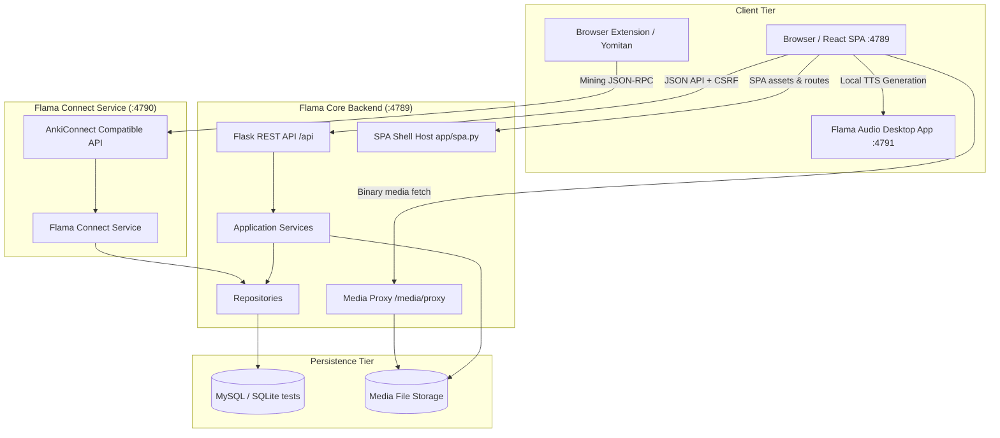

# Flama System Architecture

## Tổng quan

Flama là hệ thống học flashcard, quản lý từ vựng và chia sẻ bộ thẻ được cấu trúc thành các runtime chuyên biệt:

1. **React SPA (`frontend/` - Port 4789)**: Sở hữu toàn bộ giao diện HTML, state management, client routing và tương tác người dùng.
2. **Flask REST Backend (`app/` via `wsgi.py` - Port 4789)**: Cung cấp REST API canonical dưới `/api`, quản lý session/CSRF, binary media proxy, CLI và database migrations/maintenance.
3. **Flama Connect Service (`connect_wsgi.py` - Port 4790)**: Dịch vụ tương thích giao thức Yomitan/AnkiConnect cho phép trích xuất từ vựng 1-click từ trình duyệt trực tiếp vào Flama.
4. **Flama Audio Companion (`flama-audio/` - Port 4791)**: Ứng dụng desktop Windows độc lập (.NET 8 WPF) cung cấp VoiceVox và Kokoro TTS engines nội bộ (offline, không phụ thuộc cloud API key).

`wsgi.py` là entry point chính cho web app và REST API. Flask không còn cấu hình thư mục Jinja và không render server-side template nào.

## Luồng runtime & Hệ sinh thái dịch vụ



### Navigation và HTML

- Mọi GET giao diện được `app/spa.py` trả về `frontend/dist/index.html`.
- React Router xử lý deep-link, trang 404, auth guard và permission guard phía giao diện.
- Permission thật luôn được kiểm tra lại tại REST endpoint.
- `frontend/dist` được tạo trong frontend build stage của Dockerfile.
- Không còn thư mục `templates/`, Jinja filter, Jinja context processor hoặc HTML error page phía Flask.

### REST API

- Public namespace canonical là `/api`.
- Blueprint chính được đăng ký từ `app/api/`; package `app/api/v1/` là boundary nội bộ, không đưa version vào URL.
- JSON dùng `snake_case`; lỗi dùng envelope `error`, `message` và các trường tùy chọn như `field`, `details`.
- SPA dùng Flask-Login session, `credentials: same-origin` và CSRF token lấy từ `GET /api/session`.
- Các adapter cũ chỉ được bật trong `TESTING`; production trả `410 LEGACY_ENDPOINT_REMOVED` và yêu cầu dùng namespace `/api`.

### Ngoại lệ không phải JSON resource thông thường

- `/api/mcp`: MCP JSON-RPC protocol endpoint.
- PayOS webhook (`/api/payments/providers/payos/webhook`): callback có signature và idempotency riêng.
- `/media/*`, `/static/js/card_renderer_host.js`, download binary: static & media delivery.
- SPA shell và frontend assets.

## Các lớp backend

- `app/api/`: parse HTTP, schema validation, auth/permission guard và response mapping.
- `app/services/`: orchestration, transaction ownership và business rules.
- `app/repositories/`: query/persistence, không sở hữu response HTTP.
- `app/validators/`: validate và normalize request/business input.
- `models/`: SQLAlchemy models canonical (`Deck`, `NoteType`, `FieldDef`, `Template`, `Note`, `Card`, `DeckInstall`, `DeckChangeRequest`, `PaymentOrder`, ...).
- `app/routes/`: transition adapters, binary/proxy delivery và compatibility endpoints.

Đích kiến trúc cho mutation là:

```text
REST route -> application service (transaction owner) -> repository -> model
```

## Flashcard Renderer & Sandbox

`render_template_pair()` trong `app/services/flashcard_renderer.py` biên dịch cú pháp card `{{Field}}`, `{{{Field}}}`, conditionals và media proxy an toàn. Output được React render trong `iframe sandbox="allow-scripts"` thông qua `static/js/card_renderer_host.js` với CSP chặt chẽ (`connect-src 'none'`), bảo vệ người dùng trước các mã script không an toàn từ template chia sẻ.

## Shared Deck Collaboration & Change Requests

1. **Logical Overlay Installation**: Người dùng cài đặt shared deck không bị copy toàn bộ `Note/Card`. Hệ thống tạo `DeckInstall` và ánh xạ qua `DeckCloneDeckMap`.
2. **Local Customization**: Chỉnh sửa của người học lưu độc lập trong các bảng `DeckClone*` (`DeckCloneNoteFieldOverride`, v.v.) mà không làm thay đổi source deck của tác giả.
3. **Deck Change Request**: Người cài đặt có thể tạo Change Request (`models/deck_change_request.py`) gửi các cải tiến về cho tác giả. Hệ thống hỗ trợ phát hiện xung đột (`has_conflict`), cho phép tác giả duyệt/hợp nhất (`merged`) hoặc từ chối (`rejected`) một cách an toàn.

## Study Session & Undo System

- Quá trình học tập được quản lý bởi `StudySession` (`models/study_session.py`, `models/study_session_card.py`, `models/study_session_commit.py`).
- Hỗ trợ **Undo/Revert**: Người học có thể hoàn tác ngay lượt đánh giá thẻ vừa thực hiện; scheduler khôi phục lại trạng thái card interval/ease/state chính xác trước đó.

## Startup và dữ liệu

`create_app()` khởi tạo extension, đăng ký model/blueprint/CLI và gọi `run_startup_maintenance()` trong `app/startup.py`. Ngoài testing, `STARTUP_RUN_MAINTENANCE` mặc định tắt; schema được quản lý bằng Alembic. Kiểm tra kết nối DB là bước riêng (`STARTUP_CHECK_DB_CONNECTIVITY`).

Khi bật maintenance, các cờ con điều khiển `db.create_all()`, sửa schema tương thích, seed roles/taxonomy/TTS và clone cutover. TTS seed và clone cutover mặc định tắt; không xem chúng là chi phí bắt buộc mỗi lần boot. Xác minh effective config của process trước khi đánh giá startup hoặc chạy maintenance.

## Chạy và kiểm tra

- **Web & API (Local)**: `flask --app wsgi.py run --host=0.0.0.0 --port=4789`
- **Flama Connect Service**: `python connect_wsgi.py` (Port 4790)
- **Flama Audio Companion**: Chạy `flama-audio/publish/release/FlamaAudio-Portable.exe` hoặc debug WPF app (Port 4791)
- **Production Server**: `gunicorn --bind 0.0.0.0:4789 wsgi:app`
- **Frontend Check**: `cd frontend && npm run check`
- **Focused Tests**: `python scripts/run_tests.py --changed` hoặc `--module study,marketplace`; dùng `--all` cho CI/pre-release.
