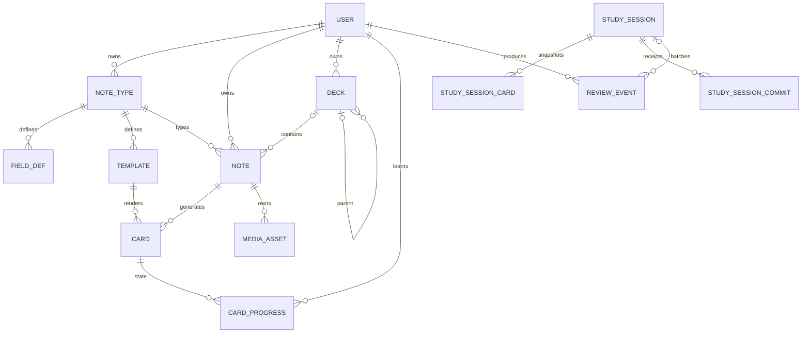
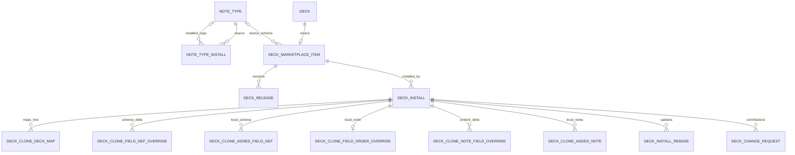
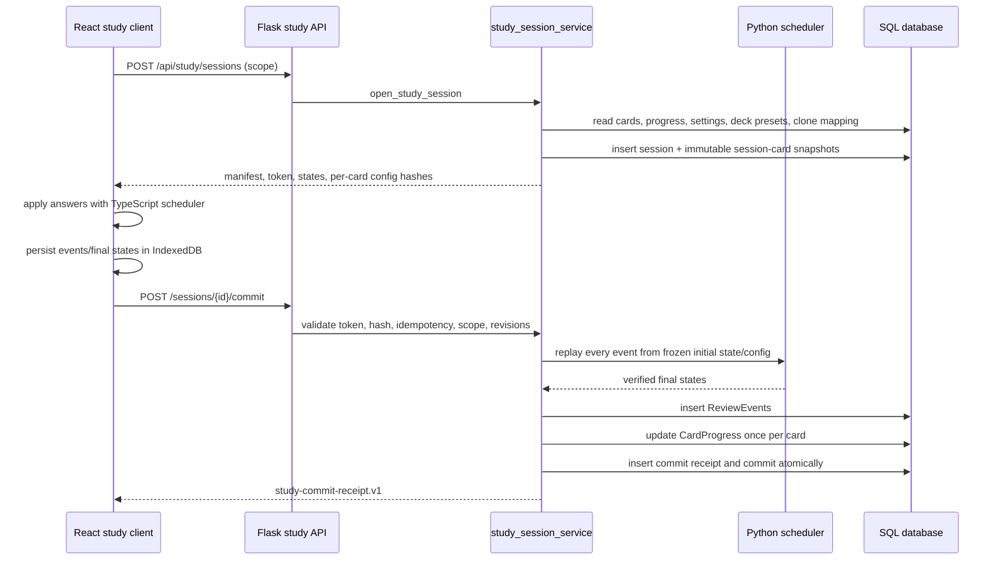

# Flama Database and Application Architecture Investigation

Status: investigation only  
Repository state inspected: 2026-08-24  
Scope: current repository implementation; no target architecture is proposed

## Purpose and method

This document records how Flama currently creates, reads, updates, snapshots, synchronizes, and deletes data. It is based on the ORM models, migrations, startup code, services, repositories, HTTP APIs, React study client, Flama Connect/MCP processes, import paths, marketplace code, and focused tests in this repository.

The terms below are used deliberately:

- **Observed:** behavior directly present in code or asserted by a test.
- **Potential concern:** coupling, duplicated state, or an invariant that deserves review. It is not automatically a defect.
- **Needs verification:** the repository is insufficient to determine intent, production data shape, or behavior outside the checked-in processes.
- **Evidence:** concrete model, function, endpoint, migration, or test references.

The original repository investigation did not inspect production. A read-only SSH/MySQL verification was completed on 2026-08-24 and is recorded in [`production-architecture-verification-2026-08-24.md`](./production-architecture-verification-2026-08-24.md). Production-specific addenda below supersede the corresponding “Needs verification” statements only for that point-in-time deployment snapshot; they do not turn observed distributions into domain invariants.

## 1. Current database/domain architecture

### 1.1 Runtime processes and persistence boundary

**Observed:** the main process is a Flask application factory (`app.create_app`) served from `wsgi.py`. It initializes one Flask-SQLAlchemy database object, registers the canonical `/api` resources and compatibility routes, and serves a React SPA. `template_folder=None` means the current application does not use Jinja as its user-interface rendering layer. The `Template` database model refers to flashcard HTML/CSS templates, not Flask page templates.

**Evidence:**

- `wsgi.py`
- `app/__init__.py::create_app`
- `app/spa.py::init_spa_delivery`
- `app/api/__init__.py`, `app/api/v1/__init__.py`
- `frontend/src/`
- `models/template.py::Template`

**Observed:** Flama Connect is a separate Flask process on port 4790. It deliberately does not register Flask-Login, the main REST blueprints, legacy templates, or startup schema mutation. It shares the same SQLAlchemy models and database. It exposes a constrained AnkiConnect/Yomitan surface and also hosts the full MCP handler under `/v1/mcp`; the main app's `/api/mcp` route is a compatibility forwarding endpoint.

**Evidence:**

- `connect_wsgi.py`
- `app/connect/__init__.py::create_connect_app`, `_register_models`, `ACTION_PARAMS`
- `app/services/flama_connect_service.py::dispatch`
- `app/connect/mcp.py`
- `app/routes/mcp.py::mcp_api`
- `docs/architecture/FLAMA_MCP_CONNECT.md`
- `tests/test_flama_connect.py`, `tests/test_flama_connect_mcp.py`

### 1.2 Where current schema truth comes from

**Observed:** normal production startup performs a connectivity check and, by default, does not mutate the schema. `STARTUP_RUN_MAINTENANCE` defaults to `TESTING`; the individual `db.create_all`, user-management repair, backward-compatible schema repair, default role/TTS seed, and clone cutover tasks are separately gated. The CLI can invoke the same maintenance tasks explicitly.

**Evidence:**

- `app/settings.py::build_app_config` (`STARTUP_RUN_*` defaults)
- `app/startup.py::run_startup_maintenance`
- `app/cli.py` maintenance and cutover commands
- `tests/test_app_startup.py`

**Observed:** the Alembic history in this repository is incremental rather than a complete creation history for every current table. The first checked-in revision is `20260327_000001_add_payment_domain_tables.py` with `down_revision = None`; many core tables such as `users`, `decks`, `notes`, `field_defs`, and `templates` are represented by ORM models but are not created by that first migration. Later migrations add payments, change requests, MCP tokens, soft delete, shared images, study sessions, Connect/import provenance, release/rebase state, and user management. The 2026-08 release line branches at `20260811_000015` and is merged by `20260820_000019`.

**Evidence:**

- `migrations/versions/20260327_000001_add_payment_domain_tables.py`
- `migrations/versions/20260729_000010_add_frontend_study_sessions.py`
- `migrations/versions/20260802_000011_add_flama_connect.py`
- `migrations/versions/20260809_000014_add_connect_import_sessions.py`
- `migrations/versions/20260812_000016_add_deck_release_foundation.py`
- `migrations/versions/20260814_000016_add_anki_sync_provenance.py`
- `migrations/versions/20260820_000018_add_user_management_schema.py`
- `migrations/versions/20260820_000019_harden_deck_release_tracking.py`
- `migrations/env.py::get_metadata`

**Potential concern:** a database cannot be reconstructed from the checked-in Alembic chain alone unless a prerequisite baseline is supplied by deployment tooling or an earlier schema snapshot not present here. Tests commonly use `db.create_all()` against SQLite, which validates current ORM metadata but does not prove a clean MySQL migration from an empty database.

**Production verification (2026-08-24):** production is at the single Alembic head `20260821_000020`. The core tables pre-exist the checked-in migration chain, but the current DB/release cannot prove whether their original source was `db.create_all()`, compatibility DDL, an older missing migration history, a dump/bootstrap, or manual setup. The correct description is “pre-existing core baseline outside the current Alembic chain.” Normal production boot has no `STARTUP_*` overrides: connectivity check is enabled and every maintenance/create-all/schema repair/seed/clone-cutover task resolves disabled. Alembic is the normal deployment schema authority. Full sanitized evidence is in the production verification report.

### 1.3 Domain boundaries actually used

The principal persisted domains are:

| Domain | Primary records | Main mutation/read boundaries |
|---|---|---|
| Identity | `users`, `user_roles`, tokens, permission audit | `app/api/v1/identity`, `app/services/admin_service.py`, `app/utils/permissions.py` |
| Flashcard content | `note_types`, `field_defs`, `templates`, `notes`, `cards`, `media_assets` | `app/api/v1/flashcards`, `flashcard_content_service`, `flashcard_renderer` |
| Organization | `decks` tree | deck APIs/services and deck tree repositories |
| Scheduling | presets/settings, `card_progress`, `review_events`, study-session tables | scheduler config, study repository, scheduler, study services, React study engine |
| Sharing | Note Type metadata/install; Deck listing/install/overlay/release/rebase/change requests | marketplace APIs and share/release/rebase/change-request services |
| External synchronization | Connect session/package/media and source reference tables | Flama Connect, Anki sync, generic note sync, MCP tool service |
| Operational/audit | audit logs, payment/support/TTS/admin records | domain-specific services and repositories |

The route/service/repository split is present but not absolute. Some services own commits, some repository functions are pure queries, and compatibility routes still call shared services directly.

## 2. Major entity relationships

### 2.1 Content and study graph

**Observed:** a Note is the authoritative content instance and has exactly one Note Type. A Card is the `(note_id, template_id)` projection, protected by `uq_cards_note_template`. Scheduling belongs to `(user_id, card_id)`, not to the Note, so source cards can be learned independently by multiple users, including through logical Deck installs.

**Evidence:** `models/note.py`, `models/card.py`, `models/card_progress.py`; `flashcard_content_service._create_cards`; `tests/test_flashcard_api_integration.py::test_shared_deck_install_clone_cards_visible_in_browse_api`.

### 2.2 Sharing graph

**Observed:** Note Type marketplace installation and Deck marketplace installation are materially different lifecycles. A Note Type install copies FieldDefs and Templates into a new learner-owned NoteType with new IDs. A Deck install creates an owned deck tree and a copied Note Type for local deck metadata, but does not copy source Notes/Cards; study and browse query source content through an overlay.

**Evidence:** `flashcards_share_service.clone_note_type_for_user`, `ensure_note_type_install_for_user`, `clone_deck_subtree`, `install_shared_deck_item_for_user`, `query_clone_scope_cards`; `tests/test_flashcard_api_integration.py::test_shared_deck_install_creates_pointer_clone_without_note_copy`, `::test_shared_deck_install_clones_source_note_type_for_installer`.

## 3. Actual runtime data flows

### 3.1 Authoring a note

1. `POST /api/note-types/<note_type_id>/notes` is validated by `validate_note_create_request` against FieldDefs keyed by name.
2. `flashcard_content_service.create_note` validates existing Note Types in the target deck, inserts a name-keyed JSON `Note.field_values`, creates one Card per Template, records release dirty state, updates install usage/statistics, adds an AuditLog, and commits.
3. Reads return the same name-keyed object. Browse search casts the JSON document to text; MCP search loads notes and searches Python values/tags.

**Evidence:** `app/api/v1/flashcards/notes.py`, `app/validators/flashcard_input.py::clean_note_field_values`, `app/services/flashcard_content_service.py::create_note`, `app/services/browse_card_service.py`, `app/services/mcp_tool_service.py::find_notes`.

### 3.2 Rendering a card

1. A Card chooses a Note and Template.
2. FieldDefs determine type, order, and sanitation. `build_render_context` gets each value by `FieldDef.name`.
3. Mustache compiles `front_html` and `back_html` at runtime. Media values are resolved against per-note MediaAssets.
4. The result is sanitized. The modern study path can instead ship sanitized template source, content context, and separated inline scripts as versioned artifacts.
5. React renders the card in an `iframe sandbox="allow-scripts"` with the renderer host and a constrained message bridge.

**Evidence:** `models/template.py`, `app/services/flashcard_renderer.py::build_render_context`, `render_template_pair`, `prepare_client_template_source`; `app/services/study_artifact_service.py`; `frontend/src/features/study/components/CardRendererFrame.tsx`; `static/js/card_renderer_host.js`; `tests/test_flashcard_renderer.py`, `tests/test_study_artifact_service.py`.

### 3.3 Complete frontend study lifecycle

**Observed:** the client-side answer is not trusted as the sole scheduling result. The server replays every event with the Python scheduler and rejects mismatched before/after hashes or final states. `CardProgress.revision` provides optimistic concurrency, event IDs and session sequence constraints provide idempotency, and the whole accepted batch is committed together.

**Evidence:** `app/routes/flashcards/study.py::study_session_open`, `study_session_commit`; `app/services/study_session_service.py::open_study_session`, `commit_study_session`; `frontend/src/features/study/session/studySessionEngine.ts`, `sessionStore.ts`; `tests/test_study_session_api.py::test_commit_replays_events_and_is_idempotent`, `::test_commit_rejects_tampered_final_state`, `::test_second_session_detects_progress_conflict`.

**Observed:** a direct per-answer path also remains: `/api/study/cards/<card_id>/answer` and MCP `submit_review` calculate on the server, update CardProgress, create one ReviewEvent, and commit immediately. Direct events do not receive a StudySession identity or its algorithm/config hashes. A direct answer invalidates a conflicting open batch via progress revision checks.

**Evidence:** `app/routes/flashcards/study.py::study_answer`; `app/services/study_service.py::apply_study_answer_and_commit`; `app/services/mcp_tool_service.py::submit_review`; `tests/test_study_session_api.py::test_legacy_answer_invalidates_open_batch_session`.

## 4. Field architecture investigation

### 4.1 What is a field's identity?

**Observed:** there are two active identities with different scopes:

- `FieldDef.id` is the stable schema identity used for CRUD/reorder endpoints, release diffs, clone schema overrides, stable note-field overrides, rebase/change-request conflict keys, and release reconstruction.
- `FieldDef.name` is the runtime content key used in `Note.field_values`, Mustache placeholders, media ownership metadata, imports, Connect, MCP note payloads, identity-field duplicate matching, and most search/display code.

This is not merely duplicate metadata: the current implementation translates between names and IDs at release/synchronization boundaries.

**Evidence:**

- `models/field_def.py::FieldDef`
- `models/note.py::Note.field_values`
- `app/services/deck_release_service.py::_build_working_state`, `get_note_field_values_by_id_for_ids_at_release`, `get_note_values_for_ids_at_release`
- `models/deck_clone_note_field_override.py::DeckCloneNoteFieldOverride`
- `app/services/deck_install_rebase_service.py::_load_local_overlays`
- migration `20260820_000019_harden_deck_release_tracking.py`

### 4.2 Where stable IDs are used

| Use | Stable-ID behavior |
|---|---|
| Field CRUD/reorder | Endpoint path and reorder payload identify FieldDefs by UUID. |
| Release changes | `DeckReleaseChange.field_def_id`, `change_key`, and `property_key=field:<id>` identify schema/content deltas. |
| Release reconstruction | Checkpoint name keys are mapped to the FieldDef names at the checkpoint sequence, then subsequent changes remain ID-keyed. |
| Clone schema | `DeckCloneFieldDefOverride.source_field_def_id`; `ordered_def_ids` includes source and added definition IDs. |
| Clone note override | `source_field_def_id` is canonical when available; `field_name` remains a compatibility key. |
| Rebase/change request | Three-way comparisons use entity/field IDs, with names reconstructed for UI/path labels and legacy fallbacks. |
| Connect provenance | Source Note Type mapping is stable at the NoteType level; field mappings and payloads themselves remain name-based. |

**Observed:** migration `20260820_000019` backfills `DeckCloneNoteFieldOverride.source_field_def_id` by joining `(source note type, field_name)` and adds uniqueness on `(deck_install_id, source_note_id, source_field_def_id)`. Name uniqueness remains too. The rebase service first looks up an override by ID, then by name for compatibility.

**Evidence:** `migrations/versions/20260820_000019_harden_deck_release_tracking.py`; `models/deck_clone_note_field_override.py`; `app/services/deck_install_rebase_service._local_overlay_for_change`; `tests/test_deck_install_rebase_flow.py::test_field_rename_keeps_stable_local_note_override_visible`.

### 4.3 Where names are references

**Observed:** the following systems use field names as keys or references:

- `notes.field_values` and release note checkpoints.
- `{{Field}}`, `{{{Field}}}`, sections/conditionals, and dotted names in templates.
- `MediaAsset.field_name` and media upload/delete APIs.
- File import column mapping and `uniqueness_fields`.
- Anki/Connect `fields`, source-to-target `fieldMapping`, target schema hashes, and identity matching.
- MCP create/update/find/sync note payloads and primary identity duplicate checks.
- Audio scan/VoiceVox destination selection.
- Browse/search serialization and fallback display.
- Compatibility fields in clone overrides and change-request metadata.

**Evidence:** `app/validators/flashcard_input.py`; `app/services/flashcard_renderer.py`; `app/services/flashcard_media_api_service.py`; `app/repositories/flashcards_import_repository.py`; `app/services/flama_connect_service.py`; `app/services/mcp_tool_service.py`; `app/services/flashcard_audio_scan_service.py`; `app/repositories/vocabulary_repository.py`.

### 4.4 Rename behavior

**Observed:** canonical field PATCH calls `_rename_field_values` synchronously inside the request transaction. It creates `FieldRenameJob(status="running")`, counts and loads all owner Notes for that NoteType, moves each JSON value from `old_name` to `new_name`, marks the job completed, renames the FieldDef, marks a stable-ID schema change, and commits. If both keys exist, the old key is discarded and the existing new-key value wins.

**Observed:** despite its name, `FieldRenameJob` is not consumed by a checked-in worker, queue, polling API, or retry process. Its only current writer is `flashcard_content_service._rename_field_values`; its current role is a persisted progress/result record for synchronous work.

**Evidence:** `models/field_rename_job.py`; `app/services/flashcard_content_service.py::update_field`, `_rename_field_values`; repository-wide references to `FieldRenameJob`.

**Potential concern:** `_rename_field_values` catches an exception, marks the job failed, and returns it; `update_field` then still assigns the new FieldDef name and commits the transaction. If a database/runtime exception occurred after some Notes were processed, the function's current control flow permits a failed job, renamed schema, and partially rewritten Note values to be committed together. There is no focused test for this failure branch (`except` is marked `pragma: no cover`).

**Potential concern:** the canonical rename does not rewrite Template placeholders or `MediaAsset.field_name`. Rendering resolves the new value by the new FieldDef name, so an unchanged `{{OldName}}` placeholder has no corresponding context value after the Note JSON rewrite. Media rendering can still resolve the asset by ID or filename, but media deletion clears `note.field_values[asset.field_name]` only when that old key contains the asset ID. These are evidenced couplings; this investigation did not execute a rename-with-template/media integration test to classify the outcomes as user-visible bugs.

**Evidence:** `flashcard_content_service._rename_field_values`; `flashcard_renderer.build_render_context`; `flashcard_media_api_service.delete_media`; absence of rename integration tests, compared with `tests/test_mcp_note_type_capabilities.py::test_update_note_type_with_field_rename_preserves_data`.

**Observed:** MCP has a separate broad `update_note_type` mutation. It can identify list-format fields by ID, old name, or current name, but directly rewrites FieldDef names and Note JSON. It does not create a FieldRenameJob or update Template/media name references. It is blocked from changing fields/templates/name when a published shared release depends on the Note Type, preventing it from bypassing release-aware field APIs in that case.

**Evidence:** `app/services/mcp_tool_service.py::preview_note_type_update`, `update_note_type`; `tests/test_oauth_mcp_security_regression.py`; `tests/test_mcp_note_type_capabilities.py::test_update_note_type_with_field_rename_preserves_data`.

### 4.5 Multiple representations

**Observed:** one logical field can appear as a FieldDef UUID, current name, historical name in a release checkpoint, Mustache token, MediaAsset `field_name`, source import name, target mapping name, clone compatibility name, or an ID-based release property key. Release code explicitly reconstructs names at the relevant sequence and exposes name-keyed values to runtime consumers after doing ID-keyed historical work.

**Potential concern:** any mutation path that updates only one representation can create temporarily or permanently stale references. Current safeguards are strongest in release/rebase code and weakest across ordinary rename-to-template/media coupling.

**Production verification (2026-08-24):** production contains one `FieldRenameJob`; it completed with zero target/processed Notes and no error. There are no recorded failed/pending/running/stale jobs. Aggregate integrity checks found zero Note JSON keys and zero current MediaAsset `field_name` values without a matching FieldDef name. This verifies current consistency but does not exercise a real bulk rename or prove every MCP/external rename path was failure-free. The intended Template/media rename contract remains an architecture decision.

## 5. Deck and Note Type relationship

### 5.1 Semantics of the two columns

**Observed:** `notes.note_type_id` is the authoritative schema for a Note. It is non-null, has a foreign key to NoteType, and selects FieldDefs/Templates. `decks.note_type_id` is nullable and exposed by MCP/import code as `default_note_type_id`. It is used as an inference/default or as a stricter binding in some ingestion paths, not as a database-enforced type for every Note in the deck.

**Evidence:** `models/note.py`, `models/deck.py`; `mcp_tool_service.create_deck`, `update_deck`, `get_deck`; `flashcards_import_repository.infer_default_note_type_id_for_deck`; `tests/test_mcp_note_type_capabilities.py::test_deck_with_default_note_type_and_in_use`, `::test_update_deck_default_note_type`.

### 5.2 Can a deck contain multiple Note Types?

**Observed:** yes, in the full Anki import path. `_upsert_import_card(... allow_mixed_model=True)` explicitly permits several source models in one Anki deck. If more than one Note Type is present, it clears `deck.note_type_id` and retains each `note.note_type_id`. A focused test imports two Note Types into one deck and asserts `deck.note_type_id is None` and two Notes remain.

**Evidence:** `app/services/flama_connect_service.py::_upsert_import_card` and its “Anki permits multiple NoteTypes” branch; `tests/test_flama_connect.py::test_one_anki_deck_can_import_multiple_ready_note_types_without_flattening`.

**Observed:** canonical Note CRUD and file import enforce a single existing Note Type in the target deck using `validate_note_type_consistency_for_deck`. Marketplace publishing inspects the full selected subtree and requires exactly one Note Type. Simple Yomitan `addNote` treats non-null `deck.note_type_id` as a binding and sets it when the deck is empty.

**Evidence:** `flashcard_content_service.create_note`, `update_note`; `flashcards_import_repository.resolve_import_execution_payload`; `flashcards_share_service.validate_note_type_consistency_for_deck`, `resolve_single_note_type_for_deck`; `flama_connect_service._parse_note`, `add_note`; `tests/test_flashcard_api_integration.py::test_note_create_rejects_mixed_note_types_in_same_deck`, `tests/test_flama_connect.py::test_add_binds_empty_deck_and_duplicate_is_exact_target_deck`.

**Observed:** the canonical consistency check compares Notes already in the deck; it does not compare the requested Note Type with `deck.note_type_id`. MCP create/update Note paths do not call that consistency helper. Therefore a default can be empty, cleared, or differ from a Note's type unless a particular caller enforces or repairs it. There is no database constraint linking the two columns.

**Potential concern:** “one Note Type per deck” is an API-specific invariant, not a universal domain invariant. Callers that assume `deck.note_type_id == note.note_type_id` can be wrong for imported mixed-model decks and potentially for MCP-created content.

**Production verification (2026-08-24):** among active Decks, 383 contain direct Notes and every one has exactly one direct NoteType; 80 of those have a NULL Deck default, and no non-null default disagrees with direct resident Notes. No individual Deck row is directly mixed. However, when each Deck plus descendants is treated as the current recursive study scope, one real scope spans two NoteTypes. Therefore the new Study Template selector cannot rely only on `decks.note_type_id` and must define mixed-subtree behavior.

## 6. Scheduler and review architecture investigation

### 6.1 Configuration and algorithm selection

**Observed:** scheduler selection starts with `UserSchedulerSettings.scheduler_mode` (`legacy` or `fsrs`). Day boundary and learn-ahead are also user-global. A Deck optionally selects a user SchedulerPreset through `decks.scheduler_preset_id`; `resolve_deck_options` overlays learning/relearning steps and legacy interval/leech settings on defaults.

**Evidence:** `models/user_scheduler_settings.py`, `models/scheduler_preset.py`, `models/deck.py`; `app/services/scheduler_config_service.py::resolve_scheduler_runtime_settings`, `resolve_scheduler_preset_for_deck`, `resolve_deck_options`; `tests/test_scheduler_schema.py::test_resolve_deck_options_reads_user_settings_and_preset`.

**Observed:** no checked-in REST route, React settings screen, service mutation, or CLI was found that creates/edits SchedulerPreset or UserSchedulerSettings. Tests construct them directly. They are nevertheless read by all current study selection/scheduling paths.

**Production verification (2026-08-24):** production has zero `SchedulerPreset` rows, zero `UserSchedulerSettings` rows, and all 965 active Decks have a NULL preset reference. No ReviewEvent or StudySessionCard references a preset. Current production therefore uses fallback/default settings and imported state. DB evidence cannot prove whether an external management tool ever existed, but there is no live configured data to preserve today.

### 6.2 Persisted progress state

`card_progress` is the mutable current state per user/card:

| State group | Columns |
|---|---|
| Queue/steps | `queue`, `step_index`, `review_kind` |
| Due state | `due_at`, `due_day`, buried/suspended flags |
| Interval/ease | integer `interval_days`, float `interval_days_raw`, `ease_factor` |
| FSRS hooks | `scheduler_mode`, `memory_stability`, `memory_difficulty` |
| Leech | suspension reason, last leech time/lapses |
| History/concurrency | `last_review_event_id`, reps/lapses, `last_reviewed_at`, `revision` |

**Observed:** the repository translates this row into `CardState`, applies the scheduler, then writes it back. `due_day` is authoritative for review-day scheduling; compatibility logic derives it from `due_at` for older rows. Raw float interval is retained alongside the rounded integer persisted interval.

**Evidence:** `models/card_progress.py`; `app/repositories/study_repository.py::card_state_from_progress`, `apply_card_state_to_progress`; scheduler/counter tests in `tests/test_anki_scheduler.py`, `tests/test_counter_logic.py`, `tests/test_study_integration.py`.

### 6.3 FSRS and legacy representation

**Observed:** `anki_scheduler.py` implements legacy Anki/SM-2-like transitions and contains FSRS hooks. FSRS execution requires both `options.schedulerMode == "fsrs"` and a non-null `fsrsNextStates`. The TypeScript engine has the same condition. Tests exercise FSRS by manually supplying next states.

**Observed:** `resolve_deck_options` currently sets `fsrsNextStates=None` and does not parse/use `fsrs_parameters_json`, `desired_retention`, `historical_retention`, `ignore_reviews_before`, `fsrs_reschedule_on_change`, `fsrs_short_term_enabled`, or either extra JSON column. A user setting of `scheduler_mode="fsrs"` is propagated into state/events, but without externally supplied next states the transition branches remain legacy.

**Evidence:** `app/services/anki_scheduler.py::_is_fsrs_mode`; `frontend/src/features/study/scheduler/legacyEngine.ts::isFsrs`; `scheduler_config_service.resolve_deck_options`; `tests/test_anki_scheduler.py::test_fsrs_mode_ignores_interval_modifier_for_passing_answers`; repository-wide usages of the FSRS preset columns.

**Potential concern:** `scheduler_mode` can describe persisted state as `fsrs` while the actual transition was the legacy branch because next states were absent. The current repository has schema/configuration capacity for more FSRS behavior than the runtime resolver wires up.

**Production verification (2026-08-24):** native FSRS usage is 0% across all available signals: no user settings, no presets, no `card_progress.scheduler_mode='fsrs'`, no FSRS-labelled ReviewEvents, and no populated stability/difficulty state. CardProgress is 95.94% `anki` and 4.06% `legacy`; ReviewEvents are predominantly imported `anki/revlog-v1`. There is therefore no live native FSRS state to migrate, but imported provenance/history completeness remains essential for the approved history-based Algorithm initializer.

**Needs verification:** whether a not-checked-in process is expected to compute `fsrsNextStates`, and whether existing `fsrs` rows were intentionally transitional metadata.

### 6.4 StudySession algorithm/version semantics

**Observed:** every current frontend StudySession is stamped `scheduler_algorithm="legacy-anki"`, `algorithm_version="1.0.0"`, and wire schema `study-session.v2`. Per-card config snapshots still contain `scheduler_mode` and possible FSRS next-state structures. The top-level algorithm/version is copied onto ReviewEvents during session commit and is used to freeze/replay the contract, not to dynamically choose a Python scheduler implementation.

**Evidence:** `study_session_service.SCHEDULER_ALGORITHM`, `ALGORITHM_VERSION`, `WIRE_SCHEMA_VERSION`; `open_study_session`, `commit_study_session`; `models/study_session.py`; `tests/test_study_session_api.py::test_commit_replays_events_and_is_idempotent`.

**Potential concern:** the top-level algorithm label and per-card scheduler mode are separate representations and can describe different levels of the execution contract. Consumers should not infer FSRS/legacy solely from one of them.

### 6.5 Preset changes and open/existing state

**Observed:** opening a session serializes each card's resolved options, hashes them, and stores the session-wide config snapshot plus per-card config hashes and initial states. Later preset changes do not affect that open session. New sessions and direct answers resolve the then-current preset. Existing CardProgress is not proactively rescheduled by any checked-in preset mutation path; it transitions under the newly resolved options on a later answer.

**Evidence:** `study_session_service.open_study_session`, `serialize_deck_options`, `commit_study_session`; `StudySession.config_snapshot_json`; `StudySessionCard.scheduler_config_hash`.

**Needs verification:** intended semantics for `fsrs_reschedule_on_change`, since it is stored but not consumed by current services.

### 6.6 Why ReviewEvent contains generic and scheduler-specific data

**Observed:** ReviewEvent is both an analytics fact and a transition/audit envelope:

- Generic analytics: user/card/deck/Note Type, time, duration, rating, mode.
- Scheduler context: preset, scheduler mode/kind, session algorithm/version/config hash.
- Before/after transition: queue, interval, due day, ease, memory stability/difficulty, leech/suspension.
- Raw provenance: `payload_json` for the submitted answer or canonical Anki revlog record.

Direct study and session commit populate before/after values from `CardState`. Anki import populates the subset available from revlog (`interval`, `lastIvl`, `factor`, rating/type/time), stamps `scheduler_algorithm="anki"` and `algorithm_version="revlog-v1"`, and keeps a durable external identity in `ConnectReviewEventRef`.

**Evidence:** `models/review_event.py`; `study_service.apply_study_answer_and_commit`; `study_session_service.commit_study_session`; `anki_sync_service._import_review`; `tests/test_anki_import_api.py::test_progress_and_full_revlog_are_separate_idempotent_sync_streams`.

**Observed consumption:** current user/admin analytics query reviewed time, duration, rating, mode, deck, and `scheduler_mode`. No checked-in production query was found reading queue-before/after, interval/ease/memory before/after, due-day transition, algorithm version/config hash, or parsing `ReviewEvent.payload_json`. Those fields are currently written and tested as audit/history data; `CardProgress.last_review_event_id` references the latest event.

**Evidence:** `app/repositories/stats_query_repository.py`, `review_event_repository.py`, `admin_analytics_repository.py`; `tests/test_scheduler_schema.py::test_review_event_persists_extended_scheduler_metadata`.

**Observed:** ReviewEvent `card_id`, `deck_id`, and `note_type_id` deliberately have no foreign keys. Purge code calls ReviewEvent an immutable analytics fact, nulls deck/Note Type snapshots before deleting those entities, and preserves the event. Connect provenance can repair a missing analytics projection by replaying its durable source reference.

**Evidence:** `models/review_event.py`; `app/services/deck_management_service.py::delete_deck_subtree`; Note Type purge in `flashcard_content_service`; `anki_sync_service._import_review`; `tests/test_rest_api_v1.py` purge test.

**Potential concern:** the table contains both operational idempotency state and long-lived audit facts with different retention expectations. The absence of FKs is intentional in purge behavior, but application-level detachment must cover every deletion path.

**Official retention decision (2026-08-24):** StudySession, StudySessionCommit, session-card/action verification detail, and equivalent execution-detail records are retained for 30 days, aggregated, then cleaned. Exact Algorithm/evaluator replay is required only through the active session lease. This does not by itself decide that every ReviewEvent fact is disposable after 30 days: the separate official Algorithm-switch decision requires scheduler-grade history or a sufficient initialization summary beyond ordinary analytics aggregation.

**Production verification (2026-08-24):** all 133 StudySessions and their 4,315 SessionCards/94 Commits are younger than 30 days; no existing data can demonstrate cleanup volume. All 39 rows still marked `open` are expired by timestamp. No durable daily aggregate table was found, and current analytics reads raw ReviewEvents. Imported ReviewEvent `reviewed_at` reaches into 2025 while ingestion `created_at` is recent, so a retention job must distinguish occurrence time from storage age.

## 7. Template architecture investigation

### 7.1 Creation and storage

**Observed:** Templates store mutable `front_html`, `back_html`, `shared_css`, display order, and default flag. Creating a Template creates a Card for every existing owner Note of that NoteType. Deleting a Template deletes its Cards. For Note Types with shared release dependents, all direct Template mutations are blocked because Template/Card changes are not yet represented in DeckRelease.

**Evidence:** `models/template.py`; `flashcards_share_service.create_template`; `mcp_tool_service.update_note_type`; `flashcard_content_service._ensure_version_safe_template_mutation`; `tests/test_flashcard_api_integration.py::test_released_shared_note_type_rejects_all_template_mutations`.

### 7.2 Placeholder resolution

**Observed:** there are no compiled FieldDef-ID bindings in Template rows. Placeholders are resolved at render time through a Mustache context keyed by field name. HTML-producing fields automatically upgrade `{{Field}}` to unescaped triple braces before rendering. Dotted field names are mirrored into nested objects for Mustache compatibility. Unknown Note keys are retained for older templates, and `hanviet` receives a `han_viet` alias.

**Evidence:** `flashcard_renderer._upgrade_html_field_double_brace_tokens`, `build_render_context`, `render_template_pair`; `tests/test_flashcard_renderer.py::test_build_render_context_keeps_unknown_legacy_keys`.

**Potential concern:** stable FieldDef identity protects release/overlay synchronization but does not protect Template bindings. A field rename therefore crosses from ID-stable schema code into name-bound template code.

### 7.3 JavaScript and media security boundary

**Observed:** inline Template scripts are allowed. External `src=` scripts and unsupported script types are removed. In the client artifact path, template-authored scripts are extracted before field interpolation, while interpolated field content is sanitized; the trusted template scripts are then delivered separately. CSS imports and URL functions are blocked. Media source URLs are restricted to `/media/proxy/<asset_id>`.

**Observed:** the execution boundary is an opaque-origin iframe with `sandbox="allow-scripts"` and a restrictive CSP (`connect-src 'none'`, no form/top navigation; approved media proxy sources). The host bridge exposes `FlamaCard.playAudio`, `notifyHeight`, `onReveal`, `getConfig`, and `getContext`; audio references are validated before the parent plays them.

**Evidence:** `flashcard_renderer._extract_inline_scripts`, `sanitize_template_html_fragment`, `prepare_client_template_source`, `sanitize_css`; `static/js/card_renderer_host.js`; `frontend/src/features/study/components/CardRendererFrame.tsx`; `docs/architecture/CARD_TEMPLATE_SANDBOX_RENDERER.md`; `tests/test_flashcard_api_integration.py::test_study_next_returns_sandbox_renderer_payload_for_inline_template_script`, renderer host tests.

**Observed:** `render_template_pair` accepts `allow_inline_script` and `defer_inline_script`, but the current function body does not branch on either argument. Script preservation is controlled by extraction/sanitation and the sandbox host rather than those flags.

**Needs verification:** whether those arguments remain part of a compatibility API or are expected to control behavior in a future caller.

## 8. Media architecture investigation

### 8.1 Per-note media

**Observed:** `MediaAsset` is owned by a Note and stores a field name, original filename, MIME type, relative storage path, SHA-256, and size. Physical web uploads are stored below `<user_id>/<note_id>/<generated filename>`. Deduplication is constrained to `(note_id, sha256, field_name)`; the same bytes can therefore be stored separately across Notes or fields.

**Observed:** ordinary image/audio/diagram upload sets the Note field to the MediaAsset UUID. Markdown-inline upload returns a filename and does not replace the whole field. Renderer/validator compatibility accepts UUID, `/media/proxy/<id>`, original filename, and `[sound:filename]` when the reference resolves to an asset attached to the same Note.

**Evidence:** `models/media_asset.py`; `flashcard_media_api_service.upload_media`, `upload_media_batch`, `_media_payload`; `flashcard_renderer._resolve_media_url`, `build_render_context`; `tests/test_flashcard_validation_security.py`, `tests/test_flashcard_media_batch_api.py`.

### 8.2 Connect media staging and materialization

**Observed:** simple Yomitan `storeMediaFile` stages MP3 bytes in `ConnectPendingMedia`, unique by `(user_id, filename)`, with expiry and integrity metadata. `addNote` resolves only staged references, moves/copies the bytes into the Note directory, creates a MediaAsset, sets the Note field to the original safe filename (the service calls this canonical for Connect), then removes staging after commit.

**Observed:** full Anki import stages audio/images in `ConnectImportMedia`, unique by `(session_id, filename)`. Materialization creates per-note MediaAssets and leaves filename/sound-tag-compatible values in Note JSON. Missing Anki media can be logged/skipped according to the import path; simple Yomitan rejects unstaged audio.

**Evidence:** `models/connect_pending_media.py`, `models/connect_import_media.py`; `app/services/flama_connect_media_service.py::stage_mp3`, `stage_import_media`, `resolve_pending_audio`, `resolve_import_media`, `materialize_audio`, `materialize_import_media`; `tests/test_flama_connect.py::test_store_mp3_then_add_note_attaches_media_asset`, `::test_import_preserves_nested_deck_path_and_attaches_audio_and_image`, `::test_add_note_rejects_audio_reference_that_was_not_staged`.

**Potential concern:** web upload and Connect import intentionally produce several field-value representations. Renderer/validation code centralizes much of the compatibility, but downstream code that assumes a media field always contains an asset UUID is incomplete.

### 8.3 Shared image library

**Observed:** `SharedImageAsset` is an admin/global reusable image catalog addressed by unique `image_key`, optionally backed by a stored file or source URL. It has tags, enabled state, creator/updater references, and global SHA lookup. Creation can return an existing SHA match and merge metadata. It has no foreign key to Note, FieldDef, or MediaAsset.

**Evidence:** `models/shared_image_asset.py`; migrations `20260726_000009_add_shared_image_assets.py` and `20260821_000020_add_shared_image_assets_tags_and_source_url.py`; `image_library_service.create_image`; `app/routes/image_library.py`; `tests/test_image_library.py`.

**Observed:** SharedImageAsset and MediaAsset overlap in validation/storage concepts and SHA metadata but serve different ownership models: a reusable catalog versus note-owned render media. The same physical asset is not relationally shared between Note MediaAssets; cross-note reuse is available only through the separate image-key subsystem, not through `media_assets`.

**Official product decision (2026-08-24):** this independence is intentional. Note content may store a SharedImage URL/key as generic free text, but there must be no Note/Field/Media FK to SharedImageAsset and no image lifecycle cascade into Note. Note-owned MediaAsset remains separate.

**Production verification (2026-08-24):** 11 SharedImageAsset rows exist. `information_schema` confirms zero SharedImage-to-Note and zero SharedImage-to-MediaAsset FKs; only optional creator/updater User FKs exist. Note JSON was intentionally not scanned for actual URL/key content, so usage rate remains unmeasured while the relational boundary is verified.

## 9. Marketplace and clone investigation

### 9.1 Publishing

**Observed:** Note Type marketplace metadata lives directly on NoteType (publish status, taxonomy, pricing, version/changelog, statistics). Publishing changes that row. Installation creates a private owned copy and a `NoteTypeInstall` provenance/usage row.

**Observed:** Deck marketplace metadata lives in `DeckMarketplaceItem`, unique by source deck after `20260811_000015`. Publishing binds a source subtree to exactly one source Note Type and stages an immutable DeckRelease. `DeckMarketplaceItem.working_revision` and sparse dirty entities support efficient release preview; the service falls back to full comparison when the journal cannot be trusted.

**Evidence:** `models/note_type.py`, `models/note_type_install.py`, `models/deck_marketplace_item.py`; `flashcards_share_service.publish_note_type`, `create_shared_deck_item`, `bind_deck_item_source_note_type`; `deck_release_service.preview_release`, `publish_release`; migrations `20260811_000015`, `20260812_000016`, `20260820_000019`; `tests/test_deck_release_api.py`.

### 9.2 Release representation

**Observed:** DeckRelease is an immutable sequence/version node with parent, manifest hash, counts, and idempotency key. Atomic `DeckReleaseChange` rows use polymorphic `(entity_kind, entity_id, field_def_id, property_key)` keys and native JSON before/after values. Note checkpoints retain full name-keyed `field_values`/tags at a sequence; membership intervals retain whether a note/field exists at a target release. Runtime reconstruction converts checkpoints to FieldDef IDs as of the checkpoint sequence, applies later ID-keyed changes, filters membership, and finally exposes name-keyed values at the requested release.

**Evidence:** `models/deck_release*.py`; `deck_release_service.reconstruct_release_state`, `_build_atomic_diff`, `_create_initial_checkpoints`, `_sync_memberships`; `tests/test_deck_release_api.py::test_second_release_diff_history_filters_and_reconstruction`, `::test_note_membership_history_survives_remove_and_readd`.

### 9.3 Install/clone and local modification

**Observed:** Deck installation creates:

- a `DeckInstall` pinned to the current release (or legacy timestamp snapshot),
- a local owned Deck tree plus `DeckCloneDeckMap` rows,
- a NoteTypeInstall/physical NoteType copy for local deck metadata,
- no copies of source Notes/Cards.

Browse/study query source Cards through the applied release membership and map source deck IDs to local deck IDs. Learner-owned additions are real Notes/Cards linked by `DeckCloneAddedNote`. Source-field schema edits and source-note content edits are delta rows; they never mutate the source Note.

**Evidence:** `flashcards_share_service.install_shared_deck_item_for_user`, `clone_deck_subtree`, `resolve_clone_scope_for_local_deck`, `query_clone_scope_cards`, `build_clone_schema_view`, `apply_clone_note_field_overrides`; `docs/plans/completed/CLONE_CUTOVER_REPORT.md`; clone tests in `tests/test_flashcard_api_integration.py` and `tests/test_study_session_api.py::test_clone_session_uses_local_scope_without_mutating_source_note`.

### 9.4 Upstream update and conflict resolution

**Observed:** a learner update is a three-way rebase from the install's applied release to a target release while preserving local overlays. The service loads only upstream changes that overlap local overlay keys. It creates conflicts only when local differs from both base and upstream and upstream differs from base. Resolutions are `keep_mine`, `keep_upstream`, or `manual`; expected applied release and overlay revision make prepared rebases stale if local/upstream state changes.

**Evidence:** `app/services/deck_install_rebase_service.py::prepare_update`, `_overlapping_changes`, `resolve_conflict`, `apply_prepared_update`; `models/deck_install_rebase*.py`; `/api/marketplace/installations/<install_id>/updates/...` in `app/api/v1/marketplace/installations.py`; `tests/test_deck_install_rebase_flow.py`.

**Observed:** change requests flow in the reverse direction. A learner's overlay is fingerprinted into draft items with base/local values; sync compares current owner state, creates three-way conflicts, and requires resolution before submission. Owner approval applies effective changes to the source working tree, keeps request-item traceability on release changes, and cleans the contributing install's accepted overlay rows; rejection leaves source unchanged.

**Evidence:** `deck_change_request_service.compute_overlay_fingerprint`, `build_or_refresh_draft_request`, `sync_request`, `resolve_request_conflict`, `approve_and_merge_request`, `reject_request`; `models/deck_change_request*.py`; `app/routes/flashcards/change_requests.py`; `tests/test_deck_change_request_flow.py`.

### 9.5 Compatibility/cutover

**Observed:** legacy full-copy Deck installs are supported by a one-shot cutover. It pairs old local/source notes, converts differences to overlays, migrates progress to source Card IDs, creates deck maps, and removes obsolete local copies when safe. Startup can run it only when explicitly enabled; CLI execution is available. Legacy snapshot installs and early release rows retain compatibility fallbacks in query/release/rebase code.

**Evidence:** `flashcards_share_service.migrate_legacy_clone_install_to_overlay`, `cutover_clone_model_to_overlay_only`; `app/startup.py`; `app/cli.py`; `docs/plans/completed/CLONE_CUTOVER_REPORT.md`; `tests/test_flashcard_api_integration.py::test_cutover_migrates_legacy_full_copy_install_to_overlay`.

**Potential concern:** the Deck lifecycle intentionally carries live working state, immutable release state, checkpoint/membership state, learner overlays, prepared rebases, and contribution requests. Stable keys and revisions are present, but any mutation bypassing dirty tracking or release gates can make those representations diverge. The code contains fail-closed/fallback logic specifically for this risk.

## 10. Import, Flama Connect, and MCP interactions

### 10.1 File import

**Observed:** file import exposes NoteType FieldDefs (IDs and names) to the React mapping UI, but submitted uniqueness and column mappings are name-based. Execution selects an owned Note Type, validates target deck access and its current Note-Type consistency, then performs insert/update behavior through the import service. Default Note Type inference prefers `deck.note_type_id`, then a single resident Note Type.

**Evidence:** `app/repositories/flashcards_import_repository.py`; `app/services/flashcard_import.py`; `app/services/flashcard_import_service.py`; `app/api/v1/flashcards/imports.py`; `frontend/src/features/import/hooks/useFileImportWizard.ts`; import tests in `tests/test_flashcard_api_integration.py`.

### 10.2 Full Anki synchronization

**Observed:** import preflight binds each external model to a local NoteType and stores a target schema hash. Field mapping is source-name to target-name. Each imported external deck/note/card/review receives a provenance mapping:

- `ConnectNoteTypeRef`: external model to NoteType and schema hash.
- `ConnectSourceDeckRef`: external deck/path to local Deck.
- `ConnectSourceNoteRef`: external note to Note plus content hash.
- `ConnectSourceCardRef`: external card/ordinal to Card plus progress snapshot hash, applied local revision, and revlog cursor.
- `ConnectReviewEventRef`: external revlog identity/hash to ReviewEvent projection.

Preflight blocks if a target NoteType schema changes before import. Content hashes include name-keyed fields/tags/deck; progress and full revlog are separate idempotent streams. Imported progress is marked `scheduler_mode="anki"` in the dedicated sync service; the older inline import-progress path uses the user's runtime mode. Revlog rows become preserved ReviewEvents.

**Evidence:** `models/connect_*_ref.py`; `flama_connect_service.create_import_session`, `_upsert_import_card`, `get_import_note_statuses`; `anki_sync_service.import_progress`, `_import_review`; migrations `20260809_000014`, `20260814_000016`; `tests/test_anki_import_api.py`.

**Potential concern:** both imported progress paths exist and stamp scheduler mode differently (`anki` versus the resolved user mode). They represent different import protocols, but analytics consumers may group them together without knowing the source path.

### 10.3 Simple Yomitan/AnkiConnect

**Observed:** simple `addNote` validates exact name-keyed fields, one primary identity field, deck binding, templates, duplicate scope, and staged media. It creates Cards, a lightweight `ConnectNoteRef(provider="yomitan")`, an AuditLog, and, inside a logical clone, a `DeckCloneAddedNote` rather than modifying source content. `findNotes` parses limited deck/field clauses and compares the primary field by name.

**Evidence:** `flama_connect_service._parse_note`, `_is_duplicate`, `add_note`, `find_notes`; `models/connect_note_ref.py`; `tests/test_flama_connect.py`.

### 10.4 MCP

**Observed:** MCP tools share the same database models and several services, but some mutations are independent implementations. Schema reads return FieldDef IDs and names; note payloads remain name-keyed. Create Note normalizes by FieldDef names and uses the primary field name for duplicate matching. Generic note synchronization uses external IDs/content hashes and name-keyed fields. `submit_review` uses the direct server-side study transaction rather than frontend StudySession batching.

**Evidence:** `app/services/mcp_tool_registry.py`; `app/services/mcp_tool_service.py::get_note_type_schema`, `create_note`, `preview_note_sync`, `submit_review`, `update_note_type`; `app/services/note_sync_service.py`; MCP tests.

**Potential concern:** canonical REST, MCP, file import, full Connect import, and simple Yomitan do not all call the same Deck/NoteType invariant or field-rename orchestration. Their differences are partly intentional (notably mixed Anki models), but they make invariants entrypoint-dependent.

## 11. JSON and serialized storage inventory

### 11.1 Native database JSON

| Area | Columns | How current code treats them |
|---|---|---|
| Notes/content | `Note.field_values`, `Note.tags`, NoteType/Deck listing taxonomy/tags | Field values are read/rewritten as dictionaries and sometimes cast to text for search; tags are arrays. |
| Clone overlay | field properties, added-field properties, ordered IDs, note override value | Structured mutable deltas; queried mostly by relational keys, values compared in Python. |
| Release/rebase/change requests | before/after/base/upstream/local/resolved values, checkpoints, membership/dirty metadata | Structured snapshots/diffs; relational columns select rows, JSON values are opaque comparisons/hashes. |
| Connect import | selected decks, bindings, blockers, error summaries, package result | Session/manifest state loaded as whole objects. |
| Audit | `AuditLog.payload` | Opaque action metadata. |
| Shared images | `tags` | Whole-list updates; search may cast JSON to text. |
| Payments | product snapshots, provider metadata, webhook payload, entitlement grant data | Provider/audit snapshots handled as domain objects, not central flashcard joins. |

**Evidence:** the corresponding files under `models/`; migrations `20260327_000001`, `20260330_000006`, `20260809_000014`, `20260812_000016`, `20260814_000016`, `20260821_000020`.

### 11.2 JSON serialized into TEXT

| Area | Columns | Reason/behavior found |
|---|---|---|
| Scheduler | preset steps/FSRS/extra; user extra settings | Model comments explicitly cite aligned SQLite/MySQL behavior. Only step arrays are currently parsed by runtime config. |
| ReviewEvent | `payload_json` | Opaque submitted/canonical source payload; written but not parsed by current production queries. |
| Study sessions | config snapshot, initial state, commit response | Canonical serialized protocol state; hashed and versioned by explicit wire/algorithm/receipt schemas. |
| TTS | provider/shared/default/user settings | Cross-database compatibility comments; parsed by TTS services. |
| Payouts | category/request/response/error payloads | Parsed by payout service; response/error payloads are masked for display. |
| Support | attachment URL arrays | Whole-list serialized attachment metadata. |

**Observed:** native JSON is selected when database storage participates in structured domain snapshots or mutable arrays/maps. TEXT JSON is used where cross-dialect behavior is explicitly desired or the value is a wire/audit/config envelope. Most values are not queried with database JSON operators.

**Observed:** explicit schema/version fields exist for StudySession wire snapshots/commit receipts and for release changes through `entity_kind/property_key/operation`. Most audit/extra-config/payment/Connect JSON relies on service validation and surrounding row status rather than an embedded JSON schema version.

**Potential concern:** “JSON” does not imply one lifecycle. Some columns are current mutable state, others immutable audit snapshots, and others compatibility envelopes. Changes to a serialized shape must be evaluated per consumer rather than by SQL type alone.

**Needs verification:** production MySQL query plans for JSON-to-TEXT browse search and shared-image tag search, and whether any external reporting queries depend on internal JSON shapes.

## 12. Identity and reference conventions

### 12.1 Observed conventions

| Representation | Current use |
|---|---|
| `INT` auto IDs | Users, Decks, progress, reviews, scheduler settings/presets, roles, TTS config, many operational rows. |
| `BIGINT` (SQLite `INT` variant) | High-volume append-only/change/provenance rows such as release changes/checkpoints/memberships, dirty entities, rebase conflicts, ConnectNoteRef. |
| `VARCHAR(36)` UUID-like | Content entities and workflow aggregates: NoteType, FieldDef, Template, Note, Card, media, installs, releases, sessions, requests, payment/support entities. Generated with `uuid_str`. |
| `VARCHAR(64)` references | Polymorphic entity/scope IDs, ReviewEvent card snapshot, hashes/idempotency-adjacent identifiers. It can hold an integer or UUID string without a typed FK. |
| `VARCHAR(64/80)` hashes | SHA-256 and canonical snapshot/request/config hashes. |
| External IDs up to 128/255/2048 | Anki model/note/card/review IDs, source keys, and hierarchical deck paths. |

**Evidence:** `models/model_uuid.py`; all core model definitions; migration definitions for release/study/Connect tables.

### 12.2 Foreign-key and polymorphic decisions

**Observed:** normal ownership/content relations use real foreign keys with explicit delete behavior. Historical/polymorphic facts often do not:

- ReviewEvent has FKs for user/preset/session, but not card/deck/NoteType snapshots.
- StudySessionCard has FKs for session/card/local deck/preset, but not `source_deck_id` or `note_type_id`.
- Release changes/checkpoints/memberships use typed release/listing/deck FKs but no FK for polymorphic entity IDs or checkpoint Note/NoteType identity.
- Change-request items use `source_type/source_ref_id`-style polymorphic references plus JSON values.

**Observed:** deletion services explicitly detach historical references where needed, demonstrating that at least ReviewEvent's missing FKs are intentional retention behavior rather than omitted ORM relationships by accident.

**Potential concern:** application-level validation and cleanup are the only integrity enforcement for polymorphic/snapshot references. Tests cover major purge/rebase/change-request paths, but the database cannot independently prevent every invalid type/ref combination.

## 13. User, role, and permission model

**Observed:** `users.role_id` points to one `UserRole`. `UserRole.is_admin` is authoritative for `is_admin_user` when a relationship is present; `users.is_admin` is a legacy fallback/mirror. Creator access is role code `creator` or admin. `users.is_disabled` drives `User.is_active` and explicit API login rejection. Permission audit logs record actor, target, before/after role/admin/disabled state; they are not consulted for authorization.

**Evidence:** `models/user.py`, `models/user_role.py`, `models/user_permission_audit_log.py`; `app/utils/permissions.py`; `app/api/common/security.py`; `tests/test_admin_user_roles.py::test_disabled_user_cannot_login`.

**Observed:** `ensure_default_user_roles` seeds regular/creator/enterprise/admin roles, assigns a role to users missing one based on legacy `users.is_admin`, then synchronizes the mirror to `role.is_admin`. Admin mutation services update `role_id` and `users.is_admin` together and use the mirror to protect the last active admin. Normal production startup only runs this synchronization if its maintenance/seed flag is enabled.

**Evidence:** `app/services/user_roles.py::ensure_default_user_roles`; `app/services/admin_service.py`; `app/services/admin_user_api_service.py`; `app/startup.py`; migration `20260820_000018_add_user_management_schema.py`; `tests/test_admin_user_roles.py`, `tests/test_bootstrap_admin_sync.py`.

**Potential concern:** authorization checks and last-admin safety checks read different representations (`role.is_admin` versus `user.is_admin`). Managed mutations keep them aligned, but direct DB writes or environments that skipped the backfill can create different answers.

**Needs verification:** whether disabling a user invalidates an already-established Flask-Login session immediately. The login path rejects disabled users through `User.is_active`, but `load_user` returns the row without an explicit disabled filter; no focused existing-session invalidation test was found.

## 14. Other architectural areas deserving review

These are not classified as defects.

### 14.1 Multiple mutation adapters

**Observed:** canonical `/api/v1` resources coexist with compatibility Flask routes, the main `/api/mcp` adapter, Connect's `/v1/mcp`, simple AnkiConnect actions, full import actions, and generic note-sync tools. Shared services cover many paths, but field rename, deck/type consistency, scheduling commit, and import provenance differ by adapter.

**Why review:** architectural invariants should be documented per entrypoint so intentional differences do not look like accidental bypasses.

### 14.2 Compatibility state

**Observed:** compatibility exists in startup schema repair, legacy Deck installs/snapshots, release reconstruction fallbacks, unknown Note field retention, old media forms, `due_at`-only progress, main-process MCP forwarding, and removed Level/Topic/Lesson routes returning 410. Production React delivery disables most legacy page adapters by default.

**Evidence:** `app/startup_schema.py`; `app/spa.py`; `app/routes/vocabulary.py::_legacy_structure_removed_response`; compatibility comments in release/share/study/renderer services; `tests/test_rest_only_runtime.py`.

**Why review:** each layer has a different retirement condition; their presence affects what data may still be valid.

### 14.3 Dirty journal versus full state

**Observed:** Deck working-tree changes maintain `working_revision`, `dirty_tracking_revision`, and sparse dirty entities. Release preview validates the journal and falls back to full comparison on mismatch or legacy state.

**Evidence:** `app/services/deck_working_tree_service.py`; `deck_release_service._try_build_sparse_diff`; `tests/test_owner_note_dirty_tracking_services.py`, `tests/test_deck_release_api.py::test_untrusted_dirty_journal_falls_back_to_full_comparison`.

**Why review:** this is a deliberate derived-state optimization and therefore requires every relevant mutation path to participate.

### 14.4 Historical facts versus live relations

**Observed:** ReviewEvents, release history, checkpoints, sync provenance, audit logs, and payment snapshots intentionally outlive or detach from live content. Some use FKs with `SET NULL`; others use untyped snapshot IDs.

**Why review:** retention, deletion, and repair semantics are distributed across domain services rather than expressed by a single database convention.

### 14.5 Soft delete and hard purge

**Observed:** Decks normally soft-delete through `deleted_at` when marketplace/overlay lineage exists; administrator purge explicitly removes dependent workflow state and detaches preserved ReviewEvents.

**Evidence:** `models/deck.py`; migration `20260401_000008_add_deck_soft_delete.py`; `deck_management_service.delete_deck_subtree`; purge and sharing tests.

**Why review:** query visibility must consistently exclude soft-deleted decks while historical/release/clone paths may still need the records.

## 15. Verification/decision register and remaining questions

### 15.1 Resolved by the 2026-08-24 production snapshot or product decision

1. **Current production migration state:** production is at the single Alembic head `20260821_000020`. The original core-table source remains historically unprovable because those tables form a pre-existing baseline outside the checked-in Alembic chain; this is a provenance limitation, not a current head mismatch.
2. **Current production startup behavior:** normal production boot runs only the connectivity check. `db.create_all`, compatibility DDL, default role/TTS seeding, and clone cutover are disabled. This observation does not assert that every other deployment has identical flags.
3. **Rename-job history:** production has one completed zero-row job and no failed/pending/running job. The data does not exercise partial recovery or a real bulk rename.
4. **Deck/NoteType distribution:** no active Deck row directly contains Notes from multiple NoteTypes and no non-null Deck default conflicts with directly resident Notes. One recursive Deck-plus-descendants study scope contains two NoteTypes, so mixed-scope selection remains a real target behavior to define.
5. **Preset/FSRS usage:** production has no SchedulerPreset or UserSchedulerSettings rows and no native FSRS progress/history state. Current data uses fallback configuration, but the target still needs an explicit Algorithm binding and initializer contract.
6. **Retention and replay:** detailed StudySession/commit/execution data is retained for 30 days, aggregated, then cleaned. Exact Algorithm/evaluator executable replay is guaranteed only during the active lease. Scheduler-grade review history or a sufficient initialization summary must survive separately if future Algorithm switching depends on it.
7. **SharedImage ownership:** SharedImageAsset is intentionally independent. A Note may store a URL/key as free field content; no Note/Field/Media FK or lifecycle cascade should be introduced.

### 15.2 Remaining questions

1. Under the stable-binding target, which legacy Mustache placeholders and `MediaAsset.field_name` aliases are rewritten during compatibility, and when can name-based rename machinery be retired?
2. Which external clients currently persist or submit FieldDef IDs, and what versioned compatibility envelope is required while public content payloads move away from name-keyed identity?
3. Which responsibility owns the active Algorithm for shared learner/Note progress, and how are incomplete imported histories initialized safely when changing Algorithm?
4. Is `StudySession.scheduler_algorithm="legacy-anki"` intended to label the replay engine even when per-card `scheduler_mode` is `fsrs`, or is this current dual vocabulary accidental?
5. Which canonical review facts or Algorithm-neutral summaries survive the 30-day execution-detail cleanup, and which clock governs late imported events whose occurrence time predates ingestion?
6. Do production reporting or support tools outside this repository query scheduler-specific ReviewEvent fields or JSON payloads?
7. Does disabling a user revoke existing browser, API-token, OAuth, Connect, and MCP sessions immediately, or only prevent subsequent login/token validation?
8. Are all owner content mutation paths covered by sparse release dirty tracking, including broad MCP note-type mutations when no shared lineage exists and a listing is later created?

## 16. Consolidated review map

| Area | Confirmed behavior | Reason for further architectural review |
|---|---|---|
| Field identity | Stable IDs for release/overlay; names for content/template/import/media | Renames cross several representations and mutation adapters. |
| Deck/Note Type | Note is authoritative; deck value is nullable default/binding; full Anki import permits mixed types | Invariant is context-dependent and not database-enforced. |
| Scheduler | User mode + deck preset + per-card state + frozen session snapshot | FSRS schema exceeds current runtime wiring; several configuration representations coexist. |
| Review events | Analytics fact plus detailed transition/provenance envelope | Most transition fields are write-only today; historical IDs intentionally outlive live entities. |
| Templates | Runtime name-bound Mustache plus sandboxed inline JavaScript | Bindings do not share stable FieldDef identity. |
| Media | Per-note asset ownership plus staging and reusable image catalog | Several valid Note-field reference formats and different deduplication scopes coexist. |
| Marketplace | Physical NoteType copy versus logical Deck overlay/releases | Distinct lifecycles are intentional but highly coupled to stable IDs and revision tracking. |
| Imports/MCP | Several adapters share models but preserve source-specific semantics | Validation and mutation orchestration vary by entrypoint. |
| JSON | Native structured snapshots and TEXT wire/config/audit envelopes | Queryability, versioning, and retention differ by column despite similar names. |
| Identity/FKs | Typed FKs for live ownership; polymorphic/snapshot IDs for history | Integrity for historical references is application-managed. |
| Permissions | Role flag authoritative with a legacy user mirror | Managed synchronization is required to keep authorization and safety checks aligned. |
| Schema lifecycle | Alembic is normal runtime authority; gated compatibility maintenance remains | Checked-in migrations do not contain a full core-schema baseline. |
