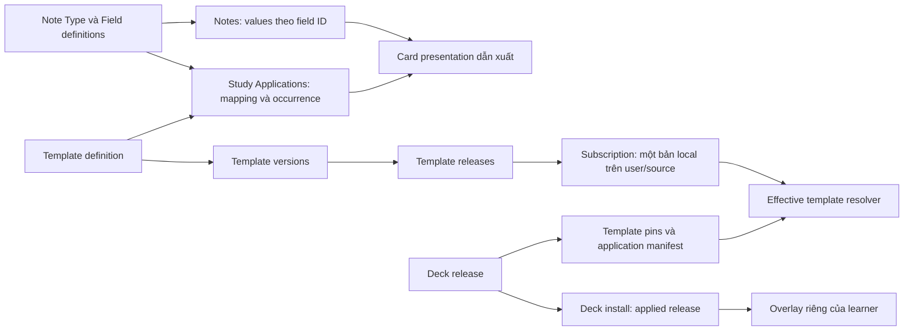

# Review Deck, Note Type và Template — 2026-10-20

> Triển khai sau review: xem [thiết kế, migration và kiểm chứng ngày 2026-10-21](deck-notetype-template-stability-design.md). Các findings dưới đây mô tả trạng thái trước khi sửa.

> Mode: INVESTIGATE. Phạm vi: React UI, API/service/repository, ORM, migrations và schema MySQL local. Không sửa application code hoặc migration.

> Cập nhật sau lượt review tiếp theo: đã chạy 8 ca trên MySQL 8.0.40 trong database thử riêng. Các lỗi F1/F3/F4/F5 được xác nhận lại; bổ sung F11 về cấp Note Type trả phí và kiểm chứng lock contention của F7. Mỗi database thử đã được dọn và kiểm tra cleanup; database ứng dụng trong `.env` không bị thay đổi.

## 1. Kết luận theo các tiêu chí được yêu cầu

| Tiêu chí | Đánh giá | Bằng chứng chính |
|---|---|---|
| Có thiếu bảng dữ liệu không? | MySQL local có đủ 21 bảng cốt lõi được kiểm tra, Alembic ở `20261019_000069`. Tuy nhiên Note Type chưa có lưu trữ release bất biến cho toàn bộ schema/mapping và chưa ghi release đã nhận trên installation. | `models/note_type.py:30`, `models/note_type_install.py:10`, F3 |
| Có gây chậm hoặc khó phát triển không? | Có điểm nghẽn query/payload và đồng bộ template trong transaction publish. Chưa đo latency/locking production. | F6, F7 |
| Code đã gọn, bỏ hết legacy chưa? | Đã tách share thành package, template tách khỏi note type, Card là dữ liệu dẫn xuất. Vẫn còn facade, nhánh compatibility, file UI dư và vi phạm ranh giới FSD. | F9 |
| Publish/chia sẻ lại dễ chưa? | Có luồng publish cho cả ba loại. Nội dung nhận từ Marketplace bị cấm publish lại theo policy hiện tại; deck tự viết dùng note type/template nhận từ chợ cũng bị chặn. Luồng sửa template của deck đã cài bị đứt. | F2, F8 |
| Tính năng và giao diện có chồng chéo không? | Fields, mapping và template source đã có trách nhiệm riêng. Các màn đã xem không thấy đè layout rõ ràng; nhưng đường dẫn sửa bị sai/đứt, và history/release/listing nằm ở các thao tác khác nhau khó phân biệt. | F2, F8, F10 |
| Version ổn định chưa? | Chưa thể coi là ổn định: presentation có thể vượt pin của deck, Note Type hiển thị schema live dưới version cũ, và nhánh cấp Note Type trả phí còn copy template draft chưa publish. | F1, F3, F11 |
| Một người sửa có ảnh hưởng người khác không? | Chưa thấy đường ghi trực tiếp trái phép từ learner vào source hoặc dữ liệu learner khác trong các luồng đã kiểm tra. Tuy nhiên thay đổi của author có thể đi tới người nhận qua auto-update, nhánh legacy; bản template dùng chung trong một tài khoản còn làm các deck ảnh hưởng lẫn nhau. | F1, F7, F9 và phần 7 |

Ưu tiên cao nhất là tính đúng của version/pin và đường chỉnh sửa bị đứt. Chưa có bằng chứng cần thêm hàng loạt bảng để giải quyết hiệu năng.

## 2. Nguồn dữ liệu chuẩn và quyền sở hữu

| Thực thể/bảng | Nguồn dữ liệu chuẩn và trách nhiệm | Đường ghi/đọc | Ownership/lifecycle đáng chú ý |
|---|---|---|---|
| `decks` | Cây deck, owner, note type gắn với deck | Deck services, share install/overlay | `owner_user_id`; xóa cây có cascade; soft-delete bằng `deleted_at` |
| `note_types`, `field_defs` | Schema hiện hành của note type | `flashcard_content_service`, share/note_types | Owner theo `NoteType.user_id`; field có ID ổn định; unique theo tên trong note type |
| `notes` | Nội dung hiện hành | Content/identity services | Giá trị chuẩn hiện tại là `field_values_by_id`, `field_values` chỉ là projection theo tên; có `content_revision` |
| `templates` | Definition có thể tái sử dụng, nội dung làm việc hiện hành | `template_library_service` | Owner riêng `owner_user_id`; phân biệt `authored` và `market_copy` |
| `study_applications` | Mỗi lần áp dụng template vào note type: mapping, vị trí, default, occurrence | Template attachment services | Unique `(note_type_id, template_id, occurrence_key)`; ACTIVE/RETIRED |
| Card | Presentation dẫn xuất từ Note và application | `models/card.py`, study/browse queries | Không cần một bảng Card vật lý mới; identity có thể suy ra từ note/application |
| `template_versions` | Snapshot nội dung template | Commit hook trong `template_version_service` | Unique `(template_id, version_no)`; ORM chặn sửa/xóa snapshot trực tiếp |
| `template_releases`, `template_publications` | Release và con trỏ/settings của publisher | `template_release_service` | Release trỏ version; có sequence/label/idempotency constraints |
| `template_subscriptions` | Bản template nhận về và release đang áp dụng | Distribution service, effective resolver | Một bản cho mỗi `(user_id, source_template_id)`, không phải một bản cho mỗi deck |
| `deck_marketplace_items`, `deck_releases` | Listing và lịch sử phát hành deck | Share publish, deck release service | Listing và content release là hai việc khác nhau |
| `deck_release_changes`, memberships, checkpoints | Schema/content lịch sử và phạm vi release | Deck release service/repository | Bảo toàn dữ liệu release, không chỉ đọc note live |
| `deck_release_template_pins` | Release template và application manifest của một deck release | Capture pins, effective resolver | PK `(deck_release_id, source_template_id)`; applications nằm trong JSON |
| `deck_installs`, `deck_clone_*` | Con trỏ release của người nhận và các thay đổi riêng | Install/overlay/rebase services | `overlay_revision`; source notes không được copy toàn bộ khi install |
| `note_type_installs` | Liên kết source với note type local đã copy | Note type install services | Unique source/user; local target nullable; chưa có applied schema release |
| `deck_install_rebases`, conflicts | Trạng thái nâng version và xử lý xung đột của deck | Rebase service | Có expected overlay revision và lựa chọn xử lý conflict |

Nguồn: các model cùng tên trong `models/`; migrations `20260812_000016`, `20260820_000019`, `20261007_000053`, `000054`, `000055`, `20261012_000061`, `20261019_000069`. `models/note.py:16` và `models/card.py:1` quan trọng hơn các mô tả cũ nói values lưu theo tên hoặc Card luôn là row vật lý.



## 3. Các luồng đã lần theo

1. **Tạo/sửa template:** React editor → `/api/card-templates` → `template_library_service` → kiểm tra owner/expected version → cập nhật definition → commit hook append `TemplateVersion`. UI editor gửi expected version; đây là một lớp bảo vệ tốt trước save đè từ tab cũ.
2. **Publish template:** marketplace listing hoặc distribution publish → snapshot current content → `TemplateRelease` → cập nhật publication head. Publish không đồng nghĩa tự động list lên marketplace; `marketplace_status` là trạng thái riêng.
3. **Install deck:** listing → `DeckInstall.applied_release_id` → copy cây deck và note type cần thiết → tạo/reuse subscription → áp dụng pins/mapping. Source Notes không bị copy thành toàn bộ cây nội dung mới.
4. **Đọc template của clone:** resolve theo source template ID → đọc local subscription nếu có; chỉ khi không có subscription mới dùng nội dung pin. Chính thứ tự này tạo F1.
5. **Install Note Type:** clone schema hiện hành → tạo `NoteTypeInstall` → nhận các template qua subscription → attach vào local note type. Không có một Note Type release manifest bao trọn schema và mapping.
6. **Nâng deck:** prepare/rebase → kiểm tra revision → merge overlay → thay applied release và sync template subscriptions. Các bài test hiện có kiểm tra giữ overlay/progress và conflict; chưa bao phủ đầy đủ tương tác giữa nhiều deck dùng chung subscription.

## 4. Findings

### F1 — P1: Template của deck A đổi khi cài deck B, dù A vẫn giữ release cũ

- **Observed:** Một user chỉ có một local template cho mỗi source. Khi B cần template mới hơn, `_sync_subscription_to_pinned_release()` có thể nâng bản local chung. Effective resolver của A ưu tiên nội dung local đó thay cho nội dung template pin của A.
- **Evidence:** `models/template_subscription.py:37`; `app/services/template_release_service.py:282`, `:646`, `:775`; `app/repositories/template_release_repository.py:162`, `:181`. Probe `shared_template_across_decks` tái hiện trên cả fixture ban đầu và MySQL 8.0.40: A vẫn pin release cũ, nhưng front chuyển từ `frozen {{term}}` sang `NEW TEMPLATE {{term}}` sau khi cài B.
- **Potential concern:** Con trỏ version deck không đủ mô tả presentation thực tế; pin hiện không phải ranh giới cô lập tuyệt đối khi có subscription.
- **Impact:** Người dùng có thể gặp layout/input schema mới trong deck chưa đồng ý nâng version. Đây là ảnh hưởng giữa các deck trong cùng tài khoản, không phải bằng chứng learner ghi vào dữ liệu của user khác.
- **Unknowns:** Chưa đo tần suất nhiều listing dùng cùng source template trên production; chưa chạy race test cho nhiều install cùng lúc. Ca MySQL hiện xác nhận chuỗi thao tác tuần tự bằng runtime service và schema ORM hiện tại, không phải rehearsal toàn chuỗi migration.

### F2 — P1: Nút sửa template của deck đã cài dẫn tới màn trống

- **Observed:** `InstallTemplatesPage` chỉ `return null`; route vẫn được đăng ký và vẫn có link thật từ dashboard.
- **Evidence:** `frontend/src/features/library/pages/InstallTemplatesPage.tsx:1`; `frontend/src/App.tsx:506`; `frontend/src/features/dashboard/components/DeckCardTypesDialog.tsx:42`. Screenshot: `output/playwright/installed-template-blank-mobile.png`.
- **Potential concern:** Luồng quản lý template đã nhận chưa được triển khai đến UI, dù backend có `list_install_templates()`.
- **Impact:** Người dùng nhấn sửa nhưng không có nội dung, trạng thái tải, lỗi, hướng dẫn hay đường đi tiếp.
- **Unknowns:** Mức độ sử dụng đường dẫn này. Test router hiện mock chính page này trong `TemplateLibraryShell.test.tsx:39`, nên pass không chứng minh màn thật hoạt động.

### F3 — P1: Version của Note Type chưa đóng băng schema và mapping

- **Observed:** `NoteType.version` là chuỗi có thể ghi trực tiếp; `field_schema_revision` không phải release snapshot. `NoteTypeInstall` không ghi schema release đã nhận. Shared detail đọc FieldDefs và application set hiện hành, còn template content có thể đến từ template release riêng.
- **Evidence:** `models/note_type.py:30`; `models/note_type_install.py:10`; `app/services/share/note_types.py:439`; `app/services/marketplace_query_service.py:72`, `:91`, `:134`; `app/services/template_release_service.py:551`, `:594`. Probe thêm field qua `create_field()` làm schema trên marketplace tăng từ `[Word]` lên `[Word, UnpublishedExtra]`, trong khi version vẫn `1.0.0` và không publish lại Note Type; đã xác nhận lại trên MySQL 8.0.40.
- **Potential concern:** Hai người cài cùng nhãn version ở hai thời điểm có thể nhận hai schema khác nhau; version của từng template không thay thế version của cả Note Type.
- **Impact:** Khó nâng schema có kiểm soát, rollback cả cấu trúc hoặc giải thích người nhận đang dùng phiên bản nào. Người đã cài có schema copy riêng, nên không thể suy ra rằng thêm field ở source sẽ lập tức sửa field của mọi người đã cài.
- **Unknowns:** Có bao nhiêu note type cần nâng version thực tế. Đây là thiếu năng lực lưu lịch sử/lineage của Note Type; báo cáo chưa chốt số bảng mới hoặc DDL đích.

### F4 — P2: Hai occurrences của cùng template bị gộp thành một ở Note Type nhận về

- **Observed:** Pin manifest giữ được nhiều application của một definition. Nhưng `_attach_received_template()` tìm bản local chỉ theo note type/template và tạo application với key `compat`, nên các occurrences tiếp theo gặp cùng row rồi return.
- **Evidence:** `app/services/template_release_service.py:662`, `:670`; `models/study_application.py:67`. Probe `repeated_occurrences`: pin có 2 occurrences, note type local có 1 application ACTIVE; kết quả giống nhau trên fixture ban đầu và MySQL 8.0.40.
- **Potential concern:** Contract DB hỗ trợ occurrence nhưng luồng nhận không bảo toàn identity đó.
- **Impact:** Note mới do người nhận tạo có thể thiếu presentation/mapping thứ hai. Không kết luận source cards mất occurrence: manifest nguồn vẫn giữ cả hai.
- **Unknowns:** Tần suất dữ liệu imported/legacy có nhiều occurrence cùng definition. UI attach thông thường còn chặn template đã ACTIVE, nên không phải mọi người dùng đều gặp.

### F5 — P2: Xóa Note Type local xong có thể không cài lại được

- **Observed:** `NoteTypeInstall.installed_note_type_id` được khai báo `ON DELETE SET NULL`; endpoint install chỉ cần thấy install row tồn tại là trả `already_installed`, không xác nhận local target còn tồn tại.
- **Evidence:** `models/note_type_install.py:20`; `app/services/flashcard_content_service.py:429`; `app/services/marketplace_note_type_service.py:479`. Lượt đầu mô phỏng SET NULL trên fixture. Lượt tiếp theo đã gọi delete service thật trên MySQL: FK tự xóa target, local NoteType không còn tồn tại, install service vẫn trả status 200, `already_installed=true`, `installed_note_type_id=null`. Metadata và số liệu local chỉ đọc cũng cho thấy 1 install có target NULL.
- **Potential concern:** Lịch sử đã từng cài bị dùng thay cho trạng thái đang có một local copy sử dụng được.
- **Impact:** Luồng cài lại có thể báo thành công trong khi người dùng vẫn không có cấu trúc thẻ.
- **Unknowns:** Chưa xác định vì sao install NULL có sẵn trong database ứng dụng được tạo ra. Delete/reinstall trong probe chỉ tác động các row tổng hợp ở database thử, không sửa/xóa row ứng dụng thật.

### F6 — P2: Danh sách Note Type còn query theo từng item và tải HTML không cần cho card list

- **Observed:** Manager gọi `/note-types` mặc định, tải mọi note type và full definitions. Serializer tiếp tục query applications theo từng note type, dù list service đã eager-load quan hệ. Nhánh marketplace khi có inferred filters cũng có thể `query.all()` rồi lọc trong Python trước pagination.
- **Evidence:** `frontend/src/features/note-types/hooks/useNoteTypeManager.ts:34`; `app/services/flashcard_content_service.py:84`; `app/services/marketplace_query_service.py:72`; `app/services/marketplace_note_type_service.py:193`. Probe có 10 note types, một template/item: MySQL phát 17 SQL statements, JSON 221,061 bytes khi cố ý dùng 10 KB HTML cho mỗi mặt. Fixture ban đầu cũng phát 17 statements (kích thước timestamp làm JSON khác nhẹ).
- **Potential concern:** Chi phí tăng theo số cấu trúc, số templates và độ dài HTML; compact cho local list hiện vẫn trả field definitions và chưa có pagination ở service này.
- **Impact:** Thư viện lớn làm response, parse JSON và database query tốn hơn; thêm bảng mới không tự giải quyết cách đọc/serialize hiện tại.
- **Unknowns:** Đây là query-count/payload trên dữ liệu tổng hợp, không phải benchmark latency hoặc workload production. Chưa có EXPLAIN cho workload production hoặc phân bố số lượng note types/template trên user thật.

### F7 — P2: Publish template đồng bộ toàn bộ subscriber tự cập nhật ngay trong transaction

- **Observed:** Publish adapter gọi `_process_auto_updates()` trước khi transaction commit. Hàm tải danh sách subscriptions, khóa từng local template rồi prepare/apply tuần tự.
- **Evidence:** `app/services/template_release_service.py:156`, `:460`; `app/repositories/template_release_repository.py:122`; `_commit()` và `publish_release()` trong cùng service. Probe MySQL giữ row local template bằng một connection khác, đặt `innodb_lock_wait_timeout=1` cho connection publish: publish nhận lỗi 1205 sau khoảng 1.047 giây; publication head và số release của author đều không đổi sau rollback.
- **Potential concern:** Thời gian publish và tập row bị khóa phụ thuộc số subscribers bật auto-update. Không thấy phân trang/batch transaction hoặc retry độc lập từng subscriber trong đường này.
- **Impact:** Với fan-out lớn có nguy cơ request chậm, transaction dài. Đã xác nhận một subscriber giữ khóa có thể làm publish của author thất bại và rollback. Lỗi trong nhánh đồng bộ subscriber không được cô lập khỏi transaction publish.
- **Unknowns:** Chưa đo fan-out lớn, thời gian giữ khóa và deadlock rate production. Ca contention dùng timeout 1 giây để giới hạn thời gian test; không có nghĩa cấu hình production timeout sau 1 giây hoặc đã xảy ra sự cố production.

### F8 — Policy/product gap: “Chia sẻ lại” hiện bị cấm, không phải chỉ khó tìm nút

- **Observed:** Backend chặn publish clone deck, chặn Note Type nhận từ Marketplace, chặn template `market_copy`/có source provenance; deck tự tạo nhưng dùng loại note hoặc template nhận từ chợ cũng có thể bị chặn. Đăng lại listing của chính author sau khi private là một trường hợp khác và có luồng hỗ trợ.
- **Evidence:** `app/services/share/publish.py:176`, `:212`, `:228`; `app/services/share/note_types.py:316`; `app/services/template_release_service.py:543`; `app/services/template_marketplace_service.py:52`; `app/services/template_library_service.py:175`.
- **Potential concern:** Nếu mục tiêu sản phẩm là người học sửa rồi chia sẻ bản phái sinh, hiện policy không đáp ứng. Không thể sửa riêng UI để làm việc này.
- **Impact:** Người dùng có nội dung tự biên soạn vẫn có thể vướng chặn vì một dependency nhận từ chợ. Deck có Change Request để đóng góp về nguồn, nhưng đó không phải publish một fork độc lập.
- **Unknowns:** Quyền/license mong muốn của sản phẩm. Chưa có yêu cầu thay policy nên không gỡ các provenance guards.

### F9 — P2: Legacy đã giảm, nhưng vẫn còn nhánh có ảnh hưởng thực tế và nợ FSD

- **Observed:** `flashcards_share_service.py` đã là facade ngắn gọi package `share/`; nhiều lời mô tả cũ gọi nó là monolith không còn đúng. Tuy nhiên facade còn wildcard/dynamic re-export; compatibility bindings, clone cutover và legacy template fallback vẫn tồn tại. `NoteTypesPage` cũ còn được export nhưng router hiện trỏ manager khác; `NoteTypeDetailPage` chỉ bọc fields page. Frontend vẫn dùng `frontend/src/app/api.ts`, deep cross-feature imports, thiếu `index.ts` ở note-types/library.
- **Evidence:** `app/services/flashcards_share_service.py:1`; `app/services/share/__init__.py:1`; `app/services/template_release_service.py:759`, `:775`; `app/services/effective_template_service.py:51`; `frontend/src/features/library/pages/LibraryPages.tsx:1`; `frontend/src/features/library/pages/NoteTypesPage.tsx:1`; `frontend/src/features/library/pages/InstalledDecksPage.tsx:11`, `:23`; `frontend/src/features/note-types/pages/NoteTypeFieldsPage.tsx:8`; migration `20261007_000055` chủ động không suy diễn pins lịch sử.
- **Potential concern:** Không thể xóa nhánh legacy chỉ dựa vào tên hoặc comment. Pin fallback là hành vi đọc nội dung khác với release mới; facade và imports xuyên feature làm thay đổi API nội bộ khó kiểm soát.
- **Impact:** Khó hiểu luồng thật, tăng coupling và nguy cơ gỡ nhầm compatibility cần thiết. MySQL local đọc được 24 deck releases: 22 chưa initialize template manifest, 2 đã initialize. Có 27 installs trỏ release chưa initialize và 1 install không join được applied release; legacy vẫn có người dùng dữ liệu local phụ thuộc.
- **Unknowns:** Tần suất nhánh fallback thực sự đổi kết quả render và số lượng tương ứng trên production. Count installs không phải count user duy nhất. Một số comments về physical Cards/temporary hotfix cũng đã lỗi thời so với model hiện tại.

### F10 — P2/UX: Nút sửa chọn sai ngữ cảnh; ba trạng thái template khó phân biệt

- **Observed:** Với card type thuộc deck cá nhân, dashboard “sửa” mở `/note-types/:id`, hiện là Fields page, thay vì application mapping/template đã chọn. Với deck installed, link rơi vào F2. Ở editor template, History, Distribution và Publish Marketplace nằm trong cùng menu nhưng mở ba luồng riêng; sidebar cũng có nhiều entry library/marketplace/publish cùng cấp.
- **Evidence:** `frontend/src/features/dashboard/components/DeckCardTypesDialog.tsx:63`; `frontend/src/features/note-types/pages/NoteTypeDetailPage.tsx:1`; `frontend/src/features/template-library/pages/TemplateDetailPage.tsx:76`; `frontend/src/features/template-distribution/ui/AuthorPublicationView.tsx`; `frontend/src/features/template-marketplace/components/PublishTemplateDialog.tsx`; `frontend/src/components/app-sidebar.tsx:72`.
- **Potential concern:** Người dùng khó phân biệt sửa mapping của một note type, sửa definition tái sử dụng, lưu lịch sử, phát hành cho subscriber và đăng listing lên chợ. Đây là chồng chéo nhận thức/điều hướng; không phải bằng chứng các lớp dữ liệu nên gộp làm một.
- **Impact:** Tăng số bước và khả năng thao tác nhầm phạm vi ảnh hưởng. Publish deck/note type có wizard 4 bước, còn template dùng dialog nên trải nghiệm chưa đồng nhất.
- **Unknowns:** Chưa có usability test với người dùng thật. Mobile 390×844 và desktop 1440×1000 của các màn được xem không cho thấy đè layout rõ ràng; không kết luận mọi modal/viewport đều đạt.

### F11 — P1: Cấp Note Type trả phí nhận template draft thay vì bản đã phát hành

- **Observed:** Nhánh fulfillment `product_type="note_type"` gọi `ensure_note_type_install_for_user()` với mặc định `copy_legacy_templates=True`. Hàm clone copy HTML/schema hiện hành từ source, không chạy bước nhận template qua release/subscription như luồng install miễn phí.
- **Evidence:** `app/services/payment/fulfillment.py:25`; `app/services/share/note_types.py:551`, `:600`, `:618`, `:623`; đối chiếu free install tại `app/services/share/note_types.py:501`. Probe MySQL publish template có front `frozen {{term}}`, sửa draft thành `UNPUBLISHED PAID DRAFT {{term}}` nhưng không publish lại. Người nhận free nhận `frozen {{term}}`; gọi nhánh fulfillment thật cho một người mua tổng hợp nhận `UNPUBLISHED PAID DRAFT {{term}}` và có 0 `TemplateSubscription`.
- **Potential concern:** Cùng một Note Type có hai contract nhận nội dung khác nhau theo đường cấp quyền. Preview/release đã publish không đảm bảo nội dung template của bản được cấp sau thanh toán; bản raw copy cũng không tự có lineage cập nhật qua distribution UI.
- **Impact:** Nội dung author chưa chủ động phát hành có thể đi tới người mua mới. Khi draft đang thử nghiệm hoặc chưa hoàn thiện, người mua có thể nhận template khác với bản preview/phát hành.
- **Unknowns:** Probe gọi service fulfillment thật với order references tổng hợp, không gọi payOS hoặc webhook ngoài. Chưa kiểm tra toàn bộ payment flow trên MySQL với thay đổi source xảy ra giữa checkout và webhook. Test `test_payment_order_flow.py:248` hiện xác nhận install/entitlement được cấp, nhưng không so nội dung với release hay kiểm tra subscription.

## 5. Đánh giá MySQL và câu hỏi “thiếu bảng”

Đã kết nối MySQL **local** 8.0.40 qua cấu hình `.env`, xác nhận loopback trước khi kết nối. Database ứng dụng được dùng chỉ đọc metadata/tổng hợp. Lượt kiểm chứng tiếp theo tạo từng database thử với tên ngẫu nhiên, kiểm tra không trùng `DB_NAME` và không tồn tại trước, rồi chạy runtime services trên dữ liệu tổng hợp. DDL/ghi/xóa chỉ diễn ra trong database thử; cleanup được xác minh sau từng ca. Không chạy startup maintenance, migration hoặc sửa dữ liệu trong database ứng dụng.

- 21 bảng cốt lõi được đối chiếu đều tồn tại, Alembic version `20261019_000069`. Không có dấu hiệu “model có bảng nhưng migration local chưa tạo” trong tập kiểm tra này. Không suy rộng thành toàn bộ schema hoặc production đã hoàn toàn đúng.
- Trong snapshot dữ liệu local: 27 deck installs tham chiếu release chưa initialize pin manifest, 1 install không join được applied release, 1 NoteTypeInstall có target NULL, 1 template subscription và auto-update đang tắt. Join subscription/local template không tìm thấy sai owner. Đây là số liệu local, không phải số liệu production hoặc mức độ khai thác lỗi.
- Các unique constraints quan trọng đã có trong model/migration: note type theo user/name; template version theo template/number; template release theo template/sequence/label/idempotency; subscription theo user/source; application theo note type/template/occurrence; deck install theo listing/user.
- Note Type thiếu một nguồn snapshot bất biến bao trọn schema + application manifest, cùng lineage của bản đã cài. `field_schema_revision` không cung cấp nội dung lịch sử, `version` không tự đảm bảo bất biến.
- F1/F4/F5 là vấn đề scope và lifecycle trên dữ liệu hiện có; không có bằng chứng rằng chỉ thêm bảng sẽ chữa được chúng.
- F6/F7 là vấn đề access pattern và transaction size. Chưa đủ cơ sở chốt index mới hoặc một bảng cache/job cụ thể.
- Card dẫn xuất và overlay-only giúp tránh tăng row theo `notes × templates × người cài`. Không coi việc không còn bảng Card vật lý là một bảng thiếu.
- JSON hiện giữ field values theo ID, input schema, application bindings và release manifests. Đây là các nguồn dữ liệu khác trách nhiệm, không phải tự động trùng thừa. Chưa kiểm tra giới hạn kích thước manifest với deck rất lớn.

## 6. Kiểm chứng và giới hạn

| Kiểm chứng | Kết quả | Giới hạn |
|---|---|---|
| Modular backend: templates, deck_collaboration, marketplace, decks | 419 tests chạy, 1 skipped, không failure | Chủ yếu SQLite fixtures; không phải chứng nhận MySQL integration/concurrency |
| Bổ sung hai file chưa nằm trong module mapping: template marketplace và frozen modernization | 10 tests pass | Cùng giới hạn engine của fixture |
| Frontend: template-library/distribution/marketplace, note-types, shared-note-type detail | 182 pass, 4 skipped; 27 files pass | jsdom; các test typing có skip; router test mock installed template page |
| Probes tái hiện F1/F3/F4/F5 và đo query/payload F6 | Kết quả ở `output/deck-template-review/results.json` | Dùng fixture in-memory có sẵn; FK SET NULL của F5 được mô phỏng, không chạy delete trên MySQL thật |
| MySQL runtime: F1/F3/F4/F5/F6 và kiểm tra quyền/draft isolation | 6 ca thực thi thành công, cleanup đều được xác minh; xác nhận lại 4 lỗi và query-count | Dùng schema ORM hiện tại trong database thử; không phải migration rehearsal hoặc kiểm tra production |
| MySQL runtime: cấp Note Type trả phí và khóa subscriber | 2 ca thực thi thành công, xác nhận F11 và rollback publish do 1205; cleanup được xác minh | Gọi service fulfillment, không gọi provider; lock wait của ca thử là 1 giây |
| MySQL local schema inspection | 21/21 bảng hiện diện, migration head nêu trên; 22/24 release chưa có pin manifest | Chỉ đọc metadata/tổng hợp; không xác nhận production hoặc test races |
| Browser | Screenshots desktop/mobile, xác nhận F2 | API mock, profile Chrome riêng; không kiểm tra thanh toán/publish thật |

Lệnh chính:

```powershell
.venv/Scripts/python.exe scripts/run_tests.py --module templates,deck_collaboration,marketplace,decks --backend-only
.venv/Scripts/python.exe scripts/run_tests.py --file tests/test_template_marketplace.py tests/test_frozen_template_modernization.py --backend-only
# Trong frontend/
npm test -- src/features/template-library src/features/template-distribution src/features/template-marketplace src/features/note-types src/features/marketplace/pages/SharedNoteTypeDetailPage.test.tsx
```

Lượt MySQL tiếp theo dùng `.venv/Scripts/python.exe output/deck-template-review/probe_mysql.py` và thêm `--extra` cho hai ca mở rộng. Script tái sử dụng guard trong `scripts/mysql_probe_db.py`; không chuyển ứng dụng dev sang SQLite.

Artifacts:

- `output/deck-template-review/probe.py`, `results.json`, `mysql-schema.json`, `mysql-runtime-summary.json`.
- `output/deck-template-review/probe_mysql.py`, `mysql-reproductions.json`, `mysql-additional-reproductions.json` cho 8 ca MySQL trong lượt tiếp theo.
- `output/playwright/deck-review-mocks.js` và các screenshot `template-library-desktop.png`, `template-detail-desktop.png`, `template-detail-mobile.png`, `note-types-mobile.png`, `notetype-fields-mobile.png`, `notetype-templates-mobile.png`, `installed-template-blank-mobile.png`.

Skill UI `impeccable` được nhắc trong AGENTS nhưng không tìm thấy tại repo hoặc các skill roots đã kiểm tra. Phần UI dựa trên code, skill frontend architecture và Playwright. Không coi API mock hay các test đang pass là bằng chứng trải nghiệm production hoàn chỉnh.

## 7. Phạm vi ảnh hưởng khi một người sửa

| Thao tác | Ảnh hưởng quan sát được/được thiết kế |
|---|---|
| Learner sửa note trong deck installed | Ghi overlay theo install; không ghi trực tiếp source note. Test overlay và rebase đang pass. |
| Learner sửa template local đã nhận | Phạm vi local template của learner; vì bản này dùng chung theo user/source, nhiều deck của chính learner có thể đổi cùng nhau. |
| Author sửa draft template | Version history được append. Ca MySQL xác nhận subscriber đã nhận giữ nội dung cũ; nhưng người được cấp Note Type trả phí mới có thể nhận draft qua F11. |
| Author publish, subscriber bật auto-update | Có thể cập nhật người nhận; đây là opt-in, có merge/conflict. Vẫn phải tính F1 và transaction fan-out F7. |
| Cài deck B dùng cùng source template nhưng release mới | Có thể nâng bản local dùng chung và đổi presentation của A dù A chưa rebase: F1. |
| Author sửa schema Note Type đang public | Có thể thay schema được người xem/người cài mới thấy dưới nhãn version cũ: F3. Không tự động thay bản schema copy của người đã cài. |
| Release cũ chưa có pin manifest | Có fallback compatibility; chưa đủ dữ liệu kết luận mọi install cũ được cô lập giống release mới. |
| Learner muốn góp nội dung về source | Có Change Request cần tác giả duyệt; khác với quyền publish fork/chia sẻ lại. |

## 8. Thứ tự xử lý sau review

1. Xác định và bảo đảm contract giữa pin của deck và template dùng chung (F1), đồng thời chặn đường cấp Note Type trả phí lấy nội dung draft (F11), trước khi tuyên bố version đã ổn định.
2. Khép kín đường sửa template của deck đã cài (F2), bảo toàn occurrence khi nhận (F4), và lifecycle cài lại (F5).
3. Làm rõ contract version của Note Type và trạng thái schema được công bố (F3); chưa chốt schema đích trong đợt điều tra này.
4. Quyết định rõ sản phẩm có cho chia sẻ bản phái sinh hay không (F8); UI phải diễn đạt đúng policy đang áp dụng.
5. Thu gọn list payload/query và đánh giá fan-out/locking trên workload MySQL thực tế (F6/F7).
6. Dọn compatibility theo số liệu phụ thuộc và migrate FSD khi chạm file, bảo toàn giao diện. Không xóa lịch sử/release hoặc nhánh fallback chỉ vì tên có chữ legacy.
