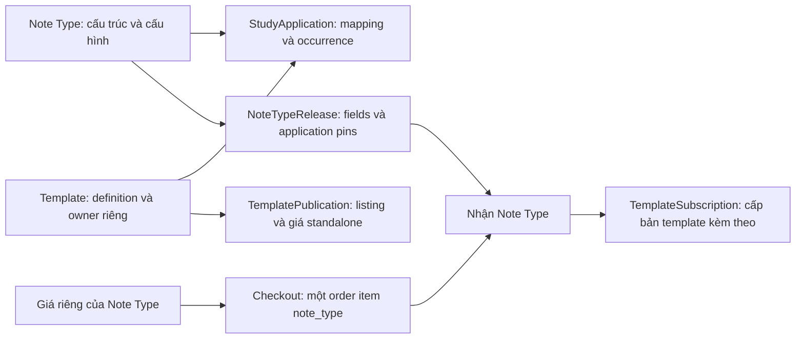

# Review chợ Note Type và chợ giao diện thẻ

> Triển khai sau khi chủ sản phẩm làm rõ cách tham chiếu và giá gói: xem [thiết kế và kiểm chứng](note-type-template-bundle-design-2026-10-21.md). Findings bên dưới ghi lại trạng thái trước khi sửa.

> Ngày: 2026-10-21 (Asia/Tokyo). Mode: INVESTIGATE. Engine đã đọc: MySQL 8.0.40 local.
> Phạm vi: checkout hiện tại, gồm các thay đổi chưa commit về NoteTypeRelease. Báo cáo này không thay đổi application code, migration, giá bán hoặc dữ liệu.

## 1. Kết luận và yêu cầu nghiệp vụ

Hai catalog đã tách ở router/API và có entity riêng. Điểm chưa đáp ứng yêu cầu là cách giải thích sản phẩm, quyền dùng template trong gói Note Type và thanh toán cho từng tác giả.

Theo yêu cầu của chủ sản phẩm trong lượt review này:

| Thành phần | Ý nghĩa / quyền tác giả | Cách tính tiền cần đáp ứng |
|---|---|---|
| Template / giao diện thẻ | Definition giao diện độc lập, có tác giả gốc và release riêng | Miễn phí thì không cộng phí; trả phí phải được xét quyền và tính phí của template |
| Note Type | Gói gồm cấu trúc field cụ thể và các template đã gắn, kèm mapping/configuration | Có thể có giá riêng của gói; không mặc nhiên bao gồm quyền miễn phí cho mọi template trả phí |
| Template của B được A gắn vào Note Type | A sở hữu cấu trúc/configuration do A tạo; template vẫn của B | A đã mua template không đồng nghĩa người mua Note Type của A đã mua template của B |
| Note Type miễn phí nhưng gắn template trả phí | Nhãn miễn phí của cấu trúc không làm template trở thành miễn phí | Vẫn phải xét khoản phí template cho người nhận |

Ví dụ minh họa yêu cầu: Note Type của A giá 20.000đ, gắn template của B giá 30.000đ và một template miễn phí của C. Với người mua chưa có quyền nào, phần phải thanh toán là 50.000đ; template của C không làm tăng giá. Phần doanh thu của template B cần được ghi nhận cho B, không đổi tác giả template thành A. Đây là ví dụ nghiệp vụ, không phải báo giá của dữ liệu local.

Việc khấu trừ khi người mua đã có quyền, phạm vi quyền theo version và cách xử lý bản chỉnh sửa từ template mua còn cần chốt; không giả định rằng có bản copy trong thư viện là đã có chứng từ thanh toán hợp lệ.

## 2. Bản đồ dữ liệu đang có

| Store | Nguồn dữ liệu chuẩn | Quyền / lineage thực tế |
|---|---|---|
| `note_types`, `field_defs` | Cấu trúc và metadata làm việc của Note Type | Owner là `NoteType.user_id` |
| `study_applications` | Các lần gắn template, mapping input, thứ tự và default | FK tới Note Type và Template; không chuyển owner của source template |
| `templates` | Nội dung definition làm việc | `owner_user_id`; bản nhận có `origin=market_copy`, `source_template_id`, `source_version_id` |
| `template_versions`, `template_releases` | Snapshot nội dung và phát hành template | Release trỏ đúng version; khác với listing trên chợ |
| `template_publications` | Listing, giá standalone và publication head | `marketplace_status`, `pricing_mode`, `price_amount_minor` |
| `note_type_releases` | Snapshot toàn bộ cấu trúc và application manifest | JSON lưu field và template release ID; không lưu bảng giá / tác giả riêng từng template trong payload definition |
| `note_type_installs` | Người nhận Note Type và release đã nhận | Source/user unique; có giá mua của Note Type |
| `template_subscriptions` | Bản template nhận về của user/source | Unique `(user_id, source_template_id)`; đây là subscription/receipt, khác với payment entitlement |
| `payment_order_items`, `payment_entitlements` | Dòng sản phẩm thanh toán và quyền được cấp | Fulfillment cấp quyền theo loại sản phẩm của từng order item |
| `user_balance_transactions` | Ghi nhận doanh thu vào ví tác giả | `wallet_service.credit_creator_for_deck_sale()` resolve seller theo order item |

Bằng chứng: [NoteType](../../models/note_type.py), [StudyApplication](../../models/study_application.py), [Template](../../models/template.py), [TemplatePublication](../../models/template_publication.py), [NoteTypeRelease](../../models/note_type_release.py), [TemplateSubscription](../../models/template_subscription.py), [PaymentOrderItem](../../models/payment_order_item.py), [PaymentEntitlement](../../models/payment_entitlement.py).

Migration `20261019_000069` thêm listing/giá standalone cho template. `20261020_000070` thêm Note Type release và các release pointers. Manifest tham chiếu template releases trong JSON; việc xác nhận template/release khớp nhau do service thực hiện, không có FK riêng cho từng phần tử JSON.

## 3. Findings

### F1 — P1: Đang cấm cả việc kết hợp hợp lệ với template của tác giả khác

- **Observed:** Publish eligibility chặn mọi attached template có `origin=market_copy` hoặc `source_template_id`, không phân biệt miễn phí/trả phí. Release staging cũng yêu cầu template authored và kiểm tra foreign owner. A không thể phát hành Note Type tự tạo gắn bản template nhận hợp lệ từ B theo yêu cầu mới.
- **Evidence:** `app/services/share/note_types.py:316`, `:334`; `app/services/template_release_service.py:535`, `:543`; `app/services/note_type_release_service.py:34`; `app/repositories/note_type_release_repository.py:20`. `tests/test_template_marketplace.py:130` xác nhận cả bản tải miễn phí không được republish.
- **Potential concern:** Code đang đồng nhất việc bán lại definition thành của mình với việc phân phối một gói cấu trúc có tham chiếu tới template của tác giả gốc.
- **Impact:** Chưa có luồng kết hợp nhiều tác giả, kể cả template miễn phí không cần thu tiền. Chỉ gỡ guard này sẽ chưa giải quyết F2/F3.
- **Unknowns:** Quyền phân phối các thay đổi nội dung trên bản template mua chưa được xác định. Mapping/display name là dữ liệu application riêng, khác với sửa HTML/CSS definition.

### F2 — P1: Nhận Note Type có thể cấp template trả phí mà không xét giá template

- **Observed:** Free/paid Note Type receipt đi qua `stage_receipt()`, sau đó mỗi application gọi `ensure_subscription(..., access_granted=True)`. Không kiểm tra `TemplatePublication.pricing_mode` hay template payment entitlement tại đây. Endpoint lấy một template riêng từ Note Type cũng chỉ kiểm tra giá/installation của Note Type rồi truyền `access_granted=True`.
- **Evidence:** `app/services/note_type_release_service.py:113`, `:160`, `:180`; `app/services/marketplace_note_type_service.py:563`, `:598`, `:628`; `app/services/template_release_service.py:283`; `app/repositories/template_release_repository.py:98` còn công nhận installed/free Note Type là quyền nhận template.
- **Potential concern:** Giá free của Note Type có thể che khoản phí standalone của template. Guard F1 chỉ chặn bản nhận từ người khác; không cấm một tác giả gắn template authored đang bán riêng vào Note Type free.
- **Impact:** Theo luồng code, nếu source template có giá riêng nhưng được đính kèm Note Type miễn phí, người nhận có thể được cấp template mà không thanh toán riêng. Subscription có thể tồn tại dù không có template entitlement; standalone install lại coi subscription hiện có là existing access tại `app/services/template_marketplace_service.py:305`.
- **Unknowns:** Local hiện không có listing template trả phí hay Note Type public gắn template trả phí. Đây là kết luận từ code paths, chưa phải giao dịch trả phí tái hiện trên production. Chính sách chủ động miễn phí/bundle discount của cùng tác giả chưa được chốt.

### F3 — P1: Checkout chưa tính tiền và cấp quyền theo các thành phần của gói

- **Observed:** Note Type checkout lấy duy nhất `source_note_type.price_amount_minor`; chỉ tạo một `PaymentOrderItem` cho sản phẩm đang mua. Fulfillment tạo entitlement theo `order_item.product_type`. Một item Note Type không sinh thêm item hoặc entitlement thanh toán riêng cho từng template trong manifest.
- **Evidence:** `app/services/payment/checkout.py:44`, `:83`, `:506`; `app/services/payment/fulfillment.py:25`, `:103`, `:125`; `models/payment_order_item.py:10`; `models/payment_entitlement.py:11`.
- **Potential concern:** Dữ liệu có khả năng chứa nhiều order items, nhưng luồng tạo đơn hiện tại chỉ tạo một item; không có bằng chứng đã triển khai tính tiền dependency/multi-author cho Note Type.
- **Impact:** Chưa thể thanh toán đúng ví dụ 20.000đ cấu trúc + 30.000đ template B, cấp quyền tương ứng và ghi nhận doanh thu riêng cho A/B. Trường hợp cấu trúc free + template paid cũng không được định tuyến checkout theo template ở luồng install Note Type.
- **Unknowns:** Chưa chốt cách bỏ phần phí template mà người mua đã có quyền, xử lý cùng template xuất hiện nhiều occurrence, giá đổi giữa checkout/webhook, refund và quyền dùng sau refund. Không coi subscription unique là bằng chứng đã giải quyết tính tiền trùng.

### F4 — P1: Nhánh ghi doanh thu Note Type đọc sai trường owner

- **Observed:** Với `product_type=note_type`, wallet service lấy `getattr(source_note_type, "owner_user_id", None)`, trong khi model khai báo `user_id`. Khi không có owner, hàm return trước khi credit ví. Nhánh template standalone resolve seller qua source template owner riêng.
- **Evidence:** `app/services/wallet_service.py:73`, `:76`, `:82`; `models/note_type.py:15`; `app/services/template_marketplace_service.py:347`; caller tại `app/services/payment/fulfillment.py:148`.
- **Potential concern:** Có thể cấp Note Type sau thanh toán nhưng không ghi nhận tiền vào ví tác giả theo nhánh code này.
- **Impact:** Ảnh hưởng trực tiếp doanh thu Note Type; cần được tính vào phạm vi kiểm tra thanh toán khi sửa phân chia hai chợ.
- **Unknowns:** Local có 0 order items Note Type; chưa xác định giao dịch production bị ảnh hưởng hoặc có bước đối soát ngoài code này hay không. Chưa chạy webhook thanh toán thật.

### F5 — P2: UI và payload chưa phân biệt đầy đủ tác giả Note Type với tác giả template

- **Observed:** Hai tab và route riêng đã tồn tại, nhưng mô tả chợ cấu trúc vẫn là “Các mẫu hiển thị Flashcard chuẩn đẹp”. Note Type detail có khu fields và khu attached templates, song template DTO không mang author/giá/quyền thanh toán riêng. UI gắn nhãn “Của bạn” dựa vào `noteType.is_owner`, không phải tác giả của từng template.
- **Evidence:** `frontend/src/features/marketplace/components/MarketplaceModeSwitcher.tsx:7`; `frontend/src/App.tsx:631`, `:647`; `frontend/src/shared/config/i18n/locales/vi/marketplace.json:6`; `frontend/src/features/marketplace/pages/SharedNoteTypeDetailPage.tsx:45`, `:573`, `:619`; `app/services/note_type_release_service.py:83`.
- **Potential concern:** Người xem dễ hiểu toàn bộ giao diện thuộc tác giả gói và toàn bộ template đã nằm trong một giá.
- **Impact:** Kể cả sửa backend cho phép gói nhiều tác giả, màn hiện tại chưa thể trình bày đúng tác giả gốc và các khoản cần trả. Cần phân biệt owner của bản local với creator của source; `market_copy` hiện vẫn giữ `source_template_id`, chưa có bằng chứng copy làm mất toàn bộ lineage.
- **Unknowns:** Chưa kiểm tra trực tiếp màn browser trong lượt này. Không kết luận toàn bộ Template bị query gộp vào catalog Note Type: catalog template có query/listing riêng tại `app/repositories/template_marketplace_repository.py:18`, `:85`.

### F6 — P2: Cả bốn Note Type public local chưa có release đầy đủ để người mới cài

- **Observed:** MySQL local có 4 Note Type `published/free`, nhưng cả 4 có `current_release_id=NULL`. Theo guard hiện tại, cài mới và preview template yêu cầu release đầy đủ. Catalog vẫn có thể liệt kê các record này; definition trả `release_available=False` và danh sách field/template rỗng.
- **Evidence:** Kết quả SQL chỉ đọc ở phần 4; `app/services/note_type_release_service.py:83`; `app/services/marketplace_note_type_service.py:419`, `:490`.
- **Potential concern:** Listing cũ hiển thị nhưng nội dung cấu trúc/giao diện bị thiếu hoặc thao tác cài mới bị chặn, khiến việc đánh giá hai chợ hiện tại dễ bị nhiễu.
- **Impact:** Suy ra từ dữ liệu và guard: người mới chưa có installation sẽ gặp `NOTE_TYPE_RELEASE_NOT_READY`. Installation cũ có đường tiếp tục dùng riêng; không kết luận tất cả người dùng hiện hữu mất quyền.
- **Unknowns:** Chưa xác nhận production có cùng dữ liệu. Không tự publish/backfill release vì sẽ biến draft hiện tại thành nội dung phát hành.

## 4. Kiểm chứng MySQL local và giới hạn

Đọc trực tiếp bằng PyMySQL, dùng `DB_*` hiện có, xác nhận host loopback và `START TRANSACTION READ ONLY, WITH CONSISTENT SNAPSHOT`; cuối phiên rollback/close. Không boot Flask, không gọi payOS, không sửa schema hoặc application rows.

| Kiểm tra | Kết quả local |
|---|---|
| MySQL / Alembic | `8.0.40` / `20261020_000071` |
| Note Type public | 4 published, tất cả free |
| Note Type private | 33, tất cả free |
| Note Type public có complete release | 0/4 |
| Template publications | 1 published/free, 1 private/free |
| Template thỏa điều kiện catalog standalone | 1 |
| Note Type public gắn template có publication paid | 0 |
| Template `market_copy` / thiếu source pointer | 1 / 0 |
| Note Type public chứa `market_copy` | 0 |
| Payment order items Note Type | 0 |

Bốn Note Type public là `En4Everyone` (19 fields), `Flama Standard Vocabulary` (16), `Trắc nghiệm` (6), `文法N1` (15); mỗi loại có một application ACTIVE. Đây đều là record có cấu trúc thực sự, nên chưa có bằng chứng dữ liệu local đang đưa mọi Template thuần thành Note Type. Không tự động chuyển/xóa các record này chỉ vì chúng có giao diện kèm theo.

Review dựa trên migrations, ORM, service/repository, API, frontend và các test contracts có sẵn. Không chạy lại integration suite hay mô phỏng giao dịch trả phí trong lượt này; các findings về phí được phân biệt rõ với số liệu đã đọc. Existing tests kiểm tra free receipt, chống republish và mua template standalone; các test đã đọc chưa chứng minh được gói Note Type nhiều tác giả theo yêu cầu mới.

## 5. Các trường hợp cần xác nhận khi triển khai

1. Template free của B gắn vào Note Type của A: không cộng phí, vẫn hiện B và giữ source/release.
2. Cấu trúc free của A + template paid của B: vẫn có khoản phí template B cho người mua chưa có quyền.
3. Cấu trúc paid của A + template free của B: chỉ thu phần cấu trúc, vẫn ghi tác giả template B.
4. Cấu trúc paid + template paid của nhiều tác giả: hiển thị và ghi nhận từng khoản, tổng tiền, quyền và doanh thu nhất quán.
5. Người mua đã có quyền template; cùng source được gắn nhiều lần; cùng source xuất hiện trong nhiều gói: cần chốt quy tắc tránh thu trùng theo phạm vi quyền thực tế.
6. A sửa mapping/display name hoặc sửa HTML/CSS của bản template mua: phải xác định phần được phân phối và provenance tương ứng; không chuyển bản mua thành authored để vượt guard.
7. Release bị gỡ bán, giá thay đổi khi đơn chờ thanh toán, webhook lặp, hoàn tiền: không cấp thiếu/thừa quyền hoặc trả nhầm người.

Các mục trên là tiêu chí nghiệp vụ và phạm vi kiểm chứng còn thiếu. Báo cáo không chốt schema đích hoặc migration trước khi thiết kế riêng dựa trên các findings này.
