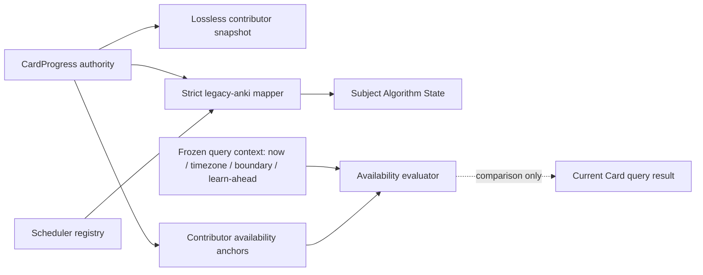

# Phase 4 — Versioned Algorithm State and availability ADR

> Date: 2026-09-12 | Mode: DESIGN | Decision: P4-D4-2 / P4-D4-3
>
> Status: PROPOSED / PROVISIONAL — repository-grounded contract with current MySQL distribution; P4-01A passed locally, while production refresh and the joint P4-02/P4-03/P4-04 review block acceptance
>
> Runtime change: none | Schema change: none | Operational authority: `CardProgress`
>
> Primary evidence: `models/card_progress.py`, `app/services/study_algorithm_registry.py`, `app/services/anki_scheduler.py`, `app/repositories/study_repository.py`, session codecs, focused tests and the P4-01 audit

This ADR defines the logical state, codec and availability contract that P4-05 may translate into physical storage. It does not authorize models, migrations, mirror writers, backfill, shadow reads, Algorithm switching or a Phase 5 authority cutover.

## 1. Decision summary

Phase 4 will represent a successfully mirrored learner/Note subject with three separate materials:

1. a lossless `raw-card-progress.v1` snapshot for every current `CardProgress` contributor;
2. one exact versioned Algorithm State for the subject only when all supported contributors have equal semantic state;
3. relational, per-contributor availability anchors that preserve current Card multiplicity and ordering without storing a time-dependent `eligible_now` result.

The only executable identity produced by the Phase 4 compatibility mapper is:

```text
algorithm_key        = legacy-anki
algorithm_version    = 1.0.0
state_schema_version = anki-card-state.v1
storage_codec        = flama-canonical-state-json.v1
```

`CardProgress.scheduler_mode`, including the value `fsrs`, is retained as raw provenance. It does not select an executable. The current scheduler enters its FSRS branch only when resolved `DeckOptions.fsrsNextStates` is present, while the repository configuration path normally supplies `None`; a label is therefore insufficient proof of an FSRS transition.

`CardProgress` remains authoritative for all answers, conflicts, due counts and ordering during Phase 4. Shadow availability is comparison-only.



## 2. Invariants

1. Raw preservation is lossless relative to values read from the authoritative ORM row; it never calls scheduler defaulting, queue fallback, clock or transition logic.
2. State decoding resolves exact `(algorithm_key, algorithm_version, state_schema_version, storage_codec)` and fails closed. No latest-version fallback is allowed.
3. `scheduler_mode` and imported FSRS-shaped fields are provenance/state inputs, not executable identity.
4. Unknown queue labels, non-finite numbers, invalid null pairing or corrupt hashes produce typed quarantine. They never normalize to `new` during migration.
5. Both `due_at` and `due_day` are preserved with their original nullness. Backfill never manufactures one from the other.
6. Availability stores stable anchors only. Eligibility is evaluated with an explicit context containing `now_utc`, timezone, day boundary and learn-ahead.
7. Phase 4 preserves one comparison row/order key per physical Card contributor. It does not deduplicate a Note to one selectable occurrence.
8. A subject-level state exists only when the P4-02 fan-in contract reports one supported semantic value. Divergent contributors retain raw and per-contributor availability evidence but have no usable subject state.
9. Generic queries may inspect relational availability fields and status codes, but must not interpret arbitrary Algorithm JSON.
10. No shadow state or projection is used to answer, order, count, restore or commit a production study request in Phase 4.

## 3. Evidence-grounded findings

### Finding 1 — The current Card adapter is intentionally lossy and contextual

- **Observed:** `card_state_from_progress()` normalizes unknown queues to `new`, substitutes `now` for missing `due_at`, derives `due_day` using timezone/day-boundary context, falls back from `interval_days_raw` to `interval_days`, and substitutes configured starting ease for falsey ease.
- **Evidence:** `app/repositories/study_repository.py:31-120`; `app/services/anki_scheduler.py:38-53`.
- **Potential concern:** using this adapter for backfill would change nullness and invalid values while making the result depend on execution time and user configuration.
- **Impact:** raw round-trip, deterministic hashes and cross-run reconciliation would be impossible; corrupt rows could appear as valid new Cards.
- **Production evidence (2026-09-12):** unknown and compatibility-alias queues are `0`; due shapes are 432 both-null, 14,172 both-present, 1,820 time-only and `0` day-only; partial memory pairs and non-finite values are `0`.
- **Alternatives Considered:** (A) reuse `card_state_from_progress()`; (B) introduce a strict source serializer plus a separate compatibility mapper.
- **Trade-offs:** A reuses runtime code but is not a migration codec. B adds explicit code and fixtures but preserves evidence and isolates compatibility rules.
- **Recommendation:** select B.
- **Migration Implications:** P4-06 must not import the current adapter as its raw serializer.

### Finding 2 — Current Algorithm labels do not prove the executed transition

- **Observed:** the exact registry exposes `legacy-anki/1.0.0` and `anki-card-state.v1`. `scheduler_mode="fsrs"` can be written into state/events, but `_is_fsrs_mode()` also requires `fsrsNextStates`, and the normal resolver does not establish a separate exact FSRS executable.
- **Evidence:** `app/services/study_algorithm_registry.py:20-45`; `app/services/anki_scheduler.py:691-693`; `app/services/scheduler_config_service.py`; existing architecture audit findings.
- **Potential concern:** migrating rows under an `fsrs` Algorithm identity based only on their label would fabricate provenance and select a decoder that never produced the state.
- **Impact:** a future switch or replay could execute the wrong scheduler against incompatible state.
- **Production evidence (2026-09-12):** FSRS-labelled rows are `0`; both memory fields are null on all 16,424 progress rows. Scheduler labels are 14,681 `anki` and 1,743 `legacy`, which remain provenance labels rather than executable identities.
- **Alternatives Considered:** (A) choose Algorithm from `scheduler_mode`; (B) map all current compatibility rows through the proven registry identity and retain labels separately.
- **Trade-offs:** A appears intuitive but is unsupported by runtime evidence. B is conservative and may quarantine rows needing a future specialized importer.
- **Recommendation:** select B; only an exact registry/provenance contract can introduce another Algorithm identity.
- **Migration Implications:** P4-06 emits `legacy-anki/1.0.0` or a typed unsupported/quarantine result, never inferred `fsrs/*`.

### Finding 3 — Availability is contextual and Card-shaped

- **Observed:** selection and counts evaluate queue, both due anchors, suspension, burial, current day boundary, timezone and learn-ahead. Ordering is relearning, learning, review, new, followed by learn-ahead relearning/learning; ties include Card creation time and Card ID.
- **Evidence:** `app/repositories/study_repository.py:271-389`, `:469-598`, `:619-747`, `:750-858`.
- **Potential concern:** a persisted boolean or one Note-level queue row becomes stale as time advances and loses physical Card multiplicity/tie-breakers.
- **Impact:** shadow counts/order could disagree even when Algorithm State is correct.
- **Production evidence (2026-09-12):** stored timestamps have at most zero fractional digits. Exact query plans for the proposed projection remain a P4-05 design/rehearsal input.
- **Alternatives Considered:** (A) materialize `eligible_now`; (B) persist anchors and evaluate with a fixed context.
- **Trade-offs:** A is cheap to read but immediately stale and policy-dependent. B needs an evaluator but is deterministic, testable and indexable.
- **Recommendation:** select B and retain per-contributor ordering keys throughout Phase 4.
- **Migration Implications:** reconciliation must compare current and shadow results under the same frozen context.

### Finding 4 — Subject state and contributor availability have different cardinality

- **Observed:** P4-02 establishes one learner/Note subject but multiple Card contributors are legal. Current selection is per Card and no production constraint guarantees one Card per Note forever.
- **Evidence:** `models/card.py:9-25`; `models/card_progress.py:8-53`; P4-02 fan-in ADR.
- **Potential concern:** putting one queue/due tuple on the subject either drops contributor evidence or falsely makes divergent fan-in selectable.
- **Impact:** reconciliation can hide ordering/count differences and later cutover could double-count or under-count.
- **Production evidence (2026-09-12):** all 16,424 current learner/Note groups are single-contributor and fan-in is `0`. The contributor-cardinality contract remains required for future Templates and imports.
- **Alternatives Considered:** (A) one subject availability row; (B) contributor availability rows plus an optional derived subject summary.
- **Trade-offs:** A is smaller; B preserves compatibility and permits exact difference classification.
- **Recommendation:** select B for Phase 4. Any later Note-level operational selector is a Phase 5 decision.
- **Migration Implications:** P4-05 must support contributor-keyed projection rows or equivalent relational cardinality.

## 4. State and storage alternatives

| Alternative | Integrity | MySQL behavior | Evolution | Decision |
|---|---|---|---|---|
| A. Put state JSON on the learner/Note envelope | state and hot lock share one wide row | every state update rewrites/locks the coordination row and its JSON | simple first DDL, poor independent version lifecycle | rejected |
| B. Narrow envelope plus separate 1:1 current Algorithm State row | exact identity/hash isolated from coordination | one additional keyed row; bounded JSON update | supports decoder retirement and future state replacement | selected provisionally |
| C. Add legacy/FSRS columns directly to the envelope | relational but algorithm-specific | many nullable columns and future DDL churn | couples generic progress to each scheduler | rejected |

Availability alternatives:

| Alternative | Queryability | Correctness | Decision |
|---|---|---|---|
| Persist an `eligible_now` boolean | simple filter | stale immediately; hides timezone/policy context | rejected |
| Keep availability only inside Algorithm JSON | no stable generic query | forces generic SQL to understand arbitrary state | rejected |
| Relational contributor anchors evaluated with explicit context | indexed anchors and deterministic comparison | preserves time/policy dependence and Card order | selected provisionally |

Exact tables, column types and indexes remain P4-05 outputs after the P4-01A production gate and joint logical decisions are accepted.

## 5. Lossless raw contributor codec

### 5.1 Schema

`raw-card-progress.v1` contains every persisted `CardProgress` column, including identity, nullness and audit timestamps:

```text
id, user_id, card_id, queue, step_index, due_at, due_day,
interval_days, interval_days_raw, is_suspended, is_buried,
buried_until_day, review_kind, scheduler_mode, ease_factor,
memory_stability, memory_difficulty, suspension_reason,
last_leech_at, last_leech_lapses, last_review_event_id,
reps, lapses, last_reviewed_at, revision, created_at, updated_at
```

This document is not an Algorithm State and is never executed. P4-06 must compare the column inventory to SQLAlchemy metadata and fail if an unclassified column is added.

### 5.2 Canonical scalar representation

The canonical byte payload is UTF-8 JSON with lexicographically sorted keys, no insignificant whitespace and these typed values:

- nullable values stay JSON `null`;
- booleans stay JSON booleans;
- integer/BigInteger values use canonical base-10 strings to avoid JavaScript safe-integer loss;
- floating values use an exact finite IEEE-754 binary64 bit token `f64:<16 lowercase hex digits>`; positive and negative zero remain distinguishable in raw evidence;
- datetimes use UTC `YYYY-MM-DDTHH:MM:SS.ffffffZ`; the precision actually returned by MySQL is preserved, padded for canonical form but never invented beyond zeroes;
- UUID/string values are preserved byte-for-byte after normal database decoding; no trim, case-fold or Unicode normalization is applied.

The digest is SHA-256 over the complete canonical UTF-8 bytes. Maximum encoded raw payload is 16,384 bytes per contributor. Exceeding the bound is `RAW_PROGRESS_PAYLOAD_TOO_LARGE`, not truncation.

“Lossless” means a decoded document reproduces every ORM-visible value and nullness. It does not claim access to MySQL's physical floating or timestamp bytes; P4-11 must prove database round trips.

## 6. Exact Algorithm State contract

### 6.1 Envelope

The state record carries relational identity columns plus a bounded payload:

```json
{
  "algorithm_key": "legacy-anki",
  "algorithm_version": "1.0.0",
  "state_schema_version": "anki-card-state.v1",
  "storage_codec": "flama-canonical-state-json.v1",
  "payload": {}
}
```

The four identity values must also be included in the state hash input. A decoder resolves the exact registry entry and exact storage codec before parsing `payload`.

### 6.2 `anki-card-state.v1` semantic payload

`anki-card-state.v1` is already an issued session schema, so Phase 4 must preserve its existing semantic shape rather than redefine it. The decoded payload keys remain exactly those emitted by `serialize_card_state()`:

```text
type, step_index, due_at, due_day, interval_days, ease,
reps, lapses, last_review_at, review_kind, scheduler_mode,
suspended, suspension_reason, leeched, memory_state
```

The strict source mapping is:

| Payload field | Source | Rule |
|---|---|---|
| `type` | `queue` | `learn` is the sole accepted alias for `learning`; `new`, `learning`, `relearning`, `review` are accepted; anything else quarantines |
| `step_index` | `step_index` | integer, non-negative |
| `due_at` | `due_at` | nullable UTC timestamp; no `now` substitution |
| `due_day` | `due_day` | nullable integer; no timezone-derived backfill |
| `interval_days` | `interval_days_raw` else `interval_days` | finite value; selected source is retained in raw metadata |
| `ease` | `ease_factor` | finite positive value; no configured starting-ease substitution during serialization |
| `reps`, `lapses` | same columns | non-negative integers |
| `last_review_at` | `last_reviewed_at` | nullable UTC timestamp |
| `review_kind` | `review_kind` | exact bounded compatibility value; no StudyMode reinterpretation |
| `scheduler_mode` | `scheduler_mode` | retained exactly as state/provenance but never used to resolve the executable |
| `suspended`, `suspension_reason` | suspension columns | exact values; reason may be null even when suspended |
| `leeched` | leech/lapse columns | deterministic current compatibility derivation; raw leech fields remain separately preserved |
| `memory_state` | stability/difficulty | both null or both finite; a partial pair quarantines |

Burial fields, rounded `interval_days`, raw leech fields and source/provenance metadata are not added to this already-issued payload. They stay in the raw snapshot and/or availability/control projection. Contributor identity, revision, audit timestamps, event pointers and external refs also remain outside Algorithm State.

### 6.3 Semantic equality

The state layer exposes two distinct digests:

- `algorithm_state_hash`: SHA-256 over the exact Algorithm identity plus canonical decoded `anki-card-state.v1` payload;
- P4-02 `semantic_state_hash`: SHA-256 over:

```text
algorithm_state_hash
+ canonical availability/control anchors
```

Including availability/control anchors prevents sibling Cards with equal Algorithm payload but different burial or due controls from being treated as one usable Note state. `scheduler_mode` remains part of the issued state payload for compatibility equality but never dispatches an executable. Raw queue aliases and unrelated audit/provenance may differ while semantic equality remains true; all raw differences stay visible through `raw_progress_hash` and contributor lineage.

The canonical state payload uses the same scalar rules as the raw codec, except all zero floats normalize to positive zero because transition semantics do not distinguish their sign. Maximum encoded state payload is 16,384 bytes. Hash mismatch is corruption even if the JSON otherwise validates.

## 7. Availability projection

### 7.1 Durable per-contributor anchors

The queryable projection must retain at least:

```text
subject identity and subject status
contributor/card identity and Card.created_at
normalized_queue
due_at (nullable)
due_day (nullable)
is_suspended
is_buried
buried_until_day (nullable)
state_schema_version
semantic_state_hash
projection_version
```

It must not persist `eligible_now`, `today_day_index`, a precomputed learn-ahead result or a timezone-specific effective due timestamp as timeless facts.

### 7.2 Evaluation context

Every shadow comparison supplies one immutable context:

```text
now_utc
timezone_name
day_boundary_hour_local
learn_ahead_seconds
effective scope/card set
comparison policy version
```

Unknown timezone or invalid day-boundary/learn-ahead values fail the comparison with a typed context error. They do not fall back silently.

### 7.3 Current compatibility rules

1. Suspended contributors are hidden.
2. Buried contributors are hidden when `buried_until_day` is null or greater than/equal to the current day index. An expired burial is visible without rewriting the stored anchor.
3. A Card with no `CardProgress` is a `new` selectable Card in current queries; the mirror records `NO_CURRENT_PROGRESS` and comparison derives this only from the authoritative Card set.
4. `new` is immediately selectable.
5. `learning`/`relearning` with `due_day` is due when `due_day <= today_day_index`; otherwise a null `due_at` or `due_at <= now_utc` is due.
6. `review` uses `due_day` first. When it is null, null/elapsed `due_at` is due.
7. If no due Card exists, learning/relearning with no `due_day` and `now < due_at <= now + learn_ahead_seconds` enters the learn-ahead fallback.
8. Due order is `relearning`, `learning`, `review`, `new`; fallback order is `relearning`, then `learning`.
9. Learning ties use `(due_at NULLS LAST, Card.created_at, Card.id)`.
10. Review ties use `(due_day NULLS LAST, due_at NULLS LAST, Card.created_at, Card.id)`.
11. New ties use `(Card.created_at, Card.id)`.
12. Queue counts fold `learning_later` into the learning count, matching `counter_bucket_for_progress_values()`.

These are Phase 4 comparison rules, not a declaration that the vocabulary is universal for later Algorithms.

## 8. Field classification matrix

| `CardProgress` field | Raw | Algorithm State | Availability/control | Identity/concurrency/provenance |
|---|---:|---:|---:|---:|
| `id` | yes | no | contributor key | contributor identity |
| `user_id` | yes | no | subject key | ownership |
| `card_id` | yes | no | ordering/member key | Note resolution |
| `queue` | yes | normalized | bucket | raw label retained |
| `step_index` | yes | yes | no | no |
| `due_at`, `due_day` | yes | yes | yes | no |
| `interval_days`, `interval_days_raw` | yes | effective `interval_days` value only | no | source-selection marker and rounded value retained raw |
| `is_suspended`, `suspension_reason` | yes | control | yes | reason retained |
| `is_buried`, `buried_until_day` | yes | no | yes | no |
| `review_kind` | yes | yes | no | compatibility provenance |
| `scheduler_mode` | yes | yes, never dispatcher identity | no | provenance label |
| `ease_factor` | yes | yes | no | no |
| `memory_stability`, `memory_difficulty` | yes | paired state | no | import provenance remains separate |
| `last_leech_at`, `last_leech_lapses` | yes | derived `leeched` boolean only | optional control diagnostic | provenance |
| `last_review_event_id` | yes | no | no | P4-04 lineage pointer |
| `reps`, `lapses`, `last_reviewed_at` | yes | yes | no | chronological diagnostic |
| `revision` | yes | no | no | authoritative contributor CAS |
| `created_at`, `updated_at` | yes | no | no | audit/backfill evidence only |

Every column has an explicit owner. P4-06 must fail its inventory test when the ORM adds a column not listed by the codec.

## 9. Typed decode and mapping results

| Code | Class | Meaning |
|---|---|---|
| `STATE_MAPPED` | success | exact identity, payload and availability projection validated |
| `UNSUPPORTED_ALGORITHM_IDENTITY` | quarantine | exact Algorithm key/version is unavailable for the mapping contract |
| `UNSUPPORTED_STATE_SCHEMA` | quarantine | exact state schema or storage codec is unavailable |
| `UNSUPPORTED_QUEUE` | quarantine | raw queue is outside the explicit allowlist/alias |
| `INVALID_STATE_VALUE` | quarantine | integer, boolean, timestamp or enum violates the schema |
| `NON_FINITE_STATE_NUMBER` | quarantine | NaN or infinity appears in a numeric field |
| `INCOMPLETE_MEMORY_STATE` | quarantine | only one FSRS memory component is present |
| `RAW_PROGRESS_PAYLOAD_TOO_LARGE` | quarantine | canonical raw snapshot exceeds 16 KiB |
| `STATE_PAYLOAD_TOO_LARGE` | quarantine | canonical state exceeds 16 KiB |
| `STATE_HASH_MISMATCH` | corruption | stored digest does not match canonical bytes |
| `STATE_DECODER_UNAVAILABLE` | fail closed | required retained decoder is not registered |
| `INVALID_AVAILABILITY_CONTEXT` | comparison error | frozen clock/timezone/policy context is invalid |
| `MIRROR_INTERNAL_ERROR` | rollback | unexpected codec/storage/invariant failure; never converted to expected quarantine |

Expected source-data errors preserve authority and produce the P4-02 quarantine/disposition. A bug, database error or impossible invariant propagates and rolls back the existing unit when mirror writing is enabled.

## 10. Decoder lifecycle

- The state and raw codecs are registered by exact version; writers never emit an unregistered version.
- A state schema remains readable through every Phase 4 backfill/reconciliation run and any active Phase 5 cutover/rollback window that references it.
- Algorithm executable retirement and state/history decoder retirement remain separate capabilities under the accepted P1-04 lifecycle.
- Removing a decoder requires proof that no active lease, accepted job, current shadow row, retained reconciliation artifact or rollback path requires it.
- Old canonical golden vectors are immutable. A semantic change creates a new state schema or storage codec version.
- Unknown versions are not auto-upgraded by a reader. Conversion is an explicit, audited migration with old bytes retained until reconciliation.

## 11. Golden-vector and comparison specification

P4-06/P4-10 must share immutable vectors covering at least:

1. all-null optional fields and exact integer/float/timestamp encoding;
2. `learn` alias versus `learning` with equal semantic hash and different raw hash;
3. unknown queue quarantine;
4. review with `due_day`, review with only `due_at`, and both anchors present;
5. learning/relearning exactly before, at and after `now` and learn-ahead cutoff;
6. indefinite burial, current-day burial and expired burial;
7. suspension with and without reason;
8. complete/partial/null memory pairs and FSRS-labelled provenance without executable proof;
9. negative zero, subnormal and high-precision finite floats; NaN/infinity rejection;
10. multiple equal contributors with distinct lineage and divergent availability controls;
11. MySQL timestamp precision round trip and SQLite/MySQL canonical hash equality;
12. ordering ties by Card creation time and binary Card ID.

The Python mapper, any TypeScript diagnostic decoder and the disposable MySQL round trip must produce identical canonical bytes/digests. Availability parity is compared under one serialized context and must include counts, selected Card ID, ordered candidate IDs, pending-learning count and next due time.

## 12. Future Algorithm switch handoff

This ADR does not enable switching. A future request must carry or resolve:

- learner/Note subject and current `subject_generation`/authority vector;
- exact source and target Algorithm identities/state schemas;
- exact target config identity/hash;
- a frozen history cut and P4-04 completeness result;
- an initializer explicitly supported by the target Algorithm;
- an authorization reason and idempotency key.

`scheduler_mode`, a Template/StudyMode choice or the presence of memory fields cannot authorize a switch. Incomplete history uses the explicit P4-04/Phase 5 fallback contract or fails closed; it never coerces legacy columns into an unrelated state silently.

## 13. MySQL OLTP implications

- Keep the subject envelope narrow; state JSON belongs on a separate keyed row.
- Query-critical availability values must be relational columns. Generic selection must not use MySQL JSON extraction over arbitrary Algorithm state.
- Per-contributor projection rows add write amplification but preserve the exact current Card selection contract and make reconciliation explainable.
- P4-05 must choose `DATETIME` precision, binary-safe UUID identity, JSON/TEXT type and index prefixes using the captured `utf8mb4_unicode_ci` production baseline and the 15-entry drift inventory. This ADR does not assume the final physical choices.
- Hash input uses application-level canonical bytes, not MySQL JSON reserialization or collation-dependent ordering.
- State/raw payload writes are bounded; no unbounded Algorithm JSON may enlarge the coordination row or transaction unexpectedly.

## 14. Staged delivery and rollback

1. **P4-05:** translate this logical contract into reviewed physical alternatives and exact MySQL constraints.
2. **P4-06:** add codecs, golden vectors and additive state/projection storage with all flags off.
3. **P4-07/P4-08:** compute the mirror once after authoritative values and event pointers are finalized in the existing transaction/savepoint.
4. **P4-09:** backfill from raw `CardProgress` with P4-02 generation/vector CAS.
5. **P4-10/P4-11:** compare fixed-context state, count and order on SQLite and disposable MySQL; never serve shadow results.
6. **Rollback:** disable mirror/comparison flags. Preserve additive rows/codecs for diagnosis; do not mutate `CardProgress` or rewrite issued schema identities.

No startup backfill, authority cutover or destructive contraction is part of Phase 4.

## 15. Open gates

### Current MySQL evidence from P4-01

- all 16,424 queue labels are canonical; due-shape, memory-pair and non-finite partitions reconcile exactly;
- timestamp fractional precision is zero; charset/collation is `utf8mb4` / `utf8mb4_unicode_ci`; actual table/index/FK shape is captured with 15 actionable drift entries;
- current fan-in is `0`, so semantic/control hash equality still needs golden-vector proof rather than production fan-in examples;
- current volume is 16,424 contributor rows; exact ordering-tie distribution and proposed-index execution plans remain P4-05/P4-11 evidence;
- `study_session_batches` is absent in the captured production baseline; its independent migration and remaining schema repairs pass locally, with production apply/refresh still pending.

### Joint review

- P4-02 must consume the exact `semantic_state_hash` definition and contributor projection cardinality.
- P4-04 must define provenance/completeness and lifecycle retention without adding history fields to semantic equality.
- P4-05 cannot be accepted until P4-01 evidence and all three logical ADRs are jointly consistent.

### Provisional result

- exact compatibility identity and no-label-dispatch rule: **ready for cross-review**;
- raw/state codec and typed error boundary: **ready for cross-review**, MySQL round-trip pending;
- availability anchors/context/order contract: **ready for cross-review**, production distribution/query proof pending;
- P4-03 overall: **not Accepted** while the P4-01A production gate and joint gates remain open.
