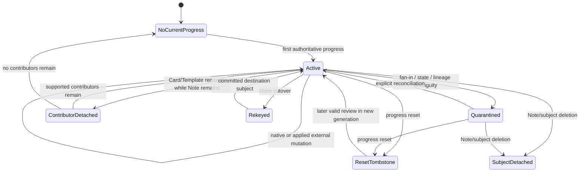

# Phase 4 — History, provenance and lifecycle ADR

> Date: 2026-09-12 | Mode: DESIGN | Decision: P4-D4-4
>
> Status: PROPOSED / PROVISIONAL — repository-grounded contract with current MySQL distribution; acceptance is blocked by P4-01 schema remediation and the joint P4-02/P4-03/P4-04 review
>
> Runtime change: none | Schema change: none | Operational authority: `CardProgress`
>
> Primary evidence: `ReviewEvent` and Connect reference models, native/session/external writers, reset/delete/cutover paths, P1-02, P1-04, P4-01 and the P4-02/P4-03 contracts

This ADR defines which history and lifecycle evidence a Phase 4 learner/Note shadow must retain. It does not turn `ReviewEvent` into current-state authority, implement retention cleanup, switch Algorithms, change delete behavior, add schema or authorize a Phase 5 cutover.

## 1. Decision summary

Current state is always mapped from the committed `CardProgress` authority. Review history explains how state was reached and supplies future Algorithm-initializer input only when its completeness is explicitly sufficient; it is never replayed to reconstruct Phase 4 current state.

Every learner/Note subject and contributor carries two independent classifications:

- **current lineage:** the exact current contributor, latest-event pointer, source snapshot/ref material and lifecycle generation that explain the mirror/disposition;
- **history completeness:** a conservative status describing whether chronological scheduler-grade facts are complete enough for a future initializer.

Equivalent Card states do not select one history winner. All contributor event pointers and external references remain separately accounted for.

Reset, contributor deletion, Note deletion and clone rekey advance the P4-02 subject generation and leave a durable lifecycle fence. No Phase 4 cleanup may remove that fence. Detached/tombstone evidence remains until Phase 4 reconciliation is closed and every later cutover/rollback/backfill checkpoint that could reference the old generation is explicitly retired.



## 2. Invariants

1. `CardProgress` is the sole source for Phase 4 current state; `ReviewEvent`, session detail and Connect revlog never rebuild it.
2. History facts are append-only or explicitly repaired through their existing typed path. Current-state mirror code does not rewrite historical events.
3. A latest-event pointer is per contributor. Fan-in has no scalar “winning event.”
4. History completeness is conservative. Event count, latest timestamp or state equality cannot upgrade an unknown/partial stream to complete.
5. External progress snapshots may own a current-state mutation without supplying a chronological review event. That condition is recorded as snapshot-only/partial, not hidden.
6. Imported revlog is history-only under P1-02. It does not change `CardProgress`, its revision or latest native pointer.
7. Reset separates lifecycle generations. A future initializer does not consume pre-reset history unless an explicit target-Algorithm policy requests it.
8. Card/Template/Note cascades must not erase the P4 lifecycle fence or the minimal detached identity needed for reconciliation.
9. User/account deletion remains the privacy/ownership boundary. This ADR does not require retaining learner-linked shadow/history after the User row is intentionally deleted.
10. Thirty-day execution-detail retention does not authorize deletion of scheduler-grade history, analytics facts or lifecycle fences. Phase 4 implements no purge.
11. Late imports use both occurrence time and ingestion time; an old `reviewed_at` value is not evidence that a recently ingested fact may be immediately purged.
12. Source Notes/Cards in logical-overlay installs are never mutated by learner progress/lifecycle handling.

## 3. Current systems and classifications

| Material | Current classification | Important behavior | P4 treatment |
|---|---|---|---|
| `CardProgress` | authoritative mutable current state | per learner/Card revision and latest-event pointer | map current state and contributor lineage only after committed write |
| `ReviewEvent` | immutable analytics/history fact | Card ID is detached text; user FK cascades; deck/note-type snapshots may be nulled | retain/account as history, never reconstruct current state |
| `CardProgress.last_review_event_id` | current contributor pointer | FK `SET NULL`; native/session/worker set it | preserve pointer validity/status per contributor |
| `ConnectReviewEventRef` | imported revlog idempotency/provenance | unique external review; event FK `SET NULL` | retain external identity and orphan/repaired status |
| `ConnectSourceCardRef` | external Card snapshot identity/cursor | Card FK cascades; stores snapshot hash/local revision/cursor | copy/hash necessary detached lineage before destructive Card lifecycle |
| `ConnectSourceNoteRef` | external Note/content identity | Note FK cascades | retain necessary detached external identity before Note deletion/rekey |
| `StudySession/Card/Commit/Batch` | active replay plus execution detail | session/card FKs may cascade; detail retention is 30 days | preserve through lease and approved detail window; not scheduler history authority |
| clone cutover mapping | maintenance transition evidence | local/source progress may merge/rekey | retain explicit old-to-new subject/contributor link and committed result |
| learner/Note lifecycle record | proposed derived fence | no table today | monotonic generation, status, reason, prior/new vector hashes and provenance |
| scheduler-grade history fact/summary | proposed initializer input | no canonical complete store today | retain exact minimum facts and completeness boundary; physical design is P4-05 |

## 4. Evidence-grounded findings

### Finding 1 — `ReviewEvent` is valuable but non-reconstructive

- **Observed:** native/session rows contain before/after scheduler fields, while direct, imported and repaired paths have different provenance. Progress snapshots can update `CardProgress` without a corresponding event. Revlog import appends events without updating current state.
- **Evidence:** `models/review_event.py`; `app/repositories/review_event_repository.py:47-119`; `app/services/study_service.py:417-592`; `app/services/study_session_service.py:1380-1640`; `app/services/anki_sync_service.py:353-489`; P1-02.
- **Potential concern:** replaying all events would omit snapshot state and mix incompatible/partial sources.
- **Impact:** reconstructed current state could differ from the authority and silently replace a valid imported snapshot.
- **Production evidence (2026-09-12):** the audit found 119,698 Anki-import events, 5,687 versioned native events, four native events without Algorithm labels and 595 event rows detached from a current Card. This confirms that imported and detached history must not be replayed as current authority.
- **Alternatives Considered:** (A) event-source current state from `ReviewEvent`; (B) map `CardProgress` and retain history solely as evidence/initializer input.
- **Trade-offs:** A offers a single conceptual stream but the stream is incomplete. B keeps two clear responsibilities and requires explicit completeness metadata.
- **Recommendation:** select B.
- **Migration Implications:** backfill reads current state from `CardProgress`; missing history changes completeness/disposition, not state.

### Finding 2 — Current foreign-key behavior can erase live lineage while events survive

- **Observed:** Card deletion cascades `CardProgress`, `StudySessionCard` and `ConnectSourceCardRef`; Note deletion cascades Cards and `ConnectSourceNoteRef`. `ReviewEvent.card_id` has no Card FK and can survive, while deck/note-type purge explicitly nulls snapshot columns.
- **Evidence:** `models/card.py`, `models/note.py`, `models/card_progress.py`, `models/study_session_card.py`, Connect ref models; `app/services/deck_management_service.py:83-212`; `app/services/flashcard_content_service.py:186-256`, `:701-731`, `:1134-1155`.
- **Potential concern:** after a cascade, a detached ReviewEvent no longer proves which Note subject or external reference it belonged to, and a stale backfill can recreate the pre-delete view if no generation fence remains.
- **Impact:** unexplained history, broken Algorithm initializer input and progress resurrection.
- **Production evidence (2026-09-12):** actual FK/delete actions and current schema drift are captured. Historical reset/delete/cutover operation volumes are not derivable from the current tables and remain a lifecycle instrumentation/rehearsal concern.
- **Alternatives Considered:** (A) cascade the entire shadow; (B) preserve an immutable subject/contributor identity snapshot and lifecycle ledger while allowing live pointers to detach.
- **Trade-offs:** A is simple but destroys evidence. B adds retained rows but supports reconciliation and safe deletion.
- **Recommendation:** select B conceptually; P4-05 decides exact FK/layout.
- **Migration Implications:** P4-08 must snapshot final lineage and advance generation before destructive cascades execute.

### Finding 3 — Imported identity and chronological history have different completeness

- **Observed:** `ConnectSourceCardRef` tracks snapshot hash, applied local revision and cursor; `ConnectReviewEventRef` tracks separately imported revlog IDs and may point to a missing/repaired event. A modern snapshot can be complete current state while its revlog history is partial.
- **Evidence:** `models/connect_source_card_ref.py`, `models/connect_review_event_ref.py`; `app/services/anki_sync_service.py`; `app/services/connect/import_cards.py:820-932`.
- **Potential concern:** treating a valid snapshot hash as complete history, or treating a complete-looking revlog range as current authority, conflates two independent contracts.
- **Impact:** unsafe Algorithm switching or current-state overwrite.
- **Unknowns:** external sources do not currently provide a universal “full history” manifest.
- **Alternatives Considered:** (A) one imported/not-imported flag; (B) separate current-source lineage, chronological completeness and repair status.
- **Trade-offs:** A is compact but ambiguous. B is more verbose and supports fail-closed initialization.
- **Recommendation:** select B.
- **Migration Implications:** P4-06/P4-08 preserve both axes and never infer completeness from cursor magnitude alone.

### Finding 4 — Reset and cutover are lifecycle discontinuities, not ordinary writes

- **Observed:** reset cancels open sessions then bulk-deletes current-user progress. Clone cutover locks local/source rows, applies a named merge/rekey rule and deletes the losing row in the same savepoint.
- **Evidence:** `app/services/deck_management_service.py:214-284`; `app/services/share/cutover.py:175-241`; P1-02.
- **Potential concern:** using only maximum Card revision cannot distinguish a later reset/new review from stale pre-reset/backfill state or retain why Card identity changed.
- **Impact:** stale resurrection, duplicate subjects or lost provenance.
- **Unknowns:** overlapping reset/cutover/backfill volume is not available without runtime evidence.
- **Alternatives Considered:** (A) let absence/rekey speak for itself; (B) advance subject generation and persist typed tombstone/rekey transitions.
- **Trade-offs:** A has no extra storage but is race-unsafe. B adds lifecycle writes and coordination locks but creates a deterministic fence.
- **Recommendation:** select B, consistent with P4-02.
- **Migration Implications:** P4-08 must join the existing transaction/savepoint and never self-commit.

### Finding 5 — Thirty-day detail and durable initializer history are separate clocks

- **Observed:** the approved 30-day rule applies to StudySession/commit/session-card/action verification detail. Current analytics still reads raw `ReviewEvent`; no durable aggregate or canonical scheduler-initializer history store exists.
- **Evidence:** canonical architecture plan sections 10.4–10.7 and Phase 7; P1-04 retirement lifecycle.
- **Potential concern:** applying one blanket 30-day delete to all events would break analytics and the approved history-based switch policy.
- **Impact:** irreversible loss of reporting and future initialization evidence.
- **Unknowns:** final aggregate dimensions and purge schedule belong to Phase 7, not P4-04.
- **Alternatives Considered:** (A) purge all review/session detail at 30 days; (B) separate execution detail, analytics facts/aggregates, scheduler-grade facts and lifecycle fences.
- **Trade-offs:** A is operationally simple but incompatible with product decisions. B needs multiple retention classes and reconciliation.
- **Recommendation:** select B; Phase 4 only preserves/classifies and performs no purge.
- **Migration Implications:** P4-05 must not encode a cascading retention assumption into the shadow schema.

## 5. History provenance vocabulary

Provenance identifies the writer/evidence source and is independent of completeness.

| Code | Meaning | Current examples |
|---|---|---|
| `NATIVE_DIRECT` | synchronous first-party REST review | canonical native transaction |
| `NATIVE_MCP` | MCP compatibility rating mapped to native transaction | MCP answer path |
| `NATIVE_SESSION` | event replayed and committed from a StudySession | session commit with sequence/client IDs |
| `NATIVE_ASYNC_BATCH` | accepted session batch processed by worker | `StudySessionBatch`/worker path |
| `CONNECT_PROGRESS_SNAPSHOT` | modern external state snapshot | hash/revision guarded applied snapshot |
| `CONNECT_LEGACY_PROGRESS` | legacy timestamp-ordered state import | legacy `cardsProgress` |
| `CONNECT_REVLOG` | imported chronological Anki revlog fact | `ConnectReviewEventRef` |
| `CLONE_CUTOVER` | local-to-source maintenance rekey/merge | overlay-only cutover |
| `PROGRESS_RESET` | explicit learner reset | deck reset service |
| `CONTENT_DELETE` | Card/Template/Note/deck lifecycle removal | content/deck services |
| `REPAIR` | explicit repair of missing/corrupt projection/reference | named maintenance/import repair path |
| `UNKNOWN_LEGACY` | source cannot be proven from retained material | legacy rows only |

Writer-specific source path, request/session/import/install IDs and exact Algorithm/config identities remain separate fields; the code above is not a replacement for them.

## 6. History completeness contract

Completeness is scoped to `(learner, logical Note, subject_generation)` and one frozen cutoff. It is never a timeless global label.

| Code | Required evidence | Initializer meaning |
|---|---|---|
| `NATIVE_COMPLETE` | known generation start plus a contiguous, validated first-party transition chain through the cutoff; no snapshot-only mutation or unexplained gap | may be used only by an initializer that accepts the recorded action/state schema |
| `IMPORTED_PARTIAL` | one or more revlog facts exist, but the source does not prove complete chronological coverage from generation start | partial; explicit target fallback required |
| `SNAPSHOT_ONLY` | current state lineage is known from an external snapshot but no sufficient chronological facts are present | cannot be treated as replayable history |
| `MIXED_PARTIAL` | native and external facts exist but coverage/order has a gap, reset boundary ambiguity or snapshot-only mutation | partial; no implicit merge/order repair |
| `REPAIRED_PARTIAL` | an explicit repair restored an event/reference projection but cannot prove the original stream was complete | partial and visibly repaired |
| `UNKNOWN` | origin, ordering or coverage cannot be proven | fail closed by default |
| `DETACHED` | subject/content relation no longer exists; retained facts remain readable with immutable detached identity | inspection only unless a future restore policy explicitly reattaches |

Rules:

- Existing repository data defaults conservatively to `UNKNOWN`, `IMPORTED_PARTIAL`, `SNAPSHOT_ONLY` or `MIXED_PARTIAL`; it is not bulk-labelled `NATIVE_COMPLETE` by counting events.
- A Connect cursor or maximum external review ID proves an observed boundary, not full history.
- Equal timestamps from sources without a strict sequence are an ordering ambiguity; the canonical fact set retains both and completeness remains partial.
- Completeness can improve only through an explicit import manifest/reconciliation operation with evidence. It can degrade when a gap, orphan or detached relation is discovered.
- Reset closes the prior generation. Completeness for a later generation starts anew.

## 7. Minimum scheduler-grade fact retained beyond execution detail

The durable initializer input is a chronological set of normalized facts, not the entire session payload. Each retained fact needs at least:

```text
learner/Note subject identity or immutable detached subject identity
subject_generation
stable fact identity and contributor/Card identity at occurrence
occurred_at_utc and ingested_at_utc
provenance code plus source/import/session identifiers when available
semantic action key/version (or exact legacy rating mapping)
review_kind
algorithm key/version and state schema, when proven
scheduler config hash, when proven
before_state_hash and after_state_hash, when available
rating/outcome and scheduler-grade interval/due/ease/memory deltas available from source
external source key/review/card IDs and payload hash, when applicable
ordering key/sequence when proven
completeness status and gap/repair reason
```

The minimum fact deliberately excludes rendered Template content, answer text, arbitrary iframe messages and large request/response bodies. Those belong to execution detail/security retention, not Algorithm initialization.

Current `ReviewEvent` remains the analytics/history source during Phase 4. The proposed fact/summary is additive derived evidence; P4-05 decides whether it is a separate normalized row, a retained summary plus existing event link, or another reviewed representation. It must not rely solely on daily analytics aggregates because those lose chronology and action/state provenance.

## 8. Event/pointer accounting

For each contributor, P4 reconciliation records:

```text
last_review_event_id (nullable)
pointer_status = VALID | ABSENT | MISSING_EVENT | LEARNER_MISMATCH |
                 CARD_MISMATCH | EXTERNAL_POINTED
sorted ConnectSourceCardRef identities/hashes
sorted ConnectSourceNoteRef identities/hashes
sorted ConnectReviewEventRef identities/hashes for pointed and historical events
history_completeness
lineage_vector_hash
```

State equality never collapses this vector. If two contributors have equal semantic state but distinct valid latest events, P4-02 emits `MIRRORED_EQUIVALENT_FANIN_DISTINCT_LINEAGE` and retains both. An invalid pointer is a lineage disposition and may also quarantine the subject where current state cannot be explained; it is never repaired by choosing another contributor's event.

## 9. Writer and lifecycle matrix

| Path/outcome | Current-state effect | History/lineage effect | P4 mirror/lifecycle result |
|---|---|---|---|
| native direct/MCP applied | mutate/create progress, increment revision | append event and set contributor pointer | finalize state and lineage after event ID flush |
| session/worker batch applied | replay one or more events; final progress revision | append ordered session events; pointer to contributor's last event | retain every fact; mirror once per affected subject after final state |
| idempotent native/session retry | no second state change | existing event/receipt remains | no duplicate fact or mirror revision |
| modern Connect snapshot applied/forced | mutate current progress and revision | update source snapshot hash/applied revision; event may be absent | mirror state; classify snapshot lineage/partial history |
| modern snapshot unchanged/stale/conflict | no current state mutation | source attempt/result may be diagnostic | no state mirror revision; optional bounded lineage audit only |
| legacy `cardsProgress` applied | timestamp-ordered progress mutation | external source known; chronological history not proven | mirror state; `SNAPSHOT_ONLY` or `MIXED_PARTIAL` |
| Anki revlog import/repair | no current progress/revision/pointer mutation | append/repair ReviewEvent and Connect ref | history-only update; never rebuild state |
| progress reset | cancel affected open sessions, delete progress | retain prior history separated by generation | increment generation; `TOMBSTONED_RESET` with prior vector hashes |
| Card delete while Note remains | cascade contributor progress/source refs/session membership | detached ReviewEvent may survive | detach contributor before cascade; increment generation; recompute siblings or `NO_CURRENT_PROGRESS` |
| Template delete | deletes Template Cards, therefore same contributor lifecycle | history remains detached by Card ID | process every affected learner/Note as Card deletion; no Note progress loss after future cutover |
| Note delete | cascade all Cards/progress/source refs | ReviewEvents survive only with detached Card/scope snapshots | `TOMBSTONED_SUBJECT_DELETED`; retain detached subject identity/fence |
| NoteType/deck purge | may cascade Notes/Cards; deck/note-type event snapshots are nulled | immutable event remains but scope weakens | snapshot lifecycle lineage before cascade; reuse Note deletion rules |
| deck archive/install context removal only | no required progress mutation | context changes | subject identity unchanged; update context evidence only |
| clone cutover rekey/merge | P1-02 chooses committed source progress and removes local loser | local/source IDs and pointers can differ | sorted old/new subject generation transition; `REKEYED_CLONE_CUTOVER`; retain mapping |
| import reconciliation/Card replacement | may create/remove/rekey Card refs and progress | external identities may move | explicit contributor topology transition; unknown mapping quarantines rather than guessing |
| user/account deletion | current FKs cascade user-owned state/history | privacy lifecycle deletes learner-linked evidence | do not retain a shadow outside User deletion policy |

P4-08 must inventory any duplicate delete implementation, including MCP note deletion and bulk deletion, and route lifecycle projection through one no-commit coordinator or prove equivalent atomic behavior.

## 10. Lifecycle transition record

Every topology/destructive transition that affects a materialized subject needs a bounded record containing:

```text
subject key or immutable detached subject key
old_generation and new_generation
transition code and occurred_at
actor/source path/request or maintenance run identity
old/new contributor_topology_hash
old/new authority_vector_hash
old/new lineage_vector_hash
affected contributor/Card/Note/install identities or their retained hashes
related ReviewEvent/source-ref IDs when available
result disposition and error/quarantine reason
```

It must not contain learner answer content, rendered HTML or secrets. The record is written in the same transaction/savepoint as the authoritative lifecycle mutation and does not commit independently.

## 11. Reset contract

1. Lock/cancel affected open sessions using the existing reset ordering.
2. Resolve and lock all affected learner/Note subjects before deleting progress once P4 mirroring is enabled.
3. Capture the final contributor, authority and lineage vectors.
4. Delete authoritative `CardProgress` exactly as today.
5. Advance `subject_generation` and write `TOMBSTONED_RESET` atomically.
6. Preserve prior scheduler-grade history under the closed generation; do not treat it as current-state input.
7. A later valid review creates a contributor in the new generation. Stale backfill/session candidates fail the generation fence.

Reset does not delete immutable ReviewEvents in Phase 4 and does not rewrite their generation retroactively. The lifecycle ledger supplies the boundary.

## 12. Delete, detach and rekey contract

### Card or Template removal while Note remains

- capture lineage before FK cascades remove current refs;
- advance generation and mark each removed contributor `DETACHED_CONTRIBUTOR_DELETED`;
- recompute the subject from all surviving contributors;
- if none remain, use `NO_CURRENT_PROGRESS` without fabricating new state;
- preserve detached Card identity in history/lifecycle evidence.

### Note/source/local deletion

- a hard-deleted Note closes the subject with `TOMBSTONED_SUBJECT_DELETED`;
- the live Note FK/pointer may detach, but immutable Note ID evidence and generation fence must remain through the retention gate;
- published shared Notes continue to follow existing retirement guards; P4 does not weaken them;
- deleting a learner's local overlay/context does not mutate the publisher's source Note/Card;
- user deletion follows privacy deletion and may remove the learner-linked ledger.

### Clone cutover/rekey

- lock old/new subjects in the P4-02 global order and retain the P1-02 local/source progress lock prefix;
- the accepted cutover merge decides authoritative state; P4 never applies ordinary fan-in winner rules;
- close/detach the old contributor/subject generation and link it to the destination generation;
- copy no source Note/Card and mutate no publisher content;
- ambiguous old-to-new mapping is quarantined with both identities, never matched by timestamps or field content alone.

## 13. Retention classes and gates

| Class | Minimum lifetime | Purge authority |
|---|---|---|
| active lease/job artifacts | through commit/expiry/processing deadline plus P1-04 safety gate | existing lease/retirement contract |
| session/action/request execution detail | 30 days after the class-specific creation/expiry clock, only after aggregate/reconciliation proof | future Phase 7 implementation |
| `ReviewEvent` analytics facts | unchanged in Phase 4; current analytics depends on them | separate analytics/retention decision |
| scheduler-grade history/initializer summary | while any supported Algorithm switch policy requires it | future Algorithm/retention contract |
| reset/delete/rekey lifecycle fence | through all Phase 4 backfill/reconciliation and any Phase 5 cutover/rollback/checkpoint horizon | explicit later closeout; no Phase 4 purge |
| detached external identity/provenance | at least as long as its lifecycle fence and referenced history/repair evidence | explicit later closeout/privacy policy |

For a detached/tombstone row, the earliest eligible cleanup time is the latest of:

1. 30 days after the lifecycle occurrence;
2. the retirement of every backfill/reconciliation checkpoint that could have observed the prior generation;
3. the end of any Phase 5 cutover rollback window;
4. the expiry/resolution of every session, accepted batch/job or import run referencing the old identity;
5. the applicable scheduler-history, analytics, external-sync and privacy retention requirement.

Because items 2–4 are not yet closed, automated tombstone/provenance purge is forbidden in Phase 4. This is a minimum safety gate, not an indefinite product-retention promise.

## 14. Future initializer handoff

A Phase 5 Algorithm switch request must freeze under the subject lock:

```text
subject key and subject_generation
current authority_vector_hash and mirror_revision
history cutoff identity/time
history completeness code plus all gap/repair reasons
ordered scheduler-grade fact digest/count
exact source and target Algorithm/state/config identities
initializer key/version and declared accepted completeness classes
authorization actor/reason and idempotency key
```

Default behavior for `IMPORTED_PARTIAL`, `SNAPSHOT_ONLY`, `MIXED_PARTIAL`, `REPAIRED_PARTIAL`, `UNKNOWN` or `DETACHED` is `HISTORY_INCOMPLETE` unless the target Algorithm registers an explicit fallback for that exact class. Permitted future fallback types must be named and auditable, such as refusing the switch or initializing from a bounded current-state contract. “Start fresh” requires explicit user/product authorization and cannot be an implicit error fallback.

The initializer rechecks generation, current authority vector and history cut before installing a new state. Any concurrent review/import/reset/delete/rekey causes conflict/retry. None of this runtime behavior is implemented in Phase 4.

## 15. Typed lifecycle/completeness results

| Code | Meaning |
|---|---|
| `HISTORY_NATIVE_COMPLETE` | completeness proven from generation start |
| `HISTORY_IMPORTED_PARTIAL` | imported chronology lacks a complete boundary |
| `HISTORY_SNAPSHOT_ONLY` | current external state exists without sufficient chronology |
| `HISTORY_MIXED_PARTIAL` | mixed sources contain gaps/order ambiguity |
| `HISTORY_REPAIRED_PARTIAL` | repair succeeded but original completeness is unproven |
| `HISTORY_UNKNOWN` | provenance/coverage cannot be classified safely |
| `HISTORY_DETACHED` | content relation is gone; retained history is inspection-only |
| `HISTORY_INCOMPLETE` | future initializer rejects the supplied completeness class |
| `LINEAGE_POINTER_MISSING` | latest-event pointer targets no current event |
| `LINEAGE_POINTER_MISMATCH` | pointed event learner/Card does not match contributor |
| `LINEAGE_EXTERNAL_ORPHAN` | external ref lacks its expected event/content target |
| `TOMBSTONED_RESET` | reset closed the prior generation |
| `TOMBSTONED_SUBJECT_DELETED` | Note/subject lifecycle closed |
| `DETACHED_CONTRIBUTOR_DELETED` | one Card contributor was removed |
| `REKEYED_CLONE_CUTOVER` | old/current contributor identity moved under named cutover |
| `LIFECYCLE_MAPPING_AMBIGUOUS` | delete/rekey/import replacement cannot be mapped without guessing |
| `MIRROR_INTERNAL_ERROR` | unexpected storage/codec/invariant failure; rollback current unit |

## 16. MySQL OLTP and physical design implications

- An `ON DELETE CASCADE` from Note/Card to the only lifecycle row is prohibited because it destroys generation fences. P4-05 must compare a detachable live FK plus immutable key/ledger against a deliberately detached ledger without a content FK.
- The hot subject envelope stays narrow. Chronological facts and zero-to-many external/contributor lineage do not belong in one growing JSON array on that row.
- Lifecycle transitions are bounded append-only records; current subject status may reference the latest transition.
- Chronological history needs deterministic indexes by subject/generation/occurrence/order identity, but exact shapes depend on P4-01 volumes and P4-05.
- Hash ordering is application-canonical and binary, never collation-dependent.
- Large payloads remain in existing detail stores; the retained scheduler fact has explicit bounded columns/payload size and excludes answer content.
- Late imports require indexes/queries over both occurrence and ingestion clocks; one timestamp cannot safely serve both retention and chronology.

## 17. Alternatives for detached identity

| Alternative | Integrity | Delete behavior | Decision |
|---|---|---|---|
| A. Cascade envelope/history with Note/Card | strong live FK, no retained fence | delete erases reconciliation/lifecycle evidence | rejected |
| B. Keep live nullable pointers plus immutable subject/contributor identity in a separate lifecycle/history ledger | validates active relations and preserves detached evidence | live pointer detaches; ledger survives through gate | selected provisionally |
| C. Remove all content FKs and keep only detached IDs | survives every delete | weak live integrity and easier orphan creation | rejected as default; may be appropriate only for immutable fact rows |

P4-05 owns exact columns, constraints and whether immutable fact rows deliberately omit FKs like `ReviewEvent`.

## 18. Verification specification

P4-06/P4-08/P4-10/P4-11 must eventually prove:

1. native direct/MCP/session/worker pointers and fact sequences are preserved without duplicate events;
2. modern snapshot state mirrors without fabricating a review event;
3. revlog imports update history only and keep current progress/revision/pointer unchanged;
4. orphan/repaired Connect refs receive stable completeness/lineage codes;
5. reset cancels sessions, deletes progress and advances a non-resurrectable generation atomically;
6. Card/Template deletion detaches contributors before cascades and recomputes surviving fan-in;
7. Note/deck/NoteType deletion retains the lifecycle fence/history identity while respecting user privacy deletion;
8. clone cutover retains old-to-new identity and only the P1-02 committed state;
9. stale backfill cannot overwrite any reset/delete/rekey result;
10. late imported events sort/account using occurrence plus ingestion time and are not prematurely purged;
11. rollback flags stop new mirror/lifecycle writes without touching `CardProgress` or deleting additive evidence;
12. two-connection MySQL tests cover reset/review, delete/backfill and cutover/review lock ordering.

## 19. Staged delivery and rollback

1. **P4-05:** select physical envelope/state/availability/contributor/lifecycle/history representations after the P4-01 schema drift and missing batch-table migration are dispositioned.
2. **P4-06:** add only additive structures/codecs with flags off; no cleanup or startup backfill.
3. **P4-07:** mirror native/session/worker state and per-contributor pointers atomically.
4. **P4-08:** cover snapshots, revlog, reset, delete, import replacement and clone rekey in their existing transaction/savepoint boundaries.
5. **P4-09/P4-10:** backfill current state from `CardProgress`, classify history separately and require complete accounting.
6. **P4-11:** rehearse migration, crash/restart, races and rollback on disposable MySQL.
7. **Rollback:** disable mirror/comparison flags and retain additive evidence. Do not rewrite historical codes or roll authority away from `CardProgress`.

No history purge, Algorithm switch, user-facing shadow read or destructive contraction occurs in Phase 4.

## 20. Open gates

### Current MySQL evidence from P4-01

- 15,992 latest-event pointers are valid and 432 are null; missing and mismatched pointer rows are `0`, and all Connect source/ref accounting partitions pass;
- 119,698 imported events, 5,687 versioned native events, four null-label native events and 595 detached event/Card references are observed; occurrence-versus-ingestion age still requires a dedicated history query if it changes retention sizing;
- FK/delete actions, `utf8mb4_unicode_ci`, zero fractional timestamp precision and matching repository/database head `20260910_000036` are captured;
- four sessions are actively open, 117 are expired and active Connect imports are `0`; destructive-path history and batch exposure remain unavailable;
- `study_session_batches` is absent in production and its independent migration disposition remains blocked.

### Joint review

- P4-02 must align generation/vector transitions and detached/tombstone codes with this lifecycle contract.
- P4-03 state/control hashes must exclude history identity while retaining every lineage difference separately.
- P4-05 must prevent cascade loss, compare physical alternatives and keep unbounded history off the hot envelope.

### Provisional result

- current-state/history authority boundary: **ready for cross-review**;
- provenance/completeness vocabulary: **ready for cross-review** against the captured production distributions;
- reset/delete/rekey and retention fence: **ready for cross-review**, physical FK/layout pending;
- P4-04 overall: **not Accepted** while P4-01 schema remediation and joint gates remain open.
