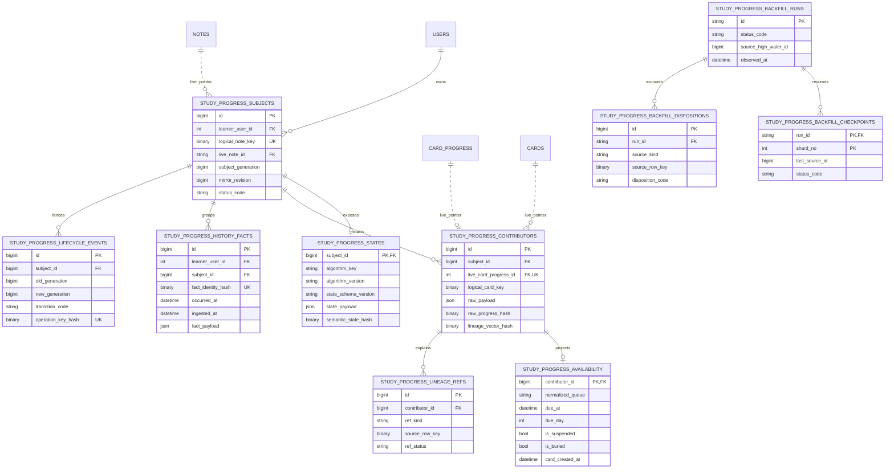

# Phase 4 — Physical learner/Note shadow schema ADR

> Date: 2026-09-13 | Mode: DESIGN | Decision: P4-D4-5
>
> Status: **ACCEPTED FOR P4-06 IMPLEMENTATION**
>
> Runtime change: none | Schema change in this ADR: none | Operational authority: `CardProgress`
>
> Dependencies: accepted [P4-01/P4-02/P4-03/P4-04 joint review](./phase-4-logical-contract-joint-acceptance-2026-09-13.md)

This ADR translates the accepted Phase 4 logical contracts into an exact additive MySQL 8 schema. It authorizes P4-06 to implement models, an Alembic migration, codecs and schema tests. It does not authorize mirror writes, backfill, shadow reads in production, cleanup, Algorithm switching or a Phase 5 authority cutover.

## 1. Decision

Select a narrow lockable subject envelope plus normalized one-to-one state, per-contributor raw/availability rows, explicit zero-to-many lineage, normalized scheduler-grade history, lifecycle fences and resumable backfill accounting.

The rejected alternative is one wide envelope containing state, availability and contributor arrays as JSON. That design reduces table count but enlarges the hot lock row, cannot DB-enforce active contributor identity, makes audit queries parse arbitrary JSON and rewrites unrelated evidence on every review.

The accepted physical topology is:



Existing `USERS`, `NOTES`, `CARDS` and `CARD_PROGRESS` are shown only as parents. P4-06 does not alter them.

## 2. Common physical conventions

1. Every table uses `InnoDB`, database charset `utf8mb4` and database collation `utf8mb4_unicode_ci` unless a column below explicitly uses binary bytes or `ascii_bin`.
2. Synthetic numeric keys use signed `BIGINT`; referenced existing keys keep their current signed `INTEGER` or `VARCHAR` type so MySQL foreign-key definitions match exactly.
3. Immutable Note/Card/source identity copies use `VARBINARY`, populated from the exact UTF-8 bytes returned by the database. No trim, case fold, UUID reformat or Unicode normalization is permitted.
4. Live FK pointers keep the parent column's current string type/collation. A live pointer may become `NULL`; its immutable binary identity remains.
5. SHA-256 values use `BINARY(32)`, never hex `VARCHAR(64)`. API/audit views may render lowercase hex.
6. New timestamps use UTC `DATETIME(6)`. Application code supplies values; there is no `CURRENT_TIMESTAMP`, implicit timezone conversion or `ON UPDATE` server behavior.
7. Canonical payloads use native MySQL `JSON` and SQLAlchemy `JSON`. Each payload has an adjacent byte-size column, SHA-256 digest and exact schema/codec version. The encoded canonical UTF-8 form is limited to 16,384 bytes before insert.
8. Counters/revisions are non-negative through named `CHECK` constraints. MySQL 8.0.46 enforces them; SQLite fixtures must exercise the same predicates.
9. Status/provenance columns use `VARCHAR(64) COLLATE ascii_bin`. P4-06 emits only the accepted codes and adds named `CHECK` allowlists. Adding a persisted code later requires an additive migration and decoder update.
10. No table stores `eligible_now`, an implicit current timezone/day, rendered content, answer text, credentials or unbounded request/session payloads.

Only columns explicitly marked with a default in the tables below receive one. P4-06 declares the same value as both SQLAlchemy client default and migration `server_default`; every other column has no server default. Boolean defaults compile to `0`, numeric defaults are unquoted, and string defaults are quoted literals.

The binary identity copy is intentionally separate from the live Note FK. A single collated `VARCHAR` could not simultaneously preserve the existing FK definition and guarantee collation-independent lock ordering. Binary capacities reserve four bytes for every character allowed by the source `utf8mb4` column (`36 -> 144`, `64 -> 256`, `128 -> 512`, `255 -> 1020`), so preservation does not assume ASCII UUIDs. P4-06 must test the boundary and reject any impossible overflow before insert.

## 3. Exact table contracts

### 3.1 `study_progress_subjects`

This is the only learner/Note coordination lock row.

| Column | Type | Null/default | Contract |
|---|---|---|---|
| `id` | `BIGINT` auto increment | not null | primary key |
| `learner_user_id` | `INTEGER` | not null | FK `users.id ON DELETE CASCADE` |
| `logical_note_key` | `VARBINARY(144)` | not null | immutable exact bytes from source `VARCHAR(36)` |
| `live_note_id` | `VARCHAR(36)` | nullable | FK `notes.id ON DELETE SET NULL`; equals decoded logical key while attached |
| `subject_generation` | `BIGINT` | not null, server default `1` | topology/reset/delete/rekey fence; `>= 1` |
| `mirror_revision` | `BIGINT` | not null, server default `0` | derived projection version; `>= 0` |
| `status_code` | `VARCHAR(64) ascii_bin` | not null, default `NO_CURRENT_PROGRESS` | accepted P4-02 subject disposition |
| `contributor_count` | `INTEGER` | not null, default `0` | count in current generation; `>= 0` |
| `authority_vector_hash` | `BINARY(32)` | nullable | null only when no trusted current vector exists |
| `lineage_vector_hash` | `BINARY(32)` | nullable | independent from semantic state |
| `mapper_version` | `VARCHAR(32) ascii_bin` | nullable | exact mapper that produced the current result |
| `last_mirrored_at` | `DATETIME(6)` | nullable | finalization time, not authority time |
| `created_at` | `DATETIME(6)` | not null | application-supplied UTC |
| `updated_at` | `DATETIME(6)` | not null | application-supplied UTC |

Constraints and indexes:

- PK `pk_study_progress_subjects (id)`;
- UQ `uq_sp_subject_user_note (learner_user_id, logical_note_key)`;
- IX `ix_sp_subject_live_note (live_note_id)`;
- IX `ix_sp_subject_status_updated (status_code, updated_at, id)`;
- checks for generation/revision/count bounds, hash length and the accepted subject-status allowlist.

`MIRROR_INTERNAL_ERROR` is not a stored subject status: that exception rolls back the unit. A quarantined/tombstoned subject has no usable current state row.

### 3.2 `study_progress_states`

One current, usable Algorithm State may exist per subject.

| Column | Type | Null/default | Contract |
|---|---|---|---|
| `subject_id` | `BIGINT` | not null | PK and FK `study_progress_subjects.id ON DELETE CASCADE` |
| `subject_generation` | `BIGINT` | not null | must equal the envelope generation at finalization |
| `mirror_revision` | `BIGINT` | not null | must equal the envelope mirror revision |
| `algorithm_key` | `VARCHAR(64) ascii_bin` | not null | initially exact `legacy-anki` |
| `algorithm_version` | `VARCHAR(32) ascii_bin` | not null | initially exact `1.0.0` |
| `state_schema_version` | `VARCHAR(64) ascii_bin` | not null | initially exact `anki-card-state.v1` |
| `storage_codec` | `VARCHAR(64) ascii_bin` | not null | initially exact `flama-canonical-state-json.v1` |
| `state_payload` | `JSON` | not null | canonical semantic payload only |
| `state_payload_size` | `SMALLINT` | not null | `0..16384` canonical bytes |
| `algorithm_state_hash` | `BINARY(32)` | not null | exact identity plus canonical state payload |
| `semantic_state_hash` | `BINARY(32)` | not null | algorithm hash plus control/availability anchors |
| `created_at` | `DATETIME(6)` | not null | application-supplied UTC |
| `updated_at` | `DATETIME(6)` | not null | application-supplied UTC |

Constraints and indexes:

- PK `pk_study_progress_states (subject_id)`;
- IX `ix_sp_state_identity (algorithm_key, algorithm_version, state_schema_version)`;
- checks for positive generation, non-negative revision, payload bound and 32-byte hashes.

Readers must resolve the exact four-part decoder and verify both size and hash before decoding. No generic query may interpret `state_payload`.

### 3.3 `study_progress_contributors`

Rows retain both current and detached generations. `live_card_progress_id IS NOT NULL` means the row is attached to the present authority row; a detached row keeps `source_progress_id` and its raw snapshot.

| Column | Type | Null/default | Contract |
|---|---|---|---|
| `id` | `BIGINT` auto increment | not null | primary key |
| `subject_id` | `BIGINT` | not null | FK subject `ON DELETE CASCADE` |
| `subject_generation` | `BIGINT` | not null | generation containing this evidence |
| `source_progress_id` | `INTEGER` | not null | immutable original `CardProgress.id` |
| `live_card_progress_id` | `INTEGER` | nullable | FK `card_progress.id ON DELETE SET NULL`; unique while attached |
| `logical_card_key` | `VARBINARY(144)` | not null | exact detached-safe bytes from current Card `VARCHAR(36)` |
| `live_card_id` | `VARCHAR(36)` | nullable | FK `cards.id ON DELETE SET NULL` |
| `card_progress_revision` | `BIGINT` | not null | copied authoritative contributor revision |
| `raw_schema_version` | `VARCHAR(64) ascii_bin` | not null | exact `raw-card-progress.v1` |
| `storage_codec` | `VARCHAR(64) ascii_bin` | not null | exact `flama-canonical-state-json.v1` |
| `raw_payload` | `JSON` | not null | every ORM-visible `CardProgress` column and nullness |
| `raw_payload_size` | `SMALLINT` | not null | `0..16384` canonical bytes |
| `raw_progress_hash` | `BINARY(32)` | not null | SHA-256 of canonical raw payload |
| `pointer_status` | `VARCHAR(64) ascii_bin` | not null | P4-04 pointer classification |
| `history_completeness_code` | `VARCHAR(64) ascii_bin` | not null | conservative generation-scoped class |
| `current_provenance_code` | `VARCHAR(64) ascii_bin` | not null | writer/source classification |
| `lineage_vector_hash` | `BINARY(32)` | not null | hash of independently retained lineage refs |
| `contributor_status` | `VARCHAR(32) ascii_bin` | not null | `ACTIVE`, `DETACHED`, `REKEYED` or `TOMBSTONED` |
| `detached_at` | `DATETIME(6)` | nullable | transition time when no longer current |
| `created_at` | `DATETIME(6)` | not null | application-supplied UTC |
| `updated_at` | `DATETIME(6)` | not null | application-supplied UTC |

Constraints and indexes:

- PK `pk_study_progress_contributors (id)`;
- UQ `uq_sp_contributor_id_subject (id, subject_id)` supports the availability table's subject-consistency FK;
- UQ `uq_sp_contributor_generation_source (subject_id, subject_generation, source_progress_id)`;
- UQ `uq_sp_contributor_live_progress (live_card_progress_id)`; MySQL permits multiple historical `NULL` values;
- IX `ix_sp_contributor_subject_current (subject_id, subject_generation, contributor_status, id)`;
- IX `ix_sp_contributor_live_card (live_card_id, subject_id)`;
- checks for generation/revision/payload bounds, hashes and accepted pointer/completeness/provenance/status codes.

P4-08 must mark/detach a row before a destructive parent cascade. The FK `SET NULL` is a final safety behavior, not a substitute for writing the lifecycle transition.

### 3.4 `study_progress_availability`

This one-to-one contributor projection contains only stable, queryable anchors.

| Column | Type | Null/default | Contract |
|---|---|---|---|
| `contributor_id` | `BIGINT` | not null | PK and FK contributor `ON DELETE CASCADE` |
| `subject_id` | `BIGINT` | not null | denormalized subject identity, DB-bound to its contributor by a composite FK |
| `subject_generation` | `BIGINT` | not null | contributor/envelope generation at finalization |
| `projection_version` | `VARCHAR(32) ascii_bin` | not null | exact availability evaluator contract |
| `normalized_queue` | `VARCHAR(20) ascii_bin` | not null | `new`, `learning`, `relearning` or `review` |
| `due_at` | `DATETIME(6)` | nullable | exact current anchor/nullness |
| `due_day` | `INTEGER` | nullable | exact current anchor/nullness |
| `is_suspended` | `BOOLEAN` | not null, default `0` | stable hidden-state anchor |
| `is_buried` | `BOOLEAN` | not null, default `0` | stable burial anchor |
| `buried_until_day` | `INTEGER` | nullable | exact burial anchor/nullness |
| `card_created_at` | `DATETIME(6)` | not null | current compatibility tie-breaker |
| `card_order_key` | `VARBINARY(144)` | not null | exact binary bytes from current Card `VARCHAR(36)` |
| `state_schema_version` | `VARCHAR(64) ascii_bin` | not null | schema used for comparison |
| `semantic_state_hash` | `BINARY(32)` | not null | same contributor semantic hash used by fan-in |
| `created_at` | `DATETIME(6)` | not null | application-supplied UTC |
| `updated_at` | `DATETIME(6)` | not null | application-supplied UTC |

Constraints and indexes:

- PK `pk_study_progress_availability (contributor_id)`;
- UQ `uq_sp_contributor_id_subject (study_progress_contributors.id, study_progress_contributors.subject_id)` is declared on the parent and composite FK `fk_sp_avail_contributor_subject (contributor_id, subject_id) -> study_progress_contributors(id, subject_id) ON DELETE CASCADE` enforces the denormalized subject;
- IX `ix_sp_avail_subject_queue_day (subject_id, subject_generation, normalized_queue, is_suspended, is_buried, due_day, due_at)`;
- IX `ix_sp_avail_queue_time (normalized_queue, is_suspended, is_buried, due_at, contributor_id)`;
- checks for positive generation, queue allowlist and 32-byte semantic hash.

The evaluator always receives frozen `now_utc`, timezone, day-boundary, learn-ahead, effective Card scope and comparison-policy version. Ordering appends `(card_created_at, card_order_key)` in application/SQL according to the accepted P4-03 queue-specific rules.

### 3.5 `study_progress_lineage_refs`

One row represents one current or detached lineage reference. It prevents zero-to-many Connect material from being reduced to one scalar pointer.

| Column | Type | Null/default | Contract |
|---|---|---|---|
| `id` | `BIGINT` auto increment | not null | primary key |
| `contributor_id` | `BIGINT` | not null | FK contributor `ON DELETE CASCADE` |
| `subject_generation` | `BIGINT` | not null | generation explained by the reference |
| `ref_kind` | `VARCHAR(64) ascii_bin` | not null | `LAST_REVIEW_EVENT`, `CONNECT_SOURCE_CARD` or `CONNECT_SOURCE_NOTE` |
| `source_row_key` | `VARBINARY(144)` | not null | exact bytes from UUID/integer source-row identity; detached-safe |
| `source_key` | `VARBINARY(1020)` | nullable | exact bytes from Connect `VARCHAR(255)` source key |
| `external_card_id` | `VARBINARY(512)` | nullable | exact bytes from external `VARCHAR(128)` Card identity |
| `external_note_id` | `VARBINARY(512)` | nullable | exact bytes from external `VARCHAR(128)` Note identity |
| `source_snapshot_hash` | `BINARY(32)` | nullable | decoded source snapshot hash where present |
| `source_payload_hash` | `BINARY(32)` | nullable | source payload/content hash where present |
| `ref_status` | `VARCHAR(64) ascii_bin` | not null | valid/absent/missing/mismatch/repair classification |
| `occurred_at` | `DATETIME(6)` | nullable | source occurrence time when known |
| `ingested_at` | `DATETIME(6)` | not null | observation/write time |

Constraints and indexes:

- PK `pk_study_progress_lineage_refs (id)`;
- UQ `uq_sp_lineage_ref (contributor_id, subject_generation, ref_kind, source_row_key)`;
- IX `ix_sp_lineage_source (ref_kind, source_row_key)`;
- IX `ix_sp_lineage_contributor_status (contributor_id, ref_status, id)`;
- checks for generation, accepted kinds/statuses and optional 32-byte hashes.

There is deliberately no polymorphic FK from `source_row_key`. A real FK would either require several nullable source-specific columns or delete the evidence when Connect/Card rows cascade. P4-06/P4-08 must validate live references before snapshotting them.

`ConnectReviewEventRef` material belongs on the normalized history fact below, so it is not duplicated into this current-lineage table.

### 3.6 `study_progress_history_facts`

This is an additive, bounded scheduler-grade fact stream. `ReviewEvent` remains the Phase 4 analytics/history authority; these rows are comparison/initializer evidence only.

| Column | Type | Null/default | Contract |
|---|---|---|---|
| `id` | `BIGINT` auto increment | not null | primary key |
| `learner_user_id` | `INTEGER` | not null | FK `users.id ON DELETE CASCADE`; privacy boundary |
| `subject_id` | `BIGINT` | nullable | FK subject `ON DELETE SET NULL`; null for unmappable detached history |
| `logical_note_key` | `VARBINARY(144)` | nullable | detached-safe bytes from source `VARCHAR(36)` when known |
| `subject_generation` | `BIGINT` | nullable | null only when history cannot be assigned safely |
| `contributor_id` | `BIGINT` | nullable | FK contributor `ON DELETE SET NULL` |
| `logical_card_key` | `VARBINARY(256)` | not null | detached-safe bytes from `ReviewEvent.card_id VARCHAR(64)` |
| `review_event_id` | `INTEGER` | nullable | FK `review_events.id ON DELETE SET NULL` |
| `fact_identity_hash` | `BINARY(32)` | not null | stable deduplication identity |
| `history_schema_version` | `VARCHAR(64) ascii_bin` | not null | exact normalized-fact schema |
| `storage_codec` | `VARCHAR(64) ascii_bin` | not null | exact canonical JSON codec |
| `occurred_at` | `DATETIME(6)` | not null | chronological source time |
| `ingested_at` | `DATETIME(6)` | not null | database observation/ingestion time |
| `provenance_code` | `VARCHAR(64) ascii_bin` | not null | accepted P4-04 writer/source code |
| `source_operation_key` | `VARBINARY(512)` | nullable | exact bytes from a bounded 128-character session/import/request identity |
| `action_key` | `VARCHAR(64) ascii_bin` | nullable | semantic action or legacy rating mapping |
| `action_version` | `VARCHAR(32) ascii_bin` | nullable | exact action version when proven |
| `review_kind` | `VARCHAR(20) ascii_bin` | nullable | retained scheduler fact |
| `algorithm_key` | `VARCHAR(64) ascii_bin` | nullable | exact identity only when proven |
| `algorithm_version` | `VARCHAR(32) ascii_bin` | nullable | exact identity only when proven |
| `state_schema_version` | `VARCHAR(64) ascii_bin` | nullable | exact identity only when proven |
| `scheduler_config_hash` | `BINARY(32)` | nullable | decoded canonical config digest |
| `before_state_hash` | `BINARY(32)` | nullable | scheduler state before fact when available |
| `after_state_hash` | `BINARY(32)` | nullable | scheduler state after fact when available |
| `history_completeness_code` | `VARCHAR(64) ascii_bin` | not null | conservative status at the frozen cutoff |
| `gap_reason_code` | `VARCHAR(64) ascii_bin` | nullable | explicit missing/repair reason |
| `fact_payload` | `JSON` | not null | bounded rating/outcome and scheduler-grade deltas, including external ref identity when applicable |
| `fact_payload_size` | `SMALLINT` | not null | `0..16384` canonical bytes |
| `fact_payload_hash` | `BINARY(32)` | not null | canonical fact digest |
| `created_at` | `DATETIME(6)` | not null | application-supplied UTC |

Constraints and indexes:

- PK `pk_study_progress_history_facts (id)`;
- UQ `uq_sp_history_learner_fact (learner_user_id, fact_identity_hash)`;
- IX `ix_sp_history_subject_order (subject_id, subject_generation, occurred_at, id)`;
- IX `ix_sp_history_learner_order (learner_user_id, occurred_at, id)`;
- IX `ix_sp_history_ingested (ingested_at, id)`;
- IX `ix_sp_history_review_event (review_event_id)`;
- checks for generation/payload/hash bounds and accepted provenance/completeness codes.

Fact ordering is `(occurred_at, proven source sequence when present in the payload, fact_identity_hash, id)`. Ingestion time remains independently queryable. No completeness upgrade is inferred from row count, maximum cursor or timestamp.

### 3.7 `study_progress_lifecycle_events`

One bounded append-only row records each subject topology/destructive transition.

| Column | Type | Null/default | Contract |
|---|---|---|---|
| `id` | `BIGINT` auto increment | not null | primary key |
| `subject_id` | `BIGINT` | not null | FK subject `ON DELETE CASCADE`; user deletion removes the ledger |
| `related_subject_id` | `BIGINT` | nullable | FK subject `ON DELETE SET NULL`; rekey destination/source |
| `old_generation` | `BIGINT` | not null | generation before transition |
| `new_generation` | `BIGINT` | not null | generation after transition; strictly greater |
| `transition_code` | `VARCHAR(64) ascii_bin` | not null | accepted reset/delete/detach/rekey code |
| `occurred_at` | `DATETIME(6)` | not null | authoritative transaction time |
| `source_path` | `VARCHAR(128) ascii_bin` | not null | named writer/maintenance path |
| `operation_key_hash` | `BINARY(32)` | not null | idempotency/request/run digest |
| `old_topology_hash` | `BINARY(32)` | nullable | prior contributor topology |
| `new_topology_hash` | `BINARY(32)` | nullable | resulting contributor topology |
| `old_authority_hash` | `BINARY(32)` | nullable | prior authority vector |
| `new_authority_hash` | `BINARY(32)` | nullable | resulting authority vector |
| `old_lineage_hash` | `BINARY(32)` | nullable | prior lineage vector |
| `new_lineage_hash` | `BINARY(32)` | nullable | resulting lineage vector |
| `result_code` | `VARCHAR(64) ascii_bin` | not null | lifecycle/disposition outcome |
| `reason_code` | `VARCHAR(64) ascii_bin` | nullable | bounded conflict/quarantine reason |
| `evidence_schema_version` | `VARCHAR(64) ascii_bin` | not null | exact lifecycle evidence schema |
| `evidence_payload` | `JSON` | not null | bounded affected identities/counts; no content/answers/secrets |
| `evidence_payload_size` | `SMALLINT` | not null | `0..16384` canonical bytes |
| `evidence_payload_hash` | `BINARY(32)` | not null | canonical lifecycle digest |
| `created_at` | `DATETIME(6)` | not null | application-supplied UTC |

Constraints and indexes:

- PK `pk_study_progress_lifecycle_events (id)`;
- UQ `uq_sp_lifecycle_operation (subject_id, new_generation, transition_code, operation_key_hash)`;
- IX `ix_sp_lifecycle_subject_order (subject_id, new_generation, occurred_at, id)`;
- IX `ix_sp_lifecycle_related (related_subject_id, occurred_at, id)`;
- checks for `old_generation >= 1`, `new_generation > old_generation`, payload/hash bounds and accepted transition/result codes.

No lifecycle row is purged in Phase 4. Content deletion detaches `live_note_id`; it does not delete the subject or ledger. Intentional user deletion may cascade the learner-owned subject and its children.

### 3.8 Backfill run, checkpoint and disposition tables

`study_progress_backfill_runs` freezes one reproducible contract:

| Column | Type | Null/default |
|---|---|---|
| `id` | `VARCHAR(36)` PK | not null |
| `run_kind` | `VARCHAR(32) ascii_bin` | not null |
| `status_code` | `VARCHAR(32) ascii_bin` | not null |
| `repository_commit` | `CHAR(40) ascii_bin` | not null |
| `database_head` | `VARCHAR(64) ascii_bin` | not null |
| `audit_schema_version` | `VARCHAR(64) ascii_bin` | not null |
| `mapper_version` | `VARCHAR(32) ascii_bin` | not null |
| `state_schema_version` | `VARCHAR(64) ascii_bin` | not null |
| `projection_version` | `VARCHAR(32) ascii_bin` | not null |
| `contract_hash` | `BINARY(32)` | not null |
| `observed_at` | `DATETIME(6)` | not null |
| `source_progress_high_water_id` | `BIGINT` | nullable |
| `source_event_high_water_id` | `BIGINT` | nullable |
| `source_count` | `BIGINT` | not null, default `0` |
| `mirrored_count` | `BIGINT` | not null, default `0` |
| `quarantined_count` | `BIGINT` | not null, default `0` |
| `unresolvable_count` | `BIGINT` | not null, default `0` |
| `retry_count` | `BIGINT` | not null, default `0` |
| `started_at`, `updated_at` | `DATETIME(6)` | not null |
| `completed_at` | `DATETIME(6)` | nullable |
| `error_summary` | `TEXT` | nullable, redacted/bounded by application |

Indexes: PK `id`; UQ `uq_sp_backfill_contract (run_kind, observed_at, contract_hash)`; IX `ix_sp_backfill_status_updated (status_code, updated_at, id)`; non-negative counter checks and accepted run/status codes.

`study_progress_backfill_checkpoints` supports one or more keyset shards:

| Column | Type | Null/default |
|---|---|---|
| `run_id` | `VARCHAR(36)` | PK part; FK run `ON DELETE CASCADE` |
| `shard_no` | `SMALLINT` | PK part; `>= 0` |
| `status_code` | `VARCHAR(32) ascii_bin` | not null |
| `range_start_id`, `range_end_id` | `BIGINT` | nullable |
| `last_source_id` | `BIGINT` | nullable |
| `processed_count`, `retry_count` | `BIGINT` | not null, default `0` |
| `lease_token_hash` | `BINARY(32)` | nullable |
| `lease_expires_at` | `DATETIME(6)` | nullable |
| `updated_at` | `DATETIME(6)` | not null |

PK `(run_id, shard_no)`; IX `ix_sp_checkpoint_lease (status_code, lease_expires_at, run_id, shard_no)`; range/counter/pairing checks. P4-09 starts with one shard unless measured throughput justifies more.

`study_progress_backfill_dispositions` gives every frozen source row exactly one latest run result without hiding retry attempts:

| Column | Type | Null/default |
|---|---|---|
| `id` | `BIGINT` auto increment | PK |
| `run_id` | `VARCHAR(36)` | FK run `ON DELETE RESTRICT`; completed evidence cannot be erased by deleting its run |
| `source_kind` | `VARCHAR(32) ascii_bin` | `CARD_PROGRESS`, `REVIEW_EVENT` or supported reference kind |
| `source_row_key` | `VARBINARY(144)` | exact frozen UUID/integer source-row identity |
| `subject_id` | `BIGINT` | nullable; FK subject `ON DELETE SET NULL` |
| `observed_generation` | `BIGINT` | nullable |
| `observed_revision` | `BIGINT` | nullable |
| `source_hash` | `BINARY(32)` | not null |
| `disposition_code` | `VARCHAR(64) ascii_bin` | mirrored/quarantine/unresolvable/stale result |
| `reason_code` | `VARCHAR(64) ascii_bin` | nullable |
| `result_hash` | `BINARY(32)` | nullable |
| `attempt_count` | `INTEGER` | not null, default `1` |
| `evidence_payload` | `JSON` | not null |
| `evidence_payload_size` | `SMALLINT` | not null; `0..16384` |
| `evidence_payload_hash` | `BINARY(32)` | not null |
| `created_at`, `updated_at` | `DATETIME(6)` | not null |

Constraints and indexes:

- UQ `uq_sp_disposition_source (run_id, source_kind, source_row_key)`;
- IX `ix_sp_disposition_result (run_id, disposition_code, id)`;
- IX `ix_sp_disposition_subject (subject_id, observed_generation, id)`;
- checks for non-negative observed tokens, positive attempts, payload/hash bounds and accepted codes.

Quarantine is a disposition code with bounded evidence, not a second competing table. A retry updates the same frozen source disposition and increments `attempt_count`; a new run creates independent evidence.

## 4. Persisted code allowlists

The named `CHECK` constraints use these exact initial values. They are centrally defined once in P4-06 and imported by codecs/models/tests; migration literals are compared against that registry in a contract test.

| Column family | Accepted values |
|---|---|
| subject status | `NO_CURRENT_PROGRESS`, `MIRRORED_SINGLE`, `MIRRORED_EQUIVALENT_FANIN`, `MIRRORED_EQUIVALENT_FANIN_DISTINCT_LINEAGE`, `QUARANTINED_STATE_DIVERGENCE`, `QUARANTINED_UNSUPPORTED_STATE`, `QUARANTINED_CORRUPT_STATE`, `QUARANTINED_UNCLASSIFIED_CONTEXT`, `TOMBSTONED_RESET`, `TOMBSTONED_SUBJECT_DELETED`, `REKEYED_CLONE_CUTOVER` |
| contributor status | `ACTIVE`, `DETACHED`, `REKEYED`, `TOMBSTONED` |
| pointer/reference status | `VALID`, `ABSENT`, `MISSING_EVENT`, `LEARNER_MISMATCH`, `CARD_MISMATCH`, `EXTERNAL_POINTED`, `MISSING_TARGET`, `PAYLOAD_MISMATCH`, `REPAIRED` |
| history completeness | `HISTORY_NATIVE_COMPLETE`, `HISTORY_IMPORTED_PARTIAL`, `HISTORY_SNAPSHOT_ONLY`, `HISTORY_MIXED_PARTIAL`, `HISTORY_REPAIRED_PARTIAL`, `HISTORY_UNKNOWN`, `HISTORY_DETACHED` |
| provenance | `NATIVE_DIRECT`, `NATIVE_MCP`, `NATIVE_SESSION`, `NATIVE_ASYNC_BATCH`, `CONNECT_PROGRESS_SNAPSHOT`, `CONNECT_LEGACY_PROGRESS`, `CONNECT_REVLOG`, `CLONE_CUTOVER`, `PROGRESS_RESET`, `CONTENT_DELETE`, `REPAIR`, `UNKNOWN_LEGACY` |
| lineage reference kind | `LAST_REVIEW_EVENT`, `CONNECT_SOURCE_CARD`, `CONNECT_SOURCE_NOTE` |
| lifecycle transition | `TOMBSTONED_RESET`, `TOMBSTONED_SUBJECT_DELETED`, `DETACHED_CONTRIBUTOR_DELETED`, `REKEYED_CLONE_CUTOVER`, `LIFECYCLE_MAPPING_AMBIGUOUS` |
| backfill run kind | `CURRENT_PROGRESS`, `HISTORY`, `FULL` |
| run/checkpoint status | `PENDING`, `RUNNING`, `COMPLETED`, `FAILED`, `CANCELLED` |
| backfill source kind | `CARD_PROGRESS`, `REVIEW_EVENT`, `CONNECT_SOURCE_CARD_REF`, `CONNECT_SOURCE_NOTE_REF`, `CONNECT_REVIEW_EVENT_REF` |
| backfill disposition | every accepted P4-02 mirror/quarantine/unresolvable/lifecycle code plus `STALE_GENERATION`, `STALE_AUTHORITY_VECTOR`, `STALE_MAPPER_VERSION`, `RETRY_PENDING` |

Typed mapping failures such as `UNSUPPORTED_QUEUE`, `INCOMPLETE_MEMORY_STATE` and payload/hash failures are stored in `reason_code`; they do not create additional subject statuses. `HISTORY_INCOMPLETE` is a future initializer result rather than a stored completeness class.

## 5. Identity, active-row and state invariants

P4-06 must encode and test these invariants in both model and migration metadata:

1. exactly one subject envelope per `(learner_user_id, logical_note_key)`;
2. at most one current state row per subject, and only for a mirrorable subject status;
3. at most one attached contributor row per current `CardProgress.id`, enforced by the nullable unique live FK;
4. usable contributor rows match the envelope's current generation; older generations remain retained but are filtered out;
5. exactly one availability row for each mapped contributor and none for an unsupported/corrupt raw mapping;
6. a state row's generation/revision/hash set is written only together with the envelope finalization;
7. state equality ignores lineage; lineage equality never substitutes for state equality;
8. a Note/Card/progress FK detach cannot erase immutable identity, raw payload, history or lifecycle evidence;
9. user deletion remains the only Phase 4 cascade permitted to remove the learner-owned subject tree;
10. every backfill source identity has one disposition per run, and run totals reconcile with disposition counts.

Cross-table generation/revision equality cannot be expressed safely as a foreign key because historical contributor/fact rows must retain older generations. It is enforced by the subject-lock transaction and by P4-10 reconciliation queries; P4-06 adds negative unit/SQL tests for stale finalization.

## 6. First-create and global lock protocol

For every affected subject, encode `logical_note_key` first and sort by `(learner_user_id, logical_note_key bytes)`. Inside the existing transaction owner:

```sql
INSERT INTO study_progress_subjects (...)
VALUES (...)
ON DUPLICATE KEY UPDATE id = id;

SELECT id, subject_generation, mirror_revision
FROM study_progress_subjects
WHERE learner_user_id = :learner_user_id
  AND logical_note_key = :logical_note_key
FOR UPDATE;
```

The no-op duplicate branch is deliberate: unlike `INSERT IGNORE`, it does not suppress unrelated errors. It acquires/serializes through the unique key and does not change `updated_at`, because timestamps have no automatic server update.

The complete order is:

1. pre-existing transaction-owner or Connect source-identity prefix lock;
2. ensure subject envelopes in canonical order;
3. lock all affected subject rows in that same order;
4. lock current `CardProgress` rows by binary Card ID then progress ID;
5. perform authoritative progress/event/source-ref mutation and flush IDs;
6. upsert contributor/raw/availability/history evidence and finalize each subject once;
7. let the existing owner commit or roll back.

For clone cutover, P1-02's deterministic local/source order is retained within step 4, after old/new subjects have been locked. No mirror helper may commit independently. P4-11 must prove absent-row creation, sibling Cards, reverse-request order, reset/backfill and cutover/review with two MySQL connections and bounded lock timeouts.

## 7. Access and index map

| Access path | Leading index / key | Expected use |
|---|---|---|
| lock one learner/Note subject | `uq_sp_subject_user_note` | every mirror/lifecycle/backfill unit |
| find subjects attached to a Note | `ix_sp_subject_live_note` | delete/detach planning |
| load current contributors | `ix_sp_contributor_subject_current` | vector recomputation |
| map authoritative progress to shadow | `uq_sp_contributor_live_progress` | writer/reconciliation lookup |
| join effective Card scope | `ix_sp_contributor_live_card` | fixed-scope comparison |
| evaluate due queue anchors | `ix_sp_avail_subject_queue_day`, `ix_sp_avail_queue_time` | comparison only in Phase 4 |
| inspect contributor lineage | `ix_sp_lineage_contributor_status` | audit/quarantine explanation |
| chronological initializer facts | `ix_sp_history_subject_order` | future exact initializer input |
| account late ingestion | `ix_sp_history_ingested` | completeness/retention review |
| inspect lifecycle fence | `ix_sp_lifecycle_subject_order` | stale-backfill/reset/rekey proof |
| resume an expired worker lease | `ix_sp_checkpoint_lease` | P4-09 recovery |
| reconcile run outcomes | `ix_sp_disposition_result` | P4-09/P4-10 accounting |

P4-06 must compile and snapshot the MySQL DDL. P4-11 must run `EXPLAIN ANALYZE` with production-shaped counts; an unexpected full scan on subject lookup, current-contributor lookup or disposition resume is a release blocker.

## 8. Production-sized row and write estimate

The accepted 2026-09-13 production snapshot contains 16,424 current progress rows/subjects, 125,554 ReviewEvents, 15,992 valid latest pointers and 15,813 current contributors matched to each source-Card/source-Note reference kind. Total Connect source-Card and source-Note tables each contain 15,828 matched references; the additional rows do not belong to a current progress contributor.

| Table | Initial row estimate | Reason |
|---|---:|---|
| subjects | 16,424 | one per current learner/Note |
| current states | 16,424 | all current rows map successfully |
| contributors | 16,424 | current fan-in is zero |
| availability | 16,424 | one per mapped contributor |
| current lineage refs | about 47,618 | current pointer plus current-contributor source Card/Note refs |
| history facts | up to 125,554 | one per existing ReviewEvent, including detached facts |
| lifecycle events | zero at initial current-state backfill | created only by later lifecycle operations |
| one full progress + history disposition run | about 141,978 | one row per frozen progress/event source |
| run/checkpoint rows | single digits initially | one run and one shard by default |

The initial additive row count is therefore approximately 380,846 before secondary indexes and later lifecycle growth. Payload maxima are safety bounds, not sizing assumptions. P4-06/P4-09 must measure actual canonical payload percentiles and `information_schema` table/index bytes on disposable MySQL before choosing a batch size.

A material native review currently writes authority plus ReviewEvent. With full P4 mirroring enabled it additionally locks/updates the subject, updates one state, one contributor and one availability row, appends one history fact, and updates bounded lineage only when its source/pointer changes. This expected amplification is accepted for shadow correctness but must be latency-tested before rollout. Idempotent/conflict/no-op outcomes do not bump mirror revision or duplicate facts.

## 9. Migration, model registration and feature flags

P4-06 uses one additive Alembic revision after `20260913_000038` and creates only the new tables above. It does not alter `card_progress`, `cards`, `notes`, `review_events` or Connect tables.

Creation order is runs, subjects, states, contributors, availability, lineage refs, history facts, lifecycle events, checkpoints and dispositions. Downgrade reverses that order only when every new table is empty; otherwise it raises and requires feature-flag rollback/forward repair.

Because some environments historically enabled startup `db.create_all()`, the migration must:

1. create a missing table normally;
2. if any target table already exists, validate its complete columns/types/nullability/PK/UQ/FK/delete/index/check/table-option contract;
3. fail closed on any mismatch; never use unchecked `IF NOT EXISTS`;
4. create no rows, run no backfill and issue no feature toggle.

Models are registered with the app only in the same change that adds the migration. Production continues to run Alembic before service restart. No compatibility/startup repair helper may create, alter or populate these tables.

Flags are independent and default false:

| Config | Owner task | Effect |
|---|---|---|
| `STUDY_PROGRESS_SHADOW_WRITE_ENABLED` | P4-07/P4-08 | write derived rows in the authoritative transaction; an unexpected mirror error rolls back |
| `STUDY_PROGRESS_SHADOW_COMPARE_ENABLED` | P4-10 | execute sampled read-only comparison; never serve the result |
| `STUDY_PROGRESS_SHADOW_BACKFILL_ENABLED` | P4-09 | admit explicit CLI/worker backfill runs; startup remains inert |

No `SHADOW_READ_AUTHORITY` flag exists in Phase 4.

## 10. Upgrade, lock and rollback analysis

- All DDL creates empty tables and indexes; it performs no table rewrite of current authority/content/history.
- Foreign-key creation still takes metadata locks on parent tables. P4-11 must measure the migration with bounded `lock_wait_timeout` during representative traffic and record duration.
- Backfill is a later explicit keyset process, never part of Alembic or app startup.
- Runtime rollback sets all three flags false. Existing additive rows remain for inspection and do not affect study behavior.
- Before any shadow data exists, a guarded downgrade may drop the new tables. Once any row exists, production downgrade is prohibited; use forward repair and preserve issued codecs/evidence.
- A failed model/table contract check blocks startup/deploy rather than letting `db.create_all()` silently repair drift.
- Phase 5 authority cutover and eventual `CardProgress` contraction require a separate migration plan, reconciliation proof, backup and user authorization.

## 11. P4-06 implementation ownership

| Area | Planned owner files | Required output |
|---|---|---|
| ORM | new `models/study_progress_*.py`, `models/__init__.py`, app model registration | exact metadata matching this ADR; relationships must not add unintended ORM delete cascades |
| migration | one new file under `migrations/versions/` | all tables/constraints/indexes; existing-table fail-closed validation; empty-only downgrade |
| codecs | new bounded canonical codec module under `app/services/` | `raw-card-progress.v1`, state/fact/lifecycle payload codecs and immutable vectors |
| mapper | new no-commit service under `app/services/` | lossless source serializer and exact compatibility mapping; no writer integration yet |
| repository | new repository module | subject ensure/lock and read-only storage primitives; no self-commit |
| configuration | `app/settings.py` plus config tests | three independent default-off flags |
| tests | focused database/study tests and fixtures | SQLite metadata/codec coverage plus disposable MySQL DDL/round-trip/first-create evidence |

P4-06 must keep writer integration out of scope; P4-07/P4-08 own callsite adoption after schema/codecs exist.

## 12. Acceptance result

- physical alternative and hot-row boundary: **ACCEPTED**;
- exact table/column/type/null/default contract: **ACCEPTED**;
- PK/UQ/FK/delete/check/index contract: **ACCEPTED**;
- Note/Card/progress detachment and user privacy cascade: **ACCEPTED**;
- state/availability/history payload and codec boundary: **ACCEPTED**;
- first-create/global lock protocol: **ACCEPTED**, implementation proof assigned to P4-06/P4-11;
- production-sized row/write estimate: **ACCEPTED as planning input**, actual bytes/latency must be measured;
- migration/startup/feature-flag/rollback contract: **ACCEPTED**;
- P4-05 overall: **COMPLETED; P4-06 is READY**.

Any implementation discovery that changes a column, relationship, identity, retention rule or lock order must amend/supersede this ADR before the migration is merged. Cosmetic ORM relationship naming does not reopen the decision if generated DDL and behavior remain exact.
