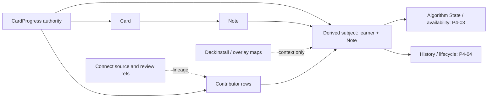

# Phase 4 — Learner/Note identity, fan-in and revision ADR

> Date: 2026-09-10 | Mode: DESIGN | Decision: P4-D4-1
>
> Status: PROPOSED / PROVISIONAL — repository-grounded contract; acceptance is blocked by current P4-01 MySQL evidence and the joint P4-02/P4-03/P4-04 review
>
> Runtime change: none | Schema change: none | Operational authority: `CardProgress`
>
> Primary evidence: `models/`, `migrations/`, `app/services/`, `app/repositories/`, focused tests and the read-only P4-01 audit

This ADR fixes the logical contract that P4-05 must translate into physical MySQL storage. It does not authorize a model, migration, backfill, mirror writer or Phase 5 authority cutover.

## 1. Executive summary and landscape map

The proposed direction is a lockable learner/Note envelope with explicit contributor rows. The logical subject key is exactly `(learner_user_id, logical_note_id)`, where `logical_note_id` is the current `Note.id` reached through `CardProgress.card_id -> Card.note_id`. Deck, Template, install, source owner and external IDs are context or provenance, not components of progress identity.

`CardProgress` remains the only operational state and conflict authority throughout Phase 4. A Note envelope therefore has two derived counters with deliberately narrow meanings:

- `subject_generation` fences contributor-set and lifecycle discontinuities such as first materialization, reset, delete, Card add/remove and clone rekey;
- `mirror_revision` versions successful writes to the derived projection and is never substituted for a Card-level scheduler revision.

Every current contributor retains its own progress/Card identity, revision, raw-state hash, semantic-state hash, event pointer and external provenance. A fan-in group may be mirrored only when every supported contributor has the same semantic current state. Distinct lineage is preserved as multiple contributors and does not select a winner. Divergent state is quarantined; no latest timestamp, maximum counter, maximum revision or average state may be used for ordinary fan-in.



## 2. Systems of record and ownership inventory

| Entity / material | Classification | Identity / ownership | Current writer | P4-D4-1 treatment |
|---|---|---|---|---|
| `CardProgress` | authoritative mutable current state | unique learner/Card by model contract | native review, session/worker, Connect snapshot/import, reset and cutover | never replaced or read through the mirror in Phase 4 |
| `Card` | authoritative presentation projection | UUID Card; exactly one Note and one Template | authoring/import/cutover lifecycle | resolves a contributor to its logical Note |
| `Note` | authoritative content identity | UUID Note; source author or installer may own content | authoring/import/overlay services | `Note.id` is the logical Note component of the subject key |
| `DeckInstall`, `DeckCloneDeckMap`, `DeckCloneAddedNote` | authoritative overlay/context mapping | install belongs to learner; source and local deck/note mappings remain distinct | marketplace/overlay services | classifies access context but never changes subject identity |
| `ReviewEvent` | immutable history/analytics fact | learner + detached Card identity; no Card FK | native recorder and Connect revlog import | referenced per contributor; never used to rebuild current state |
| `ConnectSourceCardRef`, `ConnectSourceNoteRef`, `ConnectReviewEventRef` | authoritative external identity/provenance | learner + source key + external identity | Connect import/sync | stored as zero-to-many lineage evidence, not collapsed to one pointer |
| learner/Note envelope | proposed derived coordination/projection | `(learner_user_id, logical_note_id)` | future P4 mirror/backfill only | lock/fence/status owner; not a scheduler authority |
| contributor material | proposed derived evidence | subject + authoritative `CardProgress.id` / `Card.id` | future P4 mirror/backfill only | lossless accounting of every current authority row |

## 3. Domain invariants

1. **Authority:** Phase 4 reads and writes scheduler decisions through `CardProgress` only. A shadow status or counter cannot accept, reject or order a review.
2. **Identity:** one logical subject is one learner and one current `Note.id`. `Template.id`, `Card.id`, deck/install scope and source owner never split that subject.
3. **Overlay purity:** the learner is `CardProgress.user_id`; a source Note author is not silently treated as the learner. Source Notes/Cards are not copied or mutated by the mirror.
4. **Complete accounting:** every `CardProgress` row is represented by a contributor, quarantine or unresolvable disposition. No row/value disappears because it cannot be mapped.
5. **No silent merge:** ordinary fan-in has no winning Card. A subject projection exists only when semantic current state is unique across all supported contributors.
6. **State and lineage separation:** semantic-state equality, exact raw equality and lineage equality are independent claims. Different event/source lineage never becomes evidence of state divergence by itself.
7. **Monotonic fencing:** reset, delete, rekey and contributor topology changes advance a durable subject generation so stale backfill cannot resurrect an older view.
8. **Atomicity:** when mirror writing is enabled, expected domain ambiguity commits an audited quarantine with the valid authoritative write; unexpected mirror/codec/storage failure raises and rolls back the existing transaction or savepoint.
9. **No fabricated state:** a Note with no current `CardProgress` has `NO_CURRENT_PROGRESS`; backfill does not manufacture a default scheduler state.
10. **No Phase 5 semantics:** derived generation/revision is not an API conflict token and does not authorize Note-level scheduling or Algorithm switching.

## 4. Logical identity and cardinality contract

### 4.1 Canonical subject

```text
subject = (learner_user_id := CardProgress.user_id,
           logical_note_id := Card.note_id)
```

The tuple is the relational identity. A digest may be emitted for redacted audit samples, but a hash must not be the sole stored identity. IDs are compared using their database/FK identity; no trim, case-fold or content-fingerprint rewrite is allowed. P4-05 must choose physical collation and deterministic binary lock ordering after current MySQL collation evidence is available.

### 4.2 Context classification

Context is a set of evidence, not part of the key and not necessarily mutually exclusive.

| Context membership | Evidence | Learner | Logical Note |
|---|---|---|---|
| owned | `Note.user_id == CardProgress.user_id` | progress user | current `Note.id` |
| installed source | a logical-overlay `DeckInstall.user_id` matches the progress user and the Note deck is an install source deck, including child mappings | installer | source `Note.id` |
| installed local-added | `DeckCloneAddedNote` links the Note to the learner's install | installer | local-added `Note.id` |
| multi-context | more than one rule is true | progress user | same current `Note.id` |
| unclassified | Card/Note exists but no approved ownership/install relation is found | progress user | current `Note.id`; quarantine pending disposition |

If one learner reaches the same source Note through multiple install contexts, the current authority still has one learner/Card row. Adding `deck_install_id` to the subject key would invent independent state that does not exist today. Different learners sharing one source Note have different subjects because the learner component differs.

### 4.3 Cardinality

- one learner has zero-to-many subjects;
- one Note has zero-to-many learner subjects;
- one subject has zero-to-many current contributors;
- one valid contributor resolves exactly one `CardProgress` and one `Card`;
- one Card belongs to exactly one Note/Template under the model contract;
- one contributor may have zero-to-many Connect source references and zero or one latest-event pointer;
- one pointed ReviewEvent may have zero-to-many Connect review references.

## 5. Evidence-grounded findings

### Finding 1 — Current authority is learner/Card while the target subject is learner/Note

- **Observed:** `CardProgress` is unique by `(user_id, card_id)`, `card_id` is nullable in the ORM, and Cards are unique by `(note_id, template_id)`. Multiple Template Cards can therefore contribute to one learner/Note subject.
- **Evidence:** `models/card_progress.py:13`, `models/card_progress.py:52`, `models/card.py:13`, `models/card.py:23`; `app/services/study_phase4_preflight_service.py:724-1073`.
- **Potential concern:** a one-row backfill that picks one Card silently drops state, revision or provenance from sibling Cards.
- **Impact:** current-state divergence can be hidden and a later review can make the chosen row stale without a detectable Note-level conflict.
- **Unknowns:** current MySQL fan-in counts and distributions remain Needs Verification in P4-01.
- **Alternatives Considered:** (A) collapse Cards directly into one JSON row; (B) keep a Note envelope plus explicit contributor rows.
- **Trade-offs:** A reduces joins but makes contributor integrity and lifecycle accounting opaque. B adds rows/joins but supports relational accounting, deterministic locking and reconciliation.
- **Recommendation:** select B; permit a subject projection only when all supported semantic-state hashes are equal.
- **Migration Implications:** backfill must enumerate all contributors before writing a subject and preserve a disposition for every invalid source row.

### Finding 2 — Overlay role is context, not learner/Note identity

- **Observed:** source Notes remain owned by the publisher while installed progress is written for `DeckInstall.user_id`; local-added Notes are linked separately. Child source decks are mapped through `DeckCloneDeckMap`.
- **Evidence:** `models/deck_install.py:20-44`, `models/deck_clone_deck_map.py:13-39`, `models/deck_clone_added_note.py:11-23`; `app/services/study_session_service.py:1424-1488`; `app/services/study_phase4_preflight_service.py:904-1085`.
- **Potential concern:** using `Note.user_id`, local deck or install ID as the learner/subject key would split or misattribute existing authority.
- **Impact:** installed-source progress can be assigned to the publisher, duplicated per install or lost during overlay rebase/cutover.
- **Unknowns:** multi-context rows and overlapping current installs need current MySQL accounting.
- **Alternatives Considered:** (A) key by learner + install + Note; (B) key by learner + Note and retain install/deck roles as context evidence.
- **Trade-offs:** A isolates presentation contexts but contradicts the current learner/Card uniqueness contract. B matches current authority but requires query-time context resolution for availability.
- **Recommendation:** use learner + Note; retain zero-to-many context evidence and let P4-03 resolve effective policy at query time.
- **Migration Implications:** no source Note/Card copy and no context-driven duplicate subject rows.

### Finding 3 — Raw state, semantic state and lineage are different equivalence dimensions

- **Observed:** `CardProgress.last_review_event_id` has an FK to ReviewEvent but database constraints do not prove that the event has the same learner/Card. Connect source IDs are uniquely scoped externally, while local Card/Note targets are not unique and can have multiple refs.
- **Evidence:** `models/card_progress.py:36-42`, `models/review_event.py:10-29`, `models/connect_source_card_ref.py:13-57`, `models/connect_source_note_ref.py:13-52`, `models/connect_review_event_ref.py:19-58`; P4-01 audit v4 pointer/source partitions.
- **Potential concern:** one equality hash either discards lineage or falsely treats different contributor revisions/pointers as scheduler-state divergence.
- **Impact:** future reconciliation cannot distinguish a safe equivalent fan-in from missing or contradictory provenance.
- **Unknowns:** current invalid pointer and multi-ref counts require the secured P4-01 bundle.
- **Alternatives Considered:** (A) one opaque contributor hash; (B) separate raw, semantic, topology and lineage hashes.
- **Trade-offs:** A is compact but not explainable or safely evolvable. B costs more storage/computation but gives bounded drift categories and exact codec ownership.
- **Recommendation:** use separate hashes and retain their source fields; P4-03 owns semantic-state serialization and P4-04 owns lineage completeness.
- **Migration Implications:** P4-06 mapper fixtures must prove canonical serialization and lossless raw preservation independently.

### Finding 4 — Per-Card revision cannot serve as a monotonic Note fence

- **Observed:** native/session/snapshot writers increment a touched Card revision. Reset bulk-deletes progress. Clone cutover can rekey or merge rows and assigns the surviving row `max(local, source) + 1` under the already accepted P1-02 maintenance contract.
- **Evidence:** `app/services/study_service.py:474-581`, `app/services/study_session_service.py:1403-1627`, `app/services/anki_sync_service.py:145-252`, `app/services/deck_management_service.py:214-282`, `app/services/share/cutover.py:164-241`.
- **Potential concern:** `max(CardProgress.revision)` can decrease after reset/delete, stay unchanged when a sibling is added, or change contributor identity during rekey.
- **Impact:** stale backfill can overwrite a post-reset/rekey mirror and appear numerically newer.
- **Unknowns:** production reset/cutover overlap and contributor churn volume are not available from repository evidence.
- **Alternatives Considered:** (A) use max contributor revision as Note revision; (B) preserve the revision vector and add independent subject generation/mirror revision.
- **Trade-offs:** A is cheap but not a lifecycle fence. B adds coordination state but provides a monotonic per-subject CAS and keeps current conflict semantics intact.
- **Recommendation:** use B; do not expose either derived counter as a scheduler conflict token in Phase 4.
- **Migration Implications:** lifecycle paths must retain a fence/tombstone even after current contributors disappear.

### Finding 5 — Coordination must precede contributor locks

- **Observed:** native and session writers currently lock CardProgress rows, sessions lock sorted Cards, external imports use nested savepoints/source-ref locks, and cutover locks local/source progress in deterministic Card order. There is no learner/Note coordination row today.
- **Evidence:** `app/services/study_service.py:417-592`, `app/services/study_session_service.py:1021-1627`, `app/services/anki_sync_service.py:99-269`, `app/services/share/cutover.py:164-241`; P1-02 completion evidence.
- **Potential concern:** two first reviews of sibling Cards can each see only itself and publish incompatible Note projections; adding locks in different orders can deadlock MySQL.
- **Impact:** an apparently atomic mirror can miss a committed sibling or turn rollout into a lock-cycle risk.
- **Unknowns:** final physical key/collation and MySQL execution plans depend on P4-01/P4-05 evidence.
- **Alternatives Considered:** (A) optimistic retry without a coordination row; (B) ensure and lock a unique learner/Note coordination row before progress contributors.
- **Trade-offs:** A avoids a hot row but cannot serialize absent first contributors cheaply. B introduces one lock per affected subject but makes first-create, sibling review and lifecycle fencing deterministic.
- **Recommendation:** use B with globally sorted subject keys and then sorted contributor locks.
- **Migration Implications:** P4-07/P4-08 must adapt each transaction owner without changing its commit/savepoint boundary; MySQL two-connection probes are required before rollout.

## 6. Alternatives and decision

| Alternative | Integrity / reconciliation | MySQL OLTP behavior | Evolution cost | Decision |
|---|---|---|---|---|
| A. One learner/Note row with state and contributor JSON | weak relational identity; difficult per-contributor disposition | fewer joins, but a wider frequently rewritten row and larger JSON redo/locking footprint | easy initial DDL, hard lifecycle/history evolution | rejected |
| B. Lockable envelope plus state and contributor/disposition rows | explicit fan-in, provenance and lifecycle accounting | one narrow coordination lock; extra indexed rows/joins; bounded updates | more initial DDL, safest staged migration | selected provisionally |
| C. Keep only per-Card shadow rows | lossless but does not create the requested Note subject or solve fan-in | closest to current writes | defers rather than resolves Phase 4 identity | rejected |

The selection is provisional until current MySQL evidence confirms key collation, row volumes, fan-in distribution and schema drift. P4-05 owns exact tables, columns, FKs, indexes and retention.

## 7. Contributor and equivalence contract

### 7.1 Minimum contributor vector

For each valid current `CardProgress`, the mirror must retain or be able to reproduce this canonical material:

```text
progress_id
card_id
template_id
progress_revision
raw_progress_hash
semantic_state_hash
last_review_event_id (nullable)
sorted source_card_ref_hashes
sorted source_note_ref_hashes
sorted pointed_review_ref_hashes
contributor_status
```

`raw_progress_hash` covers every persisted `CardProgress` value using the lossless P4-03/P4-06 codec, including nullness and numeric/timestamp representation. `semantic_state_hash` covers only the validated scheduler current state defined by P4-03; it excludes contributor identity, revision, audit timestamps, event pointers and external-reference identities. The source fields remain available for reconciliation; hashes are not a substitute for data retention.

Derived set proofs:

- `contributor_topology_hash`: sorted `(progress_id, card_id, template_id, contributor_status)`;
- `authority_vector_hash`: sorted `(progress_id, card_id, progress_revision, raw_progress_hash)`;
- `lineage_vector_hash`: sorted event/source reference material;
- `subject_state_hash`: the one semantic hash only when all supported contributors agree.

### 7.2 Fan-in matrix

| Source shape | Semantic state | Lineage | Subject disposition | Winner rule |
|---|---|---|---|---|
| no current progress | absent | any history is separate | `NO_CURRENT_PROGRESS`; do not synthesize scheduler state | none |
| one valid contributor | supported | valid or explicitly incomplete | `MIRRORED_SINGLE` | contributor is not a selected winner; it is the complete set |
| multiple contributors | all equal | all equal | `MIRRORED_EQUIVALENT_FANIN` | unique value by equality |
| multiple contributors | all equal | distinct | `MIRRORED_EQUIVALENT_FANIN_DISTINCT_LINEAGE` and retain every lineage | unique state by equality; no event winner |
| multiple contributors | divergent | any | `QUARANTINED_STATE_DIVERGENCE` | prohibited |
| any contributor | unsupported/corrupt | any | typed quarantine | prohibited |
| NULL/missing Card or Note/learner | unresolved | unknown | typed unresolvable ledger | prohibited |

The following ordinary fan-in selectors are forbidden: latest `updated_at`, latest `last_reviewed_at`, maximum revision, maximum reps/lapses, longest interval, queue priority, average numeric state or arbitrary first/last row. The existing P1-02 clone cutover merge rule is a named maintenance transition that mutates `CardProgress`; the mirror records its post-transition authority and old-to-new lineage rather than generalizing that rule to fan-in.

## 8. Generation, revision and backfill fencing

### 8.1 Counter semantics

| Material | Meaning | Advances when | Must not be used for |
|---|---|---|---|
| contributor `progress_revision` | current authoritative optimistic token for one learner/Card | the existing writer performs a material progress change | Note-level winner selection |
| `subject_generation` | monotonic topology/lifecycle epoch for one learner/Note identity | first subject materialization; contributor add/remove/rekey; reset; subject delete/detach | scheduler conflict/API version |
| `mirror_revision` | monotonic version of a successfully finalized derived subject row | any mirror state/status/vector update in the existing transaction | replacing per-Card revision |

The implicit generation/revision for an envelope that has never existed is zero. First materialization writes generation 1 and mirror revision 1. A normal review of an existing contributor keeps generation fixed and increments mirror revision. A topology or lifecycle change increments both. Counter overflow must fail closed; counters never reset or derive from `max(CardProgress.revision)`.

### 8.2 Lifecycle fences

| Event | Generation outcome | Contributor outcome | Required retained evidence |
|---|---|---|---|
| first CardProgress for subject | create generation 1 | add contributor | authority vector |
| new sibling CardProgress | `+1` | add contributor; mirror or quarantine after full recompute | old/new topology hash |
| Card/progress removal while Note remains | `+1` | detach contributor | reason and removed contributor identity |
| progress reset | `+1` | empty current contributor set | `TOMBSTONED_RESET`, prior vector hash and transaction provenance |
| Note/user deletion | `+1` before/during lifecycle unit | detach all contributors | durable detached/tombstone fence for rollout/reconciliation horizon |
| clone local-to-source rekey | increment affected old and new subjects in deterministic order | retain old-to-new contributor transition; reflect only committed post-cutover authority | install/cutover provenance without mutating source content |

P4-04 decides retention and detached/tombstone lifetime; P4-05 must not choose an FK cascade that destroys the required fence before that decision is accepted.

### 8.3 Backfill compare-and-set

A backfill candidate is valid only if, after acquiring the subject lock and locking/re-reading all current contributors:

1. the current `subject_generation` equals the observed generation (zero only for a truly absent envelope);
2. the recomputed contributor topology and authority vector hashes equal the observed candidate;
3. no reset/delete/rekey tombstone or newer mirror revision supersedes the candidate;
4. the exact mapper/state schema versions still match the run contract.

If any predicate fails, the item is stale and is retried from fresh authority; it never overwrites the newer mirror. Backfill never mutates `CardProgress`.

## 9. Lock order and race matrix

### 9.1 Global order

Future mirror-enabled writers must resolve and validate affected subject keys before acquiring progress locks, then use this order inside the transaction/savepoint already owned by the writer:

1. retain any pre-existing transaction-owner lock that must precede the mutation, such as a StudySession/Batch or Connect source-identity row; P4-07/P4-08 must inventory this prefix and prevent reverse acquisition;
2. ensure the coordination row exists using the P4-05-approved unique-key pattern;
3. lock all affected subject envelopes in canonical binary `(learner_user_id, logical_note_id)` order;
4. lock all current `CardProgress` contributors for those subjects in canonical `(card_id, progress_id)` order;
5. perform the existing authoritative mutation and event/source-ref work, then flush final event IDs;
6. recompute the complete contributor vector once per affected subject and finalize mirror/status;
7. let the existing transaction owner commit or roll back.

The mirror coordinator must not acquire a Connect/source lock after acquiring a subject/progress lock if another writer acquires that source lock first. Provenance needed only for projection should be read without adding a reverse locking edge. Exact callsite adaptations belong to P4-07/P4-08.

### 9.2 Race outcomes

| Race | Serialization point | Required outcome |
|---|---|---|
| first progress on the same Card | subject row, then CardProgress unique key | one writer creates; loser reloads or returns the existing typed conflict; no duplicate contributor |
| first progress on sibling Cards of one Note | same subject row | second writer recomputes both contributors and mirrors equality or quarantines divergence |
| different learners on one source Note | different subject rows | no unnecessary cross-learner lock; source Note remains unchanged |
| native review vs session commit | subject then sorted contributor locks, plus existing session revision checks | existing P1-02/P3 conflict behavior remains authoritative; mirror follows only the committed result |
| snapshot vs native review | existing source lock prefix, then subject/progress order | existing local/base snapshot conflict code is unchanged; only an applied state finalizes current mirror |
| reset vs open session | existing session locks, then affected subjects | reset cancels sessions and tombstones subjects; stale session cannot finalize a mirror |
| reset vs valid later direct review | subject lock | commit order defines authority; a post-reset valid review starts a new generation rather than restoring the old vector |
| clone rekey vs review | sorted old/new subjects, then sorted local/source progress | one committed post-cutover vector; old-to-new lineage retained; no source content mutation |
| backfill vs any writer | subject lock and generation/vector CAS | stale candidate retries; writer is never overwritten |
| expected divergence during a valid write | subject lock | authority commits together with quarantine status/evidence |
| unexpected codec/DB/constraint failure | current transaction/savepoint | exception propagates and existing atomic unit rolls back when mirror is enabled |

P4-11 must prove the first-create, sibling-Card, reset/backfill and cutover/review cases using two MySQL connections and bounded lock timeouts.

## 10. Disposition and error code contract

| Code | Class | Authority transaction | Meaning |
|---|---|---|---|
| `MIRRORED_SINGLE` | mirrored | commit | one supported current contributor |
| `MIRRORED_EQUIVALENT_FANIN` | mirrored | commit | multiple supported contributors share semantic state and lineage |
| `MIRRORED_EQUIVALENT_FANIN_DISTINCT_LINEAGE` | mirrored | commit | state is unique by equality; every distinct lineage remains attached |
| `NO_CURRENT_PROGRESS` | lifecycle | commit/no-op | no current authority row; no default state fabricated |
| `QUARANTINED_STATE_DIVERGENCE` | expected quarantine | commit | supported contributors disagree on semantic state |
| `QUARANTINED_UNSUPPORTED_STATE` | expected quarantine | commit | exact state/queue/algorithm schema has no accepted mapper |
| `QUARANTINED_CORRUPT_STATE` | expected quarantine | commit | state violates accepted bounds/null pairing/canonical validation |
| `QUARANTINED_UNCLASSIFIED_CONTEXT` | expected quarantine | commit | Card/Note resolves but learner ownership/install context is not approved |
| `UNRESOLVABLE_NULL_CARD_ID` | source disposition | backfill ledger only | authority row cannot resolve a Card key |
| `UNRESOLVABLE_MISSING_CARD` | source disposition | backfill ledger only | referenced Card does not exist |
| `UNRESOLVABLE_NULL_NOTE_ID` | source disposition | backfill ledger only | resolved Card lacks a Note key |
| `UNRESOLVABLE_MISSING_NOTE` | source disposition | backfill ledger only | referenced Note does not exist |
| `UNRESOLVABLE_MISSING_LEARNER` | source disposition | backfill ledger only | learner FK target is absent under actual schema drift |
| `TOMBSTONED_RESET` | lifecycle fence | commit | current contributors were intentionally reset |
| `TOMBSTONED_SUBJECT_DELETED` | lifecycle fence | commit | learner/Note identity was deleted or detached |
| `DETACHED_CONTRIBUTOR_DELETED` | lifecycle transition | commit | one contributor disappeared while subject may remain |
| `REKEYED_CLONE_CUTOVER` | lifecycle transition | commit | old contributor/subject maps to committed source identity |
| `MIRROR_INTERNAL_ERROR` | unexpected failure | rollback | codec, constraint, storage or invariant failure; not converted to quarantine |

Expected quarantine is a domain result that the mapper can classify deterministically. Catching an arbitrary exception and labeling it quarantine is forbidden because it would let a valid authority commit without a trustworthy audit outcome.

## 11. P1-02 compatibility mapping

P4-D4-1 consumes the accepted external conflict contract; it does not reopen priority rules.

| Existing authoritative outcome | P4 mirror action |
|---|---|
| `PROGRESS_APPLIED`, `FORCED_PROGRESS_APPLIED` | finalize the affected subject after final progress/source-ref values are flushed |
| `PROGRESS_UNCHANGED`, `PROGRESS_STALE` | no current-state mirror revision; P4-04 may account for provenance/session metadata |
| `LOCAL_PROGRESS_CHANGED`, `SOURCE_SNAPSHOT_CHANGED`, `AMBIGUOUS_PROGRESS_ORDER`, `CONCURRENT_PROGRESS_WRITE`, `ANKI_DUE_UNRESOLVED` | no current-state mirror mutation because no authoritative progress state applied |
| native/session `CARD_PROGRESS_CONFLICT`, `SESSION_NOT_OPEN` | no mirror mutation |
| Anki revlog imported/repaired/unchanged | history/provenance handling only under P4-04; never rebuild current state |
| progress reset | advance generation and write `TOMBSTONED_RESET` in the reset transaction |
| clone cutover rekey/merge | mirror only the committed P1-02 post-cutover `CardProgress`; retain the old-to-new transition |

## 12. Worked identity examples

### Owned Note with two Templates

Learner 7 owns Note `N1`; Cards `C1/T1` and `C2/T2` both have progress. The subject is `(7, N1)`. Both contributors remain. If semantic hashes match, the state is mirrored by equality; if the next review updates only `C1` to a different semantic state, the authoritative review commits and the subject becomes `QUARANTINED_STATE_DIVERGENCE`.

### Installed source Note

Publisher 2 owns source Note `N2`; learners 7 and 8 install the overlay and review source Card `C3`. Subjects `(7, N2)` and `(8, N2)` are independent. Publisher ownership and each `DeckInstall.id` are context; the mirror never edits `N2` or `C3`.

### Installed local-added Note

Learner 7 adds Note `N3` under an install and `DeckCloneAddedNote` records it. Subject `(7, N3)` uses the local Note identity. It is not collapsed into a source Note merely because it appears in the same local deck tree.

### Reset followed by a new review

Reset locks/cancels affected sessions, deletes current progress and advances the subject generation with `TOMBSTONED_RESET`. A later valid direct review creates a new contributor in the next generation. A backfill candidate observed before reset fails the generation/vector fence.

### Legacy clone cutover

Cutover from learner-local Note/Card to source Note/Card locks both affected subject identities and contributor rows in deterministic order. The existing P1-02 rule determines the committed authoritative progress. The mirror tombstones/rekeys the old identity, materializes the source identity and retains the transition; it does not reuse the maintenance merge rule for ordinary fan-in.

## 13. MySQL OLTP physical evaluation

- The envelope should be narrow because it is the serialization point for every write affecting a learner/Note. State JSON and contributor/provenance material should not enlarge that hot row.
- P4-05 must prove a unique learner/Note key and an idempotent first-create pattern that allows `SELECT ... FOR UPDATE` to lock an existing row. It must evaluate duplicate-key handling, InnoDB next-key behavior and transaction isolation on disposable MySQL.
- Deterministic lock order must not depend on the server's case-insensitive collation. Current charset/collation and actual UUID shape are still P4-01 evidence inputs.
- Contributor rows permit relational uniqueness and bounded per-row updates, at the cost of joins and write amplification. Reconciliation benefits outweigh the extra rows for Phase 4 safety.
- A direct cascading FK from envelope to Note may erase a required delete/backfill fence. Exact FK/delete behavior is deferred to the joint P4-04/P4-05 decision.
- Source/event references are zero-to-many. P4-05 must avoid a scalar external-ID column that would silently discard multiple Connect mappings.
- No index shape, JSON type, counter type or retention partition is approved by this logical ADR.

## 14. Staged migration and cutover implications

1. **Expand — P4-05/P4-06:** after all gates, add only the reviewed envelope/contributor/state/disposition structures and exact codecs. Flags default off; pre-Phase4 upgrades must not depend on `db.create_all()`.
2. **Mirror — P4-07/P4-08:** adapt each existing transaction owner to the approved lock order and finalize once per affected subject. Keep `CardProgress` reads/writes unchanged.
3. **Backfill — P4-09:** dry-run first, then resumable keyset batches with generation/vector CAS and typed disposition. No authority writes.
4. **Reconcile — P4-10/P4-11:** require full source accounting, no unexplained differences and MySQL race/restart proof. Rollback disables mirror/comparison flags while retaining additive evidence.
5. **Contract:** no destructive schema contraction and no authority cutover in Phase 4. Any Phase 5 use of Note progress requires separate authorization and a new contract.

## 15. Open questions and acceptance gates

### Needs Verification from P4-01

- current MySQL single/fan-in counts and all four state/lineage fan-in quadrants;
- NULL/orphan/missing-learner and unclassified/multi-context rows;
- actual key collation, UUID casing/shape, FK/delete actions and Alembic head;
- reset/cutover/import volume and active session/batch/import exposure;
- independent `study_session_batches` migration provenance.

### Joint decisions still required

- P4-03 must define the exact semantic-state fields, canonical raw/state codecs and supported/corrupt boundary before equivalent fan-in can leave provisional quarantine.
- P4-04 must define external lineage completeness, tombstone/detached retention and purge behavior.
- P4-05 must choose the physical schema only after P4-01 evidence and the three logical ADRs are accepted together.

### Provisional review result

- identity, authority boundary and no-winner rule: **ready for cross-review**;
- contributor/vector and counter semantics: **ready for cross-review**, exact hashes depend on P4-03/P4-04;
- lock/race contract: **ready for implementation planning**, MySQL proof pending;
- P4-02 overall: **not Accepted** while P4-01 external evidence and joint ADR gates remain open.

## 16. Rollback

This change is documentation-only. The ADR may be superseded before P4-05. After physical rollout, any identity/generation change requires a new additive migration and reconciliation plan; existing shadow evidence must not be rewritten destructively.
