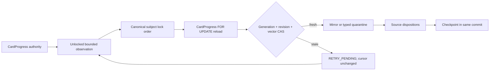

# Phase 4 — Resumable current-progress backfill verification

> Date: 2026-09-14 | Mode: DESIGN / IMPLEMENTATION VERIFICATION | Engine: MySQL 8 OLTP
>
> Operational authority: `CardProgress` | Runtime flags: default off | Production execution: not authorized

## 1. Outcome

P4-09 adds a separate dry-run-first `study-progress-backfill` CLI backed by a transaction-owning service and transaction-neutral repository. Apply mode materializes the already-approved P4-06 learner/Note shadow schema from current `CardProgress` rows only. It never replays `ReviewEvent`, creates a synthetic Note, serves a shadow read, or mutates source progress/content.

The implementation freezes one `CURRENT_PROGRESS` run contract and traverses its `CardProgress.id` high-water bound with keyset pagination. A batch advances its checkpoint only in the same commit as subject/contributor projection and one disposition per selected source row.



## 2. Invariants implemented

1. `CardProgress` remains the only scheduler state/conflict authority.
2. Apply requires both `STUDY_PROGRESS_SHADOW_BACKFILL_ENABLED=true` and `STUDY_PROGRESS_SHADOW_WRITE_ENABLED=true`; dry-run requires only the explicit backfill gate and writes no row.
3. One source scan uses `CardProgress.id > last_source_id AND id <= high_water_id ORDER BY id LIMIT 250`; OFFSET is unsupported.
4. One batch contains at most 250 source rows and 100 learner/Note subjects.
5. All subjects are locked in canonical `(learner_user_id, logical_note_key bytes)` order before current contributor locks.
6. Candidate generation, mirror revision, source identity/revision/raw hash and the complete authority vector must still match after locking.
7. ORM values read before a concurrent commit are expired before locking reads. CAS hashes are calculated from the actual locked `CardProgress` objects, not a MySQL repeatable-read snapshot.
8. Expected unsupported/corrupt/divergent/unclassified cases become typed quarantine. NULL/missing Card/Note/learner cases become source-only unresolvable dispositions.
9. Stale batches write `RETRY_PENDING` without advancing the checkpoint, then retry from fresh authority. Retained lifecycle evidence converts a source removed during reset/delete/rekey to the named lifecycle disposition.
10. Unexpected exceptions rollback mirror and disposition changes, mark the run/checkpoint failed in a separate bounded diagnostic commit, and remain resumable.
11. Every exported sample contains only a truncated identity digest, disposition and reason. Note field values, rendered content, credentials and connection strings are excluded.

## 3. Design alternatives and trade-offs

### Alternative A — Direct bulk INSERT/UPDATE from `CardProgress`

- **Observed:** SQL bulk projection would reduce round trips.
- **Potential concern:** it cannot reuse the accepted lossless Python codec, preserve pointer/external lineage, classify semantic fan-in, or participate in the subject-before-contributor lock protocol.
- **Impact:** a concurrent review/reset/rekey could be overwritten by a stale bulk result.
- **Recommendation:** rejected.

### Alternative B — Reuse the transactional mirror coordinator behind a fenced batch owner

- **Observed:** P4-07/P4-08 already centralize contributor/state/availability/lineage materialization without owning commit.
- **Trade-offs:** each batch performs more reads and row locks, but preserves one codec, one fan-in policy and one lifecycle topology contract across live writers and historical projection.
- **Recommendation:** selected. The backfill service owns batching/run/checkpoint/disposition transactions; the existing mirror coordinator owns projection details.

### Alternative C — Rebuild current state from `ReviewEvent`

- **Observed:** history can be incomplete, snapshot-only, mixed, repaired or detached.
- **Impact:** replay would invent authority and violate the accepted P4-04 completeness contract.
- **Recommendation:** rejected. P4-09 reads current `CardProgress`; history comparison remains P4-10 scope.

## 4. Evidence-grounded findings

### Finding 1 — MySQL ORM identity refresh is part of the CAS contract

- **Observed:** the first disposable MySQL race exposed that an ORM object loaded during unlocked observation could survive a second connection's committed generation change even when the later SQL used `FOR UPDATE`.
- **Evidence:** `app/services/study_progress_backfill_service.py` expires observation state immediately before `prepare_mirror_scopes`; the locked authority digest is built from `NativeMirrorPlan.locked_progress_by_card_id`.
- **Potential concern:** without the refresh, the service could compare a fresh SQL lock with a stale SQLAlchemy identity-map value.
- **Impact:** stale generation acceptance or a duplicate `(subject_id, generation, source_progress_id)` insert.
- **Unknowns:** production transaction isolation is deployment-specific; the fix does not depend on lowering isolation.
- **Alternatives Considered:** populate every individual query versus expiring the bounded observation set before the global lock phase.
- **Trade-offs:** expiration may reload a few job rows, while centrally guaranteeing current-read semantics for at most 250 sources/100 subjects.
- **Recommendation:** expire before locks and hash only locked authority rows.
- **Migration Implications:** none; this is transaction behavior over additive tables.

### Finding 2 — Source disappearance is fail-closed

- **Observed:** a source observed by a stale batch is retained as `RETRY_PENDING`; reset/delete/rekey can then be resolved through retained subject/contributor lifecycle evidence.
- **Evidence:** `app/repositories/study_progress_backfill_repository.py::load_retry_dispositions`, `latest_contributor_for_source`; `app/services/study_progress_backfill_service.py::_terminal_missing_retry`.
- **Potential concern:** a source deleted after run creation but before any candidate observation has no retry identity in that run.
- **Impact:** final source accounting refuses `COMPLETED` rather than guessing a deleted identity; an operator must retain the failed run and start a fresh versioned run after the lifecycle settles.
- **Unknowns:** production mutation volume during the short run-start-to-first-read window requires P4-11 measurement.
- **Alternatives Considered:** one unbounded source-freeze transaction versus bounded batches with explicit final accounting.
- **Trade-offs:** a global freeze would improve point-in-time enumeration but violate the initial small-transaction/low-lock objective. Bounded fail-closed execution avoids a long authority-table lock.
- **Recommendation:** retain the bounded fail-closed behavior for P4-09; P4-11 must measure whether an operational quiet window or a later source-manifest expansion is necessary.
- **Migration Implications:** none for P4-09; additive manifest storage would require a separately reviewed expand migration.

## 5. Implementation map

| Area | File | Responsibility |
|---|---|---|
| CLI | `app/cli.py` | dry-run default, explicit apply/resume/max-batches, compact redacted JSON |
| service | `app/services/study_progress_backfill_service.py` | immutable run contract, transaction batches, CAS, retry/fault boundaries, accounting |
| repository | `app/repositories/study_progress_backfill_repository.py` | keyset source reads, outer-join resolution, context proof, run/checkpoint/disposition persistence |
| existing coordinator | `app/services/study_progress_shadow_mirror_service.py` | exact contributor/state/availability/lineage projection under acquired locks |
| tests | `tests/test_study_progress_backfill.py` | dry-run, accounting, fault rollback, resume/idempotency and races |
| MySQL proof | `scripts/probe_phase4_resumable_backfill_mysql.py` | disposable migration, crash/resume and two-connection races |

## 6. Verification evidence

Focused SQLite verification:

```text
python -m unittest tests.test_study_progress_backfill -v
10 tests passed
```

Broad modular backend verification:

```text
python scripts/run_tests.py --module study,database,cli,connect_mcp,decks --backend-only
611 tests across 66 files passed in 218.74s
```

Disposable MySQL command:

```text
python scripts/probe_phase4_resumable_backfill_mysql.py
```

Verified twice after the repeatable-read fix:

- migration `20260913_000038 -> 20260913_000039`;
- dry-run creates no run or shadow row;
- injected checkpoint failure commits neither mirror, disposition nor cursor;
- the failed run resumes and reaches exact source accounting;
- replaying a completed run changes neither disposition cardinality nor mirror revision;
- a second connection adds a sibling contributor between observation and lock; stale CAS retries, generation becomes `2`, both contributors remain and divergence is quarantined;
- a second connection resets all four progress rows between observation and lock; the run resumes to four `TOMBSTONED_RESET` dispositions;
- a second connection deletes a Card/Note after observation but before lock; the run retries once and completes with one `TOMBSTONED_SUBJECT_DELETED` disposition and no surviving authority row;
- all three races finish without timeout/deadlock.

## 7. Rollback and remaining gate

Immediate rollback is to leave `STUDY_PROGRESS_SHADOW_BACKFILL_ENABLED=false` and/or `STUDY_PROGRESS_SHADOW_WRITE_ENABLED=false`. Existing run/checkpoint/disposition and lifecycle evidence is retained. `CardProgress` product reads and writes are unchanged.

P4-10 now owns full current-state, availability, provenance and scheduler comparison. P4-11 still owns representative-volume timing, EXPLAIN, operational quiet-window/source-manifest decision, backup/restore and rollout rehearsal. No production execution, commit, push, merge, shadow read authority or Algorithm switch is authorized by this result.
