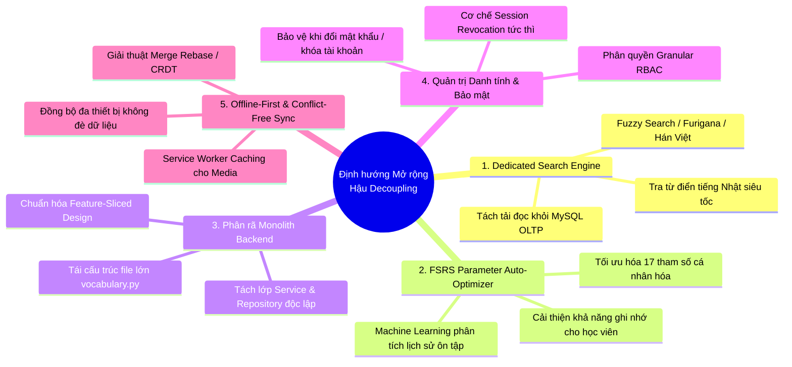

# Flama Post-Decoupling Architectural Horizons & Recommendations

> **Trạng thái:** Đề xuất & Định hướng tham khảo dài hạn (Future Horizons & Long-term Proposals)  
> **Ngày khởi tạo:** 2026-08-24  
> **Phạm vi:** Các bài toán kiến trúc **nằm ngoài phạm vi đợt Decoupling**, dành cho giai đoạn mở rộng tiếp theo khi ứng dụng tăng trưởng quy mô.  
> **Lưu ý:** Tài liệu này **không lặp lại các quyết định đã chốt trong đợt Decoupling** (như mô hình Template Decoupled, Bảo lưu Tiến độ Note, 4 nút, Prompt đổi tên field, Payout duyệt thủ công hay Retention 30 ngày). Mọi đề xuất dưới đây chỉ mang tính định hướng kỹ thuật cho tương lai, cần được Agent điều tra sâu và có sự phê duyệt từ Nhà phát triển khi có nhu cầu thực tế.

---

## 1. TỔNG QUAN CÁC TRỤC KIẾN TRÚC DÀI HẠN

Sau khi đợt Decoupling hoàn thành việc tái cấu trúc lõi học tập (Core Study, Tiến độ, Template, Action/Trigger), hệ thống Flama sẽ bước vào giai đoạn vận hành ổn định. 

Để chuẩn bị cho giai đoạn tăng trưởng quy mô tiếp theo (Scale-up), tài liệu này tập trung vào **5 bài toán kiến trúc độc lập**:

---

## 2. CHI TIẾT 5 ĐỀ XUẤT KIẾN TRÚC DÀI HẠN

### Đề xuất 1: Tích hợp Dedicated Search Engine (Meilisearch / Typesense)
* **Bối cảnh:** Hiện tại việc tìm kiếm từ vựng thực hiện trực tiếp trên MySQL qua Generated Columns có Index. Giải pháp này đáp ứng tốt cho quy mô vừa và nhỏ.
* **Định hướng tương lai:** Khi Flama phát triển thành từ điển tra cứu chuyên sâu hoặc kho từ vựng toàn hệ thống vượt $> 100.000$ từ:
  * Triển khai một Search Engine chuyên dụng siêu nhẹ như **Meilisearch** hoặc **Typesense** chạy song song bên cạnh MySQL.
  * Hỗ trợ tìm kiếm mờ (Typo-tolerance), tìm kiếm đồng thời theo Kanji, Hiragana, Romaji, Hán Việt và dịch nghĩa với độ trễ $< 5$ ms.
  * Tách tải tìm kiếm (Read workload) ra khỏi database giao dịch MySQL.

---

### Đề xuất 2: FSRS Parameter Auto-Optimizer (Bộ tối ưu hóa Machine Learning)
* **Bối cảnh:** Đợt Decoupling đã thiết lập sẵn cơ chế cho phép tính toán chu kỳ Spaced Repetition theo thuật toán FSRS.
* **Định hướng tương lai:** 
  * Xây dựng Background Worker định kỳ phân tích dữ liệu lịch sử ôn tập của từng người học (hoặc từng Deck cụ thể).
  * Chạy thuật toán tối ưu hóa (FSRS Optimizer) để tự động điều chỉnh 17 trọng số tham số ghi nhớ cá nhân hóa cho từng học viên, giúp tối đa hóa khả năng lưu giữ kiến thức với số lượt ôn tập ít nhất.

---

### Đề xuất 3: Tái cấu trúc Phân rã Monolith File [`app/routes/vocabulary.py`](file:///d:/Project/nihongo/app/routes/vocabulary.py)
* **Bối cảnh:** File `vocabulary.py` hiện là module lớn nhất của ứng dụng, chứa đan xen giữa Browse, Deck Tree, Study, logic Clone-aware và các stub lỗi `410` cũ.
* **Định hướng tương lai:** 
  * Phân rã triệt để file này thành các module độc lập theo Domain-Driven Design / Clean Architecture:
    * `app/api/v1/browse/` (Chỉ quản lý tra cứu, bộ lọc, phân trang danh sách thẻ)
    * `app/api/v1/decks/` (Quản lý cấu trúc cây thư mục Deck)
    * `app/services/vocabulary/` (Xử lý nghiệp vụ từ vựng thuần túy)
  * Giúp mã nguồn dễ bảo trì, dễ viết unit test độc lập và tránh xung đột code khi nhiều lập trình viên cùng phát triển.

---

### Đề xuất 4: Quản trị Danh tính & Thu hồi Session tức thì (Hard Session Revocation)
* **Bối cảnh:** Hiện tại việc khóa tài khoản (`is_disabled = True`) hoặc đổi mật khẩu chưa tự động hủy bỏ các session cookie cũ đang hoạt động trên trình duyệt.
* **Định hướng tương lai:** 
  * Bổ sung cơ chế `token_version` trên bảng User hoặc kiểm tra trạng thái active trực tiếp trong hàm `load_user` của `Flask-Login`.
  * Đảm bảo khi Admin khóa tài khoản hoặc người dùng bấm "Đăng xuất khỏi tất cả thiết bị", toàn bộ các phiên đăng nhập cũ sẽ bị vô hiệu hóa ngay lập tức.

---

### Đề xuất 5: Cơ chế Offline-First & Đồng bộ Không Xung đột (Conflict-Free Sync)
* **Bối cảnh:** Hiện tại ứng dụng đã hỗ trợ học batch offline trong phiên 24h trên trình duyệt.
* **Định hướng tương lai:** 
  * Nâng cấp lên trải nghiệm PWA hoàn chỉnh: Tự động cache âm thanh, hình ảnh qua Service Worker để học không cần mạng trong nhiều tuần.
  * Áp dụng giải thuật Rebase / CRDT để khi người dùng học trên điện thoại lúc offline rồi về nhà mở máy tính học tiếp, dữ liệu từ các thiết bị sẽ tự động ghép nối (merge) mượt mà mà không bao giờ bị đè mất lượt học của nhau.

---

## 3. MA TRẬN ĐÁNH GIÁ & ĐIỀU KIỆN KÍCH HOẠT

| Đề xuất | Mục tiêu chính | Độ phức tạp | Điều kiện Kích hoạt Điều tra |
|---|---|:---:|---|
| **1. Phân rã `vocabulary.py`** | Làm sạch mã nguồn, chuẩn hóa kiến trúc | Vừa | Khi có đợt Refactor Backend / Mở rộng API |
| **2. Session Revocation (Bảo mật)** | Chặn truy cập trái phép tức thì | Thấp | Trong đợt rà soát an ninh hệ thống |
| **3. FSRS Auto-Optimizer** | Tối ưu hóa chu kỳ nhớ cho học viên | Vừa - Cao | Khi lượng dữ liệu ôn tập của người dùng đủ lớn |
| **4. Offline-First PWA & Sync** | Trải nghiệm học mượt mà trên Mobile | Vừa - Cao | Khi đẩy mạnh ứng dụng di động / PWA |
| **5. Dedicated Search (Meilisearch)** | Tra từ điển siêu tốc $< 5$ ms | Cao | Khi kho từ vựng toàn sàn $> 100.000$ từ |

---

## 4. NGUYÊN TẮC THẨM ĐỊNH & TRIỂN KHAI

1. **Không triển khai tràn lan:** Các đề xuất trên chỉ được xem xét khi có nhu cầu nghiệp vụ thực tế hoặc khi hệ thống đạt đến ngưỡng tải tương ứng.
2. **Quy trình chuẩn mực:** Mỗi đề xuất khi được kích hoạt sẽ bắt đầu bằng 1 bản kế hoạch điều tra độc lập (`INVESTIGATE` mode) từ Agent chuyên trách, sau đó trình Nhà phát triển phê duyệt trước khi viết code.
