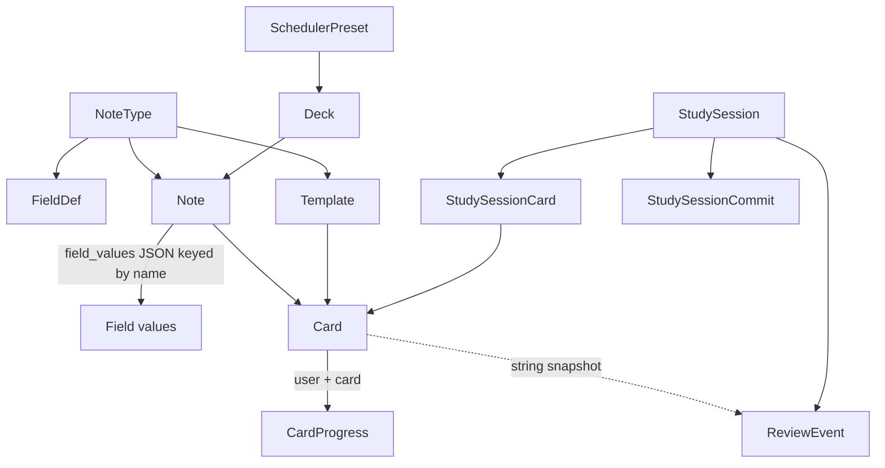
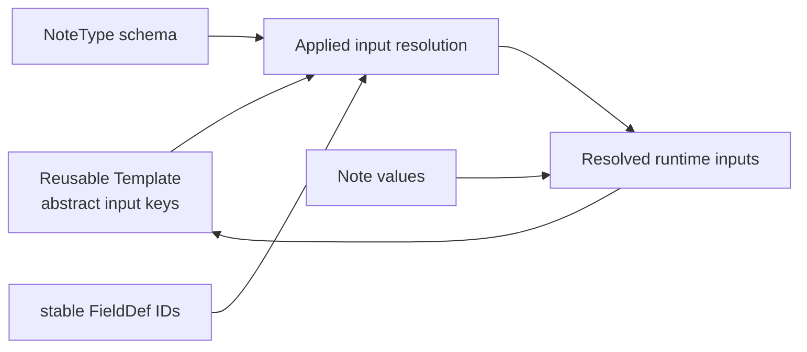
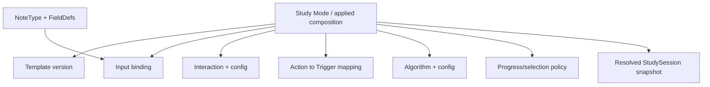
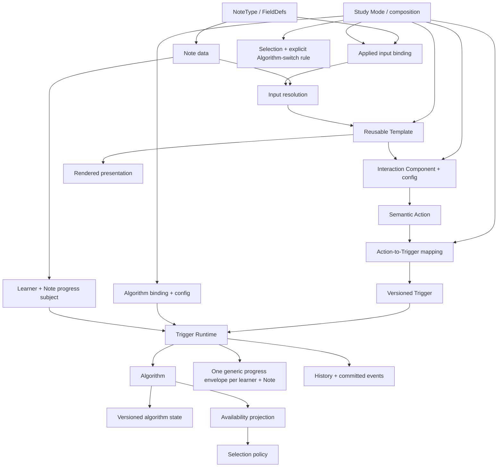
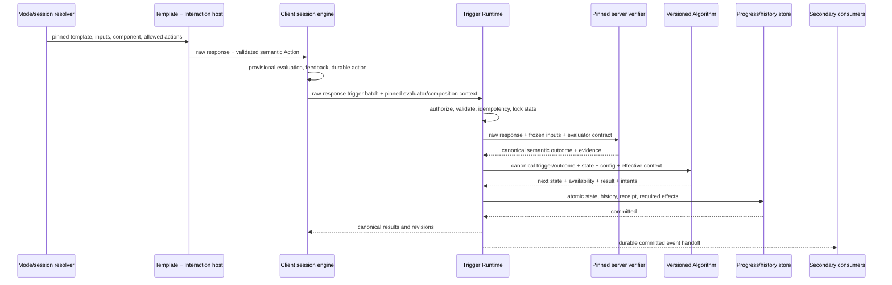

# Study, Interaction, Trigger, Algorithm, and Progress Architecture Plan

Status (2026-09-21): active staged refactor. Phases 0–4 and INT-01/INT-02 are [complete for pre-release development](./phase-4-int02-closeout-2026-09-20.md). Phase 4 code through P4-10 is committed on `develop` at `263b65e`; [P4-11](./phase-4-p4-11-pre-release-closeout-2026-09-20.md) closed with explicit production load/fault/limit deferrals. The last read-only VPS follow-up observed production Alembic head `20260913_000039`; that is not a fresh P5 preflight. `CardProgress` remains the only operational progress authority; the shadow has no product read authority and all Phase 4 flags default off. Phase 5 has begun with [partial inventory](./phase-5-p5-00-inventory-2026-09-21.md) and a [LEGACY-only additive authority-fence schema](./phase-5-authority-fence-adr-2026-09-21.md), not a NOTE cutover. The owner-directed production canary in the [P5 plan](../task/decoupling/P5_EXECUTION_PLAN_2026-09-20.md) still requires P5-09/G5-P technical gates. Phases 6–9 have not started. See the [P1/P2 closeout](../task/decoupling/completed/P1_P2_EXECUTION_CLOSEOUT_2026-09-08.md), [Phase 3/INT-01 closeout](../task/decoupling/completed/PHASE_3_AND_INT_01_CLOSEOUT_2026-09-09.md), [current-state preflight](./phase-4-current-state-preflight-2026-09-10.md), [joint acceptance](./phase-4-logical-contract-joint-acceptance-2026-09-13.md), [P4-05 physical schema ADR](./phase-4-physical-shadow-schema-adr-2026-09-13.md), [Phase 4 execution plan](../task/decoupling/P4_EXECUTION_PLAN_2026-09-10.md), and [latest rehearsal](./phase-4-reconciliation-rollout-rehearsal-2026-09-20.md).

Detailed work items, dependencies, required outputs, and acceptance gates are maintained in [`docs/task/decoupling/`](../task/decoupling/README.md).

Last investigated: 2026-08-24

Last planning review: 2026-09-10

## Scope and evidence discipline

This document continues the repository investigations in:

- [`database-architecture-investigation.md`](./database-architecture-investigation.md), especially the Field identity and normalized value plan;
- [`template-notetype-decoupling-investigation.md`](./template-notetype-decoupling-investigation.md), especially reusable Templates, abstract inputs, and applied bindings;
- [`production-architecture-verification-2026-08-24.md`](./production-architecture-verification-2026-08-24.md), for the read-only production schema and data snapshot;
- [`CARD_TEMPLATE_SANDBOX_RENDERER.md`](./CARD_TEMPLATE_SANDBOX_RENDERER.md), for the renderer security boundary;
- [`CLONE_CUTOVER_REPORT.md`](../plans/completed/CLONE_CUTOVER_REPORT.md), for the overlay-only clone invariant.

The repository implementation is the primary source. Existing documents are context, not assumed ground truth. The original investigation made no application, model, migration, API, test, or database changes. A later user-authorized implementation slice changed application/runtime/test code only; it did not add models, migrations, or a second progress store.

Statements are labelled as follows:

- **Observed**: present in the checked-in implementation or tests.
- **Inferred**: a consequence of observed behavior, but not an explicit current contract.
- **Proposed**: a responsibility boundary or migration direction for review.
- **Decision required**: product behavior must be chosen before a safe physical design can be finalized.

This plan intentionally stops before detailed SQL. It follows the requested order: responsibility, identity, ownership, runtime flow, state ownership, lifecycle, extensibility, compatibility, migration, then physical storage.

## Implementation progress snapshot — updated 2026-09-20

`Partial` means that reviewed code exists and its focused tests pass, but every exit condition written for the phase has not yet been satisfied. This avoids treating an adapter seam as the completed target architecture.

| Phase | Status | Implemented evidence | Exit-gate work still open |
|---|---|---|---|
| Phase 0 — evidence and invariants | **Complete** | Read-only audit entrypoint/contract, expanded anomaly inventory, MySQL evidence bundle and immutable behavior baseline are closed in P0-01..P0-04 | none for Phase 0 |
| Phase 1 — runtime boundaries | **Complete** | canonical native transaction, external revision/conflict contract, bounded versioned ReviewEvent provenance and exact Algorithm retirement lifecycle | async production enablement remains a separately contained transport prerequisite, not an active writer |
| Phase 2 — built-in Interaction/Trigger compatibility | **Complete** | owner-token mutex, strict restore/quarantine, one semantic callback, accepted no-bridge keyboard boundary, exact built-in Trigger dispatcher and dual v2/v3 readers | v3 issuance is deliberately flag-off until rollout; async admission is flag-off until its independent readiness gates pass |
| Phase 3 — composition/StudyMode | **Complete; correction gate reclosed** | exactly-one authorized selection, grouped mixed-NoteType discovery, query-first effective-scope filtering, pre-session selector, versioned session snapshot, real `DeckInstall` overlay proof, plus P4-00 immutable-edit/strict-restore correction | Phase 3 has no open gate; physical reusable definition/application storage remains deferred |
| Phase 4 — learner/Note progress and Algorithm State | **Complete for pre-release development; INT-02 closed** | additive schema, atomic mirrors, resumable backfill, read-only reconciliation; full 1,267 backend (2 skipped)/437 frontend tests and fresh disposable MySQL probe pass; `CardProgress` remains authoritative | production fault/load/limit rehearsal explicitly deferred before enablement; no authority cutover |
| Phases 5-9 — authority cutover through contract cleanup | **Not started** | none | all earlier exit gates plus explicit production migration approval |

### Current authority and compatibility

- `CardProgress` remains the only operational source of truth. Additive Phase 4 shadow tables and migration exist, but no second product authority was introduced; shadow flags default off.
- Existing `study-session.v2` commits remain accepted. Capable clients can negotiate `study-session.v3` when its issuance flag is enabled; commit/batch decoders are selected from the pinned session version.
- The server dispatches batch replay by the exact Algorithm key/version frozen in `StudySession`. An unavailable pinned version fails with `ALGORITHM_UNAVAILABLE` instead of silently executing current code.
- The client resolves the same exact Algorithm key/version before answering a session. It upgrades valid legacy v2 events with canonical Action metadata and moves incompatible persisted rows from the active IndexedDB store to a bounded one-row-per-scope quarantine store with explicit evidence-preserving recovery.
- Direct REST and MCP reviews now run through one locked command and stamp Algorithm/version plus the same canonical scheduler-config hash used by batch sessions. They intentionally have no StudySession identity because they are immediate commits rather than leased batches.
- The forged iframe `host_command` path is contained. Keyboard input inside the untrusted renderer remains local; only the parent document maps trusted shortcuts to semantic Actions.
- New sessions resolve exactly one context-qualified composition before opening. Discovery and authorization share effective owned/installed-source/installed-local card semantics, and ambiguous legacy requests fail closed.
- The selected composition and binding fingerprint are stored in the existing session JSON and commit/batch selection cannot switch them. P4-00 prevents same-tab/cross-tab Template or Note changes from rewriting active/pending artifacts, recomputes immutable restore relationships, and rejects batch/config mismatches. Saved authoring changes become visible in the next session.

### Verification evidence

- Phase 3 focused backend: 46 composition/session/exit-gate tests passed; the broader Study backend module passed 151 tests.
- Phase 3 focused frontend: 44 hook/restore tests passed; the pre-session selector is also covered by the full frontend run.
- P4-00 correction: the complete Study backend module passed 154 tests; the complete frontend Study module passed 186 tests; frontend typecheck and lint passed with zero errors.
- Connect/MCP backend: 161 tests across 13 files passed.
- Decks/Flashcards backend: 361 tests across 31 files passed.
- Frontend TypeScript typecheck passed; lint completed with pre-existing unrelated warnings and no errors.
- Final Phase 0–3 integration run: all 119 backend suites passed (1,094 tests, 2 skipped) and all 62 frontend files passed (384 tests).
- Isolated-browser evidence confirms the accepted no-bridge keyboard boundary.
- Shared fixture `tests/fixtures/study/legacy-anki-1.0.0-golden-vectors.json` is consumed independently by `tests/test_study_algorithm_golden_vectors.py` and `legacyEngine.golden.test.ts`; expected results are not calculated by the implementation under test at test runtime.
- Read-only production follow-up through `chung_hostinger_vps`: Alembic `20260826_000021`; zero cross-NoteType Cards, zero missing/multiple Cards per Note, zero Template default/name/position anomalies, zero NULL/orphan progress rows, and zero learner/Note progress/history fan-in groups. Forty-one `open` sessions were expired by timestamp; no session row was older than 30 days. No production mutation was performed.

Detailed production evidence and its limits are recorded in [`production-architecture-verification-2026-08-24.md`](./production-architecture-verification-2026-08-24.md#15-follow-up-read-only-verification--2026-08-27).

## Executive findings

1. **Observed:** the current four-button review flow now exposes one reusable semantic `ReviewAction` callback and exact built-in Trigger identities. The named compatibility adapter still maps these four Actions to the existing scheduler rating protocol; arbitrary Interaction/Trigger systems remain outside Phase 2.
2. **Observed:** the primary React study path already has useful runtime primitives: a self-contained session snapshot, policy hashes, IndexedDB/Web Lock durability mechanisms, optimistic local scheduling, server-authoritative replay, progress revisions, idempotency receipts, and one database transaction per batch commit. Its fallback is not fully durable, as detailed below.
3. **Observed:** Algorithm identity is executable and fail-closed on server and client paths, with explicit active/deprecated/lease-only/retired lifecycle support. Server replay, immediate native review, and React decisions resolve exact `legacy-anki` / `1.0.0`; mismatched or unavailable restored snapshots are quarantined before an answer can be produced.
4. **Observed:** `CardProgress` is the current operational source of truth. `ReviewEvent` is an analytics/audit fact plus a partial transition record and cannot reconstruct exact progress.
5. **Observed:** `CardProgress` mixes generic concurrency/lifecycle concerns, Anki-shaped availability and scheduling state, FSRS fields, user controls, leech outcome/provenance, and query projections. Adding a materially different algorithm would require new fixed columns or misuse of existing ones.
6. **Observed:** `Card` is presentation-bound because its identity is `Note + Template`, and it is also the current durable learning identity because progress and external Anki card references attach to it. **Approved target:** learner progress moves to one shared learning subject per `(learner, Note)`; Card remains a presentation/integration compatibility projection.
7. **Observed:** no existing durable entity cleanly represents the requested composition. `StudySession` is a good resolved runtime snapshot, but it is ephemeral and user-specific; it is not the reusable authoring authority.
8. **Proposed:** preserve distinct responsibilities for Template, Interaction Component, Action, Trigger, Trigger Runtime, Algorithm, Algorithm State, and an applied composition responsibility using the approved domain term **StudyMode**.
9. **Implemented for Phase 2:** the compatibility slice expresses the existing four ratings as semantic Action/Trigger metadata handled by an exact-version dispatcher around the current scheduler while preserving Card IDs, current `CardProgress` behavior, interval previews, offline commits, and clone identity. Async queue admission remains disabled until its separate production readiness gates pass.
10. **Approved:** all Templates/interactions for one Note update the same learner/Note progress; Template edits/deletion preserve progress; Algorithm switching initializes from available review history; the learner chooses an attached Template/application when Study starts; client evaluation is immediate but provisional and the server verifies/replays at batch commit.

## Approved product decisions — 2026-08-24

These decisions supersede the corresponding open alternatives later in the original investigation.

| Area | Approved decision | Architecture consequence |
|---|---|---|
| Progress scope | One shared progress per learner and Note across Flashcard, Listening, Typing, Multiple Choice, and other modes | durable progress identity is `(learner_user_id, note_id)`, not `(learner_user_id, card_id)` or Template |
| Card/Template lifecycle | Template edit, replacement, or deletion preserves 100% of learning progress | Card is no longer the progress owner after cutover; it may remain a render/import/session compatibility identity |
| Algorithm switching | Initialize the new Algorithm from existing review history; do not coerce old fixed state columns into a different Algorithm's state | switching is a versioned history-based initialization operation with provenance/completeness checks |
| Study entry UX | Clicking Study for a Deck/NoteType shows the Templates/applications attached to the relevant NoteType; the learner chooses one before the session opens | a resolved applied-composition identity/version is frozen in StudySession, not only a raw reusable Template ID |
| Interactive evaluation | Client evaluates immediately for zero-latency feedback; server independently verifies/replays and persists at batch commit | client outcome is provisional; raw response, evaluator version, resolved-content identity, and deterministic verification context must be committed |
| Detail retention | StudySession, StudySessionCommit, and detailed execution records are retained for 30 days, aggregated, then cleaned | retention needs explicit record classes, clock, aggregate SoR, reconciliation, and idempotent purge |
| Algorithm replay | Exact executable replay is guaranteed only while the StudySession active lease is valid (currently up to 24 hours) | old executable versions may be retired after all leases using them drain; 30-day row retention does not extend code replay support |
| SharedImage | SharedImageAsset remains independent; Note stores URL/key as generic text with no FK | image disable/delete never cascades into Note content; note-owned MediaAsset remains a separate lifecycle |

### Derived invariants

1. “One progress per Note” means one progress per **learner and Note**. Shared source Notes therefore have independent learner progress rows while retaining source Note identity.
2. A selected Template/application can change presentation and Interaction, but cannot fork or delete that Note's progress.
3. If a mode uses a different Algorithm, selecting it must invoke an explicit Algorithm-switch policy for the shared progress; two mode-specific Algorithms cannot silently own parallel authoritative states for the same learner/Note.
4. Client evaluation must send enough raw evidence for the server to reproduce the outcome. Committing only `correct=true` is not sufficient verification.
5. Session-detail retention and Algorithm replay are separate clocks: rows may remain for 30 days even though the executable replay guarantee ends at commit/expiry.
6. History-based Algorithm switching conflicts with deleting all canonical review history after 30 days. The target must retain compact scheduler-grade history or an Algorithm-neutral initialization summary beyond the detailed-session retention window; ordinary analytics aggregates are insufficient.

---

## 1. Current study and review architecture

### 1.1 Current entity relationships

**Observed:** the current core shape is:



Key facts:

- `Template.note_type_id` is mandatory (`models/template.py:7-22`).
- `Card` has mandatory `note_id` and `template_id` and unique `(note_id, template_id)` (`models/card.py:9-24`).
- Services create a Card for every Template when a Note is added and create Cards for all existing Notes when a Template is added (`app/services/flashcard_content_service.py:1291-1298`, `app/services/flashcards_share_service.py:247-275`).
- Deleting a Template deletes its Cards, which cascades to progress (`app/services/flashcard_content_service.py:682-713`, `models/card.py:18-23`).
- The database does not enforce that a Card's Note and Template belong to the same NoteType; services assume it.
- `Deck` can hold a default `note_type_id` and `scheduler_preset_id`, but no Template subset, input binding, Interaction choice, or mode (`models/deck.py:8-47`).

`Template.is_default` does not select the presentation during study. Cards generated from every Template in scope are included as study candidates, subject to the normal queue/hidden rules; the flag is mainly metadata and a deletion guard.

### 1.2 Primary React study path

The current React page uses durable batch sessions rather than the older single-card endpoint as its primary flow.

```mermaid
sequenceDiagram
    participant UI as StudyPage / useStudySession
    participant API as Study session API
    participant DB as StudySession tables
    participant Render as Sandbox renderer
    participant Local as TS scheduler + IndexedDB
    participant Runtime as Python session commit
    participant Progress as CardProgress / ReviewEvent

    UI->>API: open {scope: deck, scope_id}
    API->>DB: create session and immutable card base states
    API-->>UI: session.v2 snapshot, policies, templates, content
    UI->>Local: select next physical Card
    UI->>Render: render front/back artifacts
    UI->>Local: reveal and freeze four-outcome decision
    UI->>Local: answer rating; update local state and event log
    Local->>Local: persist snapshot/events/undo/pending commit
    UI->>API: commit batch with token/hash/events/final states
    API->>Runtime: validate and replay every rating
    Runtime->>Progress: lock/check revision; write events and final states
    Runtime->>DB: write receipt/audit and commit once
    API-->>UI: canonical receipt and reconciled state
```

**Observed open behavior:**

- `POST /api/study/sessions` accepts `deck` or `note_type` scope. The current React route supplies a deck scope.
- The server loads all Cards in scope, ordered by creation/id, up to 5,000. It does not open only due Cards. The frontend queue policy selects due relearning, due learning, due review, new, then learn-ahead items.
- For every Card, the server resolves effective clone-aware content, Template artifacts, current progress, effective deck/preset options, a scheduler policy hash, base progress revision, and initial state.
- The session is pinned to a 24-hour lease and `study-session.v2` wire format (`app/services/study_session_service.py:54-68,435-631`).
- `StudySessionCard` stores Card membership, scope snapshots, policy hash, initial state, base state hash, and base revision (`models/study_session_card.py:8-56`).
- The server stores scheduler configuration and hashes, but not full Template/content artifacts. Full artifacts live in the returned snapshot and the browser's persisted copy.

**Observed client behavior:**

- The renderer receives all effective field values and FieldDefs, not declared inputs (`frontend/src/features/study/components/CardRendererFrame.tsx:156-171`).
- Reveal is React-local. It freezes scheduler outcomes at reveal time; the later rating click uses that frozen result.
- The scheduler offset represents reveal/decision time, while `duration_ms` spans initial display through rating and therefore includes front and back dwell. Future generic actions must decide whether submit time, reveal time, or both are meaningful.
- The fixed durable event is `{event_id, sequence, card_id, rating, policy_key, scheduler_offset_ms, duration_ms}` (`frontend/src/features/study/types.ts:150-158`). Typed answers, selected options, matching results, audio activity, reveal, and Template actions are not durable events.
- The TypeScript scheduler computes all four outcomes optimistically. Queue state, event log, undo history, and pending commit are stored in IndexedDB (`frontend/src/features/study/session/`).
- Undo only removes the latest uncommitted local event. It is not a compensating domain event and cannot undo a committed review.
- When at least one event is pending, the client rolls over at 50 events or auto-finishes when the queue is complete. Page-exit keepalive likewise requires pending events and current lease ownership; an empty session is not auto-committed.

**Observed commit behavior:**

- The service locks the StudySession row, validates the session token, request hash, snapshot hash, status, and expiry.
- It validates contiguous sequence, UUID event identity, Card membership, one of four ratings, monotonic scheduler offsets, and policy hashes.
- It replays every event from the stored initial state with the Python scheduler.
- It locks touched `CardProgress` rows in stable order and compares their revisions to the session's base revisions.
- It creates one `ReviewEvent` per rating, updates one final `CardProgress` state per touched Card, increments that progress revision once per batch, applies synchronous leech/install side effects, writes an idempotency receipt and audit entry, then commits once (`app/services/study_session_service.py:731-1344`).
- The same session/idempotency key/request hash returns the saved receipt. A changed payload is rejected, and only one successful commit is allowed (`models/study_session_commit.py:32-41`).

The server, not the browser's submitted `final_states`, is authoritative. Supplied final states are diagnostics; the server accepts an event batch with no final-state entries and derives the result by replay.

### 1.3 Current four-button boundary

The built-in Interaction is outside the Template iframe in `StudyBottomBar.tsx`. The mapping is repeated in UI and validation code:

| UI input | Current client value | Current scheduler input |
|---|---|---|
| Button **Học lại** or key `1` | `again` | `applyAnswer(..., "again")` |
| Button **Khó** or key `2` | `hard` | `applyAnswer(..., "hard")` |
| Button **Tốt** or key `3` | `good` | `applyAnswer(..., "good")` |
| Button **Dễ** or key `4` | `easy` | `applyAnswer(..., "easy")` |
| `Space` / `Enter` on front | reveal only | none |
| `Space` / `Enter` on back | `good` | `applyAnswer(..., "good")` |

`Rating = 'again' | 'hard' | 'good' | 'easy'` appears in:

- React types, queue engine, preview records, bottom bar, completion UI, and tests;
- Python `Answer`, preview generation, scheduler application, REST validation, and session validation;
- MCP schema and argument validation;
- Anki ease mapping and analytics success classification.

This is a cross-system protocol, not merely four button labels.

### 1.4 Other write paths

There is not one canonical review entry boundary today.

| Path | Input | State transition | Concurrency/idempotency | Event behavior |
|---|---|---|---|---|
| React batch session | event batch of four ratings | server replay of Python `applyAnswer` | session lock, token/hash, progress revision, receipt | one event per answer with session/version/config metadata |
| Direct REST answer | one four-value rating normalized to a semantic review Action | exact-version server compatibility adapter | single transaction; weaker `last_reviewed_at` comparison | event records Algorithm/Action/Trigger identity but lacks session and canonical config hash |
| MCP `submit_review` | Card ID, four-value rating, duration | shares the direct transaction service | shares its concurrency/event limitations, but omits route-only suspended-state and client render-version checks | same direct event shape |
| Anki progress import | external state snapshot | writes fixed `CardProgress` fields | source provenance and row handling | may update progress without a matching review event |
| Anki revlog import | Anki ease/history | maps ease 1-4 to four ratings | per-card savepoint behavior | writes partial historical events separately from progress snapshot |
| Legacy Connect import path | external progress | directly writes fixed fields | different revision/mode behavior from dedicated sync | provenance vocabulary is inconsistent |

The direct REST and MCP paths share `app/services/study_service.py`, but they are not behaviorally identical: MCP is owner-only, has no clone scope, and bypasses route-only suspended-card and client `review_state_version` guards. The batch session has its own replay/orchestration in `study_session_service.py`. Connect/Anki import is synchronization, not an Interaction, but it competes for the same progress state and therefore must participate in future conflict rules.

### 1.5 Rendering paths

**Observed:** multiple rendering contracts coexist:

- the self-contained React `study-session.v2` snapshot;
- the `client_v1` manifest plus recomputed artifact endpoints;
- a legacy API payload containing server-rendered card HTML (not a Jinja/server-rendered page);
- direct MCP rendering from `card.template`, all NoteType fields, and `note.field_values`.

Artifact versions are current-content hashes, not retained immutable artifacts. An old artifact URL can return `410` after content changes. A future runtime whose action result depends on Template, binding, or input content needs pinned identities or retained snapshots beyond the current scheduler-only policy snapshot.

---

## 2. Current responsibilities and coupling

### 2.1 Responsibility map

| Current concept/module | Responsibilities currently carried | Coupling created |
|---|---|---|
| `NoteType` | Field schema, Template ownership, marketplace packaging | schema and presentation share lifecycle |
| `Template` | HTML/CSS/source, NoteType ownership, Card fanout identity, implicit field-name requirements | presentation change/creation affects learning identities |
| `Card` | Note+Template projection, queue member, progress anchor, external Anki card target | presentation identity and learning identity are inseparable |
| `StudyBottomBar` / `StudyPage` | reveal lifecycle, fixed Interaction, keyboard contract, rating dispatch | Interaction is hard-coded into one page rather than reusable |
| `anki_scheduler.py` and TS `legacyEngine.ts` | outcome preview, algorithm transition, parts of leech semantics | duplicated engines and fixed four-action contract |
| `SchedulerPreset` | legacy-shaped settings, FSRS settings, leech policy, opaque extra config | several algorithm-specific configuration families are mixed; actual mode selection remains user-global |
| `CardProgress` | current scheduler state, availability projection, controls, counters, provenance, concurrency | new algorithms imply new columns or misleading reuse |
| `ReviewEvent` | analytics fact, partial transition audit, idempotency identity, session provenance | neither generic event nor complete replay log |
| `StudySession` | scope, immutable runtime base state, scheduler policy snapshot, lease | useful runtime boundary but hard-coded scheduler and rating protocol |
| Clone/share services | schema/value overlay, source/local Card resolution, progress continuity | source and copied Template identities coexist in one logical deck |

### 2.2 Major coupling discovered

#### Presentation is learning identity

Editing HTML/CSS on an existing Template preserves Card IDs and progress. Adding an equivalent new Template produces new Cards and fresh progress. Deleting a Template deletes its Cards and cascades progress, active `StudySessionCard` membership, and `ConnectSourceCardRef` provenance. Therefore current history continuity and external/session lifecycle depend on mutable presentation row identity rather than an explicit learning objective or applied mode identity.

#### Interaction is scheduler protocol

The four UI choices are typed directly as scheduler ratings. There is no independent component action contract or configurable action-to-trigger mapping. A multiple-choice component cannot submit its answer without expanding the study wire format, validators, local engine, server replay, ReviewEvent, and APIs.

#### Server acceptance is membership-based, not UI-progression-based

The batch server validates event sequence, UUIDs, session Card membership, rating, policy hash, and monotonic offsets. It does not prove that reveal occurred, require the answered Card to be the current/due queue head, enforce client queue order, or reject repeated answers to one session member. Repeated same-Card events are explicitly covered by a successful backend test (`app/services/study_session_service.py:856-979`, `tests/test_study_session_api.py:312-347`).

This is current behavior, not automatically a defect. A future Trigger Runtime must make early, out-of-order, and repeated Action policy explicit per contract/mode rather than silently adding an ordering restriction during boundary extraction.

#### Algorithm selection is only partially executable

`StudySession.scheduler_algorithm` and `algorithm_version` are fixed to `legacy-anki` / `1.0.0`. Server commit now resolves that exact pair through `study_algorithm_registry` and fails with `ALGORITHM_UNAVAILABLE` when it cannot execute the pinned version. React restore and optimistic preview still check the wire schema and call the bundled `legacyEngine` directly rather than proving that the snapshot's exact Algorithm version is executable client-side. A deployment can therefore preserve server replay while changing or losing client preview behavior unless the retained TypeScript implementation is version-dispatched too.

#### Algorithm selection and configuration are misleading

User scheduler settings choose `legacy` or `fsrs`; a Deck's optional preset overlays values. `SchedulerPreset.is_default` was not found in this resolver. The runtime always emits `fsrsNextStates=None`, while the scheduler enters the FSRS branch only when both FSRS mode and next states exist. Consequently native flows can be stamped `fsrs` while executing legacy interval math. Several persisted FSRS configuration fields are not consumed by current transition code. FSRS is therefore an incomplete/reserved path, not evidence of a clean pluggable algorithm boundary.

#### Runtime state and query projection are fused

Queue selection directly queries `CardProgress.queue`, `due_at`, `due_day`, and hidden flags. These are operationally critical and indexed, but their present vocabulary and dual intraday/day semantics are Anki-shaped. They cannot simply be moved into opaque algorithm data without preserving an efficient, normalized availability projection.

#### History is incomplete for replay

`ReviewEvent` lacks `step_index`, `due_at`, reps/lapses before and after, burial state, complete suspension/leech state, prior last-review metadata, full configuration/timezone, and a generic action/trigger identity. Direct and imported events have different provenance. Anki progress snapshots and clone merges can change current state without reconstructive events. `CardProgress` must therefore remain authoritative during migration.

#### Versioned render/action context is absent

Review history does not identify Template version, content version, field/input binding, Interaction version/configuration, composition, or action schema. This was sufficient when every event was only a scheduler rating independent of rendered content. It is insufficient for a typed answer whose correctness depends on the exact choices or data shown.

#### Sandbox has an untyped action side channel

The documented `FlamaCard` API exposes audio, sizing, reveal callback, config, and context, but no semantic action submission. Nevertheless, sandbox code forwards keydown messages and the host redispatches them on `window`; `StudyPage` maps those keys to reveal/rating without an `isTrusted` check (`static/js/card_renderer_host.js:654-666,1033-1049`, `frontend/src/features/study/pages/StudyPage.tsx:142-205`).

**Inferred security implication:** Template JavaScript may synthesize a key event that indirectly answers a Card. A future Action bridge must be explicit, capability-scoped, payload-validated, and able to require a trusted host gesture for progress-changing actions. A simple `event.isTrusted` check is not a sufficient retrofit because genuine iframe keystrokes are also reconstructed as untrusted parent events. The bridge needs an explicit host gesture/action channel; merely adding typed messages without closing the keyboard path would not establish the intended boundary.

#### Session durability and lifecycle have gaps

- IndexedDB save reports failure as `false` and falls back to in-memory state. If page-exit commit also fails, the pending batch can be lost on navigation even though the code comment assumes durability.
- Pending commit recovery is one attempt per mount and has no conflict-specific rebase/discard workflow.
- Abandoned expired StudySession rows are reported as expired but are not persistently closed or cleaned by a discovered job.
- Open sessions on a never-reviewed Card can race at first `CardProgress` creation; the unique constraint prevents duplication, but the losing error may not be translated into the normal conflict response.

These issues are not reasons to replace the batch model. They are invariants and test cases for the generic runtime extraction.

---

## 3. Confirmed product direction and architecture invariants

The following direction is treated as intentional input, not an option to revisit casually:

```text
NoteType              = data schema
Template              = presentation runtime and component composition
Interaction Component = reusable user-interaction UI
Action                = semantic user intent emitted by an Interaction
Trigger               = versioned communication contract
Algorithm             = behavior / decision logic
Algorithm State       = persistent state owned or interpreted by an Algorithm
StudyMode              = applied composition of compatible pieces (approved term)
```

The refactor should preserve these invariants:

1. **Stable runtime identity:** human-readable names and labels are metadata. Fields, inputs, actions, triggers, components, algorithms, and compositions use stable identity plus explicit contract version where behavior matters.
2. **No presentation writes to progress:** Template source and custom Template JavaScript cannot mutate `CardProgress` or algorithm state directly.
3. **No Interaction owns an Algorithm:** an Interaction declares actions and UI requirements, not scheduler code or a permanent algorithm dependency.
4. **Server authority:** progress-changing triggers are validated and applied by the server runtime. Client computation is preview/optimistic state and must be reconcilable.
5. **Exactly one authoritative state transition:** a trigger that owns a progress subject has one primary handler for that state mutation. Secondary consumers cannot race to write the same state.
6. **Deterministic replay within the supported horizon:** a session pins the exact executable algorithm/action/config contracts required until it commits or expires.
7. **Atomic progress history:** the authoritative state transition, primary history event, idempotency receipt, and required local side effects commit together.
8. **No permanent dual source of truth:** compatibility projections may coexist temporarily, but each cutover stage names one authoritative state representation.
9. **Overlay-only clone continuity:** learners studying shared source content retain the source Note learning identity with independent per-learner progress; source Card IDs remain available for compatibility. Local-added Notes/Cards remain local. The refactor must not copy or fork source Note progress merely because presentation changes.
10. **Behavioral compatibility first:** the first generic path preserves the current four buttons, keyboard shortcuts, interval previews, queue order, day-boundary behavior, offline batches, and scheduler output.

---

## 4. Proposed responsibility boundaries

The following is a conceptual domain split. It does not imply one table per row.

| Responsibility | Owns | Explicitly does not own |
|---|---|---|
| NoteType / FieldDef | data schema and stable field identities | presentation, Interaction behavior, scheduler |
| Note / field values | actual typed/generic data associated with FieldDefs | Template-specific aliases, learning state |
| Input resolution | map a concrete schema/data source to abstract inputs for an applied composition | Template source, algorithm transitions |
| Template | layout, HTML/CSS/allowed JS, abstract presentation inputs, placement of one primary Interaction | concrete NoteType ownership, Field names as identity, scheduler/progress mutation |
| Interaction Component | reusable UI, input/config requirements, ephemeral UI state, semantic action schemas | algorithm selection, direct state persistence |
| Action | semantic user intent and validated client-side payload | authoritative effects |
| Trigger | stable, versioned server communication contract and execution intent | UI presentation and DB access |
| Trigger mapping/configuration | decide which allowed Action invokes which Trigger and with what safe static configuration | component source and algorithm internals |
| Trigger Runtime | authorize, validate, resolve, execute, persist, record, respond, and hand off committed secondary events | presentation rendering and algorithm-specific calculations |
| Algorithm | deterministic behavior over validated context/current state/config | UI, field names, request parsing, transaction ownership, direct DB access |
| Algorithm State | versioned persistent state whose semantics belong to an Algorithm | presentation state and generic analytics terminology |
| Availability/selection policy | derive/query what is eligible and choose an ordered item | render UI or evaluate answers |
| Study Mode / composition | select compatible Template, input binding, Interaction/config, Action-to-Trigger mapping, and Algorithm/config for the fixed learner/Note progress subject | own Template source, Note data, or current user progress; fork progress by presentation |
| StudySession | freeze a resolved composition and runtime inputs for one lease; provide replay/idempotency envelope | reusable authoring configuration |
| Note progress subject | one authoritative progress per `(learner_user_id, note_id)` | presentation/Template lifecycle |
| Card | rendered/application and Connect/Anki/session compatibility projection during migration | authoritative learning progress after cutover |

Two boundaries deserve emphasis:

- **Input binding and algorithm binding are different.** One maps Note data into presentation/Interaction inputs; the other maps semantic triggers to behavior and state.
- **Availability and transition are different.** The current scheduler both computes next state and supplies Anki-shaped data used by a separate queue selector. Future algorithms need a common way to expose eligibility without forcing their private state into one schema.

---

## 5. Template role

### 5.1 Proposed responsibility

A reusable Template is a presentation/runtime container that:

- declares abstract data inputs it needs;
- receives only the resolved inputs and safe runtime context it is allowed to see;
- renders front/back or other presentation states;
- places one primary Interaction Component and supplies allowed visual/configuration properties;
- may run sandboxed JavaScript for presentation behavior;
- can dispatch permitted component Actions through the host capability boundary.

It does not:

- know a concrete `NoteType.id` merely to render;
- use Field names as persistent identity;
- directly own concrete `FieldDef.id` bindings if it is intended to be reused across schemas;
- calculate schedule transitions;
- select an Algorithm;
- persist progress;
- create unrestricted network or database side effects.

**Legacy compatibility carve-out:** current custom Template JavaScript can inspect the complete Note field context. The first compatibility release may preserve that access only behind an explicit legacy capability/ABI, with access telemetry and without direct progress mutation. Newly authored portable Templates should receive declared resolved inputs by default. Full-context access is a migration bridge to retire deliberately, not the target data contract.

### 5.2 Data input resolution

The previous Template/NoteType investigation remains applicable:



The reusable definition may refer to an abstract input such as `prompt`, `answer`, `audio`, or `options`. The applied composition maps that input to a stable FieldDef identity or another explicitly supported source. Friendly authoring labels can remain, but rename-safe runtime resolution uses stable identities at the applied boundary.

This has three consequences:

1. Field rename changes display metadata, not the binding.
2. One Template can be applied to multiple NoteTypes with different FieldDefs.
3. The same Template can potentially be applied more than once to one NoteType with different bindings. Each application needs distinct configuration identity, while learner progress remains shared by Note.

Computed inputs, constants, lists, media transformations, and cross-field expressions are possible future input sources, but their allowed scope and trust model are product decisions. They should not be smuggled into Template JavaScript as an implicit data layer.

Shared image input follows the approved independent-asset rule: a resolved Note value may contain a free URL or image key, but neither the input binding nor normalized Note value creates a foreign-key ownership relationship to `SharedImageAsset`. SharedImage disable/delete cannot cascade to Note data. Note-owned `MediaAsset` remains a separate lifecycle and may still use stable FieldDef binding in the Field refactor.

### 5.3 Runtime isolation

The existing CSP and proxy-based media controls should remain. The future host bridge should expose typed capabilities rather than global keyboard redistribution. At minimum it should distinguish:

- presentation-only notifications, such as height or audio lifecycle;
- local Interaction state changes, such as option selected;
- progress-changing Actions, which require an authorized composition mapping and may require a trusted user gesture;
- forbidden operations, including direct progress mutation or arbitrary trigger names supplied by Template script.

Template CSS/JS may style or animate the Interaction, but semantic action identity must remain stable. Relabelling `review.good` to a custom caption is presentation; changing it silently into `review.easy` is behavior configuration and belongs in the applied mapping with validation and visibility.

---

## 6. Generic Interaction Component role

### 6.1 Definition

An Interaction Component is a reusable, versioned UI contract. It can model the current four-button control, multiple choice, true/false, typing, matching, listening response, drag/drop, or future custom controls.

It owns:

- required data/config inputs;
- visual and ephemeral interaction state;
- accessibility and keyboard behavior;
- semantic Action keys and versioned payload schemas;
- safe presentation properties exposed to Template authors;
- validation that can be performed locally for usability, without claiming server authority.

It does not own:

- a concrete Template;
- a concrete NoteType or FieldDef;
- a permanent mapping to FSRS, SM-2, Leitner, or any other Algorithm;
- durable CardProgress state;
- arbitrary backend side effects.

### 6.2 Current four-button component as the first instance

The existing control naturally becomes a built-in Interaction Component with four stable semantic Actions. Current layout, icons, labels, shortcuts, preview labels, and reveal gating remain its default presentation. A Template or mode may configure allowed visual properties while the host keeps the semantic contract and gesture enforcement.

This first component provides a compatibility target without pretending all future interactions have four ordered grades. Generic runtime types must not retain `Record<Rating, ...>` as the universal Action shape.

### 6.3 Evaluation placement

For choices, typing, and matching, “what the user submitted” and “whether it is correct” are separate facts.

**Approved trust model:** a restricted, versioned client evaluator calculates an immediate provisional result so feedback has no round-trip delay. The batch sends the raw learner response, evaluator/contract version, resolved-input/content identity, and claimed semantic outcome. The server runs the corresponding trusted verifier/replay before it commits any progress effect; the server result is canonical when the two disagree.

The Template iframe may display feedback but is not the verification authority. Untrusted Template JavaScript must not be able to submit only a forged `correct=true` outcome or bypass the raw-response contract. The exact portable evaluator technology remains an implementation decision, but client and server must share versioned golden vectors and deterministic normalization rules.

### 6.4 One primary Interaction

The confirmed direction says a Template hosts one primary Interaction. Auxiliary controls such as audio playback can remain presentation capabilities. Whether a future Template can compose multiple progress-affecting Interactions is deliberately deferred; introducing arbitrary component graphs now would complicate causation, focus, accessibility, and trigger ownership without a current requirement.

---

## 7. Action and Trigger model

### 7.1 Boundary

```text
Interaction Component
        -> Action
        -> configured mapping
        -> Trigger
        -> Trigger Runtime
```

**Proposed distinction:**

- An **Action** is a semantic user intent emitted inside an Interaction contract, for example `review.good`, `answer.selected`, or `answer.submitted`.
- A **Trigger contract/definition** is a reusable, versioned communication rule, for example `review.good.v1` or `quiz.evaluate.v1`. It owns payload/result schemas, handler requirements, compatibility, and effect classification.
- A **Trigger invocation** is one authenticated occurrence of that contract. It carries the actor, subject, composition/session context, concrete payload, timing, causation, sequence, idempotency identity, and concurrency token.
- A mapping can ignore a UI-only Action, translate an Action into a Trigger, add safe static configuration, or reject an Action that the selected Study Mode did not authorize.

The terms may share a friendly key for the simple four-button case, but they remain separate responsibilities. A selection action can update local UI without invoking any server behavior; submission can invoke evaluation; a correct evaluation may later produce an explicit scheduling trigger.

### 7.2 Minimum conceptual contract and invocation

Without prescribing storage, the reusable Trigger contract needs:

- stable trigger key and contract version;
- input and result payload schema versions;
- effect classification and primary-handler requirements;
- compatibility and authorization requirements;
- allowed follow-up/secondary event semantics.

A progress-changing invocation then needs enough concrete identity to validate and reproduce its meaning:

- trigger key and contract version;
- actor and progress subject;
- resolved Study Mode/composition and version/snapshot identity;
- Interaction/action identity and payload schema version;
- algorithm binding/configuration version selected by the composition;
- idempotency key, sequence, causation/correlation identity;
- trusted timing/context values and the client-provided values that are permitted;
- validated payload;
- current progress revision or equivalent concurrency token.

Field names, Template display names, and UI labels are not contract identity.

### 7.3 Trigger Runtime responsibilities

The runtime should:

1. authenticate the actor and authorize access to the subject/composition;
2. validate trigger identity/version and payload strictly, without ad-hoc casts;
3. validate session lease, interaction/mode compatibility, required gesture/context policy, and only the ordering/repetition rules explicitly declared by that contract;
4. resolve the pinned trusted server verifier/evaluator contract, retained primary handler, and exact Algorithm/config version;
5. load the session-frozen resolved inputs, replay the verifier over the raw learner response, derive the canonical semantic outcome, and reject or reconcile a client mismatch according to the contract;
6. acquire the relevant state/concurrency boundary;
7. load the generic progress envelope and Algorithm-owned state;
8. execute the primary Algorithm deterministically using the server-canonical outcome;
9. validate the returned state and availability projection;
10. atomically persist authoritative state, verifier evidence/outcome, the primary history event, idempotency receipt, and required local side effects;
11. return a canonical result suitable for client reconciliation;
12. hand off committed secondary events reliably when configured.

For the first four-rating compatibility component, verification can be the narrow action/session/sequence contract rather than a separate correctness calculation. For quiz-like components, the verifier must recompute correctness from raw response plus frozen resolved inputs before the scheduling Algorithm consumes the outcome.

The runtime should not render Templates, interpret Field names, accept arbitrary handler code from the iframe, or contain each Algorithm's scheduling formulas.

### 7.4 Primary behavior and secondary consumers

The repository justifies a simple distinction:

- **Primary handler:** exactly one behavior owns the authoritative transition for a progress subject. For `review.good`, the initial handler is the current scheduler adapter.
- **Synchronous required side effects:** only effects that must share the state transaction, such as the canonical history event and strictly required local invariants.
- **Secondary consumers:** analytics, XP, streaks, notifications, integrations, or automations consume an immutable committed event. They do not mutate the same algorithm state in parallel.

External secondary work needs durable handoff if delivery matters. Running it inline makes review commits depend on external availability; running it after commit without a durable record risks loss or duplication. A transactional outbox is one later implementation option, not a required table design in this document.

### 7.5 Follow-up triggers

A flow such as `answer.submitted -> quiz.correct -> review.good` may be useful, but arbitrary trigger fan-out should not be the first implementation. If enabled, it needs:

- explicit allowed mappings in the composition;
- deterministic causation/correlation IDs and idempotency;
- cycle and maximum-depth protection;
- clear transaction semantics between evaluation and scheduling;
- visibility in history and debugging.

The simplest initial rule is one primary state-changing trigger per submitted Action, with any downstream trigger explicitly emitted by the trusted primary result.

### 7.6 Timing and undo

The generic contract must not silently inherit current timing ambiguity. It should identify, where relevant:

- presentation start;
- reveal time;
- answer/submit time;
- server receive and algorithm-effective time;
- commit/recorded time;
- duration partitions if analytics needs them.

Current scheduler compatibility uses the reveal-derived scheduler offset. The server independently replays `applyAnswer`; client decisions and submitted final states are optimistic/diagnostic only. `ReviewEvent.reviewed_at` is backdated to that effective time while `created_at` records insertion/commit time. Those meanings should be named and versioned rather than collapsed into one generic timestamp.

Likewise, current Undo is “delete the last uncommitted local Action.” Post-commit reversal is a different domain behavior and should not be inferred from the same button.

---

## 8. Algorithm execution boundary

### 8.1 Proposed Algorithm responsibility

An Algorithm is a versioned deterministic behavior component. Given validated trigger input, current algorithm state, configuration, effective time, and a restricted execution context, it returns:

- its next validated state;
- a normalized availability/query projection needed by the core study selector;
- a result for the Interaction/client, such as previews, feedback, or outcome;
- optional trusted follow-up intents;
- audit metadata that does not expose unrestricted internal code or secrets.

It should not parse HTTP, query arbitrary repository state, render UI, know Template or Field display names, open its own transaction, or write `CardProgress` directly. The Trigger Runtime owns orchestration and persistence.

### 8.2 Version registry, not descriptive labels

The first extraction needs an executable registry/adapter capable of resolving the existing implementation by a frozen key and version. The invariant is:

> If a session can still legally commit, its pinned Algorithm implementation and state/config decoders must still be executable.

Changing implementation behavior requires a new effective version or an explicit compatible patch policy. Merely leaving the string `1.0.0` unchanged is not replay safety.

The same applies to the duplicated TypeScript preview engine. Options are:

- retain a version-matched client implementation and verify it with shared golden vectors against the server;
- move authoritative outcome calculation server-side and limit offline behavior;
- distribute a versioned portable evaluator with a constrained runtime.

The current offline-first UX favors the first option initially, but the long-term choice is open. In all cases the server remains authoritative.

### 8.3 Existing scheduler compatibility adapter

The initial Algorithm adapter should wrap current behavior without changing formulas:

- accept the four semantic review triggers;
- translate each to current `again|hard|good|easy` input;
- consume the current `CardState` and resolved `DeckOptions`;
- invoke current `applyAnswer`;
- return the same next state, leech outcome, preview labels, due-day/time behavior, and queue projection;
- stamp the actual executable algorithm key/version/config hash.

This is a boundary extraction, not an opportunity to “fix” FSRS calculations or change learning behavior. The observed FSRS-labelled/legacy-executed discrepancy should first be measured and treated as a separate product/behavior decision.

### 8.4 Selection is a separate responsibility

Current transition logic is in the scheduler, while queue selection is in `study_repository.py` and the frontend queue module. A custom quiz or mastery Algorithm may not expose Anki queues or intervals.

The core therefore needs either:

- a small normalized availability projection (eligible status, next eligibility, priority/bucket, blocked/completed flags), consumed by a generic selection policy; or
- a versioned selection-policy capability compatible with the chosen Algorithm.

Private Algorithm state should not be queried directly by generic Deck/stats code. Conversely, the normalized projection must not pretend that `queue`, `due_day`, and `interval_days` are universal algorithm concepts.

---

## 9. Study Mode / composition responsibility

### 9.1 Why a separate responsibility appears necessary

No current concept cleanly owns the requested relationship:

| Candidate | Useful current role | Why it is insufficient as the full composition owner |
|---|---|---|
| NoteType | owns schema and current Templates | would re-couple data schema to presentation/algorithm lifecycle |
| Template | owns presentation source | should be reusable and algorithm-independent; has no concrete bindings |
| Deck | already selects a SchedulerPreset/default NoteType | deck trees can span schemas; study can be NoteType-scoped; reuse and MCP are not always deck-owned |
| Card | concrete per-Note application and progress anchor | too granular; unique Note+Template prevents repeated configurations; would duplicate bindings |
| SchedulerPreset | algorithm-shaped configuration and leech-policy bag | does not itself select the user-global scheduler mode, inputs, Template, Interaction, triggers, or progress scope |
| StudySession | resolved runtime snapshot | ephemeral, actor-specific, and created too late to be reusable authoring configuration |
| install/release records | provenance/distribution | do not cover ordinary personal authoring or study |

**Approved direction:** a distinct durable **StudyMode/applied composition responsibility** connects a reusable Template to a NoteType schema and runtime behavior. The learner-facing selection is the attached Template/application list shown before study. `StudyMode` is the approved term for this Flashcard/Quiz/Typing-style composition; its eventual physical table/class shape remains an implementation decision.

### 9.2 What the composition owns

A Study Mode/application selects compatible versions of:

- Template;
- abstract-input-to-schema binding;
- primary Interaction Component and safe configuration;
- allowed Action-to-Trigger mappings;
- primary Algorithm binding and configuration/preset;
- the fixed learner/Note progress subject plus any explicit Algorithm-switch behavior;
- optional availability/selection policy;
- compatibility and lifecycle metadata.

It does not copy Template source, Field values, component implementation, or current user progress.



### 9.3 Association and selection

A reusable Template remains independent. A NoteType exposes one or more attached applications through concrete input bindings. When the learner clicks Study for a NoteType or Deck, the UI lists the applicable Templates; the learner selects one before the session is opened. The StudySession freezes the selected applied-composition identity and all Template, binding, Interaction, evaluator, trigger, Algorithm, and configuration versions/hashes required for its active lease. A raw reusable `template_id` alone is not a sufficient runtime snapshot.

This preserves the desired experiences:

- one NoteType with Basic, Listening, Multiple Choice, Typing, and Matching modes;
- one Template reused by different NoteTypes through different input bindings;
- one Template and Interaction reused with different Algorithms;
- potentially the same Template used more than once against one NoteType with different bindings/configuration while all applications still share the learner/Note progress.

For a recursive Deck scope containing several NoteTypes, the repository and production evidence do not yet define whether the selector groups Templates by NoteType, asks for the NoteType first, or restricts the scope. Production currently has one such two-NoteType recursive scope, so this is not purely hypothetical.

Because progress is shared per learner/Note, different selected Templates cannot silently maintain independent Algorithm states. If an attached application selects a different Algorithm, session opening must apply the approved history-based Algorithm-switch operation or reject an incompatible selection.

### 9.4 Terminology collision

`ReviewEvent.mode` is normalized to `new`, `learn`, or `review`, and admin analytics currently describes its breakdown as “study mode.” More detailed contexts such as relearn/cram/filtered belong to `review_kind`. The official terminology now reserves `StudyMode` for the Template/Interaction composition and `ReviewKind` for learn/review/relearn-style execution context. API, analytics, and migration work must remove the old ambiguous label without rewriting historical meaning.

---

## 10. Progress and algorithm-state investigation

### 10.1 Current `CardProgress` classification

`CardProgress` is the current authoritative operational progress state used by scheduling, due/browse/dashboard projections, clone behavior, Connect, MCP, and study selection. Historical review analytics primarily reads `ReviewEvent`; it is not evidence that history can rebuild current progress. The `CardProgress` fields do not form one generic abstraction.

| Current state | Current use | Long-term classification |
|---|---|---|
| `user_id`, `card_id` | current progress subject | learner identity remains generic; approved target replaces Card with Note as the progress subject |
| `revision` | optimistic concurrency | generic envelope |
| `last_review_event_id`, timestamps | latest history/mutation linkage | broadly generic envelope/provenance |
| `is_suspended`, suspension reason | learner/system control | cross-algorithm control policy, but reason/leech coupling needs separation |
| burial fields | temporary visibility control | cross-algorithm policy candidate, current day semantics are Anki-shaped |
| `queue` | eligibility/order/status | current operational projection; vocabulary is Anki-specific, not universal state |
| `review_kind` | transition context/provenance | Anki-shaped metadata; current selection does not use it for eligibility/order |
| `due_at`, `due_day` | indexed eligibility | generic need for availability, but current dual representation and authority rules are current-scheduler semantics |
| `step_index` | learning/relearning steps | Anki-shaped state used by the current learning wrapper, including its FSRS-labelled path |
| interval fields | scheduling and display | current-scheduler/Anki-compatible state and projection; the FSRS hook also returns an interval, but not every future Algorithm will |
| `ease_factor` | legacy interval calculation | legacy algorithm state |
| `memory_stability`, `memory_difficulty` | FSRS state | FSRS-specific state |
| `reps` | review count | potentially generic metric, but exact increment semantics must be standardized |
| `lapses`, leech fields | failure and leech outcome/provenance | legacy/repetition-specific semantics; threshold/action policy lives in SchedulerPreset |
| `scheduler_mode` | label/provenance | algorithm binding/provenance; currently not reliable dispatcher identity |

`card_id` is nullable despite its FK and `(user_id, card_id)` uniqueness. A schema test intentionally creates a `NULL` Card progress row, so NULL-subject rows are schema-permitted. MySQL/SQLite NULL uniqueness semantics can permit multiple such rows. Non-NULL orphans are only a production/schema-drift possibility while the declared FK is enforced; migration audit must verify actual production FK enforcement and inventory both categories rather than assume every subject is valid.

### 10.2 Generic core versus algorithm-owned state

**Proposed conceptual split:**

```text
Generic progress envelope
    - learner + durable Note progress subject
    - lifecycle/control status
    - concurrency revision
    - active algorithm/state schema identity
    - last authoritative event/mutation metadata

Normalized availability/query projection
    - eligible/blocked/completed
    - next eligibility time/day where applicable
    - selection priority/bucket where applicable
    - deliberately derived from authoritative state

Versioned algorithm-owned state
    - opaque to generic domain code
    - validated by algorithm-specific schema/version
    - may contain intervals/ease/steps, FSRS memory, box number,
      confidence, score, streak, attempt state, or future metrics

History/event record
    - trigger/action/composition/algorithm identities and versions
    - validated input and outcome
    - transition/audit references
    - not automatically the current-state source of truth
```

“Opaque” does not mean unvalidated. The Trigger Runtime must resolve the correct state decoder and validate state before and after Algorithm execution. Query-critical availability remains projected into a stable core shape so MySQL queries do not need to understand arbitrary algorithm documents.

### 10.3 Source of truth

During early phases, existing `CardProgress` remains the single authoritative source. A future algorithm-state representation can be introduced additively, backfilled, and shadow-compared, but the migration must declare exactly when authority moves.

After cutover, the proposed authority is:

- one learner/Note generic envelope + one active versioned Algorithm State for current behavior;
- normalized availability as a deterministic projection of that state/policy;
- Review/Trigger history as immutable facts for analytics/audit;
- compatibility columns, if temporarily retained, as derived projections only.

The old and new representations must not both accept independent writes indefinitely.

### 10.4 `ReviewEvent` findings

Current `ReviewEvent` is valuable but not reconstructive event sourcing:

- batch rows have stronger session/client/algorithm/config provenance;
- direct REST/MCP rows omit much of it;
- Anki revlog import supplies a different partial history;
- progress snapshots can update state without events;
- several before/after fields are algorithm-specific;
- Card/Deck/NoteType references are snapshot strings/IDs rather than complete enforced relationships;
- cleanup code can null some historical scope snapshots.

The future runtime does not need event-sourced progress, but the approved history-based Algorithm-switch policy does require a canonical, chronological, provenance-aware input that is sufficient to initialize a new Algorithm. Current ReviewEvent alone does not meet that contract. The target history can remain separate from current state, but it must declare completeness and preserve the minimal scheduler-grade facts needed by supported initializers.

### 10.5 Algorithm switching

**Approved policy:** switching a learner/Note progress subject initializes the new Algorithm from existing review history. It does not field-map legacy interval/ease/FSRS columns into unrelated state, does not reset merely because the Template changes, and does not create parallel mode-specific authoritative progress.

The switch must be a versioned, auditable operation:

1. freeze the history cut and current progress revision;
2. resolve the new Algorithm/config/state-schema version;
3. load canonical chronological history with source/completeness metadata;
4. invoke the new Algorithm's supported history initializer;
5. use an explicit initializer fallback when imported/legacy history is incomplete;
6. atomically install the new Algorithm State, availability projection, binding metadata, and switch audit event;
7. reject or retry on a concurrent review/import revision conflict.

Existing rows labelled `fsrs` cannot be assumed to contain transitions actually produced by FSRS. Production verification found no native FSRS settings, progress, events, memory state, or presets, while most state/history is Anki-imported. That makes provenance and incomplete-history fallback part of the initial migration contract, even though there is no live FSRS state to preserve.

### 10.6 Concurrency and external synchronization

All progress writers eventually need a shared conflict policy, but they need not share identical UX:

- session batches require all-or-nothing replay and receipt semantics;
- direct/MCP answers are single-trigger transactions;
- Anki progress snapshots are external snapshot writes guarded by provenance/local revision rules (or explicit force); their authority priority is unresolved;
- revlog history import is partial and can succeed per Card;
- clone cutover/repair is an administrative migration.

Today their revision behavior differs. In particular, imported revlog updates and some legacy/import/cutover paths do not consistently bump progress revision. A generic runtime cannot claim conflict safety until every authoritative state mutation participates in the same revision or explicit reconciliation protocol.

### 10.7 Retention and replay lifecycle

**Approved retention:** StudySession, StudySessionCommit, session-card/action verification detail, and equivalent execution-detail records remain available for 30 days. After successful aggregation and reconciliation, the detail is purged under an idempotent cleanup process.

**Approved replay horizon:** exact executable Algorithm/evaluator replay is guaranteed only while the StudySession lease is active. A committed or expired session can remain stored for audit/support during the rest of the 30-day window without requiring its old executable implementation to remain runnable.

The retention design must distinguish:

- active replay state, retained through commit/expiry;
- 30-day execution detail, retained for support/audit then aggregated and purged;
- durable aggregate analytics, which becomes the reporting source for purged periods;
- minimal scheduler-grade review history or an Algorithm-neutral initialization summary, retained as long as history-based Algorithm switching needs it.

Production currently has no session/detail row older than 30 days and no durable daily aggregate table. All 39 sessions still marked `open` are already expired. Therefore the first retention implementation needs logical-expiry closure, an aggregate source of truth, count/hash reconciliation, and a dry-run before deletion.

Retention clocks are field-specific. Session cleanup normally follows `created_at`/`expires_at`; imported ReviewEvents can have an old `reviewed_at` but recent ingestion `created_at`. Purging newly imported history immediately because its learning occurrence is old would violate the history-switch decision unless explicitly intended.

---

## 11. Card responsibility analysis

### 11.1 What Card is today

**Observed:** `Card = Note + Template`, unique per pair. It is simultaneously:

- a rendered projection;
- a queue/study item;
- the per-user progress subject;
- the target of ReviewEvent and StudySession membership;
- the local target of external Anki card ordinals/provenance;
- a clone-sensitive source or local identity.

It is presentation-bound but algorithm-neutral: no Algorithm is stored on Card. Algorithm/state enters through user/deck configuration and `CardProgress`.

### 11.2 Approved target: Note is the shared learning subject

The approved semantic direction is presentation-independent progress:

```text
(learner_user_id, note_id)
          -> one progress envelope
          -> one active Algorithm State

Template / Interaction / applied composition
          -> presentation and action context only
```

Card no longer owns authoritative progress after cutover. It can remain a lightweight presentation/application projection and a compatibility handle for rendering, StudySession v2, Connect/Anki ordinals, imports, and historical attribution.

Consequences:

- Flashcard, Listening, Typing, Multiple Choice, and future modes all update the same learner/Note progress.
- Editing, replacing, detaching, or deleting a Template cannot reset or cascade-delete progress.
- Selecting another Template changes the applied presentation/Interaction, not the learning subject.
- A different Algorithm is an explicit history-based switch of the shared Note progress, not a second mode-specific progress row.
- Per-attempt quiz/interaction detail is session/history data, not an independent durable scheduling identity unless a later product requirement explicitly creates another learning objective.
- Note deletion remains the natural content-lifecycle boundary for Note progress, subject to marketplace/source-history retention rules.

### 11.3 Role retained for Card

Card remains useful where an external or compatibility protocol genuinely identifies a Note presentation occurrence:

- Anki card ordinal and `ConnectSourceCardRef` mapping;
- legacy `(Note, Template)` rendering and API addresses;
- existing StudySessionCard membership and v2 event payloads;
- current ReviewEvent attribution;
- source/local clone Card resolution during migration.

These uses do not justify making Template part of progress identity. A future implementation may retain Card permanently as a projection or replace some uses with an applied-composition occurrence; that physical choice can be made without reopening the approved progress scope.

### 11.4 Alternatives no longer selected

- **Mode-specific progress per Card/application** is rejected because it would split one Note's learning state across presentations and allow Template lifecycle to affect progress.
- **Configurable shared-or-independent progress per mode** is not the default architecture; it contradicts the approved one-progress-per-Note rule. A future separate learning objective would need an explicit product concept rather than a hidden mode flag.

### 11.5 Migration position

The safe transition is:

- preserve every existing Card ID and external/source mapping;
- introduce the learner/Note progress subject without regenerating Cards;
- map each existing `(user, Card)` state through `Card.note_id`;
- detect all fan-in groups before writing; never choose one Card state silently when several Cards for one Note have progress;
- preserve all contributing histories/provenance and resolve collisions through the approved history initializer or an explicit quarantine/reconciliation path;
- keep v2 sessions bound to their existing Card IDs until they commit or expire;
- map overlay source progress to the source Note identity; local-added Notes remain local;
- remove Template/Card cascade over progress only after all canonical readers/writers use Note progress.

The 2026-08-24 production snapshot materially reduces the initial fan-in risk: all 17,532 Notes have one Card, and every `(user, Note)` progress/history group spans one Card. This is migration evidence, not a domain constraint; the migration still needs collision handling for other environments and data created before cutover.

---

## 12. Compatibility path for current four-button review

### 12.1 Generic mapping

| Existing behavior | Interaction Action | Trigger contract | Initial primary handler |
|---|---|---|---|
| Học lại / `1` | `review.again` | semantic review-again trigger v1 | existing scheduler adapter with `again` |
| Khó / `2` | `review.hard` | semantic review-hard trigger v1 | existing scheduler adapter with `hard` |
| Tốt / `3` | `review.good` | semantic review-good trigger v1 | existing scheduler adapter with `good` |
| Dễ / `4` | `review.easy` | semantic review-easy trigger v1 | existing scheduler adapter with `easy` |
| reveal / first Space or Enter | local presentation Action | no progress trigger | reveal/freeze current preview |

The exact stable key naming can be confirmed during contract design. The important part is that UI labels are not identity and the mapping is explicit.

### 12.2 Compatibility adapters

- Existing REST `{rating}` requests translate at the API boundary into one of the four semantic triggers.
- MCP `submit_review` remains compatible and translates the same way before any future generic MCP surface is introduced.
- `study-session.v2` remains accepted through a versioned compatibility handler until every open/offline session is drained or expired.
- Anki ease `1..4` maps to the same canonical review semantics at the sync adapter boundary. An imported progress snapshot remains a distinct synchronization operation, not a fabricated user Interaction.
- Existing analytics can continue deriving Again/Hard/Good/Easy counts from canonical trigger outcomes during transition.

### 12.3 Behavior that must not change in the first cut

- same labels, layout, icons, keyboard shortcuts, and reveal behavior;
- same interval previews and queue ordering;
- same learning/relearning/day-boundary/learn-ahead calculations;
- same leech and suspension outcomes;
- same one-batch atomic commit and idempotent receipt behavior;
- same source Note learning identity and per-learner progress for overlay clones, while source Card IDs remain compatible;
- same direct REST/MCP observable results;
- same local undo boundary.

The first phase introduces names and seams, not new learning behavior.

---

## 13. Conceptual target architecture

### 13.1 Responsibility graph



### 13.2 Runtime sequence



### 13.3 Lifecycle rules implied by the target

- Reusable definitions and applied configurations have separate identities and lifecycles.
- A StudySession freezes resolved versions; live mutable definitions do not alter an open session's semantics.
- Algorithm State declares its Algorithm and state schema version.
- A new incompatible Algorithm version does not reinterpret old state silently.
- A Template/Interaction update does not automatically delete learning progress.
- Every selected presentation for one Note resolves to the same learner/Note progress subject.
- A Field rename never changes stable binding/source identity or require a global source rewrite; legacy source that embeds a Field name may be updated through the explicit authoring compatibility prompt.
- Secondary consumers observe committed outcomes, not speculative browser actions.
- The server result wins if provisional client evaluation disagrees with verification.
- Exact executable replay ends when the session commits/expires; 30-day detail retention is an audit/support lifecycle, not a replay guarantee.
- Cleanup preserves durable analytics and the scheduler-grade history/summary needed for Algorithm switching.

---

## 14. Impact on existing Flama subsystems

### 14.1 Database models and migrations

Later implementation will affect Template ownership/bindings, runtime composition identity, learner/Note progress identity, algorithm state, availability projections, retention aggregates, and generic history metadata. The first phases can remain code-boundary changes with current tables authoritative.

Migration design must account for:

- schema-permitted NULL `CardProgress.card_id` rows and potentially orphaned non-NULL rows if production FK enforcement has drifted;
- existing `legacy`, `fsrs`, and `anki` labels that do not prove effective algorithm behavior;
- dual `due_at`/`due_day` authority and raw/rounded interval values;
- incomplete ReviewEvent histories;
- revision changes not applied consistently by every writer;
- open browser-persisted v2 sessions;
- source/local Card mixtures in installed clone decks;
- existing local Card identities, external-to-local Anki Card provenance, and Template ordinal mappings;
- fan-in from current `(user, Card)` rows to one `(user, Note)` subject;
- 30-day execution-detail cleanup without deleting Algorithm-switch history.

No current state should be recomputed solely from ReviewEvent.

### 14.2 REST APIs

Current four-rating endpoints become adapters into the runtime. A future generic endpoint needs versioned Action/Trigger payload validation, mode/session identity, idempotency, and canonical results. It should not expose arbitrary Algorithm method names.

The batch path's token, snapshot, sequence, revision, and receipt semantics are the strongest current foundation and should become the canonical model. Direct answer endpoints should eventually share the same transaction/concurrency service rather than maintain a weaker write path.

### 14.3 React frontend

- Extract `StudyBottomBar` behavior into the first built-in Interaction Component without visual regression.
- Add the Study entry selector that lists attached Template applications for the relevant NoteType and freezes the learner's choice before session open.
- Replace universal `Rating` assumptions in generic session types with versioned Action payloads, while retaining a four-rating compatibility type inside the built-in component/adapter.
- Make the host the explicit capability boundary for progress-changing Actions.
- Run immediate client evaluation as provisional feedback and persist the raw response/evaluator identity needed for server verification.
- Pin component/mode/algorithm versions in durable local session state.
- Preserve IndexedDB recovery, Web Lock behavior, rollover, undo, and interval previews.
- Add explicit permanent-conflict/retry/discard UX and surface loss of durable storage.
- Decide whether client previews remain duplicated versioned code and add shared client/server golden vectors.

### 14.4 Template editor and renderer

The editor eventually needs to show abstract Template inputs, compatible Interaction properties, Action contracts, applied Field bindings, and mode-level trigger configuration. It should preview with representative resolved input data without writing study progress.

The renderer should receive minimum resolved inputs rather than all Note fields by default. Existing full-context scripts use the explicit legacy capability/ABI during migration, are instrumented, and cannot use that compatibility access to mutate progress. The forgeable synthetic-key progress side channel was removed on 2026-08-27; exposing typed, authorized Actions and restoring secure shortcuts while iframe content owns focus remain open. Current media proxy/CSP restrictions remain. SharedImage URL/key inputs remain generic values with no relational FK or cascade to Note. The current client only checks that Template and content ABI strings equal each other, not that the value is a supported ABI (`frontend/src/features/study/renderer/clientRenderer.ts:100-105`); the target must validate an allowlisted/supported ABI and pinned runtime version.

### 14.5 Scheduler and study selection

- Introduce actual algorithm key/version dispatch around current code.
- Separate transition calculation from generic availability/selection.
- Preserve MySQL-friendly due projections and local day-boundary semantics.
- Treat the present FSRS route as an observed incomplete branch; do not migrate labels as proof of FSRS state.
- Implement history-based Algorithm initialization with provenance/completeness/fallback contracts.
- Retain old executable versions only until every active lease pinned to them commits/expires plus a safety margin; retained 30-day rows do not extend replay support.

### 14.6 MCP

MCP currently exposes owner-only Card queues/rendering and `submit_review(card_id, rating, duration)`. It is not clone-aware in the same way as StudySession artifacts. Initially it should resolve the addressed Card to its Note, translate the four ratings into canonical triggers, and update the same learner/Note progress through the shared transaction/revision runtime.

Whether MCP later exposes generic modes, rendered Interaction requirements, or raw Action payloads is a product/API decision. Any such surface must authorize the selected Study Mode and cannot let a caller invoke arbitrary internal algorithms.

### 14.7 Flama Connect and Anki synchronization

The advertised Yomitan/Connect surface currently covers model/deck discovery, note/media creation, and import rather than an interactive study/review command. Progress enters this boundary through Anki snapshot/revlog synchronization and legacy import paths.

- Preserve existing local Card IDs, Template ordinal mappings, and the `ConnectSourceCardRef.external_card_id -> card_id` provenance; external Anki IDs are not themselves Flama `Card.id` values.
- Resolve every external/local Card mapping to the shared learner/Note progress subject without collapsing the external presentation identity.
- Keep progress snapshot synchronization distinct from user interaction triggers.
- Normalize revision/conflict participation across dedicated and legacy sync paths before relying on session revisions universally.
- Record actual source/effective algorithm provenance without labelling imported snapshots as native algorithm executions.
- Define conflict priority when a local review, Anki snapshot, revlog import, and open offline session touch the same progress subject.
- Do not depend on completed import staging for replay: successful Connect completion deletes staged raw package rows/files, leaving provenance metadata but not necessarily the original progress snapshot. Recovery may require a source resend.

### 14.8 Import/export

Generic CSV import currently creates one Card for every Template. In the target, importing one Note creates one learner-independent content identity; applied Templates are presentation choices and do not multiply progress. Anki import can reuse an explicitly selected or previously mapped NoteType, using name-based Field compatibility and a minimum Template-count check; it creates Fields and Templates together only when create mode builds an unmapped target. External card ordinals resolve through `Template.position` with positional fallback. Future import/export needs stable applied-composition identity and explicit binding data, while retaining a compatibility mapping for existing packages and Anki ordinals.

Template inputs should export abstract requirements; concrete NoteType applications should export bindings separately. Human Field names remain labels, not binding identity.

### 14.9 Search, browse, dashboard, and analytics

Browse/due counts query fixed `CardProgress` fields directly. They need the normalized availability projection before private state can be cut over. Performance is a later physical-design concern, but the conceptual projection is mandatory.

Analytics currently depends mainly on event time, duration, rating/mode, user/deck, and scheduler mode. Future generic events should expose stable trigger/outcome dimensions while preserving existing four-rating reports. The current `mode` terminology must be disambiguated from Study Mode composition. Before 30-day detail cleanup, durable aggregate dimensions and reconciliation must replace raw-event reads for purged periods.

### 14.10 Marketplace, clone, and release constraints

Marketplace is not the driver of this design, but two current lifecycles constrain it. A standalone NoteType installation copies its NoteType, FieldDefs, and Templates per user with fresh IDs and keeps NoteType-level source/install lineage, not per-Template lineage. A shared-deck installation creates local Deck shells and an installed NoteType copy, while ordinary upstream Notes/Cards remain source pointers; learner-added Notes/Cards use the installed-copy Templates. Deck Release V1 is a separate release mechanism: it versions source note-field and FieldDef state, deliberately leaves Note/Card identities intact, and contains no Template/composition atoms.

Resulting constraints:

- reusable definitions and applied bindings need stable lineage/version identity if distributed later;
- ordinary installs need explicit definition/application lineage rather than inferring it from fresh local IDs; positional Template pairing is specifically present in legacy clone cutover, while Anki uses Template ordinals, and both need versioned replacements before removal;
- source clone Cards must continue resolving to the source Note learning identity and per-learner progress, while Card IDs remain available for integration compatibility;
- local-added clone Notes currently use installed-copy Templates, so a logical deck can contain both source and copied identities;
- clone-local Field rename overlays currently rename value keys while source Template text remains name-bound, demonstrating why stable input bindings are needed;
- live mutable shared definitions must not change an open session or every learner silently; pin/fork/update policy is required;
- distribution expansion must be staged after the core composition/version boundaries are stable.

### 14.11 Tests, security, and observability

Preserve existing focused tests in `tests/test_study_session_api.py`, frontend scheduler/session tests, renderer tests, clone overlay tests, scheduler schema tests, MCP tests, and Anki import tests.

Add contract-level coverage in implementation phases for:

- shared Python/TypeScript golden transition vectors for every retained algorithm version;
- exact four-button and keyboard mapping, including reveal gating;
- sandbox rejection of synthetic/unauthorized progress Actions;
- rejection of matching-but-unsupported renderer ABI values;
- Action/Trigger payload and version validation;
- idempotent replay, lost-response/`SESSION_ALREADY_COMMITTED` recovery, and primary/secondary effect delivery;
- empty/no-event session exit plus declared early/out-of-order/repeated Action policy;
- multi-Action same-subject revision semantics;
- concurrent first-progress creation and direct/MCP conflicts;
- IndexedDB unavailable/quota/corruption/page-exit behavior;
- old session commit across deployment/version changes;
- algorithm-state validation/migration and availability projection parity;
- one progress shared across all Templates for a Note and preserved across Template deletion;
- Card-to-Note fan-in collision quarantine plus verified production no-collision backfill;
- client/server interactive-evaluator parity and tamper rejection;
- 30-day aggregate reconciliation, active-lease exclusion, expired-session closure, and idempotent cleanup;
- clone source/local identity continuity;
- Connect snapshot/revlog conflict handling;
- NULL/potentially orphaned/invalid progress audit and migration reconciliation.

Operational telemetry should identify composition, trigger, algorithm/version, state schema, source path, conflict, idempotent retry, and secondary-delivery status without logging sensitive answer content by default.

---

## 15. Incremental migration and refactor phases

Each phase should be reviewable and reversible. “Dual write” below means temporary compatibility projection within one authoritative transaction, not two independently writable sources.

### Phase 0 — Freeze evidence and invariants

**Current implementation status: Complete.** P0-01..P0-04 closed the read-only audit contract, migration inventory, current MySQL evidence and immutable behavior baseline. The work list below preserves the earlier 2026-08-27 planning description.

**Work:**

- retain the 2026-08-24 baseline plus the 2026-08-27 follow-up that closed the cross-NoteType Card-pair and Template default/name/position query gap; complete the still-open FK/revision/import/clone/version inventory; then rerun the full inventory immediately before migration to detect drift: progress counts, NULL Card IDs, actual FK enforcement and potential non-NULL orphans, cross-NoteType Note/Template Card mismatches, duplicate/ambiguous Template positions, duplicate logical subjects, scheduler labels, FSRS fields, revision distributions, open sessions, imported provenance, clone source/local Card mixtures;
- **completed 2026-08-27:** capture current four-rating scheduler behavior as shared golden vectors covering 10 scenarios and all four Actions;
- lock clone, import, due-count, direct/MCP, batch idempotency, and keyboard behavior in acceptance tests;
- define metrics and reconciliation reports.

**Exit gate:** the team can explain every existing progress category and measure migration completeness. No state changes.

### Phase 1 — Extract runtime boundaries without changing storage

**Current implementation status: Complete.** P1-01..P1-04 closed the canonical native transaction, external revision/conflict contract, ReviewEvent provenance and exact executable/decoder retirement lifecycle. The work list below preserves the earlier extraction scope.

**Work:**

- place current Python scheduler behind an executable algorithm adapter/registry key and version;
- introduce internal semantic review Action/Trigger types;
- route current session replay and direct transaction orchestration through shared services while keeping existing API contracts;
- identify transition versus selection responsibilities;
- stamp actual effective adapter/version/config consistently on new events.

**Authority:** existing `CardProgress` remains the sole source of truth.

**Rollback:** switch call sites back to the original service seam; no data migration required.

**Exit gate:** existing behavior is byte/semantic-equivalent on golden vectors and old APIs.

### Phase 2 — Introduce the built-in Interaction and Trigger Runtime compatibility path

**Current implementation status: Complete for the built-in compatibility path.** P2-01..P2-07 closed iframe containment, the frontend mutex, strict restore/quarantine, semantic Interaction ownership, the accepted no-bridge keyboard boundary, exact built-in Trigger dispatch and v2/v3 policy. Arbitrary Trigger chains and custom evaluator runtimes remain later-scope features, not incomplete Phase 2 work.

**Work:**

- represent the four-button UI as the first reusable Interaction contract;
- map its four semantic Actions through an explicit allowed mapping to the current scheduler adapter;
- make the host bridge typed and capability-scoped; close the synthetic keyboard path for progress effects;
- retain exact labels/layout/shortcuts/previews and local undo;
- add strict payload validation and common transaction/idempotency behavior.

**Authority:** current progress columns remain authoritative; current v2 wire contract remains supported.

**Rollback:** restore the hard-coded UI dispatch while retaining non-invasive adapters.

**Exit gate:** no user-visible scheduling or clone behavior changes, and custom Template JS cannot bypass the Action boundary.

### Historical Phase 0-2 implementation review — 2026-08-27

The following findings were re-derived from the implementation diff after the focused suites passed. They are retained as delivery history; later P0/P1/P2 task files and closeouts supersede their old `Partial`/open labels. They are not an active backlog or authorization for Phase 4 schema work.

#### Finding C1 — Resolved 2026-08-27: client Algorithm dispatch is exact and fail-closed

- **Original concern:** Python replay resolved exact `(algorithm_key, algorithm_version)`, while React imported the legacy engine directly and treated snapshot/policy identity as descriptive metadata.
- **Resolution:** `algorithmRegistry.ts` owns the retained client executable registry. Session creation validates the top-level and every policy identity/config-schema/timezone/hash relationship; `decisionForCard` resolves through the registry again immediately before calculating previews/outcomes. Unknown versions raise `ALGORITHM_UNAVAILABLE`, and identity drift raises `ALGORITHM_CONTRACT_MISMATCH` before any local answer is appended.
- **Restore compatibility:** valid legacy `study-session.v2` events with all three Action metadata fields absent are normalized from their rating. Partial or inconsistent Action metadata, unavailable Algorithms, and session/policy identity mismatches are quarantined rather than committed or silently discarded.
- **Quarantine lifecycle:** IndexedDB is upgraded additively to version 2. The raw incompatible row is atomically moved out of `sessions` into `session-quarantine`, keyed by scope so repeated failures cannot accumulate duplicate rows. The current bootstrap is blocked and reports an actionable error; a reload may open a fresh session while the quarantined evidence remains available for diagnosis.
- **Evidence:** `frontend/src/features/study/scheduler/algorithmRegistry.ts`; `session/studySessionEngine.ts`; `session/sessionRestore.ts`; `session/sessionStore.ts`; `hooks/useStudySession.ts`; `session/sessionRestore.test.ts`; `session/studySessionEngine.test.ts`; `hooks/useStudySession.test.tsx`.
- **Migration implications:** no server database or API migration. Existing valid v2 leases remain executable under retained `legacy-anki/1.0.0`; the browser performs an additive IndexedDB schema upgrade and writes normalized active rows back canonically.
- **Still open:** an explicit support/retirement policy for old client executables and state decoders remains part of Phase 1 lifecycle work.

#### Finding C2 — The compatibility runtime records Trigger metadata but does not yet execute a Trigger boundary

- **Observed:** `execute_review_action` resolves an Action and invokes the Algorithm adapter immediately. `trigger_key` is recorded as metadata; there is no exact-version Trigger handler registry, payload schema, or independent authorization/dispatch step.
- **Evidence:** `app/services/study_action_runtime.py::execute_review_action`; `ReviewActionContract`; `_study_runtime` event metadata.
- **Potential concern:** calling this the final Trigger Runtime would hide the remaining direct `Action -> Algorithm` coupling.
- **Impact:** new evaluation, analytics, XP, or automation consumers would be added as conditionals around the scheduler instead of through an explicit primary/secondary behavior contract.
- **Unknowns:** the primary/follow-up transaction semantics remain a Priority-0 decision in section 16.
- **Alternatives considered:** keep the four-rating adapter as the permanent runtime, or introduce an internal exact-version Trigger dispatcher before generic external triggers.
- **Trade-offs:** the permanent adapter is simpler but not extensible; an internal dispatcher adds versioning without exposing arbitrary user automation.
- **Recommendation:** keep the current module explicitly labelled a compatibility runtime, then add a fail-closed built-in Trigger dispatcher only after primary/follow-up semantics are approved.
- **Migration implications:** no schema is required for the internal dispatcher. A required wire Trigger version belongs in the post-v2 contract phase.

#### Finding C3 — Reopened 2026-08-29: direct and batch review paths still duplicate authoritative work

- **Improvement retained:** REST and MCP adapt into `execute_native_review_command`, which resolves policy, locks progress, checks stale/suspended state, executes the exact Algorithm adapter, applies state, records the event and side effects, audits, and commits atomically.
- **Current mismatch:** batch correctly owns lease/idempotency/replay atomicity, but `study_session_service.py::commit_study_session` still reconstructs authoritative `ReviewEvent` material and required side effects instead of adapting each transition through the same persistence command/core. It also retains a local scheduler-policy serializer and policy hash construction beside `study_policy_service`.
- **Impact:** native entry points can drift in provenance, side effects, validation, first-create behavior, and future Phase 4 mirror writes even while current compatibility tests pass.
- **Recommendation:** retain batch's outer atomic transaction and idempotency contract, but make one lower-level transaction command/core own progress mutation, event construction, canonical policy identity, and required side effects for REST, MCP, and batch. Add parity tests that fail if any path independently rebuilds the authoritative event.
- **Evidence:** `app/services/study_service.py::execute_native_review_command`, `record_native_review_transition`; `app/services/study_policy_service.py`; `app/services/study_session_service.py::commit_study_session`; `app/routes/flashcards/study.py::study_answer`; `app/services/mcp_tool_service.py::submit_review`; `tests/test_study_session_api.py`; `tests/test_flama_connect_mcp.py`.
- **Still outside this finding:** external Anki snapshot/revlog authority, native/offline conflict priority, and cross-path revision semantics remain tracked separately.

#### Finding C4 — Resolved 2026-08-27: scheduler parity now uses frozen cross-language vectors

- **Original concern:** the adapter parity test calculated its expected state with the same `applyAnswer` implementation that it wrapped, while Python and TypeScript had separate scenario assertions.
- **Resolution:** one immutable JSON fixture now freezes 10 source scenarios × four Actions. It covers new, learning, relearning, on-time/early/late review, the Tokyo day boundary, leech suspension, deterministic fuzz, the current FSRS hook, previews, and Action/Trigger identity.
- **Evidence:** `tests/fixtures/study/legacy-anki-1.0.0-golden-vectors.json`; `tests/test_study_algorithm_golden_vectors.py`; `frontend/src/features/study/scheduler/legacyEngine.golden.test.ts`. The tautological adapter-equals-wrapped-function test was removed from `tests/test_study_action_runtime.py`.
- **Verification:** both focused contract suites pass; the wider regression set passes 68 backend tests and 151 frontend tests, and the production frontend build succeeds.
- **Guardrail:** fixture expectations are static and neither test computes expected values through the implementation under test. Any intentional behavior change requires a new Algorithm/contract version and a separately reviewed fixture rather than overwriting `legacy-anki/1.0.0` expectations.
- **Migration implications:** no database, persistence authority, or runtime API changed.

#### Finding C5 — Reopened 2026-08-29: Interaction UI and iframe trust boundary remain incomplete

- **Observed:** `reviewInteraction.ts` defines stable metadata, while `ReviewInteractionControls`, `StudyBottomBar`, and `StudyPage` still retain parallel raw-rating and semantic callback paths. Valid legacy IndexedDB events can be normalized and mismatches quarantined, but integrity validation is incomplete. A later `host_command` bridge reintroduced a forgeable path from iframe content to parent reveal/answer/undo handlers. The renderer cache revision is named `typed-actions-v1` even though no trusted typed Action bridge exists.
- **Evidence:** `frontend/src/features/study/interactions/reviewInteraction.ts`; `components/StudyBottomBar.tsx`; `pages/StudyPage.tsx`; `session/sessionStore.ts::isRestorableStudySession`; `components/CardRendererFrame.tsx`; `static/js/card_renderer_host.js`; `components/CardRendererHost.test.ts`.
- **Potential concern:** future modes must edit page-specific rating code, and compatibility sessions remain type-unsound after restore.
- **Impact:** Interaction reuse remains shallow; contract drift reaches the server late; keyboard UX does not yet satisfy the Phase 2 preservation gate.
- **Unknowns:** a browser-enforceable trusted-gesture bridge that untrusted Template code cannot forge still needs a focused security design.
- **Alternatives considered:** preserve raw rating callbacks, or make a built-in Review Interaction own descriptors/shortcuts and emit a discriminated Action object.
- **Trade-offs:** raw ratings minimize the initial diff; canonical Action objects remove invalid combinations and make alternate render layouts reusable. A raw keyboard relay is rejected because it restores the original security flaw.
- **Recommendation:** first disable every progress-affecting iframe `host_command`. Then make the zero-visual-regression `ReviewInteractionControls` emit one discriminated `ReviewAction` and add a browser acceptance matrix for parent/iframe focus. Restore iframe-focus shortcuts only after a focused threat model proves that untrusted Template code cannot forge the intent. Rename the current cache revision to a neutral renderer-security revision until a trusted typed bridge actually ships.
- **Migration implications:** IndexedDB compatibility normalization exists, but restored-event integrity hardening remains open. The server must continue accepting valid legacy v2 events through the lease window.

#### Finding C6 — Audit and event validation are useful but not yet migration-grade

- **Observed:** the aggregate audit covers important Template/Card/current-progress gates, but detached ReviewEvents are excluded by its inner join to current Cards. It does not yet account for FK enforcement, revision distributions, missing runtime/config metadata, imported provenance, clone source/local mixtures, or active sessions whose Algorithm executable is unavailable. Multiple Cards/Templates are reported under `gates` even though they can be valid inventory requiring fan-in analysis. Batch/direct validation still copies broad untrusted payloads into history, and some ad-hoc numeric casts can escape typed errors. Anki revlog import creates an event and then mutates its Algorithm/version to `anki` / `revlog-v1`, instead of constructing one explicit external-import provenance record atomically. The Flask CLI's query service is read-only, but invoking a Flask CLI still inherits environment-controlled app-startup maintenance behavior.
- **Evidence:** `app/services/study_architecture_audit_service.py`; `app/cli.py::study_architecture_audit`; `app/services/study_session_service.py::commit_study_session`; `app/routes/flashcards/study.py::study_answer`; `app/services/anki_sync_service.py::_import_review`.
- **Potential concern:** a green audit can omit detached/provenance categories, and malformed or oversized legacy properties can be retained unnecessarily.
- **Impact:** false migration confidence, noisy history, and dialect/startup surprises when operators run the audit.
- **Unknowns:** logical-overlay resolution cannot be reproduced completely by the current physical aggregate queries.
- **Alternatives considered:** keep one informational report, or split integrity failures, migration inventory, and operational warnings with a machine-readable verdict.
- **Trade-offs:** one report is concise; categorized output is safer for automated cutover gates and avoids treating supported multi-Template data as corruption.
- **Recommendation:** expand accounting for detached/imported/clone/version categories; add MySQL integration coverage; normalize and allowlist persisted event fields with typed size/cast errors; construct native-runtime and external-import provenance explicitly and atomically; document or enforce maintenance-disabled audit startup; publish explicit `pass`, `warn`, and `block` categories.
- **Migration implications:** still read-only. The audit must be rerun immediately before every future backfill/cutover and must never repair data implicitly.

#### Cleanup execution order

| Order | Work package | Completion gate |
|---:|---|---|
| 1 | **Complete 2026-08-27:** frozen cross-language scheduler and Action contract fixture | Python and TypeScript pass the same 40 immutable transition/preview vectors; a behavior change requires a new Algorithm/contract version |
| 2 | **Partial; reopened 2026-08-29:** canonical native review command and policy identity | REST/MCP share one locked command; batch must stop independently constructing authoritative event/side-effect/policy work; all paths need one tested concurrency contract |
| 3 | **Partial; reopened 2026-08-29:** client Algorithm registry and restored-event normalization | exact key/version resolution and legacy normalization exist; restore still needs UUID/uniqueness/contiguous-sequence/bounded-offset validation and the session mutation guard must become a true mutex |
| 4 | Reusable built-in Interaction controls and keyboard security/UX | unchanged visual snapshots; full shortcut/reveal matrix passes in a real browser for parent and approved iframe-focus behavior; sandbox scripts cannot submit progress |
| 5 | Audit/event hardening | MySQL and SQLite reports categorize integrity/inventory/warnings; detached/import/clone/version accounting reconciles; canonical event payloads enforce limits |
| 6 | Trigger dispatcher design | approved primary/follow-up semantics; exact Trigger version dispatch fails closed; no arbitrary Template code capability |

Orders 2–6 were later closed or explicitly scoped by P0/P1/P2 acceptance. The built-in compatibility runtime is complete; generic Trigger chaining and custom evaluator capabilities remain Priority 1 future work. Use the completed task files and P1/P2 closeout for current evidence rather than the historical row labels above.

### Phase 3 — Establish the composition responsibility

**Implementation status (reviewed 2026-09-10): complete; frozen-session correctness gate reclosed by P4-00.** The accepted mixed-NoteType policy groups eligible compositions by NoteType but authorizes exactly one selected application. The React flow discovers before opening; the backend validates context-qualified owned/installed selections and filters before the session limit; a real publish/install `DeckInstall` test covers source plus local-added Cards and proves that ordinary source Cards are neither copied nor mutated. The Phase 4 entry review found gaps in active Template/Note propagation, restore consistency, durable-batch composition identity and versioned config decoding. [P4-00](../task/decoupling/P4-00_FROZEN_SESSION_ENTRY_CORRECTION.md) corrected those paths and added complete Study-module regression evidence. Physical reusable definition/application tables remain deferred.

**Work:**

- define the minimum durable attached Template/application contract and lifecycle using the approved learner-selection flow;
- materialize behaviorally equivalent compatibility compositions for existing Template/Card uses, including owner and install/clone effective contexts, without regenerating Cards;
- attach abstract Template inputs and stable FieldDef-based applied bindings in coordination with the Field normalization plan;
- have StudySession freeze resolved Template, binding, Interaction, trigger, Algorithm, config, and state-schema versions;
- add the pre-session Template/application selector for NoteType/Deck entry;
- keep Deck as an entry scope/default hint, not universal composition owner; handle mixed-NoteType recursive scopes explicitly.

**Authority:** existing Template/Card relationships remain authoritative for legacy identity until mappings are reconciled.

**Rollback:** sessions resolve through compatibility mappings to existing Templates/Cards; additive composition records can remain inert.

**Exit gate:** every effective Card/application context resolves unambiguously to one behaviorally equivalent compatibility composition. A source Card reused through different install/clone overlays may require context-specific application resolution; this gate does not assume one global composition per physical Card.

### Phase 4 — Add generic progress envelope, availability projection, and versioned Algorithm State

**Historical entry status (2026-09-13): P4-00 through P4-05 complete/accepted; P4-06 was next.** At that checkpoint no additive progress/state schema or mirror existed; `CardProgress` was and remains the sole authority. After P4-01A deployed revisions `20260913_000037` and `20260913_000038`, audit v4 produced a deterministic two-run production bundle through an ephemeral `SELECT, SHOW VIEW` principal: 16,424 valid single-contributor progress subjects, zero fan-in/quarantine/unresolvable rows, matching database/repository head `20260913_000038` and zero schema drift. The [P4-02 ADR](./phase-4-progress-identity-fanin-revision-adr-2026-09-10.md), [P4-03 ADR](./phase-4-algorithm-state-availability-adr-2026-09-12.md) and [P4-04 ADR](./phase-4-history-provenance-lifecycle-adr-2026-09-12.md) are [jointly accepted](./phase-4-logical-contract-joint-acceptance-2026-09-13.md). The [P4-05 physical schema ADR](./phase-4-physical-shadow-schema-adr-2026-09-13.md) fixes additive tables, constraints, indexes, locking, sizing and rollback for P4-06. The executable sequence remains in the [Phase 4 execution plan](../task/decoupling/P4_EXECUTION_PLAN_2026-09-10.md).

**Current implementation update (2026-09-20; supersedes the historical snapshot above):** P4-06/P4-07 were accepted earlier and P4-08/P4-09/P4-10 code is committed on `develop` at `263b65e`. P4-10 locally reconciled 16,424 rows with zero unexplained differences. The [P4-09 verification](./phase-4-resumable-backfill-verification-2026-09-14.md) records bounded resume and two-connection CAS evidence. The [P4-10/P4-11 rehearsal report](./phase-4-reconciliation-rollout-rehearsal-2026-09-20.md) records writer-by-writer reconciliation, local large-cohort and VPS small-cohort migration/restart/backup/flags-off rollback rehearsals, and four further VPS schema/race/fault probes. [P4-11's pre-release closure](./phase-4-p4-11-pre-release-closeout-2026-09-20.md) defers representative production load/fault/limit gates without marking them passed. The [INT-02 closeout](./phase-4-int02-closeout-2026-09-20.md) records full 1,267 backend/437 frontend passing tests and a fresh local MySQL zero-diff probe. **Phase 4 and INT-02 are complete for pre-release development.** All shadow write/backfill/compare flags remain default-off and `CardProgress` remains the only product authority.

**Task chain:** P4-00 frozen-session correction is complete. P4-01 current-state preflight feeds P4-02..P4-04 architecture decisions; P4-05 fixes the physical design; P4-06..P4-08 add the schema and cover every writer/lifecycle path; P4-09 backfills; P4-10 reconciles; P4-11 rehearses MySQL rollout; INT-02 closes only the shadow phase.

**Work:**

- add the new representation additively after the state contract is approved;
- key the new progress subject by the approved `(learner_user_id, note_id)` identity from the start;
- backfill each current CardProgress through `Card.note_id` without recomputing its current state from ReviewEvent;
- inventory every fan-in group first; quarantine any learner/Note with multiple divergent Card states rather than choosing a winner silently;
- classify legacy/Anki versus FSRS-labelled rows conservatively and preserve raw values;
- translate current fields into versioned current-scheduler state plus normalized availability;
- quarantine/report NULL, potentially orphaned, or otherwise invalid rows rather than discarding them;
- do not assume completed Connect imports can be replayed from staging: successful completion deletes staged raw packages/rows, so provenance or source resend may be the only recovery evidence;
- shadow-read and compare every due/queue/suspension/state result.

**Authority:** old `CardProgress` remains authoritative throughout backfill and shadow comparison.

**Temporary write rule:** if new state is maintained during shadowing, it is a derived mirror written in the same transaction, never an independent input.

**Validation:** exactly one new state exists per distinct current `(user, Note)` group; every contributing CardProgress and history/provenance reference is accounted for; state hashes, due-day/time equivalence, queue ordering, suspension/burial flags, clone/source Note identity, ReviewEvent pointers, and sampled scheduler transitions reconcile. The verified production snapshot currently has no fan-in collision, but the migration must enforce this gate independently.

**Rollback:** stop mirror writes and read only old columns; additive new data is retained for diagnosis.

**Exit gate:** zero records or values are lost or discarded without an explicit, audited disposition; zero unexplained reconciliation differences remain. Tolerances apply only to understood representation effects such as documented timestamp precision or rounding. Every write path participates in revision/conflict semantics.

### Phase 5 — Cut over authoritative Trigger/Algorithm state

**Planning update (2026-09-20):** [P5-00..P5-09/INT-03 execution plan](../task/decoupling/P5_EXECUTION_PLAN_2026-09-20.md) and [draft authority design](./phase-5-authority-cutover-design-2026-09-20.md) detail persisted learner routing, independent Note CAS, lossless CardProgress write-through, versioned wire/lease, external state-sync, read parity, cohort rollout and rollback. These are proposals only. Phase 4/INT-02 development handoff is closed, with P4-11 production deferrals carried to P5-09. No Phase 5 authority enablement is authorized.

**Work:**

- switch the Trigger Runtime to write the learner/Note generic envelope + Algorithm State as authority;
- while rollback compatibility is required, derive a complete lossless legacy-compatible state/projection for every active Algorithm that can be represented there; do not mistake query-only fields for a recoverable old authority;
- introduce a new session/action wire version while retaining v2 dispatch to the frozen old adapter;
- translate REST/MCP four-rating calls at the boundary;
- make Connect/import an explicit state-sync command with shared conflict/version rules;
- upgrade history metadata to include trigger/composition/algorithm/state-schema identity.

**Compatibility window:** retain the v2 executable handler at least through the maximum session/offline lease plus an operational safety margin. Browser-persisted sessions must be measured, not assumed absent.

**Rollback:** routing authority back to legacy state is safe only while every accepted authoritative state remains losslessly write-through projected and reconciled there. Once a new-only Action/Algorithm State cannot be represented in legacy fields, rollback must be a forward repair or verified backup restore, not silent reauthorization of stale columns. Do not perform a destructive reverse migration during incident response.

**Exit gate:** all canonical readers/writers use the new authority, old/new projections reconcile, old sessions either commit through their pinned handler or are explicitly expired under approved policy.

### Phase 6 — Remove Card/Template from progress ownership

**Work:**

- preserve old Card IDs through an explicit compatibility mapping rather than regeneration;
- route new session selection/progress lookup through Note plus the selected applied composition;
- retain Card-based addressing for active v2 sessions and translate direct REST/MCP/Connect/Anki calls to the Note progress subject;
- preserve external Anki references, import ordinals, history attribution, and clone lineage while making their progress target the mapped source/local Note;
- remove Template/Card delete cascades from authoritative progress while preserving intended cascade/retention for compatibility session and external-reference rows;
- enable multiple modes/Templates per NoteType and repeated applications of one Template without creating additional progress rows.

**Rollback:** old Card identity remains addressable until all mappings and external references are verified. Do not delete compatibility identities in this phase.

**Exit gate:** progress continuity is proven for owned, imported, source-clone, and local-added Notes across Template edit, replacement, detachment, and deletion; all Card-addressed integrations resolve to the same learner/Note progress.

### Phase 7 — Implement retention, aggregation, and replay retirement

**Work:**

- define the exact execution-detail record set and `created_at`/`expires_at` retention clocks;
- create the durable aggregate analytics source and backfill it from raw detail;
- close/mark logically expired sessions and retain executable Algorithm/evaluator versions only through their active leases plus a safety margin;
- dry-run 30-day candidates, reconcile counts/hashes/aggregates, then purge eligible StudySessions and their SessionCards/Commits/other execution detail idempotently;
- retain or derive the scheduler-grade history/summary required for future history-based Algorithm initialization;
- preserve ReviewEvent/session detachment semantics and distinguish imported event occurrence time from ingestion time.

**Rollback:** disable cleanup and continue raw-detail reads; aggregated data remains additive. A purge begins only after verified backup/restore and aggregate reconciliation, so rollback never requires guessing deleted detail.

**Exit gate:** analytics for retained and purged periods match, expired sessions no longer remain indefinitely `open`, no active lease is deleted, and Algorithm-switch initialization remains possible after detail cleanup.

### Phase 8 — Add new Interactions, Algorithms, and secondary consumers

Add one capability at a time: for example, multiple choice evaluation, then a non-repetition algorithm, then committed analytics/XP consumption. Each addition defines input requirements, Action schema, trigger mapping, Algorithm State schema, availability contract, trust level, version retention, and migration behavior.

Arbitrary user code, multi-trigger chains, and external automation should remain behind explicit capability/security decisions.

### Phase 9 — Contract old storage and compatibility code

Only after telemetry proves no old readers, writers, sessions, packages, or integrations remain:

- stop legacy projection writes;
- remove four-rating assumptions from generic types while retaining the built-in component contract;
- remove direct calls to the old scheduler and duplicated transaction paths;
- remove obsolete fixed Algorithm columns that no longer serve query/compatibility needs;
- remove old renderer/manifest paths selected for retirement;
- remove name-based Template/Field compatibility and rename-rewrite jobs superseded by stable bindings;
- remove stale Connect fallback writers and positional mappings only after versioned replacements are adopted;
- archive or purge expired runtime rows under an approved retention policy.

Before destructive removal: take a verified backup, run production reconciliation, prove rollback from backup, and obtain a separate migration approval. The end state has one authoritative progress representation.

---

## 16. Decision register and remaining architecture decisions

### 16.1 Resolved product decisions

| Original question | Official decision |
|---|---|
| 1. Progress sharing | one shared progress for every learner/Note across all Templates and interactions |
| 2. Card identity/lifecycle | Note is the learning subject; Template/Card presentation changes preserve progress |
| 3. Algorithm switching | initialize the new Algorithm from available review history; no crude cross-Algorithm field coercion and no parallel mode progress |
| 4. Study selection | when Study is clicked, list attached Template applications for the relevant NoteType and let the learner choose before session open |
| 5. Naming | use `StudyMode` for Flashcard/Quiz/Typing-style composition and `ReviewKind` for learn/review/relearn context |
| 7. Replay horizon | exact executable replay only through the active session lease, currently up to 24 hours |
| 10. Evaluation trust | client evaluates immediately; server verifies/replays and commits the canonical result |
| 15. Repeated application | one NoteType may apply the same reusable Template multiple times with different binding/configuration identities; progress remains shared |
| 17/23. Installed-definition updates | installed definitions are pinned shared versions; editing forks a private copy through copy-on-write |
| 20. Detail retention | retain detailed session/execution data for 30 days, aggregate it, then clean up detail |
| SharedImage relationship | SharedImage is independent; Note stores free URL/key content without a SharedImage FK |
| Mixed-NoteType study scope | group compatible choices by NoteType on one pre-session screen and authorize exactly one composition |
| Algorithm executable retirement | retain exact executables through active leases; exact key/version resolution fails closed instead of using latest |
| External progress conflicts | external state mutations use the P1-02 typed revision/precondition contract; conflicts never silently overwrite newer native state |
| Built-in Trigger/evaluator security | use the fixed versioned built-in dispatcher and server verification; untrusted Template/iframe code has no progress-write capability |

### 16.2 Priority 0 — required before physical state/runtime implementation

1. **Progress subject, fan-in, revision and locking:** fix the canonical learner/Note key, contributor accounting, revision unit, first-create/sibling-card lock order, divergence quarantine and reset/delete/rekey fence semantics.
2. **Exact Algorithm State envelope:** define the versioned codec, raw-value preservation, size/hash limits, decoder lifecycle, query projection, corruption quarantine and initializer compatibility. `card_state_from_progress` is not a lossless migration serializer.
3. **Context-aware availability:** define which normalized facts are durable and which eligibility results must be evaluated from current time, timezone/day boundary, learn-ahead window, suspension/burial and selected policy. Do not persist a timeless `eligible` boolean.
4. **Active Algorithm binding and future switch authorization:** decide where the learner/Note active Algorithm identity lives, who may authorize a mode-requested switch, and how the already-approved history-based initialization is fenced and audited.
5. **History completeness and retained scheduler facts:** classify complete/partial/unavailable history and define the minimal Algorithm-neutral facts that survive 30-day detail cleanup. Analytics aggregates alone are not sufficient for a future switch.
6. **Provenance and destructive lifecycle:** define behavior for Note/source/local deletion, reset, import replacement, clone cutover/rekey and marketplace removal while progress, events, releases or external identities still refer to the learning subject.

### 16.3 Priority 1 — required before broad reuse/distribution

7. May future evaluation and scheduling use primary/follow-up Trigger chains; if so, what transaction, cycle and idempotency rules apply?
8. Which future StudyModes allow early, out-of-queue or repeated Actions for one Note?
9. Which runtime and trust tiers are allowed for custom evaluators, Template JavaScript, Interaction Components and Algorithms?
10. Can a Deck choose a subset/order/default among compatible StudyModes after the mandatory learner selection UI?
11. Do Template inputs support only direct FieldDef bindings initially, or also constants, computed expressions, collections and media transformations?
12. Should MCP remain a rating compatibility adapter or expose generic mode/action contracts, and must all MCP rendering become clone-aware?
13. How are marketplace dependencies, licenses, versions and clone overrides represented for pinned/copy-on-write definitions?
14. Does Anki `source_ord` bind to a Template, applied composition or presentation occurrence, and how does it remain stable across reorder or repeated applications?
15. Can a Template host auxiliary progress-affecting Interactions in addition to one primary component?
16. Which current session snapshot, manifest/artifact, server-rendered-card and MCP render-resolution path becomes canonical?
17. Which aggregate dimensions, retention clock, late-import correction policy and deletion schedule define the 30-day analytics system of record?

### Recommended decision order

Resolve Priority 0 items 1–6 through P4-02, P4-03 and P4-04 before P4-05 finalizes physical storage. P4-06 may then add only the approved derived shadow representation; P4-07 and P4-08 must cover every writer/lifecycle path before backfill. Priority 1 decisions remain outside the Phase 4 critical path unless an implementation slice introduces the corresponding generic capability.

---

## Appendix A — Evidence map

| Area | Primary implementation evidence |
|---|---|
| Template/NoteType/Card identity | `models/template.py`, `models/note_type.py`, `models/card.py`, `app/services/flashcard_content_service.py` |
| Current progress/state | `models/card_progress.py`, `app/repositories/study_repository.py`, `app/services/anki_scheduler.py` |
| Preset/selection | `models/scheduler_preset.py`, `models/user_scheduler_settings.py`, `app/services/scheduler_config_service.py` |
| Batch session open/commit | `models/study_session*.py`, `app/services/study_session_service.py`, `app/routes/flashcards/study.py` |
| React study/Interaction | `frontend/src/features/study/pages/StudyPage.tsx`, `components/StudyBottomBar.tsx`, `session/studySessionEngine.ts`, `hooks/useStudySession.ts` |
| Renderer/action boundary | `static/js/card_renderer_host.js`, `frontend/src/features/study/components/CardRendererFrame.tsx` |
| Direct review transaction | `app/services/study_service.py`, `app/routes/flashcards/study.py` |
| Review history/analytics | `models/review_event.py`, `app/repositories/review_event_repository.py`, analytics repositories/services |
| MCP | `app/services/mcp_tool_registry.py`, `app/services/mcp_tool_service.py`, `app/validators/mcp.py` |
| Connect/Anki | `app/services/flama_connect_service.py`, `app/services/anki_sync_service.py`, Connect provenance models |
| Clone/marketplace | `app/services/flashcards_share_service.py`, `app/services/study_artifact_service.py`, `app/services/deck_release_service.py` |
| Current focused tests | `tests/test_study_session_api.py`, `tests/test_anki_scheduler.py`, `tests/test_scheduler_schema.py`, `tests/test_anki_import_api.py`, frontend study/session/renderer tests |

## Appendix B — Observed issues to keep separate from architecture scope

These code-backed issues were discovered while tracing the architecture. They should become implementation tickets or acceptance tests, not be silently mixed into the domain refactor:

1. **Regression confirmed 2026-08-29:** the old synthetic `keydown_event` relay was removed, but a later `host_command` bridge again lets forgeable iframe messages reach progress-changing handlers. Containment and any future trusted shortcut design remain tracked in Finding C5;
2. IndexedDB failure can degrade to non-durable memory without blocking exit;
3. pending commit recovery lacks a permanent conflict resolution UX;
4. **Resolved 2026-08-27 for native REST/MCP/batch review:** first-ever progress insert races are translated to typed conflict errors; external import/cutover mutation paths remain covered by item 9;
5. some malformed numeric commit fields can escape ad-hoc casts as server errors;
6. **Resolved 2026-08-27:** session Algorithm/version selects exact retained executable code for both server replay and client preview/optimistic decisions;
7. **Resolved 2026-08-27:** client/server schedulers now consume one immutable `legacy-anki/1.0.0` golden-vector fixture;
8. FSRS mode can be labelled while legacy transition math executes;
9. several progress mutation/import/cutover paths do not participate consistently in revision semantics;
10. expired/abandoned StudySession rows have no discovered cleanup lifecycle;
11. locally patched session content can diverge from content/version hashes in persisted snapshots;
12. direct stale render-state hashing omits or references inconsistent progress fields;
13. deleting a Template during an open session can cascade its membership and make commit fail;
14. current history cannot identify the presentation, binding, or Interaction that produced an answer.

They reinforce the proposed boundaries, but none requires selecting the final physical schema now.
