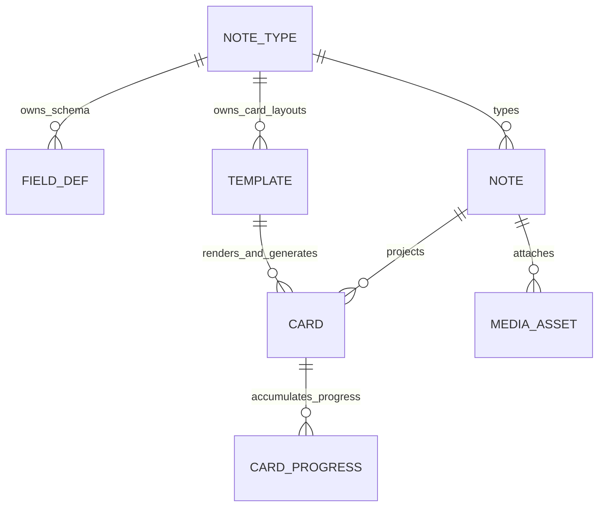

# Template, NoteType, and Field Decoupling Investigation

> Status: investigation only; no architecture decision, implementation plan, schema change, or migration is approved by this document.  
> Investigated: 2026-08-24  
> Primary authority: current repository models and runtime code. Tests and completed runbooks are supporting evidence.  
> Scope: `Template`, `NoteType`, `FieldDef`, `Note`, `Card`, rendering/study, React editing, marketplace/install/clone, import, Flama Connect, MCP, external note sync, and relevant tests.

> **Post-investigation decision notice (2026-08-24):** this document preserves the original evidence/options, but several product questions are now resolved in [`study-interaction-trigger-algorithm-plan.md`](./study-interaction-trigger-algorithm-plan.md). The approved direction uses an independent reusable Template with abstract inputs plus a NoteType-scoped applied composition/binding; the learner selects an attached Template application when Study starts. One learner/Note progress is shared across every application, Template lifecycle cannot delete progress, the same Template may be applied more than once, and installed shared definitions are pinned with copy-on-write fork on edit. Option comparisons and open-question wording below are historical investigation context where they conflict with that decision register. Production facts are recorded separately in [`production-architecture-verification-2026-08-24.md`](./production-architecture-verification-2026-08-24.md).

## 1. Executive summary

The current `Template` is not only a presentation asset. One database row simultaneously represents:

1. HTML/CSS/JavaScript presentation source;
2. membership in one `NoteType`;
3. an implicit binding to that NoteType's schema through field names;
4. one card-generation rule for every `Note` of that NoteType; and
5. part of the NoteType marketplace package and shared-deck layout lifecycle.

`templates.note_type_id` is therefore operationally required by the current lifecycle, authorization, preview, card fan-out, marketplace, and integration code. It is not, however, intrinsically required by the low-level renderer: `render_template_pair` already accepts a template-like object, a separately supplied list of field definitions, and separately supplied values. Raw preview and study artifacts provide additional seams that make future independence technically feasible.

The important distinction is consequently not only “Template versus NoteType.” It is also:

```text
reusable presentation identity
        versus
schema-scoped applied configuration / card-generation identity
```

The repository does not currently model that distinction. `Card` references the current `Template` row directly and is unique on `(note_id, template_id)`. That works while a Template is one concrete application owned by one NoteType. It cannot distinguish two uses of the same independent Template against the same NoteType with different mappings or configuration.

Current template source does not reference `FieldDef.id`. It references `FieldDef.name` indirectly through Mustache tokens such as `{{Word}}`. Rendering exposes the entire effective NoteType schema plus unknown legacy values; template JavaScript can also receive the entire field context. There is no declared input/slot/requirement contract. Field rename migrates name-keyed Note JSON but does not update or rebind template source, so stable `FieldDef.id` alone would not make templates rename-safe.

Template independence therefore appears feasible, but not as a local removal of `templates.note_type_id`, nor as an automatic conclusion that a reusable Template should directly own `FieldDef.id` references. Direct concrete IDs protect rename within one schema lineage, but marketplace NoteType installation creates new FieldDefs with new IDs and cross-NoteType reuse requires different fields. If cross-schema and multi-configuration reuse are real product requirements, some responsibility must resolve reusable presentation inputs to a concrete schema before Card creation and rendering. This document does not choose its name, persistence model, or final owner.

Four conceptual directions are compared later:

- A. retain direct NoteType ownership;
- B. make Template independent but bind it directly to concrete FieldDefs;
- C. give an independent Template abstract inputs and map them through a separate application responsibility; and
- D. keep a reusable source/package while materializing a NoteType-scoped applied variant or fork.

The evidence exposes meaningful trade-offs but is not sufficient to select a final model. Product decisions about live sharing versus copy/fork, application scope, CardProgress continuity, marketplace versioning, interaction outputs, and clone customization must come first.

## 2. Investigation method and evidence boundaries

### 2.1 Sources inspected

The investigation traced the following sources rather than relying on the database diagram or prior proposals:

- ORM models under `models/`;
- current Flask APIs and services under `app/api/` and `app/services/`;
- React authoring, import, marketplace, and study code under `frontend/src/`;
- the renderer sandbox host and renderer documentation;
- NoteType marketplace installation and shared-deck logical overlays;
- deck release and Change Request boundaries;
- CSV import, Anki/Connect synchronization, MCP, and external note synchronization;
- focused backend and frontend tests; and
- Git history for the origin of the current relationship.

No application code, model, database, migration, or test was changed as part of this investigation.

### 2.2 Prior documents are context, not runtime truth

`docs/plans/proposals/DECOUPLE_TEMPLATE_NOTE_TYPE_PROPOSAL.md` is explicitly marked as a technical proposal. It contains a detailed three-tier design and names implementation components that do not exist in the current runtime, including `CardTemplate`, a NoteType/template binding type, an Anki export compiler, and clone template overrides. It is useful evidence that decoupling has been considered, but this investigation does not adopt its schema or conclusions.

`docs/plans/completed/CLONE_CUTOVER_REPORT.md` is different: it documents the completed overlay-only clone behavior and explicitly states that Template/Card layout is outside the current atomic release scope. Its claims were cross-checked against current services and tests.

The current Alembic chain does not contain the original creation of the core `note_types`, `field_defs`, `templates`, `notes`, and `cards` tables. Git history shows that the mandatory Template-to-NoteType relationship already existed in the earlier consolidated flashcard model and was preserved when models were split (`0ae112e`, later `8d117a3`). No ADR or commit-level rationale was found that proves the relationship is a permanent domain requirement. The likely Anki-model influence is consistent with current import behavior, but that is an inference, not a recorded decision.

### 2.3 Terminology used in this document

To avoid assuming a future table structure:

| Term | Meaning in this investigation |
|---|---|
| Current Template row | The existing `models.template.Template` record with NoteType FK, raw source, position, and default flag. |
| Presentation definition | The potentially reusable HTML/CSS/JavaScript and any declared input contract. This is conceptual only. |
| Applied configuration | The schema-scoped decision that a presentation is used with a particular NoteType/Field set, mapping, options, and generation behavior. This is conceptual only. |
| Effective render context | The concrete field definitions, values, media, aliases, and safe derived values supplied at runtime. |
| Card projection | The durable `Card` created from a Note and the current Template/card-generation rule. |

The terms “slot,” “input,” “binding,” and “application” are used only as lightweight responsibility labels. They are not proposed table names.

## 3. Current domain topology

### 3.1 Persisted relationships



The database-level facts are:

- `Template.note_type_id` is non-null, indexed, and cascades on NoteType deletion (`models/template.py:7-22`).
- `NoteType.templates` is an ordered `delete-orphan` relationship (`models/note_type.py:49-65`).
- `FieldDef.note_type_id` and `Note.note_type_id` are also mandatory (`models/field_def.py:9-40`, `models/note.py:7-21`).
- `Note.field_values` is currently name-keyed JSON (`models/note.py:14`).
- `Card` has independent FKs to `Note` and `Template`, with a unique constraint on `(note_id, template_id)` (`models/card.py:9-24`).
- `CardProgress` is keyed to Card and cascades when Card is deleted (`models/card_progress.py:8-59`).
- `MediaAsset` associates media with a `note_id` and a string `field_name`, not a FieldDef ID (`models/media_asset.py:9-26`).

Only the two individual Card foreign keys and the unique pair are database-enforced. The intended invariant

```text
card.note.note_type_id == card.template.note_type_id
```

is maintained by application writers, not by the database. `build_effective_study_card` trusts the pair and combines `card.template` with `card.note.note_type.field_defs` without verifying the invariant (`app/services/study_artifact_service.py:91-132`). A cross-NoteType Card is therefore database-valid but unsupported; it may render accidentally if names happen to align. No test was found that rejects this state.

### 3.2 What `Template.note_type_id` currently does

The FK is not merely a lookup convenience. Current code uses it for:

- inherited ownership and authorization through the NoteType;
- NoteType-local ordering and default semantics;
- discovering fields for authoring, validation, preview, and media safety;
- determining the complete set of Cards that every Note should have;
- scoping every Template CRUD API;
- packaging fields and templates as one NoteType marketplace product;
- deciding whether released shared-deck safety guards apply;
- matching Anki model templates and reconciling imported Cards; and
- deleting Template/Card state with the owning NoteType.

This explains why the relationship is required by current orchestration. It does not show that raw presentation source must permanently be owned by a data schema.

### 3.3 Current responsibility map

| Concept | Current responsibility relevant to Templates |
|---|---|
| `NoteType` | Owns schema, templates, notes, publication metadata, and effectively the active card-generation profile. |
| `FieldDef` | Defines a name, type, position, required flag, and optional primary identity role within one NoteType. |
| `Template` | Stores raw presentation, NoteType membership, order/default, and acts as the Card projection identity. |
| `Note` | Supplies name-keyed values and the authoritative NoteType schema. |
| `Card` | Joins one Note to one Template; this is the scheduler/study identity to which progress attaches. |
| Renderer | Combines a template-like object with caller-supplied effective field definitions/values/media. |
| Marketplace | Publishes/installs whole NoteTypes or Decks with a source NoteType; no standalone Template product exists. |

## 4. Current lifecycle and data flows

### 4.1 NoteType and Template creation

`flashcards_share_service.create_note_type` creates FieldDefs and a first Template in the same operation (`app/services/flashcards_share_service.py:154-230`). Its fallback source uses `{{Word}}` even though callers can define arbitrary fields (`:217-220`). MCP and Connect have separate fallbacks that derive tokens from the first and second actual field names, so default behavior is inconsistent across entry points.

Creating an additional Template:

1. requires an owned NoteType;
2. computes `position` inside that NoteType;
3. persists `Template.note_type_id`; and
4. creates one new Card for every existing Note owned by the user under that NoteType.

Evidence: `app/services/flashcards_share_service.py:247-275` and `app/services/flashcard_content_service.py:593-614`.

Creating a Note performs the inverse fan-out: `_create_cards` selects every Template by `note.note_type_id` and creates a Card for each (`app/services/flashcard_content_service.py:938-989,1291-1298`). CSV import, Connect, MCP, and external note sync repeat the same rule.

The currently intended invariant is therefore stronger than “a NoteType may have Templates”:

```text
Every Template in a NoteType is assumed applicable to every Note of that NoteType,
and each pair should have exactly one Card.
```

There is no conditional generation rule, per-Deck selection, per-Note applicability, or applied configuration distinct from Template membership.

### 4.2 Update, preview, and delete

All canonical Template endpoints are nested:

```text
/note-types/<note_type_id>/templates
/note-types/<note_type_id>/templates/<template_id>
/note-types/<note_type_id>/templates/<template_id>/preview
```

The service lookup filters by both IDs (`app/api/v1/flashcards/note_types.py:151-233`, `app/services/flashcard_content_service.py:1204-1215`). There is no standalone library, attach, move, reuse, or “apply to another NoteType” API.

Template update validates by calling the renderer with the owning NoteType's entire `field_defs` and empty values (`app/services/flashcard_content_service.py:617-660`). This checks compilation/sanitization but does not declare or validate required field inputs. Missing Mustache keys normally render empty.

Preview obtains either sample values for every FieldDef or a Note constrained to the same NoteType, then renders using the same schema (`app/services/flashcard_content_service.py:717-776`). A separate raw-preview path constructs a transient template-like object and transient field definitions, demonstrating that preview itself does not require a persisted Template-to-NoteType relationship (`app/services/flashcard_content_service.py:784-871`).

Deleting a Template deletes its Cards (`app/services/flashcard_content_service.py:682-713`). Since CardProgress cascades from Card, Template lifecycle can destroy learning state. The service also protects the default Template and requires at least one Template per NoteType. These are service rules, not database constraints.

### 4.3 How Cards select Templates during study

Card already stores the exact `template_id`; study does not dynamically select a Template by name. `build_effective_study_card` loads:

```text
template    = card.template
field_defs  = card.note.note_type.field_defs (or clone-effective schema)
field_values = card.note.field_values (or clone-effective values)
```

It never asks `template.note_type` for rendering fields (`app/services/study_artifact_service.py:91-134`). This is a useful decoupling seam, but it also means the same-NoteType invariant is assumed rather than checked.

The study runtime/wire manifest separates three runtime artifacts:

- a scheduler policy;
- a template artifact; and
- a content artifact.

The Template artifact is not schema-independent yet. Its version digest includes the full effective FieldDef list, and the artifact exposes that list (`app/services/study_artifact_service.py:137-202`). The content artifact contains all name-keyed field values and a prebuilt render context (`:205-224`). The session manifest's Card payload associates a Card with `template_id`, `note_type_id`, and artifact keys (`app/services/study_session_service.py:517-548`); persisted `StudySessionCard` rows store Card/NoteType and scheduler state metadata, not those Template/content artifacts (`:550-570`).

The React renderer ultimately calls Mustache with presentation source and the already built context; it does not query NoteType at render time (`frontend/src/features/study/renderer/clientRenderer.ts:98-133`). This confirms that the runtime needs an effective presentation-plus-context, not necessarily structural Template ownership by NoteType.

### 4.4 How template variables resolve

`build_render_context` iterates every supplied FieldDef and retrieves each value by `field_def.name` (`app/services/flashcard_renderer.py:796-850`). It then:

- sanitizes or converts values according to `field_type`;
- produces media HTML and `${field_name}_url` aliases;
- retains unknown Note keys for legacy compatibility;
- creates a `hanviet`/`han_viet` compatibility alias; and
- mirrors dotted field names into nested objects for Mustache compatibility.

The renderer also scans concrete field names when upgrading HTML-producing tokens and deciding whether a media field is used as a URL (`app/services/flashcard_renderer.py:212-243,328-352`). Its shell cache signature includes names, types, positions, and required flags, but not FieldDef IDs (`:257-288`).

`render_template_pair` itself accepts any template-like object and separately supplied fields/values/media (`:853-940`). It does not read `template.note_type_id`. The renderer is thus computationally decoupled while its input contract remains schema/name dependent.

Rendering currently receives all fields, not only fields used by Mustache tokens. In addition, sandboxed Template JavaScript receives all `fieldValues` and `fieldDefs` through the renderer context (`frontend/src/features/study/components/CardRendererFrame.tsx:156-171`, `static/js/card_renderer_host.js:610-630`). A script may depend on a field name that static Mustache-token analysis cannot discover.

One additional compatibility gap was found: multiple producers and MCP documentation emit `{{FrontSide}}`, but a repository-wide runtime search found no explicit renderer/context injection for `FrontSide`. Existing tests use the token but do not assert that the rendered front is present on the back. Unless a Note itself contains that key, Mustache would normally resolve it as empty. This needs a focused behavior test before any future input contract classifies `FrontSide` as a reserved variable. *(Resolved 2026-10-10: the server and client renderers now put the rendered front where the back has `{{FrontSide}}`, with tests.)*

### 4.5 Field rename behavior

Canonical field update preserves the FieldDef row/ID, rewrites every affected Note's JSON key, and records a rename job (`app/services/flashcard_content_service.py:344-469,1222-1262`). MCP has parallel name-key migration loops (`app/services/mcp_tool_service.py:2438-2560`). Neither path updates Template source nor creates a stable Template binding.

For example:

```text
before: FieldDef(id=F1, name="Word"), Template source={{Word}}
rename: FieldDef(id=F1, name="Term"), Note value key Word -> Term
after:  Template source still requests {{Word}}
```

The current MCP rename test verifies FieldDef names and Note data only; it does not render the Template after rename (`tests/test_mcp_note_type_capabilities.py:351-391`). Shared-deck clone/rebase tests verify ID-stable schema/value overlays but likewise do not assert the source Template render after a rename.

This is evidence that stable FieldDef identity and stable presentation binding are separate problems.

### 4.6 React authoring

`NoteTypeDetailPage` loads a NoteType with embedded `field_defs` and `templates`, selects from that one Template collection, and saves/creates/previews through NoteType-nested endpoints (`frontend/src/features/note-types/pages/NoteTypeDetailPage.tsx:56-193`).

Its placeholder toolbar uses the field's stable ID only as a React list key. The inserted source is `{{field.name}}` (`:195-218,319-340`). New Template source and textarea examples hard-code `{{Word}}`/`{{Meaning}}` (`:119-126,364-384`).

There is no UI for:

- a reusable Template library;
- declared semantic inputs;
- input-to-Field mapping;
- compatibility validation;
- multiple applications of one Template;
- Template lineage or updates; or
- moving/sharing a Template independently.

Marketplace detail pages have the same shape: NoteType pages select `noteType.templates`, and shared Deck pages select `source_note_type.templates`.

## 5. Marketplace, install, clone, and release behavior

### 5.1 Two current marketplace lifecycles

Flama has two materially different installation paths.

#### NoteType marketplace

The marketplace product is a complete NoteType definition. Serialization nests its FieldDefs and Templates (`app/services/marketplace_query_service.py:44-108`). Preview requires a `(note_type_id, template_id)` pair and that NoteType's sample schema.

Installation creates a private NoteType copy. It copies every FieldDef and every Template into new rows with new IDs, preserving names and raw HTML/CSS but no source-to-installed FieldDef/Template lineage (`app/services/flashcards_share_service.py:736-767,2142-2190`; `models/note_type_install.py:10-49`). Reuse is therefore copying, not sharing. Later source Template edits do not propagate through a shared Template identity.

This has a direct consequence for concrete `FieldDef.id` bindings: even an identical installed schema has different FieldDef IDs. Any ID-based concrete mapping would need explicit remapping or a preserved lineage; neither exists today.

The product and UI vocabulary sometimes call this NoteType package a “Template.” Payment and marketplace copy can therefore blur two different meanings:

- the current individual `Template` row; and
- the saleable NoteType package containing schema plus one or more Templates.

That terminology should be clarified before defining an independent Template product.

#### Shared Deck logical overlay

A shared Deck listing is bound to a source Deck and one source NoteType. Publication requires all source Notes in scope to resolve to a single NoteType with at least one Template (`app/services/flashcards_share_service.py:973-1034,1502-1515`).

Install creates local Deck shells and ensures or reuses a private installed NoteType copy, but does not copy source Notes or Cards. `NoteTypeInstall` is unique per `(source_note_type_id, user_id)`, so this installed-copy Template population is scoped to the user and source NoteType, not to one `DeckInstall` (`app/services/flashcards_share_service.py:2193-2227`, `models/note_type_install.py:47-49`). Two installed Decks that use the same source NoteType may consequently share this copied Template population for tracked clone-local additions.

Study/browse continue to use source Card identities through the logical overlay. Tracked clone-local added Notes, however, resolve the local Deck's installed-copy NoteType and create Cards from its copied Template rows (`app/services/flama_connect_service.py:303-311,522-555`).

One installed logical deck can therefore expose two Template populations:

```text
source overlay Cards      -> source Template IDs
clone-local added Notes   -> installed-copy Template IDs
```

Evidence: `app/services/flashcards_share_service.py:2379-2401,3249-3309`, `app/services/flama_connect_service.py:303-311,522-555`, `app/services/study_artifact_service.py:91-134`, and `tests/test_flashcard_api_integration.py:1475-1566,1732-1802`.

An independent application/binding lifecycle would have to state whether those two populations share presentation behavior, versions, mappings, and user customization.

### 5.2 Clone mapping currently relies on position

During legacy full-copy-to-overlay cutover, local copied Templates are matched to source Templates by sorted position. The cutover requires equal counts and then maps local Template IDs to source Template IDs by index (`app/services/flashcards_share_service.py:2004-2076`). This is recovery logic, not durable Template lineage. Independent source/local reordering, positional drift, unequal counts, or independently reusable sources would require a stronger identity model.

### 5.3 Templates are outside atomic deck releases

Deck release V1 versions FieldDefs, including their `position`, plus Note field values and membership-related state; it has no separate field-order release entity. Change Requests do have a field-order update operation. Neither release nor Change Request change kinds include Template/Card layout (`app/services/deck_release_service.py:1-46`; `app/services/deck_change_request_service.py:45-68`; `docs/plans/completed/CLONE_CUTOVER_REPORT.md:7-9,210-213`).

Once a NoteType has released shared dependents, canonical Content APIs and MCP reject Template create/update/reset/delete. The guard explicitly cites two risks:

- unpublished live Template changes leaking into learner installs; and
- destroying Card/CardProgress identity.

Evidence: `app/services/flashcard_content_service.py:1127-1156`, `app/services/mcp_tool_service.py:2338-2363`, and `tests/test_flashcard_api_integration.py:216-352`.

Current marketplace safety therefore depends on prohibiting Template mutations after release. A reusable mutable Template referenced by multiple NoteTypes would increase the blast radius unless ownership, immutability/version pinning, application updates, and release semantics are resolved first.

## 6. Import, Connect, MCP, and external sync

### 6.1 CSV/file import

CSV import is schema-oriented: users select an existing NoteType and map columns to FieldDef names. After creating a Note, the importer loads all Templates by that NoteType and creates one Card for each (`app/services/flashcard_import.py:368-407,630-680`).

The data ingestion step does not intrinsically require Template ownership. The post-import Card projection step does. Current APIs do not allow a caller to select an applied Template/configuration set separately from the NoteType.

### 6.2 Flama Connect and Anki synchronization

Connect mirrors Anki's aggregate model:

```text
external model
  = fields + templates + field mapping + target NoteType
```

`NormalizedNoteTypePlan` contains fields, templates, a name-to-name field mapping, and one target NoteType (`app/services/flama_connect_service.py:94-102,720-807`). The mapping maps external source fields to target NoteType field names. It is not a reusable Template-input mapping.

Important current assumptions include:

- missing templates are synthesized from concrete first/second field names;
- auto-sync creates FieldDefs and Templates under one new NoteType;
- existing-target validation checks source/target field names, exactly one mapped primary field, and all required target fields, but it does not check field-type compatibility or Template name/content/identity; its Template compatibility check is only a count comparison;
- target schema hash combines FieldDef name/type/order/required/identity metadata and Template name/raw HTML/CSS/order;
- import session state persists `targetNoteTypeId`, the name-based `fieldMapping`, source-plan `schemaHash`, and `targetSchemaHash`; it still has no Template/application binding or lineage;
- Cards are reconciled to all Templates of the target NoteType; and
- Anki card ordinal maps to local `Template.position`/list order, not durable Template lineage.

Evidence: `app/services/flama_connect_service.py:730-930,1103-1119,1239-1270,1297-1339`, `models/connect_import_session.py:23-24`, `models/connect_note_type_ref.py:19-28`, `models/connect_source_card_ref.py:19-28`, and `app/services/anki_sync_service.py:73-116`.

The direct Yomitan/AnkiConnect-style `addNote` path has the same domain assumption outside batch import. It resolves `modelName` to one NoteType, validates name-keyed values against that NoteType's FieldDefs, requires at least one Template, and creates Cards for every Template; the caller cannot select or bind one application (`app/services/flama_connect_service.py:303-326,386-419,491-544`; `tests/test_flama_connect.py:1234-1244`).

An additional stale compatibility branch exists inside materialization: after parsing has already rejected a Template-less NoteType, the writer checks again and attempts to construct a fallback Template using obsolete `front_format`/`back_format` arguments instead of the current `front_html`/`back_html` model fields (`app/services/flama_connect_service.py:310-311,531-542`). It is normally unreachable in the supported path; if reached through future flow changes or a race, it would not create a valid current Template. This is duplicated/dead compatibility logic to account for in any later lifecycle refactor, not evidence for a target design.

The React import flows also send fields, templates, and name mappings together. For an existing NoteType, `AnkiNoteTypeSyncTab` merges Templates by same name or first-unused position and stores only the selected NoteType mapping; it has no Template lineage/application identity (`frontend/src/lib/ankiSyncEngine.ts:330-405`, `frontend/src/features/import/components/AnkiNoteTypeSyncTab.tsx:254-378`).

An independent Template architecture need not force Anki itself to change. Anki import/export can remain an adapter boundary that packages or compiles a concrete schema plus card templates. The unresolved question is whether imported raw tokens remain local applied variants or become reusable abstract definitions without changing Anki semantics.

### 6.3 MCP

MCP exposes Templates only as a nested part of NoteType schema:

- `get_note_type_schema` returns fields and templates together;
- `create_note_type` accepts nested fields/templates and synthesizes name-based source;
- `update_note_type` creates, updates, or removes Templates under that NoteType; and
- adding/removing Templates creates/deletes Cards for all affected Notes.

Evidence: `app/services/mcp_tool_registry.py:1055-1135,1193-1213` and `app/services/mcp_tool_service.py:1848-2080,2085-2258,2572-2664`.

There is no independent Template MCP resource, input declaration, mapping, compatibility preview, or applied-configuration identity. Current MCP template syntax documentation explicitly advertises `{{Field}}` and `{{FrontSide}}`.

### 6.4 External note synchronization

`note_sync_service` rejects a target NoteType without Templates even during preview/execution, then creates one Card for every Template for each new Note (`app/services/note_sync_service.py:228-263,494-507,647-673`). Note-content identity hashes fields/tags/deck, not Template application. This again shows that data synchronization and card projection are separable responsibilities that are currently orchestrated together through NoteType.

## 7. Reusable Template and interaction requirements

### 7.1 What exists today

Current `Template` has only raw front/back HTML, CSS, name, order, and default metadata. No model was found for:

- Template input, slot, or variable declarations;
- required/optional input compatibility;
- interaction kind or answer contract;
- Trigger or field-driven algorithm configuration;
- computed/derived Template inputs; or
- authoring/marketplace Template or application version lineage. Study artifacts do have runtime digest/version identities, but those are effective cache/snapshot identities rather than reusable-source lineage.

Scheduler algorithm configuration consumes Card/progress/deck policy. It does not consume field names or Template inputs. `template_id` appears in study session payloads as presentation/Card projection identity, not as an algorithm input contract.

The seeded multiple-choice example is a specialized NoteType with fixed concrete fields (`question`, `answer_1` through `answer_4`, and `correct_answer`) and same-named Mustache tokens (`app/services/flashcard_legacy.py:240-275,389-464`). It displays data but does not define a generic multiple-choice interaction protocol.

The renderer sandbox bridge exposes rendering/reveal/audio/context facilities, but no typed answer-submission or evaluation result contract (`docs/architecture/CARD_TEMPLATE_SANDBOX_RENDERER.md:24-39,86-105`, `static/js/card_renderer_host.js:598-631,995-1055`). Abstract input mapping alone would therefore not deliver complete multiple-choice, matching, or typing behavior.

### 7.2 Do future interactions require a specific NoteType?

At the semantic level, the listed interactions need data capabilities rather than a specific NoteType identity:

| Interaction | Example semantic needs | Inherent need for one NoteType ID? |
|---|---|---|
| Basic flashcard | prompt, response, optional context/media | No; compatible data can come from different schemas. |
| Multiple choice | question, option collection, correct-answer/evaluation semantics | No, but cardinality and answer contract matter. |
| Multiple answer | prompt, answer collection, comparison/evaluation policy | No, but a plain text placeholder is insufficient. |
| Matching | left/right collections plus stable pair identity | No, but structured/cardinality requirements matter. |
| Listening | audio prompt, optional transcript/answer | No, but media type and access policy matter. |
| Typing | prompt, accepted answers, normalization/evaluation | No, but interaction output and evaluation policy matter. |
| Custom interactive | declared inputs plus trusted behavior/output protocol | No in principle; current undeclared all-field context makes dependencies opaque even though sandbox capabilities are restricted. |

Different NoteTypes could supply those roles through different FieldDefs. Conversely, the same NoteType could support multiple applications of the same presentation with reversed or otherwise different mappings.

### 7.3 Is an abstract input concept necessary?

The answer depends on the product definition of reuse:

- If Flama remains an Anki-like system in which templates are card recipes embedded in a model, abstract inputs are optional; direct NoteType ownership is coherent, though rename safety still needs improvement.
- If “reuse” only means easy copy/fork, a reusable preset/source plus local adaptation might suffice without a globally shared runtime definition.
- If one Template must be safely applicable across heterogeneous NoteTypes, compatibility cannot be expressed using only field names or one schema's FieldDef IDs. Some schema-independent declaration of what the presentation/interaction consumes is necessary. That declaration need not automatically be a database table; it could be metadata or another contract representation.
- If custom interactions must be validated, abstract inputs alone are not enough. Type, optionality, cardinality, derived values, allowed capabilities, and an output/evaluation protocol may also be required.

This is the strongest evidence for an input/slot/requirement abstraction: not aesthetic separation, but the inability to state cross-schema compatibility or discover JavaScript dependencies today.

### 7.4 Friendly authoring syntax

Nothing in the evidence requires user-facing Mustache syntax to disappear. A future authoring surface could still show memorable aliases such as `{{Question}}` or even labels chosen by the author. The unresolved issue is what those tokens identify:

- a mutable FieldDef display name, as today;
- an immutable Template input key;
- a compiled alias generated for one applied configuration; or
- a compatibility alias retained after rename.

The raw source cannot safely be interpreted until that distinction is explicit, especially because concrete names also appear in conditionals, URL attributes, dotted names, compatibility aliases, and arbitrary Template JavaScript.

### 7.5 Compatibility with the proposed Field refactor direction

Making `FieldDef.id` the permanent identity of a field and normalizing Note values by `field_def_id` is compatible with every option in this investigation. It would let an effective-context adapter retrieve values without treating `FieldDef.name` as storage identity. The adapter could still expose friendly Mustache keys during a compatibility period or permanently at the authoring boundary.

It does not, by itself, decide where Template bindings belong. A direct `Template -> FieldDef` mapping has two materially different meanings:

- If “Template” means the current NoteType-local applied card recipe, concrete FieldDef IDs are naturally in the same schema scope and protect rename.
- If “Template” means a reusable presentation definition shared across NoteTypes, concrete FieldDef IDs make that definition schema-specific and copied NoteType installs require remapping.

The Field refactor therefore supports Template independence at the value-resolution boundary, but a physical direct Template-to-FieldDef binding should not be treated as neutral until Flama decides which of those two Template identities it represents. This is a sequencing constraint, not a recommendation to delay Field value normalization or to create a particular binding table.

## 8. Major coupling and consistency findings

### Finding 1 — Structural ownership is stronger than renderer need

**Observed:** Template is a delete-orphan child of one NoteType and has no independent owner or lifecycle. The renderer accepts schema separately and does not read `note_type_id`.

**Potential concern:** Treating the FK as proof that presentation intrinsically belongs to schema would preserve an implementation boundary that renderer code does not require.

**Impact:** Independence is technically plausible, but authorization, ordering/default, preview, Card generation, and deletion need an explicit owner after any separation.

**Unknown:** Whether product reuse means a shared live definition or only reusable copy/fork.

### Finding 2 — Current Template conflates definition and application

**Observed:** Template membership itself means “create a Card for every Note,” and Card references that row as durable projection identity.

**Potential concern:** A reusable presentation edit, attaching/detaching it, and changing a schema mapping have different lifecycle effects but are currently one mutation surface.

**Impact:** CardProgress, releases, clone installs, and deletion cannot be reasoned about independently until those responsibilities are distinguished.

**Unknown:** Whether changing mapping/configuration preserves an existing Card's learning identity or creates/retires a Card.

### Finding 3 — Names are persistent binding identifiers

**Observed:** Authoring inserts names, renderer contexts are name-keyed, media safety scans names, imports map names, and scripts receive name-keyed full context.

**Potential concern:** Field rename can preserve Note data while silently changing rendered meaning or producing blanks. Static token replacement would miss JavaScript and some compatibility syntax.

**Impact:** Stable FieldDef IDs solve value/schema identity but not existing template source dependencies.

**Unknown:** Whether old names should remain aliases and for how long.

### Finding 4 — Direct FieldDef binding has a reuse boundary

**Observed:** Every FieldDef belongs to exactly one NoteType. NoteType marketplace install creates equivalent FieldDefs with new IDs and no per-field lineage.

**Potential concern:** If a reusable Template definition owns concrete FieldDef IDs, it becomes schema-specific again. If it owns many schema-specific binding sets, it also takes on application lifecycle.

**Impact:** Direct IDs are appropriate at a concrete resolved application boundary, but the evidence does not support assuming they belong inside the reusable presentation identity.

**Unknown:** Whether one application can combine fields, constants, computed values, lists, or algorithm output rather than bind one input to one FieldDef.

### Finding 5 — Card's current key cannot represent multiple applications

**Observed:** Card is unique on `(note_id, template_id)`.

**Potential concern:** The same Template ID cannot be used twice for one Note with different configuration. Duplicating Template rows works only by duplicating identity and source.

**Impact:** If multi-application is required, Card must durably identify the concrete applied occurrence or an equivalent unambiguous projection, not only raw presentation source.

**Original investigation unknown:** Whether multi-application is an actual product requirement and how it interacts with CardProgress.

> **Post-investigation disposition:** multi-application is now approved. One reusable Template may be applied more than once to one NoteType with different bindings. Those applications do not create separate learning progress; progress is shared by `(learner_user_id, note_id)`.

### Finding 6 — Runtime artifacts are a useful seam but remain schema-contextual

**Observed:** Study already separates presentation and content artifacts, while template version includes the effective full schema.

**Potential concern:** Treating the current Template artifact as reusable would hide its schema dependency in its version/cache identity.

**Impact:** The artifact boundary can support future separation, but “presentation version” and “applied/effective version” may be different identities.

**Unknown:** Which changes should invalidate presentation cache, application compatibility, Card identity, or only content render context.

### Finding 7 — Marketplace currently has bundles and copies, not reusable Template lineage

**Observed:** NoteType installation copies templates; shared Deck overlays use source Templates for source Cards and copied Templates for local Cards; releases do not version Template changes.

**Potential concern:** A shared mutable Template could bypass release boundaries or affect many NoteTypes/installations at once.

**Impact:** Independent distribution requires ownership, licensing, version pinning, update/fork policy, compatibility validation, and clone semantics.

**Unknown:** Whether security fixes propagate automatically while visual/behavioral updates remain pinned.

### Finding 8 — Anki aggregate compatibility is real but boundary-specific

**Observed:** Connect imports fields and card templates together and maps Anki ordinals to local Template order.

**Potential concern:** Making every internal Template independent without an adapter could lose Anki fidelity; preserving Anki grouping everywhere would block Flama-native reuse.

**Impact:** Import/export likely needs an explicit compilation/adaptation boundary if Flama's internal responsibilities diverge from Anki's model.

**Unknown:** Whether Anki ordinals or an external template identity are stable enough for long-lived sync.

### Finding 9 — Future interaction requirements are not represented

**Observed:** There are no input, interaction, Trigger, or Template-specific algorithm contracts. Current JavaScript may read the full context and cannot submit a typed answer result through the documented bridge.

**Potential concern:** A visually reusable shell may work, but reusable interactive behavior cannot be compatibility-checked or safely composed with future triggers/algorithms.

**Impact:** Future consumers should not need to know human Field names. They need either schema-specific FieldDef identity or a resolved semantic input contract, depending on scope.

**Unknown:** Whether Template owns only presentation requirements or also interaction/evaluation behavior.

### Finding 10 — Current terminology hides domain boundaries

**Observed:** Marketplace/payment/UI sometimes calls a complete NoteType package a “Template,” while the database `Template` is one Card layout inside it (`app/services/payment_service.py:973-990`).

**Potential concern:** Product decisions about sharing “a Template” may refer to different lifecycles.

**Impact:** Terminology should be settled before assigning ownership or marketplace behavior.

**Unknown:** Which concept users expect to buy, install, customize, and update independently.

## 9. Answers to the twelve architectural questions

| Question | Current evidence-based answer | Consequence / remaining uncertainty |
|---|---|---|
| 1. Should Template know `FieldDef.id` directly? | Current Template knows no FieldDef IDs; it knows names implicitly. | A concrete applied configuration can use stable IDs for rename safety. Putting one schema's IDs in a reusable presentation definition would re-couple it. Final ownership is undecided. |
| 2. Should Template know field names directly? | It does today through raw source and JavaScript context. | Human-readable authoring aliases may remain, but they should not automatically be treated as mutable FieldDef identity if cross-schema reuse is required. |
| 3. Should Template know `NoteType.id`? | Current row/lifecycle must. The renderer does not. | Removing the FK alone would orphan ownership, authorization, ordering, preview, and Card generation. Independence requires another responsibility boundary first. |
| 4. Should a Template be reusable across many NoteTypes? | Current system does not support it except copy/rewrite. | It is technically feasible and aligns with stated long-term goals, but live share versus versioned fork is a product decision. |
| 5. Can one NoteType use the same Template with different bindings? | No binding concept exists. | Today this requires duplicate Template rows. A future model must distinguish configured occurrences if this is required. |
| 6. Can one Template be used multiple times against the same NoteType? | Not with the same identity; `(note_id, template_id)` permits one Card. | Multiple applications make bare `template_id` ambiguous and raise CardProgress lifecycle questions. |
| 7. What should Card reference if Template becomes independent? | Today it references Template. | If each Template has one deterministic application per NoteType, that could remain sufficient. If multiple mappings/configurations exist, Card must identify the applied occurrence or equivalent durable projection. No final entity is selected. |
| 8. Which entity should own the mapping? | No current entity fits cleanly. | NoteType currently conflates it; Card is too granular; Deck/installs are contextual; StudySession is transient; reusable Template should not own one schema's IDs. A new responsibility or a split local-instantiation concept may be necessary. |
| 9. How would independent Template marketplace/install work? | There is no such product. Marketplace distributes whole NoteTypes or Decks. | Ownership, review, licensing, compatibility, version pinning, update/fork, release integration, and binding/install UI are unresolved. |
| 10. How would Field rename affect Template? | It currently migrates Note keys but leaves Template source unchanged. | Concrete ID mapping could survive rename; abstract-input mapping could isolate presentation completely. Alias/display behavior remains undecided. |
| 11. How would future Trigger/Interaction systems consume inputs? | No such contract exists; scheduler does not consume fields. | Schema-specific consumers may use FieldDef IDs. Reusable consumers need resolved semantic inputs and, for interactions, likely output/evaluation contracts. They should not consume human labels. |
| 12. Which current assumptions block the direction? | Mandatory ownership/cascade, inherited authorization, local position/default, nested APIs/UI, all-Templates-to-all-Notes fan-out, unique Card pair, name contexts, full-context JS, CardProgress coupling, missing release/version atoms, copy-only marketplace, Anki ordinal mapping, and no requirement declaration. | These are cross-layer lifecycle constraints, so independence is not a model-only refactor. |

> **Post-investigation disposition:** the current-behavior column remains evidence, while later product decisions resolve the semantic direction: reusable Templates are independent; a durable NoteType-scoped applied composition owns bindings; repeated applications are allowed; progress belongs to learner/Note; and marketplace installs pin shared versions with copy-on-write fork on edit. Physical entity names and schemas remain undecided.

## 10. Where could binding responsibility live?

This section evaluates responsibility, not table names.

### Current `NoteType`

It is the closest existing scope because it owns the schema and currently determines all Cards. Keeping mapping here would be operationally natural, but placing reusable presentation source here preserves the coupling under investigation. It may be appropriate for NoteType to participate in an applied configuration without owning reusable source.

### Current `Template`

It is the current applied card recipe, so it could continue to represent a NoteType-local concrete variant. It is a poor owner for schema-specific IDs if the same identity is also supposed to be the reusable cross-schema definition.

### `Card`

Card is the result of applying a rule to one Note. Storing shared mapping/configuration independently on every Card would duplicate data and make global updates difficult. Card does, however, need a durable unambiguous reference to whatever applied rule created it.

### `Deck`

Deck supplies study/scheduler context and often a default NoteType, but Notes can be deckless or move Decks while Card/Progress identity persists. Imports can also encounter mixed NoteTypes. Deck cannot be the universal schema-to-presentation owner without changing existing domain behavior.

### `NoteTypeInstall` / `DeckInstall`

These are provenance and clone/install scopes. They may eventually own local overrides, but they cannot represent ordinary authoring outside an install or define the universal relationship.

### Study artifacts

Artifacts already represent the resolved runtime result and are useful caches/snapshots. They are created too late and are not the authoring/system-of-record relationship that decides Card generation.

### Boundary conclusion

No current entity cleanly owns a reusable Template-to-schema mapping. If cross-schema reuse and multiple configurations are confirmed, the repository evidence suggests a durable schema-scoped application/configuration responsibility distinct from both reusable presentation identity and individual Card identity. It could be represented by a new concept or by splitting the meaning of the current Template row. This investigation does not decide which.

> **Post-investigation disposition:** cross-schema reuse and multiple configurations are confirmed product directions. The later runtime plan assigns this responsibility conceptually to `StudyMode`/an applied composition, while intentionally deferring its physical table/class design.

## 11. Conceptual architecture options

### 11.1 Comparison matrix

| Dimension | A. Template belongs to NoteType | B. Independent Template binds directly to FieldDefs | C. Independent Template declares abstract inputs; separate mapping applies it | D. Reusable source/package with NoteType-scoped applied variant/fork |
|---|---|---|---|---|
| What remains coupled | Presentation, schema, application, Card generation, and marketplace lifecycle | Presentation identity knows concrete schema IDs or owns schema-specific binding sets | Presentation contract is separate; concrete application couples one Template version to one NoteType/schema | Reusable source is separate; each runtime variant remains NoteType/application coupled |
| Cross-NoteType reuse | Copy raw source; rewrite if names differ; no shared updates | Limited unless the Template carries multiple concrete binding profiles | Strong conceptual reuse across heterogeneous schemas | Reuse through instantiate/copy/fork and optional lineage; runtime copies may drift |
| Field rename | Name tokens break unless extra local binding/aliases are added | Stable while target FieldDef ID remains stable | Mapping target remains stable; presentation input key need not change | Rename-safe only if local applied variant uses ID-native mapping/aliasing |
| Same Template + same NoteType more than once | Requires duplicate Template rows | Ambiguous unless concrete binding sets have their own identity | Naturally representable as multiple applications, if product allows | Multiple local variants/instances can represent it, but are distinct runtime identities |
| Card impact | Current `(note, template)` model fits | Card must know which direct binding set applies if more than one exists | Card likely identifies concrete application, not only reusable source | Card may keep pointing at a stable local applied variant, closest to current behavior |
| CardProgress | Current behavior, but Template deletion destroys Cards/progress | Binding changes still need progress continuity rules | Explicit application lifecycle can define preservation/retirement, but adds decisions | Local stable identity can contain update blast radius; fork/update semantics remain |
| Marketplace/install | Current whole-NoteType/deck bundle and copy behavior | Must ship/remap concrete dependencies; copied FieldDef IDs differ | Can distribute presentation + requirements separately and validate mapping on apply | Can distribute a reusable package and instantiate/pin a local variant; updates are copy/sync/version decisions |
| Clone/overlay | Current source/local split and fail-closed Template mutation | Overrides must map source and installed FieldDef lineages | Clone can bind/override an application, but release and source/local policy must be added | Fits existing copy/overlay behavior incrementally, but may preserve duplicated variants |
| Custom interactions | Implicit hard-coded field conventions | Concrete type access is possible but semantic portability is weak | Abstract typed inputs and outputs can support portable interaction contracts | Reusable package may declare requirements; local variant resolves them |
| Trigger/Algorithm systems | Tend toward names or NoteType-specific logic | Can use concrete FieldDef IDs, but not portable across schemas | Can consume resolved semantic inputs while schema-specific systems retain FieldDef IDs | Can consume the local resolved variant; global source contract may remain portable |
| Main complexity/risk | Ongoing coupling and rename/reuse limits | Nominal independence but schema recoupling and remap complexity | New lifecycle, compatibility, versioning, security, and authoring responsibilities | Fork drift, update propagation, duplicate state, and distinction between source versus variant |

### 11.2 Option A — direct NoteType ownership

This is the current architecture and is coherent for an Anki-style model: a NoteType defines both data fields and the set of Cards generated from each Note. It minimizes change to Card, import, and marketplace flows.

It does not meet strong cross-schema reuse. Field names remain part of persistent presentation logic unless a stable local binding or alias mechanism is added. Future interactions and triggers are likely to standardize on hard-coded schema conventions.

### 11.3 Option B — independent Template with concrete FieldDef dependencies

Concrete FieldDef IDs make a configured use rename-safe within one NoteType lineage. They also give type information and avoid global string replacement.

The coupling moves rather than disappears if those IDs belong to the reusable Template definition. Every copied or different NoteType has different FieldDef IDs. Marketplace install must remap them, and one Template used with several schemas needs several grouped dependency sets. At that point, those groups are performing application responsibility even if they remain stored “on Template.” Card must still select the correct group.

This option may be sufficient if independence means ownership/versioning separate from NoteType but not true cross-schema portability. It is weak evidence for the broader reuse direction.

### 11.4 Option C — abstract inputs plus separate application mapping

Here presentation describes semantic inputs such as prompt, answer, options, or audio, while a separate responsibility resolves them to one NoteType's stable fields or other supported sources.

This most directly represents the stated cross-schema and multiple-configuration use cases. Field rename becomes metadata at the concrete schema side rather than a source rewrite. It also offers an interface for future interactions/triggers.

The cost is not primarily another join. It is lifecycle semantics: input compatibility, versioning, binding validity, Card generation, progress continuity, import compilation, marketplace installation, clone overrides, security, and failure behavior all need definitions. The original repository evidence alone did not elevate C to an approved design.

> **Post-investigation disposition:** later product decisions adopt the responsibility split of abstract inputs plus a separate applied mapping, combined with pinned shared versions and copy-on-write fork behavior associated with option D. This does not pre-select a physical schema.

### 11.5 Option D — reusable source/package plus local applied variant

This hybrid distinguishes a reusable authoring/marketplace source from the stable NoteType-local object used for Card generation. Applying a source creates or derives a local variant; Cards continue to point at that concrete variant. Current NoteType installation already copies Template source, and study artifacts already produce versioned effective material, so this option emerged from actual repository behavior rather than only the prior proposal.

It can limit the blast radius of shared edits and fit current Card/release behavior more gradually. It is not full live reuse: variants can drift, and update/fork/version lineage becomes a product feature. A local variant still needs a name-safe mapping or compilation mechanism to avoid today's field coupling.

### 11.6 Original evidence did not select a winner

The evidence strongly rejects one shortcut: a global reusable Template cannot simply inherit the current Template row's concrete field-name assumptions and Card lifecycle unchanged.

The evidence does not decide whether Flama wants:

- Anki-compatible schema-owned card recipes with better stable local bindings;
- globally shared live Template definitions;
- immutable versioned packages;
- local forks with provenance; or
- both reusable definitions and explicit applications.

Those choices were subsequently supplied. The approved conceptual direction combines C's independent inputs/mapping boundary with D's pinned distribution and copy-on-write lifecycle; the comparison remains useful for understanding trade-offs and does not define tables.

## 12. Feasibility assessment

### 12.1 Positive seams

Template independence is technically feasible because:

- `render_template_pair` already receives presentation, schema, values, and media separately;
- raw preview already renders a transient template without a persisted NoteType relationship;
- study already separates Template and content artifacts;
- Card already references a stable Template-like identity rather than resolving by name;
- FieldDefs already have UUID identities suitable for concrete schema references;
- release/overlay code has begun using stable FieldDef IDs; and
- React rendering consumes a prepared context rather than querying NoteType directly.

### 12.2 Material blockers

It is not a local refactor because:

- structural ownership, deletion, and authorization derive from NoteType;
- order/default are currently properties of NoteType membership;
- Template membership defines Card fan-out;
- Card uniqueness has no application/configuration dimension;
- CardProgress continuity is coupled to Card/Template lifecycle;
- renderer dependencies are name-based and JavaScript dependencies are opaque;
- study Template artifacts include the entire effective schema;
- NoteType/Deck marketplace and clone flows have no Template lineage/version atoms;
- released decks rely on fail-closed Template mutation;
- Connect binds fields/templates as one aggregate and uses ordinal/order matching;
- MCP and React have only NoteType-nested authoring; and
- no typed input or interaction output contract exists.

### 12.3 Feasibility conclusion

Independence appears feasible at the responsibility and runtime boundaries. It should not be treated as “drop one foreign key.” The later decision register distinguishes reusable Template identity from a concrete applied-composition identity and moves learning progress to learner/Note. Physical ownership, release atoms, and compatibility mappings still require design before implementation.

## 13. Test coverage and evidence gaps

Current tests provide good evidence for:

- name-based rendering, rich text/markdown/media handling, aliases, and unknown legacy fields (`tests/test_flashcard_renderer.py`);
- basic Note-to-Card creation for a one-Template fixture (`tests/test_note_sync_and_mcp.py:358`); production writers explicitly fan out across every Template, while a focused successful multi-Template fan-out assertion was not identified;
- NoteType-nested Template API behavior and marketplace install;
- Connect's fields-plus-templates preflight aggregate;
- split study artifacts and client rendering; and
- rejection of Template changes after released shared dependents exist.

No tests were found for:

- rejecting a Card whose Note and Template belong to different NoteTypes;
- cross-NoteType Template reuse;
- the same Template applied twice with different mappings/configuration;
- declared input compatibility or field-type/cardinality mismatch;
- rendering correctly after Field rename;
- Template-only marketplace publish/install/update/version behavior;
- source-to-installed Template or FieldDef lineage;
- JavaScript dependency declaration;
- whether `FrontSide` is actually populated;
- conditional Card generation from input availability; or
- CardProgress behavior when an application mapping changes.

These are missing capabilities as much as missing tests. They should become behavioral acceptance questions before any implementation design.

## 14. Post-investigation decision record and remaining questions

The entries marked **Quyết định** were supplied after the original investigation. They supersede the corresponding uncertainty in the option analysis but do not authorize implementation. Questions without a decision remain open. The consolidated runtime decision authority is [`study-interaction-trigger-algorithm-plan.md`](./study-interaction-trigger-algorithm-plan.md).

1. Does “reuse” mean one live shared Template, an immutable versioned artifact, a copy/fork with provenance, or a combination?
   - **Quyết định:** Kết hợp mô hình Clone & Fork (tương tự Deck Marketplace). Ban đầu khi mua/cài đặt là bản tham chiếu (clone/shared). Khi người dùng muốn chỉnh sửa, hệ thống sẽ tự động fork ra một bản riêng (copy-on-write) để sửa trên bản của họ mà không làm ảnh hưởng bản gốc của tác giả.
2. Who owns and may edit a reusable Template, especially across users? How do licensing and paid marketplace rights apply?
   - **Quyết định:** Tác giả tạo ra Template là chủ sở hữu và có quyền đăng bán lên Marketplace bình thường. Nếu Template đi kèm bên trong NoteType hoặc Deck được bán, người mua có quyền sở hữu sử dụng; khi sửa sẽ fork ra bản riêng để chỉnh sửa.
3. Are Template input keys immutable machine identifiers, author-defined API names, localized display labels, or all three?
   - **Quyết định:** Template định nghĩa các slot/vị trí input rõ ràng. Người dùng chỉ cần chọn bộ NoteType rồi chọn và gán (map) các Field vào vị trí mong muốn trong Template.
4. Can an input bind only to one FieldDef, or also to constants, computed values, multiple fields, lists, queries, trigger output, or algorithm output?
   - **Quyết định:** Gán linh hoạt (truyền thoải mái). Người dùng chọn bộ NoteType rồi đưa các Field vào các vị trí tương ứng trong Template.
5. Can one FieldDef supply multiple Template inputs? Can one input combine several fields?
   - **Quyết định:** Có (Truyền thoải mái). Một FieldDef của NoteType có thể được gán vào nhiều vị trí khác nhau trong Template.
6. Is an applied mapping uniform for a NoteType, or may it vary by Deck, clone install, Card-generation profile, interaction instance, or user?
   - **Quyết định:** Ánh xạ được thiết lập theo NoteType (chọn bộ NoteType rồi gán các Field vào Template).
7. Is using the same Template multiple times against one NoteType a required feature?
   - **Quyết định:** Có (Được phép). Cho phép áp dụng cùng 1 Template nhiều lần cho 1 NoteType với các cấu hình ánh xạ trường (input bindings) khác nhau (ví dụ: Thẻ xuôi `Từ -> Nghĩa` và Thẻ ngược `Nghĩa -> Từ`).
8. Does changing a mapping/configuration preserve Card ID and CardProgress, retire a Card, or create a new learning identity?
   - **Quyết định cập nhật:** Bảo lưu 100% tính liên tục của tiến độ theo learning identity `(learner_user_id, note_id)` cùng phần scheduler/analytics history mà chính sách yêu cầu. Raw session/execution detail vẫn tuân theo retention 30 ngày. Đổi mapping hoặc Template chỉ thay đổi lớp trình bày. Card ID hiện hữu được giữ trong giai đoạn tương thích cho session/import/Connect/Anki, nhưng Card hoặc Template không còn là chủ sở hữu tiến độ sau cutover.
9. Which presentation/application changes become deck release atoms and Change Request items?
   - **Quyết định:** Tạm thời đặt độ ưu tiên thấp cho giai đoạn đầu, sẽ mở rộng hỗ trợ Change Request cho Template trong tương lai.
10. Should marketplace installs reference a pinned shared version or create an editable local fork? How are upstream and security updates handled?
   - **Quyết định:** Người dùng khi cài đặt/mua sẽ tham chiếu phiên bản gốc được ghim (pinned shared version). Khi người dùng muốn chỉnh sửa giao diện, hệ thống sẽ tự động fork ra bản riêng (copy-on-write).
11. Can clone learners customize presentation for source overlay Cards? If so, is customization install-local, NoteType-local, or user-global?
   - **Quyết định:** Có (Được phép). Người học có quyền tùy biến giao diện template cho bản clone của mình; khi chỉnh sửa hệ thống sẽ fork ra bản riêng cục bộ (install-local) mà không ảnh hưởng đến tác giả hay người khác.
12. Should source overlay Cards and clone-local added Cards intentionally share the same presentation/application version?
   - **Quyết định:** Có (Được phép). Do cấu trúc Template đã được tách rời độc lập, người dùng hoàn toàn có thể áp dụng cùng một Template cho cả thẻ gốc (source overlay cards) và các thẻ do mình tự tạo thêm (added cards).
13. How should Anki template ordinal and external identity map to a durable Flama application across reorder/update?
   - **Quyết định:** Đồng ý hỗ trợ import đầy đủ. Hệ thống tự động tạo các Template tương ứng gắn vào NoteType nhưng phải phân rã, chuẩn hóa cấu trúc của Anki theo đúng kiến trúc độc lập (Decoupled NoteType/Template) của Flama.
14. Should imported Anki raw field tokens remain local concrete variants, or be transformed into portable inputs? How is lossless export guaranteed?
   - **Quyết định:** Chuẩn hóa các token trường của Anki thành các input có thể tái sử dụng theo cấu trúc Flama, đảm bảo tính toàn vẹn khi export ngược lại.
15. What compatibility rules cover type, optionality, cardinality, multiple values, media, structured data, and transformations?
16. Does Template specify presentation inputs only, or also interaction state, accepted answers, evaluation output, and trigger events?
   - **Quyết định:** Template tập trung vào hiển thị (HTML/CSS). Về script JS, tạm thời trong giai đoạn đầu cho phép đọc toàn bộ các trường của Note nếu việc bóc tách quá phức tạp, sau đó sẽ tinh chỉnh giới hạn phạm vi.
17. May Template scripts continue to inspect all Note fields, or only declared inputs? How are legacy scripts detected and migrated?
   - **Quyết định:** Tạm thời cho phép Template script truy cập các trường của Note để đảm bảo tính tương thích hiển thị tối đa, tránh gây gãy các template tùy biến phức tạp.
18. What are the reserved variables and semantics for `FrontSide`, `${field}_url`, dotted names, compatibility aliases, tags, deck metadata, and future computed context?
   - **Quyết định:** Đồng ý giữ nguyên hỗ trợ đầy đủ các biến hệ thống quen thuộc như `{{FrontSide}}`, `${field}_url`, media tags và các alias tương thích ngược.
19. After Field rename, should the old authoring alias remain valid, should only the display label change, or should an explicit alias migration be required?
   - **Quyết định:** Binding ổn định không đổi khi Field đổi tên. Với Template legacy còn nhúng trực tiếp tên Field trong placeholder/script, hệ thống hiển thị các phụ thuộc và hỏi người dùng có muốn cập nhật alias/tên hiển thị trong source hay không; đây là công cụ tương thích authoring, không phải cơ chế identity hoặc global rewrite bắt buộc.
20. What should happen when an applied configuration becomes invalid because a Field is deleted, changes type, or becomes unavailable in a release/clone projection?
   - **Quyết định:** Khi một trường bị xóa, vị trí tương ứng trên Template sẽ được để trống và hiển thị cảnh báo (Warning) trên màn hình cấu hình để người dùng gán lại trường khác, không làm hỏng Note.
21. Does deleting or unpublishing a reusable source invalidate installed applications, pin the last version, or only prevent new installs?
   - **Quyết định:** Khi tác giả xóa hoặc hủy đăng (unpublish), hệ thống chỉ thực hiện **soft delete**. Những người đã mua/cài đặt trước đó vẫn tiếp tục sử dụng bình thường; template sẽ bị ẩn khỏi Marketplace và không cho phép người dùng mới mua/cài đặt nữa.
22. How should template trust, sandbox permissions, review, revocation, and capability declarations work for interactive marketplace code?
23. Do Trigger and Algorithm systems consume concrete FieldDef IDs when schema-specific, resolved semantic inputs when reusable, or a deliberately separate contract?
24. What production data exists for malformed cross-NoteType Cards, missing placeholder fields, duplicate/default Template anomalies, `FrontSide`, and opaque JavaScript field access?
   - **Đã kiểm chứng read-only (2026-08-24):** Production có 10 NoteTypes/10 Templates; truy vấn phân phối xác nhận mỗi NoteType hiện có đúng một Template. Cả 17,532 Notes đều có đúng một Card; không có nhóm learner/Note nào gom progress hoặc history từ nhiều Card. Có 0 khóa JSON của Note không khớp FieldDef hiện hành và 0 required slot bị thiếu. Không có Deck trực tiếp trộn NoteType, nhưng có một recursive Deck scope chứa hai NoteTypes. Audit chưa truy vấn trực tiếp mismatch giữa NoteType của Note và NoteType của Template trên từng Card, default/name/position anomaly, `FrontSide`, hoặc các Field được truy cập động trong JavaScript; các điểm đó vẫn cần aggregate check hoặc compatibility instrumentation thay vì suy diễn từ số lượng. Chi tiết tại [`production-architecture-verification-2026-08-24.md`](./production-architecture-verification-2026-08-24.md).

## 15. Evidence index

| Area | Primary files |
|---|---|
| Models/invariants | `models/template.py`, `models/note_type.py`, `models/field_def.py`, `models/note.py`, `models/card.py`, `models/card_progress.py`, `models/media_asset.py` |
| Canonical CRUD | `app/services/flashcard_content_service.py`, `app/services/flashcards_share_service.py`, `app/api/v1/flashcards/note_types.py` |
| Renderer/sandbox | `app/services/flashcard_renderer.py`, `app/services/study_artifact_service.py`, `frontend/src/features/study/renderer/clientRenderer.ts`, `frontend/src/features/study/components/CardRendererFrame.tsx`, `static/js/card_renderer_host.js` |
| React editor | `frontend/src/features/note-types/pages/NoteTypeDetailPage.tsx` |
| Marketplace/install/clone | `app/services/marketplace_query_service.py`, `app/services/marketplace_note_type_service.py`, `app/services/flashcards_share_service.py`, `app/services/payment_service.py`, `models/note_type_install.py`, `models/deck_install.py` |
| Releases/Change Requests | `app/services/deck_release_service.py`, `app/services/deck_working_tree_service.py`, `app/services/deck_change_request_service.py`, `docs/plans/completed/CLONE_CUTOVER_REPORT.md` |
| Import/Connect | `app/services/flashcard_import.py`, `app/services/flama_connect_service.py`, `app/services/anki_sync_service.py`, `frontend/src/lib/ankiSyncEngine.ts`, `frontend/src/features/import/components/AnkiNoteTypeSyncTab.tsx` |
| MCP/external sync | `app/services/mcp_tool_registry.py`, `app/services/mcp_tool_service.py`, `app/services/note_sync_service.py` |
| Interaction example | `app/services/flashcard_legacy.py`, `docs/architecture/CARD_TEMPLATE_SANDBOX_RENDERER.md` |
| Focused tests | `tests/test_flashcard_renderer.py`, `tests/test_study_artifact_service.py`, `tests/test_flashcard_api_integration.py`, `tests/test_api_v1_marketplace_note_types.py`, `tests/test_flama_connect.py`, `tests/test_anki_import_api.py`, `tests/test_mcp_note_type_capabilities.py`, `tests/test_note_sync_and_mcp.py`, `tests/test_deck_install_rebase_flow.py` |
| Prior proposal | `docs/plans/proposals/DECOUPLE_TEMPLATE_NOTE_TYPE_PROPOSAL.md` (non-authoritative technical proposal) |

## 16. Investigation conclusion

The current architecture is tightly coupled, but not uniformly so:

- persistence and lifecycle strongly couple Template to NoteType;
- raw presentation implicitly couples to Field names;
- Card couples durable study identity to one current Template row;
- renderer execution already accepts presentation and schema separately; and
- marketplace, clone, import, and MCP preserve the stronger aggregate assumptions.

Template independence is therefore feasible, but only after Flama distinguishes reusable presentation responsibility from concrete application/Card-generation responsibility. The later approved direction uses abstract Template inputs plus a NoteType-scoped applied binding, with pinned shared versions and copy-on-write fork on edit. Its physical schema and staged migration remain intentionally delegated to the runtime architecture plan.

No physical schema, migration order, API contract, or implementation phase is proposed here.
