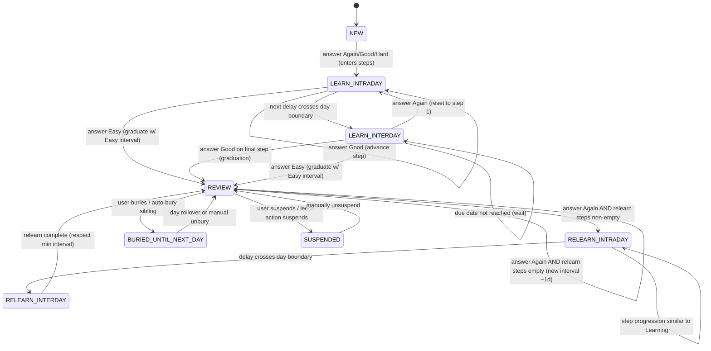

# Implementation-Ready Research Report: Anki-Compatible Scheduling Semantics (Legacy SM‑2‑like) vs FSRS

## Executive summary and scope

**Executive summary for Agent (actionable, implementation-facing)**

1) **FACT — Split the scheduler into two modes:** “legacy SM‑2‑like” vs “FSRS”. Enabling FSRS hides SM‑2‑specific options (e.g., Graduating interval, Easy bonus), and FSRS can only be enabled globally (not per preset).  
2) **FACT — Enforce *day boundary* semantics as a first-class primitive:** “Next day starts at” (default 4AM) defines when a new day begins, and the boundary is time-zone relative. Cards whose delays cross a day boundary appear at the start of the scheduled day.  
3) **FACT — Implement Learning Steps as a discrete step machine, not a multiplier rule:** Again resets to step 1; Good advances to next step; Hard is step-position-dependent (average of first two steps on step 1, otherwise repeats current step); Easy graduates immediately and sets Easy interval.  
4) **FACT — Convert learning delays that cross the day boundary into whole days:** Example in the manual: if next day starts in 5h and delay is 6h, Anki converts to 1 day.  
5) **FACT — Queue gathering order is deterministic in code:** intraday learning → due learning (interday) → due review → new. This is not merely “UI order”; it is implemented in the scheduler queue builder.  
6) **FACT — Legacy review interval formulas (non‑early) must match Anki’s code:**  
   - Hard: `current_interval * hard_multiplier`  
   - Good: `(current_interval + days_late/2) * ease_factor`  
   - Easy: `(current_interval + days_late) * ease_factor * easy_multiplier`  
   Then apply interval modifier (legacy only), fuzz, min/max clamps, and monotonic constraints.  
7) **FACT — Early review (“review ahead”) uses a different formula path and no fuzz:** code switches to an early-review computation when `days_late < 0`, and assigns revlog kind “Filtered”.  
8) **FACT — Ease-factor update constants are fixed in Anki’s legacy path:** initial 2.5, minimum 1.3, deltas: Again −0.2, Hard −0.15, Easy +0.15; Good does not change ease.  
9) **FACT — Lapse and relearn semantics:** pressing Again on a review card increments lapses and triggers leech checks; if Relearning steps are blank, Anki skips relearning and assigns a new interval of 1 day by default.  
10) **FACT — Leech warnings are periodic at half-threshold:** manual says warnings occur at half the initial threshold (e.g., threshold 8 → warnings at 12, 16, …). Code implements “at threshold, then every half-threshold (rounded up) thereafter,” and allows threshold=0 to disable.  
11) **FACT — Core FSRS knobs:** Desired retention is the most important setting; workload grows dramatically as it approaches 1.0 (with specific examples at 0.95/0.97/0.99). “Reschedule cards on change” is off by default; enabling it changes due dates and adds a review entry for each card, increasing collection size.  
12) **FACT — FSRS button semantics must be respected:** FSRS assumes “Hard” means successful recall with difficulty; using Hard when you actually forgot will inflate intervals unreasonably.  
13) **FACT — Anki’s current codebase depends on Rust crate `fsrs` version 5.2.0:** treat this as your baseline FSRS implementation unless you explicitly vendor/change it.  
14) **FACT — FSRS core API shape (crucial for integration):** FSRS returns *per-button* next states via `next_states(current_memory_state, desired_retention, days_elapsed)` giving `again/hard/good/easy`, each containing `{interval, memory}`; memory state contains `{stability, difficulty}`.  
15) **INFERENCE — Testing strategy must be fuzz-aware:** do not unit-test exact integer intervals unless you can stub/seed fuzz; assert range/clamps/monotonic ordering and invariants instead. (Derived from “fuzz exists and cannot be turned off” + code path applying fuzz.)  

**Scope and terminology (precise definitions)**

- **Legacy “SM‑2” in Anki**: The manual calls Anki’s legacy scheduler “SuperMemo 2 (SM‑2)”. In practice, Anki uses an SM‑2‑like variant with configuration multipliers, fuzz, and specific early-review behavior.  
- **FSRS (Free Spaced Repetition Scheduler)**: An alternative scheduler integrated into Anki; it computes scheduling using a DSR-family memory model (difficulty, stability, retrievability). In the FSRS algorithm definition, grade/rating `G` is 1..4 mapping to again/hard/good/easy.  
- **Learning steps / Relearning steps**: Configured step delays that govern new cards (learning) and lapsed review cards (relearning). They are discrete step transitions (not the same as review multipliers).  
- **Intraday learning vs interday learning**: Intraday learning cards are time-critical and are gathered first; steps crossing the day boundary are converted into day-based delays and treated like “due learning” (interday).  
- **Day boundary**: Defined by “Next day starts at” (default 4AM, time-zone relative). Any card crossing the boundary appears at the start of the scheduled day like review cards.  
- **Early review / review ahead**: A review performed before the scheduled due time (`days_late < 0` in Anki code). Anki treats this as “Filtered” review kind and uses special interval logic without fuzz.  
- **Fuzz**: Anki applies random variation to review intervals to avoid cards clustering; learning cards also get up to 5 minutes extra delay and it cannot be disabled.  
- **Leech**: A repeatedly-forgotten review card. Each lapse increments a counter; at threshold Anki tags the note “leech” and (by default) suspends; warnings repeat every half-threshold afterward.  

## Functional behavior model

This section describes *business/UX semantics* (“what the user does” → “what the system does”) so an implementation agent can reproduce Anki-like behavior without reading all source immediately.

**User actions and scheduler responses**

**Answer buttons (Again / Hard / Good / Easy)**  
- **FACT (UI semantics):** Buttons represent recall quality: Again = incorrect/forgot; Hard = correct but difficult; Good = correct with some effort; Easy = correct and effortless. Anki supports a reduced mode using only Again and Good.  
- **FACT (display semantics):** Each answer button shows the *next review time if that button is selected* (note: learning-card “up to 5 minutes” extra delay is not reflected on the buttons).

**New → Learning → Review (legacy and FSRS both use Learning Steps unless FSRS short-term is enabled)**  
- **FACT:** A new card enters the learning step sequence; pressing **Again** sends it to the first step; **Good** advances to the next step; **Easy** graduates immediately to review with the configured Easy interval.  
- **FACT (Hard’s special meaning in learning):** Hard depends on which step the card is on:  
  - On the first step, Hard’s delay is the average of the first two steps (or 1.5× if there is only one step, capped at +1 day).  
  - On later steps, Hard repeats the same step.  

**Learning steps and the day boundary (“crossing day boundary” rule)**  
- **FACT:** Steps smaller than a day are shown as soon as their delay expires, and are prioritized ahead of review cards and new cards.  
- **FACT:** If a step’s delay crosses a day boundary, Anki converts it to days (example: next day starts in 5 hours, delay is 6 hours → becomes 1 day).  
- **FACT:** The day boundary is controlled by “Next day starts at” (default 4AM), and is relative to the user’s current time zone.  

**Learn-ahead limit (end-of-session behavior)**  
- **FACT:** If there is nothing else to study except learning cards, Anki may show learning cards early (default 20 minutes). Setting it to 0 forces Anki to wait the full delay, showing the “congratulations” screen until the remaining cards are ready.  

**Session queue ordering (what shows up first)**  
- **FACT:** Anki gathers/queues cards in this order: intraday learning → due learning (interday) → due review → new. This is implemented in `QueueBuilder::gather_cards()`.  
- **FACT:** Learning cards are “time-critical,” fetched from all decks at once and shown in due order; new and review cards are gathered separately.  

**Review cards: legacy SM‑2‑like behavior vs FSRS behavior (high level)**  
- **FACT (legacy):** For overdue reviews, Anki incorporates lateness (`days_late`) into Good/Easy interval math (Good gets half the lateness).  
- **FACT (FSRS):** In FSRS mode, intervals are sourced from `fsrs_next_states` (again/hard/good/easy); Anki then applies constraints (min/max, monotonic, fuzz policy) without applying the legacy interval modifier.  

**Lapses and relearning (what happens when the user forgets a review card)**  
- **FACT:** Clicking Again on a review card is a “lapse”; it increases a counter and may mark the card as a leech.  
- **FACT:** Relearning steps govern the “relearning stage”; if relearning steps are blank, Anki skips relearning and assigns a new interval of 1 day by default.  

**Burying vs suspending (flow removal semantics)**  
- **FACT:** Bury hides a card/note until the next day (or manual unbury); suspend hides until manually unsuspended.  
- **FACT:** Automatic burying of siblings can occur, and buried cards are excluded from review until day rollover/unbury.  

## State machine and transition table

This section formalizes the functional model into implementable states and transitions.

**Core states (suggested minimum model)**  
These are *conceptual states* aligned to Anki’s queue behavior and scheduling steps:

- `NEW` (unseen/unintroduced)  
- `LEARN_INTRADAY` (learning steps that are due before `next_day_at`)  
- `LEARN_INTERDAY` (learning steps converted into day-based delays; treated like “due learning”)  
- `REVIEW` (graduated review card)  
- `RELEARN_INTRADAY` / `RELEARN_INTERDAY` (after lapse, following relearning steps; if steps blank, skip these)  
- `SUSPENDED` (excluded until manual remove)  
- `BURIED_UNTIL_NEXT_DAY` (excluded until day rollover/unbury)

**Mermaid state diagram (conceptual)**



**Transition table (implementation-level)**  
Legend: “Config” means behavior depends on user options/preset. “Core” means fixed algorithmic semantics.

| From state | Trigger (user/system) | Condition | To state | Scheduling effect (high level) | Core vs config | Primary sources |
|---|---|---|---|---|---|---|
| `NEW` | User answers | any | `LEARN_INTRADAY` | Initialize learning steps; schedule first delay | Config (steps), Core (step semantics) | Anki manual learning steps |
| `LEARN_INTRADAY` | Time passes | due reached | stays eligible | Card enters queue ahead of reviews/new | Core | Queue order + manual time-critical learning |
| `LEARN_INTRADAY` | Answer Again | — | `LEARN_INTRADAY` | Reset to first step | Core | |
| `LEARN_INTRADAY` | Answer Hard | step=first | `LEARN_INTRADAY` | Delay = avg(first two steps) OR 1.5× single step | Core | |
| `LEARN_INTRADAY` | Answer Hard | step>first | `LEARN_INTRADAY` | Repeat same step | Core | |
| `LEARN_INTRADAY` | Answer Good | not final | `LEARN_INTRADAY` | Advance to next step | Core | |
| `LEARN_*` | Answer Easy | — | `REVIEW` | Graduate immediately with Easy interval | Config (Easy interval), Core (semantics) | |
| `LEARN_INTRADAY` | Step delay crosses day boundary | computed | `LEARN_INTERDAY` | Convert delay to whole days; due at start of day | Core | |
| `LEARN_INTERDAY` | Day start reached | due | eligible in due-learning queue | Appears with reviews/due learning | Core | |
| `REVIEW` | Answer Hard/Good/Easy | legacy mode & `days_late>=0` | `REVIEW` | Use legacy formulas + constraints | Core+Config (multipliers) | |
| `REVIEW` | Answer Hard/Good/Easy | legacy mode & `days_late<0` | `REVIEW` | Use early-review formulas; revlog kind=Filtered; no fuzz in early calc | Core | |
| `REVIEW` | Answer Hard/Good/Easy | FSRS mode | `REVIEW` | Use `fsrs_next_states` intervals + constraints (no interval modifier) | Core | |
| `REVIEW` | Answer Again | relearn steps non-empty | `RELEARN_*` | Lapses++; leech check; schedule relearn step delay | Config (relearn steps), Core | |
| `REVIEW` | Answer Again | relearn steps empty | `REVIEW` | Lapses++; leech check; new interval defaults to ~1 day | Config (lapse multiplier/min), Core | |
| Any | User suspends / leech action suspends | — | `SUSPENDED` | Exclude from queues until unsuspend | Config+UX | |
| Any | User buries / sibling bury | — | `BURIED_UNTIL_NEXT_DAY` | Exclude until day rollover/unbury | Config+UX | |

## Parameters and rules inventory

The goal here is to make “what to implement” explicit, and to mark **core algorithm vs configuration vs UX**. (Table uses “Core”/“Config” labels per requirement.)

| Parameter / rule | Where configured | Applies to | Meaning | Core vs config | Key implementation implications / risks |
|---|---|---|---|---|---|
| Next day starts at | Preferences | All scheduling & queues | Defines day boundary; time-zone relative; boundary-crossing delays appear at start of scheduled day | Config (but foundational) | **Must not assume midnight**. Incorrect boundary breaks interday learning and daily counts. |
| Learn ahead limit | Preferences | Learning queues | If only learning left, show learning cards early up to limit; 0 means wait full delay | Config | Impacts end-of-session behavior; affects “Again pile not appearing” user perception. |
| Learning steps | Deck options (preset) | New cards | Step delays + step transition semantics | Config (steps), Core (rules) | Hard semantics are step-dependent; crossing day boundary converts to days. |
| Graduating interval | Deck options (legacy only) | Graduation to review | First review interval after last learning step with Good | Config | Hidden under FSRS; do not apply in FSRS mode. |
| Easy interval | Deck options | Learning | Easy graduates immediately and schedules this delay | Config | Must enforce “Easy >= Graduating” recommendation (UX expectation). |
| Relearning steps | Deck options | Lapses (Again in review) | Relearning steps before returning to review | Config | If blank, skip relearn and assign ~1 day default; do not “invent” steps. |
| Hard multiplier (“Hard interval”) | Deck options (legacy) | Review | Hard interval multiplier relative to previous interval | Config | Used in legacy interval formulas and early-review half-usual logic; affects monotonic constraints. |
| Easy multiplier (“Easy bonus”) | Deck options (legacy) | Review | Easy interval multiplier | Config | In early review path uses reduced bonus; hidden under FSRS. |
| Interval modifier | Deck options (legacy) | Review | Global multiplier to review intervals | Config | **Not applied when FSRS is active** (explicit in code). |
| Lapse multiplier (“New interval”) | Deck options (legacy) | Lapses | Interval after lapse = current interval × lapse multiplier (then fuzz/clamp) | Config | Must apply with review fuzz/clamp; still ensure ≥1 day. |
| Minimum lapse interval / Minimum interval | Deck options (lapses) | Lapses & relearn return | Minimum interval after lapse/relearn | Config | Combined with clamp logic; ensure min/max semantics match Anki’s `min_and_max_review_intervals`. |
| Maximum interval | Deck options | Review | Cap the interval; at cap Hard/Good/Easy can become identical | Config | Must clamp final scheduled days; affects invariants & tests. |
| Fuzz | Core behavior (not configurable) | Review + learning | Randomizes review intervals; learning adds up to 5 min extra delay; cannot be disabled | Core | Tests must be fuzz-aware; v3 shows fuzz on buttons. |
| Ease factor constants and deltas | Core constants (code) | Legacy review | Initial 2.5, min 1.3, deltas: Again −0.2, Hard −0.15, Easy +0.15 | Core | If mismatched, legacy parity breaks; Good must not change ease. |
| FSRS enable | Deck options (global) | Whole collection | FSRS on/off globally; cannot vary per preset | Config (global) | Mode separation is mandatory; avoid mixing legacy options into FSRS scheduling. |
| Desired retention | Deck options (preset) | FSRS scheduling | Target success probability at due time; impacts intervals nonlinearly (0.95/0.97/0.99 examples) | Config | Critical knob; changing it can trigger mass due cards if “reschedule on change” is enabled. |
| FSRS parameters | Deck options (preset) | FSRS scheduling | Learned parameters; manual warns not to copy/hand-edit | Config (learned) | Implement optimization as “writes preset parameters”; do not treat as dynamic per review. |
| Reschedule cards on change | Deck options (FSRS) | FSRS migration/change mgmt | Whether enabling FSRS / changing retention/params rewrites due dates immediately | Config | Default off; when on, adds revlog entries and can create huge backlog; must be explicit and reversible. |
| FSRS short-term scheduling | Deck options (FSRS, experimental) | FSRS | Leaving (re)learning steps empty lets FSRS control short-term; FSRS may output <1d but not guaranteed | Config (experimental) | Anki code contains short-term gating around scheduled_days < 0.5 and FSRS flags; treat as version-sensitive. |
| Historical retention / Ignore cards reviewed before | Deck options (FSRS advanced) | FSRS training | Fill missing history; exclude old reviews from optimization | Config | Migration/training correctness; requires careful dataset filtering. |
| Leech threshold + action | Deck options (lapses) | Lapses | Threshold triggers “leech” tag and optional suspend; warnings repeat every half-threshold | Config (threshold/action), Core (periodicity logic) | Code implements half-threshold rounding and threshold=0 disabling; must match. |
| Bury siblings (new/review/interday learning) | Deck options | Queue building | Auto-bury sibling cards; bury duration until next day/unbury | Config | Queue builder decides bury per kind (review vs interday learning vs new). |

## Version and implementation differences

**Scheduler generation (v2 vs v3) and fuzz visibility**

- **FACT:** Anki applies fuzz, and it cannot be turned off.  
- **SECONDARY (community/operations, not manual):** Users report that older schedulers did not show fuzzed intervals above buttons, while v3 does show them. Treat as a UX/display difference, not necessarily an algorithmic change.  

**FSRS enablement requirements and client compatibility**

- **FACT:** Before enabling FSRS, the manual requires all clients support it: Anki 23.10+, AnkiMobile 23.10+, AnkiWeb supports it, and AnkiDroid supports it in 2.17+. If a client doesn’t support it, “things will not work correctly.”  
- **INFERENCE:** If you are implementing an Anki-compatible system with multiple clients, you must treat FSRS enable/disable as a compatibility boundary (e.g., schema version gating, feature flags). (Derived from the explicit compatibility warning.)  

**FSRS algorithm versions vs Anki’s embedded implementation**

- **FACT (FSRS wiki):** The FSRS algorithm page specifies formulas for FSRS‑6, FSRS‑5, and FSRS‑4.5, including parameter counts (FSRS‑5 uses 19 parameters; FSRS‑6 uses 21), and provides core equations (e.g., retrievability `R(t,S)` and interval solving `I(r,S)` in FSRS‑4.5).  
- **FACT (Anki code dependency):** Anki’s `Cargo.toml` pins workspace dependency `fsrs = "5.2.0"`.  
- **UNCERTAIN (needs confirmation):** Whether `fsrs` crate 5.2.0 implements “FSRS‑5 exactly as written in the wiki” vs minor variations. The safest implementation stance is “behavior defined by the pinned crate + Anki integration constraints,” and use the wiki as conceptual reference.  
  - Confidence: **Medium** (version pin is certain; exact formula parity requires inspecting crate source).  

**Review queue sorting under FSRS**

- **FACT:** The queue builder passes an `fsrs` flag into due-card retrieval (`for_each_due_card_in_active_decks(..., self.context.fsrs, ...)`), implying due sorting/priority can depend on whether FSRS is active.  
- **UNCERTAIN:** The exact “overdueness/priority” formula under FSRS vs legacy is not fully documented in the cited manual excerpts; to reproduce exact ordering you likely need to inspect the storage query implementation that uses that `fsrs` flag.  
  - Confidence: **Medium** (flag exists; details not captured here).  

## Evidence-backed findings

Format required: Claim / Why it matters / Evidence / Confidence / Source citations.

**Finding: Learning Steps step-machine semantics are fixed and step-position dependent**  
- **Claim:** Again resets to step 1; Good advances; Hard is average-of-first-two-steps on first step (or 1.5× if only one step), otherwise repeats current step; Easy graduates immediately and uses Easy interval.  
- **Why it matters:** This is the most common place “Anki-compatible” implementations diverge (people wrongly reuse review multipliers). It affects both scheduling and what button labels show.  
- **Evidence:** Deck Options manual’s Learning Steps section spells out each case.  
- **Confidence:** High  

**Finding: Day boundary is configurable and governs step-to-days conversion**  
- **Claim:** Day boundary is defined by “Next day starts at” (default 4AM), and step delays crossing the boundary convert to day-based delays (example: 6h delay with boundary in 5h → 1 day).  
- **Why it matters:** If you treat day boundary as midnight or ignore conversion, interday learning and daily counts will drift from Anki behavior.  
- **Evidence:** Preferences page (Next day starts at + boundary-crossing behavior) and Deck Options (day boundary conversion example).  
- **Confidence:** High  

**Finding: Queue gathering order is “learn first” and is implemented in code**  
- **Claim:** Cards are gathered in order: intraday learning → due learning → due review → new.  
- **Why it matters:** Even with identical interval math, presenting cards in a different order changes perceived workload and sibling burying interactions.  
- **Evidence:** `QueueBuilder::gather_cards()` calls `gather_intraday_learning_cards`, then due learning, then due review, then new.  
- **Confidence:** High  

**Finding: Legacy review interval math (non‑early) depends on lateness in a specific way**  
- **Claim:** In legacy mode for non-early reviews, Anki computes:  
  - Hard: `current_interval * hard_multiplier`  
  - Good: `(current_interval + days_late/2) * ease_factor`  
  - Easy: `(current_interval + days_late) * ease_factor * easy_multiplier`  
- **Why it matters:** “Good uses half lateness” is a subtle but consequential behavioral detail (changes how overdue reviews recover).  
- **Evidence:** `passing_nonearly_review_intervals()` code.  
- **Confidence:** High  

**Finding: Early reviews are special-cased and logged as filtered**  
- **Claim:** If `days_late < 0`, Anki uses `passing_early_review_intervals()` and sets revlog kind to `Filtered`; early-review intervals are constrained without fuzz.  
- **Why it matters:** Filtered decks/review-ahead features depend on “early review” effects being less distortive and differently logged; reusing normal formulas would diverge.  
- **Evidence:** `revlog_kind()` returns Filtered when `days_late < 0`; early intervals call `constrain_passing_interval(..., fuzz=false)`.  
- **Confidence:** High  

**Finding: Interval modifier applies in legacy but not in FSRS**  
- **Claim:** Anki multiplies passing intervals by `interval_multiplier` only when FSRS is not active (`ctx.fsrs_next_states.is_none()`); in FSRS mode it leaves the interval as given by FSRS (then applies other constraints).  
- **Why it matters:** If you mistakenly apply the legacy interval modifier in FSRS you will double-scale intervals and break retention targeting.  
- **Evidence:** `constrain_passing_interval()` code.  
- **Confidence:** High  

**Finding: Ease-factor constants and deltas are stable and enforce minimum**  
- **Claim:** Initial ease factor is 2.5; minimum is 1.3; Again delta −0.2; Hard delta −0.15; Easy delta +0.15; Good does not change ease; Anki clamps decreases at minimum for Again and Hard.  
- **Why it matters:** Implementations that guess these values or treat them as config diverge quickly over months of usage.  
- **Evidence:** Constants and `answer_*` logic in review state.  
- **Confidence:** High  

**Finding: Lapse interval computation differs between legacy vs FSRS**  
- **Claim:** On Again in review:  
  - If FSRS next states are available, failing interval uses `states.again.interval` (and notes fuzz is applied when leaving relearning).  
  - Otherwise, failing interval uses `max(scheduled_days,1) * lapse_multiplier`, then applies review fuzz and clamps.  
- **Why it matters:** Migration and mixed-mode handling depend on this; it also affects when/where fuzz is applied.  
- **Evidence:** `failing_review_interval()` and `answer_again()` code.  
- **Confidence:** High  

**Finding: Leech threshold periodicity is half-threshold (rounded up)**  
- **Claim:** A leech alert triggers at threshold and then every half threshold after that (rounded up); threshold 0 disables.  
- **Why it matters:** Users rely on predictable “every N lapses” alerts; incorrect periodicity changes tagging/suspension patterns.  
- **Evidence:** Manual describes half-threshold warnings; code implements `half_threshold = ceil(threshold/2)` and modulo logic plus tests.  
- **Confidence:** High  

**Finding: FSRS API returns per-button ItemState including interval and memory state**  
- **Claim:** `FSRS::next_states(current_memory_state, desired_retention, days_elapsed)` returns `NextStates` with `again/hard/good/easy`, each an `ItemState { memory: MemoryState { stability, difficulty }, interval: f32 }`.  
- **Why it matters:** This defines the integration contract: the scheduler UI and scheduling logic must be able to show/compute all four outcomes in advance.  
- **Evidence:** docs.rs pages for `FSRS::next_states`, `NextStates`, `ItemState`, `MemoryState`.  
- **Confidence:** High  

## Implementation guidance, misconceptions, and handoff

**Common misconceptions (implementation-dangerous)**

- **Misconception:** “Hard means failed recall.”  
  - **Correction (FACT):** In FSRS, Hard assumes you recalled correctly (with difficulty). Using Hard when you forgot leads to “unreasonably high” intervals.  
- **Misconception:** “Day boundary is midnight.”  
  - **Correction (FACT):** Day boundary is “Next day starts at” (default 4AM) and time-zone relative.  
- **Misconception:** “Learning Hard is just a multiplier similar to review Hard.”  
  - **Correction (FACT):** Learning Hard is discrete: average-of-first-two-steps on first step; otherwise repeats the current step.  
- **Misconception:** “Early reviews use the same math as normal reviews.”  
  - **Correction (FACT):** Anki takes a separate early-review path and logs such reviews as filtered kind.  
- **Misconception:** “Fuzz can be turned off or ignored in tests.”  
  - **Correction (FACT):** Fuzz exists and can’t be disabled; learning also gets up to 5 minutes extra delay.  

**Implementation guidance for Agent**

**Things the Agent should preserve (non-negotiable parity points)**  
- Preserve day-boundary semantics and step-to-days conversion exactly.  
- Preserve the queue gathering order (intraday learning → due learning → due review → new).  
- Preserve legacy review formulas + constraint pipeline: monotonic mins, interval modifier (legacy only), fuzz application, and clamp to min/max.  
- Preserve early-review split: special math path, no fuzz in early review calc, revlog kind “Filtered”.  
- Preserve leech periodicity (threshold then every half-threshold) and threshold=0 disabling.  
- Preserve FSRS integration contract: FSRS provides per-button next states; Anki applies constraints without interval modifier in FSRS mode.  

**Things the Agent must not assume (high-risk guesses)**  
- Do not assume a fixed fuzz distribution/range unless you verify Anki’s `with_review_fuzz` implementation (not captured fully in this report).  
- Do not assume FSRS algorithm version from the wiki alone; Anki pins `fsrs` crate 5.2.0 (verify crate source if strict formula parity is required).  
- Do not assume FSRS “short-term scheduling experimental” equals “always produce <1 day”; manual explicitly says it may not.  
- Do not assume “reschedule on change” is safe by default; the manual warns it can create many due cards and adds a review entry per card.  

**Recommended implementation invariants (write these as assertions/contracts)**  
- Interval invariants (legacy + FSRS):  
  - `scheduled_days >= 1` after rounding/clamping for review states.  
  - Enforce monotonicity constraints (e.g., `hard < good < easy` with +1 mins) as Anki does (FSRS path uses minima based on “greater_than_last”, hard+1, good+1).  
- Ease invariants (legacy):  
  - `ease_factor >= 1.3`, initial `2.5`, and deltas as constants.  
- Day invariants:  
  - Day boundary computed from “Next day starts at” and current timezone; don’t hardcode midnight.  
- Mode invariants:  
  - If FSRS active (`fsrs_next_states` present), do not apply interval multiplier to passing intervals.  

**Edge cases the Agent must cover (test cases)**  
1) Learning steps: multiple steps vs single step; verify Hard averaged delay vs 1.5× exception and cap behavior.  
2) Learning delay crossing day boundary: verify conversion to 1+ day and due-at-day-start semantics based on `next_day_at`.  
3) Learn-ahead limit = 0 vs default: ensure “wait full delay” behavior when only learning remains.  
4) Legacy review intervals: non‑early (`days_late >= 0`) vs early (`days_late < 0`) and ensure early uses `Filtered` revlog kind.  
5) Interval modifier: verify applied only in legacy.  
6) Lapse with relearn steps blank: skip relearn and default to ~1 day (then clamp); confirm lapses++ and leech check.  
7) Leech periodicity: threshold 8 → leech at 8 and warnings at 12, 16, …; threshold odd numbers → half-threshold rounded up; threshold 0 disables.  
8) FSRS: ensure `next_states()` returns four outcomes; ensure Anki’s constraints can bump intervals upward (e.g., “greater_than_last” rule) and apply fuzz policy consistent with Anki integration.  

**Non-goals (avoid accidental redesign)**  
- Do not redesign the answer-button semantics (especially Hard vs Again meaning) in FSRS mode.  
- Do not attempt to “optimize away” fuzz or make it optional if you aim for Anki parity.  
- Do not auto-enable “reschedule on change” during FSRS migration; the manual recommends sparing use and backups due to potential backlog and revlog growth.  

**Open questions / ambiguities (explicitly unresolved)**

1) **Exact fuzz distribution and seeding (`with_review_fuzz`)**  
   - What is the precise fuzz range/algorithm in current Anki? The manual confirms its existence and non-disable-ability, and the code shows where fuzz is applied, but the exact distribution is not captured here.  
   - Confidence: **Medium** (we know the hook points; detailed parameters require more code inspection).

2) **FSRS short-term experimental gating**  
   - Manual: leaving (re)learning steps empty lets FSRS control short-term scheduling; FSRS may still produce ≥1 day intervals.  
   - Code: contains gating around `fsrs_allow_short_term`, `fsrs_short_term_with_steps_enabled`/`relearn_steps.is_empty()`, and `scheduled_days < 0.5`.  
   - Confidence: **Medium** (mechanism exists; full mapping from UI toggles → flags needs further inspection).

3) **Due-card ordering under FSRS vs legacy**  
   - Queue builder passes `context.fsrs` to storage iteration; exact sorting criterion (e.g., retrievability-based priority) is not shown in the captured excerpts.  
   - Confidence: **Medium**.

**Final handoff block for Agent (copy/paste)**

```text
### Agent Handoff
- Objective:
  Implement Anki-compatible scheduling behavior for (1) legacy SM-2-like mode and (2) FSRS mode, matching Anki’s day-boundary, learning/relearning, review/early-review, fuzz, ease updates, queue order, and leech behavior.

- Must preserve:
  - Day boundary = “Next day starts at” (default 4AM, timezone-relative); boundary-crossing step delays convert to whole days and appear at scheduled day start.
  - Learning step semantics: Again resets to step 1; Good advances; Hard = avg(first two steps) on first step (or 1.5× single step with cap), otherwise repeats step; Easy graduates immediately with Easy interval.
  - Queue gathering order: intraday learning → due learning (interday) → due review → new.
  - Legacy review math (non-early): Hard = current*hard_mult; Good = (current+daysLate/2)*ease; Easy = (current+daysLate)*ease*easy_mult.
  - Early review path: separate math, no fuzz in the early interval computation, and revlog kind treated as “Filtered”.
  - Constraint pipeline for passing intervals: apply interval modifier only in legacy; apply fuzz; clamp to min/max; enforce monotonic mins.
  - Legacy ease constants: initial 2.5; min 1.3; Again -0.2; Hard -0.15; Easy +0.15; Good unchanged.
  - Leech periodicity: alert at threshold, then every half-threshold afterward (rounded up); threshold 0 disables.

- Must fix / implement:
  - Two-mode architecture (legacy vs FSRS): when FSRS active, intervals come from per-button fsrs next states; do not apply legacy interval modifier.
  - Lapse handling: lapses++ and leech check on Again in review; if relearn steps blank, skip relearn and default new interval ~1 day (then clamp/fuzz as appropriate).
  - Learn-ahead limit behavior at end of session (0 = wait full delay).

- Constraints:
  - Avoid guessing fuzz distribution; tests must be fuzz-aware unless you can seed/stub.
  - Do not reinterpret Hard semantics in FSRS; Hard implies successful recall.

- Required tests:
  - Learning steps: multi-step, single-step Hard rule, crossing day boundary conversion.
  - Queue ordering: verify gather order and interactions with burying (new vs review vs interday learning).
  - Legacy review: non-early vs early review; interval formula checks; interval modifier legacy-only; min/max clamp; monotonic ordering.
  - Lapses + relearn blank/non-blank; leech threshold periodicity and threshold=0.
  - FSRS integration: next_states gives 4 outcomes; Anki-side constraints and minima; ensure no interval modifier applied.

- Known ambiguities:
  - Exact fuzz distribution/seeding (needs inspection of Anki’s with_review_fuzz implementation).
  - Exact FSRS short-term experimental gating (UI flags → scheduler flags mapping).
  - Due-card sorting/prioritization under FSRS vs legacy (storage query uses an fsrs flag; details need inspection).

- Recommended priority:
  1) Time model (day boundary, learn-ahead)
  2) Learning/relearning step machine
  3) Queue builder ordering + burying
  4) Legacy review math + constrain pipeline + ease updates
  5) Early review special path + revlog kind
  6) Leech periodicity + action behavior
  7) FSRS integration path (next_states, constraints, migration knobs)
```