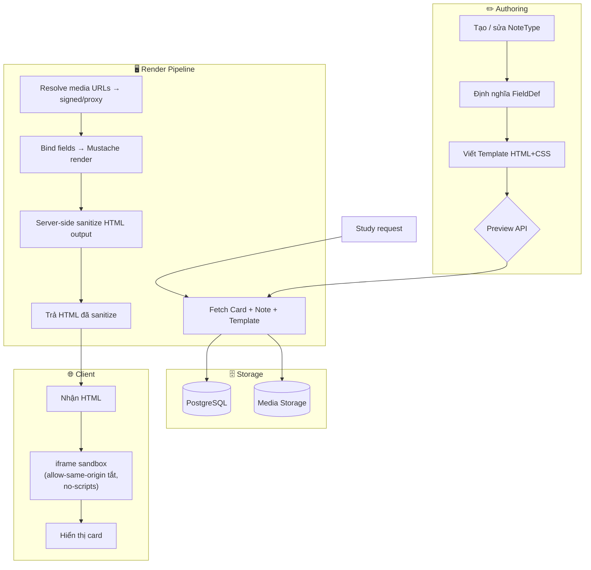
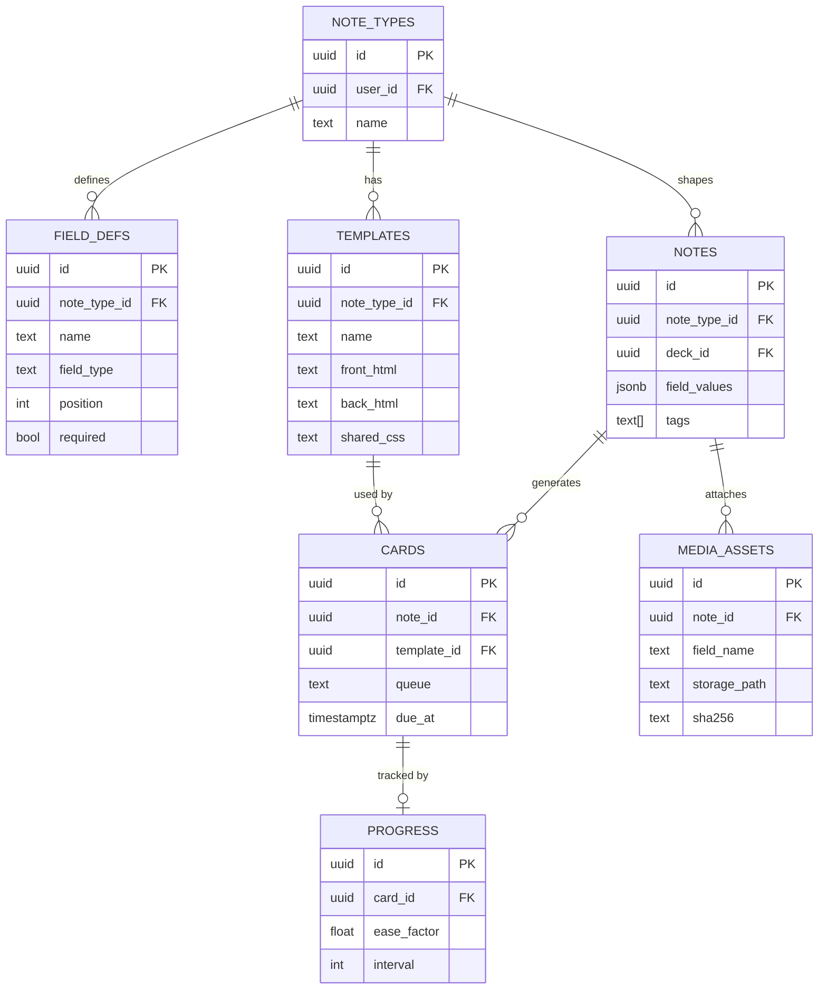

# Thiết kế Hệ thống Flashcard – Flama (Anki-like)

---

## (0) Assumptions & Non-goals

### Assumptions
| # | Giả định |
|---|---|
| 1 | Platform: web app Python/Flask, PostgreSQL, render phía **server** (Jinja2 cho app shell); card template render phía **client** (browser) trong sandbox iframe |
| 2 | Media (image/audio/diagram) lưu trên **local filesystem hoặc object storage** (S3-compatible); URL được ký (signed) hoặc phục vụ qua proxy nội bộ |
| 3 | Mỗi user có thể có NoteType riêng (multi-tenant nhẹ); không có marketplace NoteType công khai trong phạm vi thiết kế này |
| 4 | Template viết bằng HTML + CSS. **Không cho phép JS tùy ý** trong template người dùng (chọn policy NoJS để đơn giản hóa sandbox và giảm attack surface) |
| 5 | Hệ thống scheduling (spaced repetition) hiện có (FSRS/SM-2) được giữ nguyên; Card entity chỉ được mở rộng FK, không đổi logic scheduler |
| 6 | Mỗi NoteType có ít nhất 1 Template; 1 Note sinh đúng 1 Card per Template |
| 7 | Rich field (Meaning_JP, Additional_Note) cho phép HTML đã sanitize khi lưu ("stored-sanitized") |
| 8 | Không hỗ trợ cộng tác real-time trên cùng 1 note (single-editor) |

### Non-goals
- **Marketplace / chia sẻ NoteType** giữa user
- **LaTeX math rendering** (có thể bổ sung sau)
- **Offline/mobile native** sync (PWA/websocket ngoài phạm vi)
- **Conflict resolution** khi multi-device chỉnh cùng lúc
- **Versioning lịch sử** của từng Note (audit log là đủ)
- **Phân quyền chi tiết** trong cùng team/workspace

---

## (1) High-level Architecture

### Data flow tổng quát

```
Người dùng
  │
  ├─► [Tạo NoteType] → định nghĩa FieldDef list → tạo Template (Front/Back HTML+CSS)
  │
  ├─► [Tạo Note] → form sinh động từ FieldDef → lưu field_values JSON → sinh Card(s)
  │
  ├─► [Preview Template] → API /preview → server bind Note mẫu → trả HTML → iframe client
  │
  └─► [Study] → fetch Card → server render template + bind field values → iframe sandbox client
```

### Pipeline render & study



---

## (2) Domain Model

### Entities & Quan hệ

| Entity | Mô tả |
|---|---|
| **NoteType** | Định nghĩa "kiểu thẻ": tên, danh sách field, danh sách template |
| **FieldDef** | 1 field trong NoteType: tên, kiểu (text/richtext/image/audio/diagram), vị trí, có bắt buộc không |
| **Template** | Front HTML + Back HTML + CSS gắn với NoteType; 1 NoteType ≥ 1 Template |
| **Note** | 1 bộ dữ liệu thực tế của user: gắn với NoteType, chứa `field_values` (JSON key→value) |
| **Card** | 1 "thẻ học" được sinh từ Note + Template; chứa trạng thái scheduling |
| **MediaAsset** | File media: path, mimetype, hash, owner Note; orphan được dọn theo job |
| **Progress** (giữ nguyên) | Bảng scheduling hiện tại; FK → Card.id không đổi |

### Cardinality

```
NoteType ──< FieldDef       (1 NoteType có nhiều FieldDef)
NoteType ──< Template       (1 NoteType có nhiều Template)
NoteType ──< Note           (1 NoteType có nhiều Note)
Note     ──< Card           (1 Note × nhiều Template → nhiều Card)
Note     ──< MediaAsset     (1 Note có nhiều media file)
Card     ──1 Progress       (1 Card có 1 progress record)
```

---

## (3) Data Model

### So sánh 3 phương án lưu field_values

| Tiêu chí | **A: JSONB column** | **B: EAV table** | **C: Hybrid (JSONB + typed columns)** |
|---|---|---|---|
| Thêm field mới | Không cần migration | Không cần migration | Không cần migration |
| Query theo field | Cần index GIN; chậm hơn SQL thường | Query dễ nhưng nhiều JOIN | JSONB cho data thường, typed col cho field đặc biệt |
| Validation | App-layer | App-layer (hoặc check constraint) | App-layer |
| Độ phức tạp | **Thấp** | Cao (JOIN explosion) | Trung bình |
| PostgreSQL support | Native JSONB rất tốt | Chuẩn | Cần thiết kế kỹ |
| Migration từ schema cũ | Backfill 1 lần → JSON | Backfill nhiều row | Backfill 1 lần |
| Khuyến nghị | ✅ **CHỌN** | ✗ | Dự phòng nếu có filter phức tạp |

> **Quyết định: Phương án A – JSONB column.**
> Lý do: PostgreSQL JSONB có GIN index hỗ trợ tìm kiếm đủ dùng; không cần JOIN; backfill đơn giản; độ phức tạp triển khai thấp nhất; phù hợp tốc độ phát triển hiện tại của Flama.

### Schema đề xuất (phương án JSONB)

```
note_types
  id          UUID PK
  user_id     UUID FK → users.id
  name        TEXT NOT NULL
  created_at  TIMESTAMPTZ
  updated_at  TIMESTAMPTZ

field_defs
  id            UUID PK
  note_type_id  UUID FK → note_types.id
  name          TEXT NOT NULL         -- "Word", "Reading", ...
  field_type    ENUM(text, richtext, image, audio, diagram)
  position      INT NOT NULL
  required      BOOLEAN DEFAULT false
  UNIQUE(note_type_id, name)

templates
  id            UUID PK
  note_type_id  UUID FK → note_types.id
  name          TEXT NOT NULL         -- "Cơ bản", "Đảo chiều", ...
  front_html    TEXT                  -- Mustache template
  back_html     TEXT
  shared_css    TEXT
  position      INT
  is_default    BOOLEAN DEFAULT false

notes
  id            UUID PK
  note_type_id  UUID FK → note_types.id
  user_id       UUID FK → users.id
  deck_id       UUID FK → decks.id   -- giữ tương thích
  field_values  JSONB NOT NULL        -- {"Word":"犬","Reading":"いぬ",...}
  tags          TEXT[]
  created_at    TIMESTAMPTZ
  updated_at    TIMESTAMPTZ
  INDEX GIN(field_values)
  INDEX GIN(tags)

cards
  id            UUID PK
  note_id       UUID FK → notes.id
  template_id   UUID FK → templates.id
  due_at        TIMESTAMPTZ
  due_day       INT
  queue         TEXT                  -- new/learning/review/relearning
  -- (columns scheduling giữ nguyên hiện tại)

media_assets
  id            UUID PK
  note_id       UUID FK → notes.id
  field_name    TEXT                  -- field nào chứa asset này
  filename      TEXT
  mime_type     TEXT
  storage_path  TEXT                  -- relative path hoặc object key
  sha256        TEXT                  -- dedup + verify
  size_bytes    INT
  created_at    TIMESTAMPTZ
```

### ERD



---

## (4) Template System Spec

### Template engine: **Mustache** (thư viện `chevron` phía Python)

**Lý do chọn Mustache:**
- Logic-less → không thể nhúng code tùy ý
- Hỗ trợ `{{#Field}}...{{/Field}}` and `{{^Field}}` natively
- Escape HTML mặc định cho `{{Field}}` (double-mustache)
- `{{{Field}}}` (triple-mustache) = raw HTML — chỉ dùng cho field type `richtext` sau khi đã sanitize phía server
- Thư viện Python nhỏ gọn, không có eval/exec

### Quy tắc placeholder

| Cú pháp | Ý nghĩa |
|---|---|
| `{{Word}}` | Escape HTML, bind giá trị text của field "Word" |
| `{{{Meaning_JP}}}` | Raw HTML, **chỉ** cho field type `richtext` (đã stored-sanitize) |
| `{{#Reading}}...{{/Reading}}` | Render block nếu field "Reading" không rỗng |
| `{{^Reading}}...{{/Reading}}` | Render block nếu field "Reading" rỗng/thiếu |
| `{{Word_Audio}}` | Trả về HTML `<audio>` element đã build sẵn (server inject) |
| `{{image}}` | Trả về HTML `` element đã build sẵn với src đã proxy |

### Xử lý từng field type khi bind

| Field type | Binding behavior |
|---|---|
| `text` | Escape HTML → double-mustache `{{Field}}` |
| `richtext` | Server sanitize (allowlist) → lưu clean HTML → triple-mustache `{{{Field}}}` |
| `image` | Server build `` → triple-mustache |
| `audio` | Server build `<audio controls src="/media/proxy/{asset_id}"></audio>` → triple-mustache |
| `diagram` | Tương tự image; nếu là SVG inline thì sanitize SVG mạnh |

### "Field rỗng" được định nghĩa là

- Key không tồn tại trong `field_values` JSON, **hoặc**
- Giá trị là `null`, chuỗi rỗng `""`, hoặc mảng rỗng `[]`
- Tất cả ba trường hợp → `{{#Field}}` block KHÔNG render; `{{^Field}}` block render

---

## (5) Rendering & Security Design

### Render ở đâu: **Hybrid (Server render → Client display)**

- Server dùng Mustache bind field values vào template HTML
- Server sanitize output
- Trả full HTML string đến client
- Client nhúng vào `<iframe sandbox>` (không eval, không fetch tùy ý)

**Lý do không render thuần client:** Tránh lộ raw template + field data cho client khi chưa cần; server đủ tài nguyên sanitize nghiêm; giảm phức tạp client.

### Chính sách sanitize (HTML Allowlist)

Dùng thư viện `bleach` (Python) với allowlist sau:

**Tags được phép:**
```
div, span, p, br, hr,
strong, em, b, i, u, s, mark,
h1, h2, h3, h4, h5, h6,
ul, ol, li,
table, thead, tbody, tr, th, td,
img, audio, video, source,
ruby, rt, rp,
a (href chỉ https:// hoặc /media/proxy/)
```

**Attributes được phép:**
```
class, id, style (chỉ whitelist property CSS: color, font-*, text-align, margin, padding)
src (chỉ /media/proxy/ prefix)
alt, controls, autoplay (audio only)
href (chỉ https:// hoặc /media/proxy/)
```

**Bị loại bỏ hoàn toàn:** `<script>`, `<iframe>`, `<form>`, `<input>`, `on*` event attributes, `javascript:` URIs, `data:` URIs (trừ image sau verify), `<link>`, `<meta>`, `<object>`, `<embed>`

### Iframe sandbox config

```
sandbox="allow-same-origin"
```
**Không có** `allow-scripts` → JS hoàn toàn bị vô hiệu trong iframe dù template có chèn.
CSS trong template được phép (không chặn style) nhưng scoped trong iframe.

### CSP header cho endpoint trả card HTML

```
Content-Security-Policy:
  default-src 'none';
  style-src 'unsafe-inline';
  img-src /media/proxy/;
  media-src /media/proxy/;
  frame-ancestors 'self'
```

### XSS test cases phải chặn được (tối thiểu 8)

| # | Input | Expected |
|---|---|---|
| 1 | `{{Word}}` = `<script>alert(1)</script>` | Escaped → `&lt;script&gt;` |
| 2 | `{{{Meaning_JP}}}` = `<script>alert(2)</script>` | Stripped bởi bleach |
| 3 | `` trong richtext | `onerror` attribute bị strip |
| 4 | `<a href="javascript:alert(4)">` | href bị strip (không whitelist javascript:) |
| 5 | `<iframe src="https://evil.com">` | Tag bị strip hoàn toàn |
| 6 | `style="background:url(javascript:...)"` | CSS property này bị strip |
| 7 | SVG diagram chứa `<script>` | SVG sanitizer strip script node |
| 8 | Template front_html = `<meta http-equiv="refresh" content="0;url=...">` | meta tag bị strip |
| 9 | Audio src = `https://evil.com/track.mp3` | Thay bằng /media/proxy/ hoặc reject |
| 10 | `{{Word}}` = `" onmouseover="alert(10)` | Escaped trong attribute context |

---

## (6) Migration Plan

### Thứ tự các bước

```
1. [PREP]   Tạo các bảng mới (note_types, field_defs, templates, notes, media_assets)
            song song với bảng vocabulary_entry cũ — không drop gì.

2. [SEED]   Insert 1 NoteType "Legacy Japanese" với FieldDef list sau:
            Word(text), hanviet(text), Reading(text), Translation_VI(text),
            Meaning_JP(richtext), Meaning_VI(richtext),
            Usage_JP(richtext), Usage_VI(richtext),
            Example_JP(richtext), Example_VI(richtext),
            Additional_Note_JP(richtext), Additional_Note_VI(richtext),
            image(image), Diagram(diagram),
            Word_Audio(audio), Example_Audio(audio)

3. [SEED]   Insert Template "Legacy Front" và "Legacy Back" với nội dung HTML
            tương đương template Anki hiện tại (mustache syntax).

4. [BACKFILL] Script backfill:
            - Mỗi VocabularyEntry → 1 Note (field_values = JSON từ các cột)
            - Note.deck_id = Entry.deck_id
            - Sinh 1 Card từ Note × Template "Legacy"
            - Card.id mới; ghi mapping old_entry_id → new_card_id vào bảng tạm migration_map

5. [PROGRESS] Migrate VocabularyProgress:
            - Với mỗi progress record: tìm card_id mới từ migration_map
            - Chèn record Progress mới với card_id mới; giữ nguyên ease/interval/due_at
            - KHÔNG xóa progress cũ cho đến khi verify xong

6. [VERIFY] Checksum / sample compare:
            - COUNT(vocabulary_entry) == COUNT(notes WHERE note_type = Legacy)
            - COUNT(vocabulary_progress) == COUNT(new progress records)
            - Sample 50 notes ngẫu nhiên: so sánh từng field value
            - Chạy study session thử trên 10 card Legacy → kiểm tra render đúng

7. [CUTOVER] Chuyển app code đọc từ bảng notes thay vì vocabulary_entry
            (feature flag hoặc config toggle).

8. [CLEANUP] Sau N ngày không có rollback:
            - Archive bảng vocabulary_entry (đổi tên, không drop)
            - Xóa dual-write code
```

### Mapping legacy columns → Note fields

| vocabulary_entry column | FieldDef name | field_type |
|---|---|---|
| word | Word | text |
| hanviet | hanviet | text |
| reading | Reading | text |
| translation_vi | Translation_VI | text |
| meaning_jp | Meaning_JP | richtext |
| meaning_vi | Meaning_VI | richtext |
| usage_jp | Usage_JP | richtext |
| usage_vi | Usage_VI | richtext |
| example_jp | Example_JP | richtext |
| example_vi | Example_VI | richtext |
| additional_note_jp | Additional_Note_JP | richtext |
| additional_note_vi | Additional_Note_VI | richtext |
| image (SVG/HTML blob) | image | image |
| diagram (HTML blob) | Diagram | diagram |
| word_audio (URL) | Word_Audio | audio |
| example_audio (URL) | Example_Audio | audio |

### Strategy giữ progress

- Bảng `vocabulary_progress` giữ nguyên; thêm cột nullable `new_card_id UUID`
- Backfill `new_card_id` trong bước 5
- Scheduler đọc từ `new_card_id` khi không null; fallback [entry_id](file:///d:/Project/nihongo/app/routes/main.py#104-140) khi null (dual-read)
- Sau verify OK: migrate hoàn toàn sang `new_card_id`

### Rollback strategy

- Mọi bước backfill chạy trong transaction; rollback nếu lỗi
- Feature flag: `USE_NEW_CARD_MODEL=false` → app dùng bảng cũ ngay lập tức
- Bảng cũ không bị xóa trong ít nhất 30 ngày sau cutover

---

## (7) API Contract

### Endpoints chính

#### NoteType CRUD
```
GET    /api/note-types                    → list
POST   /api/note-types                    → create
GET    /api/note-types/{id}               → detail
PATCH  /api/note-types/{id}               → rename
DELETE /api/note-types/{id}               → delete (chỉ khi 0 notes)
```

#### FieldDef
```
GET    /api/note-types/{id}/fields        → list (ordered)
POST   /api/note-types/{id}/fields        → add field
PATCH  /api/note-types/{id}/fields/{fid}  → update name/type/required
DELETE /api/note-types/{id}/fields/{fid}  → remove (xóa key khỏi mọi note)
POST   /api/note-types/{id}/fields/reorder → [{ id, position }]
```

**Lưu ý rename field:** rename field_def.name → cần migration_job cập nhật key trong mọi note.field_values. Không đồng bộ; chạy background job + trả job_id.

#### Template CRUD
```
GET    /api/note-types/{id}/templates          → list
POST   /api/note-types/{id}/templates          → create
PATCH  /api/note-types/{id}/templates/{tid}    → update html/css
DELETE /api/note-types/{id}/templates/{tid}    → delete (nếu không phải default)
POST   /api/note-types/{id}/templates/{tid}/preview → { note_id? } → { html }
```

#### Note CRUD
```
GET    /api/notes?deck_id=&note_type_id=  → list (paginated)
POST   /api/notes                         → create + sinh Card(s)
GET    /api/notes/{id}                    → detail
PATCH  /api/notes/{id}                    → update field_values
DELETE /api/notes/{id}                    → delete + cascade cards
```

#### Media Upload
```
POST   /api/notes/{id}/media              multipart/form-data
       → { asset_id, url: "/media/proxy/{asset_id}", field_name }
DELETE /api/media/{asset_id}
```

#### Study
```
GET    /api/study/next?scope=deck&scope_id={id}
       → { card_id, note_id, template_id, rendered_front_html, rendered_back_html }
POST   /api/study/{card_id}/answer        → { rating: again|hard|good|easy }
       → { next_card_url, intervals_preview }
```

### Payload examples

**Tạo NoteType:**
```json
POST /api/note-types
{ "name": "Japanese Vocabulary", "field_defs": [
    { "name": "Word",    "field_type": "text",     "position": 0, "required": true },
    { "name": "Reading", "field_type": "text",     "position": 1 },
    { "name": "Meaning", "field_type": "richtext", "position": 2 }
]}
```

**Preview template:**
```json
POST /api/note-types/{id}/templates/{tid}/preview
{ "note_id": "uuid-of-sample-note" }
→ { "front_html": "<div>...</div>", "back_html": "<div>...</div>" }
```

**Study next card response:**
```json
{
  "card_id": "...",
  "rendered_front_html": "<div class='card-front'>犬</div>",
  "rendered_back_html": "<div class='card-back'>いぬ — Dog</div>",
  "intervals_preview": {
    "again": { "label": "1m" },
    "hard":  { "label": "6m" },
    "good":  { "label": "1d" },
    "easy":  { "label": "4d" }
  }
}
```

### Error model
```json
{
  "error": "TEMPLATE_COMPILE_ERROR",
  "message": "Unclosed section: #Word",
  "field": "front_html",
  "line": 12
}
```
Các error code: `VALIDATION_ERROR`, `FIELD_NOT_FOUND`, `TEMPLATE_COMPILE_ERROR`, `MEDIA_TOO_LARGE`, `MEDIA_TYPE_NOT_ALLOWED`, `NOTE_TYPE_HAS_NOTES` (khi xóa)

---

## (8) UI/UX Flows

### A. NoteType Manager
- **Screen:** danh sách NoteType → click → vào trang NoteType detail
- **Field list:** drag-and-drop reorder (position update ngay); inline rename (gửi rename job nếu có notes); chọn field_type từ dropdown; toggle required
- **Reorder field:** chỉ ảnh hưởng `position` trong field_defs — không ảnh hưởng data trong notes (JSONB lưu theo key, không theo thứ tự)
- **Rename field:** gửi background rename_job; UI hiện toast "Đang cập nhật X notes..." với job status; nếu job fail → hiện lỗi + rollback field name

### B. Note Editor
- **Form:** sinh động từ field_defs.position; text field → input/textarea; richtext → Quill/TipTap embedded editor; image/audio → drag-drop upload → hiện preview
- **Save:** PATCH /api/notes/{id}; real-time validate required fields before submit
- **Media flow:** upload trước → nhận asset_id → ghi vào field_values; nếu cancel → cleanup orphan

### C. Template Editor
- **Layout:** editor chia đôi: trái = editor Front / Back / CSS (tab); phải = preview iframe
- **Preview trigger:** debounce 600ms sau khi ngừng gõ → gọi `POST /preview` với note mẫu (user chọn hoặc auto-pick note đầu tiên của NoteType)
- **Preview cache:** cache kết quả preview theo [(template_hash, note_id)](file:///d:/Project/nihongo/app/routes/main.py#38-41) TTL 30s phía server
- **Insert placeholder:** toolbar hiện danh sách {{FieldName}} → click insert tại vị trí cursor
- **Validate template:** compile Mustache; nếu lỗi hiện inline error với số dòng
- **Reset to default:** hiện confirm dialog → overwrite front/back bằng "Legacy template" của NoteType (hoặc template gốc nếu có)

### D. Study Screen
- Giữ nguyên luồng hiện tại; thay nội dung card từ `rendered_front_html` / `rendered_back_html` thay vì render Jinja2 hardcode
- Front: nhúng `rendered_front_html` vào iframe sandbox; back tương tự sau khi flip
- Bottom bar (Again/Hard/Good/Easy) không thay đổi

---

## (9) Performance & Operational Notes

### Cache & Latency
- **Template compile:** cache compiled Mustache template object theo `template_id + updated_at` (LRU in-process hoặc Redis); không recompile mỗi request
- **Render latency target:** < 100ms per card render (bao gồm DB fetch + Mustache bind + sanitize)
- **Preview:** cache theo [(sha256(front_html+back_html+css), note_id)](file:///d:/Project/nihongo/app/routes/main.py#38-41) TTL 30s

### Media storage
- Storage path: `{user_id}/{note_id}/{sha256[:8]}_{filename}`
- Dedup: nếu sha256 trùng trong cùng note → reuse asset_id
- Orphan cleanup: job chạy hàng đêm — xóa media_assets không còn referenced trong field_values của bất kỳ note nào
- Signed URL (nếu S3): TTL 1h; không expose URL trực tiếp — proxy qua `/media/proxy/{asset_id}`

### Observability
- **Audit log** cho mọi thao tác: template_change (ai, khi nào, diff hash), field_rename_job (start/complete/fail), migration_step (progress %)
- **Alert:** migration job fail → notify qua email/log
- **Metric:** render latency P95, preview cache hit rate, orphan cleanup size

---

## (10) Test Plan

### Mapping Acceptance Criteria → Tests

| Acceptance Criterion | Test type | Mô tả |
|---|---|---|
| Tạo NoteType với field tùy ý | Integration | POST /api/note-types với field list mới; verify field_defs trong DB |
| Sửa template + preview đúng | Integration + E2E | PATCH template → POST /preview với note mẫu → assert HTML chứa giá trị field |
| Thêm field mới không cần ALTER TABLE | Integration | POST /api/note-types/{id}/fields → thêm "PitchAccent"; tạo Note mới với field đó; verify field_values JSON |
| Render đúng theo template khi học | E2E (browser) | Selenium/Playwright: mở study → verify iframe innerHTML chứa đúng word/reading |
| Legacy học được như cũ sau migrate | Integration | Chạy migration script; gọi GET /api/study/next cho deck legacy; assert rendered HTML tương đương |
| Không mất progress sau migrate | Integration | Before: count progress records; After: count new progress với new_card_id; assert equal |
| Chặn XSS case 1-10 | Unit (security) | 10 pytest case: inject payload vào field → render → assert không có script/event attr trong output |
| Rename field không mất data | Integration | Rename "Word" → "Vocabulary"; verify notes vẫn có giá trị ở key "Vocabulary" |

### Definition of Done Checklist
- [ ] Tất cả bảng mới được tạo và có index
- [ ] Migration script chạy thành công trên data copy production
- [ ] COUNT check pass (0 mất mát)
- [ ] 10 XSS test case đều pass
- [ ] Study flow với Legacy NoteType hoạt động end-to-end
- [ ] Preview template API trả < 200ms (P95 local)
- [ ] Rollback test: bật `USE_NEW_CARD_MODEL=false` → app dùng bảng cũ không lỗi
- [ ] Audit log ghi nhận template change và migration steps
- [ ] Orphan media cleanup job chạy và xóa đúng assets
