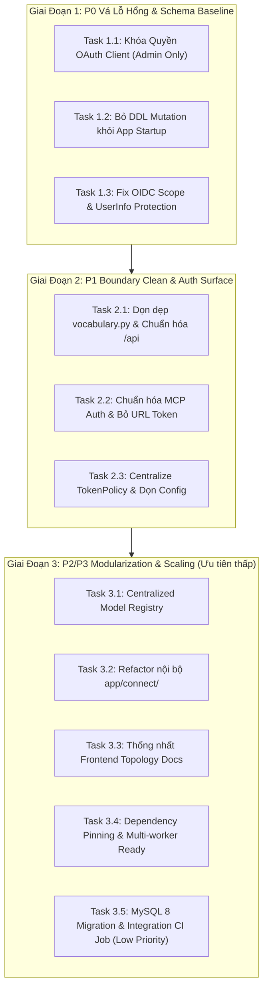

# Flama Architecture Hardening Roadmap & Task List

> **Trạng thái:** DỰ THẢO & THỰC THI (PLANNED / ACTIVE)  
> **Ngày lập:** 2026-08-19  
> **Mục tiêu:** Củng cố kiến trúc Modular Monolith của Flama, dọn dẹp các cơ chế chuyển tiếp cũ, xác lập quyền làm chủ duy nhất cho Database Schema và Transaction, vá các lỗ hổng quyền trong OAuth/MCP, và chuẩn hóa quy trình CI/CD cho production.

---

## 1. Kết Luận Đánh Giá Kiến Trúc Tổng Thể

Sau khi rà soát trực tiếp toàn bộ source code trên branch `develop` (Flask backend, React frontend, Flama Connect, OAuth 2.1, Remote MCP, models, CI và deployment):

1. **Định hướng kiến trúc:** **Đúng hướng (Modular Monolith + Specialized Adapters)**. Chưa có lý do kỹ thuật nào để chuyển sang Microservices. Hệ thống hiện tại vận hành tối ưu nhất dưới mô hình một monolith cốt lõi chia module rõ ràng, đi kèm các adapter chuyên biệt (`REST API`, `Connect Adapter`, `MCP Adapter`, `Audio Companion`).
2. **Luồng dữ liệu chuẩn:**
   $$\text{Client / Interface} \longrightarrow \text{API / Adapter} \longrightarrow \text{Application Service (Transaction Owner)} \longrightarrow \text{Repository} \longrightarrow \text{Model / MySQL}$$
3. **Trọng tâm cần xử lý:** Không rewrite hay xáo trộn domain logic, mà tập trung vào **4 trụ cột**:
   - **Bảo mật & Quyền hạn:** Khóa quản lý OAuth Client, chuẩn hóa OIDC scopes, cô lập Remote MCP token.
   - **Schema Ownership:** Alembic là chủ sở hữu duy nhất của Database Schema; loại bỏ triệt để việc chạy DDL mutation trong app startup.
   - **Tính nhất quán của REST API:** Đưa nốt các thao tác dữ liệu còn sót ở `app/routes/vocabulary.py` về đúng service/repository và canonical `/api`.
   - **CI & Production Parity:** Đưa MySQL 8 và Alembic migration test vào CI; chuẩn hóa cấu hình token, dependency pinning và topology frontend.

---

## 2. Sơ Đồ Kiến Trúc Đích (Target Architecture)

```text
React SPA (Cloudflare Pages / CDN)
       │
       ▼
   Flask REST API (/api/*)
       │
       ▼
Application Services  ◄── [Transaction Owner & Business Orchestration]
       │
       ▼
Repositories          ◄── [Data Access & Complex Queries]
       │
       ▼
  MySQL 8 Database


ChatGPT / Claude (Remote MCP)
       │ OAuth 2.1 Bearer Token
       ▼
  MCP Adapter (/api/mcp)
       │
       └──────────────► Application Services


Yomitan (Flama Connect)
       │ User API Token (X-Flama-Connect-Key)
       ▼
 Connect Adapter (:4790 / /v1/*)
       │
       └──────────────► Application Services


Alembic Migration & Maintenance CLI
       │
       └──────────────► MySQL 8 (Single Schema Authority)

App Startup Factory
       └── DB Connectivity / Schema-Version Health Check Only (No DDL Mutation)
```

---

## 3. Danh Sách Chi Tiết Các Điểm Cần Xử Lý & Task Thực Thi

### Nhóm 1: Ưu Tiên P0 — An Toàn Hệ Thống & Toàn Vẹn Dữ Liệu

#### 🔴 Task 1.1: Khóa Quyền Quản Lý OAuth Client (P0 Security)
- **Hiện trạng:**
  - File: `app/routes/oauth.py` (`list_oauth_clients`, `create_oauth_client`, `delete_oauth_client`).
  - Lỗi: Endpoint `/api/oauth/clients` chỉ yêu cầu `@login_required`, không kiểm tra role Admin; model `OAuthClient` không có `owner_user_id` (là tài nguyên toàn cục); `oauth_service.register_oauth_client` tự động ghi đè client nếu trùng `client_id`. Bất kỳ user đã đăng nhập nào cũng có thể đọc, tạo, sửa đổi callback URL hoặc xóa OAuth Client của toàn hệ thống.
- **Giải pháp:**
  - Khóa toàn bộ các endpoint CRUD OAuth Client (`GET/POST/DELETE /api/oauth/clients`) bằng permission Admin (`@admin_required` / `require_admin`).
  - Thêm validate nghiêm ngặt format `client_id`, `redirect_uris` (ngăn chặn SSRF/open redirect).
- **Files tác động:** `app/routes/oauth.py`, `app/services/oauth_service.py`, `frontend/src/features/settings/hooks/useMcpOAuth.ts`, `frontend/src/features/settings/components/McpOAuthTab.tsx`, `tests/test_oauth_mcp.py`.
- **Trạng thái:** `[x] ĐÃ HOÀN THÀNH (2026-08-19)`:
  - Đã khóa toàn bộ các endpoint CRUD OAuth Client (`GET/POST/DELETE /api/oauth/clients`) với decorator `@admin_required`.
  - Đã thêm hàm `validate_client_metadata()` trong `oauth_service.py` kiểm tra chặt chẽ `client_id` (regex `^[a-zA-Z0-9_-]{3,64}$`), `client_name`, `redirect_uris` (ngăn fragment `#`, bắt buộc HTTPS trừ loopback HTTP).
  - Đã cập nhật frontend React để tự động kiểm tra `isAdmin` qua bootstrap: vô hiệu hóa/ẩn nút đăng ký và hiển thị notice an toàn cho non-admin users, chỉ fetch `/api/oauth/clients` khi là admin.
  - Đã viết unit test trong `test_oauth_mcp.py` kiểm tra chặn 403 Forbidden cho non-admin và xác thực metadata validation.

---

#### 🔴 Task 1.2: Loại Bỏ Schema DDL Mutation Khỏi App Startup (P0 Database)
- **Hiện trạng:**
  - File: `app/__init__.py`, `app/startup.py`, `app/startup_schema.py`.
  - Lỗi: Mỗi lần `create_app()` boot (kể cả khi chạy Gunicorn, worker khởi động lại hoặc test), hệ thống tự động chạy `db.create_all()`, `ensure_user_management_schema()` và `ensure_backward_compatible_schema()` (hơn 850 dòng DDL `ALTER TABLE`, `CREATE INDEX`, update dữ liệu). Trong khi đó quy trình deploy production đã chạy `flask db upgrade`. Việc hai nơi cùng sửa schema gây chậm startup, nguy cơ deadlock khi tăng worker, và làm lu mờ vai trò của Alembic.
- **Giải pháp:**
  - Chuyển toàn bộ các DDL patch còn lại trong `startup_schema.py` thành các migration script Alembic chuẩn trong `migrations/versions/`.
  - Đổi mặc định `STARTUP_RUN_MAINTENANCE`, `STARTUP_RUN_DB_CREATE_ALL`, `STARTUP_RUN_BACKWARD_COMPAT_SCHEMA` thành `False` trong production runtime.
  - Startup app chỉ thực hiện **Health Check / Connectivity Check / Migration Version Check** (kiểm tra DB sống và migration đã lên version mới nhất).
  - Tách các task dọn dẹp dữ liệu một lần (như seed role, seed TTS) thành lệnh CLI bảo trì riêng biệt (`flask maintenance ...`).
- **Files tác động:** `app/startup.py`, `app/__init__.py`, `app/startup_schema.py`, `migrations/versions/20260820_000018_add_user_management_schema.py`, `deploy/`.
- **Trạng thái:** `[x] ĐÃ HOÀN THÀNH (2026-08-20)`:
  - Đã tạo migration Alembic `20260820_000018_add_user_management_schema.py` bổ sung bảng `user_permission_audit_logs` và cột `users.is_disabled`.
  - Mặc định `STARTUP_RUN_MAINTENANCE=False` trong production/normal runtime, startup app chỉ thực hiện DB connectivity check.
  - Đã có đầy đủ các lệnh CLI nạp dữ liệu độc lập: `clone-cutover-overlay`, `user-role-seed`, `tts-provider-seed`, `startup-maintenance`.

---

#### 🔴 Task 1.3: Chuẩn Hóa OAuth/OIDC Scope & Bảo Vệ `/oauth/userinfo` (P0/P1 Auth)
- **Hiện trạng:**
  - File: `app/services/mcp_scope_service.py`, `app/services/mcp_access_token_service.py`, `app/routes/oauth.py`.
  - Lỗi:
    1. `mcp_access_token_service._normalize_scopes()` lọc scope theo `ALLOWED_MCP_SCOPES` (không chứa `openid`, `profile`, `email`), khiến token OAuth bị mất OIDC scope khi lưu vào DB.
    2. Endpoint `/oauth/userinfo` không kiểm tra scope trong token đã cấp mà trả về toàn bộ `username` + `email`, đồng thời hardcode `email_verified=True`.
    3. `DEFAULT_SCOPES` mặc định cấp gần như toàn bộ quyền đọc/ghi (`deck:*`, `note:*`, `study:*`) khi client không truyền scope, vi phạm nguyên tắc đặc quyền tối thiểu (Least Privilege).
- **Giải pháp:**
  - Tách biệt lớp xử lý scope OAuth với scope nội bộ MCP: lưu giữ đầy đủ các granted scopes (`openid`, `profile`, `email`, v.v.).
  - Bắt buộc kiểm tra scope tại `/oauth/userinfo`:
    - Chỉ cho phép truy cập khi token có granted scope `openid`.
    - Chỉ trả về profile info (`username`, `display_name`) khi có scope `profile`.
    - Chỉ trả về email khi có scope `email`, và lấy giá trị `email_verified` thật từ model User.
  - Điều chỉnh `DEFAULT_SCOPES` sang mức tối thiểu (hoặc bắt buộc client chỉ định scope rõ ràng khi request authorization).
- **Files tác động:** `app/services/mcp_scope_service.py`, `app/services/mcp_access_token_service.py`, `app/routes/oauth.py`, `tests/test_oauth_mcp.py`.
- **Trạng thái:** `[x] ĐÃ HOÀN THÀNH (2026-08-20)`:
  - Đã thêm `ALL_OIDC_SCOPES` vào `ALLOWED_MCP_SCOPES` trong `mcp_scope_service.py` để token bảo toàn các scope OIDC khi lưu trữ.
  - Đã nâng cấp endpoint `/oauth/userinfo` trong `app/routes/oauth.py` kiểm tra bắt buộc scope `openid` (trả về 403 `insufficient_scope` nếu thiếu), đồng thời chỉ trích xuất claims theo `profile` và `email` qua hàm `extract_userinfo_claims()`.
  - Đã cập nhật và mở rộng unit test trong `tests/test_oauth_mcp.py` kiểm tra toàn diện các kịch bản OIDC claims và chặn thiếu scope.

---

### Nhóm 2: Ưu Tiên P1 — Chuẩn Hóa Boundary & Auth Surface

#### 🟡 Task 2.1: Dọn Dẹp Business Logic Trong `app/routes/vocabulary.py` (P1 Boundary)
- **Hiện trạng:**
  - File: `app/routes/vocabulary.py`.
  - Lỗi: File dài gần 1000 dòng, trực tiếp import model (`Deck`, `CardProgress`), thực hiện query phức tạp, tự gọi `db.session.commit()` / `rollback()`, xử lý tạo/đổi tên/di chuyển/reset deck, dùng `flash()` và redirect kiểu web cũ. Trong khi hệ thống đã có REST API canonical dưới `/api/decks/*` và `/api/learning/*`.
- **Giải pháp:**
  - Chuyển toàn bộ các logic mutation còn lại sang `deck_management_service.py` và `deck_repository.py`.
  - Đảm bảo toàn bộ thao tác của frontend React gọi qua REST API `/api/*`.
  - Giảm `app/routes/vocabulary.py` xuống dạng route chuyển tiếp hoặc trả về `410 Gone` / redirect an toàn, tuân thủ nguyên tắc: **Route không import Model và không tự commit transaction**.
- **Files tác động:** `app/routes/vocabulary.py`, `app/services/deck_management_service.py`, `app/repositories/deck_repository.py`, `app/api/decks/routes.py`.
- **Trạng thái:** `[ ] SẴN SÀNG TRIỂN KHAI`

---

#### 🟡 Task 2.2: Chuẩn Hóa Cơ Chế Auth Của MCP & Deprecate Legacy Fallbacks (P1 Security)
- **Hiện trạng:**
  - File: `app/services/mcp_auth_service.py`, `app/connect/mcp.py`.
  - Lỗi: MCP auth resolver hỗ trợ quá nhiều phương thức: Bearer token, `X-Flama-Connect-Key`, URL token (`/v1/mcp/<url_token>`), Body key, và Web Session (session được cấp scope wildcard `*`). Truyền token qua URL tiềm ẩn nguy cơ lộ token qua log Nginx/Gunicorn và browser history.
- **Giải pháp:**
  - Định hình rõ ràng 2 kênh xác thực:
    1. **Remote MCP (Claude / ChatGPT):** Chuẩn hóa 100% qua OAuth 2.1 Bearer Token trong header `Authorization: Bearer <token>`.
    2. **Flama Connect (Yomitan):** Dùng User API Token (`flama_yt_...`) qua header `X-Flama-Connect-Key`.
  - Đánh dấu deprecate và tiến tới loại bỏ endpoint `/v1/mcp/<url_token>` và truyền key trong body.
  - Loại bỏ fallback tự động cấp scope `*` cho web session nếu không có ngữ cảnh rõ ràng.
- **Files tác động:** `app/services/mcp_auth_service.py`, `app/connect/mcp.py`, `docs/architecture/FLAMA_MCP_CONNECT.md`.
- **Trạng thái:** `[ ] SẴN SÀNG TRIỂN KHAI`

---

#### 🟡 Task 2.3: Gom Cụm Chính Sách Token & Loại Bỏ Config Rác (P1 Config)
- **Hiện trạng:**
  - File: `app/settings.py`, `app/services/mcp_access_token_service.py`, `app/services/oauth_service.py`.
  - Lỗi: `settings.py` khai báo `MCP_TOKEN_TTL_SECONDS` và `MCP_TOKEN_MAX_REQUESTS` nhưng không nơi nào sử dụng. Trong khi đó, `mcp_access_token_service.py` hardcode hạn 180 ngày và 1.000.000 requests; `oauth_service.py` hardcode 24 giờ.
- **Giải pháp:**
  - Tạo class `TokenPolicy` tập trung quản lý thời hạn (TTL) và hạn mức request cho từng loại token: OAuth Access Token, OAuth Refresh Token, MCP Personal Access Token, Connect API Key.
  - Kết nối `settings.py` thực sự vào `TokenPolicy`, validate giá trị khi khởi động app, dọn dẹp các biến môi trường thừa không dùng đến.
- **Files tác động:** `app/settings.py`, `app/services/mcp_access_token_service.py`, `app/services/oauth_service.py`.
- **Trạng thái:** `[ ] SẴN SÀNG TRIỂN KHAI`

---

### Nhóm 3: Ưu Tiên P2 / P3 — Modularization, Scale Readiness & CI Parity (Ưu tiên thấp)

#### 🟢 Task 3.1: Centralized Model Registry (`models.registry`) (P2 Code Quality)
- **Hiện trạng:**
  - File: `app/__init__.py` (dòng 37-100), `app/connect/__init__.py` (dòng 127-176).
  - Lỗi: Hai app factory duy trì 2 danh sách dài copy-paste các câu lệnh `from models.* import ...` để SQLAlchemy load quan hệ bảng. Khi thêm model mới rất dễ quên đăng ký ở một bên.
- **Giải pháp:**
  - Tạo module `models/registry.py` chứa hàm `load_all_models()`.
  - Cả `app/__init__.py` và `app/connect/__init__.py` chỉ cần gọi `load_all_models()` duy nhất một dòng.
- **Files tác động:** `models/registry.py` (mới), `app/__init__.py`, `app/connect/__init__.py`.
- **Trạng thái:** `[ ] SẴN SÀNG TRIỂN KHAI`

---

#### 🟢 Task 3.2: Tách Module Nội Bộ Cho `app/connect/` (P2 Modularization)
- **Hiện trạng:**
  - File: `app/connect/__init__.py` (hơn 600 dòng).
  - Lỗi: Đang gánh quá nhiều trách nhiệm: App factory, SlidingWindowLimiter, ProxyFix, Protocol Parser, Action Dispatcher, Security Headers, Error Handlers.
- **Giải pháp:**
  - Tách nội bộ package `app/connect/` thành các file chuyên biệt (không tách thành microservice riêng):
    - `app/connect/app.py`: Factory tạo Flask app và middleware.
    - `app/connect/limiter.py`: Sliding window rate limiter.
    - `app/connect/dispatcher.py`: Xử lý dispatch AnkiConnect actions.
    - `app/connect/protocol.py`: Định dạng response, parse params và check duplicate keys.
- **Files tác động:** `app/connect/`.
- **Trạng thái:** `[ ] SẴN SÀNG TRIỂN KHAI`

---

#### 🟢 Task 3.3: Thống Nhất Nguồn Chân Lý Về Production Frontend Topology (P2 Docs/Ops)
- **Hiện trạng:**
  - `SYSTEM_ARCHITECTURE.md` mô tả Flask serve `frontend/dist/index.html` (đúng cho Docker container). Nhưng workflow `deploy.yml` lên Hostinger VPS lại exclude thư mục `frontend/`, và tài liệu frontend hướng dẫn deploy độc lập qua Cloudflare Pages.
- **Giải pháp:**
  - Thống nhất tài liệu kiến trúc: Làm rõ 2 chế độ:
    1. **Decoupled Production (Khuyến nghị):** Frontend React deploy trên Cloudflare Pages (CDN edge), Backend Flask chạy trên API domain riêng (`api.flama.local` / VPS).
    2. **Single Container Mode:** Docker image đóng gói sẵn `frontend/dist` và Flask `spa.py` fallback phục vụ môi trường self-hosted / dev.
  - Cập nhật đồng bộ `docs/architecture/SYSTEM_ARCHITECTURE.md`, `README.md` và `deploy/README.md`.
- **Files tác động:** `docs/architecture/SYSTEM_ARCHITECTURE.md`, `README.md`.
- **Trạng thái:** `[ ] SẴN SÀNG TRIỂN KHAI`

---

#### 🟢 Task 3.4: Pin Dependencies & Chuẩn Bị Tăng Gunicorn Worker (P2 Scaling)
- **Hiện trạng:**
  - `requirements.txt` dùng `>=` lỏng lẻo, có nguy cơ kéo các package con không tương thích giữa các lần deploy.
  - Gunicorn chạy `--workers 1 --timeout 120` do phụ thuộc vào in-memory rate limiter và lo ngại race-condition khi startup chạy DDL.
- **Giải pháp:**
  - Tạo `requirements.lock` hoặc pin version chính xác các thư viện backend trọng yếu.
  - Sau khi hoàn thành Task 1.2 (loại bỏ startup DDL), chuẩn bị lộ trình đưa state rate limiter ra Redis hoặc cơ chế database atomic để an toàn nâng Gunicorn lên `2-4 workers`.
- **Files tác động:** `requirements.txt`, `deploy/flama.service`, `deploy/flama-connect.service`.
- **Trạng thái:** `[ ] SẴN SÀNG TRIỂN KHAI`

---

#### ⚪ Task 3.5: Bổ Sung CI Integration Test Chạy Trên MySQL 8 Thật (P3 CI/CD - Ưu tiên thấp)
- **Hiện trạng:**
  - File: `.github/workflows/ci.yml`.
  - Lỗi: CI backend hiện tại chỉ chạy unittest trên SQLite in-memory, không kiểm tra được tính tương thích của dialect MySQL (JSON column queries, foreign key constraints, collation, upsert locks). Chưa có bước kiểm tra chạy sạch migration Alembic từ DB trắng.
- **Giải pháp (Triển khai khi cần thiết ở giai đoạn hoàn thiện CI/CD):**
  - Bổ sung một job `backend-mysql` trong GitHub Actions:
    1. Khởi chạy service container `mysql:8.0`.
    2. Chạy `flask db upgrade` từ migration đầu tiên đến `heads` trên database trắng.
    3. Boot Flask app với chế độ schema auto-repair **TẮT** (`STARTUP_RUN_MAINTENANCE=False`).
    4. Chạy bộ integration test cho các module trọng yếu: OAuth 2.1 / Remote MCP, Shared Deck Overlay & Clone, Anki Scheduler, payOS Payments.
- **Files tác động:** `.github/workflows/ci.yml`.
- **Trạng thái:** `[ ] SẴN SÀNG TRIỂN KHAI (ƯU TIÊN THẤP)`

---

## 4. Kế Hoạch Triển Khai Theo Giai Đoạn (Execution Plan)



### Thứ tự các việc trọng tâm thực hiện tiếp theo:
1. **Fix OIDC Scope & UserInfo Protection (Task 1.3):** Hoàn tất bảo vệ dữ liệu người dùng và chuẩn hóa OIDC OAuth 2.1.
2. **Bỏ DDL Mutation khỏi Startup (Task 1.2):** Xác lập Alembic làm chủ thể schema duy nhất, giải phóng app startup.
3. **Dọn dẹp vocabulary.py & Chuẩn hóa /api (Task 2.1):** Đưa toàn bộ transaction/mutation về đúng service & repository layer.
