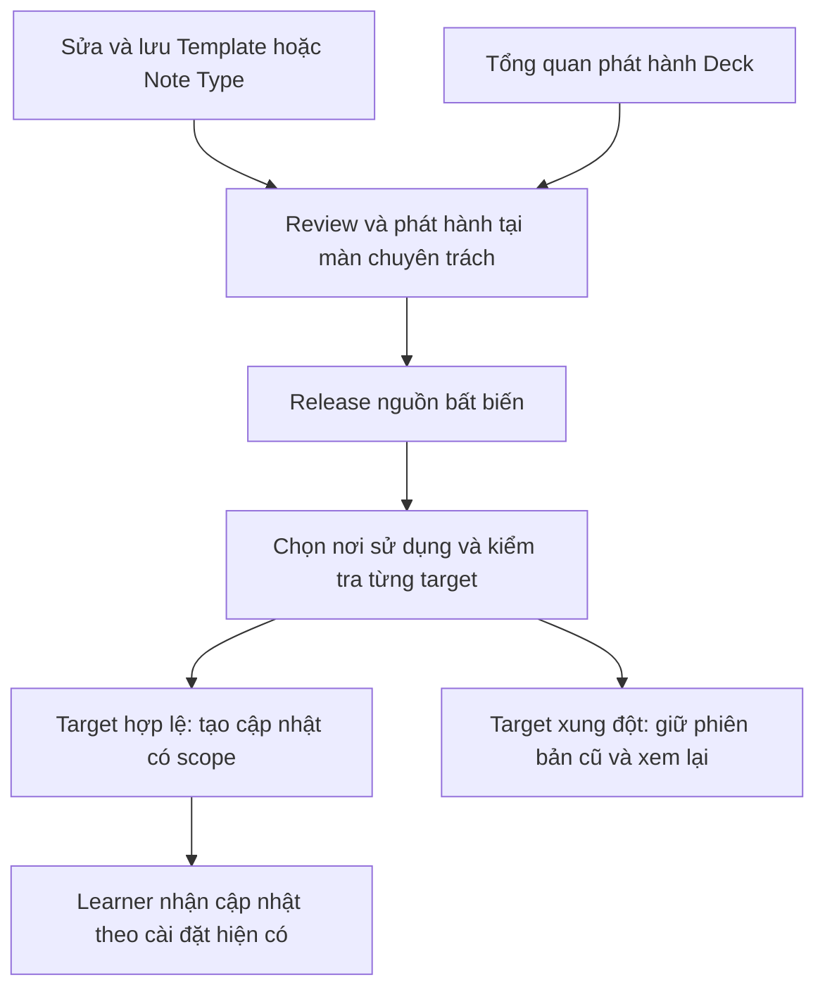

# Kế hoạch làm rõ phạm vi và cải thiện luồng phát hành Deck, Note Type, Template

Ngày: **2026-10-25 — Asia/Tokyo**. Trạng thái: **kế hoạch đề xuất, chưa triển khai**.

Căn cứ: yêu cầu cho phép phát hành Note Type/Template ngay nơi chỉnh sửa; màn phát hành Deck chỉ tóm tắt thay đổi liên quan và dẫn tới màn chuyên trách. Đối chiếu mã tại checkout có HEAD `d4da3c7d`, bao gồm trạng thái working copy tại thời điểm đọc. Tài liệu này không phải kết quả kiểm thử runtime, kiểm tra database thực tế hay xác nhận triển khai production.

## 1. Kết quả cần đạt

Người tạo sửa ở đâu thì có thể xem và phát hành thay đổi tại đó:

- Sửa nội dung ghi chú: phát hành tại Deck.
- Sửa trường dữ liệu, cách ghép dữ liệu hoặc danh sách kiểu thẻ: phát hành tại Note Type.
- Sửa mặt trước, mặt sau, CSS hoặc hành vi của giao diện: phát hành tại Template.
- Đi từ Deck sang Note Type/Template rồi quay lại vẫn giữ đúng ngữ cảnh và dữ liệu biểu mẫu đang nhập.

Màn Deck trả lời ba câu hỏi: **Nội dung bộ thẻ có đổi không? Cấu trúc/giao diện nào có thay đổi? Cần mở đâu để xử lý?** Màn này không trải chi tiết cấu hình và JSON của Note Type/Template vào cùng danh sách sửa nội dung.

Một lần xác nhận phải chỉ rõ:

1. Đối tượng và phiên bản được phát hành.
2. Những thay đổi thực sự được đưa vào phiên bản đó.
3. Các Note Type/Deck được chọn nhận phiên bản mới.
4. Người đã cài có bản cập nhật nào để nhận; phần nào vẫn dùng bản cũ.

**Quyết định kiến trúc đề xuất:** tách nơi bắt đầu thao tác và phạm vi phát hành, đồng thời giữ các bản đã phát hành bất biến. Deck tiếp tục giữ phiên bản cấu trúc/giao diện cụ thể. Cập nhật cấu trúc/giao diện cho Deck được thực hiện ngay trong màn chuyên trách, không buộc người tạo mở từng Deck để thao tác lại.

## 2. Hiện trạng đã xác nhận trong mã

| Thành phần | Hành vi hiện tại | Nguồn kiểm chứng |
|---|---|---|
| Phát hành Deck | Preview dùng chung các thay đổi `note_field`, `field_def`, `template`; template presentation được thêm vào cùng diff | [deck_release_service.py](../../app/services/deck_release_service.py), `_build_release_diff_plan()`, `preview_release()` |
| Giao diện Deck | Có phiên bản, ghi chú phát hành và `DiffWorkspace`; dùng các từ working tree, revision, release bất biến | [ReleaseBuilderPage.tsx](../../frontend/src/features/deck-collaboration/pages/ReleaseBuilderPage.tsx), [useReleaseBuilder.ts](../../frontend/src/features/deck-collaboration/hooks/useReleaseBuilder.ts) |
| Trình bày diff | Cùng một hàng so sánh cho nhiều entity; giá trị object được chuyển thành JSON để hiển thị | [DiffRow.tsx](../../frontend/src/features/deck-collaboration/components/diff/DiffRow.tsx), [DiffValueBlock.tsx](../../frontend/src/features/deck-collaboration/components/diff/DiffValueBlock.tsx) |
| Template độc lập | Đã có publication, release history, phát hành thủ công/tự động, subscription và prepare/apply update | [template_release_service.py](../../app/services/template_release_service.py), [card_templates.py](../../app/api/v1/flashcards/card_templates.py) |
| Điểm vào Template | Template detail mở phần distribution qua menu; workflow phát hành đã tồn tại | [TemplateDetailPage.tsx](../../frontend/src/features/template-library/pages/TemplateDetailPage.tsx), [AuthorPublicationView.tsx](../../frontend/src/features/template-distribution/ui/AuthorPublicationView.tsx) |
| Note Type độc lập | Có bản phát hành đầy đủ gồm metadata, fields, applications và ID TemplateRelease cụ thể | [note_type_release_service.py](../../app/services/note_type_release_service.py), `stage_publication()` |
| Publication của Note Type | Luồng publish đi qua marketplace payload; xử lý listing của template và tạo NoteTypeRelease khi gửi trạng thái hiển thị phù hợp | [marketplace_note_type_service.py](../../app/services/marketplace_note_type_service.py), [share/note_types.py](../../app/services/share/note_types.py), `apply_note_type_marketplace_payload()` |
| Note Type và template của người khác | Bundle xác định nguồn, tác giả, release được nhận và quyền tham chiếu; không trao quyền phát hành nguồn của tác giả khác | [note_type_bundle_publication_service.py](../../app/services/note_type_bundle_publication_service.py) |
| Deck giữ phiên bản Template | Khi tạo DeckRelease, đóng băng template release và các application bindings; helper hiện có thể phát hành template cùng Deck | [template_release_service.py](../../app/services/template_release_service.py), `capture_deck_release_template_pins()` |
| Cách render Deck đã cài | Nội dung upstream sạch dùng pin của từng Deck; thay đổi cá nhân được chiếu lên pin đó | [template_release_repository.py](../../app/repositories/template_release_repository.py), `load_effective_template_overrides()`, [effective_template_service.py](../../app/services/effective_template_service.py) |
| Note Type đã nhận | Applications dùng template definition đóng băng theo receipt; cập nhật canonical template subscription không tự viết lại toàn bộ receipt này | [note_type_release_service.py](../../app/services/note_type_release_service.py), `stage_received_application()` |
| Phân phối Template | Publication ghi công việc đồng bộ; delivery chạy riêng, tôn trọng opt-in và xung đột cá nhân | [template_subscription_sync_service.py](../../app/services/template_subscription_sync_service.py) |
| Auto-publish Deck | Có đường phát hành tự động và xử lý subscriber riêng; phải kiểm tra cả đường này khi thêm scope mới | [deck_auto_publish_service.py](../../app/services/deck_auto_publish_service.py), [deck_working_tree_service.py](../../app/services/deck_working_tree_service.py) |

### 2.1. Vấn đề cần giải quyết

- Có khả năng phát hành riêng nhưng điểm vào chưa làm rõ trách nhiệm từng đối tượng.
- Màn Deck trộn thay đổi nội dung, cấu trúc và giao diện; tên kỹ thuật/ID có thể xuất hiện như tiêu đề của thay đổi.
- Người tạo khó biết bấm phát hành Deck có làm phát hành thêm Template hay không.
- Trạng thái hiển thị Marketplace và tạo phiên bản mới đang dùng chung một số đường xử lý, nên nhãn “xuất bản lại” dễ gây hiểu nhầm.
- “Nguồn có bản nháp mới” và “nguồn đã phát hành bản mới nhưng Deck còn dùng bản cũ” chưa được thể hiện thành hai trạng thái rõ ràng.
- Một bản Template mới không đồng nghĩa tất cả Deck/Note Type đã nhận đều chuyển sang bản mới.

### 2.2. Tài liệu liên quan và giới hạn của thông tin cũ

- [Thiết kế ổn định Deck/Note Type/Template](../architecture/deck-notetype-template-stability-design.md): giữ các bất biến về pin, receipt, thanh toán và đồng bộ subscriber.
- [Clone cutover report](../backend/old/completed-plans/CLONE_CUTOVER_REPORT.md): ngữ cảnh overlay-only bắt buộc; một số mô tả về khả năng versioning là snapshot lịch sử, cần đối chiếu code hiện hành.
- [Audit versioning ngày 2026-10-12](TEMPLATE_NOTETYPE_VERSIONING_AND_PUBLISH_AUDIT.md): nguồn lịch sử, không dùng nguyên các đề xuất cũ làm yêu cầu triển khai. Đặc biệt không áp đặt quy tắc một template chỉ xuất hiện một lần nếu runtime còn hỗ trợ nhiều application occurrences.
- [Kế hoạch MCP template authoring](MCP_TEMPLATE_AUTHORING_IMPLEMENTATION_PLAN_2026-10-25.md): dùng chung renderer/diagnostics khi phần đó đã có; kế hoạch này không giả định công việc MCP đã triển khai.

Không suy ra migration head từ thứ tự ngày trong tên file. Ví dụ migration [Note Type releases](../../migrations/versions/20261020_000070_note_type_releases.py) hiện khai báo parent `20261021_000072`; cần đọc graph thực tế trước mọi DDL.

## 3. Thuật ngữ và phạm vi sản phẩm

### 3.1. Tên thao tác trên giao diện

| Nhãn | Ý nghĩa |
|---|---|
| **Lưu thay đổi** | Lưu bản đang chỉnh sửa; không mặc định phát hành cho người khác |
| **Xem thay đổi và phát hành** | Mở màn review bản nháp so với bản đã phát hành |
| **Phát hành cập nhật** | Tạo bản phát hành mới của đúng đối tượng được ghi trên màn hình |
| **Đưa phiên bản này vào Deck** | Tạo cập nhật để các Deck được chọn sử dụng phiên bản nguồn cụ thể |
| **Cập nhật mục trên Marketplace** | Chỉnh thông tin hiển thị/giá theo policy của listing |
| **Hiển thị lại trên Marketplace** | Bật lại listing đã ẩn; không tự đưa bản nháp chưa review vào một release |

Nếu auto-publish đang bật, phải hiện rõ “Tự phát hành khi lưu” trước khi lưu. Thay đổi này không tự bật/tắt cài đặt hiện có.

### 3.2. Ranh giới trách nhiệm

| Loại thay đổi | Nơi review chính | Đối tượng phát hành | Quan hệ với Deck |
|---|---|---|---|
| Sửa giá trị của ghi chú; thêm/bớt ghi chú trong phạm vi membership đã hỗ trợ | Deck | DeckRelease | Có nội dung mới |
| Thêm/đổi/xóa trường; thay thứ tự, kiểu dữ liệu, required/identity role | Note Type | NoteTypeRelease; DeckRelease liên quan nếu được chọn và hợp lệ | Có thể cần migration giá trị hoặc cập nhật kèm nội dung |
| Gắn/gỡ template; đổi mapping, default, tên hiển thị hoặc thứ tự application | Note Type | NoteTypeRelease; DeckRelease liên quan nếu được chọn | Đổi cấu trúc trình bày của Deck |
| Đổi HTML/CSS/hành vi mặt trước hoặc mặt sau | Template | TemplateRelease | Deck giữ bản cũ cho tới khi có cập nhật pin được chọn |
| Đổi `input_schema` của Template | Template, sau đó review Note Type liên quan | TemplateRelease và cấu trúc tham chiếu cần thiết | Không tự kết luận tương thích |
| Giá, trạng thái hiển thị, taxonomy/listing | Màn quản lý Marketplace | Theo contract listing hiện hành | Không mặc định tạo cập nhật nội dung Deck |

Một số metadata của Note Type hiện nằm trong manifest bất biến. Tách listing khỏi release phải giữ lịch sử metadata đã phát hành; không biến metadata lịch sử thành đọc trực tiếp bản nháp.

Các thao tác chưa được runtime versioning hỗ trợ, ví dụ một số thay đổi tags/move/cây Deck, tiếp tục theo guard hiện hành. Tài liệu này không mặc nhiên mở thêm các mutation đó.

### 3.3. Phân biệt hai loại phạm vi

- **Phạm vi nguồn:** bản Template hoặc Note Type nào được phát hành, với nội dung nào.
- **Phạm vi sử dụng:** những Note Type/Deck nào được chọn tham chiếu phiên bản nguồn đó.

Ví dụ: phát hành Template “Nhận diện” bản 1.2.0; đưa bản này vào Deck N3; Deck N2 vẫn giữ 1.1.0. Người học Deck N3 có cập nhật để nhận theo cài đặt của họ. Không diễn đạt kết quả thành “đã cập nhật tất cả người dùng”.

## 4. Các bất biến phải giữ

1. Không sửa/xóa nội dung một release hoặc pin đã phát hành để làm cập nhật xuất hiện.
2. Không đổi cách render mọi Deck sang “template mới nhất”; giữ cách resolve theo release cụ thể.
3. Không lấy bản nháp hôm nay để dựng lại lịch sử bị thiếu của legacy publication.
4. Người tạo chỉ phát hành nguồn mình sở hữu; tham chiếu nguồn người khác theo quyền và release đã được nhận.
5. Không phát hành kèm nội dung ghi chú ngoài phạm vi người tạo vừa review.
6. Không đánh dấu đã phát hành các dirty changes còn bị loại khỏi scope.
7. Preview không tạo version, release, listing, job đồng bộ hoặc thay đổi progress.
8. Publication không đồng nghĩa learner đã apply. Tôn trọng manual update, auto-update, conflict và opt-out hiện hành.
9. Source Notes/Cards giữ identity; clone edit tiếp tục ghi overlay, không copy toàn bộ hoặc sửa source thay learner.
10. Giữ `FieldDef.id`, application identity và occurrence; không ghép theo tên hoặc `template_id` đơn lẻ khi có nhiều occurrence.
11. Không reset tiến độ học do đổi màu, bố cục hay tái tạo application không cần thiết.
12. Native array tiếp tục là JSON list; không stringify thành repr Python, không thêm đường xuất Anki.
13. Giữ sanitization, CSP, proxy media, quyền truy cập và provenance của nội dung miễn phí/trả phí.
14. Không để thay đổi cơ chế phát hành làm fulfillment nhận phiên bản khác với phiên bản đã mua.

## 5. Màn tổng quan phát hành Deck

Giữ route hiện có `/creator/decks/:itemId/releases/new`, đổi cách trình bày và tên mô tả cho người dùng.

### 5.1. Bố cục đề xuất

```text
Cập nhật bộ thẻ N3
Đang phát hành: 1.3.0

NỘI DUNG BỘ THẺ
Không có thay đổi nội dung mới.

CẤU TRÚC VÀ GIAO DIỆN LIÊN QUAN
Cấu trúc “Từ vựng”       Có thay đổi chưa phát hành   [Xem và phát hành]
Giao diện “Nhận diện”    Có thay đổi chưa phát hành   [Xem và phát hành]
Giao diện “Nghe hiểu”    Đã có bản 1.2.0             [Xem cập nhật]

Chỉ thay đổi cấu trúc hoặc giao diện?
Mở mục tương ứng để xem phạm vi và phát hành tại đó.
```

Nếu có sửa nội dung:

```text
NỘI DUNG BỘ THẺ
Thêm 8 ghi chú · Sửa 12 ghi chú · Bỏ 2 ghi chú khỏi bộ thẻ
[Xem nội dung thay đổi]

Phiên bản: [1.3.1]   Ghi chú cập nhật: [...]
[Phát hành cập nhật nội dung]
```

Các con số trên là ví dụ thiết kế, không phải dữ liệu đã đo trong hệ thống.

### 5.2. Hành vi bắt buộc

- Chỉ hiện form phiên bản/nút phát hành nội dung khi có scope nội dung hợp lệ; không để một nút disabled không giải thích.
- Tách danh sách nội dung khỏi các dòng liên quan Note Type/Template.
- Mỗi dòng có tên dễ đọc, loại đối tượng, trạng thái và CTA phù hợp; không lấy UUID làm nhãn chính.
- Template được gắn nhiều lần có thể gom thành một dòng giao diện nhưng hiện số cách sử dụng; khi mở phải chọn đúng application/mapping.
- Nguồn có bản nháp mới: “Xem và phát hành”. Nguồn đã có release mới: “Xem cập nhật”.
- Nếu vừa có release mới vừa có draft mới hơn: hiển thị cả hai thông tin; cho chọn bản đã phát hành hoặc review draft.
- Không đưa JSON, content hash, input bindings hay diff mã nguồn vào màn tổng quan.
- Khi quay lại, giữ version/changelog/bộ lọc hợp lệ; refetch các trạng thái nguồn và Deck, không dùng dữ liệu cache cũ để xác nhận.
- Giữ đường vào review toàn bộ release cũ trong thời gian chuyển tiếp, nhưng ghi đúng phạm vi thực tế của đường đó.

## 6. Màn phát hành Note Type

Route mới đề xuất: `/note-types/:id/releases/new`. Đây là route đề xuất, chưa tồn tại trong router.

### 6.1. Điểm vào

- Trang cấu hình fields và trang mapping/application có cùng trạng thái publication.
- Nút “Xem thay đổi và phát hành” xuất hiện sau khi lưu thành công và có thay đổi so với release hiện tại.
- Trang quản lý Note Type và trang chủ sở hữu trên Marketplace dẫn tới cùng workflow.
- Dữ liệu chưa lưu: thông báo cần lưu trước; không tự phát hành một candidate chưa được lưu.
- Note Type chưa có listing: giải thích phát hành để sử dụng trong bundle khác với đăng bán/hiển thị độc lập trên Marketplace; không tự đổi giá hoặc visibility.

### 6.2. Nội dung màn hình

1. **Tóm tắt cấu trúc:** tên, bản đang phát hành, bản đề xuất.
2. **Thay đổi:** trường thêm/đổi/xóa; kiểu dữ liệu; mapping; applications/default/order.
3. **Giao diện đi kèm:** từng template và phiên bản được tham chiếu.
4. **Nơi sử dụng:** Deck của người tạo, release/pin hiện tại, mức sẵn sàng cập nhật.
5. **Xác nhận:** phạm vi nguồn, các phụ thuộc và các Deck được chọn.

Ví dụ câu chữ:

> Thêm trường “Ví dụ”. Đổi cách hiển thị “Nghe hiểu”. Sử dụng giao diện “Nhận diện” bản 1.2.0.
>
> Phát hành cấu trúc “Từ vựng” bản 1.4.0. Các Deck chưa được chọn tiếp tục dùng cấu trúc đã phát hành trước đó.

### 6.3. Template chưa phát hành trong Note Type

- Hiển thị rõ template nào đang tham chiếu bản đã phát hành và template nào có draft khác.
- Template thuộc người tạo: cho mở review/phát hành ngay trong workflow, sau đó chọn chính xác release mới.
- Không dùng `current_release_id` của template như một giá trị có thể tự thay đổi giữa preview và execute.
- Template người khác: chỉ chọn release có quyền dùng; không có nút phát hành nguồn của họ.
- Khi đăng Marketplace lần đầu cần listing/giá cho template theo policy hiện có, đưa vào bước công khai riêng. Không âm thầm list template trong một lần cập nhật schema.
- Bản NoteTypeRelease mới phải đóng băng toàn bộ manifest hợp lệ, kể cả những phần không đổi; không tạo manifest thiếu chỉ vì UI đang xem một nhóm thay đổi.

### 6.4. Note Type đã được người khác nhận

Phiên bản nguồn mới không tự đổi local Note Type của người nhận. Giữ receipt hiện tại và thông báo đúng giới hạn.

Tự động cập nhật schema cho standalone NoteTypeInstall, bao gồm merge dữ liệu ghi chú cá nhân, là một workflow riêng chưa được chứng minh đầy đủ bởi `stage_receipt()`. Không đưa lời hứa này vào bản đầu. Nếu cần mở rộng, phải có thiết kế prepare/apply, backup, conflict và provenance riêng trước khi triển khai.

## 7. Màn phát hành Template

Route mới đề xuất: `/card-templates/:id/releases/new`. Tái sử dụng chức năng của distribution hiện có; không duy trì hai bộ logic publication cạnh tranh.

### 7.1. Nội dung màn hình

- Tên template, phiên bản hiện tại và trạng thái bản đang chỉnh sửa.
- Tóm tắt thay đổi bằng ngôn ngữ người dùng: mặt trước, mặt sau, kiểu trình bày, tương tác hoặc đầu vào.
- Xem trước trước/sau cho mặt trước/mặt sau; dùng renderer và projection dữ liệu hiện hành.
- Khi template dùng nhiều Note Type, chọn một context cụ thể để preview; ghi rõ dữ liệu mẫu hay note thực và application đang dùng.
- Danh sách Note Type/Deck liên quan, bản đang tham chiếu và các mục có thể chọn nhận phiên bản mới.
- Ghi chú phiên bản và xác nhận phát hành.
- Mục “Chi tiết kỹ thuật” đóng mặc định cho HTML/CSS/script/input schema diff.

### 7.2. Điều cần nói rõ khi phát hành

> Phát hành giao diện “Nhận diện” bản 1.2.0.
>
> Sau khi phát hành, bạn có thể đưa bản này vào các Note Type/Deck được chọn ngay tại đây. Những bản đã phát hành trước vẫn được giữ lại.

Nếu mở từ Deck N3, đánh dấu N3 là ngữ cảnh xuất phát và đề xuất xem nó đầu tiên. Chỉ preselect khi backend đã kiểm tra đủ điều kiện và phần xác nhận ghi rõ lựa chọn; không chọn tất cả nơi sử dụng theo mặc định.

### 7.3. Phát hành và đưa vào nơi sử dụng là hai kết quả riêng

Workflow ở cùng một màn nhưng có hai bước rõ ràng:

1. Phát hành Template/Note Type nguồn.
2. Đưa release cụ thể vào các nơi đã chọn.

Mỗi bước có kết quả riêng. Nếu nguồn đã phát hành nhưng một Deck xung đột, hiển thị “Đã phát hành giao diện; Deck N3 cần xem lại” và cho thử lại riêng Deck đó. Không báo thất bại toàn bộ hoặc tự phát hành lại nguồn khi retry.

Bản đầu có thể thực hiện từng Deck theo thứ tự với kết quả độc lập. Không giả định nhiều request từ frontend là một transaction nguyên tử.

## 8. Nguyên tắc nhận cập nhật và tương thích

### 8.1. Trạng thái phải tách biệt

| Trục trạng thái | Ví dụ giá trị | Ý nghĩa |
|---|---|---|
| Bản đang chỉnh sửa so với release nguồn | `unchanged`, `unpublished`, `no_release`, `legacy_unknown` | Có gì để phát hành tại nguồn |
| Phiên bản tại nơi sử dụng | `current`, `release_available`, `needs_review`, `blocked` | Deck/Note Type có thể nhận release nào |
| Kết quả phát hành | `published`, `replayed`, `conflict`, `failed` | Nguồn hoặc từng target đã xử lý ra sao |
| Phân phối tới learner | Có cập nhật, chờ người dùng, đang xử lý, xung đột | Theo contract subscriber/Deck update hiện có |

Đây là vocabulary DTO đề xuất, không phải các enum ORM đã tồn tại. Không gom bốn trục này thành một cờ `has_changes` chung.

### 8.2. Ma trận tương thích

| Thay đổi | Xử lý đề xuất |
|---|---|
| Chỉ CSS/bố cục, input và mapping giữ nguyên | Có thể đủ điều kiện cập nhật pin sau validation; vẫn phải review hiển thị |
| HTML/script đổi hành vi | Cảnh báo cần kiểm tra preview/tương tác; không khẳng định an toàn chỉ vì input schema giống nhau |
| Thêm input tùy chọn có fallback hợp lệ | Kiểm tra theo từng application; có thể cập nhật độc lập nếu điều kiện được chứng minh |
| Input mới bắt buộc, bỏ/đổi tên input hoặc đổi kiểu | Cần Note Type mapping hợp lệ; chặn target chưa đáp ứng |
| Thêm field tùy chọn | Kiểm tra renderer, schema và giá trị mặc định; không tự ghi nội dung vào toàn bộ notes |
| Đổi tên field | Dùng stable field ID; kiểm tra việc đổi key trong JSON, mapping, overlay và media; có thể cần note-field atoms phụ thuộc |
| Đổi kiểu field, required hoặc identity role | Phân tích dữ liệu thật trong scope; không suy ra an toàn từ metadata |
| Xóa field | Hiện số ghi chú có dữ liệu bị ảnh hưởng và cách bảo toàn; chặn khi chưa có chính sách rõ |
| Gắn/gỡ/đổi thứ tự/default application | Giữ identity/occurrence; preview số kiểu thẻ thay đổi và kiểm tra progress |
| Deck có thay đổi nội dung không liên quan | Giữ các nội dung đó ở bản nháp; không đưa vào cập nhật cấu trúc/giao diện |

Kết quả phân tích gồm `ready`, `needs_review` hoặc `blocked`, kèm lý do cụ thể. Không gọi một thay đổi script tùy ý là “tương thích hoàn toàn” chỉ dựa vào kiểm tra tĩnh.

### 8.3. Quy tắc chọn scope

- Phát hành Template thuần túy không yêu cầu phát hành Deck để tạo TemplateRelease.
- Để learner của một Deck dùng template mới theo mô hình pin hiện tại, cần bản cập nhật Deck tham chiếu release mới; người tạo thực hiện bước này ngay ở màn Template.
- Bản cập nhật chỉ cấu trúc/giao diện được ghi rõ như vậy trong lịch sử Deck; không mô tả thành sửa nội dung ghi chú khi không có note-field changes.
- Note Type đang dùng template cũ không tự đổi manifest. Muốn thay release template trong manifest phải tạo NoteTypeRelease mới được review.
- Nếu một target cần thêm thay đổi phụ thuộc, preview liệt kê chúng. Target không đủ điều kiện bị chặn riêng, không kéo theo phát hành toàn bộ draft.
- Nếu chưa xây được scoped planner bảo đảm đúng dữ liệu, cho mở review đầy đủ của Deck với lời giải thích. Không đưa nút “chỉ cập nhật giao diện” lên UI khi backend vẫn phát hành tất cả.

## 9. Kiến trúc phát hành được chọn và các phương án đã cân nhắc

| Phương án | Lợi ích | Chi phí/rủi ro | Quyết định |
|---|---|---|---|
| Chỉ đổi câu chữ và chuyển trang | Ít thay đổi, tận dụng UI hiện có | Backend vẫn có thể phát hành vượt scope; không giải quyết trạng thái đã phát hành nhưng chưa được Deck dùng | Chỉ là bước UX ban đầu, chưa đủ nghiệm thu toàn bộ |
| Cho Deck luôn dùng Template/Note Type mới nhất | Phát hành nguồn xong thấy thay đổi ngay | Mất ổn định bản đã phát hành, lan sang Deck khác, khó giữ receipt/thanh toán và chỉnh sửa learner | Không chọn |
| Giữ release/pin bất biến; review tại nguồn; cập nhật các nơi được chọn bằng scope cụ thể | Đạt luồng người dùng mong muốn và giữ tính ổn định | Cần scoped planner, kiểm tra phụ thuộc và kết quả riêng theo target | **Chọn** |
| Tách schema/content/presentation thành các chuỗi version độc lập mới cho mọi install | Có thể giảm nhu cầu tạo DeckRelease cho presentation | Đổi mô hình resolve/rebase lớn, thêm state/migrations và ma trận tương thích | Để sau nếu có workload chứng minh cần thiết |

Trong phương án chọn, một cập nhật giao diện cho Deck có thể vẫn tạo DeckRelease ở tầng lưu trữ. UI gọi đúng mục đích “Cập nhật giao diện”, và người tạo không phải tự mở Deck để phát hành lại. Không cam kết không tồn tại DeckRelease nội bộ.



## 10. Backend và contract đề xuất

### 10.1. Tách các trách nhiệm

- API: parsing, authorization entry, mapping response/error.
- Validator: scope, version label, target IDs, release references và preview token.
- Service: lập plan, tính phụ thuộc, kiểm tra phiên bản và transaction của từng publication/target.
- Repository: batch query trạng thái nguồn, nơi sử dụng, pin và lịch sử cần so sánh.
- Dùng `release_core` và các service hiện có cho release semantics; không viết một engine publication thứ hai trong route.

### 10.2. API hiện có cần giữ tương thích

| API | Cách dùng trong kế hoạch |
|---|---|
| `GET /api/marketplace/decks/:id/releases/preview` | Giữ contract cũ; mở rộng có version/opt-in hoặc thêm projection mới, không thay nghĩa summary âm thầm |
| `POST /api/marketplace/decks/:id/releases` | Giữ đường phát hành hiện tại trong chuyển tiếp; không nhận scope mới rồi bỏ qua |
| `GET /api/card-templates/:id/publication` | Nguồn trạng thái TemplateRelease hiện tại |
| `POST /api/card-templates/:id/releases` | Tái sử dụng publication Template và stale/idempotency guards |
| `POST /api/card-templates/:id/prepare-update`, `apply-update` | Giữ workflow learner; không dùng nó để tự thay pin mọi Deck |
| `POST /api/note-types/:id/publish` | Adapter compatibility cho đường publication/listing đang tồn tại |
| `GET /api/marketplace/note-types/:id/publish-options` | Tái sử dụng quyền và thông tin template bundle; không nhầm nó với preview release đầy đủ |

### 10.3. Các endpoint mới đề xuất

Tên dưới đây là contract thiết kế, chưa phải API đã có. Chốt schema ở giai đoạn T01 trước khi frontend phụ thuộc vào nó.

| Endpoint | Mục đích |
|---|---|
| `GET /api/marketplace/decks/:id/publication-overview` | Trạng thái nội dung, Note Type/Template liên quan và CTA |
| `GET /api/note-types/:id/releases/preview` | So sánh bản nháp Note Type với complete release, template references và blockers |
| `POST /api/note-types/:id/releases` | Phát hành phiên bản Note Type một cách tường minh, độc lập với bật/tắt listing |
| `GET /api/card-templates/:id/releases/preview` | Tóm tắt thay đổi Template, preview context và mức kiểm tra |
| `GET /api/note-types/:id/publication-usage` | Danh sách nơi sử dụng có quyền xem, phân trang |
| `GET /api/card-templates/:id/publication-usage` | Note Type/Deck liên quan, release đang dùng và khả năng nhận bản mới |
| `POST /api/marketplace/decks/:id/release-plans/preview` | Lập plan target cụ thể cho content/schema/presentation hoặc các phần phụ thuộc đã chọn |
| `POST /api/marketplace/decks/:id/releases/scoped` | Thực thi plan đã review; trả DeckRelease, scope thực tế và replay status |

Preview có lựa chọn phức tạp dùng POST chỉ đọc, không ghi DB. Không dùng các query filters của diff hiện tại như một selection để phát hành; bộ lọc chỉ là cách xem.

### 10.4. Dữ liệu overview tối thiểu

```json
{
  "deck_item_id": "deck-id",
  "content": {
    "has_unpublished_changes": false,
    "added_notes": 0,
    "modified_notes": 0,
    "removed_notes": 0
  },
  "related_publications": [
    {
      "kind": "template",
      "id": "template-id",
      "name": "Nhận diện",
      "source_state": "unpublished",
      "usage_state": "current",
      "used_release_id": "release-old",
      "published_release_id": "release-old",
      "action": "review_source"
    }
  ]
}
```

Giá trị minh họa. Counts tính theo ghi chú/entity có ý nghĩa, không lấy số property atoms làm “số ghi chú đã sửa”. Payload tổng quan không mang toàn bộ field values, HTML/CSS hoặc danh sách learner.

DTO lưu ID và trạng thái có cấu trúc. Câu hiển thị do i18n dựng. Chỉ trả thông tin nơi sử dụng trong quyền của actor; không tiết lộ Deck riêng tư của tác giả khác hay danh sách người mua.

### 10.5. Preview token, concurrency và idempotency

Preview phải gắn với actor và các đầu vào đã review:

- Head release và content/schema hash của nguồn.
- Template version IDs, template release IDs, application IDs/occurrence và bindings digest.
- Head DeckRelease, revision và manifest/dependency digest của target.
- Scope được chọn, thay đổi phụ thuộc, version label và các điều kiện quyền cần kiểm tra lại.

Không chỉ dựa vào `working_revision` của Deck: template/app có thể đổi qua đường ghi khác; revalidation phải phát hiện đúng nội dung phụ thuộc.

Ưu tiên token ký số có hạn dùng hoặc cơ chế preparation đã có phù hợp; không thêm bảng chỉ để chứa state UI trong bước đầu. Token không chứa HTML/field values hoặc bí mật. Execute kiểm tra lại quyền, heads, hashes và toàn bộ plan; token không thay thế authorization.

- Mỗi publication/target có idempotency key ổn định cho lần thử lại.
- Cùng key và cùng payload trả kết quả cũ; cùng key khác payload trả conflict.
- Kiểm tra replay hợp lệ trước khi từ chối stale do chính thao tác trước đó đã thành công.
- Với Note Type, hiện có cơ chế cùng label/cùng digest được dùng lại; task backend phải bổ sung head/draft guards và xác định replay đầy đủ cho contract mới. Không coi label đơn lẻ là idempotency của một batch.
- Conflict: giữ biểu mẫu, giải thích “Dữ liệu vừa thay đổi, cần xem lại”, không tự tăng version hoặc lập plan khác rồi phát hành.
- Không ghi “phát hành thành công” trước commit.

## 11. Scoped planner cho Deck: điều kiện kỹ thuật quan trọng nhất

### 11.1. Cách xây target state

Target state phải được dựng từ **release Deck hiện tại + đúng changes đã chọn + các phụ thuộc bắt buộc**. Không dùng toàn bộ working tree rồi chỉ lọc danh sách hiển thị.

Ví dụ:

```text
Deck đang phát hành: nội dung C1 + cấu trúc S1 + giao diện T1
Draft hiện tại:      nội dung C2 + cấu trúc S1 + giao diện T2
Chọn chỉ giao diện:  nội dung C1 + cấu trúc S1 + giao diện T2
Sau phát hành:      C2 vẫn là thay đổi chưa phát hành
```

Các hạng mục bắt buộc:

1. Đọc base state và pin bằng reader lịch sử hiện có.
2. Phân loại content/schema/presentation, giữ stable entity identity.
3. Tính dependency closure tối thiểu; field rename/conversion có thể cần note-field atoms phụ thuộc.
4. Materialize target và render/validate theo chính schema/pin đó.
5. Khóa/revalidate target và các dependency theo thứ tự ổn định trước persist.
6. Ghi changes, manifest hash, pins và publication pointer cùng transaction của target.
7. Giữ lại journal/dirty changes không được chọn; preview lần sau vẫn tìm thấy chúng.

### 11.2. Những chỗ không được tái sử dụng nguyên xi

- `capture_deck_release_template_pins()` hiện đọc active draft applications và có thể stage template release. Scoped path phải nhận các release/app snapshots đã chọn, không tự publish thêm draft khác.
- Việc ghi `source_working_revision` không được khiến sparse-diff path tưởng mọi draft trước revision đó đã phát hành. Phải kiểm tra cả dirty journal, memberships và đường reconstruct sau publication một phần.
- Auto-publish không được dựa riêng vào “revision lớn hơn bản đã phát hành” để bỏ sót pending content sau một release chỉ đổi presentation.
- Hash và counts phải tính trên target scope thực tế; không copy counts của preview toàn bộ.
- `has_changes` của nút phát hành nội dung phải lấy đúng content scope, không chỉ `summary.change_count > 0` của diff hỗn hợp.

Nếu sparse checkpoint/revision hiện tại không biểu diễn được trạng thái phát hành một phần, T04 phải chọn giải pháp đúng trước khi mở nút: điều chỉnh watermark/journal semantics hoặc fallback reconstruct có giới hạn. Không đánh đổi tính đúng để giữ đường tối ưu hiện có.

### 11.3. Transaction và các target

- Phát hành nguồn là một transaction; đưa vào từng Deck là transaction riêng, tham chiếu nguồn đã commit.
- Thất bại target không rollback release nguồn hoặc target đã hoàn thành.
- Không giữ một transaction dài khóa tất cả Deck/learner.
- Reuse service stage không tự commit bên trong target transaction; không gọi HTTP route của chính ứng dụng từ service.
- Revalidate dependency được chọn sau khi chờ lock; không tiếp tục bằng một read snapshot cũ.
- Thứ tự lock phải được chốt theo call graph hiện có để tránh đảo thứ tự giữa Template/Note Type/Deck; có test cạnh tranh.
- Không fan-out learner đồng bộ trong request phát hành nguồn. Giữ queue Template đã có; tác động tới Deck subscriber cần test riêng vì đường Deck hiện chưa có cùng mức tách biệt.

## 12. Mô hình dữ liệu và tác động MySQL

### 12.1. Nguồn sự thật tiếp tục dùng

| Dữ liệu | Vai trò |
|---|---|
| `Template`, `TemplateVersion` | Bản đang chỉnh sửa và lịch sử lưu; không đồng nghĩa release |
| `TemplateRelease`, `TemplatePublication.current_release_id` | Release nguồn bất biến và head publication |
| `NoteType`, `FieldDef`, `StudyApplication` | Cấu trúc/mapping đang chỉnh sửa |
| `NoteTypeRelease.manifest_json`, `NoteType.current_release_id` | Complete published definition và head |
| `DeckRelease`, release changes/memberships/checkpoints | Lịch sử nội dung/schema và target đã phát hành |
| `DeckReleaseTemplatePin` | Template release/application snapshots của từng DeckRelease |
| `DeckInstall.applied_release_id`, clone overlay tables | Phiên bản learner đã áp dụng và phần cá nhân |
| `NoteTypeInstall.applied_release_id` | Provenance của standalone receipt |
| `TemplateSubscription`, sync jobs | Canonical received template và delivery state |

Nguồn kiểm chứng: [DeckRelease](../../models/deck_release.py), [pins](../../models/deck_release_template_pin.py), [NoteTypeRelease](../../models/note_type_release.py), [TemplatePublication](../../models/template_publication.py), [TemplateSubscription](../../models/template_subscription.py), [NoteTypeInstall](../../models/note_type_install.py), các service tại mục 2.

### 12.2. Phạm vi schema đề xuất

- Chưa chốt bảng/cột/index mới trong kế hoạch này. Overview, CTA, preview và publication nguồn ưu tiên dùng schema hiện tại.
- Scope trong history ưu tiên suy ra từ change atoms/pins và trả DTO có cấu trúc. Nếu cần lưu `release_scope`/origin bền vững, trình phương án additive cùng reader compatibility sau T04; không giấu metadata máy trong changelog của người dùng.
- Bulk publication có resume xuyên session bằng ledger/queue riêng là hạng mục mở rộng; không được dựng sẵn một hệ thống job mới chỉ để hoàn thành luồng một nguồn/một Deck.
- Không thêm ORM `index=True`, `Index`, unique/index mới hay DDL index từ tài liệu này. Mọi đề xuất phải qua quy trình bằng chứng và chấp thuận riêng trong `AGENTS.md`, kể cả schema thử nghiệm.

### 12.3. Chi phí cần đo

- Usage overview: batch query metadata/heads/pins, có pagination, không N+1 tải HTML cho mọi target.
- Một source release dùng lại cho nhiều target; không tạo TemplateRelease trùng chỉ vì khác Deck.
- Mỗi Deck được chọn có thêm release/change/pin rows; đo write amplification và kích thước history.
- Field migration có thể rewrite JSON nhiều note; đo transaction duration, lock wait và undo/redo, không gắn nó vào một GET overview.
- Không tạo thêm Note/Card copies hay reset study state.
- Chỉ có đọc source hiện tại, chưa có `EXPLAIN`, benchmark đọc/ghi hoặc số liệu tải production. Không đưa mục tiêu độ trễ tuyệt đối chưa đo làm cam kết.

## 13. Frontend, FSD và điều hướng

### 13.1. Phân bố trách nhiệm đề xuất

| Tầng | Trách nhiệm |
|---|---|
| `pages/` | Route Deck overview, Note Type release, Template release; ráp nhiều workflow và quản lý ngữ cảnh quay lại |
| `features/deck-collaboration` | Preview/publish/rebase Deck và scope target của Deck |
| `features/template-distribution` | Publication và subscription Template; tái sử dụng workflow hiện có |
| Slice Note Type publication | Tách trong slice phù hợp sau kiểm tra ownership; quản lý preview/publish Note Type |
| `entities/` | Release/usage DTO, summary presentation và preview entities dùng chung khi có trách nhiệm nghiệp vụ phù hợp |
| `shared/` | Primitives, API transport, hạ tầng độc lập nghiệp vụ |

Tên slice mới chưa chốt. Không tạo feature “publication” khổng lồ chỉ để các feature import chéo qua nhau.

- Chuyển composition của `features/*/pages` được chạm sang `pages/` theo quy tắc repo.
- Mọi caller bên ngoài qua public `index.ts`; không import xuyên sâu hoặc cùng tầng feature-to-feature.
- API call và side effects vào hook/API client của slice; không mở rộng `app/api.ts`.
- Không đẩy orchestration auth, audio, worksheet hoặc publication vào `shared` để né boundary.
- Giữ lazy loading; không import toàn bộ template editor vào Deck overview chỉ để hiển thị một dòng trạng thái.
- Không tạo file mới ở root `components/`, `hooks/`, `lib/`, `config/`, `layouts/`.

### 13.2. Ngữ cảnh quay lại và refresh

- Route state có nguồn mở, Deck ID và đường quay lại nội bộ được allowlist; chặn open redirect.
- Tách draft form của Deck khỏi server state để version/changelog không mất khi đi qua màn nguồn.
- Chỉ giữ dữ liệu form cần thiết; không nhét HTML, toàn bộ note hay thông tin nhạy cảm vào URL.
- Sau publish refresh publication head, usage, Deck overview và release preview liên quan; invalidate theo ID, tránh invalidate toàn ứng dụng.
- Back/reload/direct link có loading/error/empty state đầy đủ; không phụ thuộc một navigation state bắt buộc.
- Với auto-publish, UI phản ánh release đã đổi trong lúc người dùng thao tác; không tiếp tục dùng preview cũ.

### 13.3. Thiết kế và khả năng truy cập

- Dùng palette OKLCH ấm, Geist, gradients và primitives hiện có.
- Phạm vi redesign: các màn phát hành, trạng thái publication, CTA và các điểm vào được nêu trong kế hoạch. Editor/Study và khu vực khác giữ Zero Visual Regression.
- Trạng thái có chữ/icon, không chỉ màu; focus/keyboard/screen reader hoạt động.
- Mobile hiển thị danh sách target và so sánh trước/sau không tràn ngang; mã nguồn chỉ mở theo yêu cầu.
- Chuẩn bị đủ bản dịch tiếng Việt/tiếng Anh; không hardcode fallback kỹ thuật ra nhãn sản phẩm.

## 14. Các gói triển khai và điều kiện hoàn thành

Các task thực hiện theo phụ thuộc dưới đây; đây là phân chia công việc, không phải yêu cầu khởi chạy nhiều agent.

| Task | Nội dung | Phụ thuộc | Điều kiện hoàn thành |
|---|---|---|---|
| **T00 — Baseline** | Fixture nguồn có nhiều Deck, nhiều occurrences, content draft chưa phát hành, pin cũ, learner customizations; kiểm tra đường ghi thủ công/tự động | Không | Có bảng trạng thái đầu vào và kết quả mong đợi; không dùng nội dung production làm fixture mặc định |
| **T01 — Contract và scope** | Chốt ownership, vocabulary, DTO overview/preview/usage; capability của từng mutation | T00 | REST contract phân biệt source/usage/recipient; không có trường chứa scope mơ hồ |
| **T02 — Overview chỉ đọc** | Projection nội dung và related publications; batch queries, quyền và pagination | T01 | Deck có thể hiện đúng trạng thái draft/release_available; GET không ghi dữ liệu |
| **T03 — Phát hành nguồn** | Route release chuyên trách, direct CTA từ editor; Note Type release API tường minh; Template reuse distribution | T01 | Phát hành nguồn mà không vào Deck, có stale/idempotency guards; listing không tự đổi ngoài scope |
| **T04 — Scoped planner** | Base + selected changes, dependency closure, exact template pins, sparse journal/revision correctness | T00, T01 | Chứng minh content không chọn vẫn chưa phát hành; preview/execute cùng target; hỗ trợ scope nào ghi rõ scope đó |
| **T05 — Đưa vào nơi sử dụng** | Usage picker và per-target preview/execute ngay trong màn nguồn; retry riêng target | T03, T04 | Một Deck và nhiều Deck được xử lý đúng, kết quả riêng; không publish lại source khi retry target |
| **T06 — UX Deck và câu chữ** | Thay diff hỗn hợp bằng content review + related rows; tách visibility/listing/release labels | T02, T03, T04 | Deck-only/source-only/mixed/empty flows đúng; CTA không hứa scope backend chưa hỗ trợ |
| **T07 — Auto-publish và callers** | Rà writer hooks, imports, MCP/Connect publish Deck, compatibility facade, UI cũ | T04, T05 | Không có đường auto/legacy bypass scope mới; pending changes không bị mất hoặc publish ngoài lựa chọn |
| **T08 — MySQL/UI verification** | Matrix mục 15, scoped import/typecheck, browser desktop/mobile, kiểm tra retry/concurrency | Theo phần đã đổi | Có kết quả thực chạy và giới hạn; không ghi pass theo source inspection |
| **T09 — Rollout và cleanup** | Capability/flag rollout, docs API, loại bỏ entry/shim cũ có bằng chứng | T08 | Có rollback, metrics và kiểm tra caller đầy đủ trước xóa |

### 14.1. Cách chia mốc phát hành

**Mốc A — Đi đúng nơi:** T00–T03. Người tạo phát hành nguồn ngay tại Note Type/Template; Deck có overview chỉ đọc và điều hướng. Nếu chưa có scoped planner, thông báo rõ các Deck vẫn giữ bản cũ. Mốc này không được gọi là hoàn tất toàn bộ kế hoạch.

**Mốc B — Hoàn thành luồng chính:** T04–T08. Đưa release nguồn vào Deck xuất phát ngay tại màn chuyên trách; chọn thêm các target hợp lệ; không kéo theo draft content không liên quan. Đây là mốc tối thiểu để nghiệm thu đầy đủ yêu cầu.

**Mốc C — Hoàn thiện vận hành:** T09. Mở rộng rollout, dọn paths cũ và cập nhật tài liệu hiện hành sau khi đã chạy kiểm chứng.

Bulk job bền vững, tự nâng schema cho mọi standalone receipt, hoặc tách chuỗi version mới cho từng loại dependency không thuộc mốc B.

## 15. Ma trận kiểm thử và nghiệm thu

### 15.1. Các kịch bản người dùng

| ID | Kịch bản | Kết quả bắt buộc |
|---|---|---|
| U01 | Chỉ sửa Template rồi lưu | Có CTA phát hành tại Template; không cần mở Deck |
| U02 | Chỉ sửa field/mapping của Note Type | Có CTA tại Note Type; đúng complete manifest |
| U03 | Deck chỉ đổi Template/Note Type | Màn Deck có các dòng tóm tắt; không có diff cấu hình trộn với nội dung |
| U04 | Đi từ Deck sang màn nguồn và quay lại | Giữ version/changelog đang nhập; server state được refresh |
| U05 | Template đã phát hành bản mới, Deck chưa nhận | Hiện “Xem cập nhật”; không yêu cầu tạo TemplateRelease giống hệt |
| U06 | Nguồn vừa có release mới vừa có draft mới | Phân biệt hai trạng thái và phiên bản được chọn |
| U07 | Cùng Template dùng ở nhiều Deck | Chỉ Deck được chọn có bản cập nhật; Deck khác giữ pin |
| U08 | Có draft content C2, chỉ đưa T2 vào Deck | Published content vẫn C1; C2 còn trong preview lần sau |
| U09 | Sửa content và đổi field phụ thuộc | Preview liệt kê phần cần đi cùng; không tự gom content khác |
| U10 | Template là nguồn của tác giả khác | Có quyền tham chiếu đúng release; không được republish nguồn |
| U11 | Cùng template có nhiều application occurrences | Review/bindings và retire đúng occurrence; không mất bản còn lại |
| U12 | Template đổi input bắt buộc nhưng mapping thiếu | Target bị chặn với hướng sửa cụ thể |
| U13 | Người tạo bật lại listing đã ẩn | Không phát hành draft chưa review; giữ history và giá đúng policy |
| U14 | Source publish thành công, một target bị stale | Báo kết quả riêng; retry target không tạo release nguồn trùng |
| U15 | Bấm lại do timeout/mất mạng | Replay đúng kết quả; không publish hai lần |
| U16 | Legacy thiếu complete release/pin | Hiện trạng thái chưa xác định và hướng xử lý; không dựng lịch sử từ draft |

### 15.2. Tính đúng dữ liệu và integration MySQL

- Release cũ render cùng nội dung trước/sau khi tác giả sửa draft hoặc phát hành nguồn mới.
- Deck A/B giữ pin độc lập; nhận template mới qua Deck B không đổi upstream sạch của A.
- Overlay/note field edits của learner còn nguyên; xung đột được xử lý theo prepare/apply hiện hành.
- Field rename/type conversion giữ native arrays, media references và stable field identity trong phạm vi được hỗ trợ.
- Progress/review history/card identity không reset khi đổi presentation hoặc reorder application.
- Cùng request hai lần; concurrent publish; draft đổi sau preview; head đổi khi chờ lock; retry sau commit nhưng trước response.
- Scoped release không làm mất sparse dirty changes hoặc gây auto-publish lặp vô hạn; lần phát hành tiếp theo chỉ có thay đổi còn lại.
- Template pin capture không tự phát hành draft template ngoài lựa chọn.
- Existing free/paid receipts và checkout giữ release đã chọn; nhận lại không overwrite local content.
- Listing-only operation không đổi publication head ngoài contract đã review.
- Usage query chỉ đọc dữ liệu có quyền; tổng quan không đưa source code/learner data không cần thiết vào payload.
- Publication nguồn không chờ mọi learner; test queue Template riêng và ranh giới synchronous Deck update riêng.

### 15.3. Bộ kiểm chứng và lệnh dự kiến

Đọc [flama-local-dev](../../skills/flama-local-dev/SKILL.md) trước khi chạy. Dùng MySQL local cho integration, JSON, startup hoặc migration; không đổi dev app sang SQLite. Các test SQLite in-memory đã có chỉ giữ vai trò unit test cô lập, không thay bằng chứng MySQL.

Các test hiện có để mở rộng theo phần thay đổi:

- [Deck release API](../../tests/test_deck_release_api.py), [Deck auto-publish/update](../../tests/test_deck_auto_publish_and_auto_update.py).
- [Template release](../../tests/test_template_release_service.py), [Template/Deck release](../../tests/test_template_deck_release.py), [Pinned content](../../tests/test_template_pinned_content.py).
- [Note Type bundle publication](../../tests/test_note_type_bundle_publication.py).
- [Probe Note Type releases](../../scripts/probe_note_type_releases_mysql.py), [Probe pin isolation](../../scripts/probe_template_pin_isolation_mysql.py), [Probe template sync](../../scripts/probe_template_sync_mysql.py).

Probe là mã thực thi có thể tạo/xóa schema: đọc script và helper chọn target trước; không chạy chỉ vì tên có `_mysql`. Bộ mới cần chứng minh isolation và không tạo/đổi index ngoài phạm vi được duyệt.

Từ checkout root, lựa chọn module thực sự bị sửa:

```powershell
.\.venv\Scripts\python.exe scripts/run_tests.py --list-modules
.\.venv\Scripts\python.exe scripts/run_tests.py --module templates --backend-only
.\.venv\Scripts\python.exe scripts/run_tests.py --module decks --backend-only
```

Hai module trên tồn tại trong runner tại thời điểm lập kế hoạch. Rà fixture từng file trước khi dùng kết quả như integration qualification; cập nhật test matrix cho file mới. Không chạy `--all` mặc định. Nếu các test cùng trỏ một DB ngoài thì giữ một worker.

Từ `frontend/`, chọn các nhóm được chạm rồi typecheck:

```powershell
npm run test:collab
npm test -- src/features/template-distribution
npm test -- src/pages/marketplace-note-type-publish
npm run typecheck
```

Thêm focused tests của các page release mới sau khi tạo; không coi lệnh trên tự bao phủ chúng. Kiểm tra browser trên backend MySQL thật, desktop/mobile, keyboard/back/reload và loading/error. Chrome phải dùng profile riêng; không dùng profile cá nhân. Nếu chưa có `chrome-devtools` MCP thì không ghi rằng đã profiling bằng DevTools.

## 16. Rollout, tương thích và rollback

### 16.1. Expand

- Thêm projection/API có capability rõ và các route UI mới, giữ endpoint cũ.
- Chưa cần schema migration cho overview và direct source publication nếu dùng được stores hiện hành.
- Nếu T04 xác định cần metadata/watermark additive, lập migration và compatibility plan riêng, kiểm chứng trên MySQL local. Không tạo index khi chưa được chấp thuận cụ thể.
- Không sửa startup để tự tạo hoặc vá schema cho tính năng này; Alembic sở hữu schema.

### 16.2. Kiểm chứng song song chỉ đọc

- So sánh tổng hợp legacy diff và projected scopes trên cùng fixture; chỉ read, không dual-publish.
- Đối chiếu counts theo notes/entities và changes thực tế; phân biệt “khác nguồn mới nhất” với “khác draft”.
- Đo số query/payload và write growth ở target release; tránh đưa một usage scan toàn hệ thống vào mỗi lần mở editor.

### 16.3. Cutover

- Mở trước cho owner đủ quyền và từng capability đã pass; flag/capability mới nếu cần là đề xuất, phải khai báo env/config thật trước khi dùng.
- T03 mở direct source release; T05 chỉ mở “Đưa vào Deck” cho scope đã được hỗ trợ.
- Cutover manual publication và auto-publish phải đồng bộ về semantics; API cũ không được âm thầm bypass scope mới.
- Theo dõi source publish, target conflict/failure, replay, scope mismatch, pin errors và queue age bằng hạ tầng log/audit hiện có. Không ghi HTML, credentials hoặc learner payload vào diagnostics.

### 16.4. Rollback

- Tắt điểm vào/capability mới, giữ mọi release/pin/history đã tạo.
- Không rollback bằng cách sửa release hoặc hạ applied pointer của người học một cách hàng loạt.
- Reader cũ chỉ được bật lại nếu đã chứng minh đọc đúng releases do scoped writer tạo. Feature flag tắt không tự bảo đảm binary cũ tương thích.
- Nếu không tương thích reader cũ, giữ reader mới và tắt writer mới; xác định phương án forward fix trước khi deploy binary cũ.
- Không destructive downgrade các bảng có release/history. Không tạo backfill lịch sử suy đoán trong rollback.

### 16.5. Contract và cleanup

- Chỉ bỏ UI/adapter cũ sau khi kiểm tra router, alias, relative imports, re-exports, lazy/dynamic imports, tests, client MCP/Connect và cấu hình generator.
- Cập nhật API/docs kiến trúc theo hành vi đã triển khai, tách khỏi tài liệu kế hoạch này.
- Giữ legacy reader cần thiết cho installs thật; không xóa vì một fixture mới không dùng nó.

## 17. Rủi ro chính và cách kiểm soát

| Rủi ro | Kiểm soát |
|---|---|
| UI nói chỉ cập nhật Template nhưng DeckRelease chứa note content khác | Scoped materialization và U08 là gate bắt buộc |
| Phát hành một phần làm watermark bỏ sót pending changes | Test sparse planner, journal và auto-publish ngay trong T04 |
| Template mới không xuất hiện ở Deck nên người tạo tưởng lỗi | Tách source release và usage adoption; hiển thị pin và kết quả từng target |
| Đổi schema gây mất giá trị hoặc sai mapping | Stable IDs, dependency closure, data-impact preview, fail-closed khi chưa hỗ trợ |
| Template update lan sang Deck khác hoặc receipt độc lập | Giữ pinned resolver/frozen receipts, có regression test isolation |
| Hidden listing được bật lại kèm draft không mong muốn | Tách visibility service khỏi explicit release publication |
| Nhiều target chỉ thành công một phần | Transaction/replay theo target và summary kết quả rõ |
| Refactor FSD làm mất lazy loading hoặc thay giao diện ngoài scope | Public APIs, scoped caller migration, focused tests và browser comparison |
| Dùng thông tin docs cũ để mở guard sai | Source kiểm chứng, capability matrix; không gỡ guard hàng loạt |
| Tác động ghi/lock tăng với nhiều Deck | Batch reads, giới hạn target theo lượt, transaction ngắn; đo trước khi mở bulk |

## 18. Các điểm cần xác minh khi bắt đầu triển khai

Đây là công việc khảo sát kỹ thuật trong T00/T01/T04, không phải yêu cầu người dùng trả lời trước khi có thể làm tiếp:

1. Các đường ghi hiện hành nào tăng Deck revision khi sửa Template/StudyApplication; có writer Core/MCP/Connect nào đi khác hook không.
2. Sparse journal/checkpoint có hỗ trợ phát hành một phần hay cần thay watermark semantics; chi phí fallback reconstruct trên dữ liệu local thực tế.
3. Listing Note Type/template đang hiển thị metadata nào từ draft, metadata nào từ release; tách visibility phải giữ nguyên contract free/paid.
4. Các mutation field/application nào hiện được versioning đầy đủ và các guard nào vẫn cần giữ.
5. Số lượng target trên một nguồn và payload/query cost thực tế; chưa có số liệu để quyết định cần background bulk job.
6. Có bao nhiêu legacy publication/receipt thiếu provenance, outstanding payment orders và schema migration head thực tế tại môi trường triển khai.
7. Hành vi Deck auto-update đồng bộ đang giữ lock ra sao khi đưa vào nhiều target; không gộp việc thiết kế queue Deck lớn vào bản đầu khi chưa có bằng chứng cần thiết.

Mặc định đã chọn cho thiết kế sản phẩm: chỉ scope được review mới được phát hành; không chọn tất cả Deck; learner giữ cơ chế nhận cập nhật hiện có; phiên bản gợi ý có thể chỉnh, không ép mọi đối tượng dùng cùng một số phiên bản.

## 19. Checklist nghiệm thu toàn bộ kế hoạch

- [ ] Phát hành Note Type và Template được ngay nơi chỉnh sửa, không phải vào Deck để tạo release nguồn.
- [ ] Deck hiển thị tóm tắt liên quan và điều hướng đúng màn, đúng source/application.
- [ ] Người tạo biết rõ phiên bản nguồn nào được phát hành và Deck/Note Type nào được chọn dùng nó.
- [ ] Có thể đưa phiên bản vào Deck xuất phát ngay tại màn chuyên trách, giữ context khi quay lại.
- [ ] Không phát hành content draft ngoài lựa chọn; pending content còn nguyên ở lần preview sau.
- [ ] Nguồn có draft mới và target chưa nhận release mới là hai trạng thái riêng.
- [ ] Chi tiết JSON/mã nguồn nằm trong phần kỹ thuật, mặc định ẩn.
- [ ] Visibility/listing/release có tên và contract rõ ràng; không dùng “đăng lại” cho ba ý khác nhau.
- [ ] Đúng stale/retry/idempotency và kết quả thành công một phần theo target.
- [ ] Giữ pin/receipt/overlay/progress/arrays/media và free/paid provenance.
- [ ] Các đường auto-publish và caller cũ không bỏ qua scope hoặc làm mất pending changes.
- [ ] Có focused frontend tests, typecheck, integration MySQL và browser desktop/mobile theo phạm vi đã đổi.
- [ ] Có rollout/rollback tương thích reader, không sửa lịch sử và không tự thêm index.
- [ ] Các tài liệu mô tả runtime chỉ được cập nhật sang trạng thái hoàn thành sau khi có bằng chứng triển khai/kiểm chứng.

## 20. Phạm vi thực hiện của tài liệu này

Lần làm việc hiện tại chỉ tạo kế hoạch Markdown này. Chưa sửa frontend/backend/models/migrations, chưa chạy test ứng dụng hoặc browser, chưa kết nối MySQL và chưa triển khai.

Kế hoạch chưa có số liệu runtime/production, chưa chốt DDL mới và không cấp phép thêm index. Những phần endpoint, route, DTO, task và ma trận nghiệm thu được đánh dấu đề xuất là công việc triển khai tiếp theo.
