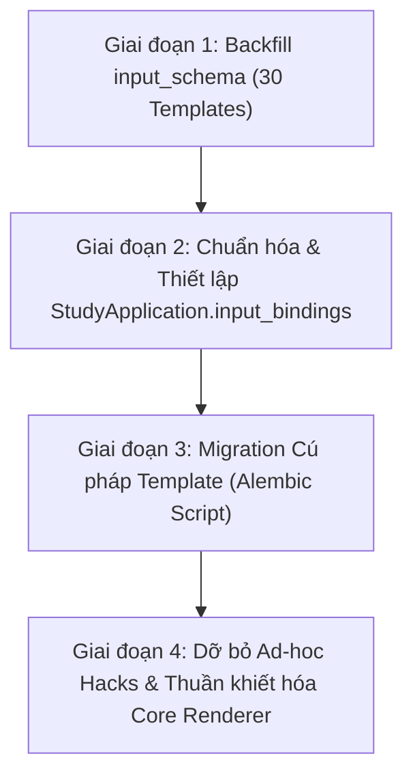

# Kế Hoạch & Báo Cáo Hiện Đại Hóa Toàn Diện Template Flashcard & Loại Bỏ Ad-hoc Hacks

> **Tài liệu**: `docs/plans/TEMPLATE_MODERNIZATION_AND_MIGRATION_PLAN.md`  
> **Ngày lập**: 2026-10-12  
> **Phạm vi**: Flashcard Template Architecture, Input Schema & Bindings Decoupling, Renderer Sanitization, Database Migration  
> **Trạng thái**: PROPOSED / DESIGN READY  

---

## 1. Tóm tắt điều hành (Executive Summary)

Trong quá trình phát triển hệ thống Flashcard từ Phase 1 (kế thừa Anki) đến Phase 6 (Reusable Presentation Architecture), hệ thống render đã phải gánh chịu nhiều **khoản nợ kỹ thuật (technical debt)** dưới dạng các hàm can thiệp ngầm ("hộp đen"). Những cơ chế này tự động can thiệp, viết lại mã nguồn template, và tiêm biến giả lập vào render context:
1. **Ad-hoc Alias Hack**: Hardcode `hanviet` $\leftrightarrow$ `han_viet` ở cả backend (`flashcard_renderer.py`) và frontend (`clientRenderer.ts`).
2. **Media URL Rewrite Hack**: Tự động regex viết lại thuộc tính `src="{{Media}}"` thành `src="{{Media_url}}"`.
3. **Double-Brace Upgrade Hack**: Tự động regex nâng cấp `{{image}}` / `{{audio}}` thành `{{{image}}}` / `{{{audio}}}`.
4. **Dotted Field Nested Hack**: Tự động bóc tách dấu chấm như `{{a.b}}` thành object lồng nhau.

### Tại sao hiện tại là thời điểm hoàn hảo để dọn dẹp triệt để?
Kiến trúc Flama hiện tại đã hoàn thiện tầng **Phase 6 - Reusable Template & Study Application**:
* `Template` và `TemplateVersion` đã trở thành thực thể độc lập, có thể tái sử dụng, sở hữu hợp đồng đầu vào chuẩn mực là **`input_schema`** (danh sách `{key, label, type, required}`).
* Tầng liên kết **`StudyApplication`** đã có sẵn cột **`input_bindings`** (`db.Column(db.JSON)`), cho phép ánh xạ linh hoạt từ bất kỳ input key nào của Template sang `field_def_id` của NoteType.
* Tầng xử lý **`template_binding_service.py`** (`prepare_bound_fields`) đã vận hành ổn định, sẵn sàng thực hiện phép chiếu alias tại thời điểm render một cách minh bạch và an toàn.

**Mục tiêu của kế hoạch này:**
* Thực hiện audit toàn diện 100% template hiện có trong database và codebase.
* Chuẩn hóa và migrate các template lỗi thời sang chuẩn cú pháp hiện đại.
* Đưa toàn bộ bài toán bí danh (aliasing) về đúng tầng kiến trúc của nó: **`input_bindings`**, tuyệt đối không để lọt vào core render engine.
* Dỡ bỏ an toàn các đoạn mã "hộp đen" ở backend và frontend mà không gây ra bất kỳ lỗi hồi quy hiển thị nào (**Zero Visual Regression**).

---

## 2. Báo cáo Audit Toàn Diện Thực Tế (Audit Findings)

Đã thực hiện audit thực tế trên toàn bộ 35 template trong database local, các bộ template mẫu (`note-type-templates/`), và các module seed (`app/services/flashcard_legacy.py`).

### 2.1. Số liệu thống kê trong Database
* **Tổng số Template trong DB**: **35 templates**
* **Số template đã có `input_schema` chuẩn hóa**: **5 / 35** (Chỉ gồm các template typing mới: *Gõ cách đọc*, *Gõ từ qua ảnh*, *Gõ đáp án*, *Gõ nghĩa*, *Gõ chép chính tả*).
* **Số template đang ở trạng thái Legacy (`input_schema: EMPTY / NULL`)**: **30 / 35** (~85.7%).
* **Số template phụ thuộc vào Media URL Rewrite (`src="{{token}}"`)**: **24 / 35** templates.
* **Số template phụ thuộc vào Double-Brace Auto Upgrade (`{{media}}`)**: **19 / 35** templates.

### 2.2. Chi tiết các Antipatterns và Mẫu Template Lỗi Thời

| Mã lỗi | Tên Antipattern | Hiện tượng & Vấn đề | Tần suất xuất hiện |
| :--- | :--- | :--- | :--- |
| **L1** | **Ad-hoc Field Aliasing** | Template hoặc test case gọi `{{han_viet}}` trong khi NoteType khai báo `hanviet`. Bắt ép backend và frontend phải hardcode `if 'hanviet' in context: context['han_viet'] = ...`. | Xuất hiện rải rác trong user templates, test suite, và ad-hoc bridge. |
| **L2** | **Legacy Media Attribute Syntax** | Viết `<audio id="audio" src="{{word_audio}}"></audio>` thay vì dùng biến chuẩn `{{word_audio_url}}`. Bắt ép backend chạy regex `_rewrite_media_url_attribute_tokens`. | **24 templates** (bao gồm `Default Flama Flashcard`, `Thẻ 1`, `Advanced Vocabulary Card`). |
| **L3** | **Double-Brace on HTML/Media** | Viết `{{image}}` hoặc `{{word_audio}}` thay vì `{{{image}}}`. Bắt ép backend chạy regex `_upgrade_html_field_double_brace_tokens` để ép lên 3 ngoặc. | **19 templates** (hầu hết là các bộ card tạo từ template default cũ). |
| **L4** | **Unbound Dotted Fields** | Template gọi trường lồng nhau như `{{literary_example.quote}}`, `{{literary_example.work}}` mà không có schema rõ ràng, phụ thuộc vào hàm biến đổi dict ngầm `_inject_dotted_field_nested_keys`. | Thấy rõ trong `note-type-templates/grammar-literary-quotes-card`. |
| **L5** | **Thiếu `input_schema` (Uncontracted Templates)** | Template không khai báo hợp đồng đầu vào (`input_schema IS NULL / []`), khiến hệ thống không thể validate hoặc hỗ trợ người dùng map trường qua UI trực quan. | **30 templates** trong DB. |
| **L6** | **Custom Non-standard Attributes** | Sử dụng các thuộc tính cũ như `auto-split` trong thẻ div (`flashcard_legacy.py`), phụ thuộc vào parser text node thay vì dùng cấu trúc linh hoạt. | Template mặc định cũ trong `flashcard_legacy.py`. |

---

## 3. Kiến trúc Đích (Target Architecture - Phase 6 Standard)

Thay vì để backend tự suy đoán và vá víu, toàn bộ luồng render được chuẩn hóa theo phân tầng rõ ràng:

```
+-------------------------------------------------------------------------------+
|                               1. NOTE CONTENT                                 |
|  Note.field_values: {"word": "犬", "reading": "いぬ", "hanviet": "KHUYỂN"}     |
+-------------------------------------------------------------------------------+
                                        |
                                        v
+-------------------------------------------------------------------------------+
|                       2. PRESENTATION APPLICATION LAYER                       |
|  StudyApplication (Phase 6):                                                  |
|    - Template: "Modern Vocabulary View"                                       |
|    - input_bindings: {                                                        |
|        "Term": "field_def_uuid_word",                                         |
|        "Pronunciation": "field_def_uuid_reading",                             |
|        "han_viet": "field_def_uuid_hanviet"  <--- BÍ DANH MAP TẠI ĐÂY!        |
|      }                                                                        |
|  => prepare_bound_fields() chiếu Note -> Render Context có đủ các key!        |
+-------------------------------------------------------------------------------+
                                        |
                                        v
+-------------------------------------------------------------------------------+
|                          3. TEMPLATE CONTRACT LAYER                           |
|  Template (Reusable):                                                         |
|    - input_schema: [                                                          |
|        {"key": "Term", "type": "text"},                                       |
|        {"key": "Pronunciation", "type": "text"},                             |
|        {"key": "han_viet", "type": "text"}                                    |
|      ]                                                                        |
|    - front_html: "<div>{{Term}}</div>"                                        |
|    - back_html: "<div>{{Pronunciation}} - [{{han_viet}}]</div>"               |
+-------------------------------------------------------------------------------+
                                        |
                                        v
+-------------------------------------------------------------------------------+
|                           4. PURE CORE RENDER ENGINE                          |
|  flashcard_renderer.py (Backend) & clientRenderer.ts (Frontend):              |
|    - KHÔNG hack bí danh ("hanviet" <-> "han_viet").                           |
|    - KHÔNG regex rewrite "src={{Media}}" -> dùng thẳng "{{Media_url}}".       |
|    - KHÔNG auto upgrade "{{Media}}" -> template tự dùng "{{{Media}}}".        |
|    - Chỉ làm đúng nhiệm vụ: Mustache Interpolation + Bleach / DOMPurify CSP.  |
+-------------------------------------------------------------------------------+
```

### Ưu điểm vượt trội:
1. **Minh bạch 100%:** Người dùng hoặc người tạo template muốn đặt tên biến là gì (`han_viet`, `am_han_viet`, `SinoVietnamese`...) đều được, chỉ cần cấu hình `input_bindings` map vào field `hanviet` của NoteType.
2. **Loại bỏ hộp đen:** Template viết sao thì chạy vậy; không có mã Regex nào âm thầm sửa code template sau lưng người dùng.
3. **Khả năng tái sử dụng (Reusability):** Một template đẹp từ Marketplace có thể áp dụng cho bất kỳ Deck nào dù Deck đó đặt tên field khác nhau hoàn toàn.

---

## 4. Chiến lược & Kế Hoạch Triển Khai Chi Tiết (Execution Plan)

Kế hoạch gồm 4 giai đoạn tuần tự, đảm bảo không downtime và an toàn dữ liệu:



---

### Giai đoạn 1: Backfill `input_schema` cho 30 Template Legacy
* **Mục tiêu:** Đảm bảo 100% template trong hệ thống đều có bản hợp đồng `input_schema` được lưu trữ cố định trong DB, chấm dứt việc phụ thuộc vào suy luận động khi render.
* **Hành động:**
  1. Viết script kiểm tra sử dụng `app.validators.template_library.infer_input_schema(front, back, field_defs)` kết hợp với parser token chuẩn `app.services.template_tokens.extract_variable_names`.
  2. Quét qua 30 template legacy trong DB và tự động sinh danh sách `input_schema` tương ứng với các biến đang được sử dụng trong `front_html` và `back_html`.
  3. Cập nhật đồng bộ vào cả bảng `templates.input_schema` và các phiên bản tương ứng trong `template_versions.input_schema`.

---

### Giai đoạn 2: Chuẩn hóa `StudyApplication.input_bindings`
* **Mục tiêu:** Biến các mối quan hệ ngầm định thành các bản ghi binding tường minh.
* **Hành động:**
  1. Với mỗi `StudyApplication` đang liên kết NoteType với một Template:
     * Đọc `input_schema` của Template.
     * So khớp các key trong schema với danh sách `FieldDef` của NoteType.
     * Ánh xạ key sang `FieldDef.id`.
     * **Xử lý đặc biệt cho bí danh:** Nếu template cần key `han_viet` nhưng NoteType chỉ có field `hanviet` (hoặc ngược lại), ghi nhận binding:
       ```json
       {
         "han_viet": "<id_of_hanviet_field>"
       }
       ```
  2. Lưu cấu hình này vào cột `input_bindings` của bảng `study_applications`. Khi đó, `prepare_bound_fields` tại runtime sẽ tự động giải quyết bí danh mà không cần renderer can thiệp.

---

### Giai đoạn 3: Migration Cú pháp Template (Alembic Script)
* **Mục tiêu:** Hiện đại hóa cú pháp của chính các chuỗi HTML trong `Template.front_html` và `Template.back_html` để không còn phụ thuộc vào các regex hack.
* **Hành động cụ thể bằng Alembic Migration:**
  1. **Khử `src="{{Media}}"` (L2):**
     * Tìm các mẫu `src="{{field_name}}"` hoặc `src="{{{field_name}}}"` với các trường có kiểu `audio`, `image`, `diagram`.
     * Dùng parser `template_tokens.py: rewrite_variable_names` chuyển đổi thành `src="{{field_name_url}}"`.
  2. **Khử Double-brace cho Media/RichText (L3):**
     * Tìm các token `{{field_name}}` độc lập (không nằm trong thuộc tính src) của các trường `image`, `diagram`, `richtext`, `markdown`.
     * Chuyển đổi thành `{{{field_name}}}`.
  3. **Khử `{{han_viet}}` legacy trong template nội bộ (L1):**
     * Với các template hệ thống mặc định (`flama-default`, `flashcard_legacy.py`): chuẩn hóa thống nhất toàn bộ các thẻ Mustache về `hanviet`.
  4. **Cập nhật snapshot `TemplateVersion`:**
     * Với mỗi template được cập nhật HTML, tính lại `content_hash` và cập nhật bản ghi version tương ứng.
  5. **Cập nhật prototype files trong codebase:**
     * Cập nhật các file tĩnh trong `note-type-templates/` và `app/services/flashcard_legacy.py` để việc cài đặt/seeding mới luôn sinh ra template chuẩn hiện đại.

---

### Giai đoạn 4: Dỡ bỏ Mã Hộp Đen (Retirement of Black-box Workarounds)
Sau khi toàn bộ dữ liệu và template đã được chuẩn hóa, tiến hành dọn sạch mã nguồn ở cả Backend và Frontend:

1. **Backend ([`app/services/flashcard_renderer.py`](file:///d:/Project/nihongo/app/services/flashcard_renderer.py)):**
   * **Xóa bỏ:**
     ```python
     # XÓA BỎ DÒNG 1029-1031
     if "hanviet" in context and "han_viet" not in context:
         context["han_viet"] = context["hanviet"]
     ```
   * **Dỡ bỏ / Deprecate:**
     * `_upgrade_html_field_double_brace_tokens`
     * `_rewrite_media_url_attribute_tokens`
2. **Frontend ([`frontend/src/entities/flashcard/lib/clientRenderer.ts`](file:///d:/Project/nihongo/frontend/src/entities/flashcard/lib/clientRenderer.ts)):**
   * **Xóa bỏ:**
     ```typescript
     // XÓA BỎ DÒNG 208-212
     if (key === 'hanviet') {
       next['han_viet'] = normalized
     } else if (key === 'han_viet') {
       next['hanviet'] = normalized
     }
     ```
3. **Cập nhật Test Suites:**
   * Cập nhật [`tests/test_flashcard_renderer.py`](file:///d:/Project/nihongo/tests/test_flashcard_renderer.py): Xóa test case kiểm tra alias ngầm, thay bằng test case kiểm tra qua `prepare_bound_fields` và `input_bindings`.
   * Cập nhật [`clientRenderer.test.ts`](file:///d:/Project/nihongo/frontend/src/entities/flashcard/lib/clientRenderer.test.ts).

---

## 5. Kế Hoạch Kiểm Thử & Đảm Bảo An Toàn (Verification & Rollback)

### 5.1. Chiến lược Snapshot Testing (Zero Visual Regression)
1. **Trước khi migrate:** Chạy script kết xuất kết quả render HTML của 35 template hiện có vào file snapshot JSON (`before_migration_snapshots.json`).
2. **Thực hiện migration trên môi trường thử nghiệm (Local):** Chạy Alembic upgrade.
3. **Sau khi migrate:** Kết xuất lại kết quả render HTML (`after_migration_snapshots.json`).
4. **Đối sánh (Diff Verification):**
   * Đảm bảo DOM hiển thị trực quan (visual elements, audio player, image tags, text) của thẻ trước và sau migration là tương đồng 100%.

### 5.2. Modular Test Execution
Theo quy định `AGENTS.md`, thực thi kiểm thử theo từng module:
```powershell
python scripts/run_tests.py --module flashcards,study
npm --prefix frontend test -- clientRenderer
```

### 5.3. Kế hoạch Rollback
* Script Alembic Migration cung cấp đầy đủ hàm `downgrade()` để hoàn nguyên `front_html`, `back_html` và `input_schema` về trạng thái ban đầu nếu phát hiện sai sót.
* Mọi thao tác ghi dữ liệu đều nằm trong Transaction database có khả năng rollback ngay lập tức.

---

## 6. Phân Công & Danh Mục Hành Động (Action Checklist)

- [ ] **M1**: Tạo script kiểm toán chi tiết và chụp snapshot HTML của toàn bộ 35 template.
- [ ] **M2**: Viết migration script Alembic `versions/20261012_xxxxxx_modernize_flashcard_templates.py`:
  - [ ] Backfill `input_schema` cho 30 template legacy.
  - [ ] Cập nhật `StudyApplication.input_bindings` tương ứng cho các NoteType liên kết.
  - [ ] Rewrite các mẫu `src="{{Media}}"` và `{{Media}}` sang chuẩn mới `src="{{Media_url}}"` và `{{{Media}}}`.
- [ ] **M3**: Cập nhật các prototype templates mẫu (`note-type-templates/*/prototype.json`, `front.html`, `back.html`) và `app/services/flashcard_legacy.py`.
- [ ] **M4**: Dọn dẹp mã nguồn Core Renderer:
  - [ ] Xóa alias `han_viet` / `hanviet` trong `flashcard_renderer.py`.
  - [ ] Xóa alias `han_viet` / `hanviet` trong `clientRenderer.ts`.
- [ ] **M5**: Chạy toàn bộ test suite backend và frontend, xác nhận pass 100%.
- [ ] **M6**: So khớp snapshot trước/sau migration, xác nhận đạt chuẩn **Zero Visual Regression**.
