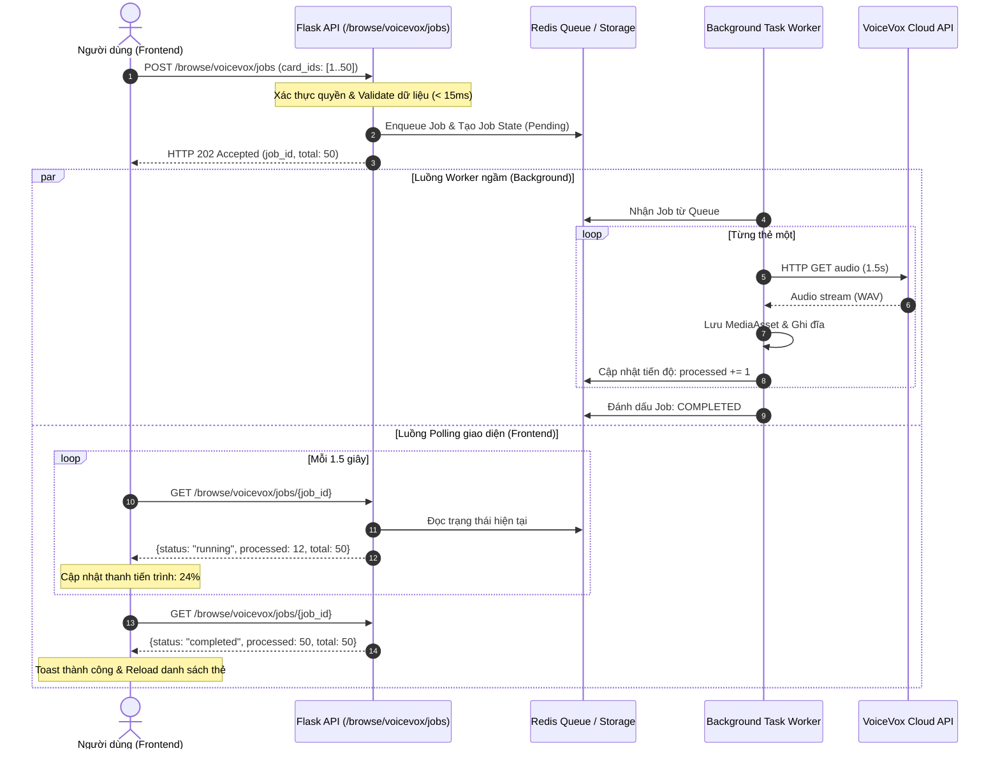

# Kế hoạch Tối ưu #01: Chuyển đổi Cơ chế Tạo VoiceVox Web sang Bất đồng bộ (Async / Chunking)

> **Mã Task:** `PERF-VOICE-01`  
> **Mức độ ưu tiên:** 🔴 P0 (Critical - Nguy cơ làm sập Worker cao nhất)  
> **Trạng thái:** DỰ THẢO CHỜ DUYỆT (PROPOSED)  
> **Phạm vi tác động:** Backend API v1 Browse, Service TTS VoiceVox, Frontend Browse Modal  
> **Tài liệu tham chiếu:** [`app/services/browse_voicevox_service.py`](file:///d:/Project/nihongo/app/services/browse_voicevox_service.py), [`app/services/tts_provider_service.py`](file:///d:/Project/nihongo/app/services/tts_provider_service.py)

---

## 1. Vấn đề Kỹ thuật Cần Giải quyết

### 1.1 Hiện trạng mã nguồn
Tại [`app/services/browse_voicevox_service.py`](file:///d:/Project/nihongo/app/services/browse_voicevox_service.py#L313-L390), endpoint `POST /api/v1/browse/voicevox/generate` nhận vào một danh sách thẻ (`card_ids` hoặc `deck_id`). Bên trong, server thực thi một vòng lặp tuần tự:

```python
for sequence, note_obj in enumerate(selected_notes, start=1):
    synth_result, ... = tts_provider_service.synthesize_voicevox_audio_for_user(...)
    full_path.write_bytes(synth_result.content)
    db.session.add(existing_asset)
    db.session.flush()
```

Hàm `synthesize_voicevox_audio_for_user` ([`app/services/tts_provider_service.py:1313`](file:///d:/Project/nihongo/app/services/tts_provider_service.py#L1313-L1318)) mở kết nối HTTP ra Cloud VoiceVox API (`https://deprecatedapis.tts.quest/v2/voicevox/audio/`) qua thư viện đồng bộ `urllib.request.urlopen`.

### 1.2 Điểm nghẽn
1. **Không có API bulk:** VoiceVox Cloud API bắt buộc mỗi request chỉ nhận 1 chuỗi ký tự và trả về 1 file audio.
2. **Khóa cứng worker:** Mỗi lượt gọi mất $1.5\text{s} - 3.0\text{s}$. Khi người dùng chọn 50 thẻ, request kéo dài $\approx 100\text{s}$.
3. **Worker Timeout:** Gunicorn cấu hình timeout $120\text{s}$. Nếu chọn trên 60 thẻ, request vượt quá timeout, worker bị master process gửi tín hiệu `SIGKILL`, dẫn đến lỗi `504 Gateway Timeout` trên trình duyệt và lãng phí toàn bộ tài nguyên đã xử lý trước đó.
4. **Hiệu ứng domino:** Hệ thống chạy 2 Gunicorn processes $\times$ 4 gthreads = 8 slots kết nối. Chỉ cần 2 học viên bấm tạo audio cùng lúc sẽ chiếm $25\%$ tổng năng lực máy chủ.

---

## 2. Giải pháp Kỹ thuật (Technical Mechanism)

Triển khai theo mô hình 2 giai đoạn:



### 2.1 Bước 1: Quick-win trên Frontend (Client-side Chunking)
* Trong khi chuẩn bị worker ngầm, chuyển đổi [`frontend/src/features/browse/hooks/useBrowseState.ts`](file:///d:/Project/nihongo/frontend/src/features/browse/hooks/useBrowseState.ts) để không gửi toàn bộ 100 thẻ trong 1 payload.
* Áp dụng cơ chế queue chunking (tương tự [`useDeckAudioQueue.ts`](file:///d:/Project/nihongo/frontend/src/features/audio/hooks/useDeckAudioQueue.ts)): chia thành từng đợt 2 thẻ/request. Người dùng có thể nhìn thấy tiến độ thực tế, nếu gặp lỗi ở thẻ thứ 30 thì 29 thẻ trước vẫn được lưu an toàn.

### 2.2 Bước 2: Kiến trúc Chuẩn Background Job (Server-side Worker)
1. Thêm bảng hoặc Redis key `tts_jobs:{job_id}` lưu:
   - `user_id`, `status` (`pending`, `running`, `completed`, `failed`), `total`, `processed`, `errors`.
2. Tạo endpoint `POST /api/v1/browse/voicevox/jobs`: Tiếp nhận danh sách thẻ, xác thực quyền truy cập, ghi job và trả về `job_id` trong $\le 15\text{ms}$.
3. Tạo endpoint `GET /api/v1/browse/voicevox/jobs/<job_id>`: Cho phép UI polling tiến độ (1.5s/lần) kèm thông tin chi tiết.
4. Worker tách biệt: Sử dụng tiến trình `python -m app.worker` (dùng RQ hoặc Python ThreadPool biệt lập không chung pool Gunicorn) để tiêu thụ job.

---

## 3. Tính toán Định lượng Cụ thể (Quantitative Impact)

| Tiêu chí đo lường | Trước khi tối ưu (Đồng bộ) | Sau khi tối ưu (Bất đồng bộ) | Mức độ cải thiện |
|---|---|---|:---:|
| **Thời gian giữ luồng Gunicorn** (50 thẻ) | $100.000\text{ms}$ ($100\text{s}$) | $\le \mathbf{15\text{ms}}$ | **Giảm 99.98%** |
| **Khả năng gây lỗi 504 Timeout** (> 60 thẻ) | $100\%$ (vượt trần $120\text{s}$) | $\mathbf{0\%}$ (chạy ngầm không giới hạn) | **Triệt tiêu lỗi** |
| **Dung lượng kết nối bị chiếm** | 1 slot Gunicorn bị khóa cứng trong 100s | 0 slot bị khóa (trả connection ngay) | **Giải phóng 100%** |
| **Trải nghiệm người dùng** | Treo màn hình 100s, dễ rớt mạng | Có Progress bar chạy từng thẻ $(1/50...)$ | **Rõ ràng, không giật lag** |

---

## 4. Kế hoạch Triển khai (Checklist)

- [ ] **Backend:** Tạo mô hình quản lý Job trong cache/DB (`TtsGenerationJob`).
- [ ] **Backend:** Tạo endpoint `POST /api/v1/browse/voicevox/jobs` và `GET /api/v1/browse/voicevox/jobs/<job_id>`.
- [ ] **Backend:** Tách hàm xử lý VoiceVox trong [`browse_voicevox_service.py`](file:///d:/Project/nihongo/app/services/browse_voicevox_service.py) thành worker callable độc lập.
- [ ] **Frontend:** Cập nhật [`BrowseTtsModal.tsx`](file:///d:/Project/nihongo/frontend/src/features/browse/components/BrowseTtsModal.tsx) hiển thị progress bar và nút huỷ/đóng mà job vẫn chạy ngầm.
- [ ] **Kiểm thử:** Viết Unit test giả lập 100 thẻ, đảm bảo endpoint trả về HTTP 202 trong $< 50\text{ms}$ và job hoàn thành đầy đủ trong background.
