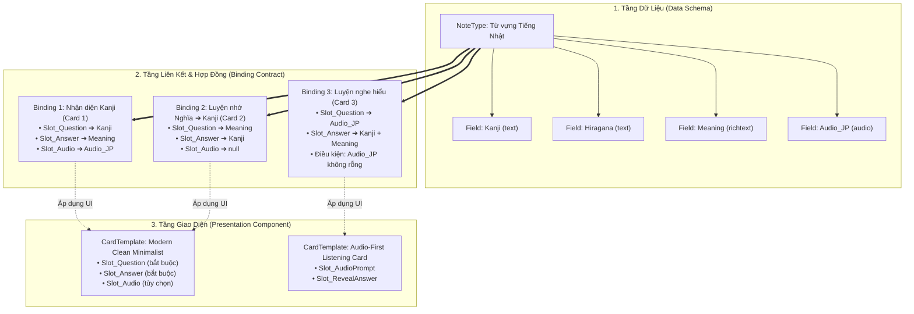
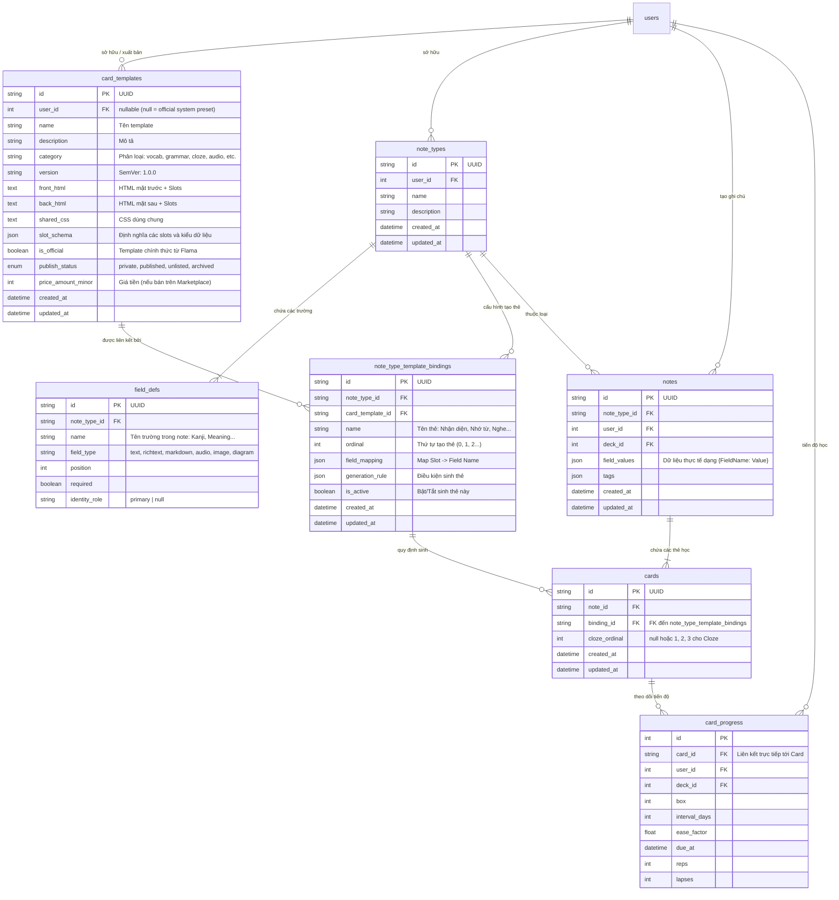
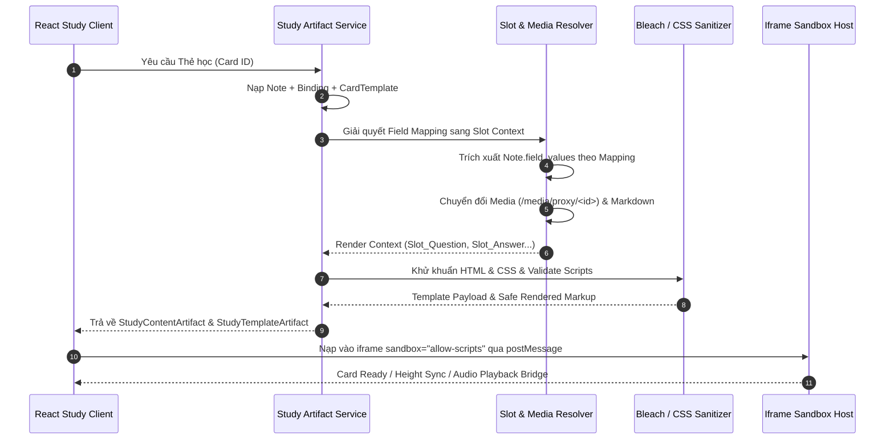
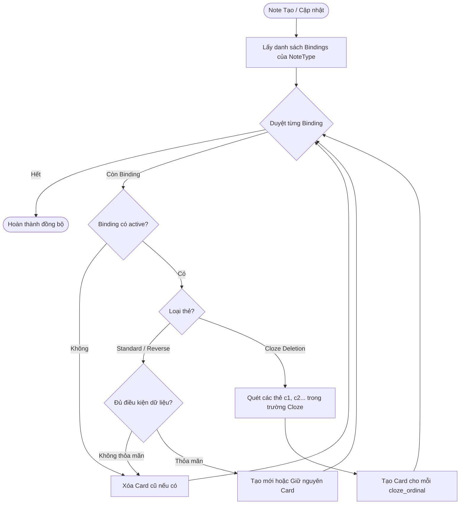
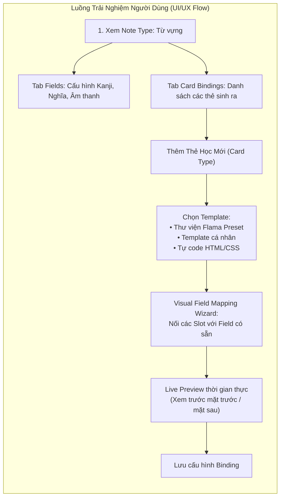

# Thiết Kế Kiến Trúc Toàn Diện: Tách Card Template Khỏi Note Type (Decoupled Flashcard Templates)

> **Mã tài liệu:** `FLAMA-ARCH-2026-TPL-01`  
> **Trạng thái:** Bản thảo đề xuất kỹ thuật (Technical Proposal & Architecture Specification)  
> **Phạm vi tác động:** Backend Data Models (`models/`), Render Engine (`flashcard_renderer.py`, `study_artifact_service.py`), Sync Engine (`flama_connect_service.py`, `anki_sync_service.py`), Share/Marketplace (`flashcards_share_service.py`), Frontend React (`frontend/src/features/note-types/`, `frontend/src/features/study/`).

> **Mốc triển khai 2026-08-27:** Schema tách Template/NoteType, các binding table, thay đổi Card và migration dữ liệu trong proposal này **chưa được triển khai**. Chỉ compatibility slice không đổi schema của Phase 0–2 trong [`study-interaction-trigger-algorithm-plan.md`](../../architecture/study-interaction-trigger-algorithm-plan.md#implementation-progress-snapshot--2026-08-27) đã được triển khai một phần. Tài liệu kiến trúc đó là tracker tiến độ canonical; không duy trì một bản trạng thái phase trùng lặp trong proposal này.

---

## 1. Tổng quan & Đặt vấn đề

### 1.1. Thực trạng kiến trúc hiện tại
Trong hệ thống thẻ nhớ Flama (cũng như mô hình truyền thống của Anki), **Note Type (Loại ghi chú)** và **Card Template (Mẫu hiển thị thẻ)** đang bị ràng buộc chặt chẽ với nhau theo quan hệ 1-N:
* Một `NoteType` sở hữu trực tiếp một hoặc nhiều `Template` thông qua khóa ngoại cứng `templates.note_type_id`.
* Mã nguồn `front_html` và `back_html` của `Template` tham chiếu trực tiếp đến tên các trường cụ thể được khai báo trong `field_defs` của `NoteType` đó (ví dụ: `{{Kanji}}`, `{{Meaning}}`, `{{Furigana}}`).
* Thẻ học (`Card`) được sinh ra tự động cho mỗi cặp `(Note, Template)` với khóa ngoại `cards.template_id`.

```mermaid
classDiagram
    direction LR
    class NoteType {
        +id: UUID
        +name: String
        +user_id: Integer
    }
    class FieldDef {
        +id: UUID
        +note_type_id: UUID
        +name: "Kanji" | "Word"
        +field_type: String
    }
    class Template {
        +id: UUID
        +note_type_id: UUID
        +front_html: "{{Kanji}}"
        +back_html: "{{Meaning}}"
    }
    class Note {
        +id: UUID
        +note_type_id: UUID
        +field_values: JSON
    }
    class Card {
        +id: UUID
        +note_id: UUID
        +template_id: UUID
    }

    NoteType "1" *-- "N" FieldDef : định nghĩa trường
    NoteType "1" *-- "N" Template : sở hữu trực tiếp
    Note "1" *-- "N" Card : sở hữu
    Template "1" -- "N" Card : liên kết tạo thẻ
    Note "*" --> "1" NoteType : thuộc về
```

### 1.2. Những điểm nghẽn và hạn chế kiến trúc
1. **Không thể tái sử dụng thiết kế UI (Zero Reusability):**  
   Khi người dùng có 10 Note Type khác nhau (ví dụ: *Từ vựng N1*, *Từ vựng N2*, *Hán tự*, *Ngữ pháp*, *Tiếng Anh giao tiếp*, *Y khoa*, *Thuật ngữ Lập trình*) nhưng muốn sử dụng chung một phong cách giao diện hiện đại (Minimalist Glassmorphism, Audio Player Card, Dark Theme, Interactive Flip), họ bắt buộc phải copy-paste toàn bộ code HTML/CSS vào từng Template của từng Note Type một.
2. **Chi phí bảo trì và nâng cấp giao diện khổng lồ:**  
   Nếu người dùng hoặc đội ngũ thiết kế muốn nâng cấp font chữ, tinh chỉnh padding, sửa lỗi hiển thị trên mobile hay thêm hiệu ứng âm thanh, họ phải sửa thủ công lặp lại trên hàng chục Note Type.
3. **Thiếu khả năng trừu tượng hóa (Tight Coupling):**  
   Template không thể hoạt động như một thành phần độc lập (Design Component / Widget) vì nó bị gắn chết với tên trường cụ thể. Template viết cho `{{Word}}` không thể dùng trực tiếp cho Note Type có trường tên là `{{Vocabulary}}` hoặc `{{Kanji}}`.
4. **Hạn chế đối với Hệ sinh thái Marketplace:**  
   Hiện tại người dùng chỉ có thể chia sẻ cả bộ `NoteType` kèm `Template`. Không thể hình thành một **Template Marketplace** độc lập – nơi các nhà thiết kế/lập trình viên chuyên nghiệp có thể sáng tạo, chia sẻ hoặc thương mại hóa các mẫu thiết kế thẻ đẹp mắt, tiện dụng mà người dùng bình thường có thể áp dụng vào bất kỳ bộ từ vựng nào của họ chỉ với 1 cú click.

---

## 2. Mô hình Kiến trúc Đề xuất (Decoupled 3-Tier Architecture)

Để giải quyết triệt để các vấn đề trên, kiến trúc đề xuất chia tách hệ thống Flashcard thành **3 tầng độc lập**:

1. **Tầng Dữ liệu (Data Schema Layer - `NoteType` & `FieldDef`):**  
   Chỉ định nghĩa cấu trúc dữ liệu của ghi chú (các trường dữ liệu: Tên trường, Kiểu dữ liệu `text`, `richtext`, `markdown`, `audio`, `image`). Không chứa bất kỳ định nghĩa HTML/CSS nào.
2. **Tầng Hiển thị (Presentation Layer - `CardTemplate`):**  
   Là một đối tượng độc lập hoàn toàn (Standalone Component). Định nghĩa Layout, HTML, CSS, Javascript (chạy trong Sandbox) và một tập hợp các **Slots (Biến vị trí trừu tượng)** cùng schema kiểu dữ liệu mà template yêu cầu.
3. **Tầng Hợp đồng Liên kết & Quy tắc Sinh thẻ (Binding & Contract Layer - `NoteTypeTemplateBinding`):**  
   Lớp trung gian định nghĩa mối quan hệ giữa một `NoteType` và một `CardTemplate`. Tầng này chứa:
   * **Field Mapping (Ánh xạ trường):** Gán trường dữ liệu thực tế của NoteType vào từng Slot trừu tượng của Template.
   * **Generation Rules (Điều kiện sinh thẻ):** Quy định khi nào một Card được tạo (ví dụ: chỉ tạo thẻ khi trường Audio có dữ liệu, hoặc tạo thẻ đảo, hoặc sinh thẻ Cloze Deletion).



---

## 3. Thiết Kế Cơ Sở Dữ Liệu Chi Tiết (Database Schema & ERD)

### 3.1. Sơ đồ Quan hệ Thực thể (ERD)



### 3.2. Cấu trúc Chi tiết các Bảng & Kiểu Dữ Liệu

#### Bảng `card_templates` (Độc lập & Có thể phân phối)
```sql
CREATE TABLE card_templates (
    id VARCHAR(36) PRIMARY KEY,
    user_id INT NULL,
    name VARCHAR(255) NOT NULL,
    description TEXT NULL,
    category VARCHAR(64) NOT NULL DEFAULT 'general',
    version VARCHAR(32) NOT NULL DEFAULT '1.0.0',
    front_html MEDIUMTEXT NOT NULL,
    back_html MEDIUMTEXT NOT NULL,
    shared_css MEDIUMTEXT NOT NULL,
    slot_schema JSON NOT NULL,
    preview_image_url VARCHAR(512) NULL,
    is_official BOOLEAN NOT NULL DEFAULT FALSE,
    publish_status ENUM('private', 'published', 'unlisted', 'archived') NOT NULL DEFAULT 'private',
    price_amount_minor INT NOT NULL DEFAULT 0,
    install_count INT NOT NULL DEFAULT 0,
    rating_avg FLOAT NOT NULL DEFAULT 0.0,
    rating_count INT NOT NULL DEFAULT 0,
    created_at DATETIME NOT NULL DEFAULT CURRENT_TIMESTAMP,
    updated_at DATETIME NOT NULL DEFAULT CURRENT_TIMESTAMP ON UPDATE CURRENT_TIMESTAMP,
    FOREIGN KEY (user_id) REFERENCES users(id) ON DELETE SET NULL,
    INDEX idx_card_templates_user (user_id),
    INDEX idx_card_templates_status (publish_status),
    INDEX idx_card_templates_category (category)
);
```

#### Cấu trúc JSON `slot_schema` của `card_templates`
```json
{
  "slots": [
    {
      "name": "Slot_Question",
      "label": "Mặt câu hỏi chính",
      "type": "text",
      "required": true,
      "description": "Nội dung chữ hoặc từ khóa hiển thị ở mặt trước"
    },
    {
      "name": "Slot_Answer",
      "label": "Đáp án / Ý nghĩa",
      "type": "richtext",
      "required": true,
      "description": "Giải nghĩa chi tiết, ví dụ hoặc hình ảnh"
    },
    {
      "name": "Slot_Audio",
      "label": "File phát âm",
      "type": "audio",
      "required": false,
      "description": "Âm thanh phát tự động hoặc nút bấm nghe"
    },
    {
      "name": "Slot_Hint",
      "label": "Gợi ý",
      "type": "text",
      "required": false,
      "description": "Gợi ý hiển thị trước khi lật thẻ"
    }
  ],
  "supported_card_types": ["standard", "audio_prompt"]
}
```

#### Bảng `note_type_template_bindings` (Hợp đồng Ánh xạ & Quy tắc Sinh thẻ)
```sql
CREATE TABLE note_type_template_bindings (
    id VARCHAR(36) PRIMARY KEY,
    note_type_id VARCHAR(36) NOT NULL,
    card_template_id VARCHAR(36) NOT NULL,
    name VARCHAR(255) NOT NULL,
    ordinal INT NOT NULL DEFAULT 0,
    field_mapping JSON NOT NULL,
    generation_rule JSON NOT NULL,
    is_active BOOLEAN NOT NULL DEFAULT TRUE,
    created_at DATETIME NOT NULL DEFAULT CURRENT_TIMESTAMP,
    updated_at DATETIME NOT NULL DEFAULT CURRENT_TIMESTAMP ON UPDATE CURRENT_TIMESTAMP,
    FOREIGN KEY (note_type_id) REFERENCES note_types(id) ON DELETE CASCADE,
    FOREIGN KEY (card_template_id) REFERENCES card_templates(id) ON DELETE RESTRICT,
    INDEX idx_bindings_note_type (note_type_id),
    INDEX idx_bindings_template (card_template_id),
    UNIQUE KEY uq_note_type_ordinal (note_type_id, ordinal)
);
```

#### Cấu trúc JSON `field_mapping` & `generation_rule`
* **`field_mapping`:** Ánh xạ từ Tên Slot trong Template ➔ Tên Trường trong NoteType:
```json
{
  "Slot_Question": "Kanji",
  "Slot_Answer": "Meaning",
  "Slot_Audio": "Audio_JP",
  "Slot_Hint": "Furigana"
}
```
* **`generation_rule`:** Điều kiện sinh thẻ cho từng ghi chú:
```json
{
  "mode": "all_required_slots_non_empty",
  "required_fields": ["Kanji", "Meaning"],
  "skip_if_empty": ["Kanji"],
  "cloze": false
}
```

#### Cập nhật Bảng `cards`
```sql
-- Thay thế khóa ngoại template_id bằng binding_id
ALTER TABLE cards ADD COLUMN binding_id VARCHAR(36) NULL AFTER note_id;
ALTER TABLE cards ADD COLUMN cloze_ordinal INT NULL AFTER binding_id;
ALTER TABLE cards ADD CONSTRAINT fk_cards_binding FOREIGN KEY (binding_id) REFERENCES note_type_template_bindings(id) ON DELETE CASCADE;
ALTER TABLE cards ADD UNIQUE KEY uq_cards_note_binding_cloze (note_id, binding_id, cloze_ordinal);
```

---

## 4. Pipeline Biên Dịch, Khử Khuẩn & Render Thẻ

### 4.1. Sơ đồ Luồng Render (Render Pipeline Architecture)



### 4.2. Logic Phân giải Context (Slot Resolution & Backward Compatibility)
Thuật toán chuẩn hóa Context kết hợp hỗ trợ ngược cho các template cũ:

```python
def build_decoupled_render_context(
    *,
    template: CardTemplate,
    binding: NoteTypeTemplateBinding,
    field_defs: list[FieldDef],
    field_values: dict[str, Any],
    media_assets: list[MediaAsset],
) -> dict[str, Any]:
    """
    1. Trích xuất media lookup dictionary.
    2. Duyệt qua từng Slot được khai báo trong template.slot_schema:
       - Tìm tên field tương ứng trong binding.field_mapping.
       - Lấy giá trị thực tế từ field_values.
       - Xử lý theo kiểu dữ liệu của field (richtext, markdown, audio, image).
       - Gán vào context theo tên Slot: context[slot_name] = processed_value.
       - Gán context[f"{slot_name}_url"] cho các trường media.
    3. HỖ TRỢ NGƯỢC (Backward Compatibility):
       - Đồng thời nạp toàn bộ raw field_values vào context theo tên trường gốc.
       - Đảm bảo template viết kiểu cũ {{Word}} hoặc {{Kanji}} vẫn chạy bình thường.
    """
    context = {}
    media_lookup = _build_media_lookup(media_assets)
    field_type_map = {f.name: f.field_type for f in field_defs}
    
    # 1. Map các Slots theo binding
    slot_mapping = binding.field_mapping or {}
    for slot_name, note_field_name in slot_mapping.items():
        if not note_field_name:
            continue
        raw_val = field_values.get(note_field_name)
        f_type = field_type_map.get(note_field_name, "text")
        
        processed_val, media_url = _process_field_value(raw_val, f_type, media_lookup)
        context[slot_name] = processed_val
        if media_url:
            context[f"{slot_name}_url"] = media_url

    # 2. Bơm raw fields cho tương thích ngược
    for field_name, raw_val in field_values.items():
        f_type = field_type_map.get(field_name, "text")
        processed_val, media_url = _process_field_value(raw_val, f_type, media_lookup)
        if field_name not in context:
            context[field_name] = processed_val
        if media_url and f"{field_name}_url" not in context:
            context[f"{field_name}_url"] = media_url

    return context
```

### 4.3. Đảm bảo An toàn Bảo mật Sandbox (Threat Model Alignment)
Việc tách template không làm thay đổi mô hình bảo mật đã xây dựng trong `docs/architecture/CARD_TEMPLATE_SANDBOX_RENDERER.md`:
* Template HTML và JavaScript luôn chạy trong `iframe sandbox="allow-scripts"` độc lập.
* Tuyệt đối không bật `allow-same-origin`, ngăn chặn truy cập cookie, localStorage, hay DOM của ứng dụng chính.
* Giao tiếp giữa Host và Thẻ thông qua giao thức cầu nối `postMessage` đã được xác thực mã phiên (`instance_id`) và whitelist hành động (`renderer_ready`, `resize_request`, `play_audio`, `reveal`).
* CSP của iframe được thiết lập nghiêm ngặt: `connect-src 'none'`, chỉ cho phép load media qua đường dẫn nội bộ an toàn `/media/proxy/<asset_id>`.

---

## 5. Động Cơ Sinh Thẻ & Hỗ Trợ Cloze Deletion

### 5.1. Quy tắc Sinh Thẻ Tự Động (Card Generation Engine)
Mỗi khi một `Note` được tạo hoặc cập nhật nội dung, hệ thống sẽ chạy hàm đồng bộ thẻ `sync_cards_for_note(note)`:



1. **Thẻ Tiêu chuẩn (Standard Card):**
   * Được sinh ra khi các trường được map vào Slot bắt buộc (`required=True`) không bị rỗng.
   * Ví dụ: Nếu `Kanji` và `Meaning` đều có chữ ➔ Tạo Card 1.
2. **Thẻ Đảo (Reversed Card):**
   * Chỉ là một Binding thứ 2 trỏ tới cùng CardTemplate nhưng đảo vị trí map (`Slot_Question ➔ Meaning`, `Slot_Answer ➔ Kanji`).
   * Không cần duplicate code giao diện; thẻ đảo tự động kế thừa 100% style của thẻ chính.
3. **Thẻ Có Điều Kiện (Conditional Card Generation):**
   * Ví dụ Binding "Luyện nghe": `generation_rule = {"require_non_empty": ["Audio_JP"]}`.
   * Nếu người dùng nhập từ vựng nhưng chưa đính kèm file audio ➔ Hệ thống tự động không tạo thẻ Card 3 (tránh thẻ rác). Khi bổ sung audio ➔ Thẻ Card 3 tự động được tạo.
4. **Thẻ Điền Khuyết (Cloze Deletion):**
   * Trường dữ liệu chứa cú pháp `{{c1::Tokyo}} là thủ đô của {{c2::Nhật Bản}}`.
   * Binding dạng Cloze sẽ phát hiện `c1`, `c2` và tự động sinh 2 bản ghi `Card` với `cloze_ordinal = 1` và `cloze_ordinal = 2`.

---

## 6. Tương Thích Hoàn Hảo Với Hệ Sinh Thái Anki & AnkiConnect

Hệ thống Flama cam kết tương thích 2 chiều với Anki Desktop và AnkiConnect (`flama_connect_service.py`, `anki_sync_service.py`):

### 6.1. Chiều Nhập (Import từ `.apkg` hoặc AnkiConnect Sync)
Khi người dùng nhập một bộ thẻ Anki vào Flama:
1. Mô hình của Anki định nghĩa `Model` gồm `flds` (fields) và `tmpls` (card templates).
2. Bộ chuyển đổi `AnkiImportAdapter` sẽ:
   * Tạo một `NoteType` tương ứng với các trường trong `flds`.
   * Tự động trích xuất từng phần tử trong `tmpls` thành một bản ghi `CardTemplate` riêng (gán quyền sở hữu cho người dùng đó).
   * Tạo một `NoteTypeTemplateBinding` nối `NoteType` với `CardTemplate` vừa tạo với cấu hình `field_mapping` đồng nhất 1:1 (`{"Front": "Front", "Back": "Back"}`).
   * Sinh các bản ghi `Card` tương ứng.
3. **Tính tương thích tuyệt đối:** 100% cấu trúc thẻ, CSS, và format đặc thù của Anki được giữ nguyên vẹn mà không gây lỗi hoặc biến dạng layout.

### 6.2. Chiều Xuất (Export sang `.apkg`)
Khi xuất bộ thẻ từ Flama ra định dạng Anki `.apkg`:
1. Bộ biên dịch `AnkiExportCompiler` sẽ đọc `CardTemplate` và `NoteTypeTemplateBinding`.
2. Thay thế toàn bộ các token `{{Slot_Name}}` trong `front_html` và `back_html` bằng tên trường thật trong NoteType dựa trên `field_mapping`.
3. Đóng gói thành file `.apkg` chuẩn với các templates nhúng sẵn bên trong NoteType, giúp Anki Desktop có thể mở và học bình thường.

---

## 7. Tích Hợp Hệ Thống Chia Sẻ & Marketplace

### 7.1. Chợ Giao Diện Thẻ Mẫu (Card Template Marketplace)
Việc tách rời template mở ra tính năng **Template Marketplace**:
* **Duyệt & Tìm kiếm:** Người dùng có thể tìm kiếm các mẫu thẻ theo phong cách (*Minimalist, Japanese Dark Theme, Furigana Auto-Ruby, Medical Flashcard, Code Syntax Highlight*).
* **Live Sandbox Preview:** Xem thử template hoạt động thực tế với dữ liệu mẫu (Sample Data) ngay trên trình duyệt mà không cần cài đặt.
* **Cài đặt 1-Click với Field Mapping Wizard:**  
  Khi người dùng bấm *"Áp dụng Template này cho Bộ Từ Vựng của tôi"*, giao diện sẽ hiện modal trực quan:
  ```
  [Slot: Câu hỏi]   ➔ [Chọn trường: Kanji        ▼]
  [Slot: Giải nghĩa]➔ [Chọn trường: Meaning      ▼]
  [Slot: Phát âm]   ➔ [Chọn trường: Audio_JP     ▼]
  ```
  Hệ thống tạo một `NoteTypeTemplateBinding` mới chỉ trong vài giây.

### 7.2. Tương thích với Mô hình Clone Deck Overlay (`docs/plans/completed/CLONE_CUTOVER_REPORT.md`)
Flama đang áp dụng mô hình `logical_overlay` cho các bộ deck được cài đặt từ Marketplace:
* Khi người dùng cài đặt một Shared Deck, hệ thống không nhân bản các Note gốc mà tạo lớp trỏ overlay.
* Với kiến trúc Decoupled Template:
  * Người dùng có thể tùy biến hoặc đổi sang một `CardTemplate` khác cho bộ deck đã clone ở cấp độ cục bộ (`DeckCloneTemplateOverride`) mà **không làm ảnh hưởng** đến bộ deck gốc của tác giả.
  * Tác giả bộ deck gốc khi cập nhật nội dung từ vựng sẽ không làm hỏng giao diện tùy biến riêng của người học.

---

## 8. Kế Hoạch Di Chuyển Dữ Liệu Không Gián Đoạn (Zero-Downtime Migration)

Để nâng cấp hệ thống hiện tại lên kiến trúc mới một cách an toàn tuyệt đối mà không làm mất tiến độ học tập của người dùng, kế hoạch gồm 4 giai đoạn:

### Giai đoạn 1: Chuẩn bị Database Schema (Non-breaking Additions)
* Chạy Alembic Migration tạo mới bảng `card_templates` và `note_type_template_bindings`.
* Thêm cột `binding_id` và `cloze_ordinal` (cho phép `NULL`) vào bảng `cards`.
* Chưa xóa bảng `templates` hay cột `template_id` cũ.

### Giai đoạn 2: Kịch bản Chuyển Đổi Dữ Liệu Tự Động (Data Backfill Script)
Viết script migration thực hiện tuần tự trong một Database Transaction an toàn:
1. **Chuyển đổi Templates ➔ CardTemplates:**  
   Duyệt qua bảng `templates` cũ. Với mỗi bản ghi, tạo một bản ghi `card_templates` mới (sao chép `id`, `name`, `front_html`, `back_html`, `shared_css`, `user_id`). Tạo `slot_schema` mặc định trích xuất từ các thẻ `{{...}}` trong HTML.
2. **Tạo Bản ghi Bindings:**  
   Tạo bản ghi `note_type_template_bindings` liên kết `note_type_id` với `card_template_id`. Thiết lập `field_mapping` đồng nhất (`{field_name: field_name}`).
3. **Cập nhật Bảng Cards (`cards.binding_id`):**  
   Cập nhật `cards.binding_id = binding.id` dựa trên `cards.template_id`.
   * **BẢO TOÀN LỊCH SỬ TIẾN ĐỘ HỌC:**  
     Bản ghi `cards.id` được **giữ nguyên 100%**. Vì `card_progress` và `review_events` tham chiếu qua `card_id`, toàn bộ lịch sử học tập (SRS intervals, box, ease factor, due dates) không bị suy chuyển một miligiây.

### Giai đoạn 3: Cập nhật Tầng Code & API (Service & Presentation Cutover)
* Nâng cấp `flashcard_renderer.py` và `study_artifact_service.py` đọc dữ liệu qua `binding_id` và `card_templates`.
* Nâng cấp giao diện React Frontend (`frontend/src/features/note-types/`):
  * Tách trang Quản lý Note Type thành 2 phần rõ rệt: Quản lý Trường Dữ Liệu (Fields Editor) và Quản lý Mẫu Thẻ (Card Types & Template Bindings).
  * Tích hợp công cụ **Visual Field Mapping Editor** dạng kéo-thả hoặc dropdown.

### Giai đoạn 4: Dọn dẹp & Hoàn thiện (Cleanup & Deprecation)
* Đặt ràng buộc `cards.binding_id NOT NULL`.
* Xóa khóa ngoại `cards.template_id`.
* Đánh dấu `deprecated` và xóa bảng `templates` cũ.

---

## 9. Thiết Kế Trải Nghiệm Người Dùng Trên Frontend (React UI/UX)



### Các Thành Phần Giao Diện Mới (Frontend Components):
1. **`TemplateSelectorModal`:** Cho phép chọn từ thư viện giao diện có sẵn (Thẻ lật 3D, Thẻ Minimalist, Thẻ âm thanh nổi bật, Thẻ Quiz 4 lựa chọn).
2. **`FieldMappingEditor`:** Giao diện trực quan hiển thị danh sách các Slot mà Template yêu cầu bên trái, bên phải là các Dropdown chọn trường dữ liệu tương ứng của Note Type.
3. **`LiveSandboxPreview`:** Iframe sandbox render trực tiếp kết quả với dữ liệu mẫu tức thì khi người dùng thay đổi mapping hoặc chỉnh sửa CSS.

---

## 10. Ma Trận Đánh Giá Rủi Ro & Giải Pháp Kỹ Thuật

| Rủi ro Kỹ thuật | Mức độ | Biện pháp Giảm thiểu & Kiểm soát |
| :--- | :---: | :--- |
| **Lỗi lệch Mapping (Unmapped Fields):** Người dùng áp dụng template nhưng quên map trường bắt buộc. | Trung bình | Giao diện hiển thị cảnh báo đỏ ngay trên `FieldMappingEditor`. Trong Render Engine, tự động fallback hiển thị placeholder mờ `[Chưa cấu hình trường: Slot_Name]` thay vì crash giao diện. |
| **Hiệu năng Render (Performance Overhead):** Thêm một bước resolve slot mapping trước khi render Mustache. | Thấp | Kết quả compile template và mapping được cache trong bộ nhớ cache LRU (`_template_cache`) với composite key `f"{card_template_id}:{binding_id}:{version}"`. Tốc độ render đạt < 1ms. |
| **Xung đột khi Đồng bộ AnkiConnect:** Anki gửi các note type kiểu cũ. | Trung bình | Bộ chuyển đổi `AnkiImportAdapter` tự động tạo Binding 1:1 trong suốt (transparent), đảm bảo luồng sync Anki không hề nhận ra sự thay đổi ở tầng dưới. |
| **Mất mát dữ liệu học tập khi Migration:** Rủi ro sai sót khóa ngoại làm mất liên kết progress. | Cao | Toàn bộ script migration chạy trong transaction có kiểm tra tính toàn vẹn (integrity assertions). `card.id` được giữ nguyên vẹn, đảm bảo an toàn 100% cho `card_progress`. |

---

## 11. Kết Luận & Lộ Trình Triển Khai (Roadmap)

Việc tách rời **Card Template** khỏi **Note Type** là bước chuyển mình quan trọng của hệ thống Flama Flashcard từ mô hình dữ liệu tĩnh truyền thống sang kiến trúc **Component-driven Design System**:
* **Về mặt Kỹ thuật:** Chuẩn hóa cấu trúc dữ liệu, tối ưu hóa tái sử dụng mã nguồn, tăng cường độ ổn định và bảo mật của Render Sandbox.
* **Về mặt Sản phẩm:** Mở ra hệ sinh thái **Template Marketplace**, nâng cấp vượt bậc trải nghiệm tạo và học thẻ của người dùng, biến Flama thành một nền tảng học tập hiện đại, linh hoạt và mở rộng không giới hạn.

### Lộ trình triển khai khuyến nghị:
* **Sprint 1:** Tạo DB Migration, Data Models (`CardTemplate`, `NoteTypeTemplateBinding`) và Unit Tests cho Schema.
* **Sprint 2:** Xây dựng Resolver Pipeline trong `flashcard_renderer.py`, `study_artifact_service.py` và bộ chuyển đổi Anki.
* **Sprint 3:** Chạy Data Migration Script trên môi trường Staging/Dev, kiểm tra tính toàn vẹn dữ liệu.
* **Sprint 4:** Nâng cấp Frontend React (`FieldMappingEditor`, `TemplateSelectorModal`, `NoteTypeDetailPage`).
* **Sprint 5:** Phát triển tính năng Template Marketplace & Presets Library.
