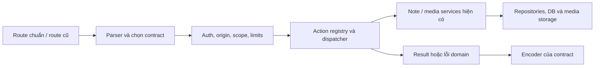

# Flama Connect nhiều phiên bản protocol và asbplayer — kế hoạch triển khai

> Ngày: 2026-10-10. Trạng thái: đã triển khai core/text/media trong repo, kiểm chứng local; chưa deploy/cutover production.
> Issue: [#217](https://github.com/TrinhChung/Flama/issues/217). Baseline Flama local: `cdd94052`.
> Yêu cầu: mở rộng được về sau, tái sử dụng logic hiện có, tránh sao chép backend theo client hoặc phiên bản.

## 1. Kết luận và bằng chứng

Thiết kế một pipeline Connect dùng chung, chọn contract theo phiên bản request và chế độ tương thích của endpoint. Yomitan và asbplayer là các client để kiểm chứng; tên client không quyết định response, quyền hoặc logic persistence.

Phân biệt ba khái niệm:

| Khái niệm | Ví dụ | Vai trò |
|---|---|---|
| Phiên bản HTTP API Flama | `/v1/...` | Namespace vận hành; không phải số phiên bản AnkiConnect |
| Phiên bản protocol trong request | `version: 2`, `version: 6` | Chọn cách đọc/ghi contract AnkiConnect đã được kiểm chứng |
| Phiên bản ứng dụng client | Release Yomitan/asbplayer | Xác định nguồn fixture và phạm vi kiểm thử |

Bằng chứng upstream đã pin:

- [Yomitan `e7334a9`](https://github.com/yomidevs/yomitan/blob/e7334a96106a6c74e6fa75bd33a5ea1219d92712/ext/js/comm/anki-connect.js): gửi v2, đọc result trực tiếp; chưa unwrap envelope. Chỉ đổi số gửi thành 6 sẽ chưa đủ để client này hoạt động.
- [AnkiConnect `4064fa1`, response](https://github.com/FooSoft/anki-connect/blob/4064fa142785975255457abd6a496015f5b71f38/plugin/web.py): success của v2–v4 là giá trị trực tiếp; v5–v6 dùng envelope. Error dùng envelope.
- [AnkiConnect handler](https://github.com/FooSoft/anki-connect/blob/4064fa142785975255457abd6a496015f5b71f38/plugin/__init__.py): request thiếu version mặc định 4; `multi` xử lý từng request con.
- [asbplayer `7b07cf1`](https://github.com/asbplayer/asbplayer/blob/7b07cf1321fa8b6c0e9b89e8a469329b166c91af/common/anki/anki.ts): gửi v6; export thêm mới cho phép duplicate; có đường inline media và staging media riêng.
- [HTTP fetcher asbplayer](https://github.com/asbplayer/asbplayer/blob/7b07cf1321fa8b6c0e9b89e8a469329b166c91af/common/src/fetcher.ts): không đặt JSON Content-Type và đọc response JSON.

Bằng chứng trong Flama:

| Nơi | Quan sát hiện tại | Hệ quả cho kế hoạch |
|---|---|---|
| `app/connect/__init__.py` | Nhận version 2–6 nhưng success luôn raw; parser bắt buộc JSON Content-Type | Chấp nhận số version chưa đồng nghĩa hỗ trợ đúng contract |
| Cùng file | Action params, scope, auth, rate limit và `multi` nằm trong HTTP module | Tách orchestration một lần; mọi route dùng lại |
| `app/services/connect/{base,actions,dispatcher}.py` | Lặp version và danh sách action | Gom metadata vào một registry; không thêm bản sao thứ tư |
| `app/services/connect/actions.py::add_note` | Tự commit; duplicate bị cấm có thể cập nhật Note cũ; cấp Note ID bằng MAX+1 | Có khác biệt semantics và concurrency cần xử lý trước adapter ghi dữ liệu |
| `app/services/user_api_token_service.py` | Cấp default scopes rộng, chưa nhận scopes tùy chọn | Bổ sung cấp/rotate token theo scope thực tế |
| `app/services/flama_connect_media_service.py` | Có staging, materialization, compensation; luồng thường chỉ nhận MP3 tên Yomitan | Mở rộng primitives hiện có, giữ policy legacy |
| `app/services/redis_state_service.py` | Có kết nối Redis và key namespace dùng chung | Tái sử dụng infrastructure khi thêm limiter Connect giữa các worker |
| `deploy/flama-connect.nginx.conf.example` | Chưa proxy route mới; body tối đa 2 MiB | HTTP routing và giới hạn body thuộc delivery scope |

Review trước đã chạy 41 test trong `test_flama_connect.py` và `test_flama_connect_auth.py`, đều pass. Probe SQLite xác nhận origin ngoài allowlist vẫn ghi được với token hợp lệ và duplicate add có thể cập nhật Note cũ. Đây là baseline hiện tại, chưa là bằng chứng adapter mới hoạt động. Production config, client ngoài repo và end-to-end chưa được xác nhận.

## 2. Lựa chọn kiến trúc và trade-off

| Phương án | Ưu điểm | Rủi ro / chi phí | Quyết định |
|---|---|---|---|
| Backend riêng cho Yomitan/asbplayer hoặc mỗi version | Dễ cô lập lúc đầu | Nhân đôi auth, validators, media, transaction và bugfix | Không chọn |
| Đổi ngay `/v1/flama-connect` sang response theo version | Một URL, hỗ trợ client nâng cấp cùng URL | Client cũ gửi v5/v6 nhưng đang đọc raw sẽ bị ảnh hưởng | Chỉ cutover sau inventory và qualification |
| Một pipeline, endpoint chuẩn nhiều version và route cũ chuyển đổi theo giai đoạn | Dùng chung logic; có đường thử chuẩn mà không đổi toàn bộ client cũ | Tạm có hai URL, nhưng không có hai backend | Chọn cho rollout ban đầu |

Đích dài hạn: `/v1/flama-connect` và alias `/v1/anki-connect` cùng gọi pipeline nhiều version. Không tạo `/yomitan-v2`, `/asbplayer-v6` hoặc `/anki-connect-v7` chỉ vì client nâng phiên bản.

Rollout ban đầu: `/v1/anki-connect` chọn contract chuẩn theo version; route cũ giữ contract legacy. Cờ dự kiến `CONNECT_VERSIONED_PROTOCOL_ENABLED` chỉ chuyển route cũ sang contract chuẩn sau gate C217-09. Alias mới có cờ dự kiến `CONNECT_ANKI_ADAPTER_ENABLED`, mặc định tắt ở release chuẩn bị.

Hai cờ là điều khiển rollout, không phải feature flag cho mỗi client. Khi hết client cần raw v5/v6, bỏ nhánh encoder raw cố định; giữ alias URL vì nó gọi cùng handler. Việc bỏ policy business legacy là gate riêng: Yomitan v2 hiện có thể cần upsert khi add trùng. Đổi encoder không được âm thầm đổi hành vi này. Nếu chưa chứng minh được retirement, giữ policy nhỏ, dùng cùng writer và ghi rõ phạm vi hỗ trợ.

## 3. Ma trận phiên bản và nâng cấp tương lai

| Request | Contract chuẩn | Contract legacy trong rollout |
|---|---|---|
| v2, v3, v4 | Success raw; error envelope | Giữ behavior hiện tại |
| v5, v6 | Success/error `{result, error}` | Success raw như hiện tại, cho đến cutover |
| Thiếu version | Mặc định v4 theo upstream | Giữ lỗi thiếu version hiện tại |
| v1, v7+, bool, float, string, null | Error rõ ràng; không dispatch action | Giữ validation legacy; không tự downgrade |

`version` trả mức protocol tối đa đã kiểm chứng (ban đầu 6), được encode theo version request. `apiReflect` chỉ trả action đã triển khai và được bật cho contract đang dùng; không quảng cáo toàn bộ Anki Desktop API.

**Codec và business policy là hai trục riêng.** Sau C217-09, URL cũ encode theo version nhưng giữ policy mutation legacy cho caller hiện có; alias chuẩn dùng policy chuẩn. Hai đường vẫn chung parser primitives, auth, registry và writer. Chỉ thống nhất cả semantics khi đã kiểm chứng caller có thể chuyển; không lấy việc reader đã hiểu envelope làm bằng chứng cho việc đổi upsert thành duplicate error.

Thiếu `params` được chuẩn hóa thành `{}`. `params: null` không được mặc định coi là hợp lệ: upstream yêu cầu object, asbplayer bỏ property khi không có params. Test hai trường hợp riêng.

Yomitan tương lai gửi v6 và đọc envelope có thể dùng endpoint chuẩn ngay. Dùng lại URL cũ được sau cutover. Không khẳng định một release Yomitan chưa tồn tại sẽ tương thích: cần fixture của release thực tế, action nó gọi và parser nó dùng.

Khi có v7: thêm entry version và các delta contract thật sự; thêm fixture; kiểm tra action/capability; mở hỗ trợ sau qualification. Giữ handler và persistence cho action có semantics không đổi. Nếu phiên bản chưa có thay đổi cần thiết cho sản phẩm thì chưa xây adapter dự phòng.

## 4. Cấu trúc code và phạm vi tái sử dụng

| File | Trách nhiệm sau thay đổi |
|---|---|
| `app/connect/__init__.py` | App factory, đăng ký route, HTTP headers; route chỉ chuyển sang pipeline |
| `app/connect/protocol.py` **mới** | Parse JSON có giới hạn, chọn contract, chuẩn hóa request, encode response; không ORM/commit |
| `app/connect/request_pipeline.py` **mới** | Orchestration auth, origin, scopes, limits, dispatch và transaction; dùng cho cả hai URL |
| `app/services/connect/dispatcher.py` | Một action registry và dispatcher; validator, scopes, khả năng batch, version/contract hỗ trợ |
| `app/services/connect/actions.py`, `base.py`, `resolvers.py`, `identity_lookup.py` | Dùng lại PreparedNote, ownership, schema, identity và writer; khác biệt business được biểu diễn bằng policy có tên |
| `app/services/flama_connect_media_service.py` | Primitives media dùng chung; policy định dạng/tên/limits của legacy và chuẩn |
| `app/services/user_api_token_service.py` | Cấp, rotate, revoke, kiểm scope; không cấp token service riêng cho asbplayer |
| `app/services/redis_state_service.py` | Kết nối Redis/key helpers dùng lại; limiter Connect chỉ thêm logic bucket còn thiếu |
| `app/services/flama_connect_service.py`, `app/services/connect/__init__.py` | Giữ facade import cho caller hiện có; không nhân đôi implementation |

Registry là bảng metadata nhỏ trong dispatcher hiện tại, không phải plugin framework. Không tạo class adapter cho mỗi version nếu chỉ khác encoder. Không thêm repository CRUD sao chép truy vấn hiện có. MCP giữ JSON-RPC transport riêng và tiếp tục dùng services/validators domain; không ép MCP vào contract AnkiConnect.

Chế độ `legacy_flama` và `standard_anki` là policy tương thích đã biết, không phải tên client. Encoder chọn theo version khi wire rollout đã mở; business policy do route/cấu hình đã kiểm soát chọn. Request không được tự khai client để chọn policy ít hạn chế hơn. Phiên bản protocol không được xuất hiện trong repository SQL hoặc renderer nếu semantics domain không đổi. Khi extract implementation, xóa thân code cũ và giữ facade gọi lại; không giữ hai bản implementation để phòng hờ.

## 5. Các quy tắc implementation bắt buộc

### Request và bảo mật

- Chuẩn: nhận `application/json`, `text/plain` và thiếu Content-Type nếu body là JSON UTF-8 hợp lệ; giữ kiểm duplicate keys, độ sâu, byte limit, Content-Encoding và field/action allowlist. Legacy giữ parser hiện tại đến cutover.
- Origin có giá trị phải qua allowlist trước action. `Origin: null` bị từ chối. Request không có Origin vẫn cần token hợp lệ, scope và rate limit; không coi absence là bằng chứng thuộc extension. CORS không thay thế auth.
- Không dùng wildcard trong allowlist chuẩn. Kiểm tra origin/host permissions thật của extension và web app bằng browser profile riêng. Không suy đoán extension ID hay giả định luôn có Origin.
- `key` trong body là đường chuẩn. Dùng lại token verifier; không đổi token/path của Yomitan hiện tại. Credential xung đột bị từ chối trong contract chuẩn; không log plaintext token/body chứa key.
- Token asbplayer text mới có preset tối thiểu: `deck:read`, `note-type:read`, `note:check`, `note:create`. Media bổ sung `media:write`; update phase sau bổ sung đúng scopes. Preset Yomitan legacy cần thêm `note:update` nếu sử dụng upsert; branch cập nhật phải kiểm quyền này trước khi ghi. Alias chuẩn không mở upsert vì token có quyền update. Rotate giữ scopes, không quay về default rộng. Không thu hẹp token cũ âm thầm.
- Domain error dùng HTTP 200 + error envelope; origin/auth policy, oversized, rate limit và infrastructure error dùng HTTP status phù hợp + JSON envelope. Proxy phải có JSON error body cho 413/429. Không trả stack trace.

### Action, duplicate, ID và transaction

- MVP chuẩn: `version`, `apiReflect`, `deckNames`, `modelNames`, `modelFieldNames`, `canAddNotes`, `canAddNotesWithErrorDetail`, `addNote`, và subset `findNotes` đã qualification. Không coi danh sách phương thức trong Yomitan mới nhất là toàn bộ API Flama đã hỗ trợ.
- Shared registry thay `ACTION_PARAMS`, `ACTION_SCOPES` và các bản `SUPPORTED_ACTIONS` trùng. Với scope cần nhiều quyền, kiểm tất cả. Các import action legacy vẫn phụ thuộc cờ hiện có, không mở qua endpoint chuẩn.
- Tách chuẩn bị Note và ghi Note khỏi commit. Pipeline sở hữu unit of work; caller service/facade cũ có wrapper giữ transaction behavior khi cần. Không gọi writer tự commit bên trong transaction tưởng là atomic. Mọi facade gọi lại cùng primitive, không sao chép thân `add_note`.
- Policy legacy giữ hành vi duplicate đã được test. Policy chuẩn: `allowDuplicate=true` tạo Note mới; `false` báo duplicate, không cập nhật Note khác. Kiểm chứng field identity, normalization và scope `deck`/`collection` trước khi quảng cáo hỗ trợ; tham số chưa thực hiện đúng phải bị từ chối rõ ràng.
- Dùng Note UUID và `ConnectNoteRef` auto-increment hiện có cho writer chuẩn; không dùng MAX+1. Giữ mọi ID/row đã phát hành. Qualification phải kiểm số ID trả về, lookup user ownership và giới hạn integer an toàn phía JS. Hợp nhất allocator legacy chỉ sau khi xác nhận caller không dựa vào Note ID dạng số.
- Không sinh namespace/reference mới chỉ vì v2 thành v6. Kiểm kê `provider='yomitan'` hiện có và giữ lookup/ID lịch sử; client label trong audit không được quyết định ownership. Nếu cần đổi provenance hoặc hợp nhất reference, làm migration plan riêng, không rekey dữ liệu trong adapter.
- `multi` chuẩn chỉ mở read actions cần thiết trong MVP, tối đa 10, không nested `multi`. Mỗi action con qua registry, scope, validation và tính chi phí rate limit. Outer principal được dùng lại; nested key nếu có phải khớp. Version của action con có contract riêng; thiếu version theo default upstream, không tự ép thành version outer. Dạng result/error từng phần phải có fixture. Mutating batch chỉ mở khi đã chốt transaction/partial-failure semantics.
- Note mới trong deck cài đặt vẫn đi đường local addition/overlay hiện có; không sửa Note nguồn. Rich update phase sau phải đi service overlay và immutable-release gate, không direct ORM update source.

### MVP text và media

- Tài liệu setup dùng deck có sẵn và Flama Sentence Card: Sentence là primary text ở vị trí đầu; Word/Definition/Source/URL và track là tùy chọn; Image là image, Audio là audio; có active StudyApplication/template. Không tự tạo deck/model qua request từ client trong MVP.
- Qualification thêm trường hợp không có Word, Unicode, ` `, field rỗng, tags và URL. Dùng normalizer/sanitizer hiện có; không hứa giữ nguyên HTML nguy hiểm hoặc markup vượt policy Flama.
- Phase text hướng dẫn chế độ Add và bỏ mapping Audio/Image. Update-last, desktop GUI và word-state annotations nằm ngoài slice; không trả success giả cho action chưa hỗ trợ. `requestPermission` có thể báo unsupported và dùng fallback `version`; không mở grant quyền không cần token.
- Media normalize inline object/array đã qualification và `storeMediaFile` về cùng attachment command. Nhận base64; không đọc path máy người dùng, không tải URL tùy ý. Áp policy filename an toàn; prefix `asbp_` không phải điều kiện cấp quyền.
- Dùng actual FieldDef để kiểm image/audio, rewrite sang asset proxy. Trường media sai type bị từ chối rõ ràng; không để filename Anki hoặc HTML raw thành resource công khai. Không tạo renderer riêng cho asbplayer.
- Tái sử dụng staging/materialize/compensate/finalize hiện có; genericize phần thật sự dùng lại, giữ constraints Yomitan qua policy legacy. Inline add rollback cả Note, cards, assets và file mới. Staging request riêng có TTL; add thất bại không tạo committed orphan. Cleanup chạy định kỳ, không chỉ khi upload kế tiếp; kiểm retry/finalize sau DB commit và sau process crash.

## 6. Work packages và delivery gates

| ID | Việc cụ thể / file ownership | Phụ thuộc | Gate hoàn tất |
|---|---|---|---|
| C217-00 | Inventory callers trong repo và deployment; fixture request/response pin SHA; so sánh codec, duplicate, `multi`, media. `tests/`, tài liệu này | — | Phân biệt observed/simulated; liệt kê raw-v5/v6 callers hoặc ghi rõ chưa biết |
| C217-01 | Thêm `protocol.py`; gom registry trong dispatcher; bỏ constants trùng, giữ facade | 00 | Matrix v2–v6, version thiếu/sai và error được test; legacy baseline giữ nguyên |
| C217-02 | Thêm pipeline chung, routes mỏng; scoped-token API/preset/rotate; origin check và request limits. `app/connect/`, token service, `app/api/v1/settings/integration_tokens.py` | 01 | Origin lạ không ghi; token thiếu/revoked/expired/thiếu scope đều không dispatch; credential conflict bị chặn |
| C217-03 | Extract UOW/primitives từ actions; duplicate policy và ID chuẩn; reusable ownership/overlay | 01, 02 | Không update Note do duplicate add chuẩn; no MAX+1 trong writer chuẩn; rollback và ID/overlay matrix pass |
| C217-04 | UI cấu hình tích hợp theo preset, URL/key tách biệt; setup Sentence Card; text E2E. `frontend/src/features/settings/`, config, docs setup | 02, 03 | asbplayer release cụ thể connect/list/map/add text với Anki Desktop đóng; Yomitan vẫn mine được |
| C217-05 | Shared limiter qua Redis hiện có; quota media committed+pending/reservation, ownership lock, retry/cleanup policy | 02 | Giới hạn dùng chung giữa hai worker/token; Redis hỏng fail-closed trên write; quota không vượt do upload đồng thời |
| C217-06 | Media command/adapter dùng primitives hiện có, JPEG/PNG/MP3, proxy render và crash cleanup | 03, 05 | Inline và staging dùng cùng đường lưu; upload/add/render/play/rollback/retry đều qua fixture và browser |
| C217-07 | Proxy routes, JSON lỗi proxy, flags và limits; config example và runbook. `deploy/`, `.env_example`, `README_SETUP.md` | 01, 02 | Endpoint disabled/enabled đúng; HTTPS không redirect chứa key; 413/429 đọc được; legacy route giữ giới hạn cũ |
| C217-08 | Qualification từng delivery slice: protocol, Yomitan/MCP regression, MySQL concurrency, browser riêng, metrics | 03, 04, 07; thêm 05/06 cho media | Evidence ghi version client, flags, request fixture và kết quả; không dùng baseline xanh để tuyên bố E2E |
| C217-09 | Cutover encoder URL cũ theo version; retirement encoder/policy legacy theo gate riêng | 00, 08 | Không còn raw-v5/v6 caller bị ảnh hưởng hoặc đã migrate; Yomitan v2 giữ semantics mutation; canary/rollback được diễn tập |
| C217-10 | Rich APIs theo nhu cầu: notes/update/tags trước, cards/query/SRS sau | MVP pass và nhu cầu được xác nhận | Mỗi action có semantics, ownership, capability và tests; không quảng cáo Anki GUI/SRS giả |

Thứ tự delivery:

1. **R0 — chuẩn bị:** C00–C03, C05 phần rate limit, C07; endpoint chuẩn tắt. Extract code phải giữ legacy contracts. Không triển khai media/schema framework dự phòng.
2. **R1 — MVP text:** C04 + C08 text; bật endpoint chuẩn cho canary. Đây là delivery đầu tiên cho #217.
3. **R2 — multimedia:** C05 phần storage + C06 + C08 media; áp limits riêng cho endpoint chuẩn. Không mở WebM video cùng đợt chỉ vì extension có thể sinh nó.
4. **R3 — thống nhất URL:** C09 sau qualification callers. R1/R2 không phụ thuộc việc retirement này.
5. C10 là follow-up độc lập; chỉ bổ sung action cần thiết, dùng cùng registry/services.

Không ước lượng số ngày trước C00; blocker chính là compatibility thực tế và quota trên MySQL, không phải số dòng adapter.

## 7. Media limits và tài nguyên

Các giá trị sau là **đề xuất cho canary**, chưa là cấu hình production hay quyết định ngân sách. C217-05/06 phải đo fixture thật và tính chi phí trước khi bật media:

| Giới hạn endpoint chuẩn | Đề xuất ban đầu | Quy tắc |
|---|---|---|
| Định dạng | JPEG, PNG, MP3 | MIME + signature + validator; chưa nhận SVG, audio Ogg/WebM hay video WebM |
| Mỗi file decoded | 2 MiB | Áp trước khi ghi file và sau decode |
| Tổng media một Note | 4 MiB decoded | Tính mọi attachment, không chỉ file lớn nhất |
| JSON request | 6 MiB | Cả Flask/parser/proxy; base64 cần khoảng `4 * ceil(bytes / 3)` chưa kể JSON/text |
| Pending media | 20 file, 16 MiB, TTL 30 phút | Reservation/ownership và cleanup; giới hạn cả request inline |
| Tổng account | 512 MiB | Tính media committed + pending; dùng chung cho mọi integration, không reset bằng token mới |

Legacy tiếp tục limits/tên MP3 hiện tại đến gate tương thích riêng. Nếu asbplayer release được test xuất Ogg/WebM audio, setup R2 phải chọn MP3 hoặc ghi rõ chưa hỗ trợ; không nhận file rồi đổi extension giả. Video WebM có policy duration/container/codec/quota riêng trước khi mở.

Reuse Redis connection và namespace; không dùng daily request quota như storage quota. Atomic storage accounting phải kiểm kê cả REST/MCP/import writers trước khi gọi là account-wide. Ưu tiên bảng media hiện có + transaction/ownership locking nếu đủ; chỉ thêm schema khi investigation chứng minh cần reservation/counter bền vững. Mọi schema mới có migration/backfill riêng theo skill database; không đổi `create_app()` để patch startup.

## 8. Qualification và tiêu chí nghiệm thu

### Contract tests

- Bảng fixture theo **contract + version + action**, không tách test suite sao chép theo client. Request đại diện từ client được ghi nguồn SHA/release; không lưu token hay nội dung cá nhân.
- Success scalar/list/object/null và error cho v2–v6; v5/v6 chỉ có `result`, `error`. Null success khác error. Unsupported version/action không gây mutation.
- Version thiếu, params thiếu/null, text/plain, không Content-Type, JSON lỗi/duplicate keys/deep/body lớn, unknown params và compressed body.
- Scope/Origin trước write; token lifecycle + rotation giữ scope; `multi` key/version/scope/limits và lỗi từng phần; reflection không khai capability chưa có.
- Policy duplicate, normalization và phạm vi deck/collection được qualification bằng oracle Anki phù hợp. Tối thiểu lặp cùng Note với duplicate true/false; không update ngoài yêu cầu. ID lookup giữa user, hai worker và hai deck.

### Regression và dữ liệu

- Dùng runner của repo, narrow trước: `python scripts/run_tests.py --file tests/test_flama_connect.py tests/test_flama_connect_auth.py --backend-only`.
- Khi thay core/auth/registry: `python scripts/run_tests.py --module connect_mcp --backend-only`.
- Khi thay UI/media: `python scripts/run_tests.py --changed`; chạy thêm module flashcards/marketplace nếu dependency mapping hoặc diff overlay yêu cầu. Không full suite cho sửa docs.
- Test MySQL cho concurrent IDs, quota reservations, rollback và commit/crash recovery. SQLite không chứng minh khóa/concurrency MySQL.
- Owned deck và installed deck đều tạo local content đúng; Note nguồn, release membership và progress không bị thay đổi ngoài action được phép.
- Ghi fixture phản hồi của Yomitan hiện tại và một client v6 đọc envelope do test harness của Flama mô phỏng. Test mô phỏng không được ghi thành bằng chứng đã hỗ trợ release Yomitan tương lai.

### Browser và vận hành

- Dùng Chrome profile riêng theo `AGENTS.md`; Anki Desktop đóng cho asbplayer, riêng oracle Anki có thể mở trong môi trường kiểm thử tách biệt.
- Test extension trên streaming video và web app/local subtitled video như hai transport paths; ghi Origin, host permission, preflight, content type và action thực tế. Không suy từ một đường rằng mọi đường đã pass.
- R1: configure key/URL, list decks/models/fields, mine sentence không Word, tags/source/URL, thấy Note và học được trên React SPA.
- R2: JPEG/PNG/MP3 upload, proxy render/play; vượt quota/body, file sai type, cancelled/retried requests và process crash không tạo asset/files mất ownership.
- Smoke qua `connect_wsgi.py` và reverse proxy thật, không boot web app để dùng startup mutation như test setup Connect.

## 9. Rollout, rollback và retirement

- Ghi deployment inventory trước cutover: routes/proxy, client versions, flags, số worker, Redis và media root. `deploy/flama-connect.service` hiện là mẫu một worker; không suy đó là production thực tế.
- R0 kiểm health + baseline, alias mới disabled. R1 bật alias chuẩn, giữ route cũ legacy; theo dõi action/version/contract, error category, rate rejection và latency. Không log raw key/body; version/client label không dùng làm quyền.
- R2 chỉ mở media khi limits/quota accounting và crash-cleanup gate pass. Không tăng body cap mọi endpoint vì request của một integration.
- C09 dùng canary trên deployment/environment hoặc credential cohort đã kiểm soát; không chọn profile bằng User-Agent, Origin, filename hay body client tự khai. Chuyển encoder route cũ chỉ khi inventory và caller tests đủ; những raw-v5/v6 caller còn lại phải migrate có hướng dẫn. Writer policy legacy và yêu cầu scope update được regression-test riêng, không đổi cùng cờ wire.
- Rollback dừng admission endpoint/action mới hoặc tắt rollout flag; giữ Note, reference và media đã tạo. Không downgrade/xóa dữ liệu để rollback adapter. Xác nhận không có request đang ghi trước khi đổi writer; scheduled cleanup dùng cùng ownership/TTL policy.
- Sau khi cả hai URL encode theo version, retirement encoder raw cố định được xét riêng với retirement policy legacy. Chỉ xóa policy đã hết caller cần semantics đó và facade không còn import. Giữ compatibility tests của contract/policy vẫn hỗ trợ; không nhân đôi chúng cho mỗi alias.

## 10. Quyết định còn cần bằng chứng khi triển khai

| Điểm | Cách giải quyết | Không được giả định |
|---|---|---|
| Client raw-v5/v6 ngoài repo | Inventory rollout C00/C09 + thống kê không có secrets | Không có caller vì frontend hiện tại dùng import REST |
| Duplicate semantics chuẩn | Oracle/cases trong C03; unsupported options bị từ chối | Upsert Yomitan hiện tại là `addNote` chuẩn |
| Origin/permissions asbplayer | Hai browser transport paths có evidence | Mọi extension request mang origin extension |
| Storage quota account-wide | C05 kiểm tất cả writer và concurrency | Sum pending hoặc rate limit request là storage quota |
| Limits media/budget | Fixture thực tế + chi phí canary | Các số đề xuất là chính sách production đã chốt |
| Provenance/reference migration | Điều tra riêng nếu cần, giữ ID đã phát hành | Phiên bản protocol mới cần bảng/reference mới |

Delivery text/media chỉ hoàn tất khi R1/R2 có evidence tương ứng; wire cutover và retirement có trạng thái riêng. Issue trên GitHub chưa được sửa.

## 11. Trạng thái triển khai local

- C01–C04: shared parser/codec v2–v6, registry, auth/origin/scope pipeline, no-commit writer/UOW, UUID Notes + database-generated numeric refs, scoped token presets/rotation, Settings mapping và Sentence Card setup đã có code/test.
- Registry ở module `registry.py` dùng chung thay vì đặt trực tiếp trong dispatcher; facade cũ re-export constants. Sáu khai báo action/version trước đây đã được gom về một nguồn.
- C05–C07: có Redis limiter dùng infrastructure hiện có, Connect-only quota admission, generic inline/staged MP3/JPEG/PNG, compensation, periodic crash/expiry cleanup và proxy/service examples. Account-wide quota cho mọi writer vẫn chưa đóng; media có cờ riêng mặc định tắt.
- C08: backend module 328 tests pass; suite protocol cuối 21 tests pass; frontend module 22 tests pass; MySQL 8.0.40 concurrency probe và standalone entrypoint smoke pass. Component preview Chrome desktop/mobile đã kiểm tra. Redis thật, stock asbplayer transports, media playback và Nginx thật chưa qualification.
- C00/C09: inventory caller production và wire cutover chưa thực hiện. Cả hai rollout flags và legacy encoder cutover mặc định tắt. C10 là follow-up ngoài MVP.

Xem [runbook](../../runbooks/FLAMA_CONNECT_ASBPLAYER.md) để bật canary, thiết lập người dùng, chạy cleanup/probe, và theo dõi các gate còn mở. Không ghi nhận repo tests/component preview thành bằng chứng production hay asbplayer release qualification.
