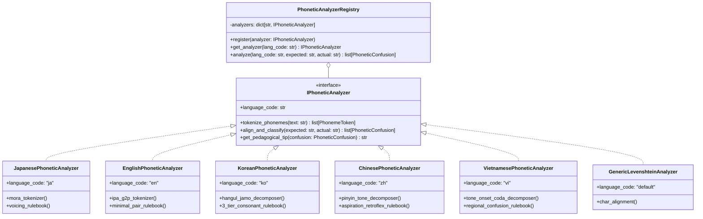

# Đề Xuất Kỹ Thuật: Phân Tích & Gợi Ý Âm Nghe Nhầm Đa Ngôn Ngữ Trong Chế Độ Nghe - Nhập Từ (Multilingual Listening Dictation Phonetic Confusion Analysis)

> **Mã tài liệu:** `FLAMA-PROP-2026-DICTATION-PHONETIC-01`  
> **Trạng thái:** BẢN THẢO ĐỀ XUẤT & BACKLOG (PROPOSAL / PLANNED)  
> **Mức độ ưu tiên:** **Thấp (P3 - Low Priority / Future Enhancement)**  
> **Phạm vi ngôn ngữ:** Đa ngôn ngữ (Tiếng Nhật, Tiếng Anh, Tiếng Hàn, Tiếng Trung, Tiếng Việt và các ngôn ngữ khác).  
> **Điều kiện tiên quyết (Prerequisites):** Đã triển khai chế độ học Nghe - Nhập từ (`AudioDictationInteraction` / `TypingStudyMode`) và lưu trữ được phản hồi nhập liệu gốc của người học (`raw_user_input`).

---

## 1. Bối Cảnh & Đặt Vấn Đề

Trong quá trình học ngoại ngữ trên Flama, khi người học thực hiện bài tập **Nghe rồi nhập từ (Audio Dictation / Listening Typing)**, lỗi sai thường không chỉ xuất phát từ việc "không nhớ từ vựng", mà phần lớn bắt nguồn từ **rào cản phân biệt âm vị học (Phonetic & Phonological Discrimination Deficiency)** giữa tiếng mẹ đẻ và ngôn ngữ mục tiêu.

Các rào cản nghe nhầm này mang tính quy luật và đặc thù theo từng ngôn ngữ:
- **Tiếng Nhật:** Nhầm âm đục $\leftrightarrow$ âm trong (`が`/`か`), thiếu/thừa trường âm (`ゆき`/`ゆうき`), xúc âm (`かこ`/`かっこ`), cặp âm `つ`/`す`, `し`/`ち`.
- **Tiếng Anh:** Nhầm nguyên âm ngắn $\leftrightarrow$ dài (`ship`/`sheep`, `pull`/`pool`), âm vô thanh $\leftrightarrow$ hữu thanh (`pat`/`bat`, `fan`/`van`), âm xát/tắc xát (`think`/`sink`, `sheet`/`seat`, `cheap`/`jeep`), cặp `l` $\leftrightarrow$ `r` (`light`/`right`), bỏ rơi âm đuôi (final consonant clusters: `-ed`, `-s`, `-t`, `-k`).
- **Tiếng Hàn:** Nhầm lẫn giữa 3 bậc phụ âm: Âm thường (Lenis: `ㅂ`/`ㄷ`/`ㄱ`) $\leftrightarrow$ Âm bật hơi (Aspirated: `ㅍ`/`ㅌ`/`ㅋ`) $\leftrightarrow$ Âm căng (Fortis: `ㅃ`/`ㄸ`/`ㄲ`); biến âm Patchim (`한국말` $\rightarrow$ `[한궁말]`).
- **Tiếng Trung (Mandarin):** Nhầm lẫn 4 thanh điệu (Tones 1/2/3/4), âm bật hơi $\leftrightarrow$ không bật hơi (`b`/`p`, `d`/`t`, `j`/`q`), âm uốn lưỡi $\leftrightarrow$ không uốn lưỡi (`zh`/`z`, `ch`/`c`, `sh`/`s`), vần mũi trước/sau (`-an`/`-ang`, `-en`/`-eng`).
- **Tiếng Việt:** Nhầm dấu thanh (hỏi $\leftrightarrow$ ngã, sắc $\leftrightarrow$ nặng), phụ âm đầu (`d`/`gi`/`r`, `s`/`x`, `tr`/`ch`, `l`/`n`), phụ âm cuối (`-c`/`-t`, `-n`/`-ng`).

**Mục tiêu của tính năng:**
Khi hệ thống đã có tính năng nghe rồi gõ từ, dựa vào **lịch sử nhập từ (`user_input`)** đối chiếu với **từ gốc / đáp án chuẩn (`target_text` / phonetic transcription)**, hệ thống sẽ:
1. Tự động bóc tách và định danh các cặp âm/âm vị bị nghe nhầm theo từng ngôn ngữ cụ thể.
2. Xây dựng **Ma trận nhầm lẫn âm vị cá nhân đa ngôn ngữ (Multilingual Personal Phoneme Confusion Matrix)** cho từng người học.
3. Đưa ra gợi ý, cảnh báo và lời khuyên sư phạm trực quan giúp người học nhận biết điểm mù thính giác của bản thân và cải thiện phản xạ nghe hiểu.

---

## 2. Danh Mục Các Dạng Âm Hay Nghe Nhầm Theo Từng Ngôn Ngữ (Phonetic Confusion Taxonomy)

```mermaid
mindmap
  root((Hệ Thống Phân Loại Âm Nghe Nhầm Đa Ngôn Ngữ))
    Tiếng Nhật (ja)
      Âm đục vs Âm trong (k/g, s/z, t/d, h/b/p)
      Trường âm (Chōon: o/ou, u/uu, e/ei)
      Xúc âm / Âm ngắt (Sokuon: っ)
      Âm mũi (Hatsuon: ん) & Ảo âm (Yōon: sha/sa)
      Cặp âm sát/tắc (tsu/su, shi/chi)
    Tiếng Anh (en)
      Nguyên âm ngắn vs dài (/ɪ/ vs /iː/, /ʊ/ vs /uː/, /æ/ vs /e/)
      Phụ âm vô thanh vs hữu thanh (/p/ vs /b/, /t/ vs /d/, /f/ vs /v/)
      Âm sát & tắc xát (/θ/ vs /s/ vs /t/, /ʃ/ vs /s/, /tʃ/ vs /dʒ/)
      Cặp âm l vs r (/l/ vs /r/ - light/right)
      Âm đuôi & Cụm phụ âm cuối (bỏ rơi -t, -d, -s, -z, -k)
      Âm câm & Nhược hóa (Schwa /ə/)
    Tiếng Hàn (ko)
      3 bậc phụ âm (Thường 평음 vs Bật hơi 격음 vs Căng 경음: ㅂ/ㅍ/ㅃ, ㄷ/ㅌ/ㄸ, ㄱ/ㅋ/ㄲ)
      Cặp nguyên âm gần nhau (ㅐ/ㅔ, ㅓ/ㅗ, ㅜ/ㅡ)
      Biến âm Patchim (Đồng hóa âm mũi, âm lỏng, căng hóa)
    Tiếng Trung (zh)
      4 Thanh điệu (Tone 1/2/3/4 & Thanh nhẹ)
      Bật hơi vs Không bật hơi (b/p, d/t, g/k, j/q, z/c, zh/ch)
      Uốn lưỡi vs Không uốn lưỡi (zh/z, ch/c, sh/s)
      Vần mũi trước vs Mũi sau (-an/-ang, -en/-eng, -in/-ing)
      Cặp nguyên âm u vs ü (u vs v)
    Tiếng Việt (vi)
      Thanh điệu (Hỏi vs Ngã, Sắc vs Nặng, Huyền vs Ngang)
      Phụ âm đầu (d/gi/r, s/x, tr/ch, l/n)
      Phụ âm cuối (c/t, n/ng, ch/c)
      Nguyên âm (o/ô/ơ, u/ư, a/ă/â)
```

---

### 2.1. Ma trận phân loại chi tiết các ngôn ngữ chính

#### 🇯🇵 Tiếng Nhật (`ja`)
| Mã nhóm lỗi | Tên nhóm | Ví dụ từ gốc (Target) | Người dùng gõ (Input) | Cặp âm nhầm lẫn |
|---|---|---|---|---|
| `JA_VOICING_K_G` | Âm đục/trong (k $\leftrightarrow$ g) | め**が**ね (`megane`) | め**か**ね (`mekane`) | `g` $\rightarrow$ `k` |
| `JA_VOICING_S_Z` | Âm đục/trong (s $\leftrightarrow$ z/j) | **じ**かん (`jikan`) | **し**かん (`shikan`) | `j/z` $\rightarrow$ `s` |
| `JA_VOICING_T_D` | Âm đục/trong (t $\leftrightarrow$ d) | **ど**うぞ (`douzo`) | **と**うぞ (`touzo`) | `d` $\rightarrow$ `t` |
| `JA_VOICING_H_B_P` | Âm đục/bán đục (h $\leftrightarrow$ b $\leftrightarrow$ p) | **ぱ**ん (`pan`) | **ば**ん (`ban`) / **は**ん | `p` $\rightarrow$ `b`/`h` |
| `JA_LONG_VOWEL_MISSING` | Thiếu trường âm | ゆ**う**き (`yuuki`) | ゆき (`yuki`) | Bỏ trường âm `/uː/` |
| `JA_SOKUON_MISSING` | Thiếu xúc âm (âm ngắt) | が**っ**こう (`gakkou`) | がこう (`gakou`) | Bỏ âm ngắt `っ` |
| `JA_AFFRICATE_TSU_SU` | Cặp âm `tsu` $\leftrightarrow$ `su` | **つ**き (`tsuki`) | **す**き (`suki`) | `tsu` $\rightarrow$ `su` |

#### 🇬🇧/🇺🇸 Tiếng Anh (`en`)
| Mã nhóm lỗi | Tên nhóm | Ví dụ từ gốc (Target) | Người dùng gõ (Input) | Cặp âm nhầm lẫn |
|---|---|---|---|---|
| `EN_VOWEL_TENSE_LAX_I` | Nguyên âm /ɪ/ $\leftrightarrow$ /iː/ | **sh**ee**p** (`/ʃiːp/`) | **sh**i**p** (`/ʃɪp/`) | `/iː/` $\rightarrow$ `/ɪ/` |
| `EN_VOWEL_TENSE_LAX_U` | Nguyên âm /ʊ/ $\leftrightarrow$ /uː/ | **p**oo**l** (`/puːl/`) | **p**u**ll** (`/pʊl/`) | `/uː/` $\rightarrow$ `/ʊ/` |
| `EN_VOWEL_AE_E` | Nguyên âm /æ/ $\leftrightarrow$ /e/ | **b**a**d** (`/bæd/`) | **b**e**d** (`/bed/`) | `/æ/` $\rightarrow$ `/e/` |
| `EN_TH_FRICATIVE_VOICELESS` | Âm /θ/ $\leftrightarrow$ /s/ hoặc /t/ | **th**ink (`/θɪŋk/`) | **s**ink / **t**ink | `/θ/` $\rightarrow$ `/s/`, `/t/` |
| `EN_TH_FRICATIVE_VOICED` | Âm /ð/ $\leftrightarrow$ /z/ hoặc /d/ | **th**is (`/ðɪs/`) | **d**is / **z**is | `/ð/` $\rightarrow$ `/d/`, `/z/` |
| `EN_SH_VS_S` | Âm /ʃ/ $\leftrightarrow$ /s/ | **sh**eet (`/ʃiːt/`) | **s**eat (`/siːt/`) | `/ʃ/` $\rightarrow$ `/s/` |
| `EN_CH_VS_J_VS_SH` | Âm /tʃ/ $\leftrightarrow$ /dʒ/ $\leftrightarrow$ /ʃ/ | **ch**eap (`/tʃiːp/`) | **j**eep / **sh**eep | `/tʃ/` $\rightarrow$ `/dʒ/` |
| `EN_LIQUID_L_R` | Cặp phụ âm `l` $\leftrightarrow$ `r` | **l**ight (`/laɪt/`) | **r**ight (`/raɪt/`) | `/l/` $\rightarrow$ `/r/` |
| `EN_FINAL_CONSONANT_DROP` | Bỏ rơi âm đuôi (-t, -d, -s, -k) | pas**t** (`/pɑːst/`) | pass (`/pɑːs/`) | Bỏ rơi âm đuôi `/t/` |
| `EN_VOICING_F_V_W` | Âm /f/ $\leftrightarrow$ /v/ $\leftrightarrow$ /w/ | **v**an (`/væn/`) | **f**an / **w**an | `/v/` $\rightarrow$ `/f/`, `/w/` |

#### 🇰🇷 Tiếng Hàn (`ko`)
| Mã nhóm lỗi | Tên nhóm | Ví dụ từ gốc (Target) | Người dùng gõ (Input) | Cặp âm nhầm lẫn |
|---|---|---|---|---|
| `KO_CONSONANT_3_TIER_B` | 3 bậc âm ㅂ (thường) $\leftrightarrow$ ㅍ (bật hơi) $\leftrightarrow$ ㅃ (căng) | **불** (`bul` - lửa) | **풀** (`pul`) / **뿔** (`ppul`) | `ㅂ` $\rightarrow$ `ㅍ`/`ㅃ` |
| `KO_CONSONANT_3_TIER_D` | 3 bậc âm ㄷ $\leftrightarrow$ ㅌ $\leftrightarrow$ ㄸ | **달** (`dal` - trăng) | **탈** (`tal`) / **딸** (`ttal`) | `ㄷ` $\rightarrow$ `ㅌ`/`ㄸ` |
| `KO_CONSONANT_3_TIER_G` | 3 bậc âm ㄱ $\leftrightarrow$ ㅋ $\leftrightarrow$ ㄲ | **개** (`gae` - chó) | **캐** (`kae`) / **깨** (`kkae`) | `ㄱ` $\rightarrow$ `ㅋ`/`ㄲ` |
| `KO_VOWEL_AE_E` | Cặp nguyên âm `ㅐ` $\leftrightarrow$ `ㅔ` | **개** (`gae`) | **게** (`ge`) | `ㅐ` $\rightarrow$ `ㅔ` |
| `KO_VOWEL_EO_O` | Cặp nguyên âm `ㅓ` $\leftrightarrow$ `ㅗ` | **서**울 (`seoul`) | **소**울 (`soul`) | `ㅓ` $\rightarrow$ `ㅗ` |
| `KO_PATCHIM_NASALIZATION` | Biến âm mũi Patchim | **한국말** (`[한궁말]`) | 한**국**말 vs 한**궁**말 | `ㄱ` trước `ㅁ` $\rightarrow$ `[ㅇ]` |

#### 🇨🇳 Tiếng Trung (`zh`)
| Mã nhóm lỗi | Tên nhóm | Ví dụ từ gốc (Target) | Người dùng gõ (Input) | Cặp âm nhầm lẫn |
|---|---|---|---|---|
| `ZH_TONE_1_VS_4` | Thanh 1 (bằng) $\leftrightarrow$ Thanh 4 (rơi mạnh) | **mā** (妈 - mẹ) | **mà** (骂 - mắng) | Thanh 1 $\rightarrow$ Thanh 4 |
| `ZH_TONE_2_VS_3` | Thanh 2 (lên) $\leftrightarrow$ Thanh 3 (uốn) | **má** (麻 - sợi đay) | **mǎ** (马 - ngựa) | Thanh 2 $\rightarrow$ Thanh 3 |
| `ZH_ASPIRATION_B_P` | Bật hơi `p` $\leftrightarrow$ Không bật hơi `b` | **p**ào (跑) | **b**ǎo (饱) | `p` $\rightarrow$ `b` |
| `ZH_ASPIRATION_D_T` | Bật hơi `t` $\leftrightarrow$ Không bật hơi `d` | **t**ā (他) | **d**ā (搭) | `t` $\rightarrow$ `d` |
| `ZH_RETROFLEX_ZH_Z` | Uốn lưỡi `zh` $\leftrightarrow$ Thẳng lưỡi `z` | **zh**īdào (知道) | **z**īdào | `zh` $\rightarrow$ `z` |
| `ZH_RETROFLEX_CH_C` | Uốn lưỡi `ch` $\leftrightarrow$ Thẳng lưỡi `c` | **ch**ī (吃) | **c**ī | `ch` $\rightarrow$ `c` |
| `ZH_NASAL_FRONT_BACK_AN_ANG`| Vần mũi trước `-an` $\leftrightarrow$ Mũi sau `-ang` | b**an** (班) | b**ang** (帮) | `-an` $\rightarrow$ `-ang` |

#### 🇻🇳 Tiếng Việt (`vi`)
| Mã nhóm lỗi | Tên nhóm | Ví dụ từ gốc (Target) | Người dùng gõ (Input) | Cặp âm nhầm lẫn |
|---|---|---|---|---|
| `VI_TONE_HOI_NGA` | Dấu Hỏi (?) $\leftrightarrow$ Dấu Ngã (~) | **bã** đậu | **bả** đậu | `ngã` $\rightarrow$ `hỏi` |
| `VI_TONE_SAC_NANG` | Dấu Sắc (') $\leftrightarrow$ Dấu Nặng (.) | **bác** học | **bạc** học | `sắc` $\rightarrow$ `nặng` |
| `VI_ONSET_D_GI_R` | Phụ âm đầu `d` $\leftrightarrow$ `gi` $\leftrightarrow$ `r` | **r**a vào | **d**a vào / **gi**a vào | `r` $\rightarrow$ `d`/`gi` |
| `VI_ONSET_S_X` | Phụ âm đầu `s` $\leftrightarrow$ `x` | **s**ôi sục | **x**ôi sục | `s` $\rightarrow$ `x` |
| `VI_CODA_C_T` | Phụ âm cuối `-c` $\leftrightarrow$ `-t` | man **mát** | mang **mác** | `-t` $\rightarrow$ `-c` |
| `VI_CODA_N_NG` | Phụ âm cuối `-n` $\leftrightarrow$ `-ng` | lan man | lang mang | `-n` $\rightarrow$ `-ng` |

---

## 3. Kiến Trúc Phân Tích Đa Ngôn Ngữ (Modular Multilingual Architecture)

Để hỗ trợ mở rộng không giới hạn ngôn ngữ mà không gây phân mảnh mã nguồn, hệ thống áp dụng mẫu thiết kế **Strategy & Registry Pattern**:



---

### 3.1. Thuật toán Sequence Alignment & G2P (Grapheme-to-Phoneme)

Mỗi ngôn ngữ triển khai một pipeline phân tích 3 bước:
1. **Phân rã âm vị (Phoneme Decomposition / G2P):**
   - **Tiếng Nhật:** Chuyển đổi Kana $\rightarrow$ Mora Token (`がっこう` $\rightarrow$ `[ga, Q, ko, o]`).
   - **Tiếng Anh:** Ánh xạ từ $\rightarrow$ IPA/ARPAbet qua từ điển phát âm CMUDict hoặc G2P offline (`sheep` $\rightarrow$ `[ʃ, iː, p]`, `ship` $\rightarrow$ `[ʃ, ɪ, p]`).
   - **Tiếng Hàn:** Tách ký tự Hangul thành 3 Jamo (Choseong 초성 + Jungseong 중성 + Jongseong 종성). Ví dụ: `불` $\rightarrow$ `(ㅂ, ㅜ, ㄹ)` vs `풀` $\rightarrow$ `(ㅍ, ㅜ, ㄹ)`.
   - **Tiếng Trung:** Tách Pinyin thành Initial (Thanh mẫu) + Final (Vận mẫu) + Tone (Thanh điệu). Ví dụ: `mā` $\rightarrow$ `(m, a, tone_1)` vs `mà` $\rightarrow$ `(m, a, tone_4)`.
   - **Tiếng Việt:** Tách Âm đầu + Âm đệm/chính + Âm cuối + Dấu thanh.
2. **Căn chỉnh chuỗi âm vị (Phonetic Alignment):**
   - Áp dụng thuật toán **Needleman-Wunsch / Wagner-Fischer** với ma trận chi phí (Cost Matrix) dựa trên khoảng cách đặc trưng ngữ âm (Phonetic Feature Distance: Voicing, Manner, Place of Articulation, Vowel Height/Backness/Length, Tone Contour).
3. **Phân loại nhãn lỗi (Rule-based Classification):**
   - Khớp sai khác phát hiện được với Rulebook của ngôn ngữ đó để sinh mã lỗi (ví dụ: `EN_VOWEL_TENSE_LAX_I` hoặc `JA_VOICING_K_G`).

---

### 3.2. Mô Hình Lưu Trữ Dữ Liệu Đa Ngôn Ngữ (Multilingual Data Schema)

Dữ liệu thống kê được lưu cô lập trong một bảng riêng biệt, hỗ trợ định danh `language_code`:

```sql
-- Bảng thống kê tần suất nhầm lẫn âm đa ngôn ngữ của từng người học
CREATE TABLE user_phonetic_confusion_stats (
    id INT AUTO_INCREMENT PRIMARY KEY,
    user_id INT NOT NULL,
    language_code VARCHAR(16) NOT NULL DEFAULT 'ja', -- 'ja', 'en', 'ko', 'zh', 'vi', etc.
    confusion_type VARCHAR(64) NOT NULL,            -- Mã lỗi, ví dụ: 'EN_VOWEL_TENSE_LAX_I', 'JA_VOICING_K_G'
    expected_phoneme VARCHAR(32) NOT NULL,           -- Âm/ký tự chuẩn: 'iː', 'g', 'ㅂ', 'tone_1'
    actual_phoneme VARCHAR(32) NOT NULL,             -- Âm/ký tự nghe nhầm: 'ɪ', 'k', 'ㅍ', 'tone_4'
    mistake_count INT NOT NULL DEFAULT 1,            -- Số lần nghe nhầm
    total_encounters INT NOT NULL DEFAULT 1,         -- Tổng số lần gặp âm này trong bài nghe
    last_mistake_at DATETIME NOT NULL,
    created_at DATETIME NOT NULL DEFAULT CURRENT_TIMESTAMP,
    updated_at DATETIME NOT NULL DEFAULT CURRENT_TIMESTAMP ON UPDATE CURRENT_TIMESTAMP,
    
    UNIQUE KEY uq_user_lang_phoneme_confusion (user_id, language_code, confusion_type, expected_phoneme, actual_phoneme),
    INDEX idx_user_lang_mistakes (user_id, language_code, mistake_count DESC),
    FOREIGN KEY (user_id) REFERENCES users(id) ON DELETE CASCADE
);
```

---

## 4. Thiết Kế Trải Nghiệm Gợi Ý & Báo Cáo Sư Phạm (UI/UX Design)

### 4.1. Phản hồi tức thì đa ngôn ngữ (Instant Study Feedback)

Giao diện học thẻ tự động hiển thị gợi ý sư phạm phù hợp với ngôn ngữ đang học:

- **Khi học Tiếng Nhật:**  
  > ⚠️ **Chú ý âm đục:** Bạn đã nghe nhầm âm **[ga / が]** thành âm trong **[ka / か]**.  
  > 💡 *Mẹo:* Âm `が` có độ rung thanh quản ở cổ họng khi phát âm.

- **Khi học Tiếng Anh:**  
  > ⚠️ **Chú ý nguyên âm dài /iː/:** Bạn đã nhập **ship** thay vì **sheep**.  
  > 💡 *Mẹo:* Âm `/iː/` trong *sheep* phát âm căng môi và kéo dài hơn âm ngắn `/ɪ/` trong *ship*.

- **Khi học Tiếng Trung:**  
  > ⚠️ **Chú ý thanh điệu:** Bạn đã gõ **mà** (Thanh 4 - rơi mạnh) thay vì **mā** (Thanh 1 - cao đều).  
  > 💡 *Mẹo:* Giữ giọng cao và đều từ đầu đến cuối cho Thanh 1.

- **Khi học Tiếng Hàn:**  
  > ⚠️ **Chú ý âm bật hơi:** Bạn đã nhầm giữa âm thường **불** (`b`) và âm bật hơi **풀** (`p`).  
  > 💡 *Mẹo:* Đặt bàn tay trước miệng: âm `ㅍ` tạo ra luồng gió mạnh hơn đáng kể so với `ㅂ`.

---

### 4.2. Báo Cáo "Listening Analytics Dashboard"

Trong trang Thống kê/Dashboard của người dùng, thêm **Widget Phân Tích Kỹ Năng Nghe Đa Ngôn Ngữ**:
1. **Dropdown chọn ngôn ngữ:** `[ Tiếng Nhật (JA) ▼ ]`, `[ Tiếng Anh (EN) ▼ ]`, `[ Tiếng Hàn (KO) ▼ ]`...
2. **Biểu đồ Radar / Thanh điểm mù thính giác:**
   - Hiển thị Top 3 cặp âm hay nghe nhầm nhất trong 30 ngày qua kèm tỉ lệ phần trăm lỗi.
3. **Nút hành động thông minh (Call-to-Action):**
   - 🎯 *"Tạo bài tập Luyện Phản Xạ Nghe (Minimal Pairs Drill)"*: Hệ thống tự động truy vấn các Note vựng có chứa đúng các cặp âm mà người dùng hay nhầm (ví dụ: các cặp từ chứa `sheep/ship`, `pull/pool` trong Tiếng Anh, hoặc `が/か`, `っ` trong Tiếng Nhật) để tạo bài luyện nghe tập trung 5 phút.

---

## 5. Ranh Giới Kiến Trúc & Nguyên Tắc Bảo Toàn (Guardrails)

1. **Không can thiệp vào SRS Scheduler Core:**
   - Dữ liệu phân tích ngữ âm là tầng **Pedagogical Analytics / Learning Intelligence**.
   - Việc phân tích này không làm thay đổi hay phân nhánh công thức tính khoảng cách lặp lại (Spaced Repetition SM-2/FSRS) của `CardProgress`.
2. **Zero-Latency Execution & Asynchronous Processing:**
   - Quá trình phân tích ngữ âm và cập nhật ma trận nhầm lẫn chạy bất đồng bộ (Background job / Post-commit hook) hoặc tính toán tức thì bằng lookup table nhẹ tại client/server, đảm bảo độ trễ phản hồi khi submit bài < 50ms.
3. **Chống nhiễu do lỗi gõ phím (Typo vs. Phonetic Error):**
   - Chỉ ghi nhận nhầm lẫn âm vị khi lỗi thuộc về các cặp âm có khoảng cách ngữ âm gần nhau (theo Rulebook). Các lỗi gõ sai bàn phím xa lạ (ví dụ: gõ phím cạnh nhau trên bàn phím QWERTY) được phân loại riêng là Typo, không tính vào điểm mù thính giác.
   - Ngưỡng cảnh báo: Chỉ đưa ra gợi ý khi một lỗi ngữ âm lặp lại $\ge 3$ lần và chiếm $\ge 25\%$ tổng lỗi của nhóm âm đó.

---

## 6. Lộ Trình Triển Khai Đề Xuất (Phased Roadmap - Low Priority)

Khi chức năng Nghe - Nhập từ (`AudioDictationInteraction`) được triển khai, tính năng phân tích âm nghe nhầm đa ngôn ngữ sẽ được kích hoạt theo các giai đoạn:

- [ ] **Giai đoạn 1 (Lưu vết dữ liệu):** Lưu `raw_user_input`, `target_text`, `language_code` trong ReviewEvent metadata khi học chế độ Dictation.
- [ ] **Giai đoạn 2 (Xây dựng Framework & Module Tiếng Nhật + Tiếng Anh):**
  - Xây dựng `IPhoneticAnalyzer` và `PhoneticAnalyzerRegistry` trong `app/services/phonetic/`.
  - Triển khai `JapanesePhoneticAnalyzer` và `EnglishPhoneticAnalyzer` kèm bộ kiểm thử Unit Test.
- [ ] **Giai đoạn 3 (Mở rộng Tiếng Hàn, Tiếng Trung, Tiếng Việt):**
  - Triển khai `KoreanPhoneticAnalyzer`, `ChinesePhoneticAnalyzer`, `VietnamesePhoneticAnalyzer`.
  - Tạo bảng `user_phonetic_confusion_stats` qua Alembic migration.
  - Endpoint REST API: `GET /api/analytics/phonetic-insights?lang=...`.
- [ ] **Giai đoạn 4 (UI Gợi ý Sư Phạm & Minimal Pairs Drill):**
  - Hiển thị instant phonetic hints trên client Dictation.
  - Tích hợp biểu đồ điểm mù thính giác trên React Dashboard và tính năng sinh bài luyện nghe tập trung.
